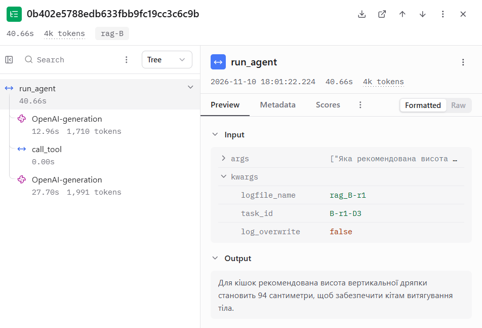
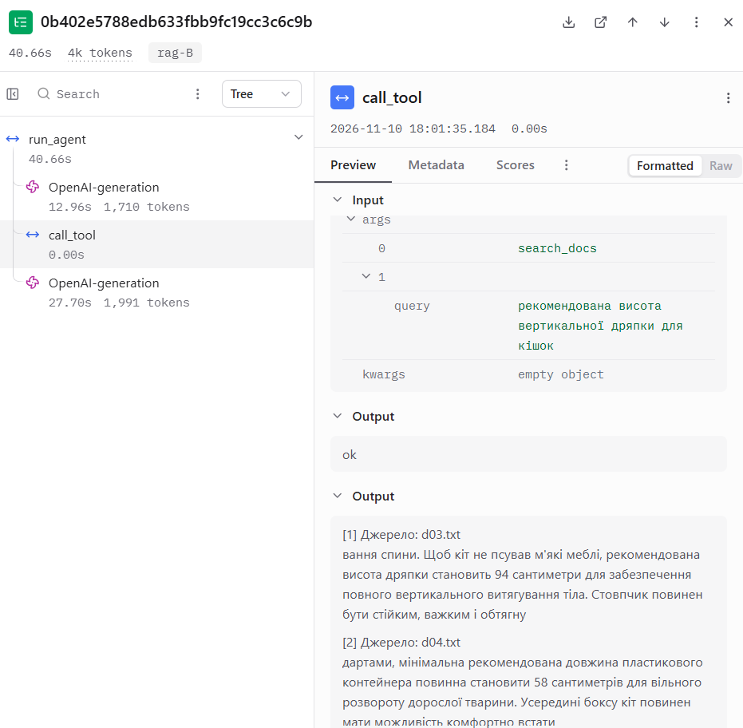
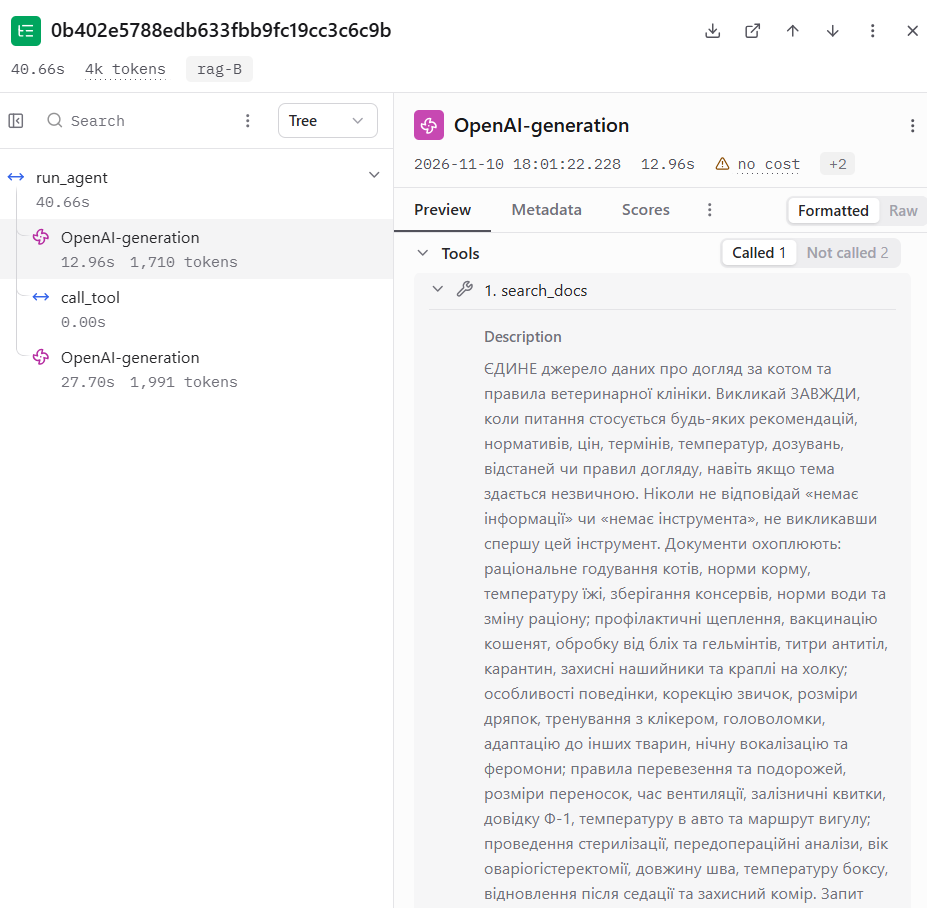
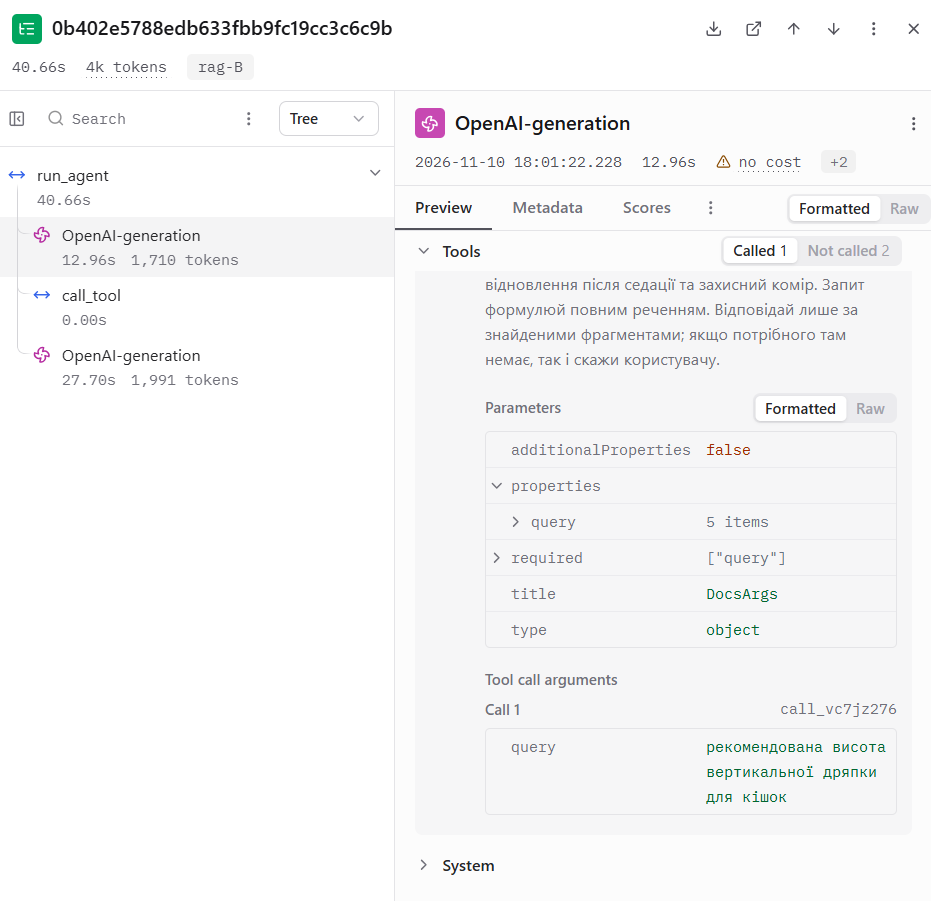
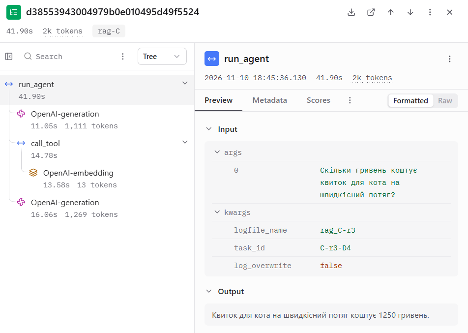
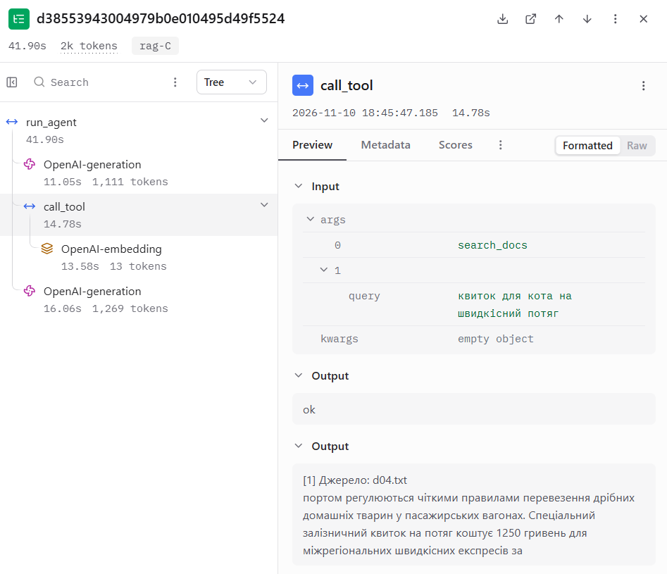
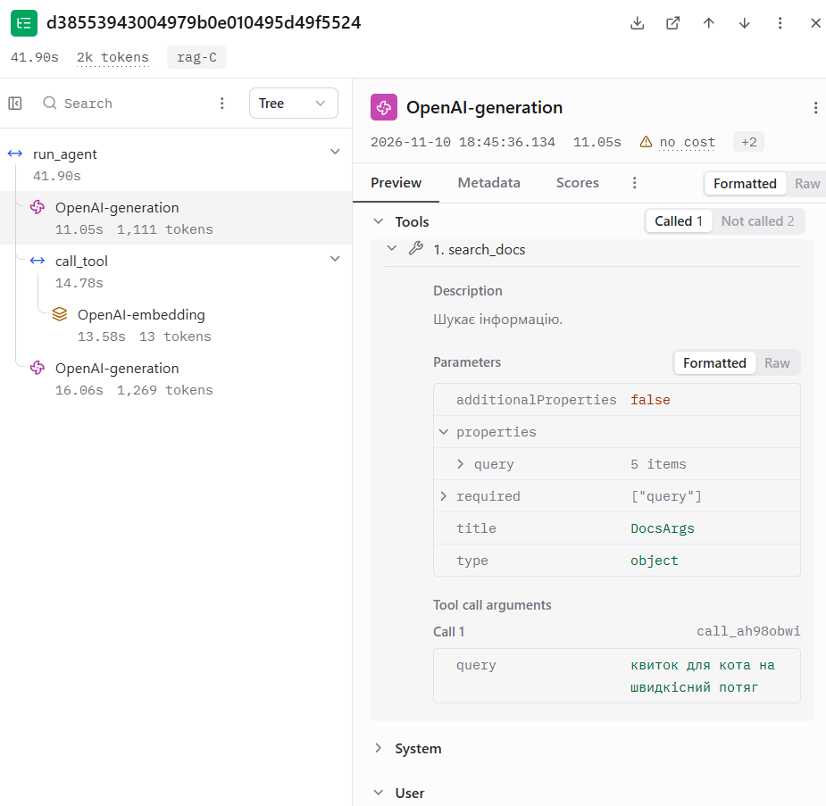
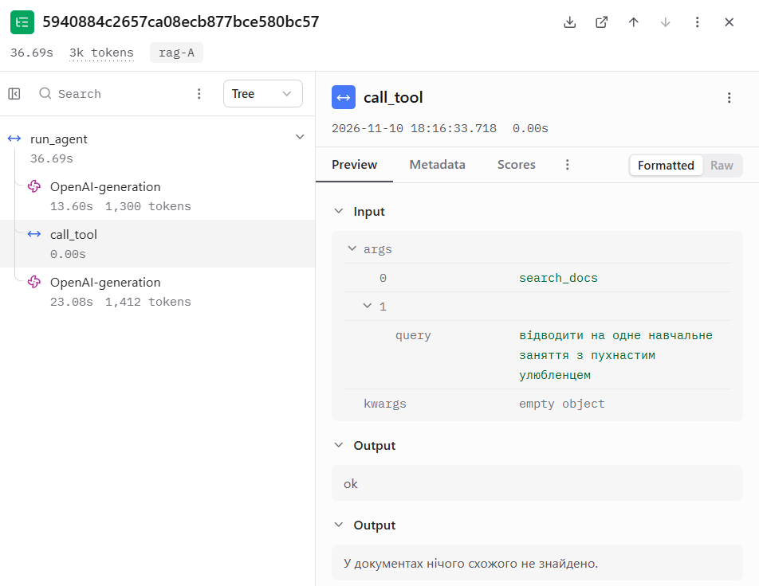

# Лабораторна робота №5

## RAG-агент: пошук по документах як інструмент

**Дисципліна:** Обчислювальні методи

**Варіант:** 10

**Предметна область:** Догляд за котом

**Виконала:** студентка групи АІ-244 Куриленко І. О.

**Перевірив:** ас. Баранов О. М.

Одеса – 2026

---

## Мета роботи

Замінити пошук підрядком векторним пошуком по документах і підключити його до агента як інструмент `search_docs`. Дослідити вплив способу нарізання документів на якість пошуку та обсяг отриманих фрагментів. Підібрати поріг схожості для відсіювання нерелевантних результатів. Порівняти поведінку агента з трьома описами інструмента, проаналізувати помилки за логами й трасами Langfuse та перевірити виконання задач із попередньої роботи.

---

## 1. Підготовка проєкту та вихідні параметри

Основою проєкту є реалізація агента з лабораторної роботи №4. Збережено локальну модель чату, температуру, системне повідомлення, корпус коротких статей, довідник щеплень та п’ять контрольних задач із `tasks.json`.

Інструмент пошуку підрядком `search_articles` замінено на векторний пошук `search_docs`. До корпусу додано п’ять довгих навчальних документів. Інструменти `vaccine_info` та `calc_food` збережено.

Параметри остаточної конфігурації наведено нижче.

| Параметр | Значення |
|---|---|
| Модель чату в Ollama | `qwen25-3k` на основі `qwen2.5:3b` |
| Контекстне вікно | 3072 токени |
| Температура | 0.2 |
| Модель ембедингів | `bge-m3` |
| Розмірність ембедингу | 1024 |
| Векторний індекс | FAISS, `IndexFlatIP` |
| Метрика пошуку | Косинусна схожість через скалярний добуток L2-нормалізованих векторів |
| Каталоги документів | `data/corpus/`, `data/docs/` |
| Спосіб нарізання | `fixed` |
| Розмір чанка | 200 символів |
| Перекриття | 0 символів |
| Додавання заголовка до кожного чанка | Вимкнено |
| `TOP_K` | 3 – максимальна кількість фрагментів до фільтрації |
| `MIN_SCORE` | 0.597 |
| Скорочення історії | Вимкнено: `COMPRESS = "none"` |
| Використання стану | Вимкнено: `USE_STATE = False` |
| Кеш відповідей моделі чату | Вимкнено: `USE_CACHE = False` |
| Трасування | Langfuse |

Розмір контекстного вікна **3072 токени використано за погодженням із викладачем**. Модель чату та розмір вікна збережено з ЛР4. Усі подальші оцінки заповнення контексту виконано для цього значення.

Корпус містить **20 824 символи**. За наближеною оцінкою 2.5 символа на токен це становить близько **8330 токенів**, що перевищує контекстне вікно приблизно у **2.71 раза**. Ця оцінка не є точним підрахунком токенізатора моделі, але показує, чому для роботи з корпусом потрібен пошук окремих фрагментів.

Конфігурацію `fixed-200-0` обрано після порівняння шести способів нарізання: вона має максимальний `hit@3` на контрольних питаннях і найменший оцінений обсяг результату серед конфігурацій із таким самим показником. Поріг `MIN_SCORE = 0.597` підібрано окремо для обраного нарізання. Результати порівняння та калібрування наведено в розділі 5.

Для дослідження впливу опису інструмента використано три варіанти: `A`, `B` і `C`. Кожен опис перевірено на десяти зафіксованих питаннях із трьома повторами – загалом **90 прогонів**. Між цими конфігураціями змінювався лише опис `search_docs`; решта налаштувань залишалася незмінною.

---

## 2. Корпус документів та зафіксовані питання

### 2.1. Підготовка документів

Збережено початковий корпус із 12 коротких статей `a01.TXT`–`a12.TXT` у каталозі `data/corpus/`. Для дослідження нарізання додано п’ять довгих документів у `data/docs/` відповідно до тем варіанта №10.

Кожен новий документ збережено у форматі UTF-8. Перший рядок містить назву, далі розміщено 8 змістових абзаців, розділених порожніми рядками. Обсяг кожного документа становить від 3000 до 4000 символів.

| Файл | Назва документа | Обсяг, символів | Абзаців після заголовка |
|---|---|---:|---:|
| `d01.txt` | Правила раціонального годування котів | 3782 | 8 |
| `d02.txt` | Профілактичні щеплення та захист котів від паразитів | 3944 | 8 |
| `d03.txt` | Особливості поведінки та корекція звичок домашніх котів | 3449 | 8 |
| `d04.txt` | Правила перевезення та подорожей з домашніми котами | 3499 | 8 |
| `d05.txt` | Проведення стерилізації та післяопераційний догляд за котами | 3801 | 8 |
| **Разом нові документи** | | **18 475** | **40** |

Документи містять спеціально задані навчальні значення: тривалість переходу на новий раціон – 13 днів, дія нашийника – 140 днів, висота дряпки – 94 сантиметри, вартість квитка – 1250 гривень та інші числові факти. Ці значення використовуються як умовні дані експерименту, а не як ветеринарні рекомендації.

Разом із початковими статтями корпус містить **17 документів і 20 824 символи**. Обидва каталоги індексуються спільно.

### 2.2. Контрольні питання

У файлі `rag_cases.json` зафіксовано десять питань:

- 4 прямих (`direct`) – використовують ключові слова з документа;
- 4 перефразованих (`paraphrase`) – передають зміст факту іншими словами;
- 2 без відповіді (`none`) – стосуються предметної області, але потрібних даних у корпусі немає.

Для питань із відповіддю поле `must_contain` містить дослівний фрагмент документа, а `expected` – очікуване числове значення. Для питань без відповіді обидва поля мають значення `null`.

| ID | Тип | Питання | `must_contain` | `expected` |
|---|---|---|---|---|
| D1 | `direct` | Скільки днів триває плавний перехід на новий раціон кота? | `перехід триває 13 днів поспіль` | `13` |
| D2 | `direct` | Скільки днів становить захисна дія протипаразитарного нашийника? | `нашийника становить 140 днів` | `140` |
| D3 | `direct` | Яка рекомендована висота вертикальної дряпки для кішок? | `дряпки становить 94 сантиметри` | `94` |
| D4 | `direct` | Скільки гривень коштує квиток для кота на швидкісний потяг? | `потяг коштує 1250 гривень` | `1250` |
| P1 | `paraphrase` | Яку вагу гранул слід відміряти на добу для звичайної кішки? | `раціону становить 47 грамів для` | `47` |
| P2 | `paraphrase` | Яка сума оплати встановлена за лабораторний аналіз напруженості імунітету тварини? | `титру антитіл вартістю 560 гривень` | `560` |
| P3 | `paraphrase` | Скільки часу ветеринари радять відводити на одне навчальне заняття з пухнастим улюбленцем? | `тривати не більше 17 хвилин, щоб` | `17` |
| P4 | `paraphrase` | Протягом скількох діб кішка повинна залишатися у спеціальному конусі після хірургічного втручання? | `комір на термін 14 днів` | `14` |
| N1 | `none` | Скільки гривень коштує чипування кота мікрочипом міжнародного стандарту? | `null` | `null` |
| N2 | `none` | Яка допустима концентрація хлоргексидину у шампуні проти лупи? | `null` | `null` |

Питання, цільові фрагменти та очікувані значення залишалися незмінними під час порівняння конфігурацій.

### 2.3. Перевірка корпусу та питань

Перевірку виконано командою:

```bash
python check_cases.py
```

Отримано результат:

```text
Документів: 17; символів: 20824; приблизно токенів: 8330 (вікно 3072)
Питань: 10 ({'direct': 4, 'paraphrase': 4, 'none': 2})
Усе гаразд
```

Перевірка підтвердила відсутність повторюваних ідентифікаторів, потрібну кількість питань кожного типу та наявність кожної фрази `must_contain` рівно в одному місці корпусу. Кожне значення `expected` міститься у відповідному цільовому фрагменті.

Оцінений обсяг корпусу перевищує контекстне вікно моделі, тому для відповіді агент має отримувати окремі релевантні фрагменти.

### 2.4. Перевірка відповідей без документів

Для попередньої перевірки локальній моделі `qwen25-3k` поставлено три питання без передавання документів.

| Питання | Спостережена відповідь без документів | Значення в корпусі |
|---|---|---|
| Тривалість переходу на новий раціон | Загальна рекомендація: 3–5 днів | 13 днів |
| Вартість аналізу напруженості імунітету | Загальні міркування без конкретної суми | 560 гривень |
| Вартість квитка для кота на швидкісний потяг | Порада уточнити інформацію у перевізника | 1250 гривень |

У цих трьох перевірках модель не відтворила заданих у документах значень. Це підтверджує потребу звертатися до корпусу для отримання саме навчальних фактів. Водночас така мала перевірка не доводить неможливість випадкового вгадування в інших запусках.

---

## 3. Перевірка моделі ембедингів

Для перетворення документів і пошукових запитів на числові вектори використано локальну модель `bge-m3` в Ollama. Перевірку виконано скриптом:

```bash
python embed_check.py
```

Скрипт перевіряє розмірність і норму вектора та порівнює схожість запиту зі змістовно близьким і віддаленим текстами.

| Показник | Отримане значення |
|---|---:|
| Розмірність вектора | 1024 |
| Норма першого вектора | 1.000 |
| Схожість із текстом «Денна норма харчування кота» | 0.801 |
| Схожість із текстом «Графік роботи ветеринарної клініки» | 0.498 |

У цьому прикладі текст про харчування отримав вищу схожість із запитом, ніж текст про графік роботи клініки. Це підтверджує здатність моделі розрізняти змістову близькість наведених українськомовних текстів. Загальну якість пошуку на підготовленому корпусі перевірено окремо в розділі 5.

### Нормалізація векторів

У реалізації пошуку вектори документів і запитів нормалізуються до одиничної L2-норми. Після цього їхній скалярний добуток дорівнює косинусній схожості, тому для пошуку використано індекс FAISS `IndexFlatIP`.

Без нормалізації скалярний добуток залежав би не лише від кута між векторами, а й від їхніх норм. Норма вектора не є прямим вимірюванням довжини тексту.

### Кешування ембедингів

Модуль `embedder.py` зберігає обчислені вектори в `index/embeddings_cache.json`. Ключ кешу формується з назви моделі ембедингів і тексту, тому повторне опрацювання незмінених фрагментів не потребує нового звернення до Ollama.

Цей кеш відрізняється від кешу відповідей чат-моделі: він зберігає векторні представлення текстів і не підміняє повторні генерації агента. Кеш відповідей чат-моделі під час вимірювань вимкнено.

Файл кешу ембедингів не включається до комплекту здачі. Побудований індекс зберігається у файлах `docs.faiss`, `chunks.json` і `meta.json`.

---

## 4. Дослідження способів нарізання тексту на чанки

### 4.1. Реалізація нарізання

У модулі `chunking.py` реалізовано два способи поділу документів:

- `fixed` – фрагменти заданої довжини в символах із можливістю перекриття;
- `paragraphs` – об’єднання сусідніх абзаців, поки їхня сумарна довжина не перевищує заданий розмір. Окремий довший абзац зберігається цілком.

Для кожного чанка зберігаються назва файла `source`, номер `chunk` і текст `text`. У збереженому індексі нумерація чанків починається з 0, а скрипт `show_chunks.py` показує їх із нумерацією від 1.

### 4.2. Порівняння нарізання одного документа

Для дослідження використано документ `data/docs/d01.txt` обсягом 3782 символи.

Виконано команди:

```bash
python show_chunks.py data/docs/d01.txt fixed 200 0
python show_chunks.py data/docs/d01.txt fixed 500 100
python show_chunks.py data/docs/d01.txt paragraphs 800
```

**Таблиця 1 – Нарізання одного документа**

| Спосіб | Кількість чанків | Не закінчуються знаком завершення речення | Найбільша довжина, символів |
|---|---:|---:|---:|
| `fixed-200-0` | 19 | 18 | 200 |
| `fixed-500-100` | 10 | 8 | 500 |
| `paragraphs-800` | 8 | 0 | 499 |

Скрипт визначає можливий розрив речення за останнім символом чанка: перевіряє наявність `.`, `!`, `?`, `…` або `:`. Це спрощена перевірка, яка не виконує повного мовного аналізу речень.

Нарізання за абзацами в цьому документі зберегло природні межі тексту. Фіксована довжина частіше розділяла слова й речення між сусідніми чанками.

### 4.3. Приклади розривів тексту

При `fixed-200-0` межа між чанками 3 і 4 проходить усередині слова «менше».

Кінець чанка 3:

```text
Для підтримки оптимальної м'язової маси та енергетичного балансу сухий раціон повинен містити не ме
```

Початок чанка 4:

```text
нше 38 відсотків протеїну в сухій речовині.
```

У результаті умова «не менше» розділена між двома фрагментами. Якщо пошук поверне лише один із них, модель може отримати неповний контекст числової норми.

Інший приклад – межа між чанками 13 і 14.

Кінець чанка 13:

```text
Рекомендована сумарна норма води на три доби для дорослого кота вагою чотири кілограми станови
```

Початок чанка 14:

```text
ть 840 мілілітрів з урахуванням вологи з їжі.
```

Тут число 840 залишається в одному фрагменті, а пояснення того, до якої норми воно належить, – у попередньому.

Водночас не кожен факт розривається. Цільова фраза питання D1:

```text
перехід триває 13 днів поспіль
```

повністю міститься в чанку 16, який у збереженому індексі має номер 15. Розрив наприкінці цього чанка проходить далі – усередині слова «порівну»: `по` / `рівну`.

Отже, фіксоване нарізання може розділяти змістовно пов’язані частини тексту, проте наслідки залежать від розташування конкретного факту. Тому остаточну конфігурацію обрано за результатами пошуку на контрольних питаннях, наведеними в розділі 5.

---

## 5. Оцінка якості пошуку без агента

### 5.1. Порівняння конфігурацій нарізання

Пошук перевірено окремо від чат-моделі командою:

```bash
python check_retrieval.py
```

Для кожної конфігурації індексувалися всі 17 документів. Якість оцінювалася на восьми питаннях із відповіддю: чотирьох прямих і чотирьох перефразованих.

Показник `hit@k` – частка питань, для яких серед перших `k` результатів є чанк із дослівною фразою `must_contain`. Наприклад, `hit@3 = 1.00` означає, що потрібний фрагмент знайдено серед трьох перших результатів для всіх восьми питань.

На цьому етапі оцінюється ранжування результатів без відсіювання порогом. Питання N1 і N2 використано окремо для калібрування `MIN_SCORE`.

**Таблиця 2 – Якість пошуку при різних способах нарізання**

| Конфігурація | Чанків | Середня довжина, символів | hit@1 | hit@3 | hit@5 | hit@3 прямі | hit@3 перефразовані | Оцінка токенів, k=3 |
|---|---:|---:|---:|---:|---:|---:|---:|---:|
| **`fixed-200-0`** | **111** | **188** | **1.00** | **1.00** | **1.00** | **1.00** | **1.00** | **225** |
| `fixed-500-0` | 50 | 416 | 0.88 | 1.00 | 1.00 | 1.00 | 1.00 | 500 |
| `fixed-500-100` | 60 | 419 | 1.00 | 1.00 | 1.00 | 1.00 | 1.00 | 502 |
| `fixed-1500-0` | 27 | 771 | 0.75 | 0.88 | 1.00 | 1.00 | 0.75 | 926 |
| `paragraphs-800` | 52 | 399 | 1.00 | 1.00 | 1.00 | 1.00 | 1.00 | 479 |
| `paragraphs-800+title` | 52 | 434 | 1.00 | 1.00 | 1.00 | 1.00 | 1.00 | 521 |

Обсяг результату оцінювався як три середні довжини чанка, поділені на 2.5 символа на токен. Розрахунок виконувався до округлення середньої довжини. Це наближена оцінка тексту фрагментів без службового оформлення виклику інструмента.

### 5.2. Вибір остаточної конфігурації

За методичкою обирається конфігурація з найвищим `hit@3`, а за однакових значень – із найменшим обсягом результату.

Максимального `hit@3 = 1.00` досягли п’ять конфігурацій. Серед них найменший оцінений обсяг має **`fixed-200-0` – 225 токенів**. Тому для подальших вимірювань встановлено:

```python
CHUNK_METHOD = "fixed"
CHUNK_SIZE = 200
CHUNK_OVERLAP = 0
WITH_TITLE = False
TOP_K = 3
```

На цьому наборі питань збільшення розміру фіксованого чанка до 1500 символів супроводжувалося зниженням загального `hit@3` до 0.88. Для прямих питань показник залишився 1.00, а для перефразованих становив 0.75.

Додавання перекриття до `fixed-500` підвищило `hit@1` з 0.88 до 1.00, але не змінило `hit@3`. Додавання заголовків до `paragraphs-800` не покращило показників на цих питаннях і збільшило оцінку обсягу результату з 479 до 521 токена.

Ці спостереження стосуються підготовленого корпусу та восьми контрольних питань. Вони не доводять перевагу одного способу нарізання для будь-яких документів.

### 5.3. Підбір порогу схожості

Навіть для питання без відповіді векторний пошук знаходить найближчі чанки. Для відсіювання недостатньо схожих результатів використано поріг `MIN_SCORE`.

Для обраної конфігурації виконано:

```bash
python check_retrieval.py scores
```

**Таблиця 3 – Схожість першого результату для початкових контрольних питань**

| ID | Тип | Схожість першого результату | Перший результат містить `must_contain` |
|---|---|---:|---|
| D1 | `direct` | 0.710 | Так |
| D2 | `direct` | 0.710 | Так |
| D3 | `direct` | 0.759 | Так |
| D4 | `direct` | 0.720 | Так |
| P1 | `paraphrase` | 0.598 | Так |
| P2 | `paraphrase` | 0.661 | Так |
| P3 | `paraphrase` | 0.633 | Так |
| P4 | `paraphrase` | 0.603 | Так |
| N1 | `none` | 0.596 | Не застосовується |
| N2 | `none` | 0.466 | Не застосовується |

Значення в таблиці округлено до трьох знаків після крапки. Найнижча схожість серед питань із відповіддю становить приблизно 0.598, а найвища серед питань без відповіді – приблизно 0.596.

Для подальшої роботи встановлено:

```python
MIN_SCORE = 0.597
```

Чанк передається агенту, якщо його схожість не нижча за цей поріг. Якщо жоден із перших трьох результатів не проходить фільтрацію, інструмент повертає:

```text
У документах нічого схожого не знайдено.
```

На початкових десяти питаннях обраний поріг зберігає потрібні фрагменти для всіх восьми питань із відповіддю та відсіює результати для N1 і N2.

Водночас проміжок між групами дуже вузький. Поріг підібрано на цьому самому малому наборі питань, тому отримане розділення не гарантує такої самої якості на нових або переформульованих запитах.

### 5.4. Побудова остаточного індексу

Після вибору нарізання та порога виконано:

```bash
python build_index.py
```

Остаточний індекс містить **111 чанків**. У каталозі `index/` збережено:

- `docs.faiss` – векторний індекс;
- `chunks.json` – тексти чанків, назви джерел і номери;
- `meta.json` – параметри побудови індексу.

Наведені в таблиці 3 оцінки отримано для початкових питань із `rag_cases.json`. Під час роботи агент може змінювати формулювання пошукового запиту, тому фактичні значення схожості та результат фільтрації можуть відрізнятися. Такий випадок розглянуто в розділі 8.

---

## 6. Перевірка інструмента через диспетчер без моделі

Перед вимірюванням агента інструмент `search_docs` перевірено без участі чат-моделі. Скрипт `try_tool.py` передає виклик через той самий диспетчер `call_tool`, який використовується агентом.

Перевірку виконано командами:

```bash
python try_tool.py D1
python try_tool.py N1
```

### 6.1. Питання з відповіддю

Для питання D1 пошук повернув фрагмент документа `d01.txt`, що містить очікуване значення 13 днів.

Фрагмент виводу:

```text
ПИТАННЯ: Скільки днів триває плавний перехід на новий раціон кота?

рівень: ok
[1] Джерело: d01.txt
едбачає, що плавний перехід триває 13 днів поспіль шляхом поступового підмішування нових гранул до старого корму. У перші чотири дні додають лише чверть нової суміші, наступні чотири дні згодовують по
```

Початок і кінець тексту обірвані через нарізання по 200 символів без перекриття. Водночас цільова фраза `перехід триває 13 днів поспіль` повністю міститься в результаті.

### 6.2. Питання без відповіді

Для питання N1 отримано:

```text
ПИТАННЯ: Скільки гривень коштує чипування кота мікрочипом міжнародного стандарту?

рівень: ok
У документах нічого схожого не знайдено.
```

Перші результати пошуку не пройшли фільтрацію за порогом `MIN_SCORE = 0.597`.

Статус `ok` означає, що інструмент успішно виконався. Він не означає, що відповідь обов’язково знайдено: порожній результат пошуку також є коректним результатом роботи інструмента.

### 6.3. Перевірка невалідних аргументів

Для закороткого запиту `query: "а"` отримано:

```text
Занадто короткий запит -> рівень: schema
Помилка: аргументи не пройшли перевірку.
Поле query: String should have at least 3 characters
Виправ аргументи і виклич інструмент ще раз.
```

Диспетчер відхилив аргументи на рівні схеми Pydantic до виконання пошуку.

Таким чином, наведені перевірки підтвердили три сценарії: повернення потрібного фрагмента, повідомлення про відсутність результатів після фільтрації та відхилення невалідного запиту. Вибір інструмента й формулювання запиту самою моделлю досліджуються в наступних розділах.

---

## 7. Експерименти з агентом за трьох описів інструмента

### 7.1. Умови проведення експерименту

Поведінку агента перевірено з трьома описами інструмента `search_docs`:

| Опис | Зміст |
|---|---|
| A | Опис пошуку статей про догляд за котом із прикладами проблем зі здоров’ям, поведінкою та годуванням |
| B | Розгорнутий перелік тем документів із вимогою звертатися до пошуку для отримання норм, цін, термінів та правил і відповідати за знайденими фрагментами |
| C | Мінімальний опис: «Шукає інформацію.» |

Між конфігураціями змінювався лише текст опису `search_docs` у схемі інструментів. Модель, температура, системне повідомлення, документи, питання, інші інструменти та параметри пошуку залишалися незмінними.

Кожен опис перевірено на десяти питаннях із трьома повторами:

```text
3 описи × 3 повтори × 10 питань = 90 прогонів
```

Для кожного опису отримано 24 прогони питань із відповіддю та 6 прогонів питань без відповіді.

Початкові автоматичні оцінки збережено у [results/rag.csv](results/rag.csv), уточнені оцінки з повними відповідями й поясненнями – у [results/rag_reviewed.csv](results/rag_reviewed.csv). Підсумки наведено у [results/summary_reviewed.txt](results/summary_reviewed.txt).

### 7.2. Підсумкові показники

**Таблиця 5 – Результати за описами інструмента**

| Опис | Правильно на питаннях із відповіддю | Звертався до пошуку | Кроків, медіана | Вхідних токенів, медіана | Час, с, медіана |
|---|---:|---:|---:|---:|---:|
| A | 2/24 (8.3%) | 3/24 | 2.0 | 2586 | 37.55 |
| B | 1/24 (4.2%) | 1/24 | 1.5 | 2546 | 22.35 |
| C | 2/24 (8.3%) | 2/24 | 2.0 | 2262 | 49.55 |

Правильність і звернення до пошуку в таблиці стосуються лише 24 прогонів питань із відповіддю. Медіани кроків, токенів і часу обчислено за всіма 30 прогонами відповідного опису.

Вхідні токени – це сума `prompt_tokens` усіх викликів моделі в одному прогоні. Вона не є розміром одного запиту та може перевищувати контекстне вікно без його переповнення в окремому виклику.

### 7.3. Помилки на питаннях із відповіддю

Для восьми питань із відповіддю використано категорії:

- `ok` – відповідь відповідає цільовому факту;
- `no_search` – агент не викликав `search_docs` і не дав правильної відповіді;
- `miss` – пошук викликано, але потрібного фрагмента немає у повернених результатах;
- `ignored` – потрібний фрагмент повернуто, але відповідь неправильна.

**Таблиця 6 – Розподіл результатів на питаннях із відповіддю**

| Категорія | A | B | C |
|---|---:|---:|---:|
| `ok` | 2 | 1 | 2 |
| `no_search` | 21 | 23 | 22 |
| `miss` | 1 | 0 | 0 |
| `ignored` | 0 | 0 | 0 |
| **Разом** | **24** | **24** | **24** |

Найчастішою помилкою в усіх трьох описах була відсутність виклику `search_docs`.

Для детальнішого аналізу випадки `no_search` поділено на взаємовиключні підтипи.

**Таблиця 6а – Деталізація випадків `no_search`**

| Підтип | A | B | C |
|---|---:|---:|---:|
| Неправильний інструмент (`wrong_tool`) | 17 | 13 | 16 |
| Порожня відповідь без виклику інструментів (`empty_response`) | 1 | 10 | 1 |
| Пряма відповідь без інструментів (`direct_answer`) | 3 | 0 | 5 |
| Зупинка за лімітом повторних спроб (`retry_limit`) | 0 | 0 | 0 |
| **Разом `no_search`** | **21** | **23** | **22** |

У випадках `wrong_tool` модель зверталася до `vaccine_info` або `calc_food`, хоча для відповіді потрібні були факти з документів.

Єдиний випадок `miss` зафіксовано у прогоні `A-r2-P3`. Модель скоротила пошуковий запит, і найвища схожість результату становила 0.589 – нижче порога 0.597. Інструмент повернув повідомлення про відсутність результатів.

У решті п’яти прогонів із викликом пошуку потрібний фрагмент було повернуто й використано у відповіді. Отже, серед шести прогонів із пошуком успішними були п’ять. Ця мала підвибірка не дає підстав вважати пошук безпомилковим на інших запитах.

### 7.4. Результати на питаннях без відповіді

Початкова автоматична перевірка визначала відмову за набором фраз. Усі інші результати на питаннях N1 і N2 отримували категорію `invented`, включно з порожніми відповідями та зупинками за лімітом.

Тому виконано перевірку повних відповідей і розділено такі результати:

- `refused` – модель визнала відсутність потрібної інформації;
- `wrong_tool` – модель підмінила предмет питання, наприклад шукала мікрочип у довіднику щеплень;
- `technical_failure` – прогін завершився за лімітом повторних спроб;
- `empty_response` – модель завершила прогін без тексту відповіді;
- `invented` – відповідь містила вигадані або спотворені твердження.

**Таблиця 6б – Уточнені результати на питаннях без відповіді**

| Категорія | A | B | C |
|---|---:|---:|---:|
| `refused` | 0 | 0 | 2 |
| `wrong_tool` | 1 | 0 | 2 |
| `technical_failure` | 3 | 1 | 1 |
| `empty_response` | 0 | 5 | 0 |
| `invented` | 2 | 0 | 1 |
| **Разом** | **6** | **6** | **6** |

У жодному з 18 прогонів N1/N2 агент не викликав `search_docs`. Тому ці прогони не демонструють захисної дії порога схожості: до пошуку модель не звернулася. Відсіювання початкових питань N1 і N2 підтверджено окремими перевірками без агента.

Для опису B зафіксовано одну зупинку за лімітом та п’ять порожніх відповідей. Їх не зараховано як вигадування фактів.

### 7.5. Правила уточнення неоднозначних відповідей

Оцінювання окремих відповідей потребувало змістовної інтерпретації. Прийняті рішення збережено у полі `review_reason` файла `rag_reviewed.csv`.

У прогоні `C-r1-N2` модель визнала брак даних, але додала незрозуміле визначення «хлоргексидин – це суперантий» і твердження про його застосування. За прийнятим правилом таку відповідь віднесено до `invented` як відмову зі спотвореним поясненням.

У `C-r2-N2` та `C-r3-N2` модель також не назвала концентрацію й повідомила, що потрібної інформації немає, відсилаючи до спеціаліста, довідників або упаковки. Попри незграбні формулювання, ці відповіді зараховано як `refused`.

Випадки `A-r1-N1`, `C-r1-N1` та `C-r3-N1` віднесено до `wrong_tool`: модель трактувала чипування як щеплення. Перелік вакцин із довідника сам по собі не є вигадуванням, але відповідь про відсутність мікрочипа серед щеплень не відповідає предмету питання про вартість чипування.

Отже, підсумки для питань без відповіді залежать від явно наведеного правила змістовного оцінювання. Відсутність виклику пошуку сама по собі не робить відмову неправильною.

### 7.6. Порівняння описів і висновки експерименту

На питаннях із відповіддю описи A і C дали по 2 правильні результати з 24, а B – 1 із 24. У цій серії розгорнутий опис B не збільшив частоту звернення до пошуку та кількість правильних відповідей.

Опис B мав найменший медіанний час – 22.35 с. Водночас швидше завершення не означає кращої якості: для цього опису зафіксовано багато порожніх відповідей.

За прийнятими правилами уточненого оцінювання загальна кількість успішних результатів, включно з відмовами на питаннях без відповіді, становила:

| Опис | Правильні фактичні відповіді | Коректні відмови | Разом успішних |
|---|---:|---:|---:|
| A | 2 | 0 | 2/30 (6.7%) |
| B | 1 | 0 | 1/30 (3.3%) |
| C | 2 | 2 | 4/30 (13.3%) |

Основною спостереженою проблемою був вибір інструмента або відсутність змістовної відповіді. Водночас випадок `A-r2-P3` показав окреме обмеження пошуку: поріг, підібраний на початкових питаннях, може відсікти результати після переформулювання запиту агентом.

Висновки обмежені десятьма питаннями, трьома повторами та використаною локальною моделлю. За цими результатами не можна стверджувати, що короткий або довгий опис інструмента завжди є кращим.

---

## 8. Розбір прогонів у логах і трасах Langfuse

Для пояснення результатів використано текстові логи `logs/rag_*.log` та відповідні траси Langfuse. Кожен прогін має ідентифікатор виду `B-r1-D3`, а назва його траси – `rag-B-r1-D3`.

### 8.1. Успішний пошук з описом B

У прогоні `B-r1-D3` користувач запитав:

```text
Яка рекомендована висота вертикальної дряпки для кішок?
```

Модель сформувала виклик:

```json
{"query": "рекомендована висота вертикальної дряпки для кішок"}
```

Інструмент `search_docs` повернув два фрагменти, що пройшли поріг. Перший – із `d03.txt` – містив потрібний факт:

```text
рекомендована висота дряпки становить 94 сантиметри
```

Другий фрагмент із `d04.txt` стосувався довжини контейнера для перевезення та містив інше значення – 58 сантиметрів. Модель використала факт про дряпку й відповіла:

```text
Для кішок рекомендована висота вертикальної дряпки становить 94 сантиметри, щоб забезпечити кітам витягування тіла.
```

Найвища схожість для фактичного запиту моделі становила **0.744**, що перевищує поріг 0.597. Значення відрізняється від 0.759 у таблиці 3, оскільки там перевірялося початкове питання користувача.

На рисунку 1 показано дерево прогону: перша генерація моделі, виклик інструмента та друга генерація з фінальною відповіддю. Загальний час траси становив 40.66 с.



*Рисунок 1 – Дерево виконання агента для опису B, питання D3*

На рисунку 2 видно аргумент `query`, успішний статус виконання `ok` та повернені фрагменти.



*Рисунок 2 – Запит і результати інструмента `search_docs` у прогоні B-r1-D3*

### 8.2. Опис інструмента B у вході моделі

У першій генерації прогону `B-r1-D3` відкрито опис `search_docs`, переданий моделі. Він містить перелік тем документів, вимогу звертатися до пошуку для отримання норм, цін і термінів та вказівку відповідати за знайденими фрагментами.

Початок опису показано на рисунку 3, а завершення з правилами використання результатів – на рисунку 4.



*Рисунок 3 – Початок розгорнутого опису інструмента B*



*Рисунок 4 – Завершення опису B та аргумент сформованого виклику*

Цей прогін підтверджує, що модель отримала опис B і звернулася до потрібного інструмента. Проте результати всієї серії з розділу 7 показують, що такий опис не забезпечив правильного вибору інструмента в більшості інших прогонів.

### 8.3. Успішний пошук з описом C

У прогоні `C-r3-D4` користувач поставив питання:

```text
Скільки гривень коштує квиток для кота на швидкісний потяг?
```

Модель скоротила його до пошукового запиту:

```json
{"query": "квиток для кота на швидкісний потяг"}
```

Найвища схожість становила **0.655**. Пошук повернув фрагмент `d04.txt` із ціною 1250 гривень. Фінальна відповідь:

```text
Квиток для кота на швидкісний потяг коштує 1250 гривень.
```

Дерево прогону наведено на рисунку 5. Усередині `call_tool` видно окремий виклик обчислення ембедингу. Загальний час траси становив 41.90 с.



*Рисунок 5 – Дерево виконання агента для опису C, питання D4*

На рисунку 6 показано пошуковий запит і фрагмент із потрібною ціною.



*Рисунок 6 – Запит і результат `search_docs` у прогоні C-r3-D4*

Опис інструмента в цій конфігурації складається лише з речення «Шукає інформацію.», що видно на рисунку 7.



*Рисунок 7 – Мінімальний опис інструмента C у вході моделі*

Отже, у цьому конкретному прогоні навіть мінімального опису вистачило для правильного виклику пошуку. Це не означає його загальної переваги: на питаннях із відповіддю конфігурація C мала лише 2 успішні результати з 24.

### 8.4. Порівняння запитів користувача та моделі

Модель не завжди передавала питання до пошуку дослівно. Приклади зі збережених прогонів наведено нижче.

| Прогін | Початкове питання | `query` моделі | `top_score` | Результат |
|---|---|---|---:|---|
| `B-r1-D3` | Яка рекомендована висота вертикальної дряпки для кішок? | рекомендована висота вертикальної дряпки для кішок | 0.744 | Факт знайдено, відповідь 94 см |
| `C-r3-D4` | Скільки гривень коштує квиток для кота на швидкісний потяг? | квиток для кота на швидкісний потяг | 0.655 | Факт знайдено, відповідь 1250 грн |
| `A-r2-P3` | Скільки часу ветеринари радять відводити на одне навчальне заняття з пухнастим улюбленцем? | відводити на одне навчальне заняття з пухнастим улюбленцем | 0.589 | Усі результати відсіяно порогом |

У перших двох випадках скорочений запит зберіг достатньо інформації для пошуку. У третьому випадку результат для скороченого формулювання не пройшов поріг.

### 8.5. Пошук викликано, але відповідь не знайдено: `miss`

У прогоні `A-r2-P3` для запиту моделі найвища схожість становила **0.589**, що нижче встановленого порога **0.597**. Інструмент успішно виконався, але повернув:

```text
У документах нічого схожого не знайдено.
```

Запит і результат показано на рисунку 8.



*Рисунок 8 – Відсіювання результатів пошуку у прогоні A-r2-P3*

Після цього модель відповіла:

```text
Не знайшов ніякої інформації про те, скільки часу ветеринари радять відводити на одне навчальне заняття з пухнастим улюбленцем. Будь ласка, перевірте правильність запиту.
```

У документі відповідь є, але агент її не отримав. Тому результат віднесено до `miss`.

Для початкового питання P3 пошук без агента давав схожість приблизно 0.633. Після скорочення запиту найвища схожість стала 0.589. Цей приклад показує, що поріг, підібраний на початкових питаннях, не гарантує збереження відповіді для запитів, переформульованих моделлю.

Причиною відсутності фрагментів у цьому прогоні було відсіювання за порогом, а не переповнення контекстного вікна.

### 8.6. Агент не звернувся до пошуку: `no_search`

На питаннях із відповіддю зафіксовано 21 випадок `no_search` для опису A, 23 – для B і 22 – для C.

Логи показують різну поведінку: модель викликала `vaccine_info` або `calc_food` замість пошуку документів, відповідала без інструментів або завершувала прогін порожньою відповіддю. Тому відсутність пошуку не означає, що в кожному такому випадку модель вигадала конкретне число.

Приклад підміни сутності також видно на питанні без відповіді `C-r3-N1`: замість пошуку ціни чипування модель зверталася до `vaccine_info` з назвою `Microchip implant`. Фінальний текст повідомляв про відсутність такого щеплення та перелічував доступні вакцини.

Цей випадок віднесено до `wrong_tool` серед питань без відповіді. Він не включається до 24 прогонів питань із відповіддю та їхнього підрахунку `no_search`.

### 8.7. Знайдений фрагмент не використано: `ignored`

У поточній серії випадків `ignored` не зафіксовано. У п’яти прогонах, де пошук повернув цільовий фрагмент, модель правильно використала потрібне числове значення.

Тому окремого прикладу `ignored` для цієї серії немає. Це спостереження стосується лише збережених прогонів і не означає, що модель завжди правильно використовуватиме знайдений текст.

### 8.8. Питання без відповіді та роль захистів

У всіх 18 прогонах N1/N2 модель не викликала `search_docs`. Отже, поріг схожості не міг вплинути на відповіді в цих прогонах.

Окрема перевірка пошуку підтвердила, що початкові N1 і N2 відсікаються порогом. Проте для використання цього захисту агент спочатку має звернутися до інструмента.

Текст опису також не гарантував коректної відмови. Зокрема, вимога опису B спочатку виконувати пошук не була дотримана на N1/N2: отримано одну зупинку за лімітом спроб і п’ять порожніх відповідей.

### 8.9. Що показує Langfuse

У дереві Langfuse одразу видно порядок викликів моделі та інструментів, їхню вкладеність, тривалість і витрати токенів. Для `call_tool` можна окремо переглянути запит і результат, а для генерації – опис інструмента, який отримала модель.

Текстові логи зручні для точного цитування відповідей і перевірки послідовності кроків. Однак для зіставлення кількох викликів у них потрібно вручну знаходити відповідні записи. Траси доповнюють логи наочним відображенням структури виконання.

---

## 9. Звичайні задачі після заміни пошуку

### 9.1. Умови порівняння

Для перевірки поведінки агента після заміни пошуку виконано п’ять незмінених задач із `tasks.json`.

Порівняно два контрольні прогони:

- **Базовий агент із пошуком ЛР4** – повторний запуск із `search_articles`. Результати збережено в [logs/run_lab4_full.log](logs/run_lab4_full.log).
- **Агент ЛР5** – запуск із `search_docs`, описом B, нарізанням `fixed-200-0`, `TOP_K = 3` та `MIN_SCORE = 0.597`. Результати збережено в [logs/run_rag.log](logs/run_rag.log).

В обох випадках використано модель `qwen25-3k`, контекст 3072 токени та температуру 0.2. Файл `run_lab4_full.log` є повторним контрольним прогоном базового агента, а не історичним логом первинного виконання ЛР4.

Ідентифікатори P1 і P2 у цьому розділі належать задачам із `tasks.json`, а не перефразованим питанням із `rag_cases.json`.

### 9.2. Результати виконання

**Таблиця 7 – П’ять задач до і після заміни пошуку**

| Задача | Очікуваний результат | Базовий агент із пошуком ЛР4 | Агент ЛР5 | Чи викликав `search_docs` у ЛР5 |
|---|---|---|---|---|
| Z1. Кіт дряпає меблі | Стаття з корпусу та порада | `search_articles` знайшов потрібну статтю. Модель порадила кігтеточку, але додала значний обсяг незрозумілого тексту та не навела явно назву статті | Викликав `vaccine_info({})`. Після помилки відповів про раціон і щеплення без пошуку статті | Ні |
| Z2. Вік і ціна першого комплексного щеплення | 2 місяці, 650 грн | Після помилки англійської назви виправив виклик на `комплексне` та повідомив правильні вік і ціну | Передав назву `First Complex Vaccination`, отримав помилку та процитував підказку замість відповіді | Ні |
| Z3. Корм коту вагою 5 кг на 30 днів | 3750 г за навчальною нормою 25 г/кг на добу | Викликав `calc_food` і правильно відповів: 3750 грамів | Викликав `calc_food` і правильно відповів: 3750 г | Ні |
| P1. Кіт проковтнув гумку | Повідомлення про відсутність статті та порада звернутися до ветеринара | Пошук не знайшов статей. Модель повідомила про це й порадила консультацію ветеринара | Викликав `vaccine_info({})`, а потім відповів про відсутність «щеплення гумки» | Ні |
| P2. Запис кота на щеплення в п’ятницю | Відмова через недоступність запису | Звертався до довідника щеплень і відповів, що кота можна записати на панлейкопенію в п’ятницю. Очікуваної відмови немає | Завершив прогін порожньою відповіддю | Ні |

### 9.3. Аналіз змін

У задачі Z3 робота калькулятора збереглася. В обох прогонах модель передала вагу 5 кг, тривалість 30 днів і навчальну норму 25 г/кг на добу та отримала:

```text
3750 г
```

У задачі Z2 базовий агент виправив невідому назву щеплення після підказки диспетчера. Агент ЛР5 не виконав повторного коректного виклику й переніс службову підказку у фінальну відповідь. Ця помилка стосується використання довідника та самовиправлення моделі, а не якості векторного індексу.

У задачах Z1 і P1 агент ЛР5 помилково обрав `vaccine_info` замість пошуку документів. Оскільки `search_docs` не викликався, за цими прогонами не можна стверджувати, що потрібні фрагменти не знайшов саме векторний пошук.

Базова відповідь Z1 теж мала недоліки: поряд із доречною порадою про кігтеточку містила повтори й незрозумілі рекомендації. Тому її не слід вважати повністю якісним виконанням задачі.

У задачі P2 жоден агент не сформував очікуваної відмови. Базова модель обговорювала можливість запису та дані щеплення, хоча фактичного запису інструментом не виконано. Модель ЛР5 повернула порожній текст.

Отже, у контрольному прогоні після заміни пошуку зберігся правильний розрахунок корму, але погіршилося виконання низки інших задач. Спостережені помилки пов’язані з вибором інструмента, обробкою його помилок і формуванням фінальної відповіді.

Порівняння виконано по одному разу для кожної задачі в кожній конфігурації. Воно показує поведінку в конкретних прогонах, але не дозволяє визначити стабільну частоту помилок або довести єдину причину відмінностей.

---

## 10. Відповіді на контрольні питання

**1. На скільки відрізнялося нарізання за кількістю символів від нарізання за абзацами? Наведіть приклад розрізаного факту.**

За таблицею 1, `fixed-200-0` утворив 19 чанків, із яких 18 не закінчувалися знаком завершення речення; `paragraphs-800` утворив 8 чанків без таких обривів. На межі чанків 13 і 14 пояснення норми води відокремлено від значення 840 мілілітрів, тому повернення лише одного фрагмента може позбавити модель потрібного контексту.

**2. Яка конфігурація виявилася найкращою за правилом вибору? Як вплинули розмір, перекриття та заголовок?**

За таблицею 2 обрано `fixed-200-0`: серед п’яти конфігурацій із `hit@3 = 1.00` вона мала найменший оцінений обсяг видачі – 225 токенів. Для `fixed-1500-0` обсяг зріс до 926 токенів, а `hit@3` знизився до 0.88; перекриття у `fixed-500` покращило `hit@1`, тоді як додавання заголовків до `paragraphs-800` збільшило обсяг без покращення hit rate.

**3. Чи відрізняється hit@3 для прямих і перефразованих питань?**

Для обраного `fixed-200-0` обидва показники дорівнюють 1.00, але для `fixed-1500-0` вони становлять 1.00 та 0.75 відповідно (таблиця 2). Отже, на цьому наборі векторний пошук знаходив факти й за перефразованими питаннями; кількісної переваги над пошуком підрядком окремим порівняльним вимірюванням не встановлювали.

**4. Чи розділяє MIN_SCORE питання з відповіддю й без неї? Що буде за надто високого або низького порога?**

На початкових питаннях поріг 0.597 розділив групи: мінімальна схожість питань із відповіддю становила приблизно 0.598, максимальна без відповіді – 0.596 (таблиця 3). Завищений поріг може відкинути потрібний результат, як у `A-r2-P3` зі схожістю 0.589, а занижений – пропустити сторонні фрагменти.

**5. Який опис дав найбільше правильних відповідей і як часто агент не шукав?**

На питаннях із відповіддю A і C дали по 2 правильні результати з 24, B – 1 із 24; кількість `no_search` становила 21, 22 і 23 відповідно (таблиці 5 і 6). Попри перелік тем і вимогу обов’язкового пошуку в описі B, у цій серії він не покращив звернення до інструмента; з урахуванням уточнених відмов найбільше успішних результатів мав C – 4/30.

**6. Яка категорія помилок найчастіша? Чи можна її виправити описом інструмента?**

Найчастішою була `no_search`: модель обирала інший інструмент, відповідала напряму або повертала порожній текст (таблиця 6а). Зміна опису може впливати на вибір інструмента, але ці прогони не показали достатнього покращення; налаштування ретривера не усуває ситуацію, коли його взагалі не викликають.

**7. У скількох прогонах на питаннях без відповіді зафіксовано вигадування? Які захисти спрацювали?**

За уточненим оцінюванням `invented` отримали 3 із 18 прогонів: два з описом A та один неоднозначний випадок із C; порожні відповіді й технічні збої рахувалися окремо (таблиця 6б). Поріг перевірено без агента, але на N1/N2 агент жодного разу не викликав `search_docs`, тому його захисну дію в цих прогонах не спостерігали; текст опису також не гарантував коректної відмови.

**8. Скільки токенів додає виклик search_docs і скільки циклів може вміститися у вікно?**

У `B-r1-D3` вхід зріс із 1667 до 1932 токенів, тобто на 265; ця різниця включає виклик інструмента, два повернені фрагменти та службове оформлення, тоді як оцінка 225 токенів у таблиці 2 стосується лише тексту трьох середніх чанків. За умовного резерву 300 токенів на відповідь і сталого приросту 265 токенів оцінка становить `floor((3072 − 1667 − 300) / 265) = 4` додаткові цикли з пошуком після початкового входу; це приблизна межа, оскільки довжина наступних результатів і повідомлень змінюється.

**9. Чи зламав новий пошук якісь зі звичайних задач?**

У контрольному прогоні ЛР5 правильно виконано Z3, тоді як у Z1 і P1 модель обрала довідник щеплень замість пошуку, а в Z2 не виправила невдалий виклик (таблиця 7). Оскільки `search_docs` не викликався в жодній із п’яти задач, ці результати показують проблеми поведінки агента після зміни конфігурації, але не доводять помилки самого векторного індексу.

**10. Яку поламку не усуне сама зміна опису інструмента? Що варто змінити?**

Опис інструмента не відновить зміст, втрачений через розрив факту між чанками, і не змінить правило відсіювання результатів у вже виконаному виклику пошуку. Для подібного до `A-r2-P3` випадку варто перевірити повторний пошук із повним початковим питанням, альтернативне формулювання або інший поріг; такі зміни потрібно оцінювати окремим експериментом.

---

## 11. Відповіді на питання для захисту

**1. Чому модель сама не знає вмісту документів? Чому не можна передати їх усі в контекст?**

Документи містять спеціально задані навчальні факти, а модель не отримує доступу до локальних файлів автоматично. Обсяг корпусу – 20 824 символи, або приблизно 8330 токенів за прийнятою оцінкою, що перевищує вікно 3072 токени приблизно у 2.71 раза. Пошук дозволяє передавати лише відібрані фрагменти.

**2. Що таке ембединг? Чому для документів і запитів використовують одну модель?**

Ембединг – числовий вектор, який представляє зміст тексту. У цій роботі `bge-m3` формує вектори з 1024 компонентів. Одна модель для запитів і документів забезпечує сумісність їхніх представлень, щоб можна було порівнювати схожість.

**3. Що таке косинусна схожість і навіщо нормалізувати вектори?**

Косинусна схожість визначається через кут між векторами: їхній скалярний добуток ділиться на добуток норм. Після нормалізації до одиничної довжини скалярний добуток уже дорівнює косинусній схожості, що дозволяє використовувати `IndexFlatIP`. Без нормалізації результат скалярного добутку залежав би також від норм векторів.

**4. Що таке чанк і як його розмір впливає на пошук?**

Чанк – фрагмент документа, який індексується та повертається пошуком. Надто малий фрагмент може втратити пояснення факту або розділити речення, а великий – містити зайву інформацію та займати більше контексту. У цій роботі `fixed-200-0` обрано за результатами контрольних питань і найменшим оціненим обсягом видачі серед конфігурацій із максимальним `hit@3`.

**5. Чому пошук повертає k результатів навіть без відповіді? Як цього уникнути?**

Індекс знаходить найближчі вектори, але сам факт близькості не гарантує наявності відповіді. Якщо в індексі достатньо чанків, він повертає `k` сусідів навіть для стороннього запиту. Поріг `MIN_SCORE` відкидає недостатньо схожі результати, проте потребує перевірки на конкретних даних.

**6. Що таке hit rate і навіщо перевіряти пошук окремо від агента?**

`Hit@k` – частка питань, для яких потрібний фрагмент потрапив до перших `k` результатів. Окрема перевірка показує можливості пошуку без впливу вибору інструмента та генерації відповіді моделлю. Так можна розрізнити випадки «не шукав», «не знайшов» і «знайшов, але не використав».

**7. Навіщо відкидати номер −1 і зберігати параметри в meta.json?**

FAISS може повернути `−1` замість відсутнього сусіда, якщо запитано більше результатів, ніж є в індексі. Без перевірки Python використав би цей номер як звернення до останнього елемента списку. Файл `meta.json` дозволяє виявити невідповідність збереженого індексу поточним параметрам нарізання та моделі ембедингів.

**8. Чим кеш ембедингів відрізняється від кешу відповідей моделі? Чи можна його використовувати?**

Кеш ембедингів зберігає числові представлення текстів, щоб не обчислювати їх повторно. Кеш відповідей чат-моделі зберігав би готові результати генерації та міг би підмінити незалежні повтори експерименту. Тому кеш ембедингів використовувався, а кеш відповідей чат-моделі був вимкнений.

**9. Чому опис інструмента впливає на його вибір? Що змінив опис B?**

Опис входить до схеми інструмента, яку отримує модель, і пояснює, коли та як використовувати функцію. Варіант B містив перелік тем, вимогу спочатку виконувати пошук і правило відповідати за знайденими фрагментами. Проте в цій серії він не покращив вибір пошуку: лише 1 із 24 прогонів питань із відповіддю містив виклик `search_docs`.

**10. Яку причину помилок спостерігали найчастіше і як її можна зменшити?**

Найчастіше агент не викликав пошук: 21–23 випадки з 24 для кожного опису. Можливі напрями покращення – точніше розмежування призначення інструментів, окрема маршрутизація запитів або перевірка іншої локальної моделі. Їхню ефективність потрібно вимірювати окремо, зберігаючи однакові питання та правила оцінювання.

---

## 12. Додаткове завдання: той самий індекс на Chroma

### 12.1. Умови порівняння

Для порівняння з FAISS реалізовано клас `ChromaIndex` у файлі [chroma_index.py](chroma_index.py). Перевірку виконано скриптом:

```bash
python chroma_test.py
```

Використано однакові чанки `fixed-200-0` та ембединги `bge-m3`. Вектори документів і запиту L2-нормалізовано.

Для питання D1 порівняно три конфігурації:

- FAISS `IndexFlatIP` – скалярний добуток нормалізованих векторів;
- Chroma з метрикою `cosine`;
- Chroma з метрикою за замовчуванням у використаній конфігурації – квадратом евклідової відстані.

Результат збережено у [results/chroma_test.txt](results/chroma_test.txt).

### 12.2. Результати

```text
FAISS, схожість           : 0.7098
Chroma cosine, відстань   : 0.2902
Chroma за замовчуванням   : 0.5804

--- Перевірка повернених чанків ---
FAISS           : source=d01.txt, chunk=15
Chroma cosine   : source=d01.txt, chunk=15
Chroma default  : source=d01.txt, chunk=15
Чи збігаються чанки: ТАК
```

| Індекс | Метрика | Значення | Перший результат |
|---|---|---:|---|
| FAISS `IndexFlatIP` | Косинусна схожість | 0.7098 | `d01.txt`, chunk 15 |
| Chroma `cosine` | Косинусна відстань | 0.2902 | `d01.txt`, chunk 15 |
| Chroma за замовчуванням | Квадрат евклідової відстані | 0.5804 | `d01.txt`, chunk 15 |

Номер 15 у збереженому індексі відповідає чанку 16 при нумерації від 1. Він містить факт про перехід на новий раціон протягом 13 днів.

### 12.3. Як пов’язані отримані значення?

Для нормалізованих векторів косинусна відстань дорівнює одиниці мінус косинусна схожість:

```text
cosine_distance = 1 − similarity
0.2902 = 1 − 0.7098
```

Квадрат евклідової відстані для векторів одиничної норми:

```text
squared_L2_distance = 2 − 2 × similarity
                   = 2 × cosine_distance

0.5804 = 2 − 2 × 0.7098
0.5804 = 2 × 0.2902
```

Отримані значення узгоджуються з цими співвідношеннями в межах наведеної точності округлення. Формула для квадрата евклідової відстані в такому вигляді справедлива за умови одиничних норм обох векторів.

### 12.4. Чи збігаються знайдені чанки?

Для тестового питання D1 перший результат збігся в усіх трьох конфігураціях: `d01.txt`, chunk 15.

Для нормалізованих векторів максимізація косинусної схожості відповідає мінімізації косинусної та квадрата евклідової відстані. Тому ці метрики узгоджуються щодо порядку близькості векторів. Водночас перевірка одного питання не доводить повного збігу результатів усіх реалізацій пошуку на будь-яких запитах.

### 12.5. Як перенести поріг MIN_SCORE?

У FAISS фрагмент проходить фільтрацію за умовою:

```python
similarity >= 0.597
```

Для косинусної відстані еквівалентний поріг становить:

```text
MAX_COSINE_DISTANCE = 1 − 0.597 = 0.403
```

Умова відбору:

```python
cosine_distance <= 0.403
```

Для квадрата евклідової відстані нормалізованих векторів:

```text
MAX_SQUARED_L2_DISTANCE = 2 − 2 × 0.597 = 0.806
```

Умова відбору:

```python
squared_L2_distance <= 0.806
```

Отже, при переході від схожості до відстані потрібно змінити і числовий поріг, і напрям порівняння.

Якщо залишити правило `distance >= 0.597`, фільтрація працюватиме у протилежному напрямі: віддаватиме перевагу віддаленим результатам. Якщо лише замінити знак на `<=`, але залишити число 0.597, поріг також не буде еквівалентним.

Наприклад, для P1 схожість приблизно 0.598 відповідає квадрату евклідової відстані приблизно 0.804. Такий результат проходить правильний поріг 0.806, але був би відкинутий за помилкового порога 0.597.

---

## 13. Висновок

У лабораторній роботі реалізовано векторний пошук по документах на основі ембедингів `bge-m3` та індексу FAISS. Пошук підключено до локального агента як інструмент `search_docs`. До початкового корпусу додано п’ять довгих документів і підготовлено десять контрольних питань.

Порівняння шести конфігурацій нарізання показало, що на восьми питаннях із відповіддю п’ять конфігурацій досягли `hit@3 = 1.00`. За правилом вибору обрано `fixed-200-0`, оскільки вона мала найменший оцінений обсяг видачі – 225 токенів для трьох середніх чанків. Водночас фіксовані межі можуть розділяти слова й пояснення числових фактів.

Поріг `MIN_SCORE = 0.597` розділив початкові питання з відповіддю та без неї. Однак у прогоні `A-r2-P3` модель скоротила запит, найвища схожість знизилася до 0.589, і всі результати були відсіяні. Отже, калібрування на початкових питаннях не гарантує збереження потрібних фрагментів після переформулювання запиту агентом.

Проведено 90 прогонів із трьома описами інструмента. На питаннях із відповіддю описи A і C дали по 2 правильні результати з 24, а B – 1 із 24. Найчастішою помилкою була відсутність виклику `search_docs`: 21–23 випадки для кожного опису. Серед шести прогонів із пошуком у п’яти потрібний факт був повернутий і використаний правильно, в одному зафіксовано `miss`.

Перевірка повних відповідей дозволила відокремити вигадування від порожніх відповідей, зупинок за лімітом і підміни предмета питання. У жодному з 18 прогонів питань без відповіді агент не викликав `search_docs`, тому захисну дію порога в цих прогонах не спостерігали. Для неоднозначних відповідей наведено пояснення прийнятих оцінок.

Контрольні задачі показали збереження правильного розрахунку корму, але також помилки вибору інструмента, самовиправлення та формування фінальної відповіді. Оскільки в цьому контрольному прогоні агент не звертався до `search_docs`, погіршення відповідей не можна приписати лише якості векторного пошуку.

Додаткове порівняння з Chroma підтвердило збіг першого знайденого чанка для питання D1 та узгодженість косинусної схожості, косинусної відстані й квадрата евклідової відстані для нормалізованих векторів. Продемонстровано необхідність перерахунку порога та зміни напряму порівняння при переході від схожості до відстані.

Таким чином, окрема перевірка пошуку та аналіз роботи агента дозволили розрізнити проблеми отримання фрагментів і проблеми їх використання. Подальші експерименти варто спрямувати на надійніший вибір інструмента, обробку порожніх відповідей і перевірку пошуку з переформульованими запитами. Отримані висновки обмежені підготовленим корпусом, десятьма питаннями та трьома повторами для кожного опису.