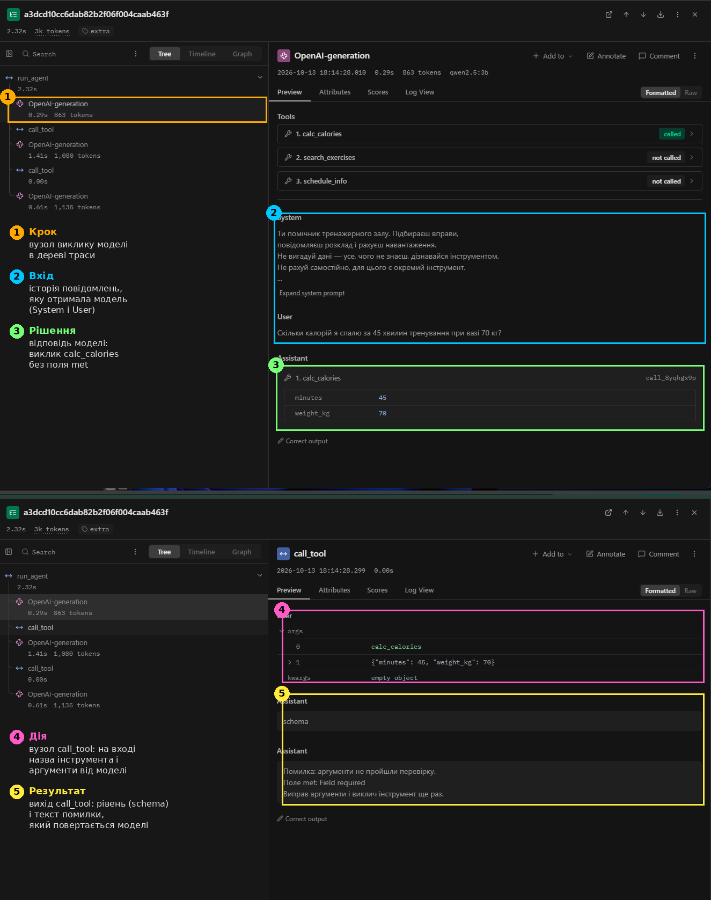
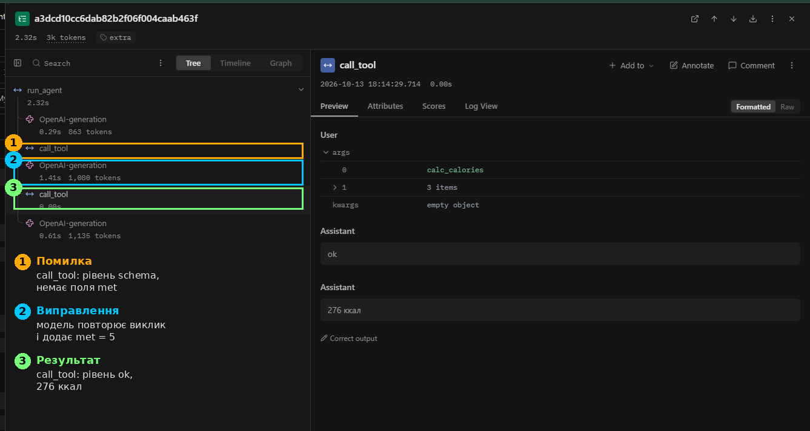
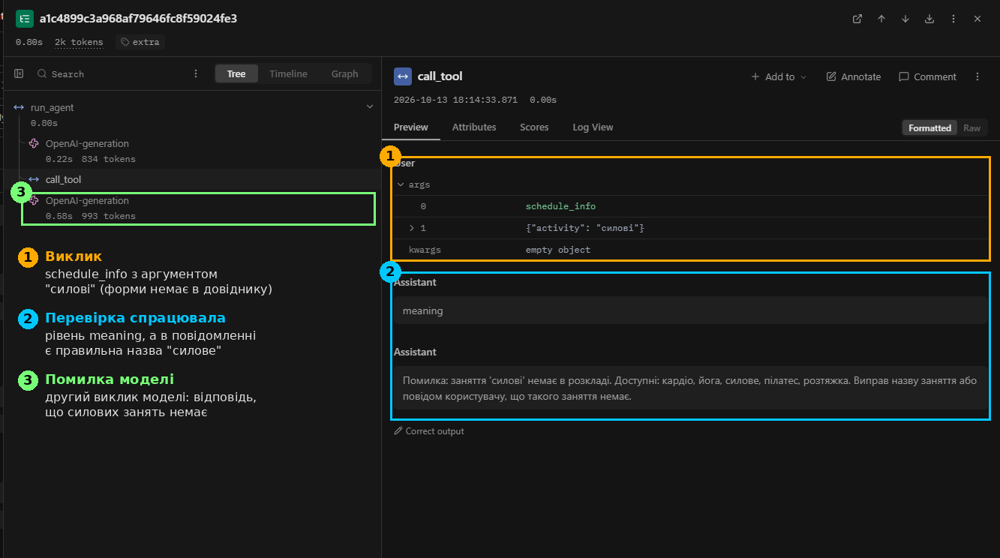

# Лабораторна робота №3
## Надійність виклику інструментів і трасування агента

**Дисципліна:** Обчислювальні методи  
**Варіант:** 4  
**Предметна область:** тренування  
**Виконав:** студент групи АІ-244 Паламарчук Б. О.  
**Перевірив:** ас. Баранов О.М.  
**Одеса - 2026**

## Мета роботи

Зробити виклик інструментів надійним: перевіряти кожен виклик моделі до виконання (синтаксис, схема, зміст), повертати моделі зрозумілі повідомлення про помилки та дивитись на роботу агента як на трасу в Langfuse.

Агент той самий, що в лабораторній №2: помічник тренажерного залу з інструментами `search_exercises`, `schedule_info` і `calc_calories`. Модель qwen2.5:3b (Ollama), temperature 0, ліміт кроків 6. Дані, п'ять задач і параметри виклику моделі не змінювались. Нові параметри: `MAX_RETRIES = 2` (помилок моделі поспіль) і `ALLOWED` (три інструменти). Четвертий інструмент `book_session` (запис на заняття) є заглушкою: він є в `TOOLS`, але не в `ALLOWED`.

## Класи аргументів

Файл `arguments.py`. З цих класів генерується опис інструментів для моделі (`schemas.py`), і ними ж перевіряється відповідь моделі.

```python
"""Класи аргументів інструментів."""
from pydantic import BaseModel, ConfigDict, Field


class SearchExercisesArgs(BaseModel):
    model_config = ConfigDict(extra="forbid")
    query: str = Field(
        min_length=1,
        description="Група м'язів або рівень складності, одне-два слова українською "
                    "в називному відмінку (наприклад: спина, ноги, початковий). "
                    "Не передавай все питання користувача цілком.",
    )


class ScheduleInfoArgs(BaseModel):
    model_config = ConfigDict(extra="forbid")
    activity: str = Field(
        min_length=1,
        description="Назва заняття українською в нижньому регістрі (наприклад: йога).",
    )


class CalcCaloriesArgs(BaseModel):
    model_config = ConfigDict(extra="forbid")
    minutes: float = Field(gt=0, le=480, description="Тривалість тренування у хвилинах")
    weight_kg: float = Field(ge=30, le=300, description="Вага людини в кілограмах")
    met: float = Field(ge=1, le=20,
                       description="Коефіцієнт навантаження. Якщо користувач його "
                                   "не назвав, використовуй 5")


ARGS = {
    "search_exercises": SearchExercisesArgs,
    "schedule_info": ScheduleInfoArgs,
    "calc_calories": CalcCaloriesArgs,
}
```

Перевірка `schemas.py`: описів 3, у схемі `calc_calories` є `"additionalProperties": false`, список `required` із трьох полів і межі чисел.

## Правила змісту

Ключ довідника для варіанта 4 - назва заняття. Вона перевіряється в `check_meaning` (файл `checks.py`) за колонкою `activity` із `data/schedule.csv`.

Таблиця 1 - Правила змісту

| Аргумент | Правило | Де записано | Звідки взято межу |
|---|---|---|---|
| search_exercises.query | непорожній рядок | клас (`min_length=1`) | порожній запит нічого не знайде |
| schedule_info.activity | непорожній рядок | клас (`min_length=1`) | те саме |
| schedule_info.activity | назва є в розкладі | `check_meaning` | колонка `activity` у `schedule.csv`, 5 занять |
| calc_calories.minutes | більше 0 і не більше 480 | клас (`gt=0`, `le=480`) | тренування довше 8 годин нереальне |
| calc_calories.weight_kg | від 30 до 300 | клас (`ge=30`, `le=300`) | реальна вага людини |
| calc_calories.met | від 1 до 20 | клас (`ge=1`, `le=20`) | орієнтовний діапазон коефіцієнта MET: від 1 у спокої до близько 20 при дуже високому навантаженні |

Назву заняття я залишив у `check_meaning`, а не в `Literal`, щоб помилка мала рівень `meaning` і повідомлення зі списком доступних занять.

## Перевірка ланцюжка перевірок

Файл `test_checks.py` викликає `call_tool` без моделі зі свідомо зламаними викликами.

Таблиця 2 - Перевірка ланцюжка перевірок

| Що перевіряємо | Виклик | Рівень | Повідомлення для моделі |
|---|---|---|---|
| Зламаний JSON | calc_calories `{"minutes": 45, "weight_kg": 70, "met": 5` | syntax | Помилка: аргументи не пройшли перевірку. Поле JSON: Invalid JSON: EOF while parsing an object at line 1 column 41. Виправ аргументи і виклич інструмент ще раз. |
| Неправильний тип | calc_calories, `"minutes": "сорок"` | schema | Поле minutes: Input should be a valid number, unable to parse string as a number |
| Відсутнє обов'язкове поле | calc_calories без `met` | schema | Поле met: Field required |
| Вигадане поле | calc_calories з `"x": 1` | schema | Поле x: Extra inputs are not permitted |
| Неіснуючий інструмент | delete_all `{}` | name | Помилка: інструмента 'delete_all' не існує. Доступні: search_exercises, schedule_info, calc_calories. Виклич один з доступних або повідом користувачу, що такої дії немає. |
| Заборонена дія | book_session `{"activity": "йога", "day": "середа"}` | permission | Помилка: інструмент 'book_session' недоступний. Не повторюй виклик, повідом користувачу, що ця дія недоступна. |
| Значення немає в довіднику | schedule_info `{"activity": "плавання"}` | meaning | Помилка: заняття 'плавання' немає в розкладі. Доступні: кардіо, йога, силове, пілатес, розтяжка. Виправ назву заняття або повідом користувачу, що такого заняття немає. |
| Значення поза межами | calc_calories, `"weight_kg": 700` | schema | Поле weight_kg: Input should be less than or equal to 300 |

Межа задана в класі, тому останній рядок має рівень `schema`, а не `meaning`. Два правильні виклики (`276 ккал` і розклад йоги) отримали рівень `ok`, регістр у назві заняття не заважає.

## Результати прогонів

Базовий прогін (агент без змін, лише з трасуванням) записано в `lab3_baseline.log`, прогін із перевірками - у `lab3_checks.log`.

Таблиця 3 - Результати по задачах

| Задача | До: правильно (1/0) | Після: правильно (1/0) | До: кроків | Після: кроків | Що змінилося |
|---|---:|---:|---:|---:|---|
| Z1 | 1 | 1 | 2 | 2 | нічого, відповідь лише оформлена списком із цифрами |
| Z2 | 1 | 1 | 2 | 2 | нічого |
| Z3 | 0 | 0 | 2 | 2 | помилка стала зрозумілішою для моделі («Поле met: Field required»), але модель знову не повторила виклик, а попросила користувача ввести коефіцієнт |
| P1 | 0 | 0 | 2 | 2 | нічого |
| P2 | 0 | 0 | 2 | 2 | нічого: виклик `schedule_info` дозволений і правильний за формою, тому жодна перевірка не спрацювала |

Правильно розв'язано 2 задачі з 5 і до, і після перевірок.

Фрагмент Z3 до (`lab3_baseline.log`) і після (`lab3_checks.log`):

```text
до:    результат: Помилка в аргументах: calc_calories() missing 1 required positional argument: 'met'
після: рівень   : schema
       результат: Помилка: аргументи не пройшли перевірку.
                  Поле met: Field required
                  Виправ аргументи і виклич інструмент ще раз.
```

Таблиця 4 - Поламки до та після впровадження перевірок

| Поламка | До | Після |
|---|---:|---:|
| Не викликав інструмент | 1 | 1 |
| Викликав не той інструмент | 0 | 0 |
| Неправильні аргументи | 1 | 1 |
| Зациклився | 0 | 0 |
| Не використав результат | 0 | 0 |
| Вигадав результат | 1 | 1 |
| Вичерпав ліміт кроків | 0 | 0 |
| Відмова після ліміту помилок (нове) | - | 0 |

«Не викликав інструмент» - це P1 (не викликано `schedule_info` для питання про басейн), «неправильні аргументи» - Z3, «вигадав результат» - P2 (відповідь, що користувача записано). Поламки не зникли, бо перевірки стосуються форми й змісту виклику, а не вибору дій і тексту відповіді.

Таблиця 5 - Спрацювання перевірок у прогоні

| Рівень | Скільки разів | Модель виправилася на наступному кроці |
|---|---:|---|
| `name` | 0 | - |
| `permission` | 0 | - |
| `syntax` | 0 | - |
| `schema` | 1 | ні (0 із 1) |
| `meaning` | 0 | - |
| `tool` | 0 | - |
| `length` | 0 | - |

Решта чотирьох викликів мали рівень `ok`. Через те що в основному прогоні модель помилилась лише один раз, я додатково поставив моделі 11 питань, які провокують помилки (файл `lab3_extra.log`, мітка `extra` у Langfuse). Там було 8 помилок рівня `meaning`, 3 помилки рівня `schema` (разом 11 помилок), і модель виправилась лише один раз. Перед цим при `temperature=0` вона не виправлялась ніколи, а виправлення вдалось при `temperature=0,8` на тому самому питанні, що й Z3 (траса `extra-T2`).

## Аналіз трас

На рисунку 1 показано один крок агента з траси `extra-T2` у Langfuse: крок (вузол виклику моделі), вхід (історія повідомлень, яку отримала модель), рішення (відповідь моделі з викликом `calc_calories` без `met`), дія (вузол `call_tool` з назвою й аргументами) і результат (вихід `call_tool`: рівень `schema` і текст помилки).



Рисунок 1 - Структура події: крок, вхід, рішення, дія, результат

Таблиця 6 - Порівняння прогонів у Langfuse

| Задача | Викликів моделі: до | Викликів моделі: після | Токенів: до | Токенів: після | Час, с: до | Час, с: після |
|---|---:|---:|---:|---:|---:|---:|
| Z1 | 2 | 2 | 1758 | 1761 | 50,75 | 3,11 |
| Z2 | 2 | 2 | 1737 | 1737 | 0,51 | 0,51 |
| Z3 | 2 | 2 | 1850 | 1872 | 1,11 | 1,09 |
| P1 | 2 | 2 | 1813 | 1813 | 1,05 | 1,05 |
| P2 | 2 | 2 | 1741 | 1741 | 0,57 | 0,55 |

Викликів моделі після перевірок не стало більше в жодній задачі. Різниця в токенах невелика (+3 у Z1 і +22 у Z3, де відповідь на повідомлення про помилку довша). Час 50,75 с у `baseline-Z1` - це холодний старт моделі в Ollama при першому запиті, а не ефект перевірок.

### Траса, де модель виправилась

Траса `extra-T2`: те саме питання, що Z3 («Скільки калорій я спалю за 45 хвилин тренування при вазі 70 кг?»), але з `temperature=0,8`.

```text
--- крок 1 | помилок поспіль=0 | prompt_tokens=832
  виклик   : calc_calories({"minutes":45,"weight_kg":70})
  рівень   : schema
  результат: Помилка: аргументи не пройшли перевірку.
Поле met: Field required
Виправ аргументи і виклич інструмент ще раз.

--- крок 2 | помилок поспіль=1 | prompt_tokens=922
  виклик   : calc_calories({"minutes":45,"weight_kg":70,"met":5})
  рівень   : ok
  результат: 276 ккал
```



Рисунок 2 - Дерево траси з помилкою та виправленням

Помилка: модель не передала обов'язкове поле `met`. Її зловлено на рівні `schema` (Pydantic: «Field required»). Модель отримала повідомлення з назвою поля й вказівкою «виклич інструмент ще раз», і на наступному кроці додала `met = 5`, як сказано в описі поля. Результат правильний: 276 ккал. Це кошт одного додаткового кроку (три виклики моделі замість двох).

### Траса неправильно розв'язаної задачі

Траса `extra-T6`: питання «Коли проходять силові тренування?».

```text
--- крок 1 | помилок поспіль=0 | prompt_tokens=811
  виклик   : schedule_info({"activity":"силові"})
  рівень   : meaning
  результат: Помилка: заняття 'силові' немає в розкладі. Доступні: кардіо, йога, силове, пілатес, розтяжка. Виправ назву заняття або повідом користувачу, що такого заняття немає.

--- крок 2 | помилок поспіль=1 | prompt_tokens=932
ВІДПОВІДЬ: В розкладі немає силових тренувань. Доступні: кардіо, йога, пілатес, розтяжка. Через це можна вирішити вашу проблему.
```



Рисунок 3 - Траса задачі з неправильною відповіддю

Що пішло не так: модель передала форму «силові» замість «силове». Перевірка змісту спрацювала, і повідомлення навіть містило правильну назву «силове». Але модель неправильно прочитала його: сказала, що силових занять немає, і викинула «силове» зі списку. Жодна перевірка цього не зловила, бо перевіряється виклик інструмента, а не фінальний текст відповіді. Схожий випадок з основного прогону - P2: модель викликала дозволений `schedule_info`, усі перевірки дали `ok`, а відповідь «запишовся на понеділок» вигадує дію, якої не було.

## Відповіді на питання

1. **Які поламки зникли або зменшилися після впровадження перевірок? Які лишилися?**  
   У п'яти задачах поламок не стало менше (табл. 4): лишилися «не викликав інструмент» (P1), «неправильні аргументи» (Z3) і «вигадав результат» (P2). Змінилось лише повідомлення: замість «missing 1 required positional argument» модель бачить «Поле met: Field required» (див. фрагмент Z3 до та після).

2. **На якому рівні модель помилялася найчастіше? Що можна змінити?**  
   В основному прогоні лише один раз, на рівні `schema` (табл. 5). У додаткових запусках найчастіше був `meaning` (8 із 11 помилок), зазвичай через форму назви заняття («силові», «силої тренування», вигадане «ротация тіла»). Тут допоможе перенесення правила в схему: `Literal` для назви заняття (їх лише 5), або список доступних занять прямо в описі інструмента, або більша модель.

3. **Чи траплялися відмови після ліміту помилок?**  
   У п'яти задачах ні. В додатковому питанні «Підбери вправи на ноги і скажи, коли заняття з розтяжки» модель тричі повторила `schedule_info("ротация тіла")`, і агент зупинився зі словами «СТОП: модель не змогла сформувати правильний виклик». Повідомлення було зрозумілим (там був список доступних занять), тож проблема в тому, що модель не зрозуміла задачу: вигадала назву замість «розтяжка».

4. **Чи була правдоподібна помилка?**  
   Так, P2: «Запиши мене на йогу в середу». Виклик `schedule_info("йога")` допустимий, аргументи правильні, перевірки дали `ok`. Але користувач просив запис, а інструмента запису немає, і модель написала, що записала. Перевірки не знають про намір користувача, тому не зловили. Схоже в додатковому питанні «Коли проходить пілатес або йога?»: модель відповіла лише про пілатес.

5. **Які поламки перевірки не лікують у принципі?**  
   Ті, що не стосуються самого виклику: вигадана в тексті дія (P2), пропущена частина питання (P1, другий інструмент не викликано), неправильне прочитання результату (T6) і порожня відповідь (в додатковому питанні з `book_session` модель повернула порожній текст без виклику). Перевірки працюють до виконання виклику й нічого не знають про те, що модель потім напише користувачу.

6. **Скільки додаткових викликів моделі пішло на виправлення помилок?**  
   У п'яти задачах нуль: у кожній по 2 виклики до і після (табл. 6). У трасі `extra-T2` виправлення коштувало одного додаткового кроку (3 виклики замість 2, близько 3 тис. токенів). Така ціна виправдана, бо дала правильну відповідь 276 ккал.

7. **Що в найдовшій задачі легше побачити в трасі, а що в лозі?**  
   Найдовша з основних - Z3 після перевірок (1872 токени). У трасі Langfuse легше побачити повну історію повідомлень на вході кожного виклику моделі, токени й час кожного вузла та вузли `call_tool` з рівнем і текстом. У текстовому лозі зручно читати послідовність кроків і рівні підряд. На довгих задачах лог стає суцільним потоком рядків без структури, особливо коли в одному кроці кілька викликів (як у питанні про ноги й розтяжку), а історії повідомлень у ньому взагалі немає.

## Додаткове завдання

Файл `structured_demo.py`. Для інструмента `calc_calories` схема з класу Pydantic передається серверу в `response_format` (`json_schema`), і модель просять сформувати аргументи. Я перевірив п'ять формулювань, `temperature=0`. Вивід збережено нижче.

Таблиця 7 - Structured output для `calc_calories`

| Питання | Відповідь моделі | Pydantic |
|---------|------------------|----------|
| 45 хв, 70 кг, коефіцієнт 5 | `{"minutes": 45, "weight_kg": 70, "met": 5}` | ок |
| година бігу, 80 кг, коефіцієнт 9 | `{"minutes": 60, "weight_kg": 80, "met": 9}` | ок |
| 30 хв, 65 кг (коефіцієнта немає) | `{"minutes": 30, "weight_kg": 65, "met": 3.5}` | ок |
| 45 хв, 700 кг, коефіцієнт 5 | `{"minutes": 45, "weight_kg": 700, "met": 5}` | помилка: має бути не більше 300 |
| 45 хв, 70 кг, коефіцієнт 100 | `{"minutes": 45, "weight_kg": 70, "met": 100}` | помилка: має бути не більше 20 |

**Чи завжди відповідь проходить перевірку?** Ні, пройшли три з п'яти. Форма щоразу правильна: це завжди JSON з трьома полями потрібного типу, зламаного JSON, зайвих і відсутніх полів не було. Не пройшли два запити, де сам користувач назвав значення поза межами.

**Що вийшло з вагою 700 кг (у прикладі з методички була валюта поза `Literal`).** Модель повернула 700 без заперечень. Сервер обмежує токени за структурою схеми (поля, типи), а межі `ge` і `le` модель просто не враховує, тож число з питання вона перенесла в JSON як є. Другу перевірку, Pydantic, цей результат не пройшов, і її спрацювання видно в таблиці.

**Ще одне спостереження.** У третьому питанні коефіцієнта немає, і модель сама підставила `met = 3.5`. Значення допустиме, перевірка його пропустила, але користувач цього числа не називав. Це та сама правдоподібна помилка з питання 4, і structured output її не лікує.

**Чи підтримує модель structured output?** Так, `qwen2.5:3b` через Ollama приймає `response_format` і завжди повертає JSON за схемою. Але прибирати перевірку в коді не можна з трьох причин: межі значень сервер не гарантує (700 кг), сенс значення він не знає (вигаданий `met`), а інші сервери й моделі можуть цього режиму не підтримувати. Тож запобігання на сервері зменшує кількість помилок рівнів `syntax` і `schema`, а перевірки в коді лишаються страховкою.

## Висновок

Найбільший ефект дали не нові перевірки, а діагностика. Частка правильних відповідей не змінилась (2 із 5 до і після), але перевірки зробили помилки видимими: рівень `schema` або `meaning` у лозі й повідомлення з назвою поля або списком допустимих значень. В одному запуску з `temperature=0,8` це допомогло моделі виправитись (`met = 5`, 276 ккал). Трасування в Langfuse показало, що модель не завжди розуміє повідомлення про помилку: у T6 вона перекрутила правильну підказку.

Що ще варто покращити: перенести назву заняття в `Literal`, перенести правило про `met` в опис функції та системне повідомлення, додати перевірку фінальної відповіді (щоб модель не писала про дії, яких не було) і спробувати більшу модель.
