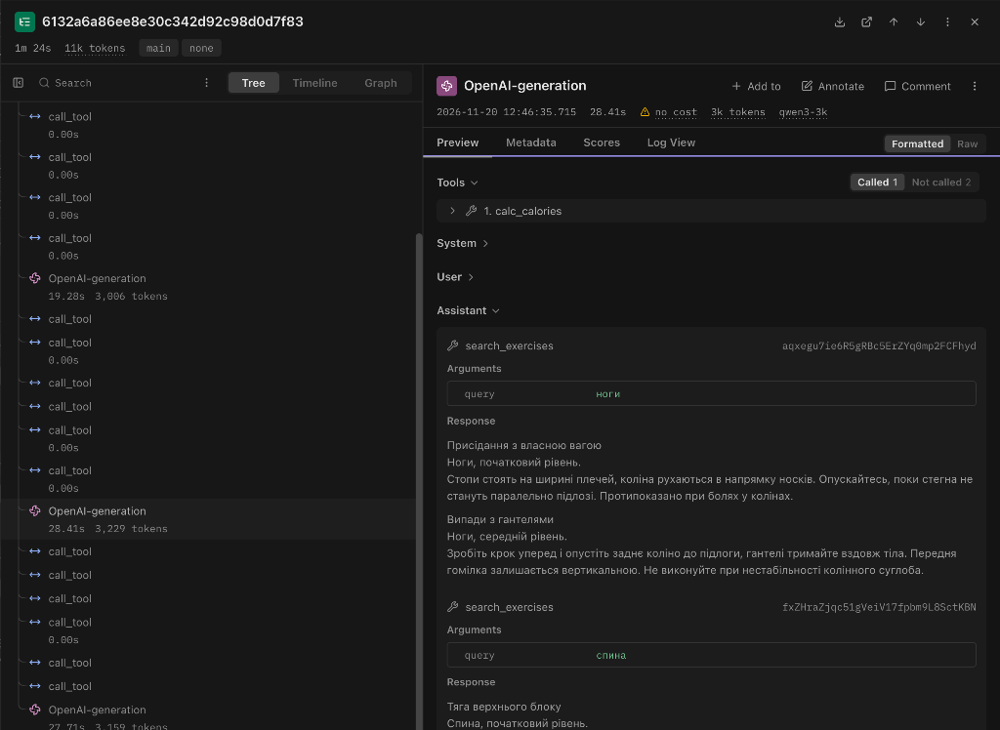
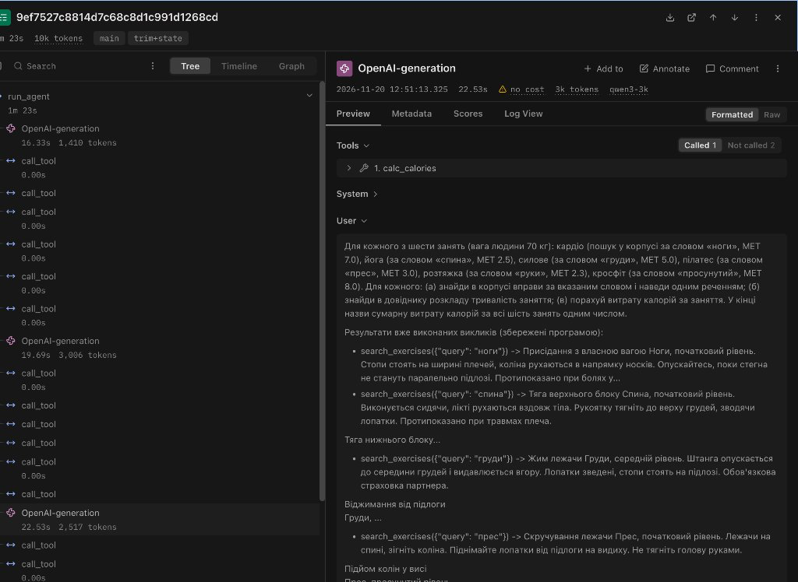

# Лабораторна робота №4

## Довгі задачі агента: вікно контексту, скорочення історії, стан задачі та кеш

**Дисципліна:** Обчислювальні методи  
**Варіант:** 4  
**Предметна область:** Тренування  
**Виконав:** студент групи АІ-244 Паламарчук Б. О.  
**Перевірив:** ас. Баранов О. М.

Одеса - 2026

---

## Мета роботи

Подивитися, що відбувається з агентом у довгому прогоні, коли історія повідомлень росте й упирається в межу вікна контексту, а потім перевірити три способи це пом'якшити: обрізання історії, записник результатів (стан задачі) та кеш викликів моделі. Окремо (додаткове завдання) порівняти обрізання з підсумовуванням історії самою моделлю.

---

## 1. Підготовка проєкту та обмеження вікна контексту

Агент узято з лабораторної № 3, предметна область «Тренування». Він має три інструменти: `search_exercises` (пошук вправ у корпусі), `schedule_info` (розклад занять) і `calc_calories` (витрата калорій). Перевірки аргументів і диспетчер лишилися без змін.

Для експериментів використано модель `qwen3:4b-instruct` через Ollama (її рідне вікно — 262144 токени). Спочатку було створено копію з вікном 4096 токенів (`qwen3-4k`), але на першому пробному прогоні максимальний вхід не перевищив 95% вікна (випадок C за таблицею кроку 4 методички). Згідно з рекомендацією методички вікно зменшено до 3072 токенів — створено модель `qwen3-3k`. У `Modelfile`:

```text
FROM qwen3:4b-instruct
PARAMETER num_ctx 3072
```

Команда створення моделі:

```text
ollama create qwen3-3k -f Modelfile
```

### Таблиця 1 - Параметри моделі

| Показник | Значення |
|---|---|
| Рідне вікно `qwen3:4b-instruct` | 262144 токенів |
| Вікно в роботі (`num_ctx` моделі `qwen3-3k`) | 3072 токенів |
| У скільки разів вікно звужено | у 85,3 раза |

Температура 0. Далі в усіх розрахунках `NUM_CTX = 3072`, а поріг стиснення — `COMPRESS_AT = 2150` (значення з методички для вікна 3072). Перевірку на задачах із лабораторної № 3 збережено в `logs/run_lab3.log`.

**Що змінено порівняно з лабораторною № 3:**

- у `data/schedule.csv` додано колонку `minutes` (тривалість) і шосте заняття (`кросфіт`), `schedule_info` повертає тривалість;
- `search_exercises` повертає повний текст усіх файлів, що підійшли під запит (без скорочення, як вимагає крок 2 методички).

---

## 2. Формування довгої задачі

Питання побудовано строго за шаблоном методички (файл `long_task.json`, скрипт `make_task.py` рахує очікувану відповідь напряму функціями з `tools.py`, без моделі):

> Для кожного з шести занять (вага людини 70 кг): кардіо (пошук у корпусі за словом «ноги», MET 7.0), йога (за словом «спина», MET 2.5), силове (за словом «груди», MET 5.0), пілатес (за словом «прес», MET 3.0), розтяжка (за словом «руки», MET 2.3), кросфіт (за словом «просунутий», MET 8.0). Для кожного: (а) знайди в корпусі вправи за вказаним словом і наведи одним реченням; (б) знайди в довіднику розкладу тривалість заняття; (в) порахуй витрату калорій за заняття. У кінці назви сумарну витрату калорій за всі шість занять одним числом.

Правильна відповідь рахується за формулою `MET * 3,5 * вага / 200 * хвилини`:

| Заняття | Ключове слово | Хвилин | MET | Ккал |
|---|---|---:|---:|---:|
| кардіо | ноги | 45 | 7,0 | 386 |
| йога | спина | 60 | 2,5 | 184 |
| силове | груди | 60 | 5,0 | 368 |
| пілатес | прес | 50 | 3,0 | 184 |
| розтяжка | руки | 30 | 2,3 | 85 |
| кросфіт | просунутий | 40 | 8,0 | 392 |
| **Разом** | | | | **1599** |

`min_calls = 18` (6 позицій × 3 інструменти).

---

## 3. Запуск агента без захисту

Конфігурація `none`: `COMPRESS = "none"`, `USE_STATE = False`, кеш вимкнено. Результати інструментів лишаються в історії без жодного скорочення. Пробний прогін виконано окремою серією `probe`:

```text
python measure.py none 1 probe
```

Журнал прогону — `logs/probe_none_r1.log`. Прогін тривав 64,8 с і завершився статусом `final`, але відповідь неправильна: модель перелічила шість занять із калоріями, порахованими з однаковим `met = 5`, і навіть не назвала підсумкову суму. Помилки `ПОМИЛКА СЕРВЕРА` в лозі немає. Максимальний вхід за прогін — 3007 токенів, це 98% вікна 3072.

---

## 4. Аналіз зростання контексту без захисту

Показники взято зі скрипта `analyze.py` (команда `python analyze.py logs/probe_none_r1.log steps`). Один крок у таблиці — одне звернення до моделі (модель групує виклики батчами по 6 на крок: спочатку 6 пошуків, потім 6 запитів розкладу, потім 6 розрахунків калорій).

### Таблиця 2 - Зростання входу в прогоні без захисту

| Крок | `prompt_tokens` | Приріст | Що зробила модель |
|---:|---:|---:|---|
| 1 | 1273 | | `search_exercises` ×6 (`ноги`, `спина`, `груди`, `прес`, `руки`, `просунутий`) |
| 2 | 2869 | +1596 | `schedule_info` ×6 (`кардіо`, `йога`, `силове`, `пілатес`, `розтяжка`, `кросфіт`) |
| 3 | 3007 | +138 | `calc_calories` ×6 (усі 6 викликів із хибним `met = 5`!) |
| 4 | 2944 | -63 | відповідь без виклику (розклад із калоріями для `met = 5`, без підсумкової суми) |

Показники з `python analyze.py logs/probe_none_r1.log steps`:

- **(а)** постійна частина входу (перший крок): **1273** токени;
- **(б)** типовий приріст за крок: **867** токенів (медіана двох додатних приростів `+1596` і `+138`);
- **(в)** сума `prompt_tokens` за прогін: **10093**. За формулою `n*C + d*n*(n-1)/2` (4 кроки, C = 1273, d = 867) виходить **10294**. Значення близькі (різниця ~2%), але фактичний профіль нерівномірний: на кроці 2 вхід різко стрибає на +1596 токенів через 6 повних текстів вправ із корпусу, а на кроках 3–4 уже впирається у стелю вікна 3072;
- **(г)** вхід перестав рости на кроці **3** (приріст упав до +138 при досягненні 98% вікна, а на кроці 4 `prompt_tokens` зменшився з 3007 до 2944, хоча історія стала довшою);
- **(д)** після кроку 3 модель втратила початок запитання користувача з індивідуальними значеннями MET (7.0, 2.5, 5.0, 3.0, 2.3, 8.0) і передала `met = 5` для всіх шести занять (`276, 368, 368, 306, 184, 245` ккал; при цьому виклик `calc_calories(60, 70, 5)` повторився двічі — для йоги й силового). На кроці 4 модель вивела розклад із цими калоріями, не навела вправи з корпусу й не порахувала суму. Чисел, яких не було в рядках `результат:`, у відповіді немає — усі числа взяті з хибних викликів `calc_calories`.

**Випадок B: сервер мовчки обрізає вхід.** Помилки `ПОМИЛКА СЕРВЕРА` в лозі немає (не A), найбільший вхід досяг 98% вікна (не C), і `analyze.py` зафіксував «вхід перестав рости на кроці 3» (випадок B). Агент не отримує жодного попередження, а модель тихо втрачає умову задачі.

**Перевірка в журналі сервера Ollama.** У серверному лозі Ollama зафіксовано пряме підтвердження обрізання саме на кроці 3 (`task 280`, де `task.n_tokens = 3007` при `n_ctx_slot = 3072`):

```text
slot   operator(): id  0 | task 280 | new prompt, n_ctx_slot = 3072, n_keep = 4, task.n_tokens = 3007
slot      release: id  0 | task 280 | stop processing: n_tokens = 1695, truncated = 1
slot   operator(): id  0 | task 506 | new prompt, n_ctx_slot = 3072, n_keep = 4, task.n_tokens = 2944
```

Позначка **`truncated = 1`** прямо підтверджує, що сервер обрізав контекст, і на наступному кроці (`task 506`, крок 4) вхід зменшився до 2944 токенів.

---

## 5. Обрізання історії повідомлень

Обрізання реалізовано в `context.py` і `compress.py`. Коли вхід останнього звернення перевищує `COMPRESS_AT = 2150`, лишаються системне повідомлення, перше повідомлення користувача та не більше `KEEP_LAST = 6` останніх повідомлень. Функція `drop_orphan_tools` прибирає з початку хвоста результати `tool`, чиє повідомлення моделі з викликом уже відрізано. Запуск серії:

```text
python measure.py trim 3 main
```

### Таблиця 3 - Стиснення історії (`COMPRESS_AT = 2150`, `KEEP_LAST = 6`)

| Конфігурація | Крок стиснення | Вхід до стиснення, токенів | Повідомлень було -> стало | Повторних викликів за прогін |
|---|---|---|---|---|
| `trim` | 2, 4, 6, ..., 24 (12 разів) | 2869 | 16 -> 2 | 138 |
| `trim+state` | 2 | 2869 | 16 -> 2 (стан додано) | 0 |
| `trim+state` | 3 | 2283 | 9 -> 2 (стан додано) | 0 |

- Обрізання надійно тримає вхід у межах вікна: максимум за прогін — 2869 токенів (93% вікна), помилок сервера й мовчазного обрізання немає.
- Але в чистому `trim` проявляється класична поломка втрати пам'яті в найгострішій формі: оскільки модель викликає по 6 інструментів за крок, останні `KEEP_LAST = 6` повідомлень після кроку 2 — це рівно 6 відповідей `role = "tool"` без їхнього повідомлення `assistant`. Цикл `while` у `drop_orphan_tools` коректно прибирає всі 6 «осиротілих» результатів, і історія стискається `16 -> 2` (лишаються лише `system` і `user`). Агент повністю забуває, що вже робив пошук і дивився розклад, і з кроку 3 починає задачу заново (`search_exercises` ×6 → `schedule_info` ×6 → стиснення → повтор). Цикл триває до ліміту 25 кроків (`step_limit`, **138 повторних викликів**, відповіді немає).

---

## 6. Збереження стану задачі

Клас `TaskState` у `state.py` записує назву інструмента, аргументи й результат кожного виклику з рівнем `ok`, а після стиснення дописує цей записник до першого повідомлення користувача. Запуск серії:

```text
python measure.py trim+state 3 main
```

- У `trim+state` після стиснення на кроці 2 історія також скорочується `16 -> 2`, але в `messages[1]` дописуються всі 12 збережених результатів (6 пошуків і 6 розкладів). Завдяки цьому на кроці 3 вхід падає з **2869** до **2283** токенів (-586 токенів), агент не повторює жодного виклику (**0 повторних викликів**) і одразу викликає всі 6 `calc_calories` із правильними тривалостями й правильними MET (`386, 184, 368, 184, 85, 392` ккал). На кроці 4 агент дає повну структуровану відповідь.

**Пункт 7 кроку 6.** У першому блоці «ПЕРШЕ ПОВІДОМЛЕННЯ КОРИСТУВАЧА ПІСЛЯ СТИСНЕННЯ» (`logs/probe_trim+state_r1.log`, після кроку 2) записник стану містить **12 рядків** виду `- інструмент(аргументи) -> результат` — загалом **2167 символів** (разом із текстом питання — 2707 символів), тобто приблизно **870 токенів** (приблизно 2,5 символа на токен для кирилиці). Це співмірно з типовим приростом одного батч-кроку (867 токенів) і помітно менше, ніж повні результати 6 пошуків у сирій історії (+1596 токенів), тому вхід після стиснення зменшується з 2869 до 2283 токенів (74% вікна 3072).

---

## 7. Кешування викликів моделі

Кеш у `cache.py` зберігає відповідь моделі за відбитком `sha256` від запиту. Серії `cache1` (кеш порожній) і `cache2` (той самий запит) запущено так:

```text
python measure.py none 1 cache1
python measure.py none 1 cache2
```

### Таблиця 4 - Робота кешу

| Запуск | Кроків | Влучань у кеш | Викликів до сервера | Час, с | Правильно |
|---|---:|---:|---:|---:|---|
| 1 (кеш порожній) | 4 | 0 | 4 | 79,9 | ні |
| 2 (той самий запит) | 4 | 4 | 0 | 0,1 | ні |

Запуск 2 швидший приблизно у **800 разів** (79,9 / 0,1 с), бо всі 4 виклики взято з диска без звернення до Ollama. Якби перед другим запуском змінити текст `SYSTEM`, змінився б відбиток `sha256` кожного запиту, кеш не спрацював би на жодному кроці й усі 4 виклики знову пішли б на сервер.

---

## 8. Порівняння конфігурацій агента

Серія `main`, кеш вимкнений, по три повтори на конфігурацію (9 прогонів):

```text
python measure.py none 3 main
python measure.py trim+state 3 main
python measure.py trim 3 main
```

### Таблиця 5 - Вартість циклу в трьох конфігураціях (медіани по трьох повторах)

| Конфігурація | Правильно (з 3) | Кроків | Токенів на вхід | Токенів на вихід | Час, с | Стиснень | Повторних викликів |
|---|---:|---:|---:|---:|---:|---:|---:|
| `none` | 0 | 4 | 10093 | 711 | 91,9 | 0 | 1 |
| `trim` | 0 | 25 | 50977 | 3425 | 329,8 | 12 | 138 |
| `trim+state` | 0 | 4 | 8915 | 875 | 73,3 | 2 | 0 |

«Правильно» перевірено вручну за рядками `ВІДПОВІДЬ:`: жоден прогін не дав `1599`.
- У `none` (усі 3 повтори) через мовчазне обрізання вікна модель підставила `met = 5` для всіх занять і не навела підсумкової суми.
- У `trim` (усі 3 повтори) агент зациклився після обрізання і зупинився за лімітом кроків (`step_limit`, відповіді немає).
- У `trim+state` (усі 3 повтори) агент виконав усі 18 викликів без жодного повтору й отримав **усі 6 точних значень калорій** (`386, 184, 368, 184, 85, 392` ккал), але помилився під час додавання цих шести чисел у тексті відповіді, написавши `1500` замість `1599`.

**Поломки, яких таблиця не показує** (з 9 прогонів основної серії `main_*.log`):

- відповів, зробивши менше 19 кроків: **6 з 9** (усі 3 прогони `none` і всі 3 `trim+state` мали по 4 кроки, проте за кількістю викликів інструментів вони зробили всі 18 викликів батчами по 6 на крок; у `trim` — 25 кроків і `step_limit`);
- назвав число, якого не було в жодному рядку `результат:`: **3 з 9** (усі 3 прогони `trim+state` назвали хибну суму `1500` замість `1599`, хоча всі шість доданків `386, 184, 368, 184, 85, 392` точно збігалися з результатами `calc_calories`);
- приховане псування аргументів через обрізання вікна: **3 з 9** (усі 3 прогони `none` передали `met = 5` замість 7.0 / 2.5 / 3.0 / 2.3 / 8.0 після `truncated = 1`).

### Траси Langfuse та скріншоти

Проєкт `agents-lab3`, фільтр за міткою `main`, назви трас `long-main_<конфігурація>_r<повтор>`.


Рисунок 1 - Дерево виклику `long-main_none_r1`



Рисунок 2 - Третій виклик моделі в `none_r1` (вхід 3007 токенів, 3229 разом із відповіддю)


Рисунок 3 - Дерево виклику `long-main_trim+state_r1`



Рисунок 4 - Третій виклик у `trim+state_r1`, перший після стиснення (вхід 2283 токени, 2517 разом із відповіддю)

Вхід першого виклику після стиснення (крок 3): у `trim+state` **2283** токени (у Langfuse 2517 разом із 234 токенами відповіді), у `none` на тому ж кроці **3007** (3229 із відповіддю). Різниця — **724 токени на вході** (приблизно **24%**). Сумарно за прогін `trim+state` витратив 8915 токенів на вхід (9790 разом із виходом) за 83,8 с проти 10093 на вхід (10804 разом із виходом) за 84,4 с у `none`.

Що в трасі видно одразу, а в текстовому лозі довелося б рахувати вручну: повне дерево викликів моделі й інструментів із часом і токенами кожного кроку (на кроках 2 і 3 в `trim+state` одразу видно падіння з 3006 до 2517 токенів), сумарний час і токени в шапці траси, а також точний список повідомлень, які пішли на вхід моделі до й після стиснення (у `trim+state` на кроці 3 видно лише 2 повідомлення `system` + `user` зі станом замість 16).

---

## 9. Відповіді на питання

1. **Крок, де агент без захисту дійшов до межі вікна.** Це крок 3 (`probe_none_r1`): `analyze.py` показав «вхід перестав рости на кроці 3», `prompt_tokens` досяг 3007 (98% вікна 3072), а на кроці 4 упав до 2944, хоча історія додала нові повідомлення (таблиця 2). У серверному лозі Ollama на цьому кроці зафіксовано `truncated = 1`. Після обрізання модель забула значення MET із початку запитання, викликала `calc_calories` із `met = 5` для всіх шести занять і не навела суму у відповіді.
2. **Сума `prompt_tokens` і формула.** Реальна сума — 10093, за формулою `n*C + d*n*(n-1)/2` — 10294. Порядок величини збігається, бо на кожному кроці модель повторно читає всю накопичену історію, але фактичне зростання нерівномірне: крок 2 дав стрибок +1596 через 6 результатів пошуку, а кроки 3–4 уже були обмежені стелею вікна 3072.
3. **Що втрачає агент при обрізанні.** Усі результати відкинутих викликів. У `trim` після стиснення на кроці 2 `drop_orphan_tools` прибирає 6 «осиротілих» результатів інструментів, історія зменшується `16 -> 2`, і агент знову викликає `search_exercises` ×6 та `schedule_info` ×6 — це призводить до зациклення й **138 повторних викликів** (таблиці 3 і 5). У `trim+state` записник повертає моделі всі 12 результатів, повторних викликів **0**, усі 6 калорій пораховані правильно.
4. **Найдешевша, найшвидша, найточніша.** За токенами входу найдешевша `trim+state` (8915 проти 10093 у `none` і 50977 у `trim`), за часом теж найшвидша `trim+state` (73,3 с проти 91,9 с у `none` і 329,8 с у `trim`). За формальною точністю фінального числа 0 з 3 в усіх конфігураціях, хоча за змістом `trim+state` єдина правильно виконала всі 18 викликів і отримала всі 6 правильних значень калорій (помилившись лише в усному додаванні). Висновок усе одно обережний: перевірено одну задачу й одну модель при `temperature = 0`, тому всі 3 повтори в кожній конфігурації майже ідентичні й не дають статистичного розкиду.
5. **Чому під час вимірювання кеш вимкнено.** Із кешем вимірюється не робота моделі, а швидкість читання JSON із диска (0,1 с проти 79,9 с у таблиці 4). Якщо інструмент поверне інші дані, зміниться історія наступного кроку та її `sha256`, тому з того кроку кеш перестане влучати (але попередній виклик усе одно віддасть стару відповідь). Якщо замінити ваги моделі під тією самою назвою `qwen3-3k`, ключ кешу не зміниться (у нього входить лише рядок `model`), і кеш віддаватиме відповіді старої моделі.
6. **Що скорочення історії не лікує.** Помилки міркувань та арифметики самої моделі, не пов'язані з довжиною контексту: у `trim+state` модель мала всі 6 правильних чисел (`386, 184, 368, 184, 85, 392`) прямо перед очима, але в умі склала їх у `1500` замість `1599`.

---

## 10. Питання для захисту

**1. Чому вартість усього прогону агента зростає швидше, ніж вартість одного кроку? Покажіть це на цифрах свого прогону.**

На кожному кроці модель заново читає всю попередню історію, тож сума входів за `n` кроків росте приблизно квадратично (`n*C + d*n*(n-1)/2`). У `probe_none_r1` перший крок коштував 1273 токени, другий уже 2869 (більш ніж удвічі), а сума за 4 кроки склала 10093 токени. У `main_trim_r1` за 25 кроків сума входів досягла 50977 токенів при тому, що один крок не перевищував 2869.

**2. Що відбувається, коли історія не вміщується у вікно? Як ви помітили це у своєму лозі і чому агент не отримує помилки?**

Ollama не повертає HTTP-помилку, а мовчки обрізає початок запиту. У `probe_none_r1` на кроці 3 вхід досяг 3007 (98% вікна 3072), а на кроці 4 упав до 2944; у серверному лозі Ollama на кроці 3 з'явилося `truncated = 1`. Агент отримує валідну відповідь моделі без винятку, але модель уже не бачить початку запитання й підставляє `met = 5` замість реальних значень.

**3. Чому `COMPRESS_AT` менший за `NUM_CTX`?**

Поріг 2150 лишає запас 922 токени до вікна 3072. Перевірка виконується після кроку за його `prompt_tokens`, а один крок із пошуком може додати понад 1500 токенів (плюс відповідь моделі й записник стану). Якби `COMPRESS_AT` дорівнював `NUM_CTX`, запит спершу обрізався б сервером, і лише потім агент спробував би його скоротити.

**4. Навіщо цикл `while` у `trim`? Що станеться, якщо його прибрати?**

Після зрізання останніх `KEEP_LAST` повідомлень хвіст може починатися з повідомлень `role = "tool"`, чиє повідомлення `assistant` із `tool_calls` уже відкинуто. У нашому прогоні модель викликала по 6 інструментів за крок, тому всі 6 останніх повідомлень були `tool`, і `while` зняв їх усі. Якщо прибрати `while`, у запит потраплять «осиротілі» результати без виклику — сервер відхилить запит помилкою або модель втратить зв'язок між викликом і результатом.

**5. Що втрачає агент при обрізанні і як це компенсує стан? Чого стан не компенсує? Чому стан записується тільки для викликів із рівнем `ok`?**

При обрізанні агент втрачає результати відкинутих кроків: у `trim` це призвело до зациклення та 138 повторних викликів. Стан (`TaskState`) дописує всі збережені результати до першого повідомлення користувача — у `trim+state` повторних викликів 0, а всі 6 калорій пораховані правильно. Стан не компенсує помилок самої моделі (наприклад, арифметичної помилки `1500` замість `1599`) і не зберігає проміжних міркувань. Записуються лише виклики з `level == "ok"`, щоб не засмічувати записник повідомленнями про синтаксичні чи заборонені помилки диспетчера.

**6. З чого складається ключ кешу? Коли від кешу є користь, а коли його не можна вмикати?**

Ключ — `sha256` від JSON-подання запиту (`model`, `messages`, `tools`, `temperature`). Будь-яка зміна, навіть одного символа `SYSTEM`, дає новий ключ. Кеш корисний для відлагодження однакових прогонів (у таблиці 4 час упав із 79,9 с до 0,1 с). Його не можна вмикати під час вимірювання вартості, при роботі з мінливими зовнішніми даними та після оновлення ваг моделі під тією самою назвою.

**7. Чому кожну конфігурацію проганяли тричі й брали медіану? Чому висновки все одно обережні?**

Медіана з трьох повторів згладжує випадкові викиди за часом чи генерацією. Водночас при `temperature = 0` повтори `none`, `trim` і `trim+state` дали однакові токени й кроки, а експеримент проведено на одній задачі й одній моделі, тому результати показують поведінку механізмів на цьому прикладі, а не універсальну гарантію для будь-яких задач.

**8. Покажіть у трасі Langfuse місце, де стиснення зменшило вхід моделі.**

У трасі `long-main_trim+state_r1` на кроці 2 генерація має 2869 вхідних токенів (3006 разом із виходом), після чого спрацьовує стиснення (`16 -> 2`, стан додано), і на кроці 3 вхід падає до **2283** токенів (2517 разом із виходом). У трасі `long-main_none_r1` на тому ж кроці 3 вхід росте до **3007** токенів (3229 разом із виходом) і викликає обрізання на сервері (рисунки 2 і 4).

---

## 11. Додаткове завдання: підсумовування замість обрізання

Реалізовано `summary.py` (`split_history`, `render_messages`, `summarize`, `compress_by_summary`), у `compress.py` додано гілку `COMPRESS = "summary"`, у `measure.py` — конфігурацію `summary`. Три повтори виконано окремою серією `extra`:

```text
python measure.py summary 3 extra
```

Журнали: `logs/extra_summary_r1.log` ... `r3.log`.

### Таблиця 6 - Результати підсумовування (медіани по трьох повторах)

| Конфігурація | Правильно (з 3) | Кроків | Токенів на вхід | Токенів на вихід | На підсумовування | Час, с | Стиснень | Повторних викликів |
|---|---:|---:|---:|---:|---:|---:|---:|---:|
| `summary` | 0 | 5 | 10460 | 653 | 3013 | 101,3 | 1 | 5 |

- **Вартість підсумовування:** **3013** токенів (медіана; у r1 — 3013, у r2 — 3004, у r3 — 4739 за два стиснення: 3062 + 1677). Один додатковий виклик на переказ коштує майже третину від усього основного прогону.
- **Економія на вході порівняно з `trim`:** у `trim` через зациклення набігло 50977 токенів, тож `summary` заощадив `50977 - 10460 = 40517` токенів на вході (~79%) і не зациклився. Проте порівняно з `trim+state` (8915 токенів на вхід, 0 на підсумовування, 73,3 с) `summary` суттєво гірший: **10460 + 3013 = 13473** токенів (на ~51% дорожче за `trim+state`), повільніший (101,3 с проти 73,3 с) і зробив 5 повторних викликів.
- **Чи зберіг переказ точні числа: ні (втрачає прив'язку даних і плутає заняття).**
  - У `r1` та `r2` переказ після кроку 2 зберіг хвилини й тренерів (`Понеділок, 07:30 — 45 хв, тренер: Сергій`), але **відкинув назви занять** (`кардіо`, `йога`, `силове`, `пілатес`, `розтяжка`), тому на кроці 3 агентові довелося повторно викликати `schedule_info` для 5 занять (звідси `repeats = 5`), а у фіналі модель видала хибну суму `1845 ккал`.
  - У `r3` під час другого підсумовування модель **переплутала заняття й числа місцями**: записала `Йога (45 хв, 70 кг, MET = 7): 386 ккал` (насправді це кардіо) і `Кардіо (60 хв, 70 кг, MET = 2.5): 184 ккал` (насправді це йога), а у відповіді назвала `1245 ккал` замість `1599`.

---

## 12. Висновок

Найбільший практичний ефект серед трьох механізмів дало **обрізання історії зі станом задачі (`trim+state`)**:
- порівняно з `none` воно усунуло мовчазне обрізання вікна (`truncated = 1`), зменшило вхід за прогін із 10093 до **8915 токенів** (-12%), прискорило роботу (73,3 с проти 91,9 с), прибрало повторні виклики (0 проти 1) і дало змогу правильно порахувати всі 6 окремих значень калорій;
- порівняно з чистим `trim` стан урятував агента від нескінченного зациклення після `drop_orphan_tools` (4 кроки й 8915 токенів замість 25 кроків, 50977 токенів і 138 повторів);
- порівняно з додатковим `summary` стан дешевший (не витрачає 3013 токенів на переказ), швидший (73,3 с проти 101,3 с) і не спотворює прив'язку чисел до назв занять.

Кеш дає найбільше прискорення за часом (**0,1 с** замість **79,9 с**), але підходить лише для повторюваних відлагоджувальних запусків, а не для вимірювання вартості чи живих даних.

Водночас жодна конфігурація не дала точної підсумкової суми `1599`: навіть маючи всі 6 правильних доданків у `trim+state`, модель помилилася в усному додаванні (`1500`). Що варто додати далі: винести підсумовування в окремий інструмент-калькулятор, щоб модель не складала числа в умі, або обмежити обсяг тексту, який повертає `search_exercises`, щоб один крок пошуку не забивав половину вікна.

## Склад роботи

`report.md`, `data/`, `logs/` (`run_lab3.log`, `probe_*_r1.log`, `cache*_none_r1.log`, `main_*_r*.log`, `extra_summary_r*.log`), `screenshots/`, `Modelfile`, `config.py`, `tools.py`, `schemas.py`, `dispatcher.py`, `agent.py`, `agent_runner.py`, `arguments.py`, `checks.py`, `model.py`, `context.py`, `compress.py`, `state.py`, `cache.py`, `summary.py`, `make_task.py`, `measure.py`, `logparse.py`, `metrics.py`, `analyze.py`, `table.py`, `tasks.json`, `long_task.json`, `test_checks.py`.
