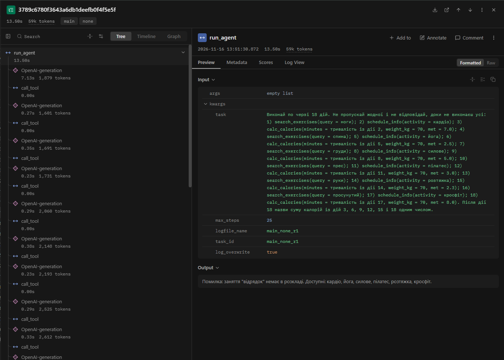
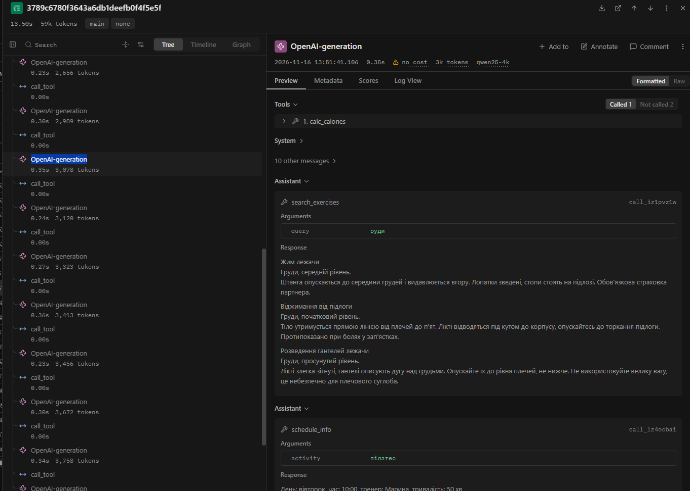
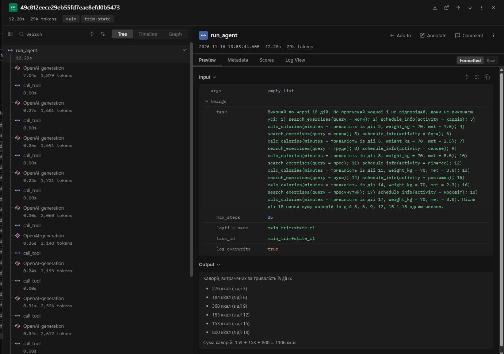
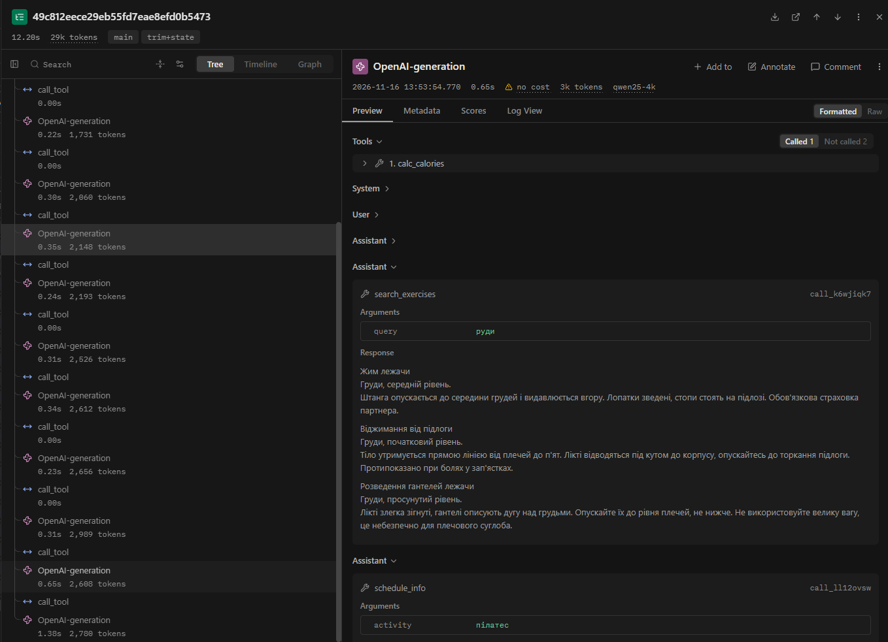

# Лабораторна робота №4

## Довгі задачі агента: вікно контексту, скорочення історії, стан задачі та кеш

**Дисципліна:** Обчислювальні методи  
**Варіант:** 4  
**Предметна область:** Тренування  
**Виконав:** студент групи АІ-244 Паламарчук Б. О.  
**Перевірив:** ас. Баранов О. М.

Одеса - 2026

---

## Мета роботи

Подивитися, що відбувається з агентом у довгому прогоні, коли історія повідомлень росте й упирається в межу вікна контексту, а потім перевірити три способи це пом'якшити: обрізання історії, записник результатів (стан задачі) та кеш викликів моделі. Окремо (додаткове завдання) порівняти обрізання з підсумовуванням історії самою моделлю.

---

## 1. Підготовка проєкту та обмеження вікна контексту

Агент узято з лабораторної № 3, предметна область «Тренування». Він має три інструменти: `search_exercises` (пошук вправ у корпусі), `schedule_info` (розклад занять) і `calc_calories` (витрата калорій). Перевірки аргументів і диспетчер лишилися без змін.

Для експериментів використано `qwen2.5:3b` через Ollama. На її основі створено модель `qwen25-4k` з вікном 4096 токенів. У `Modelfile`:

```text
FROM qwen2.5:3b
PARAMETER num_ctx 4096
```

Команда створення моделі:

```text
ollama create qwen25-4k -f Modelfile
```

### Таблиця 1 - Параметри моделі

| Показник | Значення |
|---|---|
| Рідне вікно `qwen2.5:3b` | 32768 токенів |
| Вікно в роботі (`num_ctx` моделі `qwen25-4k`) | 4096 токенів |
| У скільки разів вікно звужено | у 8 разів |

Температура 0. Далі в усіх розрахунках `NUM_CTX = 4096`. Вікно 3072 не знадобилося: прогін потрапив у випадок B (див. розд. 4), а зменшувати вікно методичка радить лише для випадку C.

**Що довелося змінити порівняно з лабораторною № 3** (щоб довга задача взагалі працювала на моделі на 3 млрд параметрів):

- у `data\schedule.csv` додано колонку `minutes` (тривалість) і шосте заняття (кросфіт), `schedule_info` тепер повертає тривалість;
- `search_exercises` повертає повний текст усіх файлів, що підійшли під запит. Так кожен виклик пошуку додає до входу 200-330 токенів, і вікно заповнюється за реальну кількість кроків;
- `qwen2.5:3b` у першій же відповіді планує всі виклики одразу (у логах «модель запропонувала викликів: 19»). Тому в `config.py` додано `MAX_CALLS_PER_STEP = 1`: агент виконує лише перший виклик із відповіді, результат повертається моделі, і далі вона дає наступний;
- у `SYSTEM` додано два правила: викликати інструменти по одному та не вигадувати аргументи;
- питання сформульовано як нумерований список із 18 дій, інакше модель відповідала після двох-трьох занять. Шість невдалих формулювань збережено в `logs\probe_v1_none_r1.log` ... `probe_v6_none_r1.log`.

---

## 2. Формування довгої задачі

Питання (файл `long_task.json`, `make_task.py` рахує очікувану відповідь із тих самих даних, які бачать інструменти):

> Виконай по черзі 18 дій. Не пропускай жодної і не відповідай, доки не виконаєш усі: 1) search_exercises(query = ноги); 2) schedule_info(activity = кардіо); 3) calc_calories(minutes = тривалість із дії 2, weight_kg = 70, met = 7.0); 4) search_exercises(query = спина); 5) schedule_info(activity = йога); 6) calc_calories(minutes = тривалість із дії 5, weight_kg = 70, met = 2.5); 7) search_exercises(query = груди); 8) schedule_info(activity = силове); 9) calc_calories(minutes = тривалість із дії 8, weight_kg = 70, met = 5.0); 10) search_exercises(query = прес); 11) schedule_info(activity = пілатес); 12) calc_calories(minutes = тривалість із дії 11, weight_kg = 70, met = 3.0); 13) search_exercises(query = руки); 14) schedule_info(activity = розтяжка); 15) calc_calories(minutes = тривалість із дії 14, weight_kg = 70, met = 2.3); 16) search_exercises(query = просунутий); 17) schedule_info(activity = кросфіт); 18) calc_calories(minutes = тривалість із дії 17, weight_kg = 70, met = 8.0). Після дії 18 назви суму калорій із дій 3, 6, 9, 12, 15 і 18 одним числом.

Правильна відповідь рахується за формулою `MET * 3,5 * вага / 200 * хвилини`:

| Заняття | Хвилин | MET | Ккал |
|---|---|---|---|
| кардіо | 45 | 7,0 | 386 |
| йога | 60 | 2,5 | 184 |
| силове | 60 | 5,0 | 368 |
| пілатес | 50 | 3,0 | 184 |
| розтяжка | 30 | 2,3 | 85 |
| кросфіт | 40 | 8,0 | 392 |
| **Разом** | | | **1599** |

---

## 3. Запуск агента без захисту

Конфігурація `none`: `COMPRESS = "none"`, `USE_STATE = False`, кеш вимкнено. Результати інструментів лишаються в історії без жодного скорочення. Пробний прогін зроблено окремою серією `probe`:

```text
python measure.py none 1 probe
```

Журнал прогону - `logs\probe_none_r1.log`. Прогін тривав 14,2 с і завершився статусом `retry_limit`, тобто відповіді агент не дав. Помилки `ПОМИЛКА СЕРВЕРА` в лозі немає. Максимальний вхід за прогін - 3894 токени, це 95% вікна 4096.

---

## 4. Аналіз зростання контексту без захисту

Показники взято зі скрипта `analyze.py` (команда `python analyze.py logs\probe_none_r1.log steps`). Один крок у таблиці - одне звернення до моделі.

### Таблиця 2 - Зростання входу в прогоні без захисту

| Крок | `prompt_tokens` | Приріст | Що зробила модель |
|---|---|---|---|
| 1 | 1332 | | план на 19 викликів, виконано `search_exercises("ноги")` |
| 2 | 1579 | +247 | `schedule_info("кардіо")` |
| 3 | 1655 | +76 | `calc_calories` (met = 5 замість 7) |
| 4 | 1710 | +55 | `search_exercises("спина")` |
| 5 | 2039 | +329 | `schedule_info("йога")` |
| 6 | 2114 | +75 | `calc_calories` |
| 7 | 2171 | +57 | `search_exercises("груди")` |
| 8 | 2504 | +333 | `schedule_info("силове")` |
| 9 | 2580 | +76 | `calc_calories` |
| 10 | 2635 | +55 | `search_exercises("руди")` (одруківка замість «прес») |
| 11 | 2967 | +332 | `schedule_info("пілатес")` |
| 12 | 3044 | +77 | `calc_calories` |
| 13 | 3099 | +55 | `search_exercises("прес")` |
| 14 | 3302 | +203 | `schedule_info("розтяжка")` |
| 15 | 3379 | +77 | `calc_calories` |
| 16 | 3435 | +56 | `search_exercises("руки")` |
| 17 | 3649 | +214 | `schedule_info("кросфіт")` |
| 18 | 3726 | +77 | `calc_calories` |
| 19 | 3781 | +55 | `search_exercises("просунутий")` |
| 20 | 3642 | -139 | `schedule_info("відрядок")` - такого заняття немає |
| 21 | 3771 | +129 | замість виклику видала JSON текстом |
| 22 | 3894 | +123 | знову `schedule_info("відрядок")` |

Показники з `python analyze.py logs\probe_none_r1.log steps`:

- **(а)** постійна частина входу (перший крок): 1332 токени;
- **(б)** типовий приріст за крок: 77 токенів. Крок після `search_exercises` дає значно більше (200-333 токени), бо в історію потрапляє повний текст знайдених вправ;
- **(в)** сума `prompt_tokens` за прогін: 62008. За формулою `n*C + d*n*(n-1)/2` (22 кроки, C = 1332, d = 77) виходить 47091. Формула занижує приблизно на чверть, бо типовий приріст 77 не враховує великі стрибки після пошуку (шість таких кроків по +200...330);
- **(г)** вхід перестав рости на кроці 20: 3781 -> 3642, хоча історія додала ще два повідомлення;
- **(д)** кроки 20-22: вигадане заняття «відрядок» (помилка за змістом), потім JSON у вигляді тексту замість виклику (помилка синтаксису), потім знову «відрядок». Прогін завершився статусом `retry_limit`, відповіді немає. Чисел, яких не було в результатах інструментів, у відповіді немає, бо відповіді не було взагалі.

**Випадок B: сервер мовчки обрізає вхід.** Помилки `ПОМИЛКА СЕРВЕРА` в лозі немає (отже, не A), найбільший вхід досяг 95% вікна (отже, не C), статус не `final`, а вхід на кроці 20 упав замість того, щоб рости (отже, B). Модель після цього вигадує заняття, якого немає в розкладі, а агент не отримує про це жодного повідомлення.

**Перевірка в журналі сервера Ollama.** Щоб не обмежуватися непрямою ознакою, я переглянув `server-2.log` (папка `%LOCALAPPDATA%\Ollama`). Команда пошуку:

```text
Select-String -Path "$env:LOCALAPPDATA\Ollama\server*.log" -Pattern "task.n_tokens = (3781|3642)"
```

Знайдено п'ять пар рядків `new prompt, n_ctx_slot = 4096, n_keep = 4, task.n_tokens = 3781`, одразу за якими йде запит з `task.n_tokens = 3642` (задачі 5231 і 5256, 8445 і 8470, 9558 і 9583, 10672 і 10697, 11786 і 11811). Тобто сервер на кроці 20 щоразу отримує вже скорочений запит на 3642 токени, а не довший запит, який виходив би без втрати початку. Рядків `truncated = 1` у журналі немає: обрізання робить сам Ollama до передачі запиту в llama-server, а повідомлення про це він пише лише на рівні DEBUG, тому слова «truncating» у звичайному журналі й не видно. Прямого рядка про відкинуті повідомлення я не бачив, отже висновок спирається на збіг клієнтських і серверних чисел, а не на пряме свідчення.

---

## 5. Обрізання історії повідомлень

Обрізання реалізовано в `context.py` і `compress.py`. Коли вхід останнього звернення перевищує `COMPRESS_AT = 2800`, лишаються системне повідомлення, перше повідомлення користувача та не більше `KEEP_LAST = 6` останніх повідомлень. Якщо хвіст починається з результатів інструментів, чиї виклики вже відкинуті, їх також прибирають. Запуск серії:

```text
python measure.py trim 3 main
```

### Таблиця 3 - Стиснення історії (`COMPRESS_AT = 2800`, `KEEP_LAST = 6`)

| Конфігурація | Крок стиснення | Вхід до стиснення, токенів | Повідомлень було -> стало | Повторних викликів за прогін |
|---|---|---|---|---|
| `trim` | 11 | 2967 | 24 -> 8 | 5 |
| `trim` | 20 | 2872 | 26 -> 8 | 5 |
| `trim+state` | 11 | 2967 | 24 -> 8 (стан додано) | 0 |

- Обрізання працює за призначенням: вхід падає з 2967 до 1796 токенів, максимум за прогін 2967 (72% вікна), помилок сервера немає.
- Але `trim` забуває результати відкинутих кроків. У прогоні r1 на кроках 12, 15 і 18 модель викликає `calc_calories` із вигаданими хвилинами (300, 180 і 240 замість 50, 30 і 40), бо результатів розкладу вона вже не бачить. Після другого стиснення вона заново викликає `schedule_info("силове")`, шукає «спина», «руки», «прес» і знову питає розклад розтяжки. Це 5 повторних викликів, і до 18-ї дії прогін не доходить: спрацьовує ліміт у 25 кроків.

---

## 6. Збереження стану задачі

Клас `TaskState` у `state.py` записує назву інструмента, аргументи й результат кожного виклику з рівнем `ok`, а після стиснення дописує цей записник до першого повідомлення користувача. Запуск серії:

```text
python measure.py trim+state 3 main
```

- У `trim+state` після стиснення до запитання дописується записник виконаних викликів, повторних викликів 0, і модель відповідає на кроці 13.

**Пункт 7 кроку 6.** У першому блоці «ПЕРШЕ ПОВІДОМЛЕННЯ КОРИСТУВАЧА ПІСЛЯ СТИСНЕННЯ» (`logs\probe_trim+state_r1.log`) 11 рядків виду `- інструмент(аргументи) -> результат`, разом близько 1680 символів, тобто приблизно 670 токенів (2,5 символа на токен). Типовий приріст за крок 76 токенів, тож блок приблизно у 9 разів більший за звичайний крок. Для вікна 4096 це відчутно: вхід після стиснення 2572 токени проти 1796 у `trim`.

---

## 7. Кешування викликів моделі

Кеш у `cache.py` зберігає відповідь моделі за відбитком sha256 від запиту. Серії `cache1` (кеш порожній) і `cache2` (той самий запит) запущено так:

```text
python measure.py none 1 cache1
python measure.py none 1 cache2
```

### Таблиця 4 - Робота кешу

| Запуск | Кроків | Влучань у кеш | Викликів до сервера | Час, с | Правильно |
|---|---|---|---|---|---|
| 1 (кеш порожній) | 21 | 0 | 21 | 13,5 | ні |
| 2 (той самий запит) | 21 | 21 | 0 | 0,5 | ні |

Запуск 2 швидший приблизно у 27 разів (13,5 / 0,5). Якби перед ним змінити текст `SYSTEM`, змінився б весь запит, а з ним відбиток sha256, тому кеш не спрацював би на жодному кроці й усі 21 виклик знову пішли б на сервер.

Дрібне спостереження: прогін `cache1_none_r1` завершився статусом `final` (модель відповіла текстом про помилку «відрядок»), а пробний `probe_none_r1` - статусом `retry_limit`. Тобто навіть при температурі 0 прогони можуть відрізнятися на останніх кроках.

---

## 8. Порівняння конфігурацій агента

Серія `main`, кеш вимкнений, по три повтори на конфігурацію (9 прогонів). Команда для кожної конфігурації окремо:

```text
python measure.py none 3 main
python measure.py trim 3 main
python measure.py trim+state 3 main
```

### Таблиця 5 - Вартість циклу в трьох конфігураціях (медіани по трьох повторах)

| Конфігурація | Правильно (з 3) | Кроків | Токенів на вхід | Токенів на вихід | Час, с | Стиснень | Повторних викликів |
|---|---|---|---|---|---|---|---|
| `none` | 0 | 21 | 58114 | 1093 | 11,1 | 0 | 0 |
| `trim` | 0 | 25 | 54566 | 1151 | 11,8 | 2 | 5 |
| `trim+state` | 0 | 13 | 28487 | 987 | 10,0 | 1 | 0 |

«Правильно» перевірено вручну за рядками `відповідь:`: жоден прогін не дав 1599. `none` у всіх трьох повтореннях закінчується текстом помилки про «відрядок» (крок 21, без числа), `trim` не дає відповіді (ліміт кроків, порожній рядок), `trim+state` називає суми 1106, 985 і 1202.

**Поломки, яких таблиця не показує** (з 9 прогонів основної серії):

- відповів, зробивши менше 19 кроків: **3 з 9** (усі три в `trim+state`, відповідь на кроці 13 після чотирьох занять із шести);
- назвав числа, яких не було в жодному рядку `результат:`: **3 з 9** (теж усі `trim+state`: у r1 «800 ккал» для дії 18 і «153» для дії 15, у r2 «122 ккал» для дії 15, у r3 сума 1202, яка не дорівнює навіть сумі названих доданків);
- помилки аргументів, що не залежать від історії: у **9 з 9** прогонів на кроці 3 модель бере `met = 5` замість 7 (276 ккал замість 386) і на кроці 10 робить одруківку «руди» замість «прес». Ці дві помилки відбуваються до першого стиснення, тож скорочення історії їх не чіпає.

### Траси Langfuse та скріншоти

Проєкт `agents-lab3`, фільтр за міткою `main`, назви трас `long-main_<конфігурація>_r<повтор>`.



Рисунок 1 - Дерево виклику `long-main_none_r1`



Рисунок 2 - Дванадцятий виклик моделі в `none_r1` (вхід 3078 токенів разом із відповіддю)



Рисунок 3 - Дерево виклику `long-main_trim+state_r1`



Рисунок 4 - Дванадцятий виклик у `trim+state_r1`, перший після стиснення (2608 токенів разом із відповіддю)

Вхід першого виклику після стиснення (крок 12): у `trim+state` **2572** токени (Langfuse показує 2608 разом із 36 токенами відповіді), у `none` на тому ж кроці **3044** (3078 з відповіддю). Різниця 472 токени, близько 15%. Сумарно за прогін Langfuse показує 29k токенів проти 59k у `none` і 12,2 с проти 13,5 с.

Що в трасі видно одразу, а в текстовому лозі довелося б рахувати вручну: дерево всіх викликів моделі з часом і токенами кожного (на кроках 11 і 12 число падає з 2989 до 2608, тобто стиснення видно одним поглядом), підсумок по всьому прогону в шапці й повний вміст будь-якого запиту, включно з тим, що після стиснення історія коротка (System, User і кілька повідомлень моделі), тоді як до стиснення в правій панелі було «9 other messages». Ще одна дрібниця з траси: виклик після стиснення повільніший (0,65 с проти звичайних 0,3 с), імовірно, бо початок запиту змінився й Ollama довелося обробити його заново.

---

## 9. Відповіді на питання

1. **Крок, де агент без захисту дійшов до межі вікна.** Це крок 20 (`probe_none_r1`): `analyze.py` показав «вхід перестав рости на кроці 20», бо `prompt_tokens` упав з 3781 до 3642, хоча історія стала довшою (таблиця 2). Після цього модель вигадала заняття «відрядок», видала JSON текстом, повторила помилку й завершила прогін статусом `retry_limit`. Помилки сервера в лозі немає: Ollama обрізає вхід мовчки.
2. **Сума `prompt_tokens` і формула.** Реальна сума 62008, за формулою 47091. Зростання кроків у цілому збігається з очікуваним (вартість прогону росте приблизно квадратично, бо кожен крок знову відправляє всю історію), але формула занижує, бо типовий приріст 77 не враховує великі стрибки (+200...330) після кожного пошуку, яких у прогоні шість.
3. **Що втрачає агент при обрізанні.** Результати відкинутих викликів. Приклад: після стиснення на кроці 20 `trim` знову викликає `schedule_info("силове")`, `search_exercises("спина")`, `("руки")`, `("прес")` і `schedule_info("розтяжка")` (це 5 повторних викликів), а на кроках 12, 15 і 18 у r1 підставляє вигадані хвилини (300/180/240). У `trim+state` (таблиці 3 і 5) повторних викликів 0, бо записник повертає моделі всі результати, але точність це не покращило: усі три відповіді неправильні.
4. **Найдешевша, найшвидша, найточніша.** За токенами найдешевша `trim+state` (28487 на вхід проти 58114 у `none`), за часом теж вона (10,0 с проти 11,1 і 11,8 с), але різниця у часі мала. За точністю різниці немає: 0 з 3 в усіх конфігураціях. Висновок обережний, бо задача одна, прогони при температурі 0 майже однакові (повтори майже не додають інформації), модель одна й та сама, а економія `trim+state` частково виникла лише через те, що прогін закінчився раніше (13 кроків замість 21), причому з вигаданою відповіддю.
5. **Чому під час вимірювання кеш вимкнено.** Кеш віддає збережені відповіді, тож вимірював би не вартість циклу, а швидкість читання з диска (0,5 с проти 13,5 с в таблиці 4). Якщо інструмент поверне інші дані, то результат потрапляє в історію наступного запиту, відбиток змінюється й від цього кроку кеш не спрацьовує (перший виклик усе одно віддасть застарілу відповідь). Якщо замінити модель під тією самою назвою, відбиток не зміниться (у ключ входить лише назва моделі, а не її ваги), тож кеш віддаватиме відповіді старої моделі.
6. **Що скорочення історії не лікує.** Помилки самої моделі, не пов'язані з розміром історії: неправильний `met` (5 замість 7) на кроці 3 у всіх 9 прогонах, одруківку в запиті («руди»), передчасну відповідь після чотирьох занять із шести та вигадані числа в підсумку. Скорочення зменшує вхід, але не робить модель уважнішою.

---

## 10. Питання для захисту

**1. Чому вартість усього прогону агента зростає швидше, ніж вартість одного кроку? Покажіть це на цифрах свого прогону.**

На кожному зверненні модель отримує всю накопичену історію, тож вхід кроку n приблизно дорівнює C + d·(n−1), а сума за прогін - n·C + d·n·(n−1)/2, тобто росте квадратично. У `probe_none_r1` вхід першого кроку 1332 токени, а на 19-му кроці вже 3781 (майже втричі). Сума за 22 кроки - 62008 токенів, хоча один крок у середньому коштує близько 2800.

**2. Що відбувається, коли історія не вміщується у вікно? Як ви помітили це у своєму лозі і чому агент не отримує помилки?**

Ollama не повертає помилку, а скорочує запит сам. У моєму лозі `prompt_tokens` на кроці 20 упав з 3781 до 3642 при довшій історії, а в журналі сервера ці ж два числа йдуть підряд (розд. 4). Агент отримує звичайну відповідь моделі, тільки модель уже не бачить частини початку запиту, тому далі вигадує заняття «відрядок». Помилка сервера (`ПОМИЛКА СЕРВЕРА`) виникає лише в іншому випадку, коли запит відхилено повністю.

**3. Чому `COMPRESS_AT` менший за `NUM_CTX`?**

Поріг 2800 лишає запас 1296 токенів до вікна 4096. Стиснення перевіряється після кроку за його `prompt_tokens`, а один крок може додати до 333 токенів (пошук) плюс відповідь моделі, а записник стану після стиснення додає ще близько 670 токенів. Якби поріг дорівнював вікну, запит спершу не влізав би, а вже потім агент це помічав. Запас не дає гарантії (у додатковому завданні вхід доходив до 4066 токенів, 99% вікна), але зменшує ризик.

**4. Навіщо цикл `while` у `trim`? Що станеться, якщо його прибрати?**

Після зрізання хвіст історії може починатися з повідомлення `tool`, чиє повідомлення моделі з викликом уже відкинуте. Цикл `while` знімає такі «осиротілі» результати з початку хвоста, поки не дійде до повідомлення, з якого історія коректна. Якщо його замінити на одну перевірку або прибрати, у запит потрапить результат без виклику, і сервер або відхилить такий запит, або модель неправильно його витлумачить.

**5. Що втрачає агент при обрізанні і як це компенсує стан? Чого стан не компенсує? Чому стан записується тільки для викликів із рівнем `ok`?**

Агент втрачає результати відкинутих викликів: у `trim` це дало 5 повторних викликів і вигадані хвилини (300/180/240). Стан повертає моделі ці результати записником (у `trim+state` повторних викликів 0). Стан не відновлює саму історію міркувань і не виправляє помилок моделі: у кожному з 9 прогонів `met = 5` замість 7 на кроці 3 дав результат 276 з рівнем `ok`, і цей хибний результат теж потрапляє в записник. Записуються лише виклики з `ok`, бо помилки диспетчера (невідоме заняття, недопустимий аргумент) не є результатами, які варто повторно показувати моделі. Але `ok` означає лише «диспетчер пропустив», а не «число правильне».

**6. З чого складається ключ кешу? Коли від кешу є користь, а коли його не можна вмикати?**

Ключ - sha256 від запиту до моделі: назви моделі, повідомлень, схем інструментів і температури. Будь-яка зміна, навіть в одному символі `SYSTEM`, дає інший відбиток. Користь є, коли той самий запит повторюється: другий запуск (таблиця 4) пройшов за 0,5 с замість 13,5 с. Під час вимірювання кеш вимикають, бо інакше міряється читання з диска, а не робота моделі. Не можна вмикати також там, де дані інструментів змінюються між запусками, і де після заміни ваг під тією самою назвою кеш віддавав би відповіді старої моделі.

**7. Чому кожну конфігурацію проганяли тричі й брали медіану? Чому висновки все одно обережні?**

Один прогін може випадково вийти вдалим чи невдалим, медіана з трьох менше залежить від одного викиду. Але при температурі 0 повтори майже однакові (це видно по логах `main_none_r1..r3`), тобто нової інформації вони додають мало. Задача одна, модель одна, жоден прогін не дав правильного числа 1599, тому порівняння конфігурацій показує тенденцію за токенами й часом, а не доводить, що одна з них краща за точністю.

**8. Покажіть у трасі Langfuse місце, де стиснення зменшило вхід моделі.**

Траса `long-main_trim+state_r1`: на кроці 11 генерація має 2989 токенів, а на кроці 12 (після стиснення) - 2608 (Langfuse додає до входу токени відповіді). За клієнтським журналом це 2967 -> 2572 токени входу, повідомлень було 24, стало 8. Для порівняння у `none_r1` на кроці 12 вхід 3044 токени (рисунки 2-4).

---

## 11. Додаткове завдання: підсумовування замість обрізання

Реалізовано `summary.py` (`split_history`, `render_messages`, `summarize`, `compress_by_summary`), у `compress.py` додано гілку `COMPRESS = "summary"`, у `measure.py` - конфігурацію `summary`. Три повтори окремою серією `extra`:

```text
python measure.py summary 3 extra
```

Журнали: `logs\extra_summary_r1.log` ... `r3.log`.

### Таблиця 6 - Результати підсумовування (медіани по трьох повторах)

| Конфігурація | Правильно (з 3) | Кроків | Токенів на вхід | Токенів на вихід | На підсумовування | Час, с | Стиснень | Повторних викликів |
|---|---|---|---|---|---|---|---|---|
| `summary` | 0 | 19 | 46734 | 1028 | 4643 | 33,2 | 6 | 1 |

- **Вартість підсумовування:** 4643 токени (медіана), перший виклик найдорожчий (1698-2672 токени), бо переказувати треба 16 повідомлень разом із текстами пошуку.
- **Економія на вході відносно `trim`:** 54566 - 46734 = 7832 токени (близько 14%). Але із вартістю підсумовування чиста економія лише близько 3190 токенів (приблизно 6%), а час зріс майже втричі (11,8 -> 33,2 с). Порівняно з `trim+state` (28487) `summary` дорожчий на 64% за входом.
- **Чи зберіг переказ точні числа: ні.** Приклади: у r1 на кроці 11 у переказі силове має «184 ккал» замість 368, а підсумкове «338 ккал» не зустрічається в жодному рядку `результат:` (вигадане число). У r2 пересказ складається з ідентифікаторів викликів і текстів вправ, жодного результату розрахунку (276, 184, 368) у ньому немає. Частина переказів перейшла на російську («Ваша работа уже выполнена»), а в кількох лишилися службові рядки на кшталт `[call_h0604609]`.
- **Вікно не захищено надійно:** переказ дописується до запитання, а останні 6 повідомлень містять довгі результати пошуку, тому вхід знову швидко росте, і стиснення спрацьовує майже на кожному кроці (6-7 разів за прогін). У r3 вхід дійшов до 4066 токенів із 4096 (99%).
- Із 3 прогонів: відповів за 18 кроків (менше 19) один (r2), вигадав число один (r1), правильної відповіді немає.

---

## 12. Висновок

Найбільший ефект за токенами дало скорочення історії зі станом: вхід за прогін зменшився із 58114 до 28487 токенів (приблизно вдвічі), повторних викликів стало 0 замість 5 в чистому `trim`. Кеш найрадикальніший за часом (0,5 с замість 13,5 с), але лише для ідентичних запитів, тож для вимірювання вартості й для живої роботи з мінливими даними він не підходить. Підсумовування моделлю виявилося найгіршим із трьох: дороге (4643 токени на пересказ), повільне й псує числа.

Водночас жоден із способів не зробив відповідь правильною: у всіх 12 прогонах (9 основних і 3 додаткових) агент не назвав 1599. Причина в самій моделі: помилковий `met` на кроці 3, одруківки в запитах і передчасна відповідь. Що ще варто змінити: перевіряти аргументи `calc_calories` на рівні інструмента (як у лабораторній № 3), рахувати підсумок програмою, а не покладатися на арифметику моделі, зменшити результат пошуку (наприклад, лише одна вправа) щоб крок не додавав 300 токенів, і перевірити більшу модель або більше вікно. Окрема проблема - мовчазне обрізання входу в Ollama: без `analyze.py` або Langfuse воно непомітне, тому стежити за `prompt_tokens` варто завжди.

## Склад роботи

`report.md`, `data\`, `logs\` (`run_lab3.log`, `probe_*_r1.log`, `cache*_none_r1.log`, `main_*_r*.log`, `extra_summary_r*.log`), `state\`, `screenshots\`, `Modelfile`, `config.py`, `tools.py`, `schemas.py`, `dispatcher.py`, `agent.py`, `agent_runner.py`, `arguments.py`, `checks.py`, `model.py`, `context.py`, `compress.py`, `state.py`, `cache.py`, `summary.py`, `make_task.py`, `measure.py`, `logparse.py`, `metrics.py`, `analyze.py`, `table.py`, `tasks.json`, `long_task.json`.
