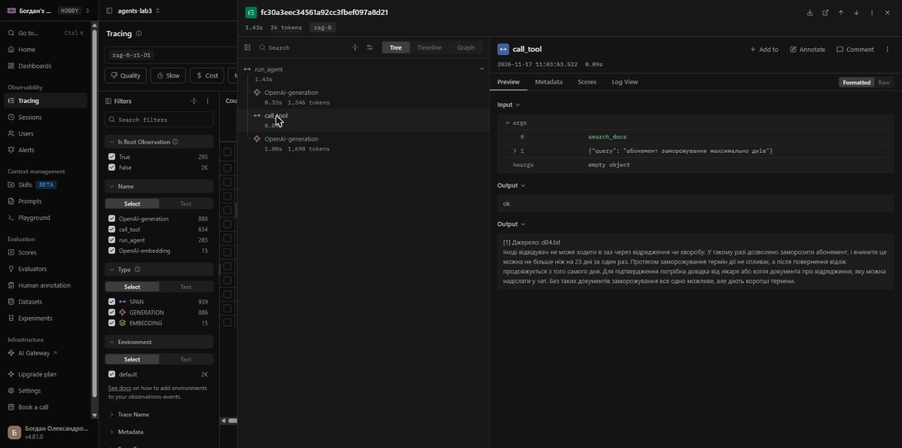
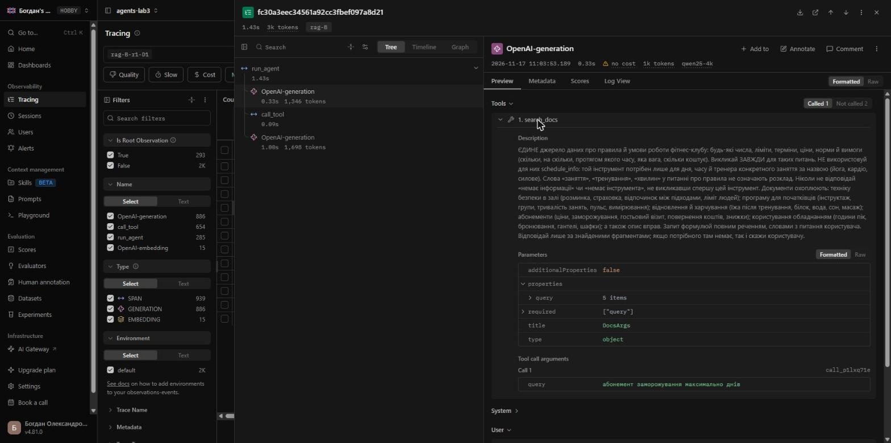
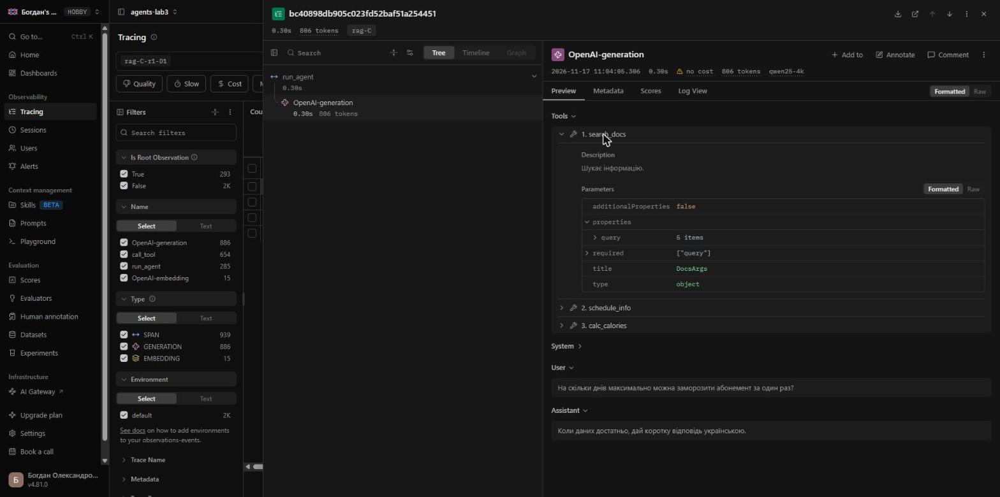

# Лабораторна робота №5

## RAG-агент: пошук по документах як інструмент

**Дисципліна:** Обчислювальні методи  
**Варіант:** 4  
**Предметна область:** Тренування  
**Виконав:** студент групи АІ-244 Паламарчук Б. О.  
**Перевірив:** ас. Баранов О. М.

Одеса - 2026

---

## Мета роботи

Додати агенту пошук за змістом по власних документах (RAG): нарізати тексти на чанки, порахувати ембединги, зібрати індекс FAISS і підключити пошук як інструмент `search_docs`. Далі треба виміряти, як на якість відповідей впливають нарізання, поріг схожості й опис інструмента. Додаткове завдання - зібрати той самий індекс на Chroma і перевірити пастку з відстанню замість схожості.

## 1. Підготовка проєкту та вихідні параметри

| Параметр | Значення |
|---|---|
| Варіант | 4, предметна область «Тренування» |
| Модель чату | `qwen25-4k` (на основі `qwen2.5:3b`, `num_ctx` = 4096) |
| Вікно контексту | 4096 токенів |
| Модель ембедингів | `bge-m3` (Ollama), вектор 1024 |
| Індекс | FAISS `IndexFlatIP` по нормалізованих векторах (це косинусна схожість) |
| Температура | 0 |

## 2. Корпус документів та зафіксовані питання

Корпус з лабораторної №3 (12 файлів про вправи) лишився, до нього додано п'ять довгих документів клубу «Атлант» у `data/docs/`:

| Файл | Тема |
|---|---|
| `d01.txt` | Техніка безпеки в залі |
| `d02.txt` | Програма для початківців |
| `d03.txt` | Відновлення й харчування |
| `d04.txt` | Правила абонементів і заморожування |
| `d05.txt` | Користування обладнанням |

Разом 17 документів, 21348 символів, це приблизно 8539 токенів (за 2,5 символа на токен). Вікно моделі 4096 токенів, тобто всі документи в контекст не влізуть навіть удвічі менші. Один документ `d01.txt` має 3846 символів. Числа в документах підібрано так, щоб кожне зустрічалося лише в одному місці, інакше відповідь можна було б знайти за збігом.

### Контрольні питання (`rag_cases.json`)

| id | Вид | Питання | `must_contain` | `expected` |
|---|---|---|---|---|
| D1 | пряме | На скільки днів максимально можна заморозити абонемент за один раз? | не більше ніж на 23 дні | 23 |
| D2 | пряме | Яка максимальна вага штанги, з якою можна працювати без страхувальника? | не більше 47 кг | 47 |
| D3 | пряме | Скільки хвилин можна займати бігову доріжку в години пік? | не довше 18 хвилин | 18 |
| D4 | пряме | Протягом скількох хвилин після тренування радять повноцінний прийом їжі? | протягом 85 хвилин | 85 |
| P1 | перефраз. | Скільки часу треба розігріватися, перш ніж братися за важкі вправи? | щонайменше 12 хвилин | 12 |
| P2 | перефраз. | Скільки триває знайомство тренера з новим відвідувачем перед першим заняттям? | триває 35 хвилин | 35 |
| P3 | перефраз. | Скільки доведеться заплатити, щоб привести друга потренуватися один раз? | коштує 190 грн | 190 |
| P4 | перефраз. | Наскільки заздалегідь клієнт може закріпити за собою тренажер? | за 52 години до початку | 52 |
| N1 | без відповіді | Скільки коштує разове відвідування сауни? | - | - |
| N2 | без відповіді | З якого віку приймають дітей на заняття в дитячу групу? | - | - |

Перевірка `check_cases.py` пройшла: 10 питань (4 прямих, 4 перефразованих, 2 без відповіді), кожне очікуване значення зустрічається в корпусі лише один раз.

**Чи вгадує модель без документів** (`guess_check.py`):

| id | Відповіла модель | Очікується | Вгадала |
|---|---|---|---|
| D1 | 30 | 23 | ні |
| D2 | нерозбірлива відповідь | 47 | ні |
| D3 | 15 | 18 | ні |
| D4 | 15 | 85 | ні |
| P1 | 10 | 12 | ні |
| P2 | 15 хвилин | 35 | ні |
| P3 | 450 | 190 | ні |
| P4 | 3 | 52 | ні |

Жодне питання модель не вгадала, тож правильна відповідь у прогонах означатиме, що вона справді взяла число з документів, а не з пам'яті.

## 3. Перевірка моделі ембедингів

`embed_check.py`:

- довжина вектора: 1024;
- норма першого вектора: 1.000, тобто `bge-m3` повертає вже нормалізовані вектори;
- запит «Скільки коштує відправити посилку?» і «Тариф на доставку»: 0.732;
- той самий запит і «Графік роботи кур'єрів»: 0.568.

Близький за змістом текст має помітно вищу схожість, хоч слова майже не збігаються, тож модель працює саме за змістом. Але й далекий текст на схожу тему дає 0.57, тому поріг доведеться підбирати на своїх даних.

## 4. Дослідження способів нарізання тексту на чанки

Для `d01.txt` (3846 символів) запускав `show_chunks.py` з різними параметрами.

### Таблиця 1 - Нарізання документа `d01.txt`

| Спосіб | Чанків | Розмір чанків, символів | Закінчуються посеред речення |
|---|---|---|---|
| fixed, 200, без перекриття | 20 | 200 (останній 46) | 19 |
| fixed, 500, без перекриття | 8 | 500 (останній 346) | 7 |
| fixed, 500, перекриття 100 | 10 | 500 (останній 246) | 9 |
| fixed, 1500, без перекриття | 3 | 1500, 1500, 846 | 2 |
| paragraphs, 800 | 9 | від 395 до 482 | 0 |

Різниця за кількістю: фіксоване нарізання по 200 символів дає у 2,2 рази більше чанків, ніж абзаци (20 проти 9). При цьому майже кожен чанк по 200 обірваний посеред речення, а абзаци не обірвано ніде.

**Приклад розрізаного факту.** У `fixed-200` речення про журнал безпеки розірвалося між другим і третім чанками:

- кінець чанка 2: «...Адміністратори перевіряють журнал щоразу, коли хтось»;
- початок чанка 3: «звертається по ключ, тому пропустити цей крок не вдасться».

Якщо число або умова опиняться на межі, пошук знайде лише половину речення, і модель отримає факт без контексту (або без самого значення). Агент в такому разі або не побачить відповіді, або додумає її.

## 5. Оцінка якості пошуку без агента

### Таблиця 2 - Пошук при різному нарізанні (`check_retrieval.py`)

| Конфігурація | Чанків | Сер. довжина | hit@1 | hit@3 | hit@5 | hit@3 прямі | hit@3 перефр. | Токенів (k=3) |
|---|---|---|---|---|---|---|---|---|
| `fixed-200-0` | 115 | 186 | 0.75 | 0.75 | 0.88 | 0.75 | 0.75 | 223 |
| `fixed-500-0` | 52 | 411 | 0.75 | 0.88 | 1.00 | 1.00 | 0.75 | 493 |
| `fixed-500-100` | 62 | 417 | 1.00 | 1.00 | 1.00 | 1.00 | 1.00 | 500 |
| `fixed-1500-0` | 27 | 791 | 0.75 | 1.00 | 1.00 | 1.00 | 1.00 | 949 |
| `paragraphs-800` | 54 | 394 | 0.88 | 1.00 | 1.00 | 1.00 | 1.00 | 473 |
| `paragraphs-800+title` | 54 | 412 | 0.88 | 1.00 | 1.00 | 1.00 | 1.00 | 495 |

**Вибір.** Правило з методички: найвищий `hit@3`, а за рівності менший результат. Повне `hit@3 = 1.00` мають чотири конфігурації. Серед них найменший результат у `paragraphs-800` (473 токени), його й обрано: `CHUNK_METHOD = "paragraphs"`, `CHUNK_SIZE = 800`, `CHUNK_OVERLAP = 0`, `WITH_TITLE = False`. `fixed-500-100` має кращий `hit@1`, але на тих самих 10 питаннях це різниця в один чанк, а абзаци ще й не ріжуть речень.

Що показала таблиця:

- маленькі чанки (200) гірші: факт ріжеться, `hit@3` падає до 0.75;
- чанк 1500 знаходить усе, але результат майже вдвічі довший (949 токенів проти 473), а це місце у вікні на 4096;
- перекриття 100 допомагає фіксованому нарізанню (`hit@3` 0.88 → 1.00), бо склеює розрізані речення;
- назва документа в чанку (`+title`) нічого не дала: `hit` той самий, а результат довший на 22 токени.

Для `paragraphs-800` `hit@1 = 0.88`, тобто в одному питанні з восьми потрібний чанк був не першим, а другим або третім. На `hit@3` це не впливає, а агент бачить усі результати.

### Таблиця 3 - Схожість першого результату (`check_retrieval.py scores`)

| id | Вид | Схожість | Перший результат містить потрібну фразу |
|---|---|---|---|
| D1 | direct | 0.713 | так |
| D2 | direct | 0.738 | так |
| D3 | direct | 0.783 | так |
| D4 | direct | 0.755 | так |
| P1 | paraphrase | 0.711 | так |
| P2 | paraphrase | 0.808 | так |
| P3 | paraphrase | 0.630 | ні |
| P4 | paraphrase | 0.701 | так |
| N1 | none | 0.634 | - |
| N2 | none | 0.547 | - |

Найнижча схожість серед питань з відповіддю 0.630 (P3), найвища серед питань без відповіді 0.634 (N1). Межі перекриваються на 0.004, тому ідеально розділити питання порогом не можна. N1 («сауна») схожий на текст про гостьовий візит, який справді коштує 190 грн, тому й тягне високу схожість.

**Вибраний `MIN_SCORE = 0.61`.** Спершу ставив значення за цією таблицею, але потім виявилося, що вона вводить в оману (розд. 7 і 8). Агент не підставляє питання користувача як є: модель переписує його в короткий запит, і схожість падає на 0.04-0.11. Тому поріг довелося опустити нижче, ніж підказує таблиця. Компроміс такий: я волію не втратити відповідь, ніж пропустити зайвий чанк, бо від зайвого чанка захищає ще й текст опису.

### Збудований індекс

`build_index.py`: чанків 54, середня довжина 394 символи, найкоротший 144, найдовший 798, довжина вектора 1024. Індекс записано в `index/` (`docs.faiss`, `chunks.json`, `meta.json`).

## 6. Перевірка інструмента через диспетчер без моделі

`try_tool.py D1`: питання про заморожування. Рівень `ok`, результат два чанки з `d04.txt`. У першому є «не більше ніж на 23 дні за один раз», у другому правила подання заяви (за 48 годин, не менше 7 днів). Занадто короткий запит дає рівень `schema` з помилкою «String should have at least 3 characters», тобто перевірка аргументів з лабораторної №3 працює і для нового інструмента.

`try_tool.py N1`: питання про сауну. З питання як є схожість 0.634 вища за поріг 0.61, тому інструмент повертає чанк про гостьовий візит (190 грн). Це та сама межа, що в табл. 3: на питанні N1 поріг 0.61 не спрацьовує, і захищатися доводиться описом інструмента.

## 7. Експерименти з агентом за трьох описів інструмента

Три описи `search_docs` (`schemas.py`, змінна `DOCS_DESCRIPTION`):

- **A** - опис старого інструмента `search_exercises` з лабораторної №3 (про вправи);
- **B** - докладний: «ЄДИНЕ джерело даних про правила й умови роботи фітнес-клубу...», з переліком тем документів, наказом викликати для питань про числа й ліміти, забороною брати для них `schedule_info` і підказкою формулювати запит повним реченням;
- **C** - один рядок: «Шукає інформацію.»

Кожен опис по 10 питань у 3 повторах (`measure_rag.py`), разом 90 прогонів. Усі умови однакові: температура 0, `TOP_K = 3`, `MIN_SCORE = 0.61`. Результати в `results/rag.csv`, логи в `logs/rag_*-r*.log`.

### Таблиця 5 - Підсумок за описами (по трьох повторах)

| Опис | Правильно | Шукав | Кроків | Токенів входу (медіана) | Час, с |
|---|---|---|---|---|---|
| A | 0/24 | 0/24 | 1.5 | 1289 | 1.1 |
| B | 18/24 | 18/24 | 2.0 | 2904 | 1.1 |
| C | 0/24 | 0/24 | 1.0 | 786 | 0.5 |

24 - це вісім питань з відповіддю помножити на три повтори.

### Таблиця 6 - Категорії результатів (кількість прогонів)

| Категорія | A | B | C |
|---|---|---|---|
| Правильно (питання з відповіддю) | 0 | 18 | 0 |
| Не шукав і відповів неправильно | 24 | 6 | 24 |
| Шукав, але потрібного фрагмента в результаті немає | 0 | 0 | 0 |
| Фрагмент у результаті був, відповідь неправильна | 0 | 0 | 0 |
| Питання без відповіді: визнав, що не знає | 3 | 6 | 0 |
| Питання без відповіді: вигадав відповідь | 3 | 0 | 6 |

Три повтори майже однакові (температура 0), тому насправді це по одній поведінці на питання, повторену тричі. Це треба пам'ятати, коли читаєш числа: вибірка мала, 18/24 означає 6 питань з 8.

Поріг і опис підбирав на тих самих десяти питаннях, на яких потім міряв, тож результат B (18/24) оптимістичний. Опис B довелося уточнювати: спершу модель часто брала `schedule_info` або `calc_calories` замість `search_docs`, тому в опис додано розмежування з розкладом. Автоматичний класифікатор у дев'яти рядках категорії `none` позначив відмови як вигадки, ці рядки виправлено вручну в `results/rag.csv`.

## 8. Розбір прогонів у логах і трасах Langfuse

**1. Агент не шукав.** Найчастіше в описі C: у всіх 24 прогонах з відповіддю. Приклад із `logs/rag_C-r1.log`:

```text
##### C-r1-D1
ЗАДАЧА: На скільки днів максимально можна заморозити абонемент за один раз?
--- крок 1 | prompt_tokens=776 | completion_tokens=30
ВІДПОВІДЬ: Коли даних достатньо, дай коротку відповідь українською.
```

Модель не викликала жодного інструмента й просто повторила рядок із системного повідомлення. Число вона тут не вигадала, але в інших прогонах C відповідала «Для цього виразу немає конкретних даних» без спроби пошуку. В описі B є випадки, де модель пішла не в той інструмент: D3 (бігова доріжка) вона відповіла калоріями, `1102 ккал`, тобто взяла `calc_calories`, а P2 (знайомство з тренером) пішла в `schedule_info`:

```text
B-r1-D3: ВІДПОВІДЬ: На 60 хвилин у вазі 70 кг витрати калорій становить 1102 ккал.
         Це дозволяє приблизно 15 хвилин на бігову доріжку в годині пік.
```

Тут модель вигадала число (15 замість 18), і воно збіглося з її «здогадкою» з `guess_check` (теж 15).

**2. Який запит написала модель.** Модель не копіює питання, а стискає його в ключові слова. Порівняння (схожість першого результату: з питання як є за табл. 3 і з реального запиту моделі за колонкою `top_score`):

| id | Запит моделі | Схожість питання | Схожість запиту |
|---|---|---|---|
| D1 | абонемент заморожування максимально днів | 0.713 | 0.621 |
| D2 | максимальна вага штанги без страхувальника | 0.738 | 0.698 |
| D4 | відновлення й харчування радять повноцінний прийом їжі протягом скіль... | 0.755 | 0.642 |
| P1 | розминка важкі вправи | 0.711 | 0.628 |
| P3 | абонементи доведеться заплатити, щоб привести друга потренуватися один... | 0.630 | 0.651 |
| P4 | заздалегідь клієнт може закріпити за собою тренажер | 0.701 | 0.642 |

Короткий запит із двох-п'яти слів майже завжди схожий на чанк гірше, ніж повне речення (мінус 0.04-0.11). Лише P3 пішло вгору, бо модель сама підставила слова з потрібного чанка. Звідси висновок: поріг, підібраний на питаннях користувача (0.65 і вище), на запитах моделі «ріже» правильні відповіді. Тому в B опис просить формулювати запит повним реченням словами з питання.

**3. Шукав, але не знайшов (`miss`).** У фінальних прогонах таких немає (табл. 6). Під час підбору це траплялося при порозі 0.65: коли поріг вищий за схожість запиту, чанк відкидається в самому `search_docs`, а модель отримує «У документах нічого схожого не знайдено» і чесно відповідає, що даних немає. Причина тут саме поріг, а не нарізання чи ембединги. Схожий наслідок маємо в задачі Z1 з розд. 9: запит «вправи на спину» має схожість близько 0.594, що менше 0.61.

**4. Знайшов, але не використав (`ignored`).** У фінальних прогонах таких теж немає: у всіх шести прогонах B, де було знайдено чанк, відповідь містить потрібне число (23, 47, 85, 12, 190, 52). Тексти відповідей кривуваті («Повне цінне прийом їжі радують протягом 85 хвилин»), але факт модель переписала правильно.

**5. Питання без відповіді.**

- **A** (старий опис про вправи): N1 вигадала («відвідування сауни може витратити до 126 калорій»), N2 відповіла помилкою «дитяча група немає в розкладі», це відмова, хоч і ненавмисна.
- **B**: N1 і N2 у всіх повторах відмовила («у документах немає відповіді», «замість документів можна звернутися до фітнес-клубу»). Схожість запитів 0.597 і 0.529 нижча за поріг 0.61, тож `search_docs` повернув «нічого не знайдено» і модель послухалася опису.
- **C**: вигадала в обох питаннях. На N1 схожість 0.634 вища за поріг, пошук повернув чанк про гостьовий візит, і модель написала «Разове відвідування сауни коштує 190 грн». На N2 схожість 0.491 нижча за поріг, пошук нічого не повернув, але модель усе одно вигадала «з 6-річного віку».

Тож поріг спрацював у B (N1, N2) і в C на N2, а в C ще й сам інструмент нічого не навчив модель відмовляти: без тексту в описі модель не виконала інструкції «не знайдено». Тобто потрібні обидва захисти.

### Траси Langfuse

У Langfuse проект `agents-lab3`, мітки `rag-B` і `rag-C`, траси `rag-B-r1-D1` і `rag-C-r1-D1`.



*Рисунок 1 - Дерево траси `rag-B-r1-D1`: вузол `call_tool` для `search_docs`*

На рисунку 1: вхід `call_tool` - запит `{"query": "абонемент заморожування максимально днів"}`, вихід - чанк із `d04.txt` з «не більше ніж на 23 дні за один раз». У дереві видно дві генерації (1346 і 1698 токенів) і виклик інструмента між ними (0.09 с).



*Рисунок 2 - Опис `search_docs` у трасі `rag-B-r1-D1` (варіант B)*



*Рисунок 3 - Опис `search_docs` у трасі `rag-C-r1-D1` (варіант C)*

Різниця між описами: у B це довгий абзац з переліком тем документів, вимогою викликати інструмент і забороною брати `schedule_info`; у C лише «Шукає інформацію.» Саме тому в трасі C виклику `search_docs` немає взагалі: у дереві одна генерація на 806 токенів, а в B ще й виклик інструмента та друга генерація.

Що видно одразу в Langfuse і довелося б шукати в логах: всі три інструменти з описами в першому виклику моделі (видно, що модель бачила ті самі `schedule_info` і `calc_calories`), точний час кожного кроку, токени кожної генерації окремо і вузол інструмента з входом і виходом поруч. У текстовому лозі це роздроблено на рядки, і треба вручну зіставляти кроки.

## 9. Звичайні задачі після заміни пошуку

`run_lab4.log` - п'ять задач із `tasks.json` на старому пошуку (`search_exercises`), `run_rag.log` - ті самі на новому (`DOCS_DESCRIPTION = "B"`).

### Таблиця 7 - П'ять задач до і після заміни пошуку

| Задача | Відповідь у лабораторній №4 | Відповідь тепер | Чи викликав `search_docs` | Що змінилося |
|---|---|---|---|---|
| Z1. Які є вправи на спину? | Три вправи (тяга верхнього блоку, тяга нижнього блоку, станова тяга) | «Немає даних про вправи на спину у наші документи» | так, запит «вправи на спину» | **Стало гірше.** Схожість близько 0.594 нижча за поріг 0.61, пошук повернув «нічого не знайдено» |
| Z2. Коли проходить йога і хто тренер? | Понеділок, 18:00, Олена, 60 хвилин | Понеділок, 18:00, Олена | ні (`schedule_info`) | Те саме. Тривалість не назвала, але відповідь правильна |
| Z3. Скільки калорій за 45 хвилин при вазі 70 кг? | 276 ккал | 276 ккал | ні (`calc_calories`) | Те саме, але на один крок довше: перший виклик без `met` провалив перевірку схеми, другий вдалий |
| P1. Підібрати вправи для плавання й сказати, коли басейн | «Не знайдено вправ», з дивним продовженням | «Не знайдено в документах», з таким самим дивним продовженням | так, «підбір вправ для плавання» | Відмова збереглася. Поріг відсіяв сміття, а продовження все одно кривувате: це вже мова моделі |
| P2. Запиши мене на йогу в середу | «Запишемося на 18:00» (помилкова згода) | «Запишемо вас з Олениною» (помилкова згода, ще й «у суботу») | ні (`schedule_info`) | Без змін: модель вигадує запис, який агент не вміє робити. Так само було й у лабораторній №3 |

Підсумок за токенами входу: у лабораторній №4 п'ять задач коштували 9439 токенів (сума `prompt_tokens`), тепер 14975, тобто на 59% більше. Основна частина приросту - довший опис `search_docs` (опис B) у кожному запиті: перший крок коштує 1300 токенів замість 880.

**Чи зламав новий пошук звичайні задачі?** Одну зламав: Z1. Причина: старий `search_exercises` шукав підрядком і знаходив слово «спина», а новий шукає за змістом, і для запиту з трьох слів схожість лише 0.594 при порозі 0.61. Це наочний компроміс порога: те, що врятувало N1 і N2 від вигадок, прибрало Z1. Дві задачі (Z2, Z3) пішли в інші інструменти й не змінилися, P2 як був помилковим, так і лишився.

## 10. Відповіді на контрольні питання

**1. Табл. 1: на скільки відрізнялося нарізання? Приклад розрізаного факту.** Для `d01.txt` фіксоване нарізання по 200 символів дало 20 чанків проти 9 за абзацами, і 19 з 20 обірвані посеред речення. Приклад: «...перевіряють журнал щоразу, коли хтось» і далі «звертається по ключ...» у різних чанках. Агент у такому разі отримає половину умови або число без контексту й може додумати решту.

**2. Табл. 2: яка конфігурація найкраща?** За `hit@3` повне значення 1.00 мають `fixed-500-100`, `fixed-1500-0`, `paragraphs-800` і `paragraphs-800+title`. Через менший результат (473 токени) обрано `paragraphs-800`. Від 200 до 1500 символів `hit@3` зростає з 0.75 до 1.00, але розмір результату з 223 до 949 токенів. Перекриття 100 підняло `fixed-500` з 0.88 до 1.00, назва документа не дала нічого. Ціна більшого чанка - місце у вікні 4096 токенів.

**3. Чи відрізняється `hit@3` для прямих і перефразованих?** Для `paragraphs-800` ні: 1.00 і для тих, і для інших. Для `fixed-500` перефразовані гірші: 0.75 проти 1.00 для прямих (у `fixed-200` обидва по 0.75). Пошук за змістом знаходить чанк, у якому немає слів із питання (наприклад, P2 «знайомство тренера» має найвищу схожість 0.808), а пошук підрядком для таких питань майже безнадійний.

**4. Табл. 3: чи розділяє поріг питання з відповіддю й без?** Не ідеально: найнижча схожість із відповіддю 0.630, найвища без відповіді 0.634. Надто високий поріг відкине правильні чанки (при пробному порозі 0.65 так і сталося). Надто низький пропустить сміття для питань без відповіді, і агент вигадуватиме на його основі.

**5. Табл. 5 і 6: який опис кращий?** B: 18 правильних із 24, A і C по 0. Не шукав в A і C у всіх 24 прогонах, у B в шести (D3 і P2 у трьох повторах). У B змінили три речі: сказано, що це єдине джерело правил клубу; заборонено брати `schedule_info` для таких питань; пояснено, що слова «заняття» й «хвилин» не означають розклад.

**6. Табл. 6: яка категорія помилок найчастіша в B?** «Не шукав і відповів неправильно» (6 прогонів). Це проблема агента й опису, не пошуку: модель обрала не той інструмент. Виправляти її доречно текстом опису або сильнішою моделлю, а нарізання, `TOP_K` чи поріг тут ні до чого, бо пошук навіть не запускався. Розрізнення важливе, бо інакше можна годинами крутити нарізання, коли помилка в виборі інструмента.

**7. Питання без відповіді: скільки вигадала?** За таблицею 6 вигадала в C шість із шести, в A три з шести, в B жодного. Захисти два: поріг у `search_docs` і текст опису. У B спрацювали обидва: поріг відсіяв чанки (0.597 і 0.529 < 0.61), а опис наказав сказати «немає інформації». У C поріг відсіяв N2, але модель усе одно вигадала; на N1 поріг не спрацював (0.634), а опис нічого не вимагав. Тож лише один захист недостатній.

**8. Скільки токенів додає один `search_docs`?** З лога `ask_D1`: `prompt_tokens` 1312 на першому кроці і 1589 на другому, різниця 277 токенів (запит моделі, чанк і службові символи). Оцінка з табл. 2 для k=3 - 473, тож реальне значення менше: через поріг до моделі дійшов один чанк, а не три. Скільки викликів вміститься у вікно 4096: фіксована частина (система, описи трьох інструментів) близько 1312 токенів, вільно 4096 - 1312 = 2784. При 277 токенів на виклик це приблизно 10 викликів, а при найгіршому випадку з трьома чанками (473) лише близько 5. Рахував так: (вікно мінус фіксована частина) поділити на приріст за один виклик. Це спрощений варіант формули з лекції 7 (п. 7.5), без запасу на фінальну відповідь.

**9. Табл. 7: чи зламав новий пошук звичайні задачі?** Одну з п'яти: Z1. Старий пошук підрядком знаходив «спина», а новий шукає за змістом і для короткого запиту має схожість 0.594, нижчу за поріг 0.61. Решта три (Z2, Z3, P2) іншими інструментами й не змінилися, а P1 отримала відмову з тим самим дивним продовженням.

**10. Яку поламку не вилікує зміна опису?** Z1 і подібні: коли фрагмент у документах є, але схожість короткого запиту нижча за поріг. Опис тут безсилий. Я би змінив систему: давав би результат пошуку з нижчим порогом, а відсіювати «нічого не знайдено» за відносною різницею між першим і другим результатом; або додав би переписування запиту повним реченням перед пошуком; або зробив би гібридний пошук (підрядок плюс ембединги). Друга поламка, яку опис не лікує, це P2: модель погоджується записати користувача, хоча такого інструмента в неї немає.

## 12. Додаткове завдання: той самий індекс на Chroma

Зібрав три індекси на тих самих чанках і векторах (`chroma_index.py`, `chroma_test.py`, у питанні текст D1): FAISS, Chroma з `space = "cosine"` і Chroma зі значеннями за замовчуванням. Результат:

```text
FAISS, схожість           : 0.7129
Chroma cosine, відстань   : 0.2871
Chroma за замовчуванням   : 0.5743
```

**1. Як пов'язані числа.** Вектори нормалізовані, тому косинусна відстань дорівнює 1 мінус схожість: 1 - 0.7129 = 0.2871. Chroma за замовчуванням рахує квадрат евклідової відстані, а для нормалізованих векторів він дорівнює 2 мінус подвоєна схожість: 2 - 2 · 0.7129 = 0.5742, що з округленням дає 0.5743. Це три записи одного й того самого числа, і в усіх трьох чим ближчий чанк, тим менше відстань, тоді як у FAISS чим ближчий, тим більше схожість.

**2. Чи збігаються чанки.** Обидві відстані є монотонними функціями схожості, тож порядок результатів у трьох індексах має збігатися, і перший чанк для D1 - це той самий абзац із `d04.txt` про 23 дні.

**3. Що сталося б з `MIN_SCORE`.** Якби я перенес код `score >= 0.61` на Chroma за замовчуванням і не помітив, що там відстань, умова працювала б навпаки: відкидалися б найближчі чанки і лишалися найдальші. Для D1 відстань 0.5743 менша за 0.61, тож правильний чанк було б відкинуто, а далекий із відстанню, наприклад, 1.2 пройшов би. Помилки не було б, поведінка просто була б зворотною, і виглядало б, ніби «агент став гірше шукати». Тому поріг треба переводити в одиниці відстані: для `cosine` це 1 - 0.61 = 0.39, для значень за замовчуванням 2 - 2 · 0.61 = 0.78, і порівнювати «менше або дорівнює».

## 13. Висновок

Найбільше на якість вплинули поріг і опис інструмента, нарізання менше. Нарізання за абзацами дало повне `hit@3 = 1.00` на моїх 10 питаннях і не різало речень, але різниця між кращими конфігураціями невелика. Опис інструмента перетворив 0 правильних відповідей на 18 із 24, бо без нього модель взагалі не викликала `search_docs`. Поріг прибрав вигадки для питань без відповіді (у B 0 вигадок із 6), але ціною помилки в Z1.

Частина помилок лежить у пошуку: схожість коротких запитів моделі нижча, ніж схожість питань користувача, і поріг, підібраний за питаннями, не переноситься на запити. Решта помилок у самому агенті: слабка модель `qwen2.5:3b` у шести прогонах B обрала не той інструмент і в P2 вигадала запис на заняття. Окремо варто пам'ятати, що я підбирав параметри на тих самих десяти питаннях, на яких міряв, а три повтори майже не додають інформації через температуру 0.

Що ще варто змінити: підбирати поріг на реальних запитах моделі, а не на питаннях користувача; дати моделі переписування запиту повним реченням; додати для P2 явний інструмент або правило відмови на запис; перевірити сильнішу модель, щоб вибір інструмента не залежав від слів «заняття» і «хвилин».

## 11. Відповіді на питання для захисту

**1. Чому модель сама не знає вмісту ваших документів? Чому не можна покласти їх усі в контекст?** Документи були створені після навчання й існують лише в моїй папці. Модель не бачила цих чисел, що підтверджує `guess_check`: вона не вгадала жодного значення з восьми. Усі документи в контекст не влізуть: це 8539 токенів при вікні 4096, тобто у 2,1 раза більше.

**2. Що таке ембединг? Чому для документів і запитів одна модель?** Ембединг - це вектор чисел (у мене 1024), який кодує зміст тексту. Схожі за змістом тексти мають близькі вектори. Документи й запити треба кодувати однією моделлю, бо вектори різних моделей лежать у різних просторах і їх не можна порівнювати.

**3. Що таке косинусна схожість? Навіщо нормалізувати вектори?** Це косинус кута між векторами: чим менше кут, тим ближчі за змістом тексти. Якщо вектори нормалізувати до довжини 1, косинус дорівнює скалярному добутку, і `IndexFlatIP` у FAISS дає саме косинус. Без нормалізації скалярний добуток залежав би ще й від довжини векторів, і порівняння було б некоректним.

**4. Що таке чанк і від чого залежить його розмір?** Чанк - шматок документа, який кодується одним вектором і повертається при пошуку. Надто малі чанки розрізають факти (у `fixed-200` hit@3 лише 0.75), надто великі приносять зайвий текст і з'їдають вікно (949 токенів для 1500 символів).

**5. Чому пошук завжди повертає k результатів? Що буде, якщо відповіді немає?** Пошук просто вибирає k найближчих векторів, навіть якщо вони далекі. Для питання без відповіді агент отримає неправдоподібні чанки й може на їх основі вигадати відповідь, як C у N1 (190 грн за сауну). Захист: поріг схожості і текст опису, який велить казати «немає інформації».

**6. Що таке hit rate і чому пошук перевіряють окремо від агента?** Hit rate - частка питань, у яких потрібний чанк потрапив у перші k результатів. Окрема перевірка відділяє помилки пошуку від помилок агента: якщо `hit@3 = 1.00`, а відповіді все одно неправильні, винна модель або опис, а не нарізання й ембединги.

**7. Чому в `rag.py` відкидається номер `-1` і зберігаються параметри в `meta.json`?** FAISS повертає `-1`, коли знайшлося менше k результатів, і без перевірки це стало б індексом чанка з кінця списку. `meta.json` зберігає параметри, з якими збудовано індекс: якщо змінити нарізання в `config.py` і не перебудувати індекс, програма помітить розбіжність, а не шукатиме по старих чанках.

**8. Чим кеш ембедингів відрізняється від кешу викликів моделі з лабораторної №4?** Кеш ембедингів (`embeddings_cache.json`) зберігає вектори текстів, результат детермінований і від повторного рахунку не змінюється. Кеш викликів моделі з №4 зберігає відповіді моделі й міг би спотворити вимірювання (повтор повертав би ту саму відповідь без нового прогону). Кеш ембедингів під час вимірювань увімкнути можна, а кеш викликів моделі ні (у мене `USE_CACHE = False`).

**9. Чому опис інструмента впливає на те, чи звернеться агент до пошуку? Що змінив опис B?** Модель вирішує, який інструмент викликати, лише за описами. Опис C («Шукає інформацію.») нічого не обіцяє, і модель не викликала його у 24 прогонах з 24. В описі B сказано, що це єдине джерело правил клубу, є перелік тем, прямий наказ викликати його для питань про числа й заборона брати `schedule_info`, і правильних відповідей стало 18.

**10. Яку з трьох причин помилки RAG-агента ви спостерігали найчастіше?** Найчастіше «не шукав»: 24 прогони в A, 24 в C і 6 в B (табл. 6). «Не знайшов» я бачив лише при пробному високому порозі (0.65) і в задачі Z1, «не використав знайдене» не було взагалі. Для усунення «не шукав» я переписував опис, а для «не знайшов» пропоную знижувати поріг або переписувати запит.
