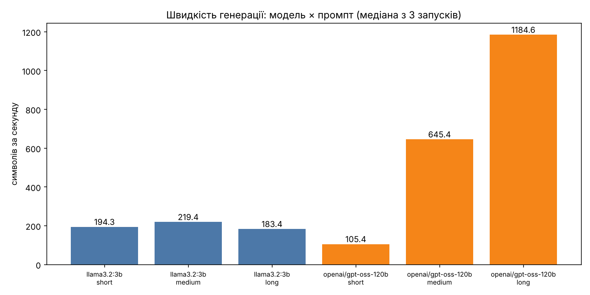

# Лабораторна робота №1
## Розгортання середовища та порівняльний аналіз мовних моделей

**Дисципліна:** Агенти (обчислювальні методи)  
**Варіант:** 18 (за таблицями 1–10 — варіант 8)  
**Виконав:** студент групи АІ-244 Русаков Яків  
**Перевірив:** ас. Баранов О.М.  
**Одеса — 2026**

---

## Конфігурація

- ОС / GPU: Google Colab (Linux, віртуальна машина з GPU NVIDIA T4); CPU/RAM окремо не знімалися
- Ollama: остання версія, встановлена скриптом `install.sh` у Colab; моделі: `llama3.2:3b`, `qwen3:4b`
- Хмарний провайдер: Groq (`https://api.groq.com/openai/v1`), модель `openai/gpt-oss-120b`
- Python: 3.x (середовище Google Colab)

## Завдання 1. Міркувальна vs інструктивна модель (`task1_reasoning.py`, `task1_results.json`)

Дані — з реального запуску в Google Colab (GPU T4, Ollama). Сирі дані — у `task1_results.json`. Першому запиту до моделі передує її завантаження, тому час першого запиту може бути більшим.

*Фактичне питання* («Столиця України? Відповідай одним словом.»)

| Показник | qwen3:4b | llama3.2:3b |
|---|---|---|
| `response` | «Київ» | «Київ.» |
| `eval_count` | 723 | 5 |
| Час, с | 16.3 | 2.2 |
| Токенів/с | 55.9 | 86.1 |

*Задача на міркування (середнє з 5 запусків; правильна відповідь — 5 грн)*

| Показник | qwen3:4b | llama3.2:3b |
|---|---|---|
| Правильних із 5 | 5 | 0 |
| `eval_count` | 1184 | 201 |
| Час, с | 24.6 | 3.4 |

Окремі запуски. qwen3:4b: eval_count 1180 / 1116 / 1427 / 1162 / 1037, час 23.6 / 24.9 / 29.3 / 23.6 / 21.5 с — у всіх п'яти відповідь «5 грн» через систему рівнянь і перевірку. llama3.2:3b: відповіді 50, 90, 100, 100, 100 грн — жодної правильної; у всіх п'яти відповідь написана російською й суржиком («Давайте проанализируем ситуацию…»), хоча питання українською. Прапорець `correct_auto` у JSON хибний для всіх запусків qwen3:4b: автоперевірка шукала «5 грн», а модель записує відповідь як `\boxed{5}`. Тому кількість правильних визначено вручну, прочитавши відповіді.

**Спостереження.** (1) На простому питанні qwen3:4b згенерував у 145 разів більше токенів (723 проти 5) за ту саму відповідь «Київ». Швидкість генерації близька (56 і 86 токенів/с), а загальний час на задачі міркування різниться в ~7 разів (24.6 проти 3.4 с) — через обсяг роботи. (2) У першому запуску цього завдання qwen3:4b на те саме питання відповів «Киев» (російською), у другому — «Київ»: відповідь моделі недетермінована. (3) Саме на задачі з пасткою (інтуїтивно «10 грн») перевагу міркувальної моделі видно найкраще: 5/5 проти 0/5.

**Відповіді чат-бота на 5 питань (стисло)**

1. *Куди пішли токени?* У прихований ланцюжок міркувань («thinking»): модель спершу розписує варіанти, перевіряє себе й лише потім видає коротку відповідь. Ці токени генеруються й рахуються в `eval_count`, хоча користувач їх не бачить (у нас 723 токени проти 5 за однакове «Київ»).
2. *Де міркувальні моделі виграють?* На задачах із кількома кроками, пастками й перевіркою (арифметика, логіка, код, планування); у нас 5/5 проти 0/5 на задачі про ручку й зошит. На простих фактах, форматуванні й перефразуванні вони невиправдані: дорожче й повільніше без виграшу в якості.
3. *Чим відрізняється навчання?* Інструктивна модель донавчається на парах «інструкція — відповідь» і за оцінками людей. Міркувальну додатково навчають з підкріпленням на задачах із перевірною відповіддю, заохочуючи довгі ланцюжки міркувань, що ведуть до правильного результату.
4. *Чи означає більше токенів «розумніша»?* Ні: кількість токенів — це витрати, а не якість. На простому питанні вони були зайвими; користь залежить від типу задачі.
5. *Чому різна швидкість (токенів/с)?* Розмір і архітектура моделі (4B проти 3B), довжина контексту, який росте під час довгого міркування, квантизація та навантаження GPU. У нас 56 проти 86 токенів/с; різниця в загальному часі (24.6 проти 3.4 с) переважно від кількості токенів.

**Мої висновки.** Міркувальну модель варто вмикати лише там, де інтуїтивна відповідь може бути хибною (задачі з пасткою), і не використовувати для простих фактів. Інструктивна мала модель швидка, але на логіці дає впевнено хибні відповіді й до того ж відповіла російською на україномовне питання. Автоперевірку відповіді (`correct_auto`) треба ретельно налаштовувати: вона не розпізнала правильні відповіді у форматі `\boxed{5}`.


## Завдання 2. Роль system-повідомлення (`hello.py`)

Питання варіанта: «Поясни різницю між реляційною і документоорієнтованою базою даних.» (`temperature=0.7`). Кількість речень — оцінка скрипта за розділовими знаками.

| Модель | System | Довжина відповіді, символів | Мова відповіді | Кількість речень | Інструкцію виконано? |
|---|---|---|---|---|---|
| llama3.2:3b | лаконічний асистент | 2126 | українська, але з вкрапленнями чужих слів («tabela», «dokumentів», «różниці», «Each», «flexibility») | ≈18 | ні: відповідь розгорнута, а не лаконічна |
| llama3.2:3b | українською, 2 речення | 308 | українська з одним чужим словом («liênками», «Documentоорієнтованої») | 2 | так (довжина й кількість речень), мова з дефектами |
| qwen3:4b | лаконічний асистент | 141 | українська | 3 | так |
| qwen3:4b | українською, 2 речення | 298 | українська | 2 | так |

| Модель | System | `prompt_tokens` | `completion_tokens` | `total_tokens` |
|---|---|---|---|---|
| llama3.2:3b | лаконічний асистент | 60 | 641 | 701 |
| llama3.2:3b | українською, 2 речення | 64 | 91 | 155 |
| qwen3:4b | лаконічний асистент | 69 | 3107 | 3176 |
| qwen3:4b | українською, 2 речення | 78 | 638 | 716 |

**Відповіді на питання**

1. *Яка модель точніше дотрималась обмеження «максимум двома реченнями»?* Обидві вклалися у 2 речення з другим system-повідомленням. Але з першим («лаконічний асистент») llama3.2:3b видала ≈18 речень, а qwen3:4b — стислі 141 символ. Тому інструкціям щодо довжини надійніше слідує qwen3:4b.
2. *Чи були випадки, коли модель відповіла не українською?* Повністю російською чи англійською — ні, але llama3.2:3b в обох відповідях вставляла слова іншими мовами й алфавітами («tabela», «różниці», «Each», «liênками»). У qwen3:4b таких дефектів не було (проте на простому питанні в завданні 1 він відповів «Киев» російською).
3. *Як змінився `prompt_tokens`?* Він зріс на 4 (llama: 60→64) і на 9 (qwen: 69→78), бо друге system-повідомлення довше: токени системного тексту входять у запит. Різниця між моделями — через різні токенізатори й службову розмітку шаблону чату.
4. *Чому в qwen3:4b `completion_tokens` значно більший?* Токени прихованого міркування (`thinking`) теж рахуються як згенеровані: 3107 токенів при 141 символі видимого тексту.

**Відповіді чат-бота на 5 питань (стисло)**

1. *Чому по-різному дотримуються інструкцій?* Модель не «виконує команди», а продовжує текст за найімовірнішим сценарієм, сформованим навчанням. Інструкції про довжину й мову конкурують зі звичками моделі (детальні відповіді на питання про бази даних), і слабша модель частіше виграє на користь звички.
2. *Чи має system більший пріоритет?* Формально це лише інша роль у шаблоні чату; пріоритет вчать під час донавчання, тому він не абсолютний і залежить від моделі. Тому system-повідомленню довіряють більше, ніж user, але без гарантій.
3. *Чому міркувальна модель витрачає більше токенів?* Бо приховане міркування рахується як вихідні токени, навіть коли видима відповідь коротка (у нас 3107 токенів при 141 символі).
4. *Що буде при суперечливих інструкціях?* Зазвичай модель надає перевагу system, але результат нестабільний: може виконати user-інструкцію, змішати обидві або відповісти невпевнено. Тому суперечностей у промптах краще уникати.
5. *Чому малі моделі гірше дотримуються мови?* Менше параметрів і менше україномовних даних у навчанні; модель легко «зісковзує» на домінуючу мову (англійську, російську), а в довгій відповіді помилки накопичуються (у нас чужі слова й алфавіти в llama3.2:3b).

**Мої висновки.** System-повідомленням можна керувати поведінкою, але не надійно: llama3.2:3b проігнорувала «лаконічність» (≈18 речень), хоча з жорсткішою інструкцією («2 речення») впоралася. Тому інструкцію треба формулювати конкретно (кількість речень, мова), а критичні вимоги перевіряти кодом і за потреби повторювати запит або міняти модель.


## Завдання 3. Локальна vs хмарна модель (`providers.py`, `compare.py`)

Питання варіанта: «Поясни різницю між реляційною і документоорієнтованою базою даних. Коротко.» (`temperature=0.7`; локально — Ollama на GPU Google Colab).

| Показник | Локальна | Хмарна |
|---|---|---|
| Назва моделі | llama3.2:3b | openai/gpt-oss-120b (Groq) |
| Час відповіді, с | 12.97 (у першому запуску — 43.28: модель завантажувалась у пам'ять) | 1.45 |
| `completion_tokens` | 215 | 537 (з них 51 — `reasoning_tokens`) |
| Довжина відповіді, символів | 765 | 1449 |
| Мова відповіді | українська з дефектами: арабська літера в слові («ذakhистовуються»), «tabel», русизм «ключей», нісенітниця «Наглянувши ці відрізи» | українська, природна; термінологія (ACID, JOIN, шардинг) коректна |
| Фактичних помилок у відповіді | ≈2–3 (оцінка): CSV названо форматом документів; «SEARCH» подано як запит документних БД; таблиці описано як «множество даних» | 0 (оцінка) |

Оцінка кількості помилок суб'єктивна: перевірте її самі, перечитавши відповіді вище.

**Відповіді на питання**

1. *Скільки рядків коду довелося змінити?* У програмі — жодного: `compare.py` однаковий для обох провайдерів. Відмінності винесено в словник `PROVIDERS` у `providers.py` — три значення: `base_url`, `api_key`, `model`.
2. *Яка відповідь повніша й точніша?* Хмарна. Вона називає транзакції ACID, різницю в масштабуванні (вертикальне проти горизонтального), роль JOIN і приклади СУБД (PostgreSQL, MongoDB). Локальна вигадує «SEARCH» як запит і плутає формати.
3. *Чи були в локальної моделі помилки або проблеми з українською?* Так: чужі символи й слова (арабська літера, «tabel»), русизм «ключей», кострубаті фрази.
4. *Чому хмарна відповіла швидше, попри мережу?* Хмарна модель працює на спеціалізованому серверному обладнанні й завжди завантажена, а її відповідь пішла зі швидкістю в сотні токенів за секунду. У локальній відповіді час 12.97 с включає повторне завантаження моделі в пам'ять (`cached_tokens=0`), тому порівняння не зовсім рівне; мережева затримка (десятки мілісекунд) на тлі секунд генерації майже не впливає.

**Додатково.** Хмарна модель проігнорувала слово «Коротко»: видала довгу структуровану відповідь із markdown (537 токенів проти 215), тобто більша модель не гарантує виконання інструкції про довжину.

**Відповіді чат-бота на 5 питань (стисло)**

1. *Чому формат OpenAI став стандартом?* OpenAI першою масово зробила API чат-моделей, і навколо нього з'явилися бібліотеки й інструменти. Провайдери (Groq, Ollama та інші) підтримують сумісний інтерфейс, щоб користувачі переходили без переписування коду.
2. *Наскільки розмір впливає на якість?* Сильно для знань, міркування й мовної якості, але не єдиний фактор: важливі дані навчання, донавчання, квантизація, промпт і параметри. У нашому прикладі різниця велика: 3B вигадує факти, 120B відповідає точно.
3. *Чому хмарна швидша попри мережу?* Потужні серверні GPU, відсутність завантаження моделі (вона вже в пам'яті) й оптимізований інференс дають сотні токенів/с; мережева затримка (десятки мс) мала порівняно з виграшем.
4. *Ризики приватності?* Дані покидають вашу інфраструктуру: можливі зберігання, логування, навчання на запитах, витоки. У комерційних проєктах використовують угоди про обробку даних (DPA), режим без збереження, маскування персональних даних, приватні розгортання або локальні моделі.
5. *Що таке rate limit?* Обмеження на кількість запитів і токенів за період на безкоштовному тарифі. Його «обходять» легально: кешують відповіді, групують запити, повторюють із затримкою (backoff), чергують моделі або переходять на платний тариф.

**Мої висновки.** Локальну модель обираю, коли дані конфіденційні, потрібна робота без мережі або завдання просте й формальне (форматування, витяг даних із наданого тексту). Хмарну — коли потрібні знання, міркування й гарна українська, а передача даних назовні допустима. Різниця в якості між llama3.2:3b і gpt-oss-120b на нашому питанні така велика, що для змістовних відповідей локальна 3B-модель недостатня.


## Завдання 4. Швидкість: TTFT (`benchmark.py`, `results.csv`, `chart.py` → `chart.png`)

Промпти варіанта: короткий — «Столиця Мексики?»; середній — «Поясни в одному абзаці, що таке рекурсія.»; довгий — «Напиши інструкцію з 10 пунктів, як задокументувати проєкт.» Медіана з 3 повторів після прогріву; значення — з другого (теплого) запуску `benchmark.py`.

| Розміщення | Модель | Промпт | TTFT, с | Всього, с | Симв./с |
|---|---|---|---|---|---|
| локальна | llama3.2:3b | короткий | 0.029 | 0.502 | 194.3 |
| локальна | llama3.2:3b | середній | 0.033 | 1.430 | 219.4 |
| локальна | llama3.2:3b | довгий | 0.073 | 8.303 | 183.4 |
| хмарна | openai/gpt-oss-120b | короткий | 0.375 | 0.414 | 105.4 |
| хмарна | openai/gpt-oss-120b | середній | 0.350 | 0.618 | 645.4 |
| хмарна | openai/gpt-oss-120b | довгий | 0.353 | 2.285 | 1184.6 |

*Холодний і теплий старт локальної моделі.* Холодний — перший запит (прогрів «розігрів») одразу після `ollama stop llama3.2:3b`; теплий — перший запит наступного запуску, коли модель вже в пам'яті. Порівнювати варто TTFT: повний час залежить від довжини відповіді.

| Показник | Холодний старт | Теплий старт |
|---|---|---|
| TTFT, с | 4.484 | 0.446 |
| Всього, с | 8.731 | 6.534 |



**Відповіді на питання**

1. *У якої моделі кращий TTFT і чому?* У локальної: 0.03–0.07 с проти 0.35–0.38 с у хмарної. Запит не йде мережею, модель мала й уже в пам'яті GPU; у хмарної в TTFT входять мережева дорога, TLS, черга на сервері й обробка запиту великою моделлю.
2. *Чи збігається «найшвидша за TTFT» з «найшвидшою за символами/с»?* Ні. За TTFT виграє локальна, а за швидкістю генерації на середньому й довгому промптах — хмарна (645 і 1185 симв./с проти 219 і 183). На короткому промпті локальна швидша й за символами/с (194 проти 105), бо відповідь коротка й домінує накладна затримка хмари.
3. *Як змінилося співвідношення при переході від короткого до довгого?* На короткому загальний час майже однаковий (0.50 с локальна проти 0.41 с хмарна). На довгому хмарна швидша приблизно в 3.6 раза за загальним часом (2.3 проти 8.3 с) і в 6.5 раза за симв./с: початкова затримка поступається швидкості генерації.
4. *Наскільки різняться три повтори? Чи достатньо одного запуску?* TTFT повторів коливається в межах десятків відсотків (хмара довгий: 0.298–0.412 с; локальна довгий: 0.040–0.077 с). Показові й два запуски скрипта: медіана `total_s` довгого промпту локальної моделі була 4.5 с в одному запуску і 8.3 с у другому (різна довжина відповіді). Одного вимірювання недостатньо.
5. *Чому холодний старт повільніший?* Під час холодного старту ваги моделі читаються з диска й завантажуються в пам'ять GPU, і лише потім починається обробка запиту: TTFT 4.48 с проти 0.45 с.

**Відповіді чат-бота на 5 питань (стисло)**

1. *Що відбувається під час TTFT?* Модель обробляє весь вхідний запит (prefill), будує кеш уваги й генерує перший токен; для хмари додаються мережа, TLS і черга. Його вимірюють окремо, бо він визначає відчуття «чат відповідає одразу», а швидкість генерації — як швидко відповідь дописується.
2. *Чому хмара може мати гірший TTFT, але кращу швидкість?* Мережева дорога й черга додають десятки-сотні мс до першого токена, а потужне обладнання потім генерує токени набагато швидше (у нас 0.35 с TTFT, але 1185 симв./с на довгому промпті проти 183 локально).
3. *Що таке холодний старт?* Перший запит після простою вимагає завантажити ваги з диска в пам'ять (GPU); у нас TTFT 4.48 с проти 0.45 с у теплому режимі.
4. *Чому медіана?* Окремі запуски дають викиди через завантаження системи, мережу, кеші; медіана стійка до викидів, одне значення — ні.
5. *Чому вхід обробляється швидше за генерацію?* Вхідні токени обробляються паралельно одним проходом, а вихідні генеруються по одному, кожен залежить від попереднього.

**Мої висновки.** Для інтерактивного чат-бота важливіший TTFT (відчуття миттєвої реакції) і стабільність, для фонової обробки великих обсягів тексту — пропускна здатність (токени або символи за секунду) і ціна. У наших вимірах локальна модель виграє за TTFT, а хмарна — за швидкістю на довгих відповідях.


## Завдання 5. Якість за рубрикою (`quality.py`, `quality.json`, `check_format.py`)

Завдання варіанта 8 (тема «Туризм»):

1. Факт: рік відкриття нинішньої будівлі Одеського оперного театру. **Правильна відповідь: 1887** (відкрито 13 жовтня 1887 р.). Джерело: [Вікіпедія — Одеський театр опери та балету](https://uk.wikipedia.org/wiki/Одеський_національний_академічний_театр_опери_та_балету).
2. Формат: JSON `landmark`, `city`, `year`.
3. Стиснення тексту про Одеський оперний театр до двох речень зі збереженням чисел (1810, 800, 1873, 1884, 1887, 2007; текст — у `quality.py`).
4. Код: `trip_cost(days, daily_cost, transport)` = `days * daily_cost + transport`.
5. Логіка: поїздка 6 днів, житло 900/добу, їжа 500/день, дорога 2400, троє, житло й дорога порівну. Прийнято трактування «їжа 500/день — на людину»: (6·900 + 2400)/3 + 6·500 = 2600 + 3000 = **5600 грн**. Альтернативне трактування (їжа 500/день — спільний бюджет групи) дає 2600 + 1000 = 3600 грн; нижче вказано, як змінилися б оцінки.
6. Українська мова: «Чим хостел відрізняється від готелю».

Оцінки виставлено за рубрикою з методички; для кожної моделі враховано обидва прогони (оцінки двох прогонів збіглися в усіх 18 випадках, тому розбіжностей між оцінками немає). Оцінки — мої; перевірте їх, перечитавши `quality.json`, і за потреби виправте.

| Завдання | llama3.2:3b | qwen3:4b | openai/gpt-oss-120b |
|---|---|---|---|
| 1. Факт | 0 | 0 | 2 |
| 2. Формат | 2 | 2 | 2 |
| 3. Стиснення | 0 | 2 | 2 |
| 4. Код | 2 | 2 | 2 |
| 5. Логіка | 0 | 0 (2 при трактуванні 3600) | 2 |
| 6. Українська | 0 | 1 | 2 |
| **Разом /12** | **4** | **7** (9 при трактуванні 3600) | **12** |

Обґрунтування оцінок:
- **1. Факт.** llama: «1867», «1867» — однакові, але хибні (стабільна галюцинація) → 0. qwen: «1931» і «1870» — різні й обидві хибні → 0. gpt-oss: «1887», «1887» → 2.
- **2. Формат.** `check_format.py`: усі 6 відповідей парсяться `json.loads()` без правок, markdown немає → 2 бали всім. (Зміст полів не оцінюється: llama видала «Одесяновський оперний театр», роки 1907 і 1892; qwen — 1861 і 1893; gpt-oss — 1887, 1887.)
- **3. Стиснення.** llama: обидва прогони втратили числа (1873, 1884, у другому ще й 2007); у першому ще й вступна фраза → 0. qwen: у обох прогонах усі числа збережені, 2 речення → 2. gpt-oss: так само → 2 (граматична помилка «відкритою» мову не впливає на оцінку цього завдання).
- **4. Код.** У всіх одна й та сама коректна функція. У gpt-oss код обгорнуто в markdown-блок «```python» попри «Лише код» — код працює, тому 2, але це та сама слабкість формату.
- **5. Логіка.** llama: 1800 і 1266,67 грн — хибно, хід розв'язання містить помилки → 0. qwen: 3600 грн (їжа розподілена між трьома) — хибно за основним трактуванням, правильно за альтернативним; хід розв'язання послідовний. gpt-oss: 5600 грн із ходом і перевіркою → 2; у другому прогоні вказано й альтернативу 3600, але фінальна відповідь 5600.
- **6. Українська.** llama: перший прогін — марковані списки замість двох абзаців, нісенітниця («Готельна робота: готельці працюють в режимі повного працівництва»), англійські слова «reception, concierge»; другий — безглуздий (кваліфікація персоналу) → 0. qwen: два абзаци по суті, але русизми й помилки («гость», «їду» замість «їжа», «довгий перебування», «відкриті відділи») → 1. gpt-oss: природна українська, два змістовні абзаци (дрібниці: «дормі», «майстер-класси») → 2.

*Розбіжність оцінок між двома прогонами (так / ні)*

| Завдання | llama3.2:3b | qwen3:4b | openai/gpt-oss-120b |
|---|---|---|---|
| 1. Факт | ні (обидва 0; відповіді однакові) | ні (обидва 0; **відповіді різні**: 1931 і 1870) | ні |
| 2. Формат | ні | ні | ні |
| 3. Стиснення | ні | ні | ні |
| 4. Код | ні | ні | ні |
| 5. Логіка | ні (0 і 0; відповіді різні: 1800 і 1266,67) | ні (3600 і 3600) | ні |
| 6. Українська | ні | ні | ні |

**Відповіді на питання**

1. *Яка модель набрала найбільше балів і на яких завданнях основна різниця?* openai/gpt-oss-120b — 12 із 12; qwen3:4b — 7; llama3.2:3b — 4. Різниця у фактах (1), логіці (5) і мові (6): там, де потрібні знання, багатокрокове міркування чи гарна українська, мала модель провалюється.
2. *На яких завданнях оцінки двох прогонів розійшлися?* Оцінки не розійшлися ніде. Але самі відповіді розійшлися: qwen3:4b на питання про рік назвав 1931 і 1870, llama на логіці — 1800 і 1266,67. Оцінки збіглися, бо в слабких моделей провал системний, а не випадковий; розбіжність відповідей при хибності обох показує, що факт моделлю вигадується.
3. *Чи виконала хоч одна модель вимогу «без markdown» у завданні 2?* Так, усі три: усі 6 відповідей парсяться без правок. Очікуваного «обгортання в ```json» не сталося. Але вимогу «лише код» у завданні 4 gpt-oss-120b порушив (обгортка ```python), тобто розмір моделі не гарантує дотримання формату.
4. *Чи були проблеми з українською мовою?* Так. llama3.2:3b: чужі слова й алфавіти, російська замість української (у задачі міркування), безглузді конструкції. qwen3:4b: русизми й помилки роду («гость», «їду», «довгий перебування»). gpt-oss-120b: лише дрібні огріхи.

**Крок 7. Приклад провалу — завдання 1 (факт), обидві малі моделі.**

- *Запит (повністю):* «Рік відкриття нинішньої будівлі Одеського оперного театру. Відповідай лише роком.»
- *Відповіді (повністю):* llama3.2:3b — «1867.» і «1867.»; qwen3:4b — «1931» і «1870».
- *Правильна відповідь:* 1887 (відкриття 13 жовтня 1887 р.).
- *Чому так сталося:* це галюцинація. Модель не має бази даних, а генерує найправдоподібніший рік у такому форматі. Факт про регіональну споруду був у навчанні слабко представлений, тому модель замість «не знаю» видає впевнене число. Показово, що qwen3:4b дав два різні роки: стабільність відповіді була б ознакою знання, а розкид — ознака вигадки. llama двічі видала той самий хибний рік, тобто послідовність теж не гарантує правильності. Тому для фактів потрібні RAG або інструменти, а не пам'ять моделі.

**Відповіді чат-бота на 5 питань (стисло)**

1. *Інші підходи до оцінювання?* Стандартизовані бенчмарки (MMLU, GSM8K, HumanEval), порівняння «наосліп» людьми (арени), оцінка іншою моделлю як суддею (LLM-as-a-judge), автоматичні метрики (ROUGE, exact match), тести на безпеку та власні набори завдань для конкретного продукту.
2. *Чому ігнорують «без markdown»?* У навчанні JSON дуже часто зустрічається в блоках коду, тому модель відтворює звичну форму; інструкція лише одна з сигналів. Надійніше вмикати режим structured output або чистити відповідь кодом.
3. *Чому гірше українською?* Україномовних даних у навчанні менше, ніж англомовних, токенізація менш ефективна, звідси русизми, чужі слова, помилки роду.
4. *Чому відповіді різної якості?* Вибірка токенів випадкова (temperature > 0), мікророзбіжності обчислень і стан сервера змінюють розподіл; навіть при 0 повна відтворюваність не гарантована.
5. *Що таке галюцинація?* Правдоподібна, але хибна відповідь. Модель навчена продовжувати текст правдоподібно, а не перевіряти істинність; визнання незнання рідкісне в даних і не завжди закріплене донавчанням.

**Мої висновки.** Рубрика достатньо надійна для грубого порівняння (4 / 7 / 12 з 12), але оцінки суб'єктивні, особливо логіка (5600 чи 3600) і мовна якість; тому оцінювали два прогони. Найпоказовіші завдання — факт (галюцинація), логіка й українська мова; формат (завдання 2) і код не розрізнили моделі. Для україномовного тексту я обрав би хмарну gpt-oss-120b; із локальних — qwen3:4b, бо вона краща за llama3.2:3b, хоча й допускає русизми.


## Завдання 6. temperature і top_p (`sampling.py`)

Локальна модель `llama3.2:3b`. Творче завдання: «Придумай назву сервісу обміну речами. Відповідай лише однією назвою.» Фактичне: «Рік першого польоту людини в космос. Відповідай лише роком.» Правильна відповідь — **1961** (Ю. Гагарін, «Восток-1», 12 квітня 1961 р.). Джерело: [Вікіпедія — Восток-1](https://uk.wikipedia.org/wiki/Восток-1).

| Параметр | Значення | Унікальних із 5 (творче) | Правильних із 5 (фактичне) |
|---|---|---|---|
| temperature | 0.0 | 1 | 5 |
| temperature | 0.7 | 4 | — |
| temperature | 1.5 | 5 | 5 |
| top_p | 0.1 | 1 | — |
| top_p | 0.5 | 4 | — |
| top_p | 1.0 | 5 | — |

Творчі відповіді: при `temperature=0.0` — «Реча в обмен» ×5; при 1.5 — «Fonet», «Gласом», «Vozlyku», «TALKBOXER», «Речбажем»; при `top_p=1.0` — «Реча в обмену», «Реча в обмен», «SpeechHub», «Вокальна Піраміда», «VoiceSwap». Фактичне питання при `temperature=1.5`: «1961 рік.», «1961 рік», «1961.», «1961.», «1961» — усі п'ять правильні, відрізняється лише оформлення.

| Показник | Значення |
|---|---|
| Кількість запусків | 10 |
| temperature | 0.0 |
| Унікальних відповідей | 1 |
| Усі відповіді однакові (так / ні) | так |

**Відповіді на питання**

1. *Температура для агента з JSON:* 0 (або близько 0.1): потрібна передбачуваність, а не різноманітність.
2. *Для генератора варіантів заголовків:* 0.7–1.0: достатньо різноманітності, але ще без безглуздих слів, які з'явилися при 1.5.
3. *Чим top_p відрізняється за характером?* Він відсікає «хвіст» малоймовірних токенів, тому при 0.1 відповіді однакові, а при 0.5 лишаються варіації одного кореня («Реча в обмен/обмін/на місці»). Температура ж розплющує весь розподіл і при 1.5 випускає в текст зовсім сторонні слова та алфавіти.
4. *Чи означає temperature=0 повну відтворюваність?* У нашому експерименті 10 запусків дали 1 унікальну відповідь, тобто так, але це лише спостереження для цієї моделі й цього запиту. Гарантії немає (обчислення з плаваючою комою, паралелізація), у наступних лабораторних частина різниці між версіями агента може бути шумом.
5. *Найбезглуздіша відповідь при 1.5:* «Gласом» (латинська G усередині кириличного слова) і «Vozlyku». Модель вибрала токени з «хвоста» розподілу, у якому є слова інших мов і скриптів; при плоскому розподілі такі токени мають помітний шанс.

**Додаткові спостереження.** (а) Навіть при `temperature=0` «Реча в обмен» — це неграмотна назва: мала модель слабка в українській незалежно від температури. (б) Очікувалося, що при `temperature=1.5` модель вигадуватиме різні роки, але в 5 запусках усі відповіді були правильні: факт про Гагаріна модель знає «міцно», тож температура зіпсувала форму, а не зміст.

**Відповіді чат-бота на 5 питань (стисло)**

1. *Що робить temperature?* Ділить логіти (оцінки токенів) на T перед softmax: при T<1 розподіл «гострішає» і домінує найімовірніший токен, при T>1 вирівнюється і зростає шанс рідкісних токенів; T→0 дає жадібний вибір.
2. *Чим top_p відрізняється?* Це відсікання: з токенів, відсортованих за ймовірністю, лишають найменшу множину з сумою ≥ p і вибирають лише з неї. Temperature змінює форму розподілу, top_p обрізає хвіст.
3. *Змінювати обидва чи один?* Зазвичай один: їх ефекти перетинаються й важко розрізнити внесок кожного. Практична порада — змінювати temperature, залишаючи top_p за замовчуванням, або навпаки.
4. *Чому при T=0 відповіді можуть різнитися?* Через нестабільність обчислень з плаваючою комою на GPU, порядок паралельних операцій, пакетування запитів і оновлення моделі на стороні сервера; у нашому локальному експерименті відповіді збігалися, але гарантій немає.
5. *Типові значення?* Для витягу структурованих даних 0–0.2, для відповідей на питання 0.3–0.7, для творчого тексту 0.7–1.0 (інколи вище).

**Мої висновки.** Для наступних лабораторних, де модель має повертати структуровані дані (аргументи інструментів, JSON), використовую `temperature = 0`: потрібні відтворюваність і передбачуваність (у лабораторній 2 й 3 так і зроблено). Налаштування «за замовчуванням» (≈0.7–1.0) може виявитися непридатним: повторні запуски дають різні відповіді, що псує тести й ускладнює налагодження; при 1.5 модель узагалі видає слова з чужих мов.


## Підсумкове порівняння моделей

| Критерій | Локальна мала (3B): llama3.2:3b | Локальна більша (4B): qwen3:4b | Хмарна: openai/gpt-oss-120b |
|---|---|---|---|
| Швидкість генерації | 183–219 симв./с; 86 токенів/с | ≈50–56 токенів/с (+ приховане міркування: тисячі токенів) | 645–1185 симв./с на середньому й довгому промптах |
| TTFT | 0.03–0.07 с (теплий); 4.5 с (холодний) | не вимірювався (benchmark лише для llama3.2:3b) | 0.35–0.38 с |
| Якість, балів /12 | 4 | 7 | 12 |
| Стабільність формату (завдання 2) | 2/2 | 2/2 | 2/2 (але порушив «лише код» у завданні 4) |
| Потрібні ресурси | кілька ГБ пам'яті на диску й у RAM/VRAM, бажано GPU | те саме, трохи більше; довга генерація через міркування | лише мережа й API-ключ |
| Вартість | безкоштовно (своє обладнання) | безкоштовно (своє обладнання) | безкоштовний тариф з лімітами на запити |
| Куди йдуть ваші дані | залишаються на комп'ютері | залишаються на комп'ютері | надсилаються провайдеру (Groq) |
| Працює без інтернету | так | так | ні |
| Коли обирати саме її | конфіденційні дані, робота без мережі, прості формальні задачі (формат, витяг із наданого тексту, простий код); не для фактів і логіки | потрібна точність у логіці й задачах із пасткою, час і приватність важливі менше; не для простих фактів | потрібні знання, міркування й якісна українська, і дані можна передавати назовні |

