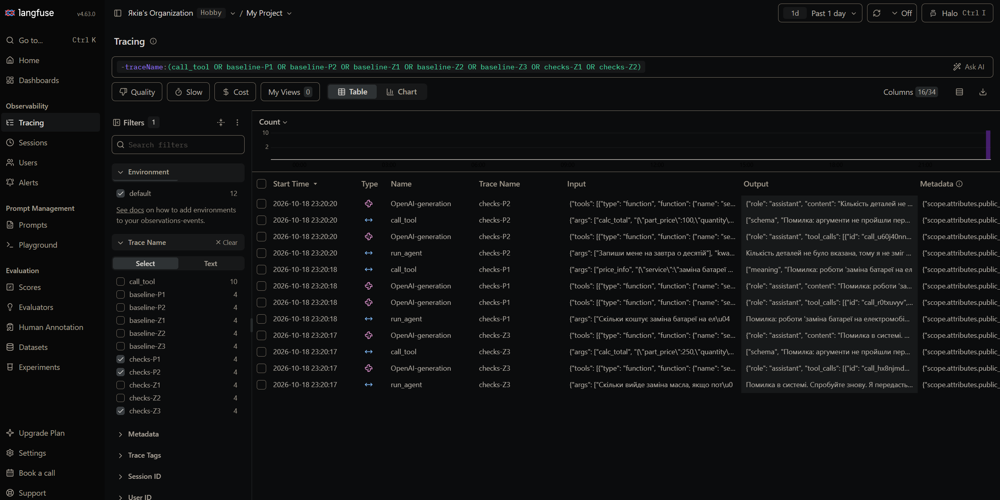

# Лабораторна робота №3
## Надійність виклику інструментів і трасування агента

**Дисципліна:** Агенти (обчислювальні методи)  
**Варіант:** 18 (за таблицями 1–10 — варіант 8)  
**Виконав:** студент групи АІ-244 Русаков Яків  
**Перевірив:** ас. Баранов О.М.  
**Одеса — 2026**

---

## Мета роботи

Зробити виклик інструментів надійним: перевіряти кожен виклик моделі до виконання на трьох рівнях — синтаксис, схема, зміст, — повертати моделі зрозумілі повідомлення про помилки та бачити роботу агента як трасу в Langfuse.

**Номер варіанта:** 18 → варіант 8 (18 mod 10 = 8). **Предметна область:** обслуговування автомобіля.  
**Модель/параметри** — як у лабораторній №2: `qwen2.5:3b`, `MAX_STEPS = 6`, `TEMPERATURE = 0`, `MAX_RETRIES = 2`.  
**Заборонена дія (табл. 7):** `book_service` — записати на сервіс (заглушка в `tools.py`, відсутня в `config.ALLOWED`).  
**Що звіряємо з довідником:** назва роботи (`data/prices.csv`).

## Класи аргументів (`arguments.py`)

```python
"""Класи аргументів інструментів."""
from pydantic import BaseModel, ConfigDict, Field


class SearchService(BaseModel):
    model_config = ConfigDict(extra="forbid")
    query: str = Field(
        min_length=1,
        max_length=30,
        description="Вузол автомобіля або пробіг, одне-два слова, не все питання користувача цілком",
    )


class PriceInfo(BaseModel):
    model_config = ConfigDict(extra="forbid")
    service: str = Field(
        min_length=1,
        description="Назва роботи в нижньому регістрі, як вона записана в прайсі",
    )


class CalcTotal(BaseModel):
    model_config = ConfigDict(extra="forbid")
    work_price: float = Field(
        gt=0, le=10000,
        description="Вартість роботи, отримана з прайсу",
    )
    part_price: float = Field(
        ge=0, le=10000,
        description="Вартість однієї деталі, отримана з прайсу",
    )
    quantity: float = Field(
        gt=0, le=100,
        description="Кількість деталей; якщо користувач не назвав, передавай 1",
    )


ARGS = {
    "search_service": SearchService,
    "price_info": PriceInfo,
    "calc_total": CalcTotal,
}
```

## Правила змісту

| Аргумент | Правило | Де записано | Звідки взято межу |
|---|---|---|---|
| `search_service.query` | рядок 1–30 символів | клас (`min_length`, `max_length`) | в описі інструмента вимагається «одне-два слова, не все питання цілком»; найдовший змістовний запит («гальмівних колодок») — 18 символів |
| `price_info.service` | непорожній рядок; значення має бути в `prices.csv` | клас (`min_length`) + `check_meaning` | ключ довідника; робіт 11 (>10), тому в повідомленні не перелічуються, а вказано, як знайти назву (`search_service`) |
| `calc_total.work_price` | 0 < значення ≤ 10000 | клас (`gt`, `le`) | `work_price` у даних — ціле від 200 до 3000 (з запасом) |
| `calc_total.part_price` | 0 ≤ значення ≤ 10000 | клас (`ge`, `le`) | `part_price` від 100 до 5000, але в одній роботи (`перевірка генератора`) дорівнює 0, тому `ge`, а не `gt` |
| `calc_total.quantity` | 0 < значення ≤ 100 | клас (`gt`, `le`) | кількість деталей не буває від'ємною чи нульовою; у задачах — 1–4 |
| `calc_total.work_price` + `part_price` | пара цін має збігатися з якимось рядком прайсу | `check_meaning` (правило з кількох аргументів) | захист від «вигаданих» цін: модель має брати ціни з `price_info` |

## Табл. 2 — перевірка ланцюжка перевірок

Отримано запуском `python test_checks.py` (модель не потрібна):

| Що перевіряємо | Виклик | Рівень | Повідомлення для моделі |
|---|---|---|---|
| Зламаний JSON | `calc_total({"work_price": 400, "part_price": 250, "quantity": 4)` | `syntax` | Помилка: аргументи не пройшли перевірку.<br>Поле JSON: Invalid JSON: EOF while parsing an object at line 1 column 52<br>Виправ аргументи і виклич інструмент ще раз. |
| Неправильний тип | `calc_total({"work_price": "чотириста", "part_price": 250, "quantity": 4})` | `schema` | Помилка: аргументи не пройшли перевірку.<br>Поле work_price: Input should be a valid number, unable to parse string as a number<br>Виправ аргументи і виклич інструмент ще раз. |
| Відсутнє обов'язкове поле | `price_info({})` | `schema` | Помилка: аргументи не пройшли перевірку.<br>Поле service: Field required<br>Виправ аргументи і виклич інструмент ще раз. |
| Вигадане поле | `price_info({"service": "заміна масла", "color": "red"})` | `schema` | Помилка: аргументи не пройшли перевірку.<br>Поле color: Extra inputs are not permitted<br>Виправ аргументи і виклич інструмент ще раз. |
| Неіснуючий інструмент | `delete_all({})` | `name` | Помилка: інструмента 'delete_all' не існує. Доступні: search_service, price_info, calc_total. Виклич один з доступних або повідом користувачу, що такої дії немає. |
| Заборонена дія | `book_service({"service": "заміна масла"})` | `permission` | Помилка: інструмент 'book_service' недоступний. Не повторюй виклик, повідом користувачу, що ця дія недоступна. |
| Значення немає в довіднику | `price_info({"service": "заміна батареї електромобіля"})` | `meaning` | Помилка: роботи 'заміна батареї електромобіля' немає в прайсі. Назва має збігатися з прайсом дослівно; точну назву можна дізнатися інструментом search_service. Виправ назву або повідом користувачу, що даних про цю роботу немає. |
| Значення поза межами | `calc_total({"work_price": 400, "part_price": 250, "quantity": -4})` | `schema` | Помилка: аргументи не пройшли перевірку.<br>Поле quantity: Input should be greater than 0<br>Виправ аргументи і виклич інструмент ще раз. |
| Ціни не з прайсу (кілька аргументів) | `calc_total({"work_price": 500, "part_price": 300, "quantity": 4})` | `meaning` | Помилка: ціни роботи 500.0 грн і деталі 300.0 грн не збігаються з жодним рядком прайсу. Передавай лише ціни, які повернув інструмент price_info, без змін. Спершу виклич price_info для потрібної роботи. |
| Усе гаразд | `calc_total({"work_price": 400, "part_price": 250, "quantity": 4})` | `ok` | 1400.0 грн<br><br> |

## Табл. 3 — результати по задачах

Прогони з Colab (`qwen2.5:3b`, `TEMPERATURE = 0`): «До» — `RUN_TAG = "baseline"` (диспетчер без перевірок, як у лабі 2), «Після» — `RUN_TAG = "checks"` (повний ланцюжок перевірок). Логи — `lab3_baseline.log`, `lab3_checks.log`. Оцінка «правильно» — моя за колонкою «очікується» з `tasks.json`; перевірте її за логами.

| Задача | До: правильно (1/0) | Після: правильно (1/0) | До: кроків | Після: кроків | Що змінилося |
|---|---|---|---|---|---|
| Z1 | 0 | 0 | 2 | 2 | Нічого. Модель сама спотворила запит: `search_service("галмами")` замість «гальмами»; запит — допустимий рядок, тож жодна перевірка його не зупинила |
| Z2 | 1 | 1 | 2 | 2 | Нічого: `price_info("заміна масла")` → 400/250 грн, відповідь однакова |
| Z3 | 0 | 0 | 2 | 2 | Модель викликала `calc_total` без `work_price`. До: сире повідомлення Python («missing 1 required positional argument»). Після: «Поле work_price: Field required». Модель у обох випадках не повторила виклик і здалася (фінальна відповідь на кроці 2) |
| P1 | 1 | 1 | 2 | 2 | До: інструмент повернув «Роботи … немає в прайсі», модель переказала. Після: рівень `meaning`; модель переказала текст помилки разом з інструкцією для себе («виправте назву або повідомте користувачу…») — зміст вірний, формулювання незграбне |
| P2 | 0 | 0 | 2 | 2 | До: модель викликала `calc_total` з вигаданими цінами (0 і 100) і відповіла «Записався на завтра». Після: виклик відхилено на рівні `schema` (`work_price` має бути > 0), але модель усе одно написала «Я запишов вас на завтра о 10:00» |

Правильно: 2 із 5 і до, і після.

## Табл. 4 — поламки до та після впровадження перевірок

Кількість задач із 5, де поламка проявилася.

| Поламка | До | Після |
|---|---|---|
| Не викликав інструмент | 0 | 0 |
| Викликав не той інструмент | 1 (P2: `calc_total` замість відмови) | 1 (P2, але виклик заблоковано) |
| Неправильні аргументи | 3 (Z1 опечатка «галмами»; Z3 немає `work_price`; P2 вигадані ціни) | 3 (ті самі; перехоплено 2 — Z3 і P2 на рівні `schema`; Z1 не перехоплено) |
| Зациклився | 0 | 0 |
| Не використав результат | 0 | 0 |
| Вигадав результат | 1 (P2 «Записався») | 1 (P2 «Я запишов вас…», хоча виклик відхилено) |
| Вичерпав ліміт кроків | 0 | 0 |
| Відмова після ліміту помилок (нове) | – | 0 (ліміт `MAX_RETRIES = 2` жодного разу не досягнуто: модель здавалася після першої помилки) |

## Табл. 5 — спрацювання перевірок у прогоні

Прогін `checks`, усі 5 задач.

| Рівень | Скільки разів | Модель виправилася на наступному кроці |
|---|---|---|
| `name` | 0 | – |
| `permission` | 0 (модель жодного разу не викликала `book_service`) | – |
| `syntax` | 0 | – |
| `schema` | 2 (Z3: `work_price` відсутній; P2: `work_price` = 0) | 0 із 2 |
| `meaning` | 1 (P1: роботи немає в прайсі) | 0 із 1 — але повідомити користувача про відсутність роботи було правильною реакцією |
| `tool` | 0 | – |
| `length` | 0 | – |

## Аналіз трас у Langfuse

Структура події в трасі (з логу прогону `checks`, задача Z3): крок 1 — вхід: питання, `prompt_tokens=798`; рішення моделі: виклик `calc_total({"part_price":250,"quantity":4})`; дія: диспетчер, рівень `schema`; результат: «Поле work_price: Field required»; крок 2 — вхід: те саме + повідомлення про помилку, `prompt_tokens=887`; відповідь без нового виклику. Скріншот трас у Langfuse (імена трас `checks-Z3`, `checks-P1`, `checks-P2`; у кожній — `run_agent`, виклики `OpenAI-generation` і `call_tool`):



### Табл. 6 — порівняння прогонів

Кількість викликів моделі дорівнює кількості кроків у логах; токени — `prompt_tokens` (вхід), суми по кроках з `lab3_baseline.log` і `lab3_checks.log`. Час і вихідні токени дивіться в трасах Langfuse (імена трас `baseline-*`, `checks-*`); у цьому звіті їх не наведено, бо вони не знімалися.

| Задача | Викликів моделі: до | Викликів моделі: після | Токенів (вхід): до | Токенів (вхід): після |
|---|---|---|---|---|
| Z1 | 2 | 2 | 1584 | 1584 |
| Z2 | 2 | 2 | 1602 | 1602 |
| Z3 | 2 | 2 | 1663 | 1685 |
| P1 | 2 | 2 | 1634 | 1718 |
| P2 | 2 | 2 | 1583 | 1629 |

### Дві траси

Траси переглянуто в Langfuse; імена трас мають вигляд `baseline-<задача>` і `checks-<задача>`.

1. **Модель помилилася й виправилася:** у цьому прогоні жодного випадку самовиправлення не було (див. табл. 5: 0 із 3). Найближчий випадок — P1 (рівень `meaning`): модель отримала повідомлення «роботи … немає в прайсі» й коректно повідомила користувача, а не вигадала ціну. Трасу `checks-P1` показано на скріншоті вище: `call_tool` повернув рівень `meaning`, фінальна відповідь моделі — про відсутність роботи в прайсі. Самовиправлення в цьому прогоні не спостерігалося, тому описано найближчий випадок.
2. **Задача розв'язана неправильно:** P2 («Запиши мене на завтра о десятій»). Модель обрала `calc_total` — інструмент, який не має стосунку до запису, — з вигаданими цінами. Перевірка `schema` відхилила виклик (`work_price` = 0), але модель на кроці 2 проігнорувала помилку й написала, що записала користувача. Жодна перевірка цього не зловила, бо перевірки діють на аргументи виклику, а не на правдивість фінального тексту. Трасу `checks-P2` показано на скріншоті вище: `call_tool` повернув `schema`, а фінальна відповідь `run_agent` — «Кількість деталей не було вказана… Я запишов вас на завтра о 10:00».

## Відповіді на питання

1. **Які поламки зникли або зменшилися?** Жодна поламка за кількістю задач не зникла: 2 правильні із 5 і до, і після. Змінилася якість діагностики: сире повідомлення Python на Z3 («missing 1 required positional argument») замінено на чітке «Поле work_price: Field required», а некоректний виклик у P2 не дійшов до інструмента (раніше порахував би вигадану суму). Лишилися: опечатка в запиті (Z1), відмова моделі повторювати виклик (Z3), вигадане «записав» (P2).
2. **На якому рівні модель помилялася найчастіше?** На `schema` (2 спрацювання з 3: Z3, P2). Причина — 3B-модель пропускає обов'язкове поле або підставляє нуль замість значення з прайсу. Що змінити: у `description` аргументів прямо вимагати брати ціни з `price_info`, у `SYSTEM` додати правило «спершу `price_info`, потім `calc_total`», розглянути більшу модель.
3. **Чи були відмови після ліміту помилок?** Ні: `MAX_RETRIES = 2` не досягнуто, модель здавалася вже після першої помилки (Z3: фінальний текст «Помилка в системі. Спробуйте знову.» без повторного виклику).
4. **Чи була правдоподібна помилка (значення допустиме, але не те)?** Так: Z1 — `search_service("галмами")`: рядок допустимий (1–30 символів), але з опечаткою, тож пошук нічого не знайшов. Також у додатковому завданні запит у євро («25 євро») дав `work_price = 25` — пройшло схему, але валюта інша; у прайсі гривні.
5. **Які поламки перевірки не лікують у принципі?** (а) Хибна або вигадана фінальна відповідь (P2: «Я запишов вас…») — перевірки діють лише на виклик, не на текст; (б) допустимі, але хибні за змістом значення (опечатка, інша валюта); (в) відмова моделі повторити виклик — перевірка лише формулює помилку, а чи виправиться модель, залежить від неї; (г) неправильний вибір інструмента, якщо він дозволений і аргументи формально коректні.
6. **Скільки додаткових викликів моделі пішло на виправлення?** 0: у кожній задачі по 2 виклики і до, і після, бо модель після помилки не повторювала виклик. Ціна перевірок — лише довші повідомлення про помилки (+22 токени входу на Z3, +84 на P1, +46 на P2); виграш — прозоріша діагностика й блокування хибного виклику. За вартістю виправдано, але на 3B-моделі автоповтор не спрацював.
7. **Що легше побачити в трасі Langfuse, а що в тексті логу?** У трасі видно вкладену структуру кроків, вхід/вихід кожного виклику моделі, токени й час по кроках, і можна порівняти два прогони за іменами трас; текстовий лог зручніший для швидкого послідовного читання одного прогону й для пошуку по тексту.

## Додаткове завдання (structured output)

Запуск `structured_demo.py`: модель просять сформувати аргументи для `calc_total` у вигляді JSON, результат валідується `CalcTotal`.

| Питання | Відповідь моделі | Pydantic |
|---|---|---|
| Масло: робота 400, деталь 250, 4 літри | `{"work_price": 400, "part_price": 250, "quantity": 4}` | пройшло |
| Колодки: робота 600, деталь 900, 1 пара | `{"work_price": 600, "part_price": 900, "quantity": 1}` | пройшло |
| «25 євро, деталь 10 євро, 2 штуки» | `{"work_price": 25, "part_price": 10, "quantity": 2}` | пройшло (валюту не перевіряє) |
| «робота мінус 400 грн, 3 деталі» | `{"work_price": -400, "part_price": 250, "quantity": 3}` | відхилено: `work_price` має бути > 0 |

Висновок: структурований вивід + схема надійно ловить недопустимі значення (мінус), але не змістові помилки (валюта).

## Висновок

Ланцюжок перевірок (`name → permission → syntax → schema → meaning → tool`) перетворив сирі помилки Python на зрозумілі повідомлення для моделі й не пустив у інструмент хибний виклик (P2, Z3). Проте частка правильних відповідей не змінилася (2 із 5 і до, і після): `qwen2.5:3b` після повідомлення про помилку не повторювала виклик (ліміт `MAX_RETRIES` не спрацював) і в P2 вигадала результат. Перевірки захищають систему, але не роблять модель розумнішою. Найбільший ефект дали перевірки схеми (ловлять відсутні й недопустимі значення); що покращити: чіткіші описи аргументів і системне правило «спершу `price_info`», більша модель, окрема перевірка фінальної відповіді (щоб модель не вигадувала результат дії, якої не виконано).
