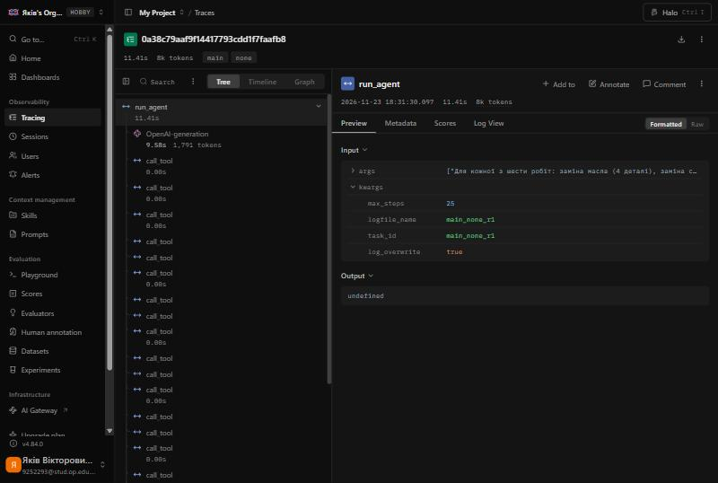
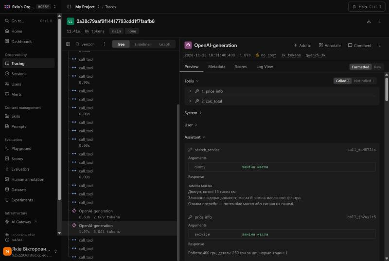
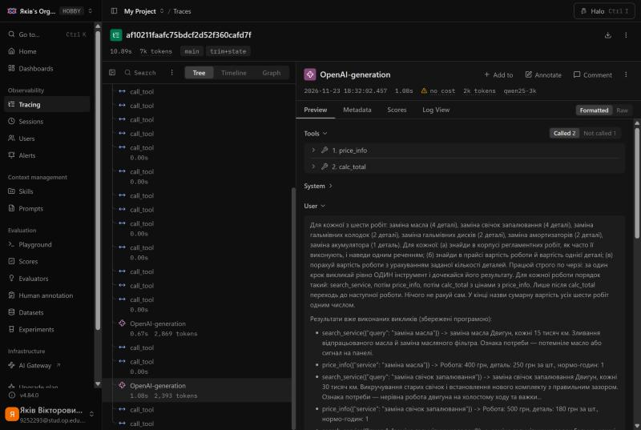

# Лабораторна робота №4
## Контекст, стан і кеш агента

**Дисципліна:** Агенти (обчислювальні методи)  
**Варіант:** 18 (за таблицями 1–10 — варіант 8)  
**Виконав:** студент групи АІ-244 Русаков Яків  
**Перевірив:** ас. Баранов О.М.  
**Одеса — 2026**

---

## Мета роботи

Побачити, що відбувається з агентом, коли історія не вміщується в контекстне вікно моделі; навчитися скорочувати історію, зберігати результати інструментів поза текстом діалогу та кешувати виклики моделі; виміряти, скільки це коштує.

**Номер варіанта:** 18 → варіант 8. **Предметна область:** обслуговування автомобіля.  
**Модель:** `qwen2.5:3b` (та сама, що в лабораторних № 2–3), `TEMPERATURE = 0`, `MAX_STEPS = 6`, `MAX_STEPS_LONG = 25`, `MAX_RETRIES = 2`. Прогони виконано в Google Colab (GPU Tesla T4, Ollama).

| Показник | Значення |
|---|---|
| `context length` вихідної моделі (`ollama show qwen2.5:3b`) | 32768 |
| `num_ctx` нової моделі `qwen25-4k` (розділ `Parameters`) | 4096 |
| У скільки разів вікно звужено | 32768 / 4096 = **8** |
| Після випадку C (крок 4): `num_ctx` моделі `qwen25-3k` | 3072 (звужено в 32768 / 3072 ≈ **10,7** раза) |

Далі в роботі використовується `MODEL = "qwen25-3k"`, `NUM_CTX = 3072`, `COMPRESS_AT = 2150` (див. крок 4).

**Зміни відносно лабораторної № 3.**
- `tools.py`: `search_service` повертає **повний текст** знайдених файлів корпусу, а не лише назву роботи (вимога кроку 2 — результат пошуку не скорочувати; без цього агент не міг би навести речення з корпусу в пункті (а)). Додано допоміжну `find_price()` для `make_task.py`.
- `agent.py`: логер створюється всередині `run_agent()`, виклик моделі винесено в `model.py`, ліміт кроків, ім'я лога і `task_id` — параметри; повідомлення моделі зберігаються як словники; після кожного кроку викликається `compress_history`; успішні виклики записуються в стан.
- `agent_runner.py`: прибрано вибір `agent_baseline` з лабораторної № 3.
- `measure.py`: `all` запускає три основні конфігурації (`none`, `trim`, `trim+state`), `summary` — окремою серією `extra`.
- `run_all.py` — допоміжний скрипт, що виконує всі кроки підряд і зберігає виведення кожного в `outputs/`.

## Довга задача (крок 2)

Шість позицій — шість робіт із прайсу з кількістю деталей. Для кожної: (а) `search_service` — періодичність з корпусу; (б) `price_info` — ціни; (в) `calc_total` — вартість з урахуванням кількості. `min_calls = 18`.

**Правильна відповідь** (`make_task.py`, прямі виклики `find_price` і `calc_total`, без моделі): **24970 грн**.

| Робота | Робота, грн | Деталь, грн | Кількість | `calc_total` |
|---|---:|---:|---:|---:|
| заміна масла | 400 | 250 | 4 | 1400 |
| заміна свічок запалювання | 500 | 180 | 4 | 1220 |
| заміна гальмівних колодок | 600 | 900 | 2 | 2400 |
| заміна гальмівних дисків | 1200 | 2400 | 2 | 6000 |
| заміна амортизаторів | 1800 | 4200 | 2 | 10200 |
| заміна акумулятора | 250 | 3500 | 1 | 3750 |
| **Разом** | | | | **24970** |

**Перша спроба (каталог `attempt1/`).** Питання було сформульоване точно за шаблоном методички (варіант `v1` у `make_task.py`). `qwen2.5:3b` на першому ж кроці викликав **12 інструментів паралельно** (по `search_service` і `price_info` для всіх шести робіт), `calc_total` не викликав жодного разу і на кроці 2 відповів «Загальна вартість усіх шести робіт: 10000 грн» — числа 10000 немає в жодному результаті інструментів (вигаданий результат; правильно 24970). Вхід виріс лише з 1078 до 2277 токенів, тому і у вікні 4096 (56 %), і у вікні 3072 (74 %) це був випадок C; стиснення не спрацювало жодного разу, і всі 12 прогонів `main` та 3 `extra` були однаковими (2 кроки, 0 стиснень). Порівнювати конфігурації за таких даних неможливо, тому питання доповнено вимогою працювати по черзі, а `expected = 24970` залишено без змін.

**Остаточне питання** (варіант `v2`, вибраний скриптом: обидва варіанти v2 і v3 дали на вікні 4096 по 2 кроки, обрано перший):

> Для кожної з шести робіт: заміна масла (4 деталі), заміна свічок запалювання (4 деталі), заміна гальмівних колодок (2 деталі), заміна гальмівних дисків (2 деталі), заміна амортизаторів (2 деталі), заміна акумулятора (1 деталь). Для кожної: (а) знайди в корпусі регламентних робіт, як часто її виконують, і наведи одним реченням; (б) знайди в прайсі вартість роботи й вартість однієї деталі; (в) порахуй вартість роботи з урахуванням заданої кількості деталей. Працюй строго по черзі: за один крок викликай рівно ОДИН інструмент і дочекайся його результату. Для кожної роботи порядок такий: search_service, потім price_info, потім calc_total з цінами з price_info. Лише після calc_total переходь до наступної роботи. Нічого не рахуй сам. У кінці назви сумарну вартість усіх шести робіт одним числом.

Вимогу «один інструмент за крок» модель усе одно не виконала: на першому кроці вона викликає всі 18 інструментів одразу, причому `calc_total` — з вигаданими цінами, ще до того, як побачила результат `price_info`. Проте тепер історія стала довшою (18 результатів замість 12 плюс повідомлення про помилки), і вікно почало переповнюватися.

## Прогін без захисту (кроки 3–4)

Пробний прогін на вікні 4096 (`outputs/03b_probe_none.txt`): відповідь «3500», правильно — ні, 9,2 с; 2 кроки, найбільший вхід 3200 токенів (78 % вікна), статус `final` — **випадок C** (задача закоротка). За методичкою вікно зменшено: `Modelfile` → `num_ctx 3072`, `ollama create qwen25-3k`, у `config.py` `MODEL = "qwen25-3k"`, `NUM_CTX = 3072`, `COMPRESS_AT = 2150`; лог прогону на 4096 збережено як `logs/probe_none_r1_4k.log`.

Пробний прогін на вікні 3072: відповідь «Заміна акумулятора вартість обслуговування становить 3750.0 грн.», правильно — ні, 17,2 с.

Таблиця 2 — Зростання входу в прогоні без захисту (`python analyze.py logs/probe_none_r1.log steps`, вікно 3072)

| Крок | `prompt_tokens` | Приріст | Що зробила модель | Рівень |
|-----:|---------------:|--------:|:------------------|:-------|
| 1 | 1185 |  | `search_service({"query":"заміна масла"})` | `ok` |
|  |  |  | `price_info({"service":"заміна масла"})` | `ok` |
|  |  |  | `calc_total({"work_price":200,"part_price":50,"quantity":4})` | `meaning` |
|  |  |  | `search_service({"query":"заміна свічок запалювання"})` | `ok` |
|  |  |  | `price_info({"service":"заміна свічок запалювання"})` | `ok` |
|  |  |  | `calc_total({"quantity":4,"work_price":200,"part_price":15})` | `meaning` |
|  |  |  | `search_service({"query":"заміна гальмівних колодок"})` | `ok` |
|  |  |  | `price_info({"service":"заміна гальмівних колодок"})` | `ok` |
|  |  |  | `calc_total({"quantity":2,"work_price":200,"part_price":50})` | `meaning` |
|  |  |  | `search_service({"query":"заміна гальмівних дисків"})` | `ok` |
|  |  |  | `price_info({"service":"заміна гальмівних дисків"})` | `ok` |
|  |  |  | `calc_total({"work_price":200,"part_price":50,"quantity":2})` | `meaning` |
|  |  |  | `search_service({"query":"заміна амортизаторів"})` | `ok` |
|  |  |  | `price_info({"service":"заміна амортизаторів"})` | `ok` |
|  |  |  | `calc_total({"work_price":200,"part_price":50,"quantity":2})` | `meaning` |
|  |  |  | `search_service({"query":"заміна акумулятора"})` | `ok` |
|  |  |  | `price_info({"service":"заміна акумулятора"})` | `ok` |
|  |  |  | `calc_total({"part_price":100,"quantity":1,"work_price":200})` | `meaning` |
| 2 | 2829 | 1644 | `calc_total({"work_price":200,"part_price":3500,"quantity":1})` | `meaning` |
| 3 | 2976 | 147 | `price_info({"service":"заміна акумулятора"})` | `ok` |
| 4 | 3055 | 79 | `calc_total({"part_price":3500,"quantity":1,"work_price":250})` | `ok` |
| 5 | 2649 | -406 | відповідь без виклику | |

На кроці 1 усі 18 викликів зроблено в одній відповіді моделі; усі `calc_total` мали вигадані ціни й були відхилені перевіркою `meaning` (пари цін немає в прайсі).

- **(а)** вхід першого кроку: **1185** токенів;
- **(б)** типовий приріст за крок (медіана додатних приростів): **147** токенів;
- **(в)** сума `prompt_tokens` за прогін: **12694**; за формулою `n·C + d·n·(n−1)/2` = 5·1185 + 147·10 = **7395**. Числа сильно відрізняються, бо приріст нерівномірний: на кроці 2 історія виросла одразу на 1644 токени (18 результатів паралельних викликів), а формула бере медіану 147, яка не враховує цей стрибок. Якщо підставити середній приріст (3055 − 1185) / 3 ≈ 623, формула дає 5·1185 + 623·10 ≈ 12155 — близько до фактичних 12694;
- **(г)** вхід перестав рости на кроці **5**: на кроці 4 вхід займав 3055 токенів (99 % вікна 3072), а на кроці 5, хоча агент додав до історії ще повідомлення моделі й результат інструмента, вхід **зменшився** до 2649. Сервер (Ollama) мовчки відкинув початок історії, щоб запит вмістився у вікно;
- **(д)** після кроку 4 у логу лишився один крок — 5, і на ньому модель відповіла без виклику: «Заміна акумулятора вартість обслуговування становить 3750.0 грн.». Це відповідь лише про **останню** роботу: модель «забула», що питали про шість робіт і суму, — початок історії з питанням було відкинуто. Число 3750 є в результаті `calc_total` на кроці 4; вигаданих чисел у відповіді немає, але відповідь не на те питання. На кроках 2–4 модель теж працювала лише з акумулятором (останньою позицією), повторивши `price_info` для нього (повторних викликів — 2).

**Випадок: B** — сервер мовчки обрізає вхід (`analyze.py`: «вхід перестав рости на кроці 5»; найбільший вхід 99 % вікна, помилки сервера немає).

## Стиснення історії і стан (кроки 5–6)

`COMPRESS_AT = 2150` (для вікна 3072), `KEEP_LAST = 6`, `STATE_RESULT_CHARS = 200`.

Таблиця 3 — Стиснення історії (пробні прогони `probe_trim_r1`, `probe_trim+state_r1`)

| Конфігурація | Крок стиснення | Вхід до стиснення, токенів | Повідомлень було -> стало | Повторних викликів за прогін |
|---|---|---|---|---|
| `trim` | 2 | 2833 | 23 -> 4 | 3 |
| `trim+state` | 2 | 2829 | 23 -> 4 | 3 |

Після стиснення в `trim` вхід кроку 3 упав до 1332 токенів (−1501): у вікні лишилися інструкція, питання і останні повідомлення, а результати перших 17 викликів зникли — і модель знову викликала `price_info("заміна масла")`, тобто почала задачу спочатку (повторний виклик). У `trim+state` вхід кроку 3 — 2327 токенів: до питання дописано збережені результати, і модель продовжила з того місця, де зупинилася (`price_info("заміна акумулятора")`), але теж повторила вже виконаний виклик.

Обидва пробні прогони закінчилися `retry_limit` на кроці 3: три поспіль виклики `calc_total` з вигаданою ціною роботи 200 грн відхилила перевірка `meaning` з лабораторної № 3, відповіді немає.

**Блок `ПЕРШЕ ПОВІДОМЛЕННЯ КОРИСТУВАЧА ПІСЛЯ СТИСНЕННЯ`** (`logs/probe_trim+state_r1.log`): рядків виду `- інструмент(аргументи) -> результат` — **12** (6 `search_service` і 6 `price_info`; усі `calc_total` були неуспішними й у стан не потрапили). Сам список займає ≈ 2180 символів ≈ **870 токенів** (2,5 символа на токен) — це приблизно **6 типових приростів** за крок (147 токенів). Блок завеликий: результати `search_service` (повні описи робіт) обрізаються лише до 200 символів кожен і складають більшу частину нагадування; через це вхід після стиснення в `trim+state` (2327) майже вдвічі більший, ніж у `trim` (1332), і вже перевищує `COMPRESS_AT`.

## Кеш (крок 7)

Таблиця 4 — Робота кешу (`cache1_none_r1`, `cache2_none_r1`)

| Запуск | Кроків | Влучань у кеш | Викликів до сервера | Час, с | Правильно |
|---|---|---|---|---|---|
| 1 (кеш порожній) | 4 | 0 | 4 | 12,2 | ні |
| 2 (той самий запит) | 4 | 4 | 0 | 0,2 | ні |

Запуск 2 швидший приблизно в **60 разів** (12,2 / 0,2 с) — практично миттєво: усі чотири відповіді моделі взято з файлів `cache/`, жодного звернення до сервера. Відповідь (неправильна) та сама, бо кеш повертає ту саму відповідь моделі. Якби перед запуском 2 змінити текст `SYSTEM` у `config.py`, змінився б перший елемент `messages`, а отже текст запиту і його відбиток `sha256`: жоден файл у `cache/` не підійшов би, усі виклики пішли б на сервер (0 влучань), а відповіді збереглися б у нові файли.

## Вимірювання і траси (крок 8)

Таблиця 5 — Вартість циклу в трьох конфігураціях (медіани по трьох повторах; `python measure.py all 3 main`; рядок `summary` — додаткове завдання, `python measure.py summary 3 extra`)

| Конфігурація | Правильно (з 3) | Кроків | Токенів на вхід | Токенів на вихід | Час, с | Стиснень | Повторних викликів |
|---|---|---|---|---|---|---|---|
| `none` | 0 | 3 | 6998 | 703 | 10,6 | 0 | 2 |
| `trim` | 0 | 3 | 5350 | 699 | 10,6 | 1 | 2 |
| `trim+state` | 0 | 3 | 6345 | 708 | 10,9 | 1 | 2 |
| `summary` | 0 | 3 | 6171 (+3228 на підсумовування) | 705 | 24,8 | 1 | 3 |

Колонку «Правильно» перевірено вручну: у всіх дев'яти прогонах `main` відповіді немає взагалі — кожен закінчився рядком «СТОП: модель не змогла сформувати правильний виклик» на кроці 3.

**Поломки, яких таблиця не показує** (9 прогонів `main` і 3 прогони `extra_summary` — разом 12; у всіх дванадцяти картина однакова):
- **відповів, зробивши менше 19 кроків — 0 з 12**, але лише тому, що відповіді не було зовсім: усі 12 прогонів зупинилися на кроці 3 (`retry_limit`), зробивши по 21 виклику інструментів, з них 8 — `calc_total`, жоден не успішний;
- **вигадані числа — 12 з 12**: у кожному прогоні модель передавала в `calc_total` ціни, яких немає в жодному рядку `результат:` (`work_price` 200, `part_price` 50/15/100). Їх зупинила перевірка `meaning` (пара цін не збігається з прайсом), тому вигадані числа не потрапили у відповідь, а агент вичерпав ліміт помилок;
- у `none` усі три прогони мають ознаку обрізання вікна вже на кроці 3: вхід 2980 токенів (97 % вікна) при прирості лише 147 (`analyze.py`: «вхід перестав рости на кроці 3»).

Langfuse, траси `long-main_none_r1` і `long-main_trim+state_r1` (мітка `main`, прогони о 18:31). Дерево `long-main_none_r1`: перший `OpenAI-generation` (1791 токен) і одразу під ним 18 вузлів `call_tool` — усі паралельні виклики першого кроку:

Третій виклик моделі в `long-main_none_r1` (3041 токен = 2980 вхід + 61 вихід): у вході досі вся історія з самого початку (`search_service("заміна масла")`, `price_info("заміна масла")` → 400/250 грн…):

Дерево `long-main_trim+state_r1` — на початку таке саме:

Перший виклик моделі після стиснення в `trim+state` — крок 3 (`python analyze.py logs/main_trim+state_r1.log`: стиснення на кроці 2): **2327** токенів входу (у Langfuse 2393 = 2327 + 66). Той самий крок у `none`: **2980** токенів (3041 = 2980 + 61). У вузлі видно, що повідомлення користувача тепер — питання плюс блок «Результати вже виконаних викликів (збережені програмою)», а проміжних повідомлень `assistant`/`tool` перших кроків уже немає:

У трасі одразу видно токени кожного виклику моделі і як вони впали після стиснення (3041 → 2393 на тому самому кроці), а також повний вхід моделі: що саме лишилося в історії після обрізання і як виглядає дописаний стан. У текстовому лозі довелося б відтворювати історію вручну за рядками `виклик`/`результат` і рядком `СТИСНЕННЯ`, а вміст історії після стиснення там не видно взагалі (крім блоку `ПЕРШЕ ПОВІДОМЛЕННЯ…`).

## Відповіді на питання

1. **Межа вікна.** Без захисту на вікні 3072 агент дійшов до межі на кроці 4 (3055 токенів, 99 % вікна), а на кроці 5 вхід зменшився до 2649 (табл. 2, пункт (г)) — сервер мовчки відкинув початок історії. Після цього модель забула питання: відповіла лише про останню роботу («Заміна акумулятора … 3750.0 грн») замість суми шести робіт.
2. **Сума `prompt_tokens` і формула.** Фактична сума 12694 проти 7395 за формулою з медіанним приростом 147. Зростання нерівномірне: один стрибок +1644 на кроці 2 (18 результатів паралельних викликів), далі +147 і +79; з середнім приростом ≈623 формула дає ≈12155, тобто квадратичне зростання суми підтверджується, але `d` треба брати середнім, а не медіаною.
3. **Що втрачає агент при обрізанні.** Результати відкинутих повідомлень: після стиснення 23 → 4 у `trim` вхід упав з 2833 до 1332, і модель знову викликала `price_info("заміна масла")` — почала спочатку. У `trim+state` модель продовжила з акумулятора, бо отримала список із 12 збережених результатів, але сам список (≈870 токенів) зробив вхід удвічі більшим (2327 проти 1332), а повторних викликів (табл. 5) не поменшало — 2 в обох.
4. **Найдешевша / найшвидша / найточніша.** Найдешевша за токенами — `trim` (5350 проти 6998 у `none`, −24 %); за часом конфігурації не відрізняються (10,6–10,9 с), `summary` найповільніша (24,8 с через окремий виклик моделі); найточнішої немає — 0 з 3 в усіх. Висновок обережний: одна задача, три повтори, і всі прогони обірвалися на кроці 3 через ту саму поломку моделі (вигадані ціни в `calc_total`), тож різниця між конфігураціями проявилася лише на одному кроці.
5. **Кеш при вимірюванні.** Кеш вимкнено, бо інакше повтори брали б відповіді з `cache/`: вартість і час були б майже нульовими (як у запуску 2 табл. 4, 0,2 с), а «три повтори» були б однією відповіддю. Ключ кешу залежить лише від запиту: якщо інструмент поверне інші дані, зміниться історія наступних кроків і ключ — кеш не спрацює; а якщо замінити модель під тією самою назвою (`ollama create qwen25-3k` з іншим `Modelfile`), запит не зміниться, і кеш мовчки віддасть відповіді старої моделі.
6. **Чого скорочення не лікує в принципі.** Неправильних викликів самої моделі: тут усі прогони зупинила не довжина історії, а вигадані ціни в `calc_total` і паралельні виклики «наперед», ще до отримання цін. Також скорочення не повертає забуте питання, якщо його вже відкинув сервер, і не робить пересказ точним (див. додаткове завдання).

## Додаткове завдання: підсумовування

`python measure.py summary 3 extra`: рядок `summary` у табл. 5. Підсумовування коштувало **3228 токенів** (медіана; окремий виклик моделі на стиснення на кроці 2). Вхід самого агента — 6171 токен проти 5350 у `trim`, тобто **порівняно з `trim` нічого не заощаджено: +821 токен на вході агента і ще 3228 на підсумовування**; час — 24,8 с проти 10,6 с.

**Чи зберіг переказ точні числа — ні.** Блок `ПІДСУМОК ІСТОРІЇ` у `logs/extra_summary_r1.log` починається словами «Ваші дані вже перекладені і збережені. Вони зберігають всі точні числа…», а далі для кожної роботи пише ціни з **вигаданих аргументів `calc_total`**, а не з результатів `price_info`:

| Робота | Рядок `результат:` (`price_info`) | У переказі |
|---|---|---|
| заміна масла | Робота: 400 грн, деталь: 250 грн | Робота: 200.0 грн, деталь: 50.0 грн |
| заміна свічок запалювання | Робота: 500 грн, деталь: 180 грн | Робота: 200.0 грн, деталь: 50.0 грн |
| заміна гальмівних колодок | Робота: 600 грн, деталь: 900 грн | Робота: 200.0 грн, деталь: 100.0 грн |
| заміна гальмівних дисків | Робота: 1200 грн, деталь: 2400 грн | Робота: 200.0 грн, деталь: 100.0 грн |
| заміна амортизаторів | Робота: 1800 грн, деталь: 4200 грн | Робота: 200.0 грн, деталь: 50.0 грн |

Усі п'ять цін спотворено, хоча запит на переказ прямо вимагав зберегти точні числа. Після такого стиснення агент працює з хибними даними — це головний ризик підсумовування, який обрізання і стан не мають (стан зберігає результати дослівно).

## Висновок

На довгій задачі `qwen2.5:3b` з вікном 3072 дійшов до межі вікна за 4 кроки, після чого Ollama **мовчки** відкинула початок історії без жодної помилки, і агент відповів лише про останню з шести робіт (випадок B). Обрізання історії зменшило сумарний вхід на 24 % (6998 → 5350 токенів), але агент забув уже отримані результати й почав задачу спочатку; стан повернув ці результати, але сам зайняв ≈870 токенів; підсумовування коштувало найдорожче (+3228 токенів) і спотворило всі ціни. Кеш дав найбільший ефект у часі — повторний прогін у ~60 разів швидший — але для вимірювань він непридатний. Точності жоден спосіб не додав: усі прогони зупинила поломка самої моделі — паралельні виклики «наперед» і вигадані ціни в `calc_total`, які відхиляла перевірка змісту. Що варто змінити: обробляти по одному виклику інструмента за крок у самій програмі (ігнорувати решту `tool_calls`), не записувати в стан повні тексти пошуку (лише потрібне поле), дозволити `calc_total` брати ціни з `price_info` за назвою роботи, і спробувати модель, що краще виконує інструкції щодо порядку дій.
