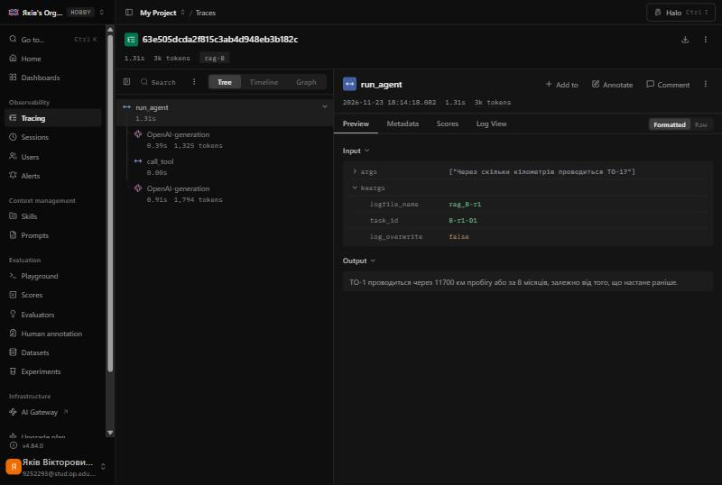
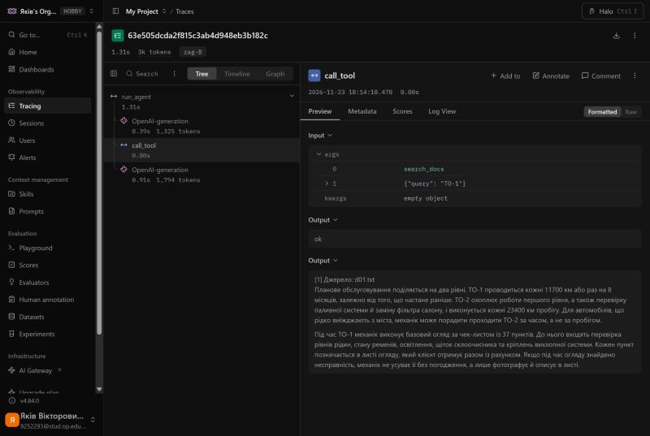
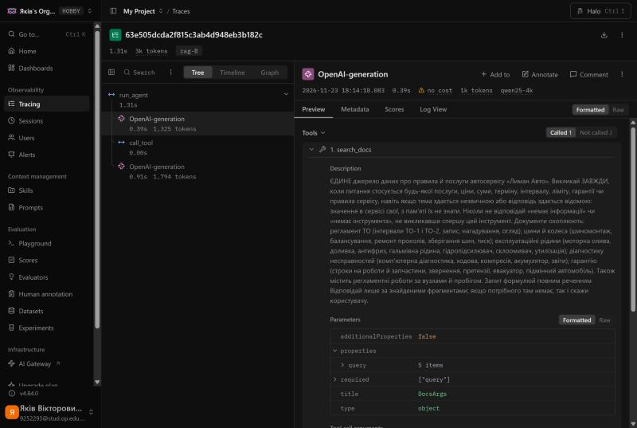
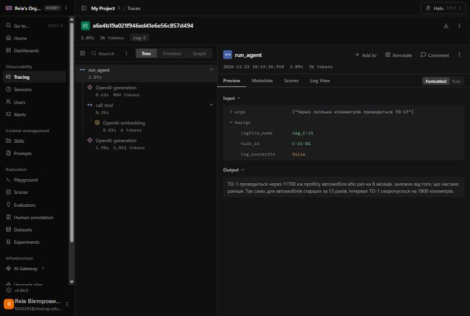
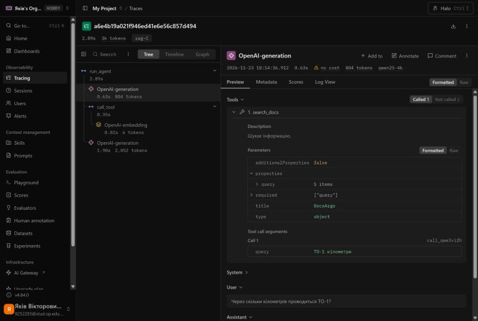
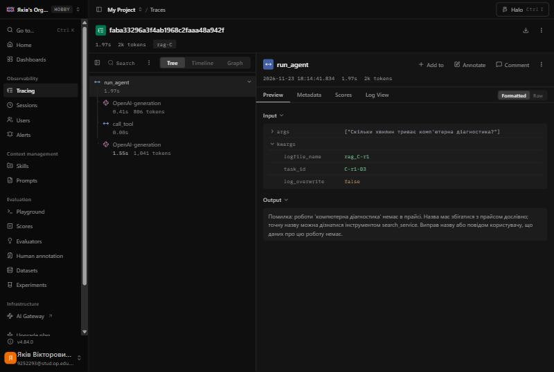
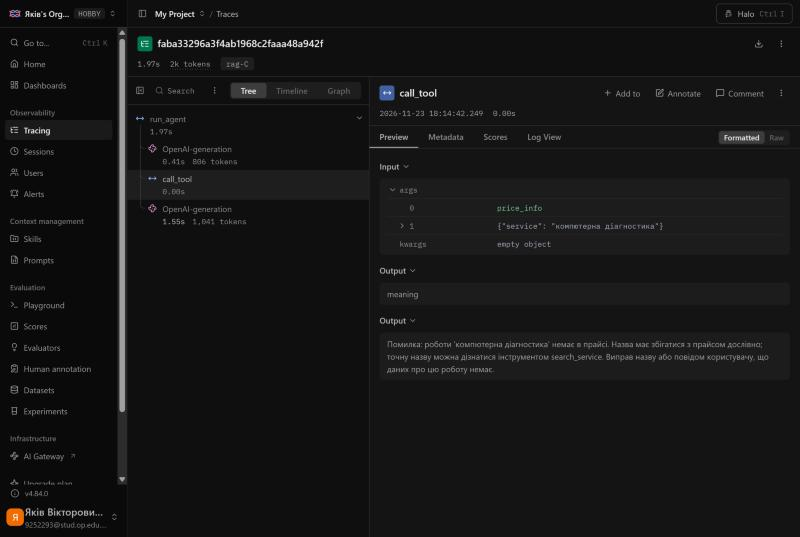

# Лабораторна робота №5
## RAG-агент: пошук по документах як інструмент

**Дисципліна:** Агенти (обчислювальні методи)  
**Варіант:** 18 (за таблицями 1–10 — варіант 8)  
**Виконав:** студент групи АІ-244 Русаков Яків  
**Перевірив:** ас. Баранов О.М.  
**Одеса — 2026**

---

## Мета роботи

Замінити пошук підрядком з лабораторної № 2 векторним, під'єднати його до агента як інструмент `search_docs`, перевірити якість пошуку окремо від агента і виміряти, як розмір чанка та опис інструмента впливають на поведінку агента.

**Номер варіанта:** 18 → варіант 8. **Предметна область:** обслуговування автомобіля.  
**Модель чату:** `qwen25-4k` — `qwen2.5:3b` з `PARAMETER num_ctx 4096` (з лабораторної № 4), `TEMPERATURE = 0`, `MAX_STEPS = 6`.  
**Розмір вікна:** 4096 токенів.  
**Модель ембедингів:** `bge-m3` (довжина вектора 1024).  
Скорочення історії, стан і кеш вимкнено (`COMPRESS = "none"`, `USE_STATE = False`, `USE_CACHE = False`). Прогін виконано в Google Colab (GPU Tesla T4, Ollama).

## Дані

Вигадана організація — сервісний центр «Лиман Авто». П'ять довгих документів у `data/docs/` (теми з табл. 8 для варіанта 8) індексуються разом зі старим корпусом `data/corpus/` (12 коротких описів регламентних робіт):

| Файл | Назва | Символів |
|---|---|---:|
| `d01.txt` | Регламент технічного обслуговування | 3418 |
| `d02.txt` | Шини й колеса | 3269 |
| `d03.txt` | Експлуатаційні рідини | 3339 |
| `d04.txt` | Діагностика несправностей | 3321 |
| `d05.txt` | Гарантійні умови сервісу | 3217 |

Кожен документ — 9 абзаців по 2–4 речення, 9–14 конкретних значень цифрами; жодне число не повторюється в різних документах.

`python check_cases.py`:

```
Документів: 17; символів: 18844; приблизно токенів: 7538 (вікно 4096)
Питань: 10 ({'direct': 4, 'paraphrase': 4, 'none': 2})
Усе гаразд
```

Усі документи разом (~7538 токенів) майже вдвічі більші за вікно 4096, тож покласти їх у контекст неможливо — потрібен пошук.

Питання (`rag_cases.json`, зафіксовано до першого прогону):

| id | Вид | Питання | `must_contain` | `expected` |
|---|---|---|---|---|
| D1 | direct | Через скільки кілометрів проводиться ТО-1? | ТО-1 проводиться кожні 11700 км | 11700 |
| D2 | direct | Скільки коштує сезонна заміна шин за одне колесо? | коштує 185 грн за одне колесо | 185 |
| D3 | direct | Скільки хвилин триває комп'ютерна діагностика? | діагностика триває до 43 хвилин | 43 |
| D4 | direct | До якої суми сервіс компенсує евакуатор? | компенсує евакуатор до 1750 грн | 1750 |
| P1 | paraphrase | Скільки мастила для мотора поповнять задарма, якщо його бракує? | безкоштовну доливку оливи до 350 мл | 350 |
| P2 | paraphrase | Як довго мою гуму можуть тримати у вас між сезонами? | Термін зберігання шин не перевищує 22 місяців | 22 |
| P3 | paraphrase | Яка частка води в засобі, що передає зусилля від педалі до коліс, вимагає його оновлення? | гальмівній рідині перевищує 4 відсотки | 4 |
| P4 | paraphrase | Скільки місяців після ремонту вам безоплатно переробляють те, що механіки зробили погано? | Гарантія на виконані роботи становить 7 місяців | 7 |
| N1 | none | Скільки коштує мийка салону автомобіля? | — | — |
| N2 | none | Яка вартість фарбування одного елемента кузова? | — | — |

У перефразованих питаннях немає ключових слів речення з відповіддю («мастило» замість «олива», «гума» замість «шини», «засіб, що передає зусилля від педалі до коліс» замість «гальмівна рідина», «безоплатно переробляють» замість «гарантія»). Слів «мийка» і «фарбування» в документах немає.

**Чи вгадує модель без документів** (`python guess_check.py D1 D2 P1` — той самий запит, що й `ollama run`, без документів та інструментів):

| Питання | Правильна | Відповідь моделі (скорочено) | Вгадала |
|---|---|---|---|
| D1 Через скільки кілометрів проводиться ТО-1? | 11700 | «Немає даних про провідку проводу ТО-1… ви повинні уточнити» | ні |
| D2 Скільки коштує сезонна заміна шин за одне колесо? | 185 | «…від 50 до 200 доларів США за одне колесо» | ні |
| P1 Скільки мастила для мотора поповнять задарма? | 350 | «…мені не варто надавати неправдивих або незаконних рекомендацій» | ні |

Значення нетипові, з пам'яті моделі вони не вгадуються.

## Модель ембедингів (`embed_check.py`)

```
Довжина вектора: 1024
Довжина (норма) першого вектора: 1.000
Запит - 'Тариф на доставку'      : 0.732
Запит - 'Графік роботи кур'єрів' : 0.568
```

Вектори `bge-m3` уже нормалізовані (норма 1.000). Запит про вартість відправлення ближчий до фрази про тариф (0.732), ніж до фрази про графік кур'єрів (0.568) — модель працює правильно.

## Нарізання одного документа (крок 3)

Таблиця 1 — Нарізання документа `d01.txt` (3418 символів)

| Спосіб | Чанків | Закінчуються посеред речення | Довжина найбільшого, символів |
|---|---|---|---|
| `fixed`, 200, перекриття 0 | 18 | 17 | 200 |
| `fixed`, 500, перекриття 100 | 9 | 8 | 500 |
| `paragraphs`, 800 | 5 | 0 | 771 |

**Приклад розрізаного факту** (`fixed`, 200): чанк 9 закінчується словами «Якщо клієнт спізнюється біл», а чанк 10 починається з «ьш ніж на 17 хвилин, запис переноситься…». Число 17 опинилося в іншому чанку, ніж те, до чого воно належить («спізнюється»): за питанням про допустиме запізнення пошук знайде або чанк 9 без числа, або чанк 10 без контексту. Так само розрізано «за 19 дн» | «ів до дати за календарем» (чанки 11–12).

## Пошук без агента (крок 5)

Таблиця 2 — Пошук при різному нарізанні (`python check_retrieval.py`)

| Конфігурація | Чанків | Сер. довжина | hit@1 | hit@3 | hit@5 | hit@3 прямі | hit@3 перефр. | Токенів (k=3) |
|---|---|---|---|---|---|---|---|---|
| `fixed-200-0` | 101 | 187 | 0.62 | 0.75 | 0.75 | 1.00 | 0.50 | 224 |
| `fixed-500-0` | 47 | 401 | 0.88 | 0.88 | 0.88 | 1.00 | 0.75 | 481 |
| `fixed-500-100` | 57 | 399 | 0.88 | 0.88 | 0.88 | 1.00 | 0.75 | 479 |
| `fixed-1500-0` | 27 | 698 | 1.00 | 1.00 | 1.00 | 1.00 | 1.00 | 838 |
| `paragraphs-800` | 37 | 508 | 0.88 | 1.00 | 1.00 | 1.00 | 1.00 | 610 |
| `paragraphs-800+title` | 37 | 522 | 1.00 | 1.00 | 1.00 | 1.00 | 1.00 | 626 |

**Вибір: `paragraphs-800`** (`CHUNK_METHOD = "paragraphs"`, `CHUNK_SIZE = 800`, `CHUNK_OVERLAP = 0`, `WITH_TITLE = False`). Повний `hit@3 = 1.00` дали три конфігурації; з них `paragraphs-800` має найменший розмір результату (610 токенів проти 626 і 838). При `paragraphs-800` повний `hit@3` досягнуто для всіх 8 питань, тому питань для розбору промахів пошуку немає; єдине неідеальне місце — `hit@1 = 0.88`: для P4 перший результат не містить потрібної фрази (табл. 3), потрібний чанк стоїть у top-3, але не першим. У питанні P4 немає жодного слова з речення-відповіді («гарантія», «виконані роботи»), тому схожість розподіляється між кількома абзацами документа про гарантію з подібним змістом. З назвою документа в чанку (`+title`) `hit@1` стає 1.00 — назва зсуває вектор кожного чанка до теми документа, і абзац потрібного документа піднімається вище.

Таблиця 3 — Схожість першого результату (`python check_retrieval.py scores`, `paragraphs-800`)

| id | Вид | Схожість | Перший результат містить потрібну фразу |
|---|---|---|---|
| D1 | direct | 0.670 | так |
| D2 | direct | 0.763 | так |
| D3 | direct | 0.750 | так |
| D4 | direct | 0.714 | так |
| P1 | paraphrase | 0.545 | так |
| P2 | paraphrase | 0.655 | так |
| P3 | paraphrase | 0.599 | так |
| P4 | paraphrase | 0.607 | НІ |
| N1 | none | 0.548 | - |
| N2 | none | 0.525 | - |

Найнижча схожість серед питань з відповіддю — 0.545 (P1), найвища серед питань без відповіді — 0.548 (N1): межі перекриваються, ідеального порогу немає. **Вибрано `MIN_SCORE = 0.54`** — трохи нижче за 0.545. Пріоритет — не пропустити наявну відповідь: поріг 0.55 відрізав би P1 (перефразоване питання з правильним першим результатом). Ціна компромісу — N1 (0.548) проходить поріг, і від вигадування відповіді на нього має захищати вже опис інструмента; N2 (0.525) поріг відсікає.

Індекс збудовано остаточно (`python build_index.py`): 37 чанків, середня довжина 508, найкоротший 153, найдовший 798 символів; `bge-m3`, довжина вектора 1024.

## Інструмент без моделі (крок 6)

`python try_tool.py D1`:

```
ПИТАННЯ: Через скільки кілометрів проводиться ТО-1? 

рівень: ok
[1] Джерело: d01.txt
Планове обслуговування поділяється на два рівні. ТО-1 проводиться кожні 11700 км або раз на 8 місяців, залежно від того, що настане раніше. ТО-2 охоплює роботи першого рівня, а також перевірку паливної системи й заміну фільтра салону, і виконується кожні 23400 км пробігу. Для автомобілів, що рідко виїжджають з міста, механік може порадити проходити ТО-2 за часом, а не за пробігом.

Під час ТО-1 механік виконує базовий огляд за чек-листом із 37 пунктів. До нього входять перевірка рівнів рідин, стану ременів, освітлення, щіток склоочисника та кріплень вихлопної системи. Кожен пункт позначається в листі огляду, який клієнт отримує разом із рахунком. Якщо під час огляду знайдено несправність, механік не усуває її без погодження, а лише фотографує й описує в листі.

[2] Джерело: d01.txt
Сервіс сам нагадує про наближення чергового обслуговування. Повідомлення надсилається, коли до планового пробігу лишається 640 км, а для клієнтів без даних про пробіг за 19 днів до дати за календарем. Нагадування можна вимкнути в особистому кабінеті на сайті. Пробіг у нагадуванні рахується за даними останнього візиту та середнім щоденним пробігом автомобіля.

Для автомобілів, старших за 13 років, інтервал ТО-1 скорочується на 1800 км. Причина в тому, що гумові деталі, сальники й шланги старих автомобілів зношуються швидше, а пропущена несправність обходиться дорожче. Вік автомобіля рахується від року випуску, зазначеного в техпаспорті. Для таких автомобілів механік також частіше перевіряє стан гальмівних шлангів і патрубків системи охолодження.

[3] Джерело: d01.txt
Тривалість робіт залежить від рівня обслуговування. ТО-1 займає приблизно 85 хвилин. ТО-2 триває близько 145 хвилин, тому на цей рівень клієнтів записують лише на першу половину робочого дня, щоб автомобіль встигли повернути того ж дня. На час робіт клієнт може зачекати в залі очікування з кавою та безкоштовним Wi-Fi або залишити автомобіль і забрати пізніше.

Записатися на планове обслуговування потрібно не пізніше ніж за 52 години до бажаного часу. Запис приймається телефоном, через сайт або особисто на рецепції. Якщо клієнт спізнюється більш ніж на 17 хвилин, запис переноситься на найближче вільне вікно, а підйомник передається наступному автомобілю. Скасувати запис без жодних наслідків можна в будь-який момент до його початку, достатньо повідомити рецепцію.

Занадто короткий запит -> рівень: schema
Помилка: аргументи не пройшли перевірку.
Поле query: String should have at least 3 characters
Виправ аргументи і виклич інструмент ще раз.
```

Для питання з відповіддю пошук повернув три фрагменти з `d01.txt` з іменами файлів; відповідь («ТО-1 проводиться кожні 11700 км») є вже в першому фрагменті. Занадто короткий запит відхилено схемою на рівні `schema`.

`python try_tool.py N1`:

```
ПИТАННЯ: Скільки коштує мийка салону автомобіля? 

рівень: ok
[1] Джерело: d04.txt
Комп'ютерна діагностика триває до 43 хвилин. Діагност підключає сканер до роз'єму автомобіля, зчитує коди помилок з усіх доступних блоків керування й переглядає параметри двигуна в русі та на холостому ходу. Коди помилок стираються лише з дозволу клієнта, бо вони можуть знадобитися для гарантійного звернення. Роздруківку з кодами помилок клієнт отримує разом зі звітом і може зберегти її для наступних візитів.

Вартість комплексної діагностики становить 465 грн. Ця сума зараховується у вартість ремонту, якщо клієнт замовляє ремонт у сервісі протягом 10 календарних днів після діагностики. Якщо клієнт відмовляється від ремонту, він отримує письмовий висновок і може звернутися з ним куди завгодно. Оплата діагностики приймається готівкою або карткою на рецепції після видачі висновку.

Занадто короткий запит -> рівень: schema
Помилка: аргументи не пройшли перевірку.
Поле query: String should have at least 3 characters
Виправ аргументи і виклич інструмент ще раз.
```

Для питання без відповіді «У документах нічого схожого не знайдено» **не** повернулося: схожість першого чанка 0.548 вища за поріг 0.54 (компроміс табл. 3), тому повернувся один фрагмент з `d04.txt` про діагностику — про мийку в ньому нічого немає, і правильна реакція моделі — сказати, що даних немає. Два інші чанки поріг відсік.

Описи інструмента в `schemas.py`: **A** — текст старого `search_service` без змін («Шукає регламентні роботи за вузлом автомобіля або пробігом…»); **B** — докладний: «ЄДИНЕ джерело даних про правила й послуги автосервісу "Лиман Авто"…», перелік тем п'яти документів, вимога викликати завжди, бо значення сервісу з пам'яті не відомі, і що відповідати, якщо нічого не знайдено; **C** — «Шукає інформацію.». `checks.py` не змінювався: для `search_docs` у `check_meaning` правил немає, функція повертає `None`.

Перевірка всього ланцюжка `python ask.py D1` (`logs/lab5_ask.log`): крок 1 — `search_docs({"query":"ТО-1"})`, `prompt_tokens=1303`; крок 2 — `prompt_tokens=1744`, відповідь «ТО-1 проводиться через 11700 км пробігу або за 8 місяців…» — правильно.

## Агент із трьома описами (крок 7)

`python measure_rag.py` — 3 описи × 3 повтори × 10 питань = 90 прогонів; логи `logs/rag_<опис>-r<повтор>.log`, підсумки `results/rag.csv`.

**Ручна перевірка.** Усі відповіді з `correct = 0` і всі відповіді на N1/N2 переглянуто. Для питань з відповіддю автоматична оцінка збіглася з ручною. Для питань без відповіді автоматична перевірка позначила всі 18 прогонів як «вигадав», але жодна відповідь не містить вигаданого значення: модель писала «не може бути знайдена в нашому прайсі», «в прайсі немає дані», «я не маємо доступу до ць інформації», «повідомте користувачу, що даних про цю роботу немає» — цих формулювань немає в списку `UNKNOWN`. У `results/rag.csv` для цих 18 рядків виправлено `correct = 1`, `category = refused`; автоматичний варіант збережено в `results/rag_auto.csv`. Окремо: у C-N1 модель не відмовила прямо, а попросила в користувача ціну й кількість деталей — вигаданого числа теж немає, тому зараховано як «визнав, що не знає».

Таблиця 5 — Агент з трьома описами інструмента (питань з відповіддю 8, у трьох повторах 24 прогони)

| Опис | Правильно (з 24) | Викликав пошук (з 24) | Кроків, медіана | Токенів входу, медіана | Час, с, медіана |
|---|---|---|---|---|---|
| `A` | 6 | 9 | 2 | 1788 | 1.9 |
| `B` | **15** | **18** | 2 | 3045 | 1.8 |
| `C` | 3 | 6 | 2 | 1708 | 1.9 |

Таблиця 6 — Куди ламається відповідь (питань з відповіддю 24 на опис, без відповіді 6)

| Категорія | `A` | `B` | `C` |
|---|---|---|---|
| Правильно | 6 | 15 | 3 |
| Не шукав і відповів неправильно | 15 | 6 | 18 |
| Шукав, але потрібного фрагмента в результаті немає | 3 | 0 | 3 |
| Фрагмент був у результаті, відповідь неправильна | 0 | 3 | 0 |
| Питання без відповіді: визнав, що не знає | 6 | 6 | 6 |
| Питання без відповіді: вигадав відповідь | 0 | 0 | 0 |

Три повтори кожного опису дали **однакові** відповіді (`TEMPERATURE = 0`, той самий вхід), тому кожне число в таблицях — це результат одного прогону, помножений на 3; розкиду між повторами в цьому прогоні не було.

## Розбір у логах і трасах Langfuse (крок 8)

**1. Агент не шукав.** Найчастіша поломка — і майже ніколи «не шукав і відповів з пам'яті»: замість `search_docs` модель викликає `price_info`, сприймаючи прайс як «джерело даних». Приклад `rag_C-r1.log`, C-r1-D3:

```
--- крок 1 | помилок поспіль=0 | prompt_tokens=806 | ...
  виклик   : price_info({"service":"компютерна діагностика"})
  рівень   : meaning
  результат: Помилка: роботи 'компютерна діагностика' немає в прайсі. Назва має збігатися з прайсом дослівно;
             точну назву можна дізнатися інструментом search_service. ...
ВІДПОВІДЬ: Помилка: роботи 'компютерна діагностика' немає в прайсі. ...
```

Значення модель не вигадала — вона переказала повідомлення перевірки. Інший варіант (A-r1-D4, A-r1-P3, A-r1-P4, C-r1-P2): відповідь без жодного виклику, наприклад «Не можу знайти відповіді на цей запит у даних, які ми маємо» — теж без вигаданих чисел.

**2. Який запит написала модель.** Модель майже завжди переписує питання в коротке ключове слово, хоча `DocsArgs.query` просить «одне-два речення… словами користувача»:

| Прогін | Питання | `query` моделі | `top_score` | Результат |
|---|---|---|---|---|
| A-r1-D1 | Через скільки кілометрів проводиться ТО-1? | ТО-1 кілометрів | 0.661 | ok |
| B-r1-D1 | те саме | ТО-1 | 0.555 | ok |
| C-r1-D1 | те саме | ТО-1 кілометри | 0.626 | ok |
| B-r1-D4 | До якої суми сервіс компенсує евакуатор? | евакуатор компенсация | 0.670 | ok |
| B-r1-P3 | Яка частка води в засобі, що передає зусилля… | (питання скопійовано повністю) | 0.593 | ok |
| B-r1-P4 | Скільки місяців після ремонту вам безоплатно переробляють… | гарантія | 0.631 | ok |
| A-r1-P2 | Як довго мою гуму можуть тримати у вас між сезонами? | гуму довго | 0.508 | miss |
| C-r1-P4 | Скільки місяців після ремонту… | опека після ремонту | 0.555 | miss |

Чим коротший і «обрізаніший» запит, тим нижча схожість: повне питання D1 у `check_retrieval.py scores` дало 0.670, запит «ТО-1» — лише 0.555, тобто майже на межі порогу 0.54. Коли модель сама «перекладає» перефразоване питання (P4 → «гарантія»), це допомагає; коли губить зміст («гуму довго», «опека після ремонту»), пошук промахується.

**3. Шукав, але не знайшов (`miss`).** A-r1-P2: запит «гуму довго» дав схожість 0.508 < `MIN_SCORE` 0.54 — поріг відкинув усі три чанки, і модель чесно відповіла «Не знайшов я в документах…». Причина — не нарізання (у `check_retrieval.py` P2 має hit@1), а вигляд запиту. C-r1-P4: запит «опека після ремонту» повернув один чанк з `d02.txt` (про ремонт проколів), абзацу про гарантію в результаті немає — знову запит, а не нарізання.

**4. Знайшов, але не використав (`ignored`).** B-r1-P2: запит «довго довго можуть тримати гуму у сервісі», у результаті три чанки (d05, d02, d05), серед них потрібний абзац «Термін зберігання шин не перевищує 22 місяців». Модель відповіла: «Гарантія на виконані роботи з гуми становить 7 місяців або 9600 км пробігу…» — узяла число з першого чанка (`d05.txt`, гарантія), що стояв вище, і поєднала його зі словом «гума» з питання. Правильний фрагмент був другим.

**5. Питання без відповіді.** В усіх трьох описах модель не вигадала жодного значення (табл. 6). Поріг `MIN_SCORE` тут майже не допоміг: N1 проходить поріг (0.548), а в описах A і C модель на N1/N2 узагалі не викликала `search_docs`, а викликала `price_info` і переказала помилку «немає в прайсі». У B-r1-N1 модель спершу спробувала `calc_total({"work_price":200,"part_price":0,"quantity":1})` з вигаданою ціною — виклик зупинила перевірка `meaning` з лабораторної № 3 (такої пари цін у прайсі немає), потім `price_info("мийка салону автомобіля")` → `meaning`, і на кроці 3 модель відповіла, що даних немає. Тобто від вигадування спрацювали перевірки змісту, а не поріг.

**Траси Langfuse** (мітки `rag-B` і `rag-C`, назви `rag-<опис>-r<повтор>-<id>`).

Опис B, питання D1 — дерево траси: `run_agent` → `OpenAI-generation` (1325 токенів) → `call_tool` → `OpenAI-generation` (1794 токени):



Вузол `call_tool`: вхід — `search_docs`, `{"query": "ТО-1"}`; вихід — рівень `ok` і фрагмент `[1] Джерело: d01.txt` з реченням «ТО-1 проводиться кожні 11700 км…» (лише один фрагмент: два інших не пройшли поріг):



Вхід першого виклику моделі — у розділі Tools опис `search_docs` у варіанті B:



Опис C, питання D1 — дерево (тут видно й вузол `OpenAI-embedding` всередині `call_tool`: ембединг запиту «ТО-1 кілометри» рахувався вперше; у B запит «ТО-1» уже був у кеші ембедингів після пробного прогону, тому вузла ембедингу немає):



Вхід першого виклику моделі з описом C — «Шукає інформацію.»; модель отримала 804 токени входу проти 1325 з описом B:



Опис C, питання D3 — агент не шукав: `call_tool` викликав `price_info` з `{"service": "компютерна діагностика"}`, рівень `meaning`:





**Відмінність B і C у трасі:** у B опис займає ~10 рядків і перелічує теми документів, у C — одне речення; різниця видна і в токенах першого виклику (1325 проти 804, ≈520 токенів на сам опис). **Що в трасі видно одразу:** які інструменти й з якими описами отримала модель, точний запит `query`, повний текст повернених чанків і токени/час кожного вузла; у текстовому лозі опису інструментів немає зовсім, а чанки й запит доводиться шукати між рядками кількох прогонів одного файла.

## Звичайні задачі після зміни пошуку (крок 9)

Таблиця 7 — Задачі з `tasks.json` до (`logs/run_lab4.log`) і після (`logs/run_rag.log`, опис B) заміни пошуку

| Задача | Відповідь у лабораторній № 4 | Відповідь тепер | Чи викликав `search_docs` | Що змінилося |
|---|---|---|---|---|
| Z1 Що робити з гальмами? | `search_service("галмами")` → «Не знайдено регламентних робіт» — неправильно | `search_docs("гарантія гальмівної рідiny")` → переказ абзацу про гальмівну рідину (4 % вологи) — неправильно (очікувались колодки й диски) | так | Пошук знайшов «щось про гальма», але модель сформулювала запит про гальмівну рідину; помилка перемістилася з пошуку (опечатка) у формулювання запиту |
| Z2 Скільки коштує заміна масла? | 400 / 250 грн, 1 н-год — правильно | те саме — правильно | ні | Нічого: задача на `price_info` |
| Z3 Заміна масла, 4 л | `calc_total` без `work_price` двічі → `schema`, «СТОП: модель не змогла…» | `calc_total(..., work_price=0)` → `schema`, «Помилка в системі» | ні | Та сама поломка (не взяла ціну з прайсу), інше завершення |
| P1 Батарея електромобіля | `price_info` → `meaning`, переказ «немає в прайсі» — правильно | те саме — правильно | ні | Нічого |
| P2 Запиши на завтра | відповідь без виклику: «зверніться напряму до автосервісу» — фактично відмова | `calc_total(0, 0, 1)` → `schema`, «не можу записати вас без вартості роботи» — неправильно | ні | Гірше: модель знову обрала `calc_total`, як у лабораторній № 3; з пошуком не пов'язано |
| Z4 2 колодки | `calc_total` з вигаданою ціною → `schema` — неправильно | те саме — неправильно | ні | Нічого |
| Z5g Колодки з виправленням | `price_info` → `meaning` → `search_service("колодок")` → `price_info` 600/900 грн — виправлення відбулося | `price_info` → `meaning`, далі **порожня** відповідь | ні | **Регресія:** і текст задачі, і повідомлення `check_meaning` посилаються на `search_service`, якого агент більше не має; модель не змогла виконати інструкцію й зупинилася |

Пошук у звичайних задачах потрібен лише в Z1 (і в Z5g), решта — задачі на прайс і обчислення, і там нічого не змінилося. Справжня регресія одна — Z5g: після заміни інструмента треба було оновити повідомлення в `checks.py` («точну назву можна дізнатися інструментом search_docs») і текст задачі. Логи лабораторної № 4 записані моделлю `qwen25-3k` (та сама `qwen2.5:3b`, вікно 3072), лабораторної № 5 — `qwen25-4k`; для коротких задач (до 2,4 тис. токенів) різниця у вікні не впливає.

## Відповіді на питання

1. **Табл. 1.** Нарізання за символами ріже майже кожен чанк посеред речення (17 з 18 при 200 і 8 з 9 при 500), за абзацами — жодного (0 з 5). Приклад: «Якщо клієнт спізнюється біл | ьш ніж на 17 хвилин…» — число 17 відірване від того, до чого належить; агент або знайде чанк без числа, або отримає число без контексту і може приписати його іншому факту.
2. **Табл. 2.** Найкраще за `hit@3` — `fixed-1500-0`, `paragraphs-800` і `paragraphs-800+title` (усі 1.00); вибрано `paragraphs-800` як найменшу за розміром результату (610 токенів). Від 200 до 1500 символів `hit@3` зріс з 0.75 до 1.00 (найбільше виграли перефразовані: 0.50 → 1.00), бо великий чанк охоплює і слова питання, і факт. Перекриття 100 при 500 нічого не змінило (0.88 обидва), назва документа підняла `hit@1` з 0.88 до 1.00. Ціна більшого чанка — довший результат: 838 токенів на виклик при 1500 проти 224 при 200, тобто менше кроків у вікні 4096.
3. **Прямі / перефразовані.** При малих чанках різниця велика (`fixed-200-0`: 1.00 проти 0.50), при `paragraphs-800` її немає (1.00 і 1.00). Пошук за змістом знаходить «гуму», «мастило» і «засіб, що передає зусилля від педалі до коліс» без жодного спільного слова з реченням-відповіддю, тоді як пошук підрядком на таких питаннях повертав би «нічого не знайдено».
4. **Табл. 3.** Ні: найвища схожість питань без відповіді (N1 0.548) вища за найнижчу схожість питань з відповіддю (P1 0.545), межі перекриваються. Надто високий поріг (наприклад 0.6) відрізав би P1, P3 і короткі запити моделі («ТО-1» = 0.555) — агент казав би «нічого не знайдено» на питання з відповіддю; надто низький (0.0) — пошук завжди повертав би 3 чанки, і N1/N2 отримували б «правдоподібний» контекст для вигадування.
5. **Табл. 5 і 6.** Найбільше правильних — B: 15 з 24 (A — 6, C — 3). Агент не звертався до пошуку в 15 з 24 прогонів з A, 6 з 24 з B і 18 з 24 з C. У B спрацювали три речі: «ЄДИНЕ джерело даних про правила й послуги автосервісу» (модель перестала сприймати прайс як єдине джерело), явний перелік тем (евакуатор, діагностика, гарантія — саме ті слова, яких не знаходила модель з описом A про «регламентні роботи») і заборона відповідати «немає інформації», не викликавши пошук.
6. **Найчастіша помилка в B** — «не шукав» (6 з 24: D2 і P1 у кожному повторі — модель викликала `price_info` з назвою «заново заміна шин за одне колесо» / «мастила для мотора»). Це лікується описами: ще чіткіше розвести `search_docs` і `price_info` (у `price_info` написати, що він знає лише ціни 11 регламентних робіт). Друга — «ignored» (3 з 24, P2) — описом не лікується: потрібна менша кількість чанків (`TOP_K`), назва документа в чанку або сильніша модель. Розрізнення важливе, бо кожна причина має свої ліки: зміна опису не виправить промах пошуку, а нове нарізання не змусить агента шукати.
7. **Питання без відповіді.** Після ручної перевірки — 0 з 18 вигаданих відповідей. Захисти: поріг у `search_docs` і текст опису («якщо потрібного там немає, так і скажи»). У цьому прогоні поріг не знадобився: N2 він відсік би, N1 пропустив би, але агент на N1/N2 майже не викликав `search_docs`. Спрацювали інша поведінка моделі (переказ «немає в прайсі») і перевірка `meaning` з лабораторної № 3, яка заблокувала спробу `calc_total` з вигаданою ціною (B-N1).
8. **Скільки коштує виклик `search_docs`.** У B-r1-P2 вхід зріс з 1304 до 2380 токенів — ≈1076 токенів за три чанки; в `ask.py D1` з одним чанком (два відсік поріг) — з 1303 до 1744, ≈440. Оцінка табл. 2 (610 токенів на три чанки) занижена майже вдвічі: для українського тексту в токенізаторі qwen виходить приблизно 1,5 символа на токен (три чанки по ~500 символів ≈ 1000 токенів), а не 2,5. За формулою з лекції 7: C ≈ 1300 токенів (інструкція, описи з B, питання), d ≈ 1080 на крок з пошуком; C + d·(n − 1) ≤ 4096 → n ≤ 3,6, тобто у вікно вміщується близько трьох викликів моделі (два пошуки й відповідь).
9. **Табл. 7.** Задачі на прайс (Z2, Z3, P1, Z4) не змінилися. Z1 як була неправильною, так і лишилася, але з іншої причини (запит про гальмівну рідину замість опечатки). P2 погіршилась без зв'язку з пошуком. Зламалась Z5g — бо і задача, і повідомлення перевірки посилаються на прибраний `search_service`.
10. **Що не вилікує опис інструмента.** «Знайшов, але не використав» (B-P2: правильний фрагмент був у результаті, а модель узяла число з сусіднього) і погані запити, які модель пише сама («гуму довго»). Що змінити: повертати менше, але точніших фрагментів (`TOP_K = 2`, `WITH_TITLE = True`), переписувати запит програмою (використовувати питання користувача як запит або додавати його до `query`), більша модель; і оновити повідомлення `checks.py`, які досі посилаються на `search_service`.

## Додаткове завдання: той самий індекс на Chroma

`python chroma_test.py` (питання D1, ті самі чанки й вектори):

```
FAISS, схожість           : 0.6699
Chroma cosine, відстань   : 0.3301
Chroma за замовчуванням   : 0.6601
Чанки: FAISS ('d01.txt', 1) | Chroma cosine ('d01.txt', 1) | Chroma default ('d01.txt', 1)
```

1. **Як пов'язані числа.** Косинусна відстань = 1 − схожість: 1 − 0.6699 = 0.3301 — точно. За замовчуванням Chroma використовує квадрат евклідової відстані; для нормалізованих векторів ‖a − b‖² = 2 − 2·cos = 2 − 2·0.6699 = 0.6602 ≈ 0.6601 (різниця в останньому знаку — округлення float32).
2. **Чанки збігаються:** усі три індекси повернули той самий чанк `d01.txt` № 1 — порядок результатів однаковий, бо обидві відстані монотонно спадають зі зростанням схожості.
3. **Поріг на Chroma.** Якби `MIN_SCORE = 0.54` перенести на Chroma зі стандартними налаштуваннями як «схожість ≥ 0.54», а там відстань (менше — ближче), фільтр працював би навпаки: D1 з відстанню 0.66 пройшов би, а найближчі чанки з відстанню < 0.54 (схожість > 0.73, наприклад D2 0.763) — відкидалися б. Пошук мовчки віддавав би гірші результати замість кращих, і жодної помилки не було б — саме та пастка з лекції 9.

## Висновок

Векторний пошук на `bge-m3` з нарізанням за абзацами по 800 символів знайшов потрібний фрагмент у top-3 для всіх 8 питань, включно з перефразованими, де пошук підрядком безсилий. Найбільше на якість відповідей агента вплинув **опис інструмента**: з тим самим індексом і порогом правильних відповідей 3 з 24 (C), 6 з 24 (A) і 15 з 24 (B). Більшість помилок лежить в **агенті**, а не в пошуку: у найкращому описі B 6 з 9 помилок — агент не викликав пошук (обрав `price_info`), 3 — не використав знайдений фрагмент, промахів пошуку 0; у A і C промахи (3) теж спричинені короткими запитами, які модель пише сама. Поріг `MIN_SCORE` на цих даних ідеально не розділяє питання (0.545 проти 0.548). Що варто змінити: розвести описи `search_docs` і `price_info`, не давати моделі обрізати запит, додати назву документа в чанк і зменшити `TOP_K`, оновити повідомлення перевірок, що згадують `search_service`, і спробувати більшу модель — 3B-модель часто обирає не той інструмент навіть з докладним описом.
