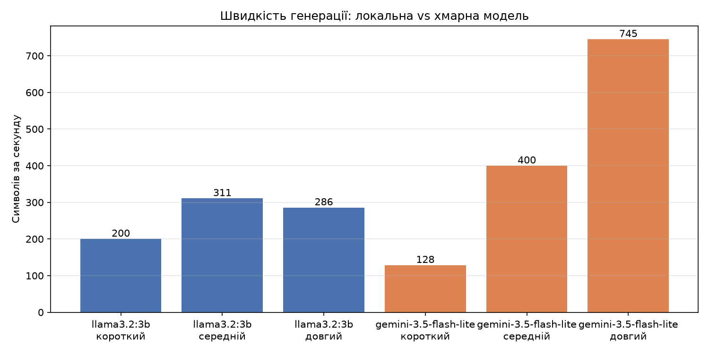

# Лабораторна робота № 1. Розгортання середовища та порівняльний аналіз мовних моделей

**Студент:** Шугаєв Роман, група АІ-244
**Варіант:** 4

## Конфігурація

| Параметр        | Значення                                                       |
|-----------------|----------------------------------------------------------------|
| ОС              | Windows                                                        |
| CPU / RAM / GPU | AMD Ryzen 5 5500 / 32 ГБ / NVIDIA GeForce GTX 1080 Ti          |
| Python          | 3.15                                                           |
| Локальні моделі | `llama3.2:3b`, `qwen3:4b` (Ollama)                             |
| Хмарна модель   | `gemini-3.5-flash-lite` (Google AI Studio, OpenAI-сумісний API) |

Файли роботи:

| Файл                     | Призначення                                                         |
|--------------------------|---------------------------------------------------------------------|
| `providers.py`           | налаштування провайдерів, логер, збереження результатів            |
| `reasoning.py`           | завдання 1: ті самі запити, що й `curl` до `/api/generate`          |
| `hello.py`               | завдання 2: вплив system-повідомлення                                |
| `compare.py`             | завдання 3: локальна vs хмарна модель                               |
| `benchmark.py`, `plot.py`| завдання 4: TTFT, швидкість, холодний/теплий старт, діаграма        |
| `quality.py`, `check_json.py` | завдання 5: прогін рубрики, перевірка JSON через `json.loads()` |
| `sampling.py`            | завдання 6: temperature і top_p                                     |
| `results/*.json`, `results.csv`, `quality.json`, `logs/lab1.log` | сирі результати |

Відмінність від методички: моделі Gemini 3.5+ не приймають параметри `temperature`/`top_p` (у документації Google вони позначені як застарілі), тому для хмарного провайдера ці параметри не передаються (функція `sampling_params` у `providers.py`).

---

## Завдання 1. Ціна роздумів: міркувальна vs інструктивна модель

*Фактичне питання* «Столиця України? Відповідай одним словом.»

| Показник     | qwen3:4b | llama3.2:3b |
|--------------|----------|-------------|
| `response`   | Киев     | Київ.       |
| `eval_count` | 4616     | 5           |
| Час, с       | 118.69   | 6.49        |
| Токенів/с    | 67.8     | 123.1       |

*Задача на міркування (середнє з 5 запусків)*

| Показник        | qwen3:4b | llama3.2:3b |
|-----------------|----------|-------------|
| Правильних із 5 | 5        | 3           |
| `eval_count`    | 1178.6   | 184.6       |
| Час, с          | 17.58    | 2.26        |

Спостереження:
- На питання про столицю `qwen3:4b` згенерувала 4616 токенів (поле `thinking` – близько 12 700 символів) і відповіла російською «Киев», хоча питання було українською. `llama3.2:3b` відповіла правильно й українською за 5 токенів.
- Час llama на фактичному питанні (6.49 с) майже повністю пішов на завантаження моделі в пам'ять: генерація 5 токенів зайняла соті частки секунди.
- На задачі про ручку і зошит qwen розв'язала всі 5 разів правильно (система рівнянь + перевірка), llama – 3 з 5; у двох невдалих запусках вона відповіла «60 грн» і «100 грн». Усі відповіді llama на цю задачу – російською, одна з відповідей qwen також російською.

**Відповіді чат-бота (Claude)**

1. *Куди пішли токени?* У внутрішню чернетку (`thinking`): модель перебирає варіанти, перевіряє себе й переформульовує відповідь. Ці токени генеруються так само, як і видимі, тому займають час і контекст, але користувач їх не бачить.
2. *Де міркувальні моделі виграють?* На задачах, які розкладаються на кроки: арифметика, логіка, планування, код із нетривіальною умовою. На простих фактичних питаннях, класифікації та переформулюванні тексту роздуми лише додають затримку й вартість без виграшу в якості.
3. *Чим відрізняється навчання?* Інструктивну модель донавчають на парах «інструкція – відповідь» і через RLHF. Міркувальну додатково навчають (зокрема, підкріпленням із перевірюваною винагородою) генерувати довгий ланцюжок міркувань перед відповіддю, і правильність фінальної відповіді винагороджується.
4. *Більше токенів = розумніша?* Ні. Більше токенів означає більше обчислень на одну відповідь; на задачі з кроками це підвищує точність, але на простому питанні та сама відповідь коштує в сотні разів дорожче. Розумність вимірюється якістю відповіді, а не довжиною чернетки.
5. *Різниця в токенах/с.* `qwen3:4b` має більше параметрів (4 млрд проти 3 млрд), тож на кожен токен треба більше обчислень і читання ваг з пам'яті. Також впливають архітектура, розмір словника й квантизація конкретної збірки.

**Висновок.** Міркувальна модель вигідна там, де потрібен багатокроковий розрахунок (5/5 проти 3/5), але на простому фактичному питанні вона витратила майже 2 хвилини й ще й відповіла не тією мовою. Для агентів, що роблять багато коротких викликів, інструктивна модель дешевша; для складних обчислень варто вмикати роздуми лише там, де вони потрібні.

---

## Завдання 2. Роль system-повідомлення

Питання: «Поясни різницю між оперативною пам'яттю і жорстким диском.»

*Вплив system-повідомлення*

| Модель      | System                 | Довжина, символів | Мова відповіді                         | Речень | Інструкцію виконано? |
|-------------|------------------------|-------------------|----------------------------------------|--------|----------------------|
| llama3.2:3b | лаконічний асистент    | 1212              | українська з англ. вставками («quickly access») | 8 | ні – відповідь розлога, з помилками |
| llama3.2:3b | українською, 2 речення | 171               | українська                             | 1      | формально так, але зміст хибний |
| qwen3:4b    | лаконічний асистент    | 335               | українська (русизм «кратковічна»)      | 4      | так                  |
| qwen3:4b    | українською, 2 речення | 237               | українська                             | 2      | так                  |

*Витрати токенів*

| Модель      | System                 | `prompt_tokens` | `completion_tokens` | `total_tokens` |
|-------------|------------------------|-----------------|---------------------|----------------|
| llama3.2:3b | лаконічний асистент    | 59              | 365                 | 424            |
| llama3.2:3b | українською, 2 речення | 63              | 58                  | 121            |
| qwen3:4b    | лаконічний асистент    | 65              | 1809                | 1874           |
| qwen3:4b    | українською, 2 речення | 74              | 746                 | 820            |

Відповіді на питання:
1. Точніше дотрималась обмеження `qwen3:4b` – рівно два речення. llama дала одне речення, але з фактичною помилкою: «жорсткий диск – пристрій, який використовує цю оперативну пам'ять для збереження даних».
2. Повністю іншою мовою не відповіла жодна модель, але у llama в першій відповіді є англійські вставки («quickly access») і неіснуючі слова («піщемом», «зварювання» замість «зберігання»); у qwen – русизм «кратковічна».
3. `prompt_tokens` зріс на 4 (llama) і на 9 (qwen), бо друге system-повідомлення довше за перше; кожна модель ще додає службові токени шаблону чату, тому числа різні для однакового тексту.
4. У `completion_tokens` qwen враховуються токени прихованих роздумів: видима відповідь 237–335 символів, а згенеровано 746–1809 токенів.

**Відповіді чат-бота (Claude)**

1. *Чому моделі по-різному дотримуються інструкцій?* Це залежить від того, скільки прикладів обмежень довжини й мови було в даних донавчання та наскільки сильно їх закріпили під час RLHF. Мала модель має менше «ресурсу», щоб одночасно тримати зміст і обмеження, тому формат часто програє змісту.
2. *System vs user.* Технічно це той самий текст у контексті, позначений іншою роллю в шаблоні. Пріоритет system не гарантований архітектурою, а лише вивчений під час навчання, тому в різних моделей він різний.
3. *Чому міркувальна модель витрачає більше токенів?* Вона спочатку генерує прихований ланцюжок роздумів, а потім видиму відповідь, і обидві частини рахуються як вихідні токени. Видима довжина однакова, а реальний обсяг генерації – у кілька разів більший.
4. *Суперечливі інструкції в system і user.* Добре навчені моделі зазвичай віддають перевагу system, але мала модель часто виконує останню або конкретнішу інструкцію. Поведінка нестабільна, тому на неї не можна покладатися.
5. *Чому малі моделі гірше тримають мову?* Українських текстів у навчальних даних мало, а близьких російських – значно більше, тому мала модель легко «зісковзує» на сусідню мову або вставляє англійські терміни. Більша модель має більше параметрів, щоб розрізняти мови й тримати обрану.

**Висновок.** System-повідомлення впливає на поведінку помітно (довжина відповіді llama впала з 1212 до 171 символу), але не надійно: виконана інструкція не гарантує правильного змісту, а «лаконічність» llama просто проігнорувала. Якщо формат критичний, інструкцію треба доповнювати перевіркою відповіді в коді та повторним запитом (або структурованим виводом), а не сподіватися на промпт.

---

## Завдання 3. Локальна vs хмарна модель

Питання: «Поясни різницю між оперативною пам'яттю і жорстким диском. Коротко.»

| Показник                      | Локальна                                   | Хмарна                  |
|-------------------------------|--------------------------------------------|-------------------------|
| Назва моделі                  | llama3.2:3b                                | gemini-3.5-flash-lite   |
| Час відповіді, с              | 2.73                                       | 1.61                    |
| `completion_tokens`           | 128                                        | 235                     |
| Довжина відповіді, символів   | 399                                        | 704                     |
| Мова відповіді                | українська з англ. вставками («temporary storage», «permanent storage») | українська |
| Фактичних помилок у відповіді | 1 (різниця зведена до того, «як інформація записується на об'єкт»; слово «обмінкується») | 0 |

Відповіді на питання:
1. У коді програми – жодного рядка: цикл однаковий для обох провайдерів. Відмінності – три значення в словнику `PROVIDERS` (`base_url`, `api_key`, `model`). Для Gemini 3.5 довелося ще не передавати `temperature`.
2. Хмарна відповідь повніша й точніша: вона прямо називає ключові відмінності (швидкість, енергозалежність, постійне зберігання) і додає аналогію «робочий стіл / шафа». Локальна зводить усе до «temporary/permanent storage» і плутано формулює різницю.
3. Так: англійські вставки, неіснуюче слово «обмінкується»; у першому (невдалому) запуску було ще й німецьке «benötуються».
4. Хмарна модель працює на потужних прискорювачах, тож генерує набагато швидше, і цей виграш перекриває мережеву затримку (~0.6–0.9 с до першого токена).

**Відповіді чат-бота (Claude)**

1. *Чому формат OpenAI став стандартом?* OpenAI першою отримала масову базу розробників і готові SDK; іншим провайдерам вигідніше прийняти той самий формат, ніж змушувати всіх переписувати код. Ollama, vLLM, Groq, Google надають сумісні ендпоінти саме для цього.
2. *Вплив розміру.* Розмір – один із головних факторів: модель на десятки млрд параметрів має більше знань і краще тримає мову та інструкції. Але якість даних, донавчання й підказка в контексті (RAG) можуть дати меншій моделі результат, близький до більшої, на вузькій задачі.
3. *Чому хмарна швидша попри мережу?* Хмарні сервери використовують GPU/TPU з дуже високою пропускною здатністю пам'яті та оптимізований інференс, тож генерують у рази швидше. Мережа додає фіксовану затримку на старті, але не впливає на швидкість потоку.
4. *Ризики приватності.* Усі дані запиту передаються стороннім серверам і можуть логуватися або (у безкоштовних тарифах) використовуватися для навчання. У комерційних проєктах укладають угоди про обробку даних, обирають тарифи без зберігання даних, маскують персональні дані або тримають модель локально.
5. *Rate limit.* Це обмеження кількості запитів/токенів за хвилину чи день у безкоштовному тарифі. Розробники додають повторні запити з паузою (backoff), кешують відповіді, групують запити або перемикаються на іншого провайдера.

**Висновок.** Локальну модель я обрав би для конфіденційних даних, роботи без інтернету та великої кількості дешевих простих запитів. Хмарну – там, де важлива якість і українська мова, а дані не секретні.

---

## Завдання 4. Вимірювання швидкості

Промпти: короткий – «Столиця Бразилії?», середній – «Поясни в одному абзаці, що таке рекурсія.», довгий – «Напиши інструкцію з 10 пунктів, як підготуватися до технічної співбесіди.» (медіана з 3 запусків після прогріву).

| Розміщення | Модель                | Промпт   | TTFT, с | Всього, с | Симв./с |
|------------|-----------------------|----------|---------|-----------|---------|
| локальна   | llama3.2:3b           | короткий | 0.034   | 0.175     | 199.9   |
| локальна   | llama3.2:3b           | середній | 0.034   | 0.940     | 310.6   |
| локальна   | llama3.2:3b           | довгий   | 0.053   | 7.711     | 285.5   |
| хмарна     | gemini-3.5-flash-lite | короткий | 0.871   | 1.029     | 128.2   |
| хмарна     | gemini-3.5-flash-lite | середній | 0.621   | 1.091     | 399.6   |
| хмарна     | gemini-3.5-flash-lite | довгий   | 0.637   | 3.728     | 744.8   |

*Холодний і теплий старт локальної моделі (короткий промпт)*

| Показник  | Холодний старт | Теплий старт |
|-----------|----------------|--------------|
| TTFT, с   | 1.671          | 0.030        |
| Всього, с | 2.115          | 0.184        |



Відповіді на питання:
1. Кращий TTFT у локальної моделі (0.03–0.05 с проти 0.6–0.9 с): запит не йде через мережу, модель уже в пам'яті, а короткий промпт обробляється миттєво.
2. Ні. Локальна найшвидша за TTFT, але хмарна генерує швидше: 400 проти 311 симв./с на середньому промпті й 745 проти 286 на довгому.
3. На короткому промпті локальна виграє в рази (0.18 с проти 1.03 с), бо все визначає TTFT. На довгому – хмарна вдвічі швидша загалом (3.7 с проти 7.7 с), бо мережева затримка стає малою часткою часу.
4. TTFT і симв./с між повторами стабільні (наприклад, локальна на довгому: 277–300 симв./с). Загальний час розкидається сильно, бо модель щоразу пише відповідь різної довжини (у локальної на довгому промпті: 2990, 469 і 2316 символів → 10.8 / 1.6 / 7.7 с). Одного запуску недостатньо.
5. При холодному старті Ollama спочатку завантажує ваги моделі (~2 ГБ) з диска в пам'ять; при теплому модель уже завантажена, тож TTFT впав з 1.67 до 0.03 с.

**Відповіді чат-бота (Claude)**

1. *Що відбувається під час TTFT?* Запит доходить до сервера, токенізується, модель обробляє весь промпт (prefill), заповнює KV-кеш і рахує перший токен; для хмари додається мережа й черга. Це затримка «порожнього екрана», тому її вимірюють окремо від швидкості подальшого потоку.
2. *Гірший TTFT, але краща швидкість у хмари.* TTFT хмари включає мережевий шлях і чергу на сервері, а швидкість генерації визначається потужним залізом, яке в рази швидше за домашній ПК. Тому хмара програє на старті, але виграє на довгих відповідях.
3. *Холодний старт.* Перший запит змушує завантажити ваги з диска в RAM/VRAM та ініціалізувати рушій. Після цього модель залишається в пам'яті на кілька хвилин, і наступні запити цей етап пропускають.
4. *Чому медіана?* Окремі заміри спотворюються фоновими процесами, мережею, кешем і різною довжиною відповіді. Медіана кількох запусків стійка до одиничних викидів, на відміну від середнього чи одного значення.
5. *Чому обробка входу швидша за генерацію?* Токени промпту обробляються паралельно одним проходом, а вихідні генеруються послідовно, по одному на прохід через усю модель. Тому той самий обсяг тексту на вході обробляється в рази швидше.

**Висновок.** Для інтерактивного чат-бота важливіший TTFT – користувач бачить реакцію одразу. Для фонової обробки великих обсягів тексту важливіша швидкість генерації (симв./с) і пропускна здатність, а затримка старту майже не впливає на загальний час.

---

## Завдання 5. Оцінювання якості за рубрикою

Завдання (варіант 4, тема «Спорт»):
1. Рік перших сучасних Олімпійських ігор. Правильна відповідь – **1896** (джерело: <https://olympics.com/en/olympic-games/athens-1896>).
2. JSON: event, year, city для перших сучасних Олімпійських ігор.
3. Стиснення тексту про Ігри 1896 року (числа: 6, 15, 1896, 241, 14, 43, 9, 60 тисяч, 47; дані з olympics.com).
4. `win_rate(results)` зі списку 'W'/'L'/'D'.
5. 8 команд, кожна з кожною по разу. Правильно: 28 матчів, 7 днів.
6. Чим спринт відрізняється від стаєрського бігу.

Правило оцінювання: кожне завдання прогнано двічі, у таблицю ставиться нижчий бал із двох прогонів.

*Оцінка якості за рубрикою*

| Завдання      | llama3.2:3b | qwen3:4b | Хмарна модель |
|---------------|-------------|----------|---------------|
| 1. Факт       | 2           | 2        | 2             |
| 2. Формат     | 0           | 2        | 2             |
| 3. Стиснення  | 0           | 2        | 2             |
| 4. Код        | 2           | 2        | 2             |
| 5. Логіка     | 0           | 2        | 2             |
| 6. Українська | 0           | 0        | 1             |
| **Разом /12** | **4**       | **10**   | **11**        |

*Розбіжність оцінок між двома прогонами*

| Завдання      | llama3.2:3b | qwen3:4b | Хмарна модель |
|---------------|-------------|----------|---------------|
| 1. Факт       | ні          | ні       | ні            |
| 2. Формат     | так (0 / 2) | ні       | ні            |
| 3. Стиснення  | ні          | ні       | ні            |
| 4. Код        | ні          | ні       | ні            |
| 5. Логіка     | ні          | ні       | ні            |
| 6. Українська | ні          | ні       | так (2 / 1)   |

Коментарі до оцінок:
- **2. Формат.** llama у першому прогоні видала обірваний «JSON» з десятками повторених ключів і вигаданими містами (не парситься), у другому – валідний JSON, але з містом «атенас (Греція)». Gemini у другому прогоні повернула масив з одного об'єкта замість об'єкта – `json.loads()` проходить, але структура відрізняється від запитаної.
- **3. Стиснення.** llama втратила числа 60 тисяч і 47, у другому прогоні ще й спотворила зміст («переможці були присутні близько 60 тисяч глядачів»). qwen і Gemini зберегли всі числа у двох реченнях; Gemini має одруківку «спортсмена-чооловіка» і пише «перед 60 тисячами глядачів», хоча в тексті ця кількість стосується церемонії відкриття.
- **4. Код.** Усі функції працюють (`['W','L','D','W']` → 0.5). Частина варіантів падає на порожньому списку (ділення на нуль), але умова цього не вимагала. Gemini і другий прогін llama обгорнули код у markdown попри «Лише код».
- **5. Логіка.** llama обидва рази помилилась (56 матчів / 14 днів; 64 матчі), qwen і Gemini дали 28 і 7 з повним ходом.
- **6. Українська.** llama сплутала стаєрський біг із бігом з перешкодами, вставляла російські й англійські слова («препятствиями», «several»). qwen в одному прогоні заявила, що терміна «стаєрський біг» не існує, в іншому теж сплутала його з бігом з перешкодами – суть неправильна. Gemini в першому прогоні дала зразкову відповідь, у другому почала з англійського «Sprint» і має одруківку «стаєєра».

Відповіді на питання:
1. Найбільше балів у Gemini (11), трохи менше – у qwen (10), llama – 4. Основна різниця – у завданнях 2, 3 і 5 (формат, стиснення, логіка), де llama провалилась.
2. Розбіжності: у llama на форматі (0 і 2 бали) і в Gemini на мові (2 і 1). Це означає, що навіть одна правильна відповідь не гарантує стабільності: у програмі треба перевіряти кожну відповідь.
3. Так: qwen і Gemini обидва рази віддали чистий JSON без markdown; llama – лише в одному прогоні з двох.
4. Так: русизми й російські слова у llama («Следовательно», «Окончательный ответ»), англійські вставки, неіснуючі слова; у qwen – неправильне трактування терміна; у Gemini – дрібні одруківки й англійське слово на початку.

### Приклад провалу

**Запит** (llama3.2:3b, завдання 5, прогін 1):

```text
8 команд, кожна грає з кожною по разу. Скільки матчів? При 4 матчах на день — скільки днів? Покажи хід розв'язання.
```

**Відповідь моделі (повністю):**

```text
Здорово!

Хід розв'язання:

1. Кожна команда грає з кожною іншим по разу. Следовательно, для однієї команди необхідно зіграти з 7 інших команд.
2. Поскольку команди грають по разу, то для однієї команди необхідно зіграти 7 матчів.
3. В загалом, якщо кожна команда грає з кожною іншим по 7 матчів, то загальна кількість матчів становить 8 x 7 = 56 матчів.
4. При 4 матчах на день, кількість днів required для проведення всіх матчів буде 56/4 = 14 днів.

Окончательный ответ — 14.
```

**Правильна відповідь:** 8 · 7 / 2 = 28 матчів, 28 / 4 = 7 днів.

**Чому так сталося.** Модель правильно почала (кожна команда грає 7 матчів), але пропустила ключовий крок – кожен матч порахований двічі, бо в ньому беруть участь дві команди. Хід розв'язання виглядає переконливо, але містить помилку, і далі вона тягнеться в другу частину (14 днів замість 7). Це типовий провал малої інструктивної моделі в багатокроковій арифметиці: вона відтворює «схожий» шаблон розв'язку, не перевіряючи його. Додатково модель перейшла на російську («Следовательно», «Окончательный ответ») і вставила англійське «required» – наслідок малої кількості українських даних у навчанні.

**Відповіді чат-бота (Claude)**

1. *Інші підходи до оцінювання.* Автоматичні бенчмарки з еталонними відповідями (MMLU, GSM8K, HumanEval), оцінювання іншою моделлю-суддею (LLM-as-a-judge), попарне порівняння людьми (Chatbot Arena, рейтинг Elo) і доменні тестові набори під конкретний продукт.
2. *Чому ігнорують «без markdown»?* У навчальних даних JSON і код майже завжди обгорнуті в markdown-блоки, і донавчання на чатах це закріплює. Звичка сильніша за одну інструкцію, тому надійніше використовувати режим структурованого виводу або вирізати обгортку в коді.
3. *Чому мала модель гірше пише українською?* Частка українських текстів у даних мала, а мала модель має обмежену «місткість» і в першу чергу запам'ятовує найчастіші мови. Близькість до російської, якої в даних значно більше, призводить до русизмів і переходу мови.
4. *Різна якість на однаковий запит.* При temperature > 0 кожен токен вибирається випадково з розподілу, і одна невдала ланка змінює весь подальший текст. Тому відповіді різняться і за змістом, і за якістю.
5. *Галюцинація.* Це впевнено сформульована, але вигадана відповідь. Модель навчена продовжувати текст правдоподібно, і «не знаю» в даних зустрічається рідко, тож найімовірніше продовження – конкретна, але не перевірена відповідь.

**Висновок.** Рубрика дала відтворюваний результат: бали ставились за об'єктивними правилами (рік, `json.loads()`, числа, запуск коду, правильна відповідь), суб'єктивним залишилось лише завдання 6. Найпоказовішими виявились завдання 2 (формат) і 5 (логіка) – саме вони відокремили llama від інших. Для українськомовного тексту я обрав би хмарну модель: лише вона в одному з прогонів написала природну й змістовно правильну відповідь українською.

---

## Завдання 6. Керування випадковістю: temperature і top_p

Модель: `llama3.2:3b`. Творче завдання: «Придумай назву сервісу доставки домашньої їжі.» Фактичне питання: «Рік перших сучасних Олімпійських ігор?» (правильно – 1896, джерело: <https://olympics.com/en/olympic-games/athens-1896>).

| Параметр    | Значення | Унікальних із 5 (творче) | Правильних із 5 (фактичне) |
|-------------|----------|--------------------------|----------------------------|
| temperature | 0.0      | 1                        | 5                          |
| temperature | 0.7      | 5                        | —                          |
| temperature | 1.5      | 5                        | 5                          |
| top_p       | 0.1      | 1                        | —                          |
| top_p       | 0.5      | 4                        | —                          |
| top_p       | 1.0      | 5                        | —                          |

Приклади: при temperature = 0.0 – п'ять разів «DomDom»; при 0.7 – варіації навколо того самого («DomHome», «DomDom Delivery», «HomeDeliver»); при 1.5 – «Мистичний Гостинець», «Гастропаска», «БуфетНа дом», «БуфеДomic».

| Показник                          | Значення |
|-----------------------------------|----------|
| Кількість запусків                | 10       |
| temperature                       | 0.0      |
| Унікальних відповідей             | 1        |
| Усі відповіді однакові (так / ні) | так      |

Відповіді на питання:
1. Для агента, що повертає JSON, – temperature 0–0.2: потрібна передбачуваність формату й однаковий результат на однаковий вхід.
2. Для генератора заголовків – 0.7–1.0: є різноманіття, але ще без безглуздих слів, які з'явились при 1.5.
3. temperature змінює форму всього розподілу (згладжує його), тому при 1.5 з'являються нові, далекі від типових варіанти. top_p лише відсікає «хвіст»: при 0.1 лишився тільки найімовірніший варіант (як при t = 0), а при 0.5 модель обирала серед близьких варіантів однієї теми («DomHome», «DomHomeDelivery»).
4. Повної гарантії немає, але в моєму експерименті всі 10 відповідей при t = 0 збіглися («1896»). Факт, який модель добре знає, має дуже «гострий» розподіл, тому навіть при t = 1.5 вона 5/5 відповіла правильно – цього разу температура не зламала відповідь, хоча на менш відомих фактах ефект був би помітним.
5. Найбезглуздіша – «БуфеДomic»: суміш кирилиці й латиниці в одному слові. При високій температурі малоймовірні токени (латинські літери замість кириличних, обрізки слів) отримують помітну ймовірність і зрештою вибираються.

**Відповіді чат-бота (Claude)**

1. *Що робить temperature?* Логіти ділять на T перед softmax. При T < 1 розподіл стає гострішим (найімовірніший токен домінує), при T > 1 – пласкішим, при T → 0 вибір зводиться до найімовірнішого токена.
2. *top_p vs temperature.* temperature змінює співвідношення ймовірностей усіх токенів, а top_p (nucleus sampling) нічого не змінює в співвідношенні, лише залишає мінімальний набір найімовірніших токенів із сумарною ймовірністю p і вибирає серед них.
3. *Змінювати обидва?* Зазвичай рекомендують налаштовувати один параметр, а другий лишати за замовчуванням, бо ефекти накладаються і їх важко інтерпретувати. Комбінація можлива (висока температура + обмежений top_p), але її треба перевіряти експериментально.
4. *Чому t = 0 не гарантує однакову відповідь?* Обчислення з плаваючою комою на GPU залежать від порядку операцій, розміру батча й паралелізації, тому логіти можуть трохи відрізнятися. Якщо два токени майже рівноймовірні, така різниця змінює вибір і весь подальший текст.
5. *Практичні значення.* Для витягу структурованих даних і класифікації – 0–0.3; для звичайного діалогу – близько 0.7; для творчих завдань – 0.8–1.2. Значення вище за ~1.3 використовують рідко через різке зростання безглуздих відповідей.

**Висновок.** Для наступних лабораторних, де модель повертає структуровані дані, я ставитиму temperature 0 (або близьку) і не чіпатиму top_p. Налаштування за замовчуванням (часто 0.7–0.8) розраховані на «живий» діалог, тому для агента вони додають зайву випадковість у формат і аргументи інструментів.

---

## Підсумкове порівняння моделей

| Критерій                          | Локальна мала (llama3.2:3b) | Локальна більша (qwen3:4b) | Хмарна (gemini-3.5-flash-lite) |
|-----------------------------------|-----------------------------|----------------------------|--------------------------------|
| Швидкість генерації               | ~123 ток/с, ~290 симв./с    | ~70 ток/с                  | 400–745 симв./с                |
| TTFT                              | 0.03–0.05 с (теплий), 1.7 с (холодний) | секунди–хвилини через роздуми | 0.6–0.9 с                |
| Якість, балів /12                 | 4                           | 10                         | 11                             |
| Стабільність формату (завдання 2) | 1 з 2 прогонів              | 2 з 2                      | 2 з 2 (один раз масив замість об'єкта) |
| Потрібні ресурси                  | ~2 ГБ пам'яті               | ~3 ГБ пам'яті              | лише інтернет і ключ           |
| Вартість                          | безкоштовно                 | безкоштовно                | безкоштовний ліміт, далі платно |
| Куди йдуть ваші дані              | нікуди, лишаються на ПК     | нікуди, лишаються на ПК    | на сервери Google              |
| Працює без інтернету              | так                         | так                        | ні                             |
| Коли обирати саме її              | прості швидкі запити, класифікація, дані не можна передавати назовні, потрібна мінімальна затримка | багатокрокові обчислення й структурований вивід локально, коли можна чекати | якість тексту й українська мова, довгі відповіді, дані не конфіденційні |

**Правило вибору.** Локальну модель я беру, коли дані не можна віддавати назовні, потрібна робота без мережі або дуже багато дешевих коротких запитів; якщо при цьому треба міркувати чи віддавати JSON, – міркувальну `qwen3:4b`, змирившись із її повільністю. Хмарну – коли головне якість відповіді, українська мова й швидкість на довгих текстах, а дані не є конфіденційними і є стабільний інтернет.

---

## Загальні висновки

1. **Немає «найкращої» моделі, є найкраща для задачі.** За рубрикою хмарна `gemini-3.5-flash-lite` набрала 11/12, локальна `qwen3:4b` – 10/12, `llama3.2:3b` – 4/12. Водночас найменшу затримку має саме мала локальна модель (TTFT 0.03–0.05 с у теплому стані), а тільки локальні моделі працюють без інтернету й не передають дані назовні. Модель треба обирати за вимогами до якості, затримки, вартості й конфіденційності, а не за одним показником.
2. **Роздуми – це ціна, а не безкоштовне покращення.** Міркувальна `qwen3:4b` розв'язала багатокрокову задачу краще (5/5 проти 3/5), але на простому питанні думала майже 2 хвилини. Для агента, який робить багато коротких викликів, роздуми варто вмикати лише там, де справді потрібен розрахунок.
3. **Промпт впливає на поведінку, але нічого не гарантує.** System-повідомлення скоротило відповідь llama з 1212 до 171 символу, проте формат і зміст дотримувались не в усіх прогонах. Тому формат відповіді треба перевіряти в коді (`json.loads()`, схема) і повторювати запит при помилці.
4. **Швидкість має дві складові.** Для діалогу важливий TTFT, для обробки великих текстів – швидкість генерації. Холодний старт локальної моделі (1.7 с проти 0.03–0.05 с) треба враховувати, якщо модель довго не викликалась.
5. **Випадковість треба контролювати.** Для структурованого виводу й викликів інструментів я ставитиму temperature 0 і не змінюватиму top_p; навіть так повна відтворюваність не гарантована, тому результати варто перевіряти на кількох прогонах.
6. **Об'єктивна оцінка потребує рубрики.** Бали за перевірюваними правилами (рік, валідний JSON, числа, запуск коду) дали відтворюване порівняння. Без такої рубрики висновок «модель краща» був би суб'єктивним.

Для наступних лабораторних з агентами з цього випливає: локальна модель із temperature 0, перевірка кожної відповіді в коді та вимірювання якості на фіксованому наборі задач, а не на одному прикладі.
