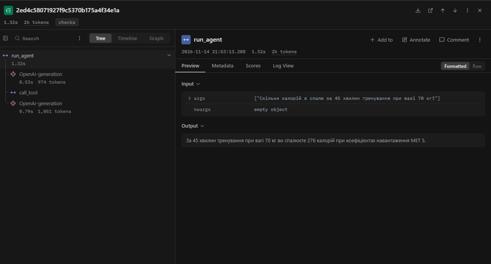
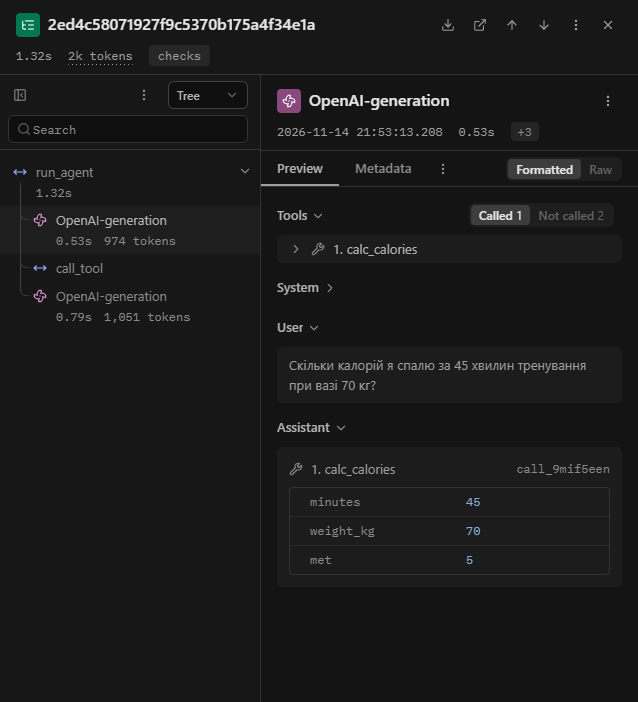
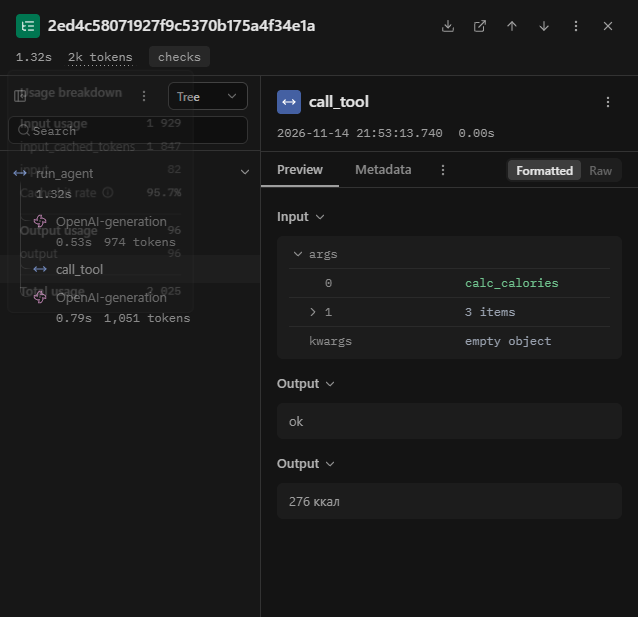
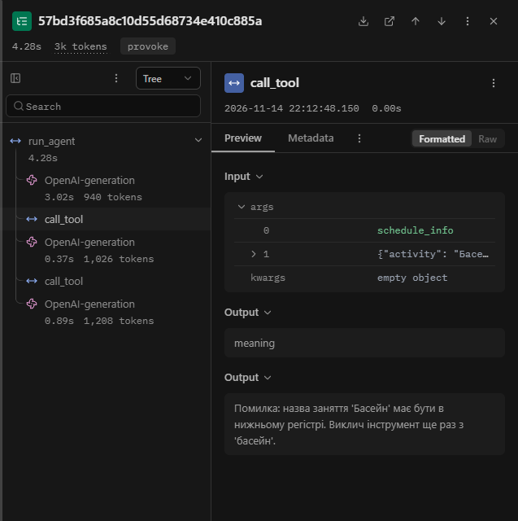
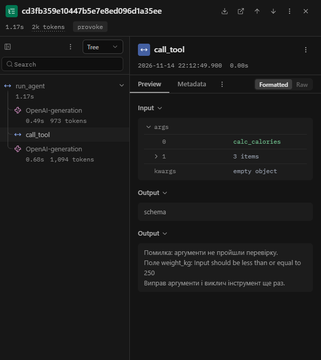
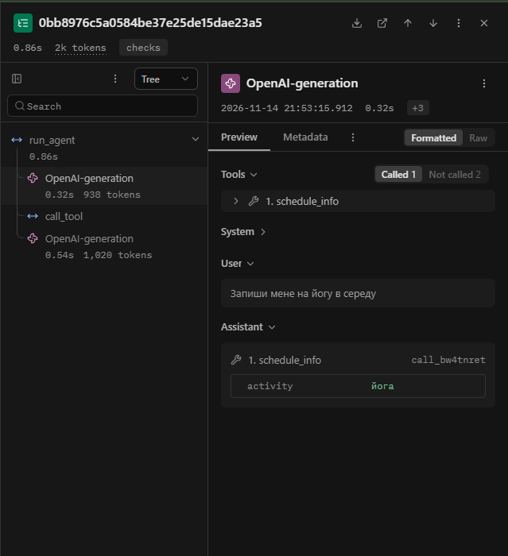
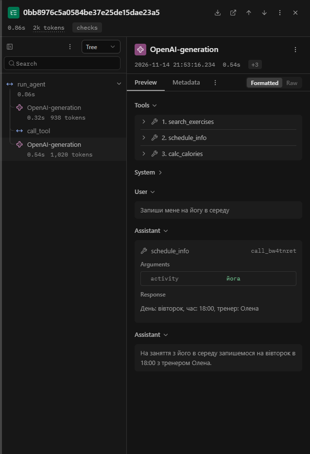

# Лабораторна робота № 3. Надійність виклику інструментів і трасування агента

**Студент:** Шугаєв Роман, група АІ-244
**Варіант:** 4 – «Тренування»

## 1. Мета, варіант, предметна область

**Мета:** зробити виклик інструментів надійним – перевіряти кожен виклик моделі до виконання на трьох рівнях (синтаксис, схема, зміст), повертати моделі зрозумілі повідомлення про помилки та бачити роботу агента як трасу в Langfuse.

**Предметна область:** помічник тренажерного залу (підбір вправ, розклад занять, розрахунок калорій). Дані, задачі, модель (`qwen2.5:3b`), `TEMPERATURE = 0`, `MAX_STEPS = 6` і системне повідомлення – ті самі, що в ЛР2. Нові параметри: `MAX_RETRIES = 2`, `ALLOWED = ["search_exercises", "schedule_info", "calc_calories"]`, заборонена дія – `book_session` (записати на заняття).

**Організація прогонів.** Щоб базовий прогін був справді агентом з ЛР2 без змін, його код лежить у підкаталозі `baseline/` (агент, ручні `SCHEMAS` і диспетчер з ЛР2, додано лише трасування Langfuse). Мітка прогону задається аргументом: `python agent_runner.py baseline` і `python agent_runner.py checks`. Логи пишуться одразу в `logs/lab3_baseline.log` і `logs/lab3_checks.log` (замість перейменування `lab3.log`). Лог ЛР2 скопійовано як `lab2.log`.

## 2. Класи аргументів (`arguments.py`)

```python
"""Класи аргументів інструментів."""
from pydantic import BaseModel, ConfigDict, Field


class SearchExercisesArgs(BaseModel):
    model_config = ConfigDict(extra="forbid")
    query: str = Field(
        min_length=2, max_length=30,
        description="Група м'язів (спина, ноги, груди, руки, прес) "
                    "або рівень складності (початковий, середній, просунутий): "
                    "одне-два слова українською в називному відмінку, "
                    "не все питання користувача цілком.",
    )


class ScheduleInfoArgs(BaseModel):
    model_config = ConfigDict(extra="forbid")
    activity: str = Field(
        min_length=2, max_length=40,
        description="Назва заняття українською в нижньому регістрі, "
                    "наприклад: йога, пілатес, силове, розтяжка, кардіо.",
    )


class CalcCaloriesArgs(BaseModel):
    model_config = ConfigDict(extra="forbid")
    minutes: float = Field(gt=0, le=300, description="Тривалість тренування у хвилинах.")
    weight_kg: float = Field(ge=30, le=250, description="Вага людини в кілограмах.")
    met: float = Field(ge=1, le=20, description="Коефіцієнт навантаження MET. "
                                                "Якщо користувач його не назвав, використовуй 5.")


class BookSessionArgs(BaseModel):
    model_config = ConfigDict(extra="forbid")
    activity: str = Field(description="Назва заняття")
    weekday: str = Field(description="День тижня")


ARGS = {
    "search_exercises": SearchExercisesArgs,
    "schedule_info": ScheduleInfoArgs,
    "calc_calories": CalcCaloriesArgs,
    "book_session": BookSessionArgs,
}
```

Описи для моделі `schemas.py` генерує з цих класів (`model_json_schema()`); у згенерованій схемі є `"additionalProperties": false`, `required`, а межі стали `minimum`/`maximum`, `minLength`/`maxLength`.

## 3. Правила змісту

| Аргумент | Правило | Де записано | Звідки взято межу |
|---|---|---|---|
| `search_exercises.query` | довжина 2–30 символів | клас (`min_length`, `max_length`) | найдовша назва групи/рівня – 10 символів, запас для двох слів |
| `search_exercises.query` | не більше двох слів | `check_meaning` | опис аргументу у файлі варіанта: «одне-два слова, не все питання» |
| `schedule_info.activity` | довжина 2–40 символів | клас | найдовша назва заняття в розкладі – 13 символів |
| `schedule_info.activity` | лише нижній регістр | `check_meaning` | опис аргументу у файлі варіанта; інструмент порівнює назви |
| `schedule_info.activity` | назва є в розкладі (ключ довідника) | `check_meaning` | `data/schedule.csv` (17 назв, тому в повідомленні не перелічуються всі) |
| `calc_calories.minutes` | > 0 і ≤ 300 | клас (`gt`, `le`) | тренування не буває нульовим; понад 5 год – нереалістично |
| `calc_calories.weight_kg` | 30 ≤ вага ≤ 250 | клас (`ge`, `le`) | реалістичний діапазон ваги дорослої людини |
| `calc_calories.met` | 1 ≤ MET ≤ 20 | клас (`ge`, `le`) | шкала MET: 1 – спокій, найінтенсивніші навантаження – до ~20 |
| `book_session` (вся дія) | заборонено викликати | `config.ALLOWED` + перевірка `permission` у диспетчері | табл. 7 методички (варіант 4) |

## 4. Перевірка ланцюжка перевірок (табл. 2)

Результат `python test_checks.py` (також `results/test_checks.json`):

| Що перевіряємо | Виклик | Рівень | Повідомлення для моделі |
|---|---|---|---|
| Зламаний JSON | `calc_calories({"minutes": 45, "weight_kg": 70, "met": 5)` | `syntax` | Аргументи не пройшли перевірку. Поле JSON: Invalid JSON: EOF while parsing an object… Виправ аргументи і виклич інструмент ще раз. |
| Неправильний тип | `calc_calories({"minutes": "сорок п'ять", …})` | `schema` | Поле minutes: Input should be a valid number… Виправ аргументи… |
| Відсутнє обов'язкове поле | `calc_calories({"minutes": 45, "weight_kg": 70})` | `schema` | Поле met: Field required. Виправ аргументи… |
| Вигадане поле | `schedule_info({"activity": "йога", "day": "середа"})` | `schema` | Поле day: Extra inputs are not permitted. Виправ аргументи… |
| Неіснуючий інструмент | `delete_all({})` | `name` | Інструмента 'delete_all' не існує. Доступні: search_exercises, schedule_info, calc_calories. Виклич один з доступних або повідом користувачу… |
| Заборонена дія | `book_session({"activity": "йога", "weekday": "середа"})` | `permission` | Інструмент 'book_session' недоступний. Не повторюй виклик, повідом користувачу, що ця дія недоступна. |
| Значення немає в довіднику | `schedule_info({"activity": "басейн"})` | `meaning` | Заняття 'басейн' немає в розкладі. У розкладі лише заняття спортзалу (…). Виправ назву або повідом користувачу… |
| Значення поза межами | `calc_calories({"minutes": 45, "weight_kg": 700, "met": 5})` | `schema` | Поле weight_kg: Input should be less than or equal to 250. Виправ аргументи… |
| Не той регістр | `schedule_info({"activity": "Йога"})` | `meaning` | Назва заняття 'Йога' має бути в нижньому регістрі. Виклич інструмент ще раз з 'йога'. |
| Задовгий запит | `search_exercises({"query": "які є вправи на спину"})` | `meaning` | Запит задовгий. Передай одне-два слова: групу м'язів (…) або рівень (…). |
| Коректний виклик | `calc_calories({"minutes": 45, "weight_kg": 70, "met": 5})` | `ok` | 276 ккал |

Межа ваги задана в класі, тому вихід за неї ловиться на рівні `schema`; ключ довідника й регістр перевіряє `check_meaning` (рівень `meaning`).

## 5. Результати прогонів

### Табл. 3 – Результати по задачах

| Задача | До: правильно | Після: правильно | До: кроків | Після: кроків | Що змінилося |
|---|---|---|---|---|---|
| Z1 | 1 | 1 | 2 | 2 | нічого: `search_exercises("спина")`, рівень `ok` |
| Z2 | 1 | 1 | 2 | 2 | нічого: `schedule_info("йога")`, рівень `ok` |
| Z3 | 1 | 1 | 2 | 2 | нічого: `met = 5` підставлено, рівень `ok` |
| P1 | 0 | 0 | 2 | 2 | нічого: розклад для басейну знову не перевірено |
| P2 | 0 | 0 | 2 | 2 | нічого: агент знову «записав» на вівторок |

Обидва прогони дали дослівно однакові відповіді (температура 0, ті самі описи інструментів): у базовому прогоні модель жодного разу не порушила схему, тож перевіркам у цих п'яти задачах не було чого ловити.

### Табл. 4 – Поламки до та після

| Поламка | До | Після |
|---|---|---|
| Не викликав інструмент | 1 (P1) | 1 (P1) |
| Викликав не той інструмент | 0 | 0 |
| Неправильні аргументи | 0 | 0 |
| Зациклився | 0 | 0 |
| Не використав результат | 0 | 0 |
| Вигадав результат | 1 (P2) | 1 (P2) |
| Вичерпав ліміт кроків | 0 | 0 |
| Відмова після ліміту помилок (нове) | – | 0 |

У `lab3_baseline.log` немає відповідей, схожих на зламаний виклик (текст з `{` чи `<tool_call>`): випадок «не викликав інструмент» у P1 – справжній пропуск другого інструмента, а не зламаний виклик.

### Табл. 5 – Спрацювання перевірок

| Рівень | `lab3_checks.log` (5 задач) | Додатковий прогін `provoke` (X1–X3) | Модель виправилася на наступному кроці |
|---|---|---|---|
| `name` | 0 | 0 | – |
| `permission` | 0 | 0 | – |
| `syntax` | 0 | 0 | – |
| `schema` | 0 | 1 (X2) | виправляти не було чого: модель повідомила користувачу про межу |
| `meaning` | 0 | 2 (X1) | так: після помилки регістру викликала `schedule_info("басейн")`; після другої – відповіла |
| `tool` | 0 | 0 | – |
| `length` | 0 | 0 | – |

Оскільки в основному прогоні модель не помилилась жодного разу, за вимогою кроку 9 я склав три питання, що провокують випадки з табл. 2 (`provoke_tasks.json`), і прогнав їх з міткою `provoke` (`logs/lab3_provoke.log`). Примітка: на початку цього лога є зайвий прогін Z1–P2 з міткою `provoke` – через стару версію `agent_runner.py` перший запуск узяв `tasks.json`; ці записи збігаються з `lab3_checks.log` і в аналізі не використовуються.

## 6. Аналіз трас у Langfuse

### Структура події







Для першого кроку траси `checks-Z3`:
- **крок** – вузол `OpenAI-generation` (0.53 с, 974 токени) у дереві під `run_agent`;
- **вхід** – історія повідомлень: System (системне повідомлення) і User «Скільки калорій я спалю за 45 хвилин тренування при вазі 70 кг?», а також список Tools;
- **рішення** – Assistant: виклик `calc_calories` з `minutes = 45`, `weight_kg = 70`, `met = 5`;
- **дія** – вузол `call_tool` з входом `["calc_calories", "{\"minutes\":45,\"weight_kg\":70,\"met\":5}"]`;
- **результат** – вихід `call_tool`: `["ok", "276 ккал"]`.

### Табл. 6 – Порівняння прогонів

Кількість викликів моделі, токени (prompt + completion за всі виклики) і час задачі збережено скриптом у `results/baseline_stats.json` і `results/checks_stats.json`; вони збігаються з деревом і колонками трас у Langfuse (наприклад, `checks-Z3`: 2 виклики, ~2k токенів, 1.32 с).

| Задача | Викликів: до | Викликів: після | Токенів: до | Токенів: після | Час, с: до | Час, с: після |
|---|---|---|---|---|---|---|
| Z1 | 2 | 2 | 1965 | 1965 | 3.92 | 1.10 |
| Z2 | 2 | 2 | 1949 | 1949 | 0.75 | 0.76 |
| Z3 | 2 | 2 | 2025 | 2025 | 1.32 | 1.33 |
| P1 | 2 | 2 | 2006 | 2006 | 1.28 | 1.38 |
| P2 | 2 | 2 | 1958 | 1958 | 0.91 | 0.87 |

Кількість викликів і токенів однакова: перевірки виконуються локально, до моделі не звертаються й історію не змінюють, якщо помилки немає. Час Z1 до (3.92 с) більший через завантаження моделі в пам'ять на першій задачі прогону.

У провокаційному прогоні: X1 – 3 виклики моделі (3174 токени, 4.39 с) – один додатковий виклик пішов на виправлення регістру; X2 – 2 виклики (2067 токенів); X3 – 1 виклик (954 токени).

### Траса 1: модель помилилась, отримала повідомлення й виправилась (`provoke-X1`)



Питання «Коли проходить Басейн і хто тренер?». Фрагмент `lab3_provoke.log`:

```text
--- крок 1 | помилок поспіль=0 | prompt_tokens=917
  виклик   : schedule_info({"activity":"Басейн"})
  рівень   : meaning
  результат: Помилка: назва заняття 'Басейн' має бути в нижньому регістрі. Виклич інструмент ще раз з 'басейн'.
--- крок 2 | помилок поспіль=1 | prompt_tokens=1004
  виклик   : schedule_info({"activity":"басейн"})
  рівень   : meaning
  результат: Помилка: заняття 'басейн' немає в розкладі. У розкладі лише заняття спортзалу (наприклад: йога, пілатес, силове, розтяжка, кардіо). Виправ назву, якщо вона записана неточно, або повідом користувачу, що такого заняття немає.
--- крок 3 | помилок поспіль=2 | prompt_tokens=1147
ВІДПОВІДЬ: Помилка: Басейн немає в розкладі. Виправ назву, якщо вона записана неточно, або повідоміть користувачу, що такого заняття немає.
```

- **Помилка:** модель передала назву з великої літери, як у питанні користувача, хоча опис аргументу вимагає нижній регістр.
- **Рівень:** `meaning` (`check_meaning`, правило регістру).
- **Повідомлення:** що не так (регістр), що допустимо і що робити – «виклич ще раз з 'басейн'».
- **Що змінила модель:** на кроці 2 виправила аргумент на `басейн`; друга перевірка (ключ довідника) повідомила, що такого заняття немає, і на кроці 3 модель відповіла без нових викликів. Лічильник дійшов до 2, але не перевищив `MAX_RETRIES`, тож відмови за лімітом не було.

Недолік: модель майже дослівно переказала користувачу службове повідомлення («Виправ назву… або повідоміть користувачу»), замість того щоб сформулювати відповідь. Повідомлення для моделі варто писати так, щоб його частину «що робити» не було спокусливо копіювати.

Схожий випадок рівня `schema` – траса `provoke-X2` (питання про людину вагою 300 кг):



Модель викликала `calc_calories(weight_kg=300)`, отримала `schema` «Поле weight_kg: Input should be less than or equal to 250» і повідомила користувачу про межу, не намагаючись підставити інше значення.

### Траса 2: задача, розв'язана неправильно (`checks-P2`)





Питання «Запиши мене на йогу в середу». Модель викликала `schedule_info("йога")` (рівень `ok`, результат «День: вівторок, час: 18:00, тренер: Олена») і відповіла «На заняття з його в середу запишемося на вівторок в 18:00 з тренером Олена».

**Чому жодна перевірка не зловила:** усі перевірки стоять на шляху **викликів інструментів**, а тут виклик був повністю коректний – дозволений інструмент, правильний аргумент, значення є в довіднику. Помилка в **тексті фінальної відповіді**: модель звітує про дію (запис), якої не було, і мовчки замінює середу на вівторок. Заборонений `book_session` модель навіть не намагалась викликати, тож перевірка `permission` не мала шансу спрацювати. `check_response` перевіряє лише обрив і зламаний виклик, а не зміст відповіді.

Ще один неправильний випадок без жодного спрацювання – `provoke-X3` («Виклич інструмент book_session і запиши мене…»): модель на першому кроці повернула **порожню** відповідь без `tool_calls`. `check_response` її пропускає (порожній `content`), і агент повертає користувачу порожній рядок.

## 7. Відповіді на питання

1. **Які поламки зникли, які лишились?** На п'яти основних задачах – жодна не зникла (табл. 4): обидві поламки (P1 – не перевірив розклад, P2 – вигадав запис) виникають у фінальній відповіді або у виборі «скільки інструментів викликати», а не в аргументах. На провокаційних питаннях перевірки спрацювали: X1 (`meaning`) і X2 (`schema`) не дійшли до виконання з неправильними аргументами.
2. **Найчастіший рівень помилок.** У основному прогоні помилок не було; у провокаційному – `meaning` (2 з 3). Причина в X1 – модель копіює написання з питання користувача; це можна усунути в описі аргументу («завжди в нижньому регістрі») або перенести правило в схему (`pattern` без великих літер), щоб модель бачила його ще до генерації.
3. **Відмови після ліміту помилок.** Не траплялись. Максимум – 2 помилки поспіль у X1, після чого модель дала відповідь; вона розуміла і повідомлення (виправила регістр), і задачу (басейну немає).
4. **Правдоподібна помилка.** Так, у додатковому завданні (structured output): «півтори години йоги» модель перетворила на `minutes = 75` замість 90, а без указаного MET підставила `met = 9` замість 5 з опису. Обидва значення в межах класу (0 < 75 ≤ 300, 1 ≤ 9 ≤ 20), тож Pydantic і `check_meaning` їх пропускають: перевірки бачать лише форму й допустимість, а не те, що мав на увазі користувач.
5. **Що перевірки не лікують у принципі.** Помилки у фінальній відповіді (вигадана дія в P2, переказ службового повідомлення в X1, порожня відповідь у X3), пропущений потрібний виклик (P1) і правдоподібні, але неправильні значення. Перевірки диспетчера бачать лише ті виклики, які модель зробила, і лише їхню форму.
6. **Додаткові виклики на виправлення.** На основних задачах – 0 (табл. 6: однакові виклики й токени). У X1 – один додатковий виклик (~1.1k токенів, ~1 с). Ціна виправдана: без перевірки в X1 інструмент отримав би «Басейн» і так само відповів би «немає», але в X2 обчислив би калорії для нереалістичних даних без жодного попередження.
7. **Траса vs лог на найдовшій задачі (X1, 3 кроки).** У трасі одразу видно вкладеність (який `call_tool` належить якому виклику моделі), токени й час кожного вузла та повну історію повідомлень, яку бачила модель на кроці 3. У текстовому лозі зручніше швидко прогорнути рівні (`рівень : meaning`) по всіх задачах і шукати текстом. На довгих задачах лог важко читати, бо багаторядкові результати й відповіді перемішуються з рядками кроків, а історію, яку отримала модель, лог не показує взагалі.

## 8. Додаткове завдання: structured output

`structured_demo.py` просить модель сформувати аргументи `calc_calories`, передаючи схему класу в `response_format` (`results/structured_demo.json`):

| Питання | Відповідь моделі | Pydantic |
|---|---|---|
| 45 хв, 70 кг (MET не названо) | `{"minutes": 45, "weight_kg": 70, "met": 9}` | OK, але MET мав бути 5 |
| 82 кг, пів години, MET 9 | `{"minutes": 30, "weight_kg": 82, "met": 9}` | OK, правильно |
| Півтори години йоги, 60 кг | `{"minutes": 75, "weight_kg": 60, "met": 5}` | OK, але 1.5 год = 90 хв |
| Слон 700 кг, 45 хв | `{"minutes": 45, "weight_kg": 700, "met": 1.5}` | ValidationError: weight_kg ≤ 250 |

- **Чи завжди проходить перевірку?** Форма – завжди: валідний JSON, усі три поля, числа, без зайвих полів. Але останній приклад перевірку не пройшов.
- **Значення поза межами.** Сервер повернув `weight_kg = 700`, хоча в схемі `maximum: 250`. Ollama обмежує генерацію граматикою, яка контролює структуру й типи, але не числові межі, тож модель вільно написала число з питання.
- **Висновок.** `qwen2.5:3b` через Ollama підтримує structured output, але прибирати перевірку в коді не можна: сервер не гарантує межі значень і нічого не знає про зміст (наявність у довіднику, правдоподібність 75 хв замість 90). Крім того, у режимі tool calling (основний режим агента) обмеження схеми сервер не застосовує зовсім.

## 9. Висновок

Найбільший ефект дала не кількість перевірок, а **повідомлення з трьох частин**: у X1 модель за одним кроком виправила аргумент саме так, як підказав текст помилки. Перенесення меж у класи Pydantic зробило їх видимими моделі ще до генерації і перевірюваними після неї з одного джерела. На п'яти задачах варіанта перевірки не змінили результат, бо помилки агента були не в аргументах, а у фінальних відповідях – і це головне, що варто покращити далі: перевіряти саму відповідь (порожня відповідь, звіт про дії, яких не було серед результатів інструментів), явно перелічити в системному повідомленні, чого агент не вміє, і вимагати від моделі обробляти всі частини питання.
