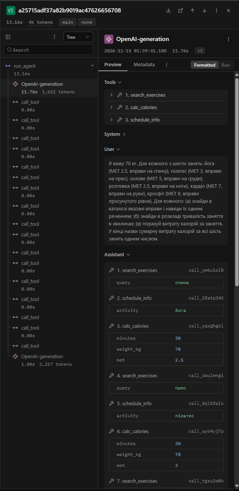
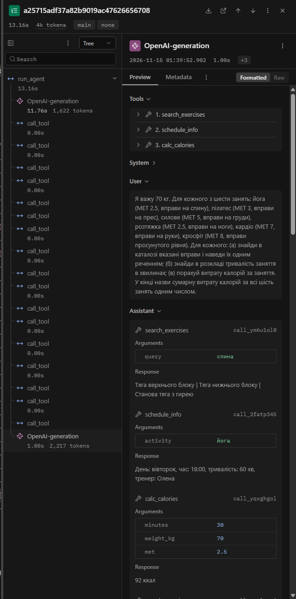
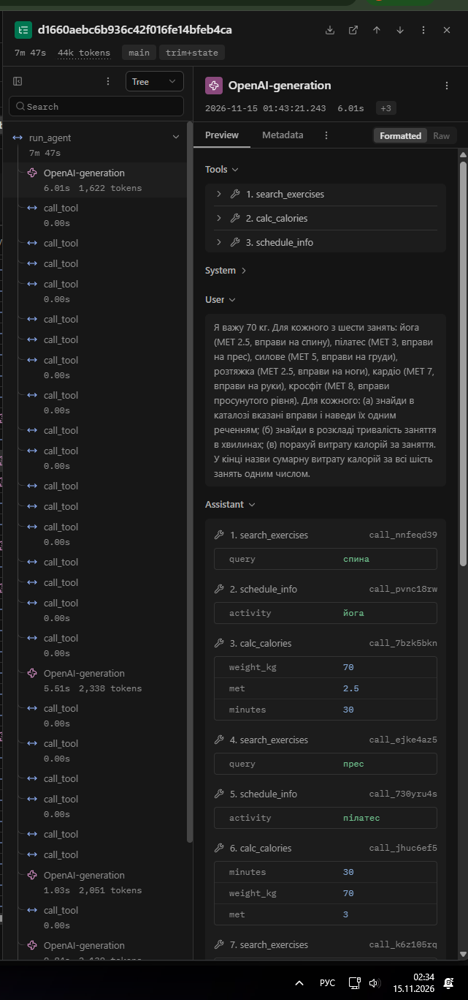
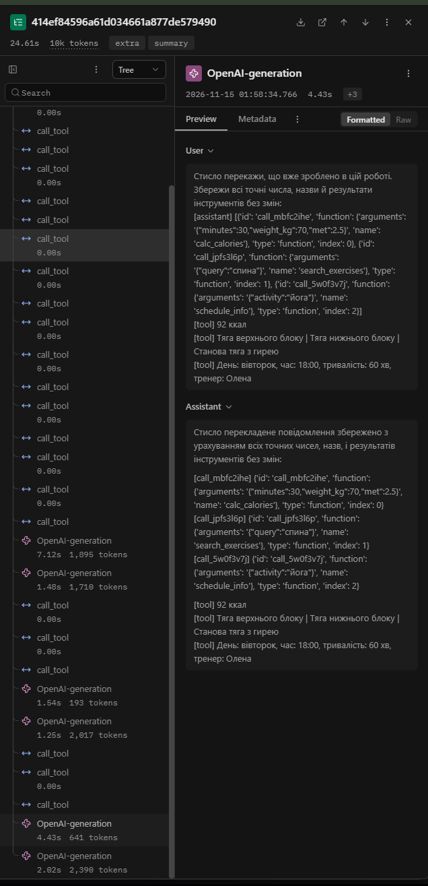

# Лабораторна робота № 4. Контекст, стан і кеш агента

**Студент:** Шугаєв Роман, група АІ-244
**Варіант:** 4 – «Тренування»

## 1. Мета, варіант, модель і вікно

**Мета:** побачити, що відбувається з агентом, коли історія не вміщується у вікно; навчитися скорочувати історію, зберігати результати інструментів поза діалогом і кешувати виклики моделі; виміряти, скільки це коштує.

**Предметна область:** помічник тренажерного залу (агент і перевірки з ЛР3, `ALLOWED` – три інструменти, `book_session` заборонено).

| Показник | Значення |
|---|---|
| Вихідна модель | `qwen2.5:3b`, `context length` = **32768** |
| Перша вузька модель | `qwen25-4k`, `num_ctx` = **4096** – вікно звужено у **8 разів** |
| Остаточна вузька модель (після випадку C) | `qwen25-3k`, `num_ctx` = **3072** – вікно звужено в **10.7 раза** |

Виведення `ollama show` збережено в `results/ollama_show_*.txt`. У звіті далі всі числа – для вікна 3072.

## 2. Довга задача

У довіднику (`data/schedule.csv`) не було тривалості заняття, тому, як дозволяє методичка, додано числове поле `duration_min`, і `schedule_info` тепер повертає тривалість. `make_task.py` рахує правильну відповідь прямими викликами `find_session` і `calc_calories` без моделі.

**Питання:**

> Я важу 70 кг. Для кожного з шести занять: йога (MET 2.5, вправи на спину), пілатес (MET 3, вправи на прес), силове (MET 5, вправи на груди), розтяжка (MET 2.5, вправи на ноги), кардіо (MET 7, вправи на руки), кросфіт (MET 8, вправи просунутого рівня). Для кожного: (а) знайди в каталозі вказані вправи і наведи їх одним реченням; (б) знайди в розкладі тривалість заняття в хвилинах; (в) порахуй витрату калорій за заняття. У кінці назви сумарну витрату калорій за всі шість занять одним числом.

| Заняття | Тривалість, хв | Калорії |
|---|---|---|
| йога | 60 | 184 |
| пілатес | 55 | 202 |
| силове | 75 | 459 |
| розтяжка | 45 | 138 |
| кардіо | 50 | 429 |
| кросфіт | 60 | 588 |

**Правильна відповідь: 2000 ккал**, `min_calls = 18`.

## 3. Прогін без захисту і де ламається вікно (кроки 3–4)

Пробний прогін `probe_none_r1`: відповідь «За всі шість занять витрато калорій: 294 ккал» – **неправильна**, час **12.1 с** (на вікні 4096) і 12.3 с (на 3072).

### Таблиця 2 – Зростання входу в прогоні без захисту (`analyze.py logs\probe_none_r1.log steps`, вікно 3072)

| Крок | `prompt_tokens` | Приріст | Що зробила модель |
|---:|---:|---:|:---|
| 1 | 1147 | | search_exercises({"query":"спина"}) |
| | | | schedule_info({"activity":"йога"}) |
| | | | calc_calories({"minutes":30,"weight_kg":70,"met":2.5}) |
| | | | search_exercises({"query":"прес"}) |
| | | | schedule_info({"activity":"пілатес"}) |
| | | | calc_calories({"minutes":30,"weight_kg":70,"met":3}) |
| | | | search_exercises({"query":"груди"}) |
| | | | schedule_info({"activity":"силове"}) |
| | | | calc_calories({"weight_kg":70,"met":5,"minutes":30}) |
| | | | search_exercises({"query":"ноги"}) |
| | | | schedule_info({"activity":"розтяжка"}) |
| | | | calc_calories({"minutes":30,"weight_kg":70,"met":2.5}) |
| | | | search_exercises({"query":"руки"}) |
| | | | schedule_info({"activity":"кардіо"}) |
| | | | calc_calories({"weight_kg":70,"met":7,"minutes":30}) |
| | | | search_exercises({"query":"просунутий"}) |
| | | | calc_calories({"minutes":30,"weight_kg":70,"met":8}) |
| 2 | 2190 | 1043 | відповідь без виклику |

- **(а)** постійна частина входу (вхід першого кроку): **1147** токенів;
- **(б)** типовий приріст за крок: **1043** токени (17 результатів інструментів за один крок);
- **(в)** сума `prompt_tokens` за прогін: **3337**, за формулою n·C + d·n(n−1)/2 = 2·1147 + 1043·1 = **3337** – збіг точний, бо кроків лише два і приріст один;
- **(г)** вхід перестав рости: **не помічено**;
- **(д)** не застосовується – застою немає.

**Випадок C (задача закоротка).** Найбільший вхід 2190 токенів – 53 % вікна 4096 (`probe4k_none_r1`), статус `final`. За методичкою вікно зменшено до 3072 (`Modelfile`, `qwen25-3k`, `NUM_CTX = 3072`), але й тоді – 71 % вікна, статус `final`: знову випадок C. Причина не в довжині задачі, а в поведінці моделі: `qwen2.5:3b` **запитує всі 17 викликів паралельно в одному кроці** і одразу відповідає, тож історія росте лише один раз.

Ця сама поведінка – причина неправильної відповіді (за таблицею поламок ЛР2 – «неправильні аргументи» і «вигадав результат»): модель викликала `calc_calories` одночасно з `schedule_info` і не бачила тривалості, тому всюди підставила `minutes: 30` від себе; для кросфіту розклад не запитала зовсім; а в підсумку назвала калорії лише останнього заняття (294) замість суми.

## 4. Обрізання і стан (кроки 5–6)

**Поріг.** Для вікна 3072 методичка радить `COMPRESS_AT = 2150`. Пробні прогони `probe_trim_r1` і `probe_trim+state_r1` з цим порогом **жодного разу не стиснули історію** і дослівно збіглися з `none`: стиснення виконується між кроками, а на першому кроці вхід лише 1147 токенів, на другому модель уже відповідає. Щоб механізм спрацював, пробні (`probelow_*`) і основні (`main_*`) прогони виконано з порогом **`COMPRESS_AT = 1100`** (задається змінною середовища, `config.py` читає її). `KEEP_LAST = 6`.

**Обмеження цього вибору.** `compress_history` порівнює поріг із входом поточного кроку, а для цієї моделі такий вхід буває лише двох видів: 1147 токенів на кроці 1 (постійна частина C – інструкція, питання й описи інструментів) або більший – на наступних кроках. Тому будь-який поріг ≥ 1147 не дає жодного стиснення (результат = `none`), а будь-який поріг < 1147, зокрема 1100, вмикає стиснення **на кожному кроці**, навіть коли в історії самі лише інструкція й питання. Проміжного значення, за якого стиснення спрацювало б «природно», для цієї задачі не існує. Отже, прогони з 1100 – це навантажувальна перевірка механізмів, а не імітація реального переповнення вікна; так їх і треба читати, особливо результат `trim`.

### Таблиця 3 – Стиснення історії (`COMPRESS_AT = 1100`)

| Конфігурація | Крок стиснення | Вхід до стиснення, токенів | Повідомлень було -> стало | Повторних викликів за прогін |
|---|---|---|---|---|
| `trim` | 1, 2, 3, …, 25 (кожен крок) | 1147 (щоразу) | 20 -> 2 (щоразу) | **400** |
| `trim+state` | 1 | 1147 | 20 -> 2 | **24** |
| | 2 | 1929 | 7 -> 7 | |
| | 3 | 2304 | 9 -> 4 | |
| | 4 | 2093 | 11 -> 2 | |
| | 5 | 2267 | 13 -> 2 | |
| | 6 | 2711 | 12 -> 2 | |

**Чому `trim` зациклився.** Після кроку 1 в історії 2 + 1 + 17 повідомлень: інструкція, питання, повідомлення моделі з 17 викликами і 17 результатів. `trim` лишає останні 6 – це самі результати інструментів, і `drop_orphan_tools` прибирає їх як «осиротілі». Лишаються тільки інструкція й питання, тож модель на кожному кроці починає задачу з нуля й робить ті самі 17 викликів – 25 разів до ліміту кроків, без відповіді (279.5 с).

Це не помилка реалізації: `context.py` і `compress.py` збігаються з кодом методички, і лог показує саме ту поведінку, яку цей код задає. Зациклення виникає через поєднання двох умов: (1) поріг 1100 нижчий за постійну частину входу, тож стиснення виконується після кожного кроку; (2) модель робить 17 паралельних викликів, а `KEEP_LAST = 6` відрізає повідомлення з викликами від їхніх результатів. За нормального порогу (вище за C) `trim` тут просто не спрацьовує.

**Пункт 7 кроку 6.** Перший блок «ПЕРШЕ ПОВІДОМЛЕННЯ КОРИСТУВАЧА ПІСЛЯ СТИСНЕННЯ» в `trim+state` містить **17 рядків** виду `- інструмент(аргументи) -> результат`, ~1673 символи ≈ **669 токенів** (за 2.5 символа на токен). Це менше за типовий приріст за крок у `none` (1043), тож блок не завеликий: вхід наступного кроку 1929 замість 2190 у `none`. Але блок займає ~22 % вікна і з кожним стисненням росте, бо стан накопичує й повторні виклики.

## 5. Кеш (крок 7)

### Таблиця 4 – Робота кешу

| Запуск | Кроків | Влучань у кеш | Викликів до сервера | Час, с | Правильно |
|---|---|---|---|---|---|
| 1 (кеш порожній) | 2 | 0 | 2 | 12.3 | ні |
| 2 (той самий запит) | 2 | 2 | 0 | 0.6 | ні |

Запуск 2 приблизно у **20 разів** швидший; 0.6 с – це лише робота інструментів, логування й відправка трас. Обидва кроки взято з кешу, а відповідь дослівно та сама – разом з помилкою: кеш не виправляє, а відтворює.

Якби перед запуском 2 змінити текст `SYSTEM`, змінився б перший елемент `messages`, а отже, й відбиток `sha256` кожного запиту. Кеш не спрацював би жодного разу: обидва виклики пішли б на сервер, а в `cache/` з'явилися б нові файли поруч зі старими.

## 6. Вимірювання і траси (крок 8)

### Таблиця 5 – Вартість циклу (медіани по трьох повторах, `COMPRESS_AT = 1100`)

| Конфігурація | Правильно (з 3) | Кроків | Токенів на вхід | Токенів на вихід | Час, с | Стиснень | Повторних викликів |
|---|---|---|---|---|---|---|---|
| `none` | 0 | 2 | 3337 | 502 | 10.8 | 0 | 1 |
| `trim` | 0 | 25 | 28675 | 11875 | 181.4 | 25 | 399 |
| `trim+state` | 0 | 6 | 12111 | 2239 | 31.5 | 5 | 9 |
| `summary` (дод.) | 0 | 9 | 16534 | 921 | 43.6 | 8 | 11 |

Колонку «Правильно» перевірено вручну за рядками `відповідь:`: жодна відповідь не містить 2000. Сама правильна відповідь перевірена повторно: перші рядки розкладу дають тривалості 60, 55, 75, 45, 50, 60 хв, `calc_calories` для них повертає 184 + 202 + 459 + 138 + 429 + 588 = 2000. Неправильність відповідей – поведінка моделі, а не помилка інструментів: у прогонах `none`, `trim` і `trim+state` усі виклики `calc_calories` мають `minutes = 30`; лише в `summary` модель частково перерахувала з реальними тривалостями (60, 45, 75 хв), але до правильної суми не дійшла. Прогони `none` і `trim` у трьох повторах дослівно однакові (температура 0, однакові розміри логів), `trim+state` відрізняються з 2-го кроку.

**Поламки, яких таблиця не показує:**
- **Відповідь менш ніж за 19 кроків** – у **9 з 12** прогонів: усі `none` (2 кроки), `trim+state` (6–7) і `summary` (4–9); прогони `trim` відповіді не дали зовсім. Зауваження: через паралельні виклики кількість кроків тут не дорівнює кількості викликів – у `none` за 2 кроки зроблено 17 викликів, але й цього не досить (кросфіт без розкладу).
- **Вигадане число** (немає в жодному рядку `результат:` і в питанні) – у **4 з 12**: `main_trim+state_r1` (1047), `main_trim+state_r2` (900), `main_trim+state_r3` (937) і `extra_summary_r1` (1616). У r3 модель сама склала 92 + 110 + 184 + 92 + 257 + 294 і отримала 937, хоча правильна сума цих чисел – 1029: порушено правило «не рахуй самостійно», і ще й з арифметичною помилкою.
- **Зациклена генерація до обриву** (`finish_reason = length`) – у **1 з 12**: `main_trim+state_r1`, крок 5, 30 720 токенів на виході.
- **Вигадані аргументи** – у **12 з 12**: `minutes = 30` у всіх розрахунках першого кроку замість тривалості з розкладу.

### Траси Langfuse

У трасі `long-main_none_r1` видно все одразу: лише два виклики моделі, між ними 17 вузлів `call_tool`; у виділеному першому виклику Assistant запитує всі виклики паралельно, і в кожному `calc_calories` стоїть `minutes = 30` – ще до того, як `schedule_info` повернув тривалість. Другий виклик – 2 217 токенів (2190 на вході + 27 на виході).

На вході другого виклику модель уже бачить відповідь `schedule_info` «тривалість: 60 хв» поруч із власним викликом `calc_calories(minutes=30)` і результатом «92 ккал», але не перераховує – одразу дає фінальну відповідь.

Перше стиснення в `main_trim+state_r1` відбулося після кроку 1, тож перший виклик після стиснення – **крок 2**: на вході **1929** токенів (у дереві траси другий `OpenAI-generation` – 2 338 токенів = 1929 на вході + 409 на виході). У `main_none_r1` на тому самому кроці 2 – **2190** токенів (2 217 у дереві).

У шапці траси `trim+state_r1` видно ще одну річ, якої не показує таблиця медіан: **7 хв 47 с і 44k токенів**. Лог пояснює чому: на кроці 5 модель зациклилась у генерації тексту й видала **30 720 токенів** (`completion_tokens=30720`), повторюючи ті самі абзаци, доки сервер не обірвав відповідь; `check_response` зафіксував рівень `length`, і агент повторив запит. Через це r1 тривав 467.8 с проти 19.5 і 31.5 с у r2 і r3. Стан замінив 17 повідомлень з результатами (і повідомлення моделі з викликами) одним компактним списком.

У трасі одразу видно, скільки разів викликали модель, вхід і вихід кожного виклику, повну історію, яку модель отримала на кожному кроці, і час кожного вузла; у текстовому лозі довелося б вручну рахувати кроки, віднімати сусідні `prompt_tokens` і відновлювати, які саме повідомлення лишилися після стиснення.

## 7. Відповіді на питання

1. **На якому кроці агент дійшов до межі вікна?** Ні на якому: найбільший вхід – 2190 токенів (71 % вікна 3072, табл. 2), застою не помічено (пункт (г)). Модель робить усі виклики паралельно в першому кроці й одразу відповідає, тож історія встигає вирости лише раз. Межу вікна наблизили тільки прогони зі стисненням (до 2711 у `trim+state` і 3019 = 98 % у `summary`).
2. **Сума `prompt_tokens` і формула.** У `none` збіг точний (3337 = 3337), бо крок один. У прогонах зі стисненням формула розходиться (наприклад, `trim+state` r1: 11702 проти 9214), бо приріст нерівномірний: стиснення зменшує вхід, а стан і нові паралельні виклики стрибкоподібно його збільшують.
3. **Що втрачає агент при обрізанні?** Усі результати інструментів, що не потрапили в останні `KEEP_LAST` повідомлень. У нашому випадку – усі 17 одразу, і агент 25 разів повторював ті самі виклики: після стиснення на кроці 1 крок 2 знову містить `search_exercises({"query":"спина"})`, `schedule_info({"activity":"йога"})` тощо (табл. 3, 399–400 повторів). У `trim+state` стан повертає ці результати в питання, і повторів стало 9, кроків – 6 замість 25 (табл. 5). Масштаб втрат у `trim` перебільшений штучно низьким порогом (розд. 4): стиснення відбувалося на кожному кроці.
4. **Найдешевша, найшвидша, найточніша.** Найдешевша й найшвидша – `none` (3337 токенів, 10.8 с), бо задача вкладається у вікно за 2 кроки. Найточнішої немає – 0 з 3 у всіх. Висновок обережний: одна задача, три повтори, температура 0 (повтори майже детерміновані), а поріг стиснення довелося штучно опустити нижче за постійну частину входу, тож `trim`, `trim+state` і `summary` стискали історію на кожному кроці – значно частіше, ніж у реальному переповненні вікна.
5. **Чому кеш вимкнено під час вимірювання?** Інакше повтори 2 і 3 брали б відповіді з кешу, і вартість і час були б майже нульовими. Якщо інструмент поверне інші дані, запит з наступного кроку зміниться, і кеш просто не спрацює; але якщо замінити модель під тією самою назвою, ключ лишиться тим самим і кеш віддасть **застарілі** відповіді старої моделі – цю помилку непомітно.
6. **Що скорочення історії не лікує в принципі?** Неправильні аргументи, вигадані моделлю (`minutes = 30`), пропущені виклики (кросфіт без розкладу), самостійну арифметику замість інструмента (937) і неправильно зрозуміле завдання (відповідь лише про одне заняття). Скорочення вирішує тільки проблему місця у вікні, а не якість рішень моделі.

## 8. Додаткове завдання: підсумовування

`python measure.py summary 3 extra` (`COMPRESS = "summary"`, `COMPRESS_AT = 1100`):

- **Вартість підсумовування:** медіана **4776** токенів за прогін (по 158–2318 токенів за кожне з 3–8 стиснень; найдорожче – перше, коли переказуються всі 17 результатів).
- **Заощаджено на вході** порівняно з `trim`: 28675 − 16534 = **12141** токен (медіана), але це більше, ніж у `trim+state` (12111), і ще +4776 на сам переказ.

На скріншоті – окремий виклик моделі для підсумовування (вузол `OpenAI-generation`, 641 токен): на вході – прохання переказати стару частину історії, на виході модель фактично повторила виклики й результати майже дослівно, тобто «переказ» майже не скоротив текст.

- **Чи зберіг переказ точні числа:** частково. У `extra_summary_r1` перший підсумок модель написала **російською** («Тяга верхнего блока…»), калорії 92/110/184 зберегла, але назви вправ змінила. Другий підсумок зовсім порожній за змістом: «…будь ласка, дайте мені контекст або конкретні деталі…» – модель не зрозуміла, що треба переказати, і вся стара частина історії втрачена. У відповіді r1 з'явилося число 1616, якого немає в жодному результаті.

## 9. Висновок

Найбільший ефект дав **стан задачі**: за порогу, нижчого за постійну частину входу, обрізання без стану зациклювало агента (25 кроків, 399–400 повторних викликів, без відповіді), а зі станом агент завершував за 6 кроків і в 2.4 раза дешевше. Самого переповнення вікна в цій задачі не сталося (випадок C), тож ефект стиснення виміряно в навантажувальному режимі. **Кеш** дав найбільше прискорення (≈20 разів на повторному запуску), але корисний лише для налагодження. Саме **обрізання** без стану на задачі з паралельними викликами шкідливе, а **підсумовування** малою моделлю ненадійне: переказ змінює мову, назви і може повністю загубити зміст.

Головна проблема цієї задачі – не вікно, а паралельні виклики з вигаданими аргументами. Варто змінити: перевіряти в `check_meaning`, що `minutes` для `calc_calories` збігається з тривалістю, уже отриманою від `schedule_info`; вимагати від моделі (у `SYSTEM` або через `parallel_tool_calls=False`) спершу отримати дані, а потім рахувати; рахувати підсумкову суму окремим інструментом, а не моделлю; а в `trim` не відрізати результати інструментів поточного кроку разом з їхнім викликом.
