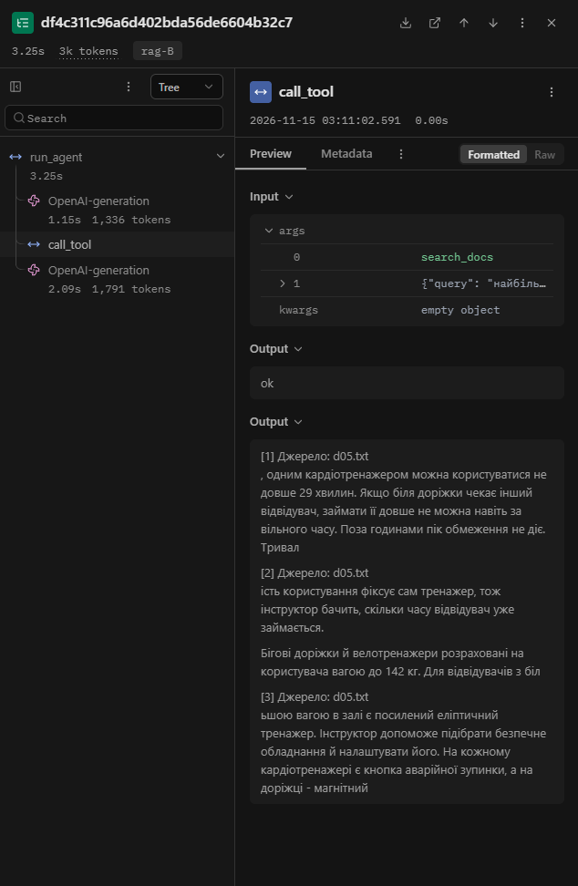
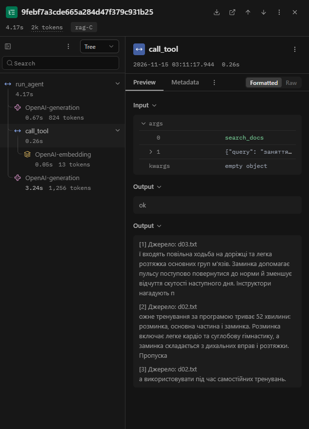

# Лабораторна робота № 5. Пошук по документах (RAG) як інструмент агента

**Студент:** Шугаєв Роман, група АІ-244
**Варіант:** 4 – «Тренування»

## 1. Мета, варіант, моделі

**Мета:** додати агентові векторний пошук по документах (RAG) як інструмент `search_docs`, перевірити пошук окремо від агента і виміряти, як опис інструмента впливає на те, чи звертається агент до пошуку.

| Параметр | Значення |
|---|---|
| Предметна область | помічник тренажерного залу (вигаданий спортклуб «Граніт») |
| Модель чату | `qwen25-4k` – `qwen2.5:3b` з вікном 4096 (з ЛР4) |
| Розмір вікна | 4096 токенів |
| Модель ембедингів | `bge-m3` (Ollama), вектор довжини 1024 |
| Індекс | повний перебір на numpy (див. нижче) |

**Відхилення від методички.** `faiss-cpu` не має збірки для Python 3.15 (`pip`: «No matching distribution found for faiss-cpu»). Як дозволяє крок 4, FAISS замінено індексом на numpy з лекції 9 (п. 9.7): клас `FlatIP` у `rag.py` має той самий інтерфейс (`add`, `search`, `d`), нормалізує вектори і шукає за скалярним добутком, а якщо чанків менше за k – доповнює результат номером `-1`, як FAISS. Тому замість `index/docs.faiss` збережено `index/docs.npy`; `chunks.json` і `meta.json` – без змін.

## 2. Дані

П'ять документів (`data/docs/`, згенеровано чат-ботом Claude за вимогами кроку 2, перевірено вручну): 9 абзаців по 2–4 речення, близько 3000 символів кожен, щонайменше шість нетипових чисел, числа не повторюються між документами.

| Файл | Тема | Символів |
|---|---|---|
| d01.txt | Техніка безпеки в залі | 3031 |
| d02.txt | Програма для початківців | 3049 |
| d03.txt | Відновлення й харчування | 3003 |
| d04.txt | Правила абонементів і заморожування | 3017 |
| d05.txt | Користування обладнанням | 3076 |

Разом з корпусом вправ (`data/corpus/`, 12 файлів) – **17 653 символи ≈ 7061 токен** (`check_cases.py`), тобто корпус у **1.7 раза більший за вікно 4096** і в контекст цілком не вміщується.

**Питання** (`rag_cases.json`, `check_cases.py`: «Усе гаразд» – кожна `must_contain` трапляється в документах рівно один раз, `expected` міститься в `must_contain`):

| id | Вид | Питання | `must_contain` | `expected` |
|---|---|---|---|---|
| D1 | direct | Скільки хвилин триває вступний інструктаж з техніки безпеки? | `який триває 17 хвилин` | 17 |
| D2 | direct | Скільки коштує місячний абонемент? | `Місячний абонемент коштує 1190 грн` | 1190 |
| D3 | direct | Скільки шафок є в роздягальнях? | `У роздягальнях є 168 шафок` | 168 |
| D4 | direct | Скільки грамів білка міститься в протеїновому коктейлі спортивного бару? | `міститься 27 г білка` | 27 |
| P1 | paraphrase | Як довго не можна братися за важкі силові вправи, якщо я захворів чи отримав ушкодження і не маю папірця від медика? | `не раніше ніж через 9 днів` | 9 |
| P2 | paraphrase | Скільки секунд треба переводити подих між серіями повторень на курсі для новачків? | `програмі становить 85 секунд` | 85 |
| P3 | paraphrase | Яку частку грошей залишить собі клуб, якщо я передумаю ходити й захочу повернути гроші за решту строку? | `за вирахуванням комісії 16 відсотків` | 16 |
| P4 | paraphrase | Яка найбільша маса тіла допустима для того, хто хоче бігати чи крутити педалі на кардіомашинах? | `користувача вагою до 142 кг` | 142 |
| N1 | none | Скільки коштує одне персональне тренування з тренером? | — | — |
| N2 | none | Скільки коштує оренда рушника в клубі? | — | — |

**Чи вгадує модель без документів** (`qwen25-4k`, без інструментів, temperature 0):

| id | Правильно | Відповідь моделі |
|---|---|---|
| D1 | 17 хв | «може зайняти від 10 до 30 хвилин» |
| P2 | 85 с | «від 1 до 5 хвилин» |
| D4 | 27 г | «я не маю конкретних даних…» |

Жодного вгаданого значення – числа достатньо нетипові.

## 3. Перевірка моделі ембедингів (`embed_check.py`)

| Показник | Значення |
|---|---|
| Час (без кешу) | 10.6 с |
| Довжина вектора | 1024 |
| Норма першого вектора | 1.000 (вектори вже нормалізовані) |
| Схожість «Тариф на доставку» | 0.732 |
| Схожість «Графік роботи кур'єрів» | 0.568 |

## 4. Нарізання одного документа (крок 3)

### Таблиця 1 – Нарізання `d01.txt`

| Спосіб | Чанків | Закінчуються посеред речення | Довжина найбільшого, символів |
|---|---|---|---|
| `fixed`, 200, перекриття 0 | 16 | 14 | 200 |
| `fixed`, 500, перекриття 100 | 8 | 7 | 500 |
| `paragraphs`, 800 | 5 | 0 | 730 |

**Розрізаний факт** (`fixed`, 200):

```text
--- чанк 1 ... Перед першим тренуванням новий клієнт проходить вступний інструктаж з техн
--- чанк 2  іки безпеки, який триває 17 хвилин. Інструктаж проводить черговий інструктор у малій залі, ...
```

Число 17 потрапило в інший чанк, ніж «вступний інструктаж», до якого воно належить; слово «техніки» розірване посередині.

## 5. Пошук при різному нарізанні і поріг (крок 5)

### Таблиця 2 – Пошук при різному нарізанні (`check_retrieval.py`)

| Конфігурація | Чанків | Сер. довжина | hit@1 | hit@3 | hit@5 | hit@3 прямі | hit@3 перефр. | Токенів (k=3) |
|---|---|---|---|---|---|---|---|---|
| `fixed-200-0` | 99 | 178 | 0.75 | 1.00 | 1.00 | 1.00 | 1.00 | 214 |
| `fixed-500-0` | 47 | 376 | 0.88 | 0.88 | 1.00 | 1.00 | 0.75 | 451 |
| `fixed-500-100` | 52 | 407 | 0.88 | 0.88 | 1.00 | 1.00 | 0.75 | 488 |
| `fixed-1500-0` | 27 | 654 | 0.88 | 1.00 | 1.00 | 1.00 | 1.00 | 785 |
| `paragraphs-800` | 37 | 476 | 1.00 | 1.00 | 1.00 | 1.00 | 1.00 | 571 |
| `paragraphs-800+title` | 37 | 492 | 1.00 | 1.00 | 1.00 | 1.00 | 1.00 | 590 |

**Вибір:** за правилом методички (найвищий `hit@3`, за рівності – менший результат) – **`fixed-200-0`**: `hit@3 = 1.00` при найменшому результаті (214 токенів). `CHUNK_METHOD = "fixed"`, `CHUNK_SIZE = 200`, `CHUNK_OVERLAP = 0`, `WITH_TITLE = False`. Ціна вибору видна в `hit@1 = 0.75`: у P2 і P4 перший результат не містить потрібної фрази (табл. 3), і потрібний чанк лише на 2–3 місці; у P2 перший результат – чанк про інше заняття з тими самими словами («програмі», «тренування»), а відповідь з числом 85 стоїть нижче.

### Таблиця 3 – Схожість першого результату (`fixed-200-0`, `check_retrieval.py scores`)

| id | Вид | Схожість | Перший результат містить потрібну фразу |
|---|---|---|---|
| D1 | direct | 0.697 | так |
| D2 | direct | 0.738 | так |
| D3 | direct | 0.688 | так |
| D4 | direct | 0.732 | так |
| P1 | paraphrase | 0.669 | так |
| P2 | paraphrase | 0.649 | ні |
| P3 | paraphrase | 0.718 | так |
| P4 | paraphrase | 0.570 | ні |
| N1 | none | 0.642 | – |
| N2 | none | 0.600 | – |

Найнижча схожість серед питань з відповіддю – 0.570, найвища серед питань без відповіді – 0.642: **межі перекриваються**, і жоден поріг не розділяє їх ідеально.

**Вибір `MIN_SCORE`.** Поріг відсікає кожен результат окремо, тому важлива схожість саме потрібного чанка: у P2 вона 0.605, у P4 – 0.558. Для порогів від 0.50 до 0.75 пораховано, скільки з 8 відповідей лишаються в результаті й скільки з 2 питань без відповіді отримують «нічого не знайдено»:

| Поріг | Відповідей збережено (з 8) | Без відповіді заблоковано (з 2) |
|---|---|---|
| 0.50–0.55 | 8 | 0 |
| 0.56–0.59 | 7 (втрачено P4) | 0 |
| 0.60 | 7 | 1 (N2) |
| 0.61–0.64 | 6 (втрачено P2, P4) | 1 |
| 0.65–0.66 | 6 | 2 |
| 0.67–0.75 | 5 → 0 | 2 |

Сума «збережено + заблоковано» однакова (8) для 0.50, 0.60 і 0.65. Я вважаю важливішим **не пропустити відповідь** (від вигадування захищає ще й текст опису `B`), тому за рівності взято менший поріг: **`MIN_SCORE = 0.50`**. На моїх питаннях такий поріг практично не фільтрує: він відсікає лише результати, далекі від будь-якого документа (у прогоні `A-r1-D3` запит «шафок» дав схожість 0.483, і пошук повернув «нічого не знайдено»).

## 6. Перевірка інструмента без моделі (`try_tool.py`)

**D1** – рівень `ok`, перший результат містить відповідь, хоча й розрізаний:

```text
[1] Джерело: d01.txt
іки безпеки, який триває 17 хвилин. Інструктаж проводить черговий інструктор у малій залі, ...
[2] Джерело: d02.txt
ожне тренування за програмою триває 52 хвилини: розминка, основна частина і заминка. ...
[3] Джерело: d01.txt
Порушення правил безпеки фіксує інструктор у журналі порушень ...
Занадто короткий запит -> рівень: schema
Поле query: String should have at least 3 characters
```

**N1** («персональне тренування») – пошук повертає три чанки з `d02.txt`, перший – про «4 безкоштовні персональні консультації з тренером». Ціни там немає, але поріг 0.50 цей результат не відсікає: агент отримує правдоподібний, але нерелевантний текст.

## 7. Агент із трьома описами (крок 7)

### Таблиця 4 – Конфігурації агента

| Назва | Опис `search_docs` | Нарізання, `TOP_K`, `MIN_SCORE` |
|---|---|---|
| `A` | опис старого `search_exercises` з ЛР2–4: «Шукає вправи в каталозі за групою м'язів або рівнем складності…» | `fixed-200-0`, 3, 0.50 |
| `B` | «ЄДИНЕ джерело даних про правила роботи спортклубу. Викликай ЗАВЖДИ, коли питання стосується  будь-якого правила, ціни, штрафу, ліміту, терміну, тривалості чи послуги клубу, навіть якщо тема  здається незвичною. Ці дані вигадані й унікальні для клубу, тому з власних знань відповідати не можна.  Ніколи не відповідай «немає інформації» чи «немає інструмента», не викликавши спершу цей інструмент.  Документи охоплюють: техніку безпеки в залі (інструктаж, ліміти, страхування, штрафи, травми);  програму для початківців (тестування, тривалість тренувань, відпочинок, пульс, консультації);  відновлення й харчування (перерви між тренуваннями, вода, сауна, масаж, спортивний бар);  правила абонементів і заморожування (ціни, передача, гостьовий візит, повернення коштів, запис на заняття);  користування обладнанням (кардіотренажери, гантелі, бронювання, шафки, браслети).  Запит формулюй повним реченням. Відповідай лише за знайденими фрагментами;  якщо потрібного там немає, так і скажи користувачу.» | ті самі |
| `C` | «Шукає інформацію.» | ті самі |

### Таблиця 5 – Агент з трьома описами (`rag_report.py`; питань з відповіддю 8, у трьох повторах 24 прогони)

| Опис | Правильно (з 24) | Викликав пошук (з 24) | Кроків, медіана | Токенів входу, медіана | Час, с, медіана |
|---|---|---|---|---|---|
| `A` | 2 | 6 | 1.0 | 892 | 2.5 |
| `B` | 3 | 9 | 2.0 | 2668 | 2.2 |
| `C` | 0 | 3 | 1.0 | 796 | 2.1 |

### Таблиця 6 – Куди ламається відповідь (питань з відповіддю 24 на опис, без відповіді 6)

| Категорія | `A` | `B` | `C` |
|---|---|---|---|
| Правильно | 2 | 3 | 0 |
| Не шукав і відповів неправильно | 18 | 15 | 21 |
| Шукав, але потрібного фрагмента в результаті немає | 4 | 6 | 3 |
| Фрагмент був у результаті, відповідь неправильна | 0 | 0 | 0 |
| Питання без відповіді: визнав, що не знає | 0 | 0 | 3 |
| Питання без відповіді: вигадав відповідь | 6 | 6 | 3 |

**Чого таблиця не показує: «не шукав» часто означає «викликав не той інструмент».** За логами, першим викликом агента був `schedule_info` у 6 з 30 прогонів `A`, у **15 з 30** прогонів `B` і в 6 з 30 `C` (наприклад, `schedule_info({"activity":"абонемент"})`, `schedule_info({"activity":"инструктаж техніки безпеки"})`). Перевірка змісту з ЛР3 відповідає «заняття немає в розкладі», і модель або переказує це повідомлення користувачу, або здається, але **не переходить до `search_docs`**. Опис `B` сильніше підштовхнув модель до інструментів загалом (не викликав жодного – лише 6 з 30 проти 18 і 21), але вона все одно обирала «розклад» для питань про правила клубу.

## 8. Розбір у логах і трасах (крок 8)

**1. Агент не шукав** (`C-r1-P3`, категорія `no_search`):

```text
ЗАДАЧА: Яку частку грошей залишить собі клуб, якщо я передумаю ходити й захочу повернути гроші за решту строку?
--- крок 1 | prompt_tokens=800 | completion_tokens=118
ВІДПОВІДЬ: Це питання не пов'язане зі змістом, який ви надали. Ви не вказали суму грошей, ...
```

Модель не вигадала числа, але й не шукала: з описом «Шукає інформацію.» вона не зрозуміла, що відповідь може бути в документах.

**2. Який запит пише модель.** У `B` запити часто **скопійовані з опису інструмента**, а не з питання: `search_docs({"query":"правила роботи спортклубу"})` (P1, `top_score` 0.617), `search_docs({"query":"правила абонементів і заморожування"})` (P3, 0.649) – це назви тем з опису `B`. Такі запити повертають загальні чанки, і потрібний не потрапляє в top-3 (`miss`). Коли ж модель скопіювала питання дослівно (`B-P4`: «найбільша маса тіла допустима для того, хто хоче бігати чи крутити педалі на кардіомашинах», 0.544), пошук знайшов «користувача вагою до 142 кг» і відповідь була правильною у всіх трьох повторах.

**3. Шукав, але не знайшов** (`C-r1-P2`):

```text
виклик   : search_docs({"query":"заняття для новачків серії повторень подих"})
результат: [1] Джерело: d03.txt  ...ї входять повільна ходьба на доріжці та легка розтяжка...
           [2] Джерело: d02.txt  ...ожне тренування за програмою триває 52 хвилини...
           [3] Джерело: d02.txt  а використовувати під час самостійних тренувань.
ВІДПОВІДЬ: На основі знайдених джерел, для новачків використовуються повільна ходьба на доріжці ...
```

Модель скоротила питання до набору слів, втративши «скільки секунд» і «між серіями»; пошук знайшов чанки про розминку і заминку. До цього додається нарізання: чанк [3] – це обрізок у 49 символів з кінця абзацу, а потрібне речення «…програмі становить 85 секунд» навіть для повного питання стоїть лише на 2–3 місці (табл. 3).

**4. Знайшов, але не використав** (`ignored`) – **жодного випадку** в усіх 90 прогонах: коли потрібний фрагмент потрапляв у результат, модель брала з нього правильне число.

**5. Питання без відповіді.** У `A` і `B` агент у всіх 6 прогонах «вигадав» (здебільшого переказав помилку `schedule_info` або порадив звернутися до тренера з власними числами), у `C` – тричі визнав, що не знає (N2) і тричі вигадав (N1). Поріг 0.50 не допоміг жодного разу: схожість N1 і N2 (0.642 і 0.600) вища за поріг.

### Траси Langfuse



**`rag-B-r1-P4`** (правильна відповідь). Дерево: `run_agent` → `OpenAI-generation` (1 336 токенів) → `call_tool` → `OpenAI-generation` (1 791). Вхід `call_tool` – `search_docs` із запитом «найбільша маса тіла допустима для того, хто хоче бігати…» (питання майже дослівно); вихід – рівень `ok` і три чанки з `d05.txt`. Потрібна фраза «на користувача вагою до 142 кг» – лише в чанку [2], і речення обірване на «Для відвідувачів з біл», а продовження «ьшою вагою…» – у чанку [3]: це нарізання `fixed-200` у дії. Модель все одно взяла правильне число.



**`rag-C-r1-P2`** (`miss`). Вхід `call_tool` – запит «заняття для новачків серії повторень подих»: модель скоротила питання до набору слів і втратила «скільки секунд». Вихід – чанки про заминку (`d03.txt`), про тривалість тренування 52 хвилини і 49-символьний обрізок «а використовувати під час самостійних тренувань.» – числа 85 немає. Під `call_tool` видно ще вузол `OpenAI-embedding` (13 токенів, 0.05 с) – обчислення ембединга запиту; у трасі `rag-B` його немає, бо такий самий запит уже був у кеші ембедингів після пробного прогону `measure_rag.py B 1`.

**Опис інструмента у вході першого виклику моделі.** У `B` опис `search_docs` – великий абзац («ЄДИНЕ джерело даних про правила роботи спортклубу. Викликай ЗАВЖДИ…» з переліком п'яти тем), у `C` – три слова «Шукає інформацію.». Це видно і в розмірі першого виклику: **1 336 токенів у `B` проти 824 у `C`** – понад 500 токенів на кожному кроці йдуть лише на опис.

**Що в трасі видно одразу:** які інструменти й з якими аргументами викликала модель, точний вміст чанків, що повернув пошук, окремий вузол ембединга запиту і токени кожного виклику. У текстовому лозі довелося б вручну шукати рядок `#####`, віднімати сусідні `prompt_tokens` і зіставляти чанки з запитом, а опису інструмента, який отримала модель, у лозі немає зовсім.

## 9. Звичайні задачі після зміни пошуку (крок 9)

### Таблиця 7 – П'ять задач до і після заміни пошуку (`logs/run_lab4.log` → `logs/run_rag.log`)

| Задача | Відповідь у ЛР4 | Відповідь тепер | Чи викликав `search_docs` | Що змінилося |
|---|---|---|---|---|
| Z1. Вправи на спину | Тяга верхнього блоку, Тяга нижнього блоку, Станова тяга з гирею | Скручування на підлозі, Тяга верхнього блоку, Тяга нижнього блоку | так, `"вправи на спину"` | **зламалось**: векторний пошук дав у top-3 вправу на прес (у тексті «Лежачи на спині») і загубив станову тягу |
| Z2. Йога і тренер | вівторок, 18:00, Олена | вівторок, 18:00, Олена | ні (`schedule_info`) | нічого |
| Z3. Калорії, 45 хв, 70 кг | 276 ккал | 276 ккал | ні (`calc_calories`) | нічого |
| P1. Плавання й басейн | «нічого не знайдено» за `search_exercises("плавання")` | «Коли басейн відкрите, можна звернутися до нього… В розкладі немає заняття плавання» | ні (`schedule_info("плавання")`) | перевірив розклад замість вправ; частково вигадав про басейн |
| P2. Запис на йогу в середу | «запишовся на вівторок» | «віднімайте в 18:00, тренер Олена» | ні (`schedule_info`) | так само неправильно: запису немає, день замінено |

## 10. Відповіді на питання

1. **Табл. 1.** Нарізання за символами давало в 3.2 раза більше чанків (16 проти 5), і 14 з 16 закінчувалися посеред речення, тоді як за абзацами – жоден. Приклад – D1: «вступний інструктаж з техн | іки безпеки, який триває 17 хвилин». Агент може отримати число без того, до чого воно належить, або назву без числа, і тоді відповідає неповно чи приписує число іншому факту.
2. **Табл. 2.** `hit@3 = 1.00` мали чотири конфігурації; за правилом обрано `fixed-200-0` як найменшу. Збільшення з 200 до 500 символів погіршило `hit@3` на перефразованих (0.75), а 1500 – знову повернуло 1.00 ціною в 3.7 раза більшого результату (785 токенів); перекриття 100 нічого не змінило, назва документа не вплинула на `hit@3`, лише додала токенів. Ціна більшого чанка – місце у вікні й більше стороннього тексту поруч з потрібним фактом.
3. **Прямі й перефразовані.** У вибраній конфігурації `hit@3` однаковий (1.00 і 1.00), але `hit@1` нижчий у перефразованих (P2, P4 – не першими). Пошук підрядком з ЛР2 на перефразованих не знайшов би нічого: у P1–P4 немає жодного ключового слова з документа, а пошук за змістом знаходить їх усі в top-3.
4. **Табл. 3.** Ні: межі перекриваються (0.570 < 0.642). Надто високий поріг (≥ 0.67) відсікає справжні відповіді, і агент отримує «нічого не знайдено» на питання, відповідь на яке є; надто низький (як мій 0.50) нічого не блокує, і агент отримує нерелевантні чанки на питання без відповіді.
5. **Табл. 5–6.** Найбільше правильних дав `B` (3 з 24), але різниця з `A` (2) мала. Без пошуку агент відповідав у 18, 15 і 21 прогоні з 24. `B` прямо каже «викликай ЗАВЖДИ», «з власних знань відповідати не можна» і перелічує теми документів – після цього модель частіше брала інструмент, але переплутала його зі `schedule_info`, а запит переписувала назвою теми з опису.
6. **Найчастіша помилка в `B`** – «не шукав» (15), і за логами це здебільшого виклик не того інструмента. Частково це лікує опис (наприклад, чітко розвести `schedule_info` – «лише час заняття за точною назвою» – і `search_docs`), але не повністю: мала модель плутає інструменти навіть з явним «ЄДИНЕ джерело». Друга за частотою – `miss` (6) через погано сформульований запит; це вже питання запиту й пошуку (більші чанки, `TOP_K`), а не опису. Розрізнення важливе, бо зміна не того компонента нічого не дасть.
7. **Без відповіді.** Вигадав у 6 + 6 + 3 = 15 з 18 прогонів. Захисти – поріг `MIN_SCORE` у `search_docs` і текст опису `B` («якщо потрібного там немає, так і скажи»). Поріг не спрацював жодного разу (0.50 нижчий за схожість N1/N2), а опис `B` теж не допоміг – агент здебільшого навіть не шукав. Єдині 3 чесні відмови дав `C`.
8. **Токени одного виклику `search_docs`.** За логами `B`: 1285 → 1568 (+283), 1270 → 1639 (+369), 1272 → 1696 (+424), тобто **~280–420 токенів** проти оцінки 214 з табл. 2 – українська мова й рядки «[n] Джерело: …» кодуються щільніше, ніж 2.5 символа на токен. З постійною частиною C ≈ 1270 (з описом `B`) і приростом d ≈ 350 за крок у вікно 4096 вміщується близько 1 + (4096 − 1270) / 350 ≈ **9 кроків** з пошуком.
9. **Табл. 7.** Так: Z1 зламалась. Векторний пошук знаходить схоже за змістом, а не точний збіг: «Лежачи на спині» в описі скручувань виявилось ближчим до «вправи на спину», ніж «Спина, просунутий рівень» у становій тязі. Підрядковий `search_exercises` з ЛР2 тут був точнішим. Решта задач не використовує пошук і не змінилась.
10. **Що не вилікує опис.** Неправильний вибір інструмента малою моделлю серед схожих за змістом (`schedule_info` для правил клубу) і неточний результат векторного пошуку для структурованих даних (Z1). Варто: залишити `search_exercises` для каталогу вправ і `search_docs` лише для правил; у `check_meaning` для `schedule_info` повідомляти «для правил і цін клубу викликай search_docs», а не «повідом користувачу»; взяти більшу модель.

## 11. Додаткове завдання (Chroma)

`chromadb` не встановлюється на Python 3.15 (сучасні версії не мають збірки, а стара, яку підтягує `pip`, несумісна з `pydantic` 2). Тому `chroma_test.py` запущено в окремому середовищі на **Python 3.12** (як вимагає README курсу) з тими самими `config.py`, чанками й ембедингами `bge-m3` з Ollama; «FAISS» у виводі – це індекс на numpy з `rag.py`, який рахує ту саму косинусну схожість.

Питання D1, конфігурація `fixed-200-0`:

```text
FAISS, схожість           : 0.6972
Chroma cosine, відстань   : 0.3028
Chroma за замовчуванням   : 0.6057
Чанки: ('d01.txt', 1) ('d01.txt', 1) ('d01.txt', 1)
```

1. **Як пов'язані числа.** Косинусна відстань = 1 − схожість: 1 − 0.6972 = 0.3028 – збіг точний. Chroma за замовчуванням рахує квадрат евклідової відстані, а для нормалізованих векторів він дорівнює 2 − 2 · схожість: 2 − 2 · 0.6972 = 0.6056, Chroma повернула 0.6057 (різниця – похибка float32).
2. **Чанки збігаються:** усі три індекси повернули той самий чанк `d01.txt` № 1 – саме той, де «…який триває 17 хвилин». Порядок результатів однаковий, бо всі три величини монотонно пов'язані зі схожістю; різняться лише числа.
3. **Пастка з порогом.** Мій фільтр `score >= MIN_SCORE` перенесений на Chroma без змін порівнював би **відстань** із 0.50, тобто працював би навпаки. Для D1 з відстанню 0.6057 (за замовчуванням) результат пройшов би, але чим ближчий чанк, тим менша відстань, тож найрелевантніші результати (відстань < 0.50, тобто схожість > 0.75) відкидалися б, а далекі – проходили. Для косинусної відстані 0.3028 < 0.50 відповідь на D1 відсікалася б повністю, і агент отримав би «нічого не знайдено». Помилки при цьому не буде – лише тихо зіпсовані результати.

## 12. Висновок

Найбільше на якість відповідей вплинув **не пошук, а агент**: пошук знаходить відповідь у top-3 для всіх 8 питань (табл. 2), а агент дійшов до правильної відповіді лише у 2–3 з 24 прогонів. Із 90 прогонів **жодна** помилка не потрапила в категорію «знайшов, але не використав»; 54 – це «не шукав» (значна частина – виклик `schedule_info` замість `search_docs`), 13 – «шукав, але не знайшов» через запит, складений з назви теми або скорочений до набору слів. Опис інструмента змінює, *чи* звертається модель до інструментів (`B`: 24 з 30 прогонів з викликом проти 12 у `A` і 9 у `C`), але не гарантує, *до якого*. Нарізання і поріг для цих питань майже не важили: межі схожості перекриваються, і поріг вийшов фактично вимкненим. Далі варто змінити повідомлення перевірки `schedule_info`, щоб воно направляло до `search_docs`, розділити каталог вправ і правила клубу між різними інструментами, просити модель передавати в `query` питання користувача без скорочень і перевірити більшу модель.
