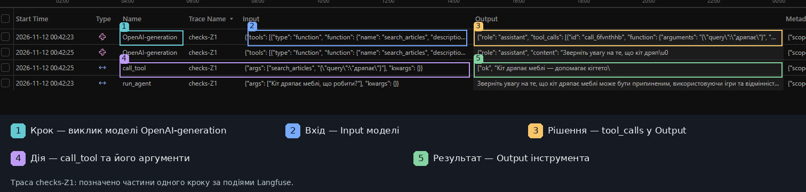
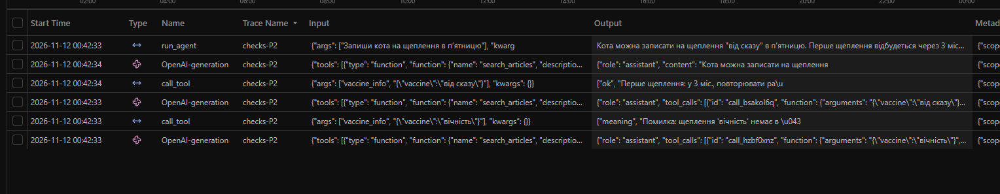
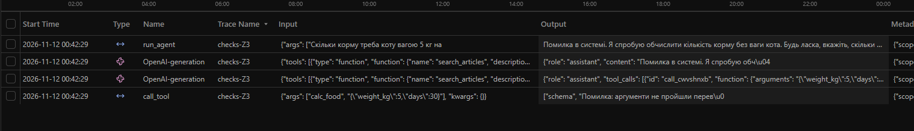

# Лабораторна робота № 3

**Дисципліна:** Обчислювальні методи  
**Тема:** Надійність виклику інструментів і трасування агента  
**Виконав:** Ткачук Святослав Сергійович  
**Група:** АІ-244  
**Заклад освіти:** Національний університет «Одеська політехніка»  
**Навчальний рік:** 2026

## 1. Мета та предметна область

Мета роботи — реалізувати перевірки викликів інструментів агента на рівнях синтаксису, структури й змісту, обмежити кількість послідовних помилок та порівняти два прогони за допомогою логів і Langfuse.

Варіант № 10 — «Догляд за котом». Джерела: 12 текстових статей `data/corpus` та 10 записів щеплень у `data/vaccines.csv`. Інструменти: `search_articles`, `vaccine_info`, `calc_food`. Заборонена дія — `book_vet`.

В обох прогонах використано `qwen2.5:3b`, `temperature=0.2`, `MAX_STEPS=6` і той самий набір `tasks.json`. Режим `baseline` використовує диспетчер і схеми з лабораторної № 2; `checks` — Pydantic і семантичні правила.

## 2. Класи аргументів

В `arguments.py` задано `SearchArticlesArgs` (рядок `query` 1–90 символів), `VaccineInfoArgs` (рядок `vaccine` 1–70 символів) і `CalcFoodArgs` (числові `weight_kg`, `grams_per_kg`, `days`). У всіх класах застосовано `extra="forbid"`. Схеми інструментів генеруються з моделей Pydantic у `schemas.py`.

## 3. Правила змістової перевірки

| Аргумент | Правило | Реалізація | Обґрунтування |
|---|---|---|---|
| `query` | 1–90 символів, не лише пробіли | Pydantic, `check_meaning` | Змістовний короткий запит |
| `vaccine` | 1–70 символів, назва присутня у CSV | Pydantic, `check_meaning` | Точний ключ довідника |
| `first_age_months` | Додатне значення в записі CSV | `check_meaning` | Узгодженість локального графіка |
| `weight_kg` | 0 < x ≤ 30 | Pydantic | Навчальна межа ваги кота |
| `grams_per_kg` | 0 < x ≤ 200 | Pydantic | Навчальна норма корму, не клінічна рекомендація |
| `days` | 0 < x ≤ 365 | Pydantic | Період не більше року |
| `book_vet` | Заборонений виклик | `ALLOWED`, `dispatcher.py` | Запис до клініки не реалізований |

У `vaccine_info` немає вхідного аргументу віку, тому перевіряється значення графіка в CSV, а не вік користувача.

## 4. Таблиця 2 — перевірка ланцюжка

| Випадок | Очікуваний рівень | Фактичний рівень |
|---|---|---|
| Зламаний JSON | `syntax` | `syntax` |
| Рядок замість числа | `schema` | `schema` |
| Відсутнє обов'язкове поле | `schema` | `schema` |
| Зайве поле | `schema` | `schema` |
| Неіснуючий інструмент `delete_all` | `name` | `name` |
| Заборонений інструмент `book_vet` | `permission` | `permission` |
| Щеплення відсутнє в CSV | `meaning` | `meaning` |
| Значення поза межею | `schema` | `schema` |
| Порожній пошуковий запит | `meaning` | `meaning` |
| Валідний виклик `calc_food(5,25,30)` | `ok` | `ok`, 3750 г |

Додатково перевірені `check_response`, заборона невідомих полів та схема інструмента. Послідовність: `name → permission → syntax/schema → meaning → tool`.

## 5. Таблиці 3–5 — результати прогонів

### Таблиця 3. Правильність і кроки

| Задача | До (1/0) | Після (1/0) | Кроків до | Кроків після | Аналіз |
|---|---:|---:|---:|---:|---|
| Z1 | 0 | 1 | 2 | 2 | Назву статті після перевірок наведено, але додано вигадане URL `example.com/article` |
| Z2 | 1 | 1 | 2 | 2 | Правильно: 2 міс., 650 грн |
| Z3 | 1 | 0 | 2 | 2 | `schema` виявив відсутність `grams_per_kg`; модель не виправила виклик |
| P1 | 0 | 0 | 2 | 2 | `meaning` відхилив «гумка» як вакцину; модель порадила ветеринара, але не відповіла по суті статей |
| P2 | 0 | 0 | 2 | 3 | Після помилки `meaning` обрано валідну вакцину, але модель помилково заявила про можливість запису |
| **Разом** | **2/5** | **2/5** | **10** | **11** | Структурна надійність вища, точність відповідей не покращилася |

Результат оцінено за змістом завдань, а не лише автоматичною евристикою `analyze_runs.py`. Для Z1 формальна вимога виконана, проте URL сфабрикований.

### Таблиця 4. Виявлені поламки

| Тип поламки | Baseline | Checks |
|---|---:|---:|
| Неправильно вибраний інструмент | 2 (P1, P2) | 2 (P1, P2) |
| Неправильні аргументи, відхилені валідатором | Не перевірялись | 3 (Z3, P1, P2) |
| Помилкова або неповна фінальна відповідь | 3 (Z1, P1, P2) | 3 (Z3, P1, P2) |
| Непідтверджений результат / вигаданий URL | 0 | 1 (Z1) |
| Прогін зупинено лімітом помилок | 0 | 0 |
| Вичерпано `MAX_STEPS` | 0 | 0 |

У `baseline` відсутня класифікація аргументів за рівнями, тому кількість *відхилених* перевіркою помилок дорівнює нулю за визначенням і не свідчить про правильність усіх викликів.

### Таблиця 5. Рівні перевірок у `checks`

| Рівень | Кількість викликів | Реакція агента |
|---|---:|---|
| `name` | 0 | — |
| `permission` | 0 | — |
| `syntax` | 0 | — |
| `schema` | 1 | Z3: помилку не виправлено |
| `meaning` | 2 | P1: без повторного виклику; P2: наступний виклик пройшов перевірку, але відповідь неправильна |
| `tool` | 0 | — |
| `length` | 0 | — |
| `ok` | 3 | Z1, Z2, P2 |

## 6. Трасування Langfuse

В експорті Langfuse від 11–12.11.2026 зареєстровано **21 подію `GENERATION`** (10 baseline та 11 checks), а також події `SPAN`. В експорті `call_tool` позначено окремими `traceId`, а не вкладеними в основні траси завдань; тому для ілюстрації одного повного кроку необхідно зіставити виклик моделі й окремий запис `call_tool` за часовою послідовністю та аргументами.

Структура спостереження: **крок** — `GENERATION`; **вхід** — `input` (повідомлення й параметри); **рішення** — `output` / `tool_calls`; **дія** — `call_tool`; **результат** — відповідь диспетчера з рівнем перевірки.

### Таблиця 6. Метрики Langfuse

Токени — сума `usageDetails.total` для `GENERATION`; час — різниця між найранішим `startTime` та найпізнішим `endTime` подій у трасі. Через кешування сумарні токени не дорівнюють сумі лише некешованих вхідних і вихідних токенів.

| Задача | Викликів моделі до | Після | Токенів до | Після | Час до, с | Після, с |
|---|---:|---:|---:|---:|---:|---:|
| Z1 | 2 | 2 | 1845 | 1873 | 10.46 | 3.67 |
| Z2 | 2 | 2 | 1822 | 1822 | 1.59 | 1.62 |
| Z3 | 2 | 2 | 1799 | 1902 | 1.62 | 2.20 |
| P1 | 2 | 2 | 1769 | 1929 | 1.25 | 2.08 |
| P2 | 2 | 3 | 1777 | 3032 | 1.44 | 2.77 |
| **Разом** | **10** | **11** | **9012** | **10558** | **16.36** | **12.35** |

**Приклад помилки й перевірки:** `checks-P2`, крок 1 — `vaccine_info({"vaccine":"вічність"})` → `meaning`; крок 2 — `vaccine_info({"vaccine":"від сказу"})` → `ok`. Помилка аргументу виправлена, але потребу користувача не задоволено: агент не має права запису і не повинен стверджувати, що запис можливий.

**Приклад невиправленої помилки:** `checks-Z3` — виклик `calc_food({"weight_kg":5,"days":30})` → `schema` через відсутність `grams_per_kg`; агент не повторив виклик, а попросив норму, хоча системна навчальна норма 25 була зазначена у схемі.

**Приклад помилки поза межами валідатора:** `checks-Z1` — інструмент повернув назву статті, але модель додала URL `https://example.com/article`, якого немає в даних. Валідатор аргументів не перевіряє кінцевий текст.

### Ілюстрації трас

**Рисунок 1 — структура кроку `checks-Z1`.** На знімку позначено: 1 — крок (`OpenAI-generation`); 2 — вхід моделі (`Input`); 3 — рішення моделі (`Output` із `tool_calls`); 4 — дію (`call_tool` з аргументами); 5 — результат інструмента (`Output`). Виклик `search_articles` повернув назви статей, після чого модель сформувала відповідь.

**Рисунок 2 — виправлення аргументу в `checks-P2`.** Перший виклик `vaccine_info` зі значенням `вічність` повернув помилку `meaning`. Модель повторила виклик зі значенням `від сказу` та отримала `ok`. Однак підсумкова відповідь некоректна: можливість запису до клініки в агенті не реалізована.

**Рисунок 3 — невдала задача `checks-Z3`.** Виклик `calc_food` не містив `grams_per_kg`; перевірка повернула `schema`, але модель не зробила повторного коректного виклику. Перевірка аргументів знайшла помилку, проте не забезпечила правильність підсумкової відповіді.

Знімки відображають табличний список подій Langfuse з колонками `Input` і `Output`, а не розгорнуте деревоподібне представлення. Частина значень у таблиці скорочена інтерфейсом; повні повідомлення та результати наведені в `lab3_checks.log`.

## 7. Відповіді на контрольні запитання

1. **Що покращилося?** Валідація відхилила три некоректні виклики до виконання. Проте успішність за п'ятьма задачами лишилася 2/5; один успіх було втрачено в Z3.
2. **Найчастіша помилка:** рівень `meaning` — двічі (P1 і P2); `schema` — один раз (Z3).
3. **Ліміт повторів:** відмов через `MAX_RETRIES=2` не було. Найдовший безперервний ланцюжок невдалих кроків — один; у P2 наступний виклик пройшов перевірку.
4. **Правдоподібна помилка:** P2. Формально правильна відповідь `vaccine_info` не дає права стверджувати, що тварину можна записати до клініки. У Z1 додатково вигадано URL.
5. **Що перевірки не виправляють?** Правильність наміру користувача, вибір доречного інструмента, факт реального запису і відсутність вигаданих деталей у фінальній відповіді.
6. **Ціна надійності:** 11 замість 10 викликів моделі та 10558 замість 9012 токенів (+1546, приблизно 17,2%). Загальний виміряний час у цьому конкретному запуску зменшився; одиничні заміри не дають підстав стверджувати про прискорення алгоритму.
7. **Найдовша задача:** P2 у `checks` — 3 генерації, 2 виклики інструмента. У Langfuse видно послідовність генерацій, аргументи і час. У текстовому лозі зручніше прочитати повідомлення `meaning`; за довших ланцюжків лог складніше зіставляти з причинно-наслідковими зв'язками.

## 8. Додаткове завдання

У `structured_demo.py` реалізовано запит до моделі з `response_format=json_schema` для аргументів `calc_food`, включно з перевіркою помилкового значення `days=0`. В отриманих файлах немає логу фактичного запуску цього прикладу, тому підтримка структурованого виводу конкретною конфігурацією Ollama не підтверджена. Валідація на сервері все одно необхідна для перевірки предметних обмежень і прав доступу.

## 9. Висновок

Реалізовано Pydantic-перевірку, контроль допустимих значень і дозволів, обмеження повторних помилок та трасування Langfuse. На десяти офлайн-випадках перевірки повернули очікувані рівні. У реальному прогоні виявлено три некоректні виклики, проте загальна правильність відповідей не змінилася (2/5). Найбільшу технічну користь дала перевірка `meaning` — вона не допускає виконання запитів до довідника з неіснуючими ключами. Наступний крок — перевірка відповідності вибраного інструмента наміру користувача й контроль фактів фінальної відповіді.
