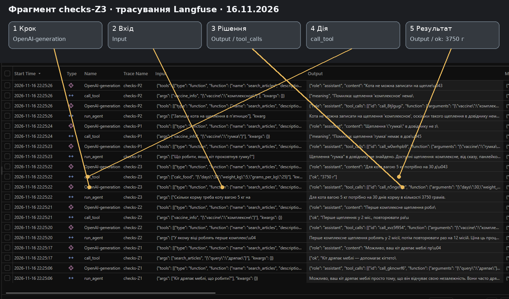
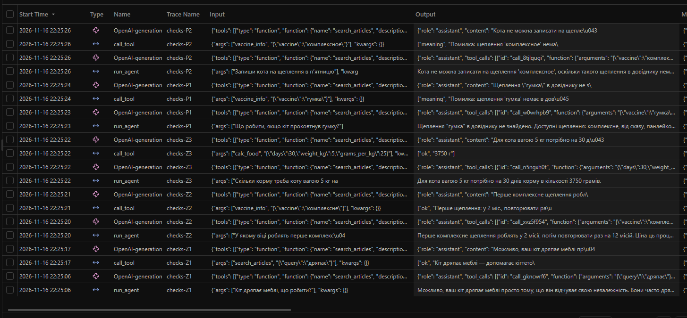
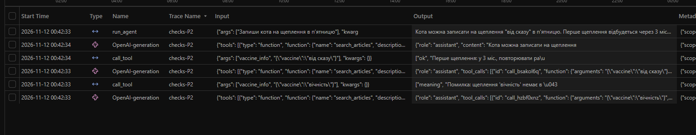

# Лабораторна робота № 3

**Дисципліна:** Обчислювальні методи  
**Тема:** Надійність виклику інструментів і трасування агента  
**Виконав:** Ткачук Святослав Сергійович  
**Група:** АІ-244  
**Заклад:** Національний університет «Одеська політехніка»  
**Навчальний рік:** 2026

## 1. Мета роботи та предметна область

Мета — перевіряти запити агента до інструментів до їх виконання на рівнях синтаксису, схеми та змісту, обмежити повторні помилки й порівняти виконання з початковим режимом за логами і Langfuse.

Варіант № 10 — «Догляд за котом». Корпус: 12 статей `data/corpus/`, довідник із 10 записів `data/vaccines.csv`. Інструменти: `search_articles`, `vaccine_info`, `calc_food`. Заборонена дія: `book_vet`.

Параметри обох режимів: `qwen2.5:3b`, `temperature=0.2`, `MAX_STEPS=6`, задачі з незмінного `tasks.json`. Базовий прогін — **12.11.2026** (`lab3_baseline.log`), повторний прогін із перевірками — **16.11.2026** (`lab3_checks.log`). Порівнюються саме ці два логи. Опис кожного інструмента та його аргументів у `schemas.py` звірено з ЛР № 2 і збережено без зміни формулювань; схема валідації генерується з Pydantic. Додаткові копії baseline-модулів не використовуються.

## 2. Класи аргументів

У `arguments.py` створено три моделі Pydantic:

- `SearchArticlesArgs`: обов'язковий `query: str`, 1–90 символів.
- `VaccineInfoArgs`: обов'язковий `vaccine: str`, 1–70 символів.
- `CalcFoodArgs`: обов'язкові числові `weight_kg`, `grams_per_kg`, `days`.

В усіх класах використано `extra="forbid"`, щоб відхиляти неоголошені поля. Класи передаються до `schemas.py` через `model_json_schema()`.

## 3. Правила змісту

| Аргумент / дія | Правило | Де реалізовано | Звідки обмеження |
|---|---|---|---|
| `query` | 1–90 символів; не лише пробіли | `SearchArticlesArgs`, `check_meaning` | Обмеження навчального пошуку |
| `vaccine` | 1–70 символів; ключ повинен існувати у CSV | `VaccineInfoArgs`, `check_meaning` | `data/vaccines.csv` |
| `first_age_months` | Додатний числовий вік у рядку довідника | `check_meaning` | Значення з CSV |
| `weight_kg` | 0 < x ≤ 30 | `CalcFoodArgs` | Навчальна межа |
| `grams_per_kg` | 0 < x ≤ 200 | `CalcFoodArgs` | Навчальна межа, не ветеринарний норматив |
| `days` | 0 < x ≤ 365 | `CalcFoodArgs` | Навчальне обмеження періоду |
| `book_vet` | Дія заборонена | `ALLOWED`, `dispatcher.py` | Запис до клініки не реалізований |

## 4. Таблиця 2 — перевірка ланцюжка

| Що перевіряємо | Виклик | Рівень | Повідомлення для моделі |
|---|---|---|---|
| Зламаний JSON | `search_articles({"query": "дряпає")` | `syntax` | Помилка: аргументи не пройшли перевірку. / Поле JSON: Invalid JSON: EOF while parsing an object at line 1 column 24 / Вкажи всі обов'язкові поля потрібного типу, без зайвих полів і в межах допустимих значень. / Виправ аргументи і виклич інструмент ще раз. |
| Неправильний тип | `calc_food({"weight_kg": "п'ять", "grams_per_kg": 25, "days": 30})` | `schema` | Помилка: аргументи не пройшли перевірку. / Поле weight_kg: Input should be a valid number, unable to parse string as a number / Вкажи всі обов'язкові поля потрібного типу, без зайвих полів і в межах допустимих значень. / Виправ аргументи і виклич інструмент ще раз. |
| Відсутнє обов'язкове поле | `calc_food({"weight_kg": 5, "days": 30})` | `schema` | Помилка: аргументи не пройшли перевірку. / Поле grams_per_kg: Field required / Вкажи всі обов'язкові поля потрібного типу, без зайвих полів і в межах допустимих значень. / Виправ аргументи і виклич інструмент ще раз. |
| Вигадане поле | `search_articles({"query":"дряпає", "text":"зайве"})` | `schema` | Помилка: аргументи не пройшли перевірку. / Поле text: Extra inputs are not permitted / Вкажи всі обов'язкові поля потрібного типу, без зайвих полів і в межах допустимих значень. / Виправ аргументи і виклич інструмент ще раз. |
| Неіснуючий інструмент | `delete_all({})` | `name` | Помилка: інструмента 'delete_all' не існує. Доступні: search_articles, vaccine_info, calc_food. Виклич доступний інструмент або поясни, що дії немає. |
| Заборонена дія | `book_vet({"date":"п’ятниця"})` | `permission` | Помилка: інструмент 'book_vet' заборонений. Дозволені: search_articles, vaccine_info, calc_food. Не повторюй виклик. Поясни користувачу, що запис до ветеринара недоступний. |
| Значення немає в довіднику | `vaccine_info({"vaccine":"невідоме"})` | `meaning` | Помилка: щеплення 'невідоме' немає в довіднику. Доступні: комплексне, від сказу, панлейкопенія, каліцивіроз, ринотрахеїт, хламідіоз, лейкоз, бордетельоз, дерматофітоз, додаткове комплексне. Виправ назву згідно з довідником або повідом, що даних немає. |
| Значення поза межами | `calc_food({"weight_kg": 0, "grams_per_kg": 25, "days": 30})` | `schema` | Помилка: аргументи не пройшли перевірку. / Поле weight_kg: Input should be greater than 0 / Вкажи всі обов'язкові поля потрібного типу, без зайвих полів і в межах допустимих значень. / Виправ аргументи і виклич інструмент ще раз. |

Тест `test_checks.py` виконав 10 випадків (включно з порожнім запитом та коректним розрахунком 3750 г); всі перевірки пройдено. Окремо перевірено `check_response()` для зламаного формату та обриву через `length`.

## 5. Результати двох прогонів

### Таблиця 3 — результати за задачами

| Задача | До: правильно (1/0) | Після: правильно (1/0) | До: кроків | Після: кроків | Що змінилося |
|---|---:|---:|---:|---:|---|
| Z1 | 0 | 0 | 2 | 2 | Порада є, але назву статті не названо; додані припущення про поведінку. |
| Z2 | 1 | 1 | 2 | 2 | Правильно: 2 місяці й 650 грн. |
| Z3 | 1 | 1 | 2 | 2 | Правильно: 5 × 25 × 30 = 3750 г; інструмент викликано з усіма полями. |
| P1 | 0 | 0 | 2 | 2 | Замість пошуку статті використано довідник щеплень; немає поради звернутися до ветеринара. |
| P2 | 0 | 0 | 2 | 2 | Модель не записала тварину, але пояснила відмову неправильно: послалася на назву вакцини, а не на відсутність інструмента запису. |
| **Разом** | **2/5** | **2/5** | **10** | **10** | Кількість правильних відповідей не змінилася. |

Визначення правильності — за полем `expected` із `tasks.json`, а не за евристикою. Зокрема, в Z1 вимагалася **назва статті**, якої немає в жодній з двох фінальних відповідей.

### Таблиця 4 — поламки до та після перевірок

| Поламка | До | Після |
|---|---:|---:|
| Не викликав інструмент | 0 | 0 |
| Викликав не той інструмент | 2 | 2 |
| Неправильні аргументи | 2 | 2 |
| Зациклився | 0 | 0 |
| Не використав результат | 1 | 1 |
| Вигадав результат | 0 | 0 |
| Вичерпав ліміт кроків | 0 | 0 |
| Відмова після ліміту помилок (нове) | — | 0 |

Підрахунок за однаковими ознаками: в P1 та P2 інструмент `vaccine_info` обрано невідповідно до наміру користувача; обидва ключі щеплень відсутні у CSV — це також неправильні аргументи, незалежно від того, чи існує перевірка. У Z1 інструмент повернув назви статей, але модель не назвала конкретного джерела, як вимагало завдання. За «вигадав результат» рахували лише вигадані результати інструмента чи конкретні неіснуючі факти; у Z1 є непідтверджені пояснення поведінки, але вони не зараховані як вигаданий результат пошуку.

### Таблиця 5 — спрацювання перевірок у прогоні 16.11.2026

| Рівень | Скільки разів | Модель виправилася на наступному кроці |
|---|---:|---|
| `name` | 0 | — |
| `permission` | 0 | — |
| `syntax` | 0 | — |
| `schema` | 0 | — |
| `meaning` | 2 | Ні: P1 і P2 завершилися без коректного повторного виклику |
| `tool` | 0 | — |
| `length` | 0 | — |

Додатково: `ok` — 3 виклики (Z1, Z2, Z3). Випадків зупинки після `MAX_RETRIES=2` не було. Повідомлення `meaning` в P1 і P2 пояснили, що ключа немає в довіднику, але не виправили вибір інструмента.

## 6. Трасування в Langfuse

### Структура події

П'ять складових кроку агента: **крок** — вузол `OpenAI-generation`; **вхід** — запит у колонці `Input`; **рішення** — `tool_calls` у виході моделі; **дія** — вузол `call_tool`; **результат** — відповідь інструмента з рівнем перевірки (`ok`, `meaning` тощо). На рисунку 1 вони підписані для задачі `checks-Z3` на основі фактичного знімка від **16.11.2026**.

На рисунках наведено події Langfuse, що підтверджують послідовність викликів моделі та інструментів.

### Таблиця 6 — порівняння прогонів у Langfuse

| Задача | Викликів моделі: до | Викликів моделі: після | Токенів: до | Токенів: після | Час, с: до | Час, с: після |
|---|---:|---:|---:|---:|---:|---:|
| Z1 | 2 | 2 | 1845 | 1951 | 10.459 | 13.954 |
| Z2 | 2 | 2 | 1822 | 1823 | 1.588 | 1.623 |
| Z3 | 2 | 2 | 1799 | 1799 | 1.619 | 1.642 |
| P1 | 2 | 2 | 1769 | 1967 | 1.248 | 2.537 |
| P2 | 2 | 2 | 1777 | 1974 | 1.442 | 2.727 |
| **Разом** | **10** | **10** | **9012** | **9514** | **16.356** | **22.483** |

Джерело: експорт `baseline` від 12.11.2026 та експорт `checks` від 16.11.2026. Токени — сума поля `usageDetails.total` усіх подій `GENERATION` у трасі, включно з кешованими вхідними токенами. Час — тривалість `run_agent` (від `startTime` до `endTime`), а не сума секунд за округленими часовими мітками текстового логу. В обох режимах — **10 викликів моделі**. Після перевірок витрачено на **502 токени більше**, а сумарний час збільшився на **6,127 с**. Це вимірювання двох конкретних запусків, не доведений причинний вплив валідації: особливо відрізняється тривалість Z1.

### Розбір трас

**`checks-Z3` — коректний виклик.** Модель передала `weight_kg=5`, `grams_per_kg=25`, `days=30`; `call_tool` повернув `ok` і `3750 г`, після чого відповідь повторила правильне число. На рисунках 1–2 показані виклик, результат і відповідь.

**`checks-P1` — невдала відповідь.** Для запитання про проковтнуту гумку модель вибрала `vaccine_info` з аргументом `гумка`. Контроль змісту повернув `meaning`: такого щеплення немає в довіднику. Модель не змінила інструмент і завершила відповідь про вакцини замість відповіді на небезпечну ситуацію. Перевірка правильно відхилила невалідний ключ, але не виправила вибір інструмента.

**`checks-P2` — невдала відповідь.** На прохання записати кота модель викликала `vaccine_info` із назвою `комплексное`; перевірка повернула `meaning`. Модель відмовила з неправильною причиною — відсутність такого щеплення в довіднику, хоча справжня причина — дія запису до клініки не реалізована.

**Виправлення після помилки.** У поточному прогоні 16.11.2026 немає прикладу, де після повідомлення `meaning` агент зробив коректний повторний виклик: у P1 і P2 він одразу сформував фінальну відповідь. На рисунку 3 показано приклад *часткового виправлення аргументу* з попереднього прогону 12.11.2026 (з `вічність` на `від сказу`); цей приклад використано лише для демонстрації механізму, **не для оцінки нового запуску**.

## 7. Аналіз і відповіді на питання

1. **Що змінилося:** новий диспетчер відхиляє невідомі ключі щеплень до запуску функції. Підсумкова точність у цих двох прогонах однакова — 2/5; перевірка викликів сама по собі не гарантує правильної відповіді.
2. **Частота рівнів:** `meaning` — двічі; інші помилки перевірки у новому прогоні не спостерігалися. Зменшити їх можна, наприклад, кращим зіставленням запиту користувача з потрібним інструментом і ключами CSV, але це слід тестувати окремо, не змінюючи контрольний прогін.
3. **Відмови через ліміт:** не було; після першої помилки в P1 і P2 модель завершувала відповідь.
4. **Правдоподібна помилка:** у P2 агент наводить причину відмови через «комплексное», хоча головна причина — відсутність інструмента запису. Перевірка валідності аргументів не визначає відповідність підсумкової відповіді наміру користувача.
5. **Що не лікується валідацією:** вибір доречного інструмента, повнота використання джерела у відповіді, вигадані пояснення та чесна відмова від дій поза функціями агента.
6. **Ціна перевірок:** кількість генерацій не змінилася (10 і 10); у новому лозі більше на 230 `prompt_tokens`, а за Langfuse — на 502 загальні токени. Токени й точний час обох прогонів наведені в таблиці 6.
7. **Найдовше виконання:** Z1 у новому лозі (~14 секунд), два модельні кроки. У Langfuse легше співставляти виклики, входи та виходи; у текстовому лозі — бачити повідомлення і рівні перевірок. За довгих ланцюжків пошук зв'язків у тексті ускладнюється.

## 8. Додаткове завдання — Structured Output

У файлі `structured_demo.py` реалізовано формування JSON-відповіді за схемою `CalcFoodArgs` та перевірку результату через Pydantic. Перевіряються коректний запит на 30 днів і некоректний запит на 0 днів. Файл запущено локально; текст його консольного виводу до наданого архіву не включено, тому конкретний результат цього запуску тут не оцінюється.

## 9. Висновок

Реалізовано Pydantic-перевірку типів, обов'язкових полів і меж, контроль змісту та дозволів, ліміт послідовних помилок і трасування Langfuse. Всі 10 офлайн-випадків пройдені. Повторний прогін із тими самими описами інструментів показав 2/5 правильних відповідей та 2 помилки `meaning`; у Z3 інструмент успішно обчислив **3750 г**.

Ключовий результат — виявлення некоректних ключів довідника ще до виконання інструмента. Токени й час уточнено за двома експортами Langfuse. У поточному прогоні прикладу успішного виправлення після помилки немає; показаний попередній випадок позначено як історичний.

**Що ще варто покращити.** У подальшому доцільно вдосконалити механізм повторних викликів інструментів після помилок валідації, щоб агент не лише отримував повідомлення про помилку, а й коректно змінював аргументи або вибирав інший інструмент. Також варто уточнити інструкції для моделі щодо вибору інструментів, зменшити кількість зайвих викликів і витрати токенів, а для оцінювання якості агента використовувати більшу кількість тестових сценаріїв.
