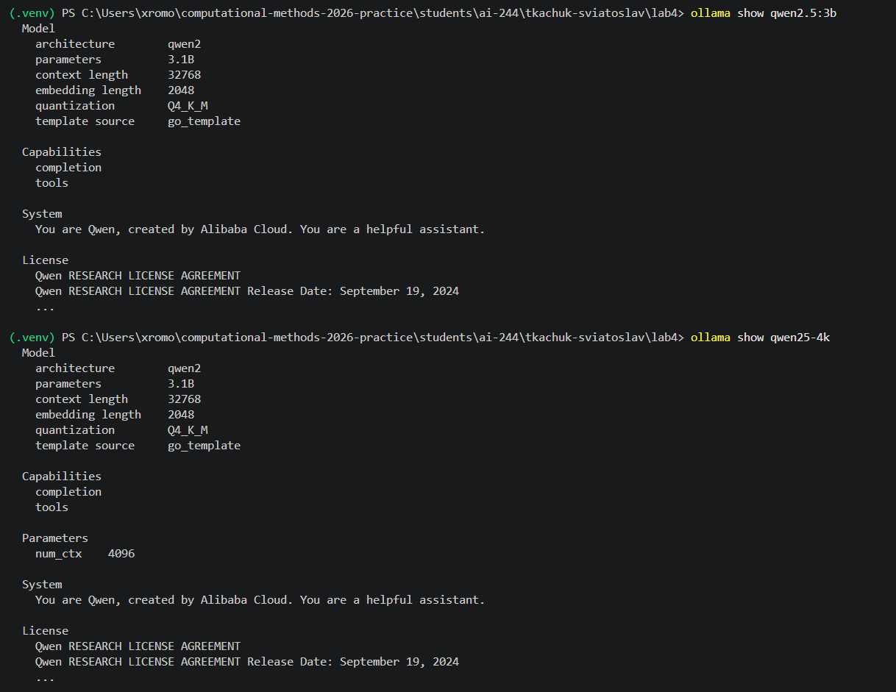
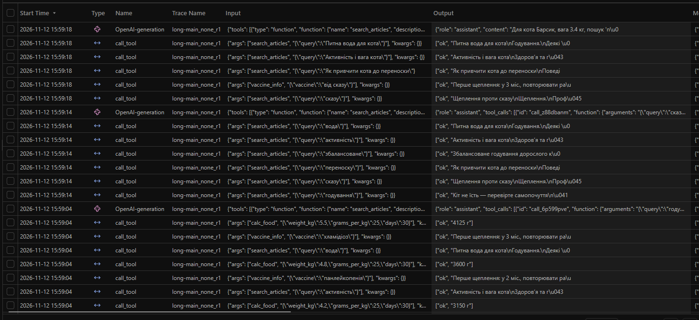
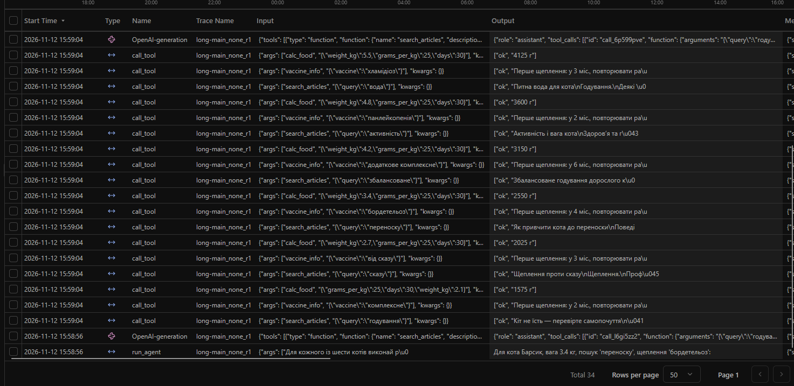
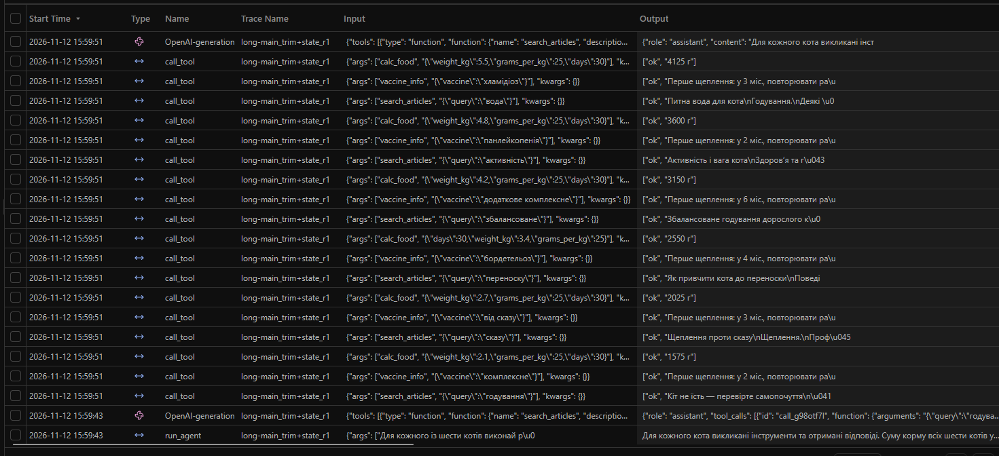

# Лабораторна робота № 4

**Тема:** Контекст, стан і кеш агента  
**Дисципліна:** Обчислювальні методи  
**Виконав:** Ткачук Святослав Сергійович, група АІ-244  
**Варіант:** 10 — «Догляд за котом»  
**Рік:** 2026

## 1. Мета роботи та середовище

Дослідити поведінку агента з інструментами при обмеженому контекстному вікні, реалізувати обрізання історії, збереження стану та кеш відповідей, порівняти токени, тривалість і правильність результатів.

- Локальна модель: `qwen2.5:3b` (Q4_K_M, 3,1 млрд параметрів).
- `context length` базової моделі за `ollama show`: **32 768** токенів.
- Створена модель: `qwen25-4k`, параметр `num_ctx`: **4096** токенів.
- Номінальне звуження вікна: **32 768 / 4096 = 8 разів**. `context length` є характеристикою вихідної моделі, тоді як `num_ctx` задає контекст нової конфігурації Ollama.
- Температура: `0.2`, максимум `25` кроків у довгій задачі, поріг стиснення `COMPRESS_AT = 2800` токенів.
- Режими: `none`, `trim`, `trim+state`; додатково — `summary`.
- Інструменти: `search_articles`, `vaccine_info`, `calc_food`. Облік здійснюється за файлами `logs/`, трасуванням Langfuse і власними вимірюваннями часу.

**Таблиця 1.** Конфігурації тестування.

| Конфігурація | Обрізання історії | Зовнішній стан | Кеш під час `main` |
|---|---|---|---|
| `none` | Ні | Ні | Вимкнено |
| `trim` | Так | Ні | Вимкнено |
| `trim+state` | Так | Так | Вимкнено |
| `summary` (додаткова) | Переказ | Ні | Вимкнено |

## 2. Довга задача та еталон

**Формулювання задачі:**

> Для кожного із шести котів виконай рівно три типи перевірок, окремими інструментами: Мурчик — 2 міс., 2.1 кг, пошук 'годування', щеплення 'комплексне'; Луна — 3 міс., 2.7 кг, пошук 'сказу', щеплення 'від сказу'; Рижик — 4 міс., 3.4 кг, пошук 'переноску', щеплення 'бордетельоз'; Сніжок — 6 міс., 4.2 кг, пошук 'збалансоване', щеплення 'додаткове комплексне'; Соня — 14 міс., 4.8 кг, пошук 'активність', щеплення 'панлейкопенія'; Барсик — 15 міс., 5.5 кг, пошук 'вода', щеплення 'хламідіоз'. Для кожного: (а) виклич search_articles з наведеним словом і наведи назву статті; (б) виклич vaccine_info для вказаної назви щеплення, наведи перший вік, інтервал і ціну; (в) виклич calc_food з вагою кота, нормою 25 г/кг/добу та 30 днями, наведи кількість грамів. Не пропускай позицій. У кінці назви сумарну витрату корму за 30 днів для шести котів в грамах одним числом. Це навчальна норма, не практична схема вакцинації чи харчування.

Для кожного кота потрібно звернутися до трьох інструментів: щонайменше **18 викликів** загалом. Контрольне значення з `long_task.json`: **17 025 г** за 30 днів при демонстраційній нормі 25 г/кг/добу.

| Кіт | Вік, міс. | Вага, кг | Пошукове слово | Назва щеплення | Корм на 30 днів, г |
|---|---:|---:|---|---|---:|
| Мурчик | 2 | 2,1 | годування | комплексне | 1575 |
| Луна | 3 | 2,7 | сказу | від сказу | 2025 |
| Рижик | 4 | 3,4 | переноску | бордетельоз | 2550 |
| Сніжок | 6 | 4,2 | збалансоване | додаткове комплексне | 3150 |
| Соня | 14 | 4,8 | активність | панлейкопенія | 3600 |
| Барсик | 15 | 5,5 | вода | хламідіоз | 4125 |
| **Разом** | | | | | **17 025** |

Розрахунок виконано безпосередньо через `calc_food`: сума мас 22,7 кг; `22,7 × 25 × 30 = 17 025 г`. Це навчальні, а не індивідуальні ветеринарні норми.

## 3. Прогін без захисту: зростання контексту

**Таблиця 2.** Дані `logs/probe_none_r1.log`.

| Крок моделі | `prompt_tokens` | Приріст | Поведінка |
|---:|---:|---:|---|
| 1 | 1427 | — | 17 викликів інструментів |
| 2 | 3075 | +1648 | 18 викликів, частково повторює попередні |
| 3 | 3880 | +805 | Завершує відповіддю, підсумок **16 980 г** — помилковий |

- **(а)** Постійна частина входу: **1427** токенів.
- **(б)** Медіанний додатний приріст: **1226,5** токена.
- **(в)** Фактична сума `prompt_tokens`: **8382**. Оцінка `n × C + d × n(n−1)/2`, де `n=3`, `C=1427`, `d=1226,5`: **7960,5** токена. Різниця 421,5 (близько 5 %) виникає через нерівномірні розміри відповідей і викликів.
- **(г)** Стійкої зупинки зростання в цьому пробному прогоні не виявлено: максимум **3880 із 4096** токенів (94,7 %).
- **(д)** Трьох кроків після зупинки немає, оскільки модель завершила відповіддю на третьому кроці. Підсумок **16 980 г** не був результатом `calc_food` і не відповідає правильній сумі.

За буквальним критерієм методички це **випадок C** (прогін завершився, а максимальний вхід не досяг 95 % вікна). Окремий повтор із `num_ctx = 3072`, рекомендований для випадку C, у наданих логах відсутній.

Водночас у `main_none_r1.log` модель дійшла до **4012** токенів на третьому кроці, а на четвертому вхід зменшився до **3998**. Аналізатор позначає зупинку росту на кроці 4 (ознака випадку B); відповідь при цьому обірвана й плутає Барсика з даними Рижика. Це додаткове спостереження, але не підміна пробного запуску.

## 4. Обрізання історії та стан задачі

**Таблиця 3.** Фактично зафіксовані стиснення.

| Режим | Прогін | Крок стиснення | Вхід до стиснення | Повідомлень було → стало | Повторних викликів |
|---|---|---:|---:|---|---:|
| `trim` | `probe_trim_r1` | не відбулося | — | — | 0 |
| `trim+state` | `probe_trim+state_r1` | не відбулося | — | — | 0 |
| `trim` | `main_trim_r3` | **2** | **3126** | **28 → 2** | **22** |
| `trim+state` | усі 3 прогони `main` | не відбулося | — | — | 0 |

У `main_trim_r3` після стиснення вхід на наступному кроці став **1427** замість 3126 токенів до обрізання. Агент повторив раніше виконані звернення, що узгоджується з втратою історії після `trim`. У `main_none_r1` на третьому кроці було 4012 токенів, але це інший запуск із відмінною послідовністю дій, тож пряме причинне порівняння обмежене.

Файли `state/*.json` підтверджують окреме збереження успішних результатів. У `main_trim+state_r1.json` є **18 результатів**. Якщо сформувати з них повідомлення стану, воно матиме близько **2484 символів ≈ 994 токени** (приблизна оцінка 2,5 символа на токен), тобто орієнтовно 81 % медіанного приросту з пробного запуску. Проте у фактичному `trim+state` стиснення не спрацювало, тому це **оцінка потенційного розміру**, а не витрати реального відновлення контексту.

## 5. Кешування

**Таблиця 4.** Файли `logs/cache1_none_r1.log` і `logs/cache2_none_r1.log`.

| Запуск | Кроків моделі | Влучань у кеш | Реальних звернень до сервера | Час, с | Числовий результат правильний |
|---|---:|---:|---:|---:|---|
| Перший (`cache1`) | 2 | 0 | 2 | 15,64 | Ні (18 720 г) |
| Другий (`cache2`) | 2 | 2 | 0 | 0,65 | Ні (18 720 г) |

Прискорення: `15,64 / 0,65 ≈ 24,1 раза`. Кеш не виправляє логічні помилки моделі: неправильна відповідь повторюється без змін. Зміна `SYSTEM` змінює запит і його SHA-256 ключ, тому старий кеш не буде використаний. За зміни джерельних даних інструментів, які не включені до ключа, кеш може виявитися застарілим.

## 6. Порівняння конфігурацій

**Таблиця 5.** Медіани трьох запусків серії `main`, кеш вимкнений.

| Конфігурація | Збіг підсумку (з 3) | Кроків моделі | Вхідних токенів | Вихідних токенів | Час, с | Стиснень | Повторних викликів |
|---|---:|---:|---:|---:|---:|---:|---:|
| `none` | 0/3 | 4 | 10 654 | 800 | 15,26 | 0 | 0 |
| `trim` | **1/3** | 4 | 9106 | 852 | 15,96 | 0 | 0 |
| `trim+state` | 0/3 | 2 | **4553** | **628** | **12,92** | 0 | 0 |

**Пояснення оцінювання.** Спочатку автоматична перевірка помилково відхилила `main_trim_r3`: число `17,025` (кома як роздільник тисяч) не зіставлялося з `17025`. Перевірку числа в `measure.py` виправлено, а `main_results.json` узгоджено з фактичним текстом відповіді. Водночас відповідь `main_trim_r3` містить іншу фактичну помилку: для щеплення «комплексне» вказано **600 грн** замість **650 грн** із довідника. Отже, **за правильністю підсумкового числа — 1 із 9**, а **за повним виконанням усіх вимог довгої задачі — 0 із 9**.

У 3 із 9 прогонів серії `main` (`none_r3`, `trim_r2`, `trim+state_r2`) викликано лише **12 із мінімум 18** інструментів; у решті обсяг викликів досягнуто або перевищено, але це саме по собі не гарантує повноти кінцевої відповіді. Серед дев'яти підсумків: **6 неправильних числових сум**, **2 відповіді без підсумкової суми**, **1 числово правильна сума**. У прогоні `main_trim_r3` зафіксовано **42 виклики**, з них **22 повторні**, після стиснення історії.

За виміряними медіанами `trim+state` використав найменше токенів і часу, але жоден із цих трьох прогонів не активував стиснення. Тому цей виграш **не можна приписувати механізму стану**; він зумовлений відмінностями конкретних відповідей моделі. Поведінку після фактичного `trim+state` ще не продемонстровано.

## 7. Трасування Langfuse

**`long-main_none_r1`:** виклики моделі та багаторазові звернення до інструментів у базовій конфігурації.

**`long-main_trim+state_r1`:** збереження 18 успішних результатів, завершення без фактичного стиснення історії.

Надані скріншоти показують **табличний перелік подій** Langfuse з вхідними аргументами та результатами, а не розгорнуте дерево однієї траси. У них видно звернення до моделі та виклики `call_tool`. Числову послідовність `prompt_tokens` і момент стиснення надійніше встановлено за `logs/*.log`. Порівняти перший виклик **після стиснення `trim+state`** із тим самим кроком `none` неможливо, оскільки стиснення `trim+state` в цих логах не відбулося.

## 8. Відповіді на контрольні запитання

1. **Коли видно межу контексту?** У пробному запуску на кроці 3 отримано 3880/4096 токенів без підтвердженого застою; це випадок C. В окремому `main_none_r1` на кроці 4 обсяг входу зменшився з 4012 до 3998 токенів, після чого модель дала обірвану відповідь.
2. **Чому формула відрізняється від реальності?** `nC + d·n(n−1)/2` припускає сталий приріст. У пробному запуску прирости 1648 і 805 різні, тому фактичні 8382 токени відрізняються від оцінки 7960,5.
3. **Що втрачається після обрізання?** Раніше отримані відповіді інструментів. `main_trim_r3` після `28 → 2` повторив виклики (22 повтори за весь прогін). Записник стану реалізовано, але збереження фактів після фактичного обрізання у `trim+state` цими вимірюваннями ще не перевірено.
4. **Який режим дешевший, швидший, точніший?** За медіанами — `trim+state` дешевший за токенами й швидший; за збігом підсумкового числа — `trim` (1/3). Однак повна точність у всіх режимах 0/3, а на три повтори впливають випадкові рішення моделі.
5. **Чому вимкнено кеш у головному порівнянні?** Інакше повторні запити не надсилаються до моделі й спотворюють оцінку витрат. При зміні результатів інструментів або перевиданні моделі під тією самою назвою попередні кешовані відповіді можуть стати неактуальними.
6. **Чого стиснення не виправляє?** Арифметичних помилок, недостовірних фактів, пропущених дій, неправильного інструмента та хибних висновків. Зокрема, режим `trim` повернув правильну суму, але неправильну ціну щеплення.

## 9. Додаткове завдання: `summary`

Виконано три запуски серії `extra`:

| Прогін | Кроків моделі | Вхідних токенів | Вихідних токенів | Вартість підсумовування, токенів | Час, с | Підсумкова сума |
|---|---:|---:|---:|---:|---:|---|
| `extra_summary_r1` | 2 | 4553 | 820 | 0 | 16,01 | 18 720 г — неправильно |
| `extra_summary_r2` | 2 | 4553 | 627 | 0 | 12,74 | 16 050 г — неправильно |
| `extra_summary_r3` | 2 | 4553 | 897 | 0 | 613,01 | 16 625 г — неправильно |

За всі три прогони **не було події стиснення**: модель завершувала завдання раніше, тому додаткового звернення для формування summary і відповідних токенових витрат не виникло. **613,01 с** у третьому прогоні — фактично зафіксований тривалий час, але його причину за логами однозначно визначити неможливо. Отримані дані демонструють працездатність запуску режиму, а не якість самого алгоритму підсумовування в ситуації переповнення контексту.

## 10. Висновок

Досліджено агент із трьома інструментами та зменшеним до 4096 токенів контекстом. На довгій задачі з шістьма котами доведено зростання входу до 3880 токенів у пробному прогоні та 4012 у серії `main`. У `trim` зафіксовано реальне обрізання `28 → 2` повідомлень із подальшими повторними зверненнями. Механізм стану зберігає результати у JSON, однак його ефективність після стиснення не підтверджена фактичним прогоном. Кеш забезпечив найбільший **безпосередньо виміряний ефект за часом** — приблизно 24-кратне прискорення повторного однакового запиту, але повторив помилкову відповідь.

Для підвищення надійності доцільні нижчий поріг стиснення для окремого контрольного досліду, перевірка повноти 18 потрібних викликів, детерміноване підсумовування значень `calc_food` засобами Python і незалежна перевірка фактів у фінальній відповіді. Для буквального виконання всіх демонстраційних пунктів методички необхідно окремо отримати прогін `trim+state` зі стисненням та розгорнуте дерево траси Langfuse.
