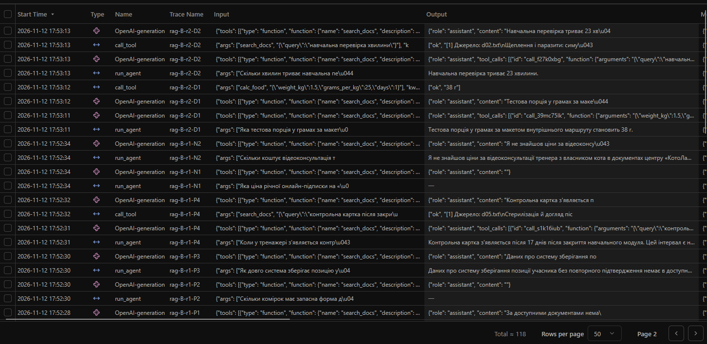
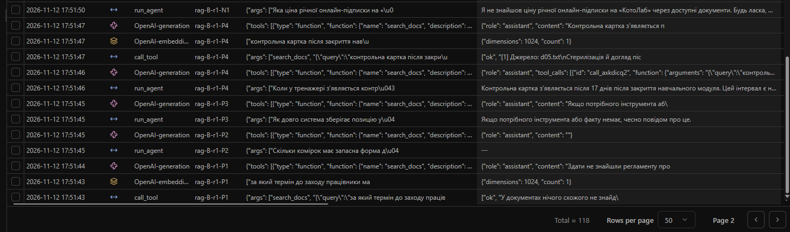
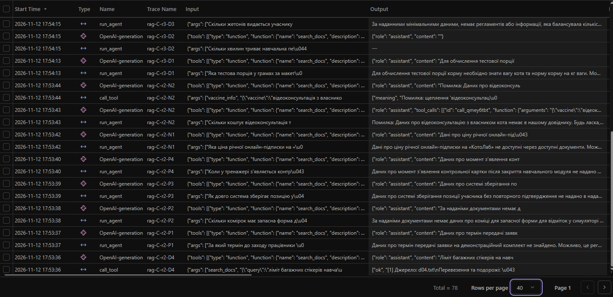
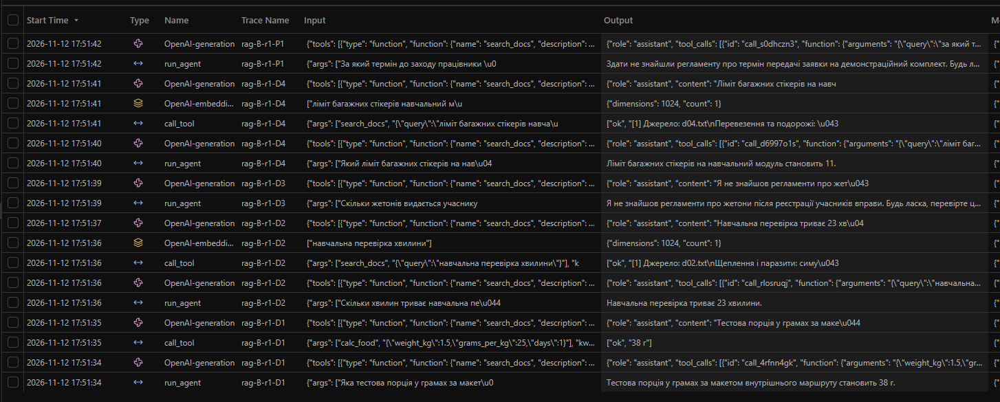

# Лабораторна робота № 5

**Дисципліна:** Обчислювальні методи  
**Тема:** RAG-агент: пошук по документах як інструмент  
**Виконав:** Ткачук Святослав Сергійович  
**Група:** АІ-244  
**Університет:** Національний університет «Одеська політехніка»  
**Варіант:** 10 — догляд за котом

## 1. Мета роботи та середовище

Побудувати RAG-агента з векторним пошуком FAISS, перевірити вплив нарізання документів на `hit@k`, підібрати поріг релевантності та порівняти три описи інструмента `search_docs`.

Модель чату — **Qwen2.5 3B** (`qwen25-4k`, Ollama), `num_ctx=4096`, температура `0.2`. Модель ембедингів — `bge-m3`, розмірність 1024. Індекс — FAISS `IndexFlatIP` з L2-нормалізацією. Вимірювання виконані **12.11.2026**. Дані вигадані й призначені лише для навчального експерименту.

## 2. Документи та контрольні питання

| Файл | Тема | Символів | Орієнтовно токенів |
|---|---|---:|---:|
| `d01.txt` | Годування | 3851 | 1540 |
| `d02.txt` | Щеплення й паразити | 3783 | 1513 |
| `d03.txt` | Поведінка й навчання | 3775 | 1510 |
| `d04.txt` | Перевезення й подорожі | 3742 | 1497 |
| `d05.txt` | Догляд після стерилізації | 3884 | 1554 |

П'ять документів доповнюють 12 коротких статей із попередніх робіт. Загальний корпус — **17 файлів**, приблизно **21 111 символів / 8 444 токени**; повністю в контекст 4096 токенів не вміщується.

| ID | Тип | Питання | `must_contain` | `expected` |
|---|---|---|---|---|
| D1 | direct | Яка тестова порція у грамах за макетом внутрішнього маршруту? | тестова порція становить 137 г | 137 |
| D2 | direct | Скільки хвилин триває навчальна перевірка? | навчальна перевірка триває 23 хвилини | 23 |
| D3 | direct | Скільки жетонів видається учаснику після реєстрації вправи? | видається 19 жетонів | 19 |
| D4 | direct | Який ліміт багажних стікерів на навчальний модуль? | ліміт багажних стікерів становить 11 | 11 |
| P1 | paraphrase | За який термін до заходу працівники мають надіслати заявку на демонстраційний комплект? | оформлюють замовлення за 46 годин | 46 |
| P2 | paraphrase | Скільки комірок має запасна форма для відміток у симуляторі реєстру? | резервний бланк містить 71 клітинку | 71 |
| P3 | paraphrase | Як довго система зберігає позицію учасника без повторного підтвердження? | можна тримати місце в черзі 52 хвилини | 52 |
| P4 | paraphrase | Коли у тренажері з’являється контрольна картка після закриття навчального модуля? | контрольний запис створюють через 17 днів | 17 |
| N1 | none | Яка ціна річної онлайн-підписки на «КотоЛаб»? | — | — |
| N2 | none | Скільки коштує відеоконсультація тренера з власником кота? | — | — |

`check_cases.py` пройшов перевірку у локальному запуску. Окремого експерименту «модель без документів» із трьома питаннями у наданих результатах **не зафіксовано**; прогони без виклику пошуку в таблиці 6 не є його повною заміною.

## 3. Перевірка ембедингів

За `results/embed_check.txt`: розмірність **1024**, норма вектора **1.000**, схожість двох тематично близьких фраз **0.722**, різних тем **0.370**, тривалість перевірки **7.5 с**. Більша схожість тематично пов'язаних фраз підтверджує придатність ембедингів для тестового корпусу.

## 4. Нарізання документів

**Таблиця 1. Нарізання `d01.txt`.**

| Спосіб | Чанків | Обірвані речення | Макс. довжина, символів |
|---|---:|---:|---:|
| fixed, 200, overlap 0 | 20 | 18 | 200 |
| fixed, 500, overlap 100 | 10 | 9 | 500 |
| paragraphs, 800 | 8 | 0 | 566 |

У `fixed-200-0` фраза про подання замовлення за **46 годин** розірвана між сусідніми фрагментами: «…центру оф» / «ормлюють замовлення за 46 годин». Абзацне нарізання залишає числовий факт разом із його контекстом.

**Таблиця 2. Пошук без агента, вісім питань із відповіддю.**

| Конфігурація | Чанків | Сер. довжина | hit@1 | hit@3 | hit@5 | hit@3 прямі | hit@3 перефр. | Токенів (k=3) |
|---|---:|---:|---:|---:|---:|---:|---:|---:|
| fixed-200-0 | 110 | 192 | 0.62 | 0.62 | 0.62 | 1.00 | 0.25 | 230 |
| fixed-500-0 | 52 | 406 | 0.88 | 1.00 | 1.00 | 1.00 | 1.00 | 487 |
| fixed-500-100 | 62 | 413 | 1.00 | 1.00 | 1.00 | 1.00 | 1.00 | 496 |
| fixed-1500-0 | 27 | 782 | 0.75 | 0.88 | 0.88 | 1.00 | 0.75 | 938 |
| paragraphs-800 | 52 | 405 | 1.00 | 1.00 | 1.00 | 1.00 | 1.00 | 486 |
| paragraphs-800+title | 52 | 439 | 1.00 | 1.00 | 1.00 | 1.00 | 1.00 | 527 |

За критерієм однакового `hit@3` і найменшого обсягу відповіді найекономнішим є **paragraphs-800 (486 токенів)**. У фактичних агентних прогонах використано **paragraphs-800+title** (527 токенів): це на 41 токен (~8.4%) більше, але забезпечує назви джерел у кожному чанку. Це відхилення від критерію мінімального обсягу зафіксоване, результати не переписувались заднім числом.

**Таблиця 3. Схожість першого результату (`paragraphs-800+title`).**

| ID | Вид | Score | Факт у top-1 |
|---|---|---:|---|
| D1 | direct | 0.693 | так |
| D2 | direct | 0.699 | так |
| D3 | direct | 0.711 | так |
| D4 | direct | 0.787 | так |
| P1 | paraphrase | 0.514 | так |
| P2 | paraphrase | 0.635 | так |
| P3 | paraphrase | 0.649 | так |
| P4 | paraphrase | 0.703 | так |
| N1 | none | 0.535 | — |
| N2 | none | 0.536 | — |

Обраний поріг **`MIN_SCORE=0.5856`**. За вимірами `calibrate_threshold.py` він відсікає обидва питання без відповіді (2/2), але також відкидає корисний результат для P1 (залишає 7/8). Діапазони релевантності перетинаються (`0.514 < 0.536`), тому ідеального порога немає. `hit@3=1.00` у таблиці 2 — оцінка сирого пошуку **до застосування порога**, а не гарантія відповіді агента.

Остаточний індекс (`index/docs.faiss`) містить **52 чанки**, середню довжину **439 символів**, вектори довжини **1024**.

## 5. Перевірка інструмента

`search_docs` шукає найближчі чанки FAISS і передає агенту текст джерел за умови `score >= MIN_SCORE`.

- `try_tool.py D1`: статус `ok`; знайдено релевантний `d01.txt`, зокрема факт **137 г**.
- `try_tool.py N1`: статус `ok`; відповідь **«У документах нічого схожого не знайдено»**.
- Невалідний однолітерний запит повертає помилку `schema` (мінімальна довжина `query` — 3 символи).

Тексти перевірок: `results/tool_D1.txt`, `results/tool_N1.txt`; збірка індексу: `results/build_index.txt`.

## 6. Порівняння описів інструмента

**Таблиця 4. Умови експерименту.**

| Конфігурація | Опис `search_docs` |
|---|---|
| A | Опис попереднього підрядкового пошуку статей про поведінку котів |
| B | Спеціалізований RAG-пошук, обов'язкова перевірка правил і чисел за документами, заборона вигадувати |
| C | «Шукає інформацію.» |

Для кожного опису — три повтори десяти запитів (24 запитання із відповіддю і 6 без відповіді). `TOP_K=3`; модель і параметри індексу між описами не змінювалися.

**Таблиця 5. Результати відповідей на 24 запитання з фактом.**

| Опис | Правильно / 24 | Звернувся до пошуку / 24 | Медіана кроків | Медіана вхідних токенів | Медіана часу, с |
|---|---:|---:|---:|---:|---:|
| A | 1/24 | 1/24 | 1 | 886 | 1.20 |
| B | 6/24 | 7/24 | 1 | 1046 | 1.32 |
| C | 3/24 | 5/24 | 1 | 773 | 1.69 |

**Таблиця 6. Категорії всіх 30 прогонів для кожного опису (після ручної перевірки).**

| Категорія | A | B | C |
|---|---:|---:|---:|
| Правильно (8 питань із відповіддю × 3 повтори) | 1 | 6 | 3 |
| Не шукав, відповідь неправильна | 23 | 17 | 19 |
| Шукав, потрібного фрагмента немає | 0 | 1 | 2 |
| Фрагмент був, відповідь неправильна | 0 | 0 | 0 |
| Без відповіді: повідомив про відсутність ціни | 2 | 4 | 3 |
| Без відповіді: вигадав ціну | 0 | 0 | 0 |
| Без відповіді: порожній вивід | 4 | 1 | 0 |
| Без відповіді: некоректно інтерпретував запит | 0 | 1 | 3 |

Автоматична перевірка `measure_rag.py` шукала обмежений список фраз для відповіді «не знаю» й помилково позначала частину відмов як вигадування. **Уручну переглянуто всі 18 запитів N1/N2**: жодна відповідь не містила вигаданої ціни. Порожні результати (A — 4, B — 1) і неправильне трактування запиту як щеплення/некоректного пошуку (B — 1, C — 3) позначено окремо; позитивний `correct` присвоєний лише змістовним відмовам без вигаданої ціни. Перекласифіковано `results/rag.csv`; логів та відповідей моделі не змінено. Оновлено логіку оцінювання й друку таблиць для подальших запусків.

Найкращим був опис **B (6/24)**, але переважаюча причина невдач — **відмова від пошуку (17/24)**. Отже, на цьому наборі даних bottleneck — насамперед рішення агента про застосування інструмента, а не сама здатність FAISS знайти факт.

## 7. Аналіз прогонів та Langfuse

**Успішний пошук:** `B-r2-D2` (`logs/rag_B-r2.log`): `search_docs({"query":"навчальна перевірка хвилини"})` повернув `d02.txt` із «23 хвилини»; модель відповіла правильно. `prompt_tokens`: 1034 → 1843, збільшення **809 токенів** після додавання результату інструмента й історії, тоді як середня оцінка тексту трьох чанків у таблиці 2 — 527 токенів.

**Відсутність пошуку:** `C-r3-D1` (`logs/rag_C-r3.log`): агент не викликав `search_docs` і не назвав числового значення **137**.

**Пошук без результату:** `B-r1-P1` (`logs/rag_B-r1.log`): модель надіслала розгорнутий запит про заявку на демонстраційний комплект; `top_score=0.501`, що нижче порога 0.5856. Потрібний факт **46 годин** існує в `d01.txt`, але був відсіяний порогом. Це приклад категорії `miss` без проблеми індексації.

**Пошук із правильною відповіддю:** `B-r3-P4` (`logs/rag_B-r3.log`): знайдено `d05.txt`, модель повернула **17 днів**. **Категорії `ignored` не зафіксовано** (0 для всіх трьох описів).

**Без відповіді:** `C-r3-N2` (`logs/rag_C-r3.log`): модель помилково звернулася до `vaccine_info` для питання про відеоконсультацію, не вигадала ціну, але неправильно класифікувала послугу. На запити без відповіді поріг може відсіяти нерелевантні чанки, однак не допомагає, якщо модель зовсім не викликає пошук або обирає інший інструмент.

Нижче наведено чотири оригінальні скріншоти Langfuse: записи `run_agent`, `OpenAI-generation` і `call_tool`, включно із вхідним запитом та вихідним фрагментом. Це **табличний перегляд подій**, а не повністю розгорнуте дерево траси.

**Опис B: пошук і відповідь за джерелом.**

**Опис B: запит не пройшов поріг релевантності.**

**Опис C: правильна відповідь після пошуку.**

**Опис C: пропуск пошуку і плутанина з інструментом.**

## 8. Контроль п'яти задач до та після заміни пошуку

**Таблиця 7. Фактичні відповіді за `logs/run_lab4.log` і `logs/run_rag.log`.**

| Задача | ЛР №4 (до) | ЛР №5 (після) | `search_docs` | Висновок |
|---|---|---|---|---|
| Z1, дряпання меблів | Порада з кігтеточкою та іграми за `search_articles` | Загальні припущення без пошуку | ні | Погіршення; агент пропустив пошук |
| Z2, комплексне щеплення | 2 міс., 650 грн | 2 міс., 650 грн | ні | Значення збережено через `vaccine_info` |
| Z3, 5 кг × 25 г × 30 днів | 3750 г | 3750 г після виправлення відсутнього аргументу | ні | Число збережено; з'явилася помилка схеми й повтор |
| P1, проковтнута гумка | Хибний виклик довідника щеплень | `search_docs` не знайшов факту; порада звернутися до ветеринара | так | Покращення поведінки в небезпечній ситуації |
| P2, запис на щеплення | Вказано ціну, але запис не виконано | Помилковий `calc_food` (625 г); натяк на можливість запису | ні | Погіршення; недоступну дію не пояснено |

Зміна інструмента пошуку вплинула не тільки на власне retrieval, а й на вибір інших інструментів і якість відповіді агента.

## 9. Відповіді на контрольні запитання

1. У таблиці 1 `fixed-200` обірвав 18 із 20 чанків посеред речення, `paragraphs-800` — жодного з восьми. Розрив «оф» / «ормлюють замовлення за 46 годин» відокремлює частини факту.
2. За `hit@3` чотири конфігурації дали 1.00. Найменший результат серед них — `paragraphs-800` (486 токенів). Перекриття підняло `hit@1` з 0.88 до 1.00 для fixed-500, але збільшило обсяг індексу; чанки по 1500 символів дали лише `hit@3=0.88` і 938 токенів результату.
3. За `fixed-200-0` `hit@3` для прямих питань 1.00, а для перефразованих 0.25; після абзацного нарізання обидва стали 1.00. Пошук за змістом допомагає перефразуванням, коли цілісний фрагмент збережено.
4. Таблиця 3: P1 має 0.514, питання без відповіді — 0.535–0.536. Поріг 0.5856 не розділяє всі випадки: відкидає N1/N2, але також P1. Занадто високий поріг знижує повноту, низький підвищує ризик нерелевантних джерел.
5. За таблицею 5 опис B дав 6/24, A — 1/24, C — 3/24. Без пошуку на питаннях із відповіддю залишилися A — 23, B — 17, C — 19. Опис B краще пояснює, **коли і чому** викликати інструмент.
6. У B найчастіша помилка — `no_search` (17). Потрібне точніше правило виклику, можливо обов'язковий попередній retrieval або інша модель; зміна `TOP_K` не усуває пропущених викликів.
7. Конкретної ціни агент не вигадав жодного разу з 18 тестів без відповіді, але 5 відповідей були порожніми, 4 — некоректними за змістом. Захисти: `MIN_SCORE` і вказівка не вигадувати. У прогонах з іншими інструментами ці захисти не гарантували якісної відповіді.
8. За `B-r2-D2` додано 809 вхідних токенів (1034 → 1843), більше за оцінку самих фрагментів (527), бо враховуються службові повідомлення й структура історії. За бюджету 4096 токенів після початкового запиту приблизно `(4096−1034)/809 ≈ 3.8` аналогічних приростів, тобто практично **не більше трьох** додаткових повних кроків із запасом; точна межа залежить від конкретних текстів.
9. Таблиця 7: Z2 і Z3 зберегли числову правильність, Z1 погіршилася через відсутність пошуку, P1 покращилась, P2 спричинила неправильний вибір інструмента. Сам факт RAG не гарантує безпечної маршрутизації інших задач.
10. Жоден опис інструмента не створить відсутнього в корпусі факту й не поверне чанк, відсіяний завищеним порогом. Для P1 потрібне налаштування порога або повторний retrieval із контрольованим допуском; для порожніх відповідей — перевірка фінального тексту.

## 10. Додаткове завдання

Chroma не запускалась, оскільки це необов'язкове завдання.

## 11. Висновок

Векторний індекс FAISS побудовано, ембединги та пошук перевірено, усі 90 агентних прогонів виконано. Під час пошуку без агента найкраще нарізання дало `hit@3=1.00`, але на рівні агента повнота нижча через нерегулярне застосування `search_docs` і занадто високий для P1 поріг. Опис B підвищив кількість правильних відповідей, однак залишилося 17/24 запитів із фактом без пошуку. Подальше покращення: контроль обов'язкового виклику `search_docs` для питань із даних центру, перевірка відповідності цитаті й обережне калібрування порога на більшій вибірці.

**Обмеження:** відсутній окремий зафіксований тест вгадування без документів і скріншот повністю розгорнутого дерева Langfuse; надані знімки документують табличний перегляд подій.
