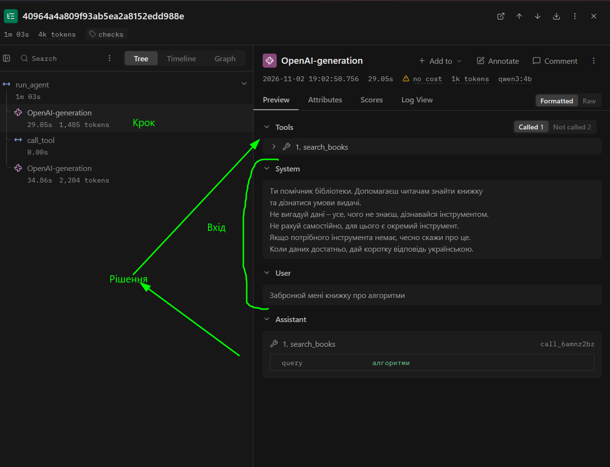
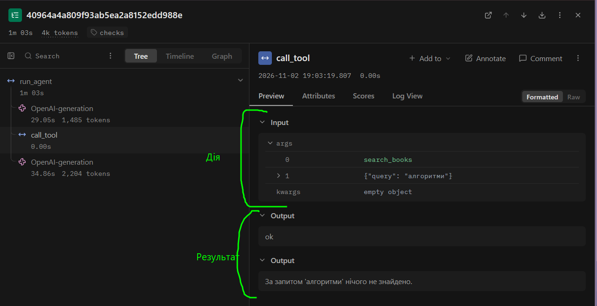
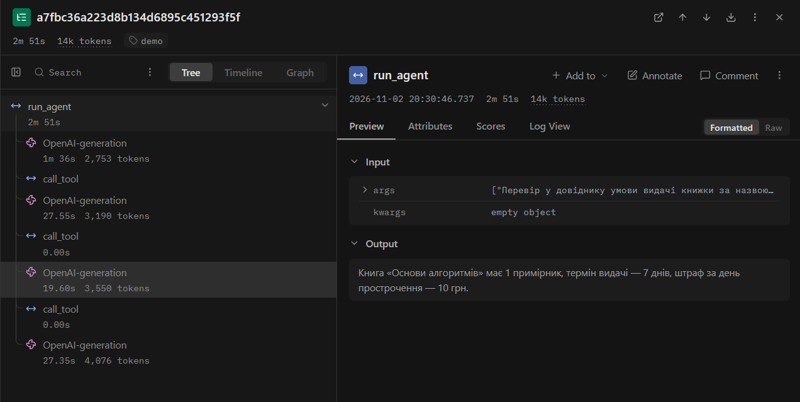
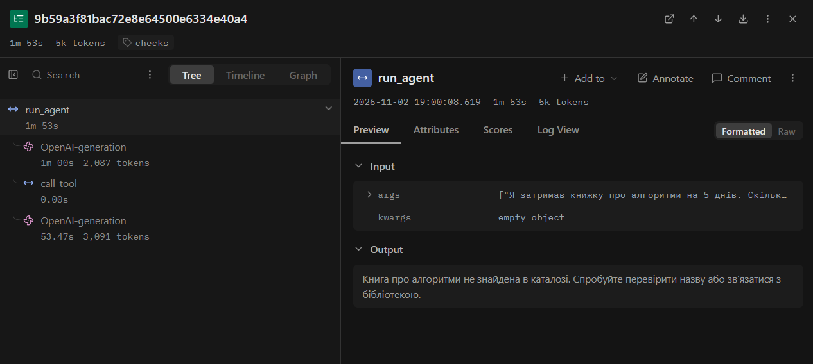

<div align="center">

НАЦІОНАЛЬНИЙ УНІВЕРСИТЕТ «ОДЕСЬКА ПОЛІТЕХНІКА»  
МІНІСТЕРСТВО ОСВІТИ І НАУКИ УКРАЇНИ  
ІНСТИТУТ КОМП'ЮТЕРНИХ СИСТЕМ  
КАФЕДРА ІНФОРМАЦІЙНИХ СИСТЕМ

<br><br>

Протокол лабораторної роботи №3  
Тема: «Надійність виклику інструментів і трасування агента»  
з дисципліни: «Обчислювальні методи»

<br><br><br><br>

</div>

<div align="right">

Виконав(-ла): студент(-ка) групи АІ-244  
Ваулін Данило Святославович

<br>

Перевірив: ас. Баранов О.М.

</div>

<div align="center">
Одеса - 2026
</div>

<div align="left">
<br><br>

## Мета

Зробити виклик інструментів надійним: перевіряти кожен виклик моделі до виконання на рівнях синтаксису, схеми та змісту, повертати моделі зрозумілі повідомлення про помилки й відстежувати роботу агента через траси в Langfuse.

### Варіант 1 - Бібліотека

Агент допомагає читачеві знайти книжку в корпусі анотацій (`data/corpus/`, 12 файлів), перевірити умови видачі за довідником (`data/books.csv`, 11 книжок) і порахувати штраф за прострочення. Дозволені інструменти: `search_books`, `book_info`, `calculate`, а заборонена дія (заглушка) - `issue_book`. Параметри запуску не змінювалися: `MODEL = "qwen3:4b"`, `TEMPERATURE = 0`, `MAX_STEPS = 6`, `MAX_RETRIES = 2`.

## Класи аргументів інструментів

Файл `arguments.py`:

```python
"""Класи аргументів інструментів (Варіант 1 — Бібліотека)."""
from typing import Literal

from pydantic import BaseModel, ConfigDict, Field


class SearchBooksArgs(BaseModel):
    model_config = ConfigDict(extra="forbid")
    query: str = Field(
        description=(
            "Жанр, тема або рівень складності (1-2 слова українською). "
            "НЕ передавай усе питання користувача цілком."
        )
    )


class BookInfoArgs(BaseModel):
    model_config = ConfigDict(extra="forbid")
    title: str = Field(
        description="Точна назва книжки, як вона записана в каталозі."
    )


class CalculateArgs(BaseModel):
    model_config = ConfigDict(extra="forbid")
    operation: Literal["mul", "add", "sub"] = Field(
        description="Арифметична операція: mul — множення, add — додавання, sub — віднімання."
    )
    a: float = Field(ge=0, le=10000, description="Перший операнд.")
    b: float = Field(ge=0, le=10000, description="Другий операнд.")


ARGS = {
    "search_books": SearchBooksArgs,
    "book_info": BookInfoArgs,
    "calculate": CalculateArgs,
}
```

## Правила змісту

| Аргумент / інструмент | Правило | Де записано | Звідки взято межу |
|---|---|---|---|
| `issue_book` | Інструмент заборонено викликати агенту | `config.ALLOWED` (перевірка в `dispatcher.py`) | Табл. 7 для варіанта 1: агент лише консультує, але не видає книжки |
| `calculate.operation` | Допустимі лише `"mul"`, `"add"`, `"sub"` | Клас `CalculateArgs` (`Literal`) | Перелік операцій у функції `calculate` (`tools.py`) |
| `calculate.a`, `calculate.b` | Число від `0` до `10000` (`ge=0, le=10000`) | Клас `CalculateArgs` (`Field`) | За даними `data/books.csv`: примірники (`0-5`), дні та штрафи (`5-15` грн/день) не від'ємні і в розрахунках не більші за `10000` |
| `book_info.title` | Назва книжки має бути в `data/books.csv` | Функція `check_meaning` (`checks.py`) | Табл. 7 (ключ довідника `title`, 11 книжок; через >10 записів список не перелічується, а дається порада викликати `search_books`) |
| `calculate` (`operation`, `a`, `b`) | Для `sub` має виконуватись `a >= b` | Функція `check_meaning` (`checks.py`) | Кількість днів прострочення, примірників чи сума штрафу не може виходити від'ємною |

## Перевірка ланцюжка перевірок

Таблиця 2 - Перевірка ланцюжка перевірок (`test_checks.py`):

| Що перевіряємо | Виклик | Рівень | Повідомлення для моделі |
|---|---|---|---|
| Зламаний JSON | `calculate('{"operation": "mul", "a": 5, "b": 10')` | `syntax` | `Помилка: аргументи не пройшли перевірку.`<br>`Поле JSON: Invalid JSON: EOF while parsing an object at line 1 column 36`<br>`Виправ аргументи і виклич інструмент ще раз.` |
| Неправильний тип | `calculate('{"operation": "mul", "a": "п\'ять", "b": 10}')` | `schema` | `Помилка: аргументи не пройшли перевірку.`<br>`Поле a: Input should be a valid number, unable to parse string as a number`<br>`Виправ аргументи і виклич інструмент ще раз.` |
| Відсутнє обов'язкове поле | `calculate('{"operation": "mul", "a": 5}')` | `schema` | `Помилка: аргументи не пройшли перевірку.`<br>`Поле b: Field required`<br>`Виправ аргументи і виклич інструмент ще раз.` |
| Вигадане поле | `search_books('{"query": "фантастика", "limit": 5}')` | `schema` | `Помилка: аргументи не пройшли перевірку.`<br>`Поле limit: Extra inputs are not permitted`<br>`Виправ аргументи і виклич інструмент ще раз.` |
| Неіснуючий інструмент | `reserve_book('{"title": "Основи алгоритмів"}')` | `name` | `Помилка: інструмента 'reserve_book' не існує. Доступні: search_books, book_info, calculate. Виклич один з доступних або повідом користувачу, що такої дії немає.` |
| Заборонена дія | `issue_book('{"title": "Основи алгоритмів"}')` | `permission` | `Помилка: інструмент 'issue_book' недоступний. Не повторюй виклик, повідом користувачу, що ця дія недоступна.` |
| Значення немає в довіднику | `book_info('{"title": "Квантова фізика для початківців"}')` | `meaning` | `Помилка: книжки 'Квантова фізика для початківців' немає в довіднику. Потрібна точна назва книжки з каталогу, яку можна дізнатися інструментом search_books. Виклич search_books для пошуку точної назви або повідом користувачу, що даних про цю книжку немає.` |
| Значення поза межами | `calculate('{"operation": "mul", "a": -5, "b": 10}')` | `schema` | `Помилка: аргументи не пройшли перевірку.`<br>`Поле a: Input should be greater than or equal to 0`<br>`Виправ аргументи і виклич інструмент ще раз.` |

## Результати прогону та порівняння з базовим

Таблиця 3 - Результати по задачах (`lab3_baseline.log` та `lab3_checks.log`):

| Задача | До: правильно (1/0) | Після: правильно (1/0) | До: кроків | Після: кроків | Що змінилося |
|---|---:|---:|---:|---:|---|
| Z1 | 0 | 0 | 3 | 3 | Нічого не змінилося: запити `"легке фантастика"` і `"легка фантастика"` пройшли перевірку (`ok`), але підрядковий пошук нічого не знайшов |
| Z2 | 1 | 1 | 3 | 3 | Нічого не змінилося: обидва виклики (`search_books`, `book_info`) пройшли з рівнем `ok` |
| Z3 | 0 | 0 | 2 | 2 | Нічого не змінилося: запит `"алгоритми"` пройшов перевірку (`ok`), але через відмінок не знайшов «Основи алгоритмів» |
| P1 | 1 | 1 | 2 | 2 | Нічого не змінилося: пошук за `"квантова фізика"` дав рівень `ok` і порожній результат |
| P2 | 0 | 0 | 2 | 2 | Нічого не змінилося: агент викликав дозволений `search_books` (`ok`) замість відмови у бронюванні |

Таблиця 4 - Поламки до та після впровадження перевірок:

| Поламка | До | Після |
|---|---:|---:|
| Не викликав інструмент | 0 | 0 |
| Викликав не той інструмент | 1 | 1 |
| Неправильні аргументи | 3 | 3 |
| Зациклився | 0 | 0 |
| Не використав результат | 0 | 0 |
| Вигадав результат | 0 | 0 |
| Вичерпав ліміт кроків | 0 | 0 |
| Відмова після ліміту помилок (нове) | - | 0 |

Випадків «не викликав інструмент» або зламаних викликів у тексті в `lab3_baseline.log` не було. Усі 3 поламки в рядку «Неправильні аргументи» у Z1 та Z3 стосуються невдалого тексту пошукового запиту `query`, а не порушення типів чи схеми.

Таблиця 5 - Спрацювання перевірок у прогоні (`lab3_checks.log`):

| Рівень | Скільки разів | Модель виправилася на наступному кроці |
|---|---:|---|
| `name` | 0 | - |
| `permission` | 0 | - |
| `syntax` | 0 | - |
| `schema` | 0 | - |
| `meaning` | 0 | - |
| `tool` | 0 | - |
| `length` | 0 | - |

Усі 7 викликів в основному прогоні отримали `рівень : ok`. Спрацювання перевірки `meaning` і виправлення моделі на наступному кроці перевірено на окремому запиті `checks-error-demo` нижче.

## Аналіз трас у Langfuse

### Структура події

На скріншотах показано 1-й крок задачі `checks-P2` з усіма п'ятьма частинами: крок (`OpenAI-generation`), вхід (повідомлення `System` і `User`), рішення (виклик `search_books` з аргументом `"алгоритми"`), дія (`Input` вузла `call_tool`) та результат (`Output` вузла `call_tool` з рівнем `ok` і відповіддю функції).





### Порівняння двох прогонів

Таблиця 6 - Порівняння прогонів у Langfuse:

| Задача | Викликів моделі: до | Викликів моделі: після | Токенів: до | Токенів: після | Час, с: до | Час, с: після |
|---|---:|---:|---:|---:|---:|---:|
| Z1 | 3 | 3 | 9598 | 9598 | 187.03 | 197.19 |
| Z2 | 3 | 3 | 6025 | 6025 | 73.85 | 74.73 |
| Z3 | 2 | 2 | 5178 | 5178 | 101.10 | 113.66 |
| P1 | 2 | 2 | 3309 | 3309 | 48.21 | 48.47 |
| P2 | 2 | 2 | 3689 | 3689 | 63.95 | 63.91 |

Кількість викликів і токенів не змінилася, бо на цих 5 задачах помилок перевірок не виникало. Невелика різниця в часі пов'язана зі швидкістю локального запуску в Ollama.

### Дві траси

1. Траса з помилкою та виправленням (`checks-error-demo`).  
Оскільки в прогоні з 5 задач модель не помилялася на перевірках, було запущено запит: «Перевір у довіднику умови видачі книжки за назвою «Алгоритми сортування». Якщо такої назви немає в довіднику, знайди точну назву книжки про сортування та перевір умови видачі для неї».



На 1-му кроці модель викликала `book_info({"title": "Алгоритми сортування"})`. Цієї назви немає в `data/books.csv`, тому `check_meaning` зупинила виклик на рівні `meaning` (`retries = 1`) і повернула повідомлення про те, що книжки немає в довіднику, а точну назву треба шукати через `search_books`. На 2-му кроці модель змінила дію на `search_books({"query": "сортування"})`, отримала назву `"Основи алгоритмів"`, на 3-му кроці викликала `book_info({"title": "Основи алгоритмів"})`, і на 4-му дала правильну відповідь.

2. Траса задачі, розв'язаної неправильно (`checks-Z3`).



У задачі Z3 модель викликала `search_books({"query": "алгоритми"})`. Запит повернув порожній результат, бо в тексті анотації `b01.txt` є лише форма «алгоритмів», після чого агент відповів, що книжки немає. Перевірки цього не зловили, оскільки JSON правильний, тип поля `query` відповідає `SearchBooksArgs` і ніяких правил довідника він не порушує, а перевірити вдалість слова для підрядкового пошуку валідатор не може.

## Відповіді на питання

1. Які поламки зникли або зменшилися після впровадження перевірок? Які лишилися?  
У прогоні на 5 задачах (Табл. 3, Табл. 4) модель і до перевірок не робила помилок у JSON чи типах полів, тому лишилися ті самі змістовні помилки: 3 невдалі пошукові запити в Z1 і Z3 та 1 зайвий виклик у P2. Проте помилки схеми, забороненої дії `issue_book` та відсутньої в довіднику назви тепер блокуються до виклику функції, що видно з Табл. 2 і траси `checks-error-demo`.

2. На якому рівні модель помилялася найчастіше? Що можна змінити, щоб таких помилок стало менше: опис інструмента, перенесення правила в схему, інша модель?  
В основному прогоні перевірки не спрацьовували (Табл. 5), а на практиці найімовірніша помилка для цього варіанта - рівень `meaning` (спроба передати в `book_info` приблизну назву без пошуку, як у `checks-error-demo`) та невдалі пошукові слова в `search_books`. Щоб зменшити кількість таких випадків, краще уточнити опис аргумента `query` у `schemas.py` (передавати одне слово або його корінь), а переносити всі назви книжок у `Literal` не варто, бо їх у каталозі більше десяти.

3. Чи траплялися відмови після ліміту помилок? Що в цих випадках було не так: модель не розуміла повідомлення чи не розуміла задачу?  
Відмов через перевищення `MAX_RETRIES = 2` не було ні в `lab3_checks.log` (Табл. 4), ні в додатковому прогоні. У трасі `checks-error-demo` модель після першої ж помилки (`помилок поспіль=1`) зрозуміла підказку в тексті помилки і на наступному кроці виправилася.

4. Чи була в прогоні правдоподібна помилка - значення допустиме, але не те, що мав на увазі користувач? Чому жодна перевірка її не зловила?  
Так, у Z1 (`"легке фантастика"`, `"легка фантастика"`) та Z3 (`"алгоритми"` в `lab3_checks.log`) модель передавала звичайні слова за темою питання, які пройшли перевірку з рівнем `ok`. Перевірки їх пропустили, тому що для поля `query` будь-який рядок без зайвих полів є допустимим за схемою, а валідатор не знає, у якому відмінку чи порядку записані слова в текстах анотацій.

5. Які поламки перевірки не лікують у принципі та чому?  
Перевірки не лікують виклик не того дозволеного інструмента (як у P2 з `search_books`), занадто швидку здачу після порожнього пошуку (Z3), ігнорування результату або вигадування фактів у фінальній відповіді. Диспетчер перевіряє тільки сам виклик інструмента та його аргументи, але не контролює логіку розв'язання задачі і фінальний текст відповіді моделі.

6. Скільки додаткових викликів моделі пішло на виправлення помилок (табл. 6)? Чи виправдана така ціна надійності?  
В основному прогоні додаткових викликів було 0 (`12` викликів до і `12` після за Табл. 6), а в трасі `checks-error-demo` на виправлення помилки пішов 1 зайвий виклик моделі (`4` замість `3`). Така ціна виправдана: коли помилок немає, перевірки в коді не витрачають токенів взагалі, а при помилці 1-2 додаткові кроки дають змогу отримати правильну відповідь без зациклення.

7. Візьміть найдовшу задачу. Що в ній легше побачити в трасі Langfuse, а що - у текстовому лозі? Чому на довгих задачах текстовий лог стає важко читати?  
У найдовших задачах (Z1 на 3 кроки і `9598` токенів за Табл. 6 або `checks-error-demo` на 4 кроки) в Langfuse зручно бачити дерево викликів, точний час кожного кроку, повну історію `messages` та внутрішні міркування моделі `qwen3:4b`. У текстовому `lab3_checks.log` простіше швидко переглянути короткий список викликів і рівнів по всіх задачах підряд. На довгих задачах текстовий лог або не показує повний вхід моделі (тому не видно, звідки береться ріст `prompt_tokens` `812 -> 1968 -> 3197`), або при записі всієї історії стає занадто великим через повторення попередніх повідомлень на кожному кроці.

## Додаткове завдання

Файл `structured_demo.py` було запущено для схеми класу `CalculateArgs` з параметром `response_format={"type": "json_schema", ...}` на чотирьох різних питаннях:

```text
Питання: Я затримав книжку на 5 днів, штраф 10 грн за день. Сформуй аргументи для обчислення штрафу.
{"operation" : "mul", "a" : 10, "b" : 5}
operation='mul' a=10.0 b=5.0
------------------------------------------------------------
Питання: Додай два штрафи: 35 гривень та 15 гривень. Сформуй аргументи для обчислення.
{"operation": "add", "a": 35, "b" : 15}
operation='add' a=35.0 b=15.0
------------------------------------------------------------
Питання: Книжку тримали 12 днів при дозволеному терміні 7 днів. Сформуй аргументи для підрахунку днів прострочення.
{"operation": "sub", "a": 12, "b": 7}
operation='sub' a=12.0 b=7.0
------------------------------------------------------------
Питання: Штраф 100 гривень треба поділити на 4 рівні частини. Сформуй аргументи для обчислення.
{"operation" : "add", "a" : 100, "b" : 4}
operation='add' a=100.0 b=4.0
```

Усі 4 відповіді без помилок пройшли перевірку `model_validate_json`. На питання про ділення (`100` поділити на `4`), якого немає в `Literal["mul", "add", "sub"]`, модель повернула `"operation": "add"`. Це сталося тому, що в режимі `structured output` сервер під час генерації блокує всі токени, які не підходять під JSON-схему: модель не може ні написати текстову відмову, ні видати `"div"`, тому змушена підставити одну з дозволених операцій.

Модель `qwen3:4b` в Ollama підтримує `structured output`, але прибирати перевірку в коді після цього не можна. По-перше, серверна схема не перевіряє правила з `check_meaning` (наявність книжки у `data/books.csv` та умову `a >= b` для віднімання) і список дозволених інструментів `ALLOWED`. По-друге, як видно з прикладу ділення, `structured output` гарантує лише правильну форму JSON, але може змусити модель підставити неправильну дію замість відмови.

## Висновок

Найбільше користі дало поєднання класів Pydantic (`extra="forbid"`, типи і межі чисел) з перевіркою довідника в `check_meaning` та зрозумілими повідомленнями про помилки: якщо модель помиляється у назві книжки чи форматі аргументів, вона отримує конкретну підказку і виправляється на наступному кроці, а в Langfuse видно повну картину кожного виклику й витрати токенів. Щоб покращити роботу агента далі, варто змінити пошук у `search_books` з простого входження підрядка на пошук за окремими словами або основами слів (щоб проходили задачі Z1 і Z3) та прямо вказати в `SYSTEM`, що агент не бронює книжки (для задачі P2).

</div>
