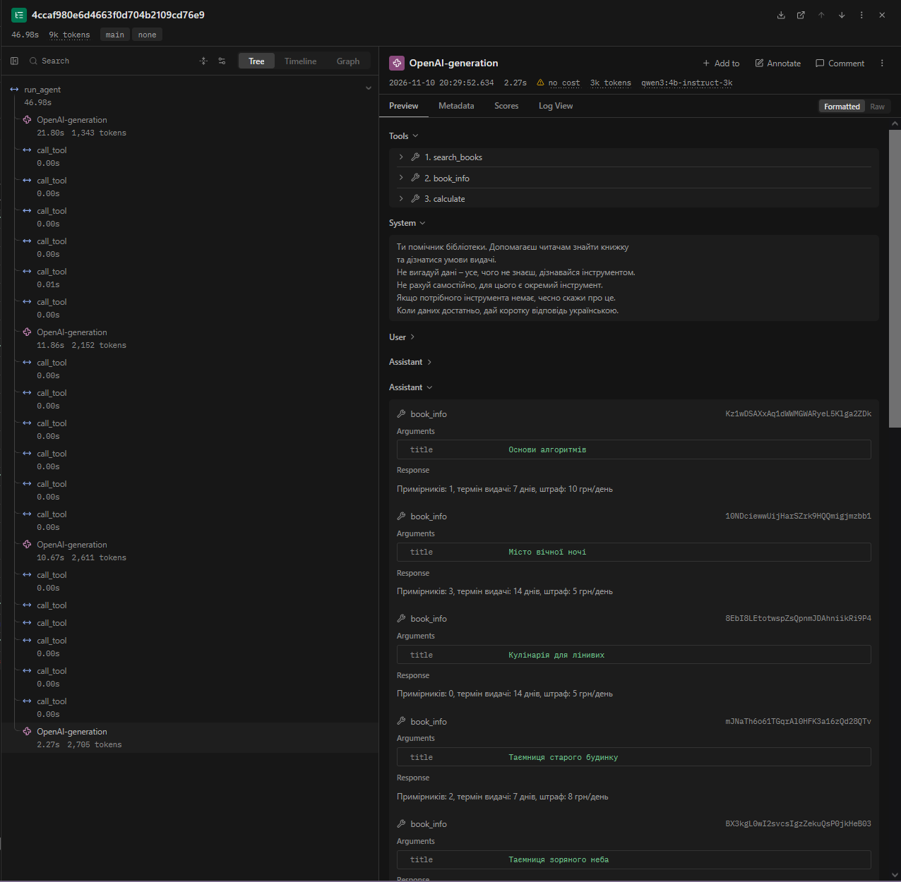
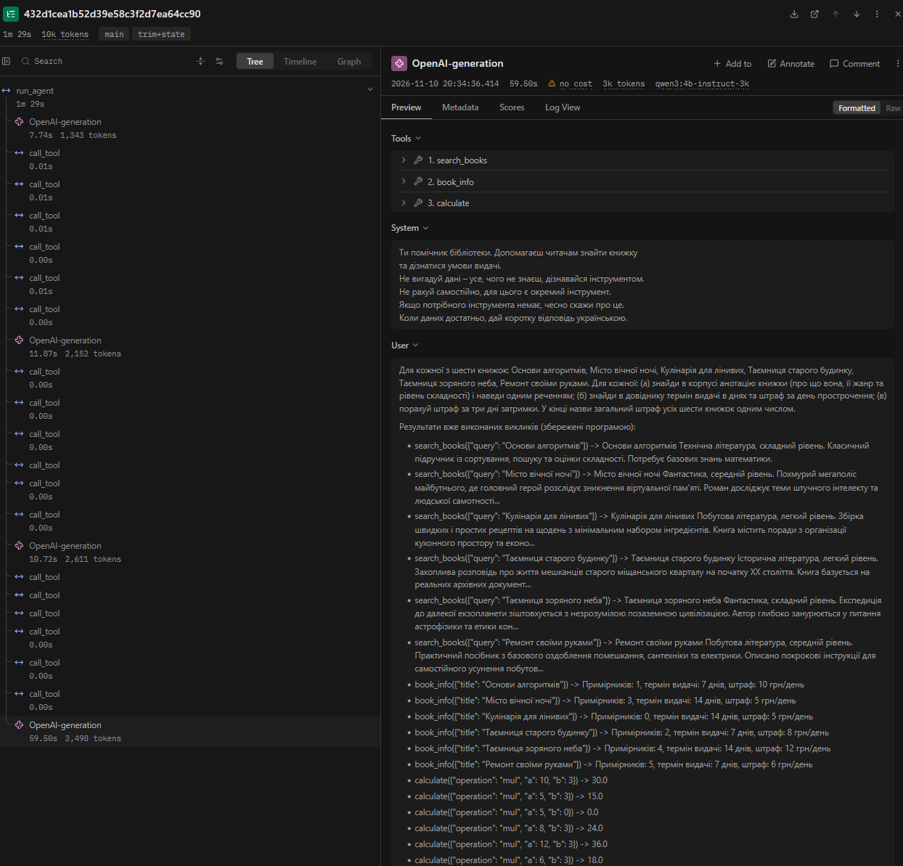

НАЦІОНАЛЬНИЙ УНІВЕРСИТЕТ «ОДЕСЬКА ПОЛІТЕХНІКА»  
МІНІСТЕРСТВО ОСВІТИ І НАУКИ УКРАЇНИ  
ІНСТИТУТ КОМП'ЮТЕРНИХ СИСТЕМ  
КАФЕДРА ІНФОРМАЦІЙНИХ СИСТЕМ

  

Протокол лабораторної роботи №4  
Тема: «Контекст, стан і кеш агента»  
з дисципліни: «Обчислювальні методи»

    

Виконав(-ла): студент(-ка) групи АІ-244  
Ваулін Данило Святославович

 

Перевірив: ас. Баранов О.М.

Одеса - 2026

  

## Мета

Побачити, що відбувається з агентом, коли історія не вміщується в контекстне вікно моделі; навчитися скорочувати історію, зберігати результати інструментів поза текстом діалогу та кешувати виклики моделі; виміряти, скільки це коштує.

### Варіант 1 - Бібліотека

Агент допомагає читачеві знайти книжку в корпусі анотацій (`data/corpus/`, 12 файлів), перевірити умови видачі за довідником (`data/books.csv`, 11 книжок) і порахувати штраф за прострочення. Дозволені інструменти: `search_books`, `book_info`, `calculate`.

Вихідна модель: `qwen3:4b-instruct`. Для роботи у вузькому вікні через `Modelfile` створено модель із обмеженим параметром `num_ctx` (спочатку `4096`, а після перевірки в кроці 4 за випадком C зменшено до `3072`).

Три числа з кроку 1:

- `context length` вихідної моделі (`qwen3:4b-instruct`): `262144` токени;
- `num_ctx` нової моделі (`qwen3:4b-instruct-3k`): `3072` токени (на кроці 1 для `qwen3:4b-instruct-4k` було `4096`);
- у скільки разів вікно звузили: у `85.33` раза (`262144 / 3072`, а для початкового вікна `4096` - у `64` рази).

Параметри в `config.py`: `LAB_LOGFILE_NAME = "lab4"`, `MODEL = "qwen3:4b-instruct-3k"`, `RUN_TAG = "ctx-control"`, `NUM_CTX = 3072`, `MAX_STEPS_LONG = 25`, `COMPRESS_AT = 2150`, `KEEP_LAST = 6`, `STATE_RESULT_CHARS = 200`.

## Довга задача

Скрипт `make_task.py` створює задачу в `long_task.json` для шести книжок із каталогу (`min_calls = 18`).

Питання (`question`):
«Для кожної з шести книжок: Основи алгоритмів, Місто вічної ночі, Кулінарія для лінивих, Таємниця старого будинку, Таємниця зоряного неба, Ремонт своїми руками. Для кожної: (а) знайди в корпусі анотацію книжки (про що вона, її жанр та рівень складності) і наведи одним реченням; (б) знайди в довіднику термін видачі в днях та штраф за день прострочення; (в) порахуй штраф за три дні затримки. У кінці назви загальний штраф усіх шести книжок одним числом.»

Правильна відповідь (`expected`): `138` (`10×3 + 5×3 + 5×3 + 8×3 + 12×3 + 6×3 = 30 + 15 + 15 + 24 + 36 + 18 = 138` грн).

## Де ламається вікно

Пробний прогін без захисту `python measure.py none 1 probe` на вікні `3072` тривав `46.7` с (на вікні `4096` - `36.3` с), відповідь правильна: `так` (`138` грн).

Таблиця 2 - Зростання входу в прогоні без захисту (`logs/probe_none_r1.log`):

| Крок | `prompt_tokens` | Приріст | Що зробила модель                                    |
| ---: | --------------: | ------: | :--------------------------------------------------- |
|    1 |            1166 |         | `search_books({"query":"Основи алгоритмів"})`        |
|      |                 |         | `search_books({"query":"Місто вічної ночі"})`        |
|      |                 |         | `search_books({"query":"Кулінарія для лінивих"})`    |
|      |                 |         | `search_books({"query":"Таємниця старого будинку"})` |
|      |                 |         | `search_books({"query":"Таємниця зоряного неба"})`   |
|      |                 |         | `search_books({"query":"Ремонт своїми руками"})`     |
|    2 |            1975 |     809 | `book_info({"title":"Основи алгоритмів"})`           |
|      |                 |         | `book_info({"title":"Місто вічної ночі"})`           |
|      |                 |         | `book_info({"title":"Кулінарія для лінивих"})`       |
|      |                 |         | `book_info({"title":"Таємниця старого будинку"})`    |
|      |                 |         | `book_info({"title":"Таємниця зоряного неба"})`      |
|      |                 |         | `book_info({"title":"Ремонт своїми руками"})`        |
|    3 |            2423 |     448 | `calculate({"operation":"mul","a":10,"b":3})`        |
|      |                 |         | `calculate({"operation":"mul","a":5,"b":3})`         |
|      |                 |         | `calculate({"operation":"mul","a":5,"b":0})`         |
|      |                 |         | `calculate({"operation":"mul","a":8,"b":3})`         |
|      |                 |         | `calculate({"operation":"mul","a":12,"b":3})`        |
|      |                 |         | `calculate({"operation":"mul","a":6,"b":3})`         |
|    4 |            2672 |     249 | відповідь без виклику                                |

Показники прогону за виведенням `analyze.py`:

- (а) Постійна частина входу («вхід першого кроку»): `1166` токенів.
- (б) Типовий приріст за крок: `448` токенів (медіана приростів `809`, `448`, `249`).
- (в) Сума `prompt_tokens` за прогін: `8236` токенів, а значення за формулою `n*C + d*n*(n-1)/2`: `7352` токени (`4*1166 + 448*6`). Різниця в `884` токени виникає через те, що на 1-му кроці модель викликала одразу 6 пошуків `search_books`, які повернули 6 повних анотацій і дали стрибок приросту `+809` токенів (замість медіанних `448`), який далі входив у кожен наступний крок.
- (г) Крок, на якому вхід перестав рости: `не помічено`.
- (д) Дії моделі та перевірка чисел у `logs/probe_none_r1.log`: модель групувала виклики пачками по 6 штук за крок, тому виконала всі 18 викликів за 3 кроки і на 4-му дала відповідь. Перевірка лога показала дві проблеми: на кроці 3 для книжки «Кулінарія для лінивих» (`Примірників: 0, термін видачі: 14 днів, штраф: 5 грн/день`) модель переплутала кількість днів із кількістю примірників і викликала `calculate({"operation":"mul","a":5,"b":0}) -> 0.0`. Крім того, модель жодного разу не викликала `calculate` з операцією `add`, а порахувала суму `138` самостійно (додавши в умі `15` замість `0.0`), тож числа `138` у рядках `результат:` не було.

Випадок за таблицею кроку 4: на початковому вікні `4096` найбільший вхід склав `2672` токени (`65%` вікна, менше за `95%`), статус завершення `final` - це випадок C («Задача закоротка»). За інструкцією для випадку C у `Modelfile` задано `PARAMETER num_ctx 3072`, створено модель `qwen3:4b-instruct-3k`, у `config.py` змінено `MODEL = "qwen3:4b-instruct-3k"`, `NUM_CTX = 3072`, `COMPRESS_AT = 2150`, після чого прогін повторено (найбільший вхід `2672` токени склав `87%` вікна `3072`).

## Обрізання історії та стан задачі

Таблиця 3 - Стиснення історії (`logs/probe_trim_r1.log` та `logs/probe_trim+state_r1.log`):

| Конфігурація | Крок стиснення | Вхід до стиснення, токенів | Повідомлень було -> стало | Повторних викликів за прогін |
| :----------- | -------------: | -------------------------: | ------------------------: | ---------------------------: |
| `trim`       |              3 |                       2423 |                   23 -> 2 |                          132 |
| `trim`       |              6 |                       2423 |                   23 -> 2 |                          132 |
| `trim`       |              9 |                       2423 |                   23 -> 2 |                          132 |
| `trim`       |             12 |                       2423 |                   23 -> 2 |                          132 |
| `trim`       |             15 |                       2423 |                   23 -> 2 |                          132 |
| `trim`       |             18 |                       2423 |                   23 -> 2 |                          132 |
| `trim`       |             21 |                       2423 |                   23 -> 2 |                          132 |
| `trim`       |             24 |                       2423 |                   23 -> 2 |                          132 |
| `trim+state` |              3 |                       2423 |                   23 -> 2 |                            0 |

У конфігурації `trim` на кроці 3 вхід перевищує поріг `2150` (`2423` токени). Оскільки модель на кожному кроці викликає по 6 інструментів, останні `KEEP_LAST = 6` повідомлень у списку `messages` - це 6 відповідей інструментів (`role = "tool"`), а повідомлення `assistant` із самими викликами є сьомим з кінця і відсікається. Після цього `drop_orphan_tools` прибирає всі 6 «осиротілих» результатів, і в історії лишаються тільки 2 перші повідомлення (`system` і `user`). Агент забуває все, що зробив, і кожні 3 кроки починає задачу спочатку, набираючи `132` повторні виклики до зупинки за `step_limit` на кроці 25.

Результати пункту 7 кроку 6 (перший блок `ПЕРШЕ ПОВІДОМЛЕННЯ КОРИСТУВАЧА ПІСЛЯ СТИСНЕННЯ` у `logs/probe_trim+state_r1.log`):

- кількість рядків виду `- інструмент(аргументи) -> результат`: `18` рядків (усі 18 викликів за кроки 1-3 з рівнем `ok`);
- розмір блоку стану: `2547` символів, що за розрахунком `2.5` символа на токен становить приблизно `1019` токенів (разом із текстом питання повідомлення має `3003` символи або `~1201` токен; фактично вхід на кроці 4 виріс відносно 1-го кроку на `2405 - 1166 = 1239` токенів);
- порівняння з типовим приростом за крок (`448` токенів): блок стану у `2.3` раза більший за типовий приріст одного кроку. Він помітний за розміром, бо зберігає результати одразу 18 викликів, проте завдяки скороченню результатів до `200` символів вільно вміщується у вікно `3072` (`2405` токенів на кроці 4, тобто `78%` вікна) і зменшує кількість повторних викликів зі `132` до `0`.

## Кеш викликів моделі

Таблиця 4 - Робота кешу (`logs/cache1_none_r1.log` та `logs/cache2_none_r1.log`):

| Запуск              | Кроків | Влучань у кеш | Викликів до сервера | Час, с | Правильно |
| :------------------ | -----: | ------------: | ------------------: | -----: | :-------- |
| 1 (кеш порожній)    |      4 |             0 |                   4 |   47.4 | так       |
| 2 (той самий запит) |      4 |             4 |                   0 |    0.7 | так       |

Запуск 2 відпрацював у `67.7` раза швидше за запуск 1 (`0.7` с проти `47.4` с, практично миттєво), тому що всі 4 відповіді моделі були взяті з JSON-файлів у папці `cache/` без звернень до сервера Ollama. Якби перед запуском 2 змінити текст `SYSTEM` у `config.py`, змінився б текст першого повідомлення в `messages`, функція `make_key` порахувала б інший хеш `sha256`, і кеш не спрацював би жодного разу (`0` влучань, усі 4 виклики пішли б на сервер).

## Вимірювання і траси

Таблиця 5 - Вартість циклу в різних конфігураціях (медіани по трьох повторах, серії `main` та `extra`):

| Конфігурація | Правильно (з 3) | Кроків | Токенів на вхід | Токенів на вихід | На підсумовування | Час, с | Стиснень | Повторних викликів |
| :----------- | :-------------: | -----: | --------------: | ---------------: | ----------------: | -----: | -------: | -----------------: |
| `none`       |      3 з 3      |      4 |            8236 |              575 |                 0 |   33.3 |        0 |                  0 |
| `trim`       |      0 з 3      |     25 |           45678 |             4513 |                 0 |  251.1 |        8 |                132 |
| `trim+state` |      0 з 3      |      4 |            7969 |             1635 |                 0 |   89.9 |        1 |                  0 |
| `summary`    |      0 з 3      |      4 |            7777 |             1493 |              3267 |  150.9 |        1 |                  0 |

Поламки в `logs/main_*.log` (9 прогонів) та `logs/extra_*.log` (3 прогони, разом 12 прогонів), яких не видно у зведеній таблиці:

1. Агент відповів, зробивши менше 19 кроків: сталося у `9` з `12` прогонів (`6` з `9` в основній серії `main`). У всіх прогонах `none`, `trim+state` та `summary` агент вклався у `4` кроки замість `19`, бо викликав по 6 інструментів паралельно за один крок. У 3 прогонах `trim` відповіді не було взагалі через зупинку за лімітом `25` кроків (`step_limit`).
2. Агент назвав число, якого не було в жодному рядку `результат:` цього лога: сталося у `9` з `12` прогонів (`6` з `9` у серії `main`), тобто в усіх прогонах, де агент дав відповідь. У всіх цих прогонах на кроці 3 були отримані лише проміжні результати множення (`30.0`, `15.0`, `0.0`, `24.0`, `36.0`, `18.0`), а для їх додавання `calculate("add", ...)` не викликався. Модель рахувала загальну суму в умі: у `none` (3 прогони) видала `138`, у `trim+state` (3 прогони) помилилася при усному додаванні `30 + 15 + 15 + 24 + 36 + 18` і написала `148` грн, а в `summary` (3 прогони) через плутанину тарифів у переказі видала `129` грн (`r1`, `r2`) та `117` грн (`r3`).

Скріншоти дерев трас у Langfuse:

Траса `long-main_none_r1`:

Траса `long-main_trim+state_r1`:

Порівняння токенів входу після стиснення за трасами Langfuse:
У `main_trim+state_r1` стиснення відбулося після кроку 3, тому перший виклик після стиснення - крок 4. На кроці 4 вхід (`prompt_tokens`) у `long-main_trim+state_r1` склав `2405` токенів (`1245` нових + `1160` кешованих, у `messages` лише 2 повідомлення), а на тому самому кроці 4 у `long-main_none_r1` вхід склав `2672` токени (`62` нових + `2610` кешованих, у `messages` 20 повідомлень), тобто вхід зменшився на `267` токенів.

У трасі Langfuse одразу видно дерево виконання з пачками по 6 викликів `call_tool`, точний час кожного кроку генерації моделі (`21.8` с, `11.9` с, `10.7` с) проти миттєвих викликів інструментів (`0.001-0.005` с) і підсумкову кількість токенів. У текстовому лозі тривалість кожного кроку та сумарні витрати токенів довелося б рахувати вручну за різницею часових позначок.

## Відповіді на питання

1. На якому кроці агент без захисту дійшов до межі вікна і як ви це побачили (таблиця 2, пункти (г) і (д) кроку 4)? Що в його поведінці змінилося після цього?  
   У прогоні без захисту (`logs/probe_none_r1.log`, Табл. 2) агент не дійшов до межі вікна і застій входу не спостерігався (`вхід перестав рости на кроці: не помічено`). Оскільки модель викликала по 6 інструментів за крок, вона встигла виконати всі 18 викликів за 3 кроки і завершити роботу на 4-му кроці при вході `2672` токени (`65%` вікна `4096` та `87%` вікна `3072`), тому обрізання історії сервером не виникло.

2. Порівняйте суму `prompt_tokens` за прогін із формулою (пункти (а)-(в) кроку 4). Чи збігається зростання з очікуваним?  
   Фактична сума `prompt_tokens` у `logs/probe_none_r1.log` склала `8236` токенів, тоді як за формулою `n*C + d*n*(n-1)/2` очікувалося `7352` токени (Табл. 2). Загальний характер росту збігається, але фактична сума більша на `884` токени через нерівномірний приріст: після 1-го кроку вхід зріс одразу на `809` токенів (шість повних анотацій із `search_books`), що значно перевищило медіанний приріст `448` токенів.

3. Що втрачає агент при обрізанні? Наведіть приклад повторного виклику після стиснення. Що змінилося в `trim+state` (таблиці 3 і 5)?  
   При обрізанні (`trim`) агент втрачає старі повідомлення діалогу, а через `KEEP_LAST = 6` та відкидання осиротілих відповідей `tool` історія взагалі скидається з `23` до `2` початкових повідомлень (Табл. 3). У `logs/probe_trim_r1.log` після стиснення на кроці 3 агент на кроці 4 (і далі на кроках 7, 10, 13, 16, 19, 22, 25) знову викликав `search_books({"query":"Основи алгоритмів"})` та решту 5 пошуків, тоді як у `trim+state` збережені результати дописуються до запитання користувача і повторні виклики падають зі `132` до `0` (Табл. 3, Табл. 5).

4. Яка конфігурація найдешевша за токенами, найшвидша, найточніша (таблиця 5)? Чому висновок за трьома повторами однієї задачі обережний?  
   За сумою всіх витрачених токенів найдешевшою є `trim+state` (`7969` вхідних і `1635` вихідних токенів без витрат на переказ за Табл. 5), а найшвидшою та формально найточнішою виявилася `none` (`33.3` с, `3 з 3` правильних відповідей). Висновок за трьома повторами однієї задачі обережний, бо модель у всіх прогонах рахувала фінальну суму в умі без `calculate("add", ...)`: у `none` вона випадково порахувала `138` правильно, а в `trim+state` при тих самих даних видала `148` грн (`logs/main_trim+state_r1.log`, крок 4).

5. Чому під час вимірювання вартості кеш вимкнено? Що станеться з кешем, якщо інструмент поверне інші дані або ви замініть модель під тією самою назвою?  
   Під час основного вимірювання кеш вимикають, бо інакше повторні прогони брали б готові відповіді з файлів за `0.7` с (як у `logs/cache2_none_r1.log`, Табл. 4) і ми не змогли б оцінити реальний час генерації та розкид відповідей моделі. Якщо дані в довіднику зміняться або під тією самою назвою в Ollama буде завантажена інша модель, `make_key` для однакового вхідного запиту поверне старий хеш і програма віддасть застарілу відповідь із кешу.

6. Які поламки довгого прогону скорочення історії не лікує в принципі?  
   Скорочення історії не лікує помилки у виборі аргументів і порушення інструкцій самою моделлю. Наприклад, у всіх прогонах (`logs/main_none_r1.log`, `logs/main_trim+state_r1.log`, крок 3) модель передавала в `calculate` кількість примірників `0` замість `3` днів затримки (`calculate({"operation":"mul","a":5,"b":0})`) і рахувала підсумкову суму самостійно в умі без виклику калькулятора.

## Додаткове завдання

Для скорочення історії переказом створено файл `summary.py` і виконано три прогони `python measure.py summary 3 extra` (результати додано в Табл. 5).

Вартість та економія токенів:

- На окремий виклик моделі `summarize` пішло `3267` токенів за прогін (медіана по трьох повторах: `3267` у `r1`, `3326` у `r2`, `3236` у `r3`).
- На вході основної моделі витрачено `7777` токенів проти `45678` токенів у `trim`, тобто заощаджено `37901` токен входу (навіть разом із `3267` токенами на переказ це в 4 рази дешевше за `trim`, хоча дорожче й повільніше за `trim+state`).

Перевірка збереження чисел за `logs/extra_summary_r1.log`:
Переказ не зберіг прив'язку точних чисел до назв книжок. На кроці 2 в рядках `результат:` були отримані точні дані, зокрема для «Таємниця старого будинку» - `Примірників: 2, термін видачі: 7 днів, штраф: 8 грн/день`. Однак у блоці `ПІДСУМОК ІСТОРІЇ` на кроці 3 модель перерахувала рядки `Примірників: ..., термін видачі: ..., штраф: ...` окремим списком без назв книжок. Через це на кроці 4 вона приписала книжці «Таємниця старого будинку» штраф `5` грн/день замість `8` грн/день, порахувала `5 * 3 = 15` грн замість `24` грн і видала неправильну суму `129` грн (а в `extra_summary_r3.log` - `117` грн) замість `138` грн.

## Висновок

Із трьох досліджених способів найбільший ефект для виконання довгої задачі у вузькому вікні (`3072` токени) дало поєднання обрізання історії зі збереженням стану (`trim+state`): воно втримує вхід у межах вікна, не витрачає додаткових токенів на переказ (на відміну від `summary`), точно зберігає всі числа з результатів інструментів і прибирає зациклення зі `132` повторних викликів у чистому `trim` до `0`, а кеш (`cache`) прискорює повторні прогони при налагодженні з `47.4` с до `0.7` с. Щоб виправити поламки, які залишилися, варто збільшити `KEEP_LAST` (або відраховувати `keep_last` групами разом із повідомленням `assistant`), щоб `drop_orphan_tools` не зрізав увесь крок при пакетному виклику 6 інструментів, а також додати перевірку або уточнення в `SYSTEM`, щоб модель обов'язково викликала `calculate("add", ...)` для підрахунку фінальної суми, а не додавала числа в умі.

