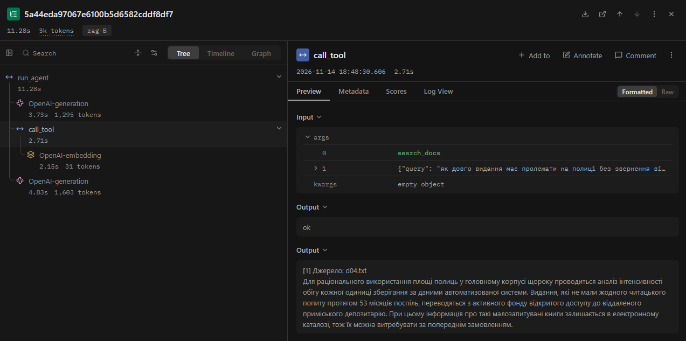
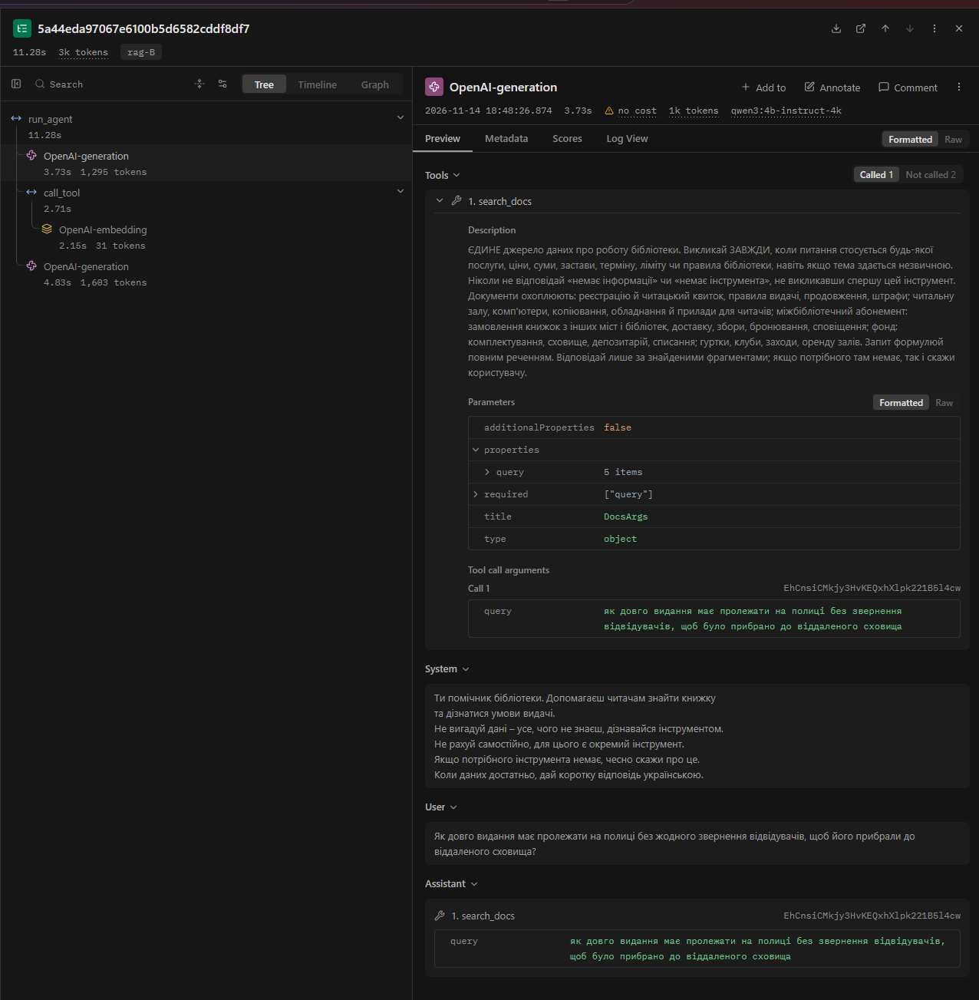
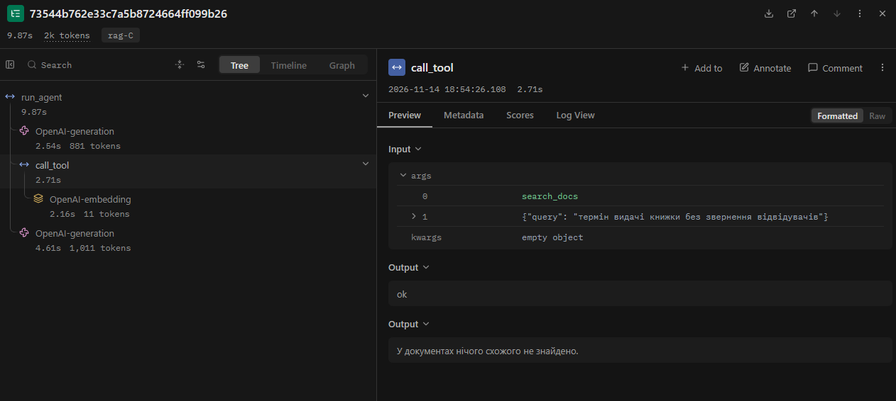
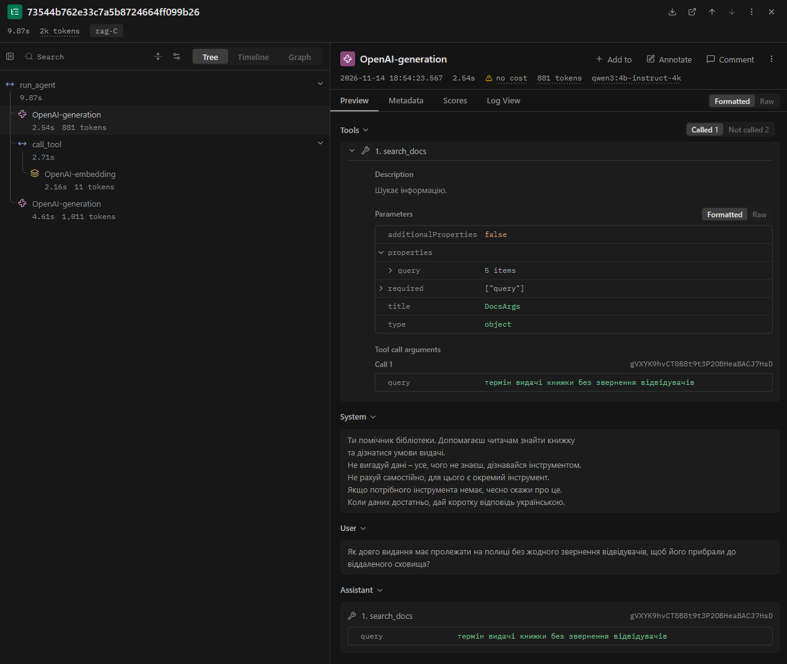

<div align="center">

НАЦІОНАЛЬНИЙ УНІВЕРСИТЕТ «ОДЕСЬКА ПОЛІТЕХНІКА»  
МІНІСТЕРСТВО ОСВІТИ І НАУКИ УКРАЇНИ  
ІНСТИТУТ КОМП'ЮТЕРНИХ СИСТЕМ  
КАФЕДРА ІНФОРМАЦІЙНИХ СИСТЕМ

<br><br>

Протокол лабораторної роботи №5  
Тема: «RAG-агент: пошук по документах як інструмент»  
з дисципліни: «Обчислювальні методи»

<br><br><br><br>

</div>

<div align="right">

Виконав(-ла): студент(-ка) групи АІ-244  
Ваулін Данило Святославович

<br>

Перевірив: ас. Баранов О.М.

</div>

<div align="center">
Одеса - 2026
</div>

<div align="left">
<br><br>

## Мета роботи та початкові налаштування

Мета роботи: замінити пошук за підрядком на векторний пошук за змістом (RAG); подивитися, як спосіб нарізання документів, поріг схожості та опис інструмента впливають на відповіді агента; відокремити помилки пошуку від помилок самого агента.

Варіант: 1 (Бібліотека).  
Модель чату: `qwen3:4b-instruct-4k`.  
Розмір контекстного вікна (`NUM_CTX`): `4096` токенів.  
Модель ембедингів (`EMBED_MODEL`): `bge-m3`.  
Дозволені інструменти (`ALLOWED`): `search_docs`, `book_info`, `calculate`.

## Дані та перевірка моделі без документів

До 12 коротких анотацій книжок у `data/corpus/` додано 5 довгих нормативних документів у `data/docs/` для вигаданої установи «Центральна муніципальна бібліотека Академічний маяк» (по 8 абзаців кожен, разом 36 унікальних числових значень, записаних цифрами):

1. `d01.txt` - Правила користування бібліотекою (`3895` символів, 8 абзаців).
2. `d02.txt` - Читальна зала й електронні ресурси (`3964` символи, 8 абзаців).
3. `d03.txt` - Міжбібліотечний абонемент (`3932` символи, 8 абзаців).
4. `d04.txt` - Формування й списання фонду (`3942` символи, 8 абзаців).
5. `d05.txt` - Гуртки та заходи при бібліотеці (`3997` символів, 8 абзаців).

Загальний обсяг корпусу за виводом `python check_cases.py`:

- документів: `17` (`12` у `data/corpus/` та `5` у `data/docs/`);
- символів: `22198`;
- оцінка в токенах (`chars / 2.5`): приблизно `8879` токенів, що більш ніж удвічі перевищує розмір вікна `4096`.

Список десяти контрольних питань із `rag_cases.json`:

| ID   | Вид          | Питання                                                                                                                                | `must_contain`                            | `expected` |
| :--- | :----------- | :------------------------------------------------------------------------------------------------------------------------------------- | :---------------------------------------- | :--------- |
| `D1` | `direct`     | Яка вартість первинного виготовлення електронного читацького квитка у гривнях?                                                         | `читацького квитка становить 165 гривень` | `165`      |
| `D2` | `direct`     | Скільки хвилин становить максимальна тривалість однієї безперервної робочої сесії за стаціонарним комп'ютерним терміналом?             | `терміналом становить 115 хвилин`         | `115`      |
| `D3` | `direct`     | Який фіксований логістичний збір встановлено за транспортування одного друкованого тому в обидва кінці за міжбібліотечним абонементом? | `кінці становить 235 гривень`             | `235`      |
| `D4` | `direct`     | Скільки тематичних гуртків і дискусійних клубів діють на постійній основі на базі соціокультурного відділу установи?                   | `діють 15 тематичних гуртків`             | `15`       |
| `P1` | `paraphrase` | Скільки доведеться доплатити за кожен день, якщо взяту додому книжку не повернули вчасно?                                              | `пеню у розмірі 43 гривні`                | `43`       |
| `P2` | `paraphrase` | Яку суму потрібно тимчасово залишити як гарантію, щоб узяти прилад зі збільшувальним склом для читання дрібного шрифту?                | `заставу в розмірі 310 гривень`           | `310`      |
| `P3` | `paraphrase` | Скільки часу тримають у резерві присланий з іншого міста том після повідомлення читача, перш ніж скасувати замовлення?                 | `замовленої книги протягом 68 годин`      | `68`       |
| `P4` | `paraphrase` | Як довго видання має пролежати на полиці без жодного звернення відвідувачів, щоб його прибрали до віддаленого сховища?                 | `попиту протягом 53 місяців поспіль`      | `53`       |
| `N1` | `none`       | Яка вартість оформлення річної сімейної передплати на доставку аудіокниг кур'єром додому?                                              | `null`                                    | `null`     |
| `N2` | `none`       | Скільки коштує послуга ламінування читацьких дипломів та прошивання курсових робіт металевою пружиною?                                 | `null`                                    | `null`     |

Перевірка трьох питань напряму на моделі `qwen3:4b-instruct-4k` без документів та без інструментів:

- на `D1` (очікується `165`) модель відповіла, що вартість не встановлена в офіційних джерелах;
- на `D2` (очікується `115`) модель назвала типову санітарну норму `60 хвилин`;
- на `P1` (очікується `43`) модель відповіла, що сума залежить від конкретної бібліотеки (наприклад, `1-5 гривень`).  
  Жодного правильного числа без доступу до документів модель не вгадала.

## Перевірка моделі ембедингів

Результат запуску `python embed_check.py`:

```text
Час: 9.3 с (з кешем буде майже 0)
Довжина вектора: 1024
Довжина (норма) першого вектора: 1.000  (1.000 - вектори вже нормалізовані)
Запит - 'Тариф на доставку'      : 0.731
Запит - 'Графік роботи кур'єрів' : 0.568
```

Модель `bge-m3` повертає вже нормалізовані вектори розмірності `1024` (норма `1.000`). Для речення «Скільки коштує відправити посилку?» косинусна близькість до тематично відповідної фрази «Тариф на доставку» (`0.731`) помітно вища, ніж до суміжної фрази «Графік роботи кур'єрів» (`0.568`), незважаючи на відсутність спільних слів.

## Нарізання одного документа

Таблиця 1 - Нарізання одного документа (`data/docs/d01.txt`, вивід `python show_chunks.py`):

| Спосіб                       | Чанків | Закінчуються посеред речення | Довжина найбільшого, символів |
| :--------------------------- | -----: | ---------------------------: | ----------------------------: |
| `fixed`, 200, перекриття 0   |     20 |                           18 |                           200 |
| `fixed`, 500, перекриття 100 |     10 |                            8 |                           500 |
| `paragraphs`, 800            |      8 |                            0 |                           621 |

Приклад розрізаного факту при способу `fixed` (`200`, перекриття `0`) між чанками 12 і 13 у `d01.txt` (питання `P1` про пеню `43` грн за добу):

```text
--- чанк 12 (200 симв.) ---
ча, адже затримка затребуваних томів перешкоджає навчанню інших учасників спільноти. За кожну прострочену добу понад погоджений термін повернення однієї книжки облікова система автоматично нараховує ф

--- чанк 13 (200 симв.) ---
інансову пеню у розмірі 43 гривні. Нарахування штрафної суми стартує наступного ранку після завершення дозволеного строку і триває аж до фактичної здачі видання бібліотекарю.
```

Межа чанка розрізала слово «фінансову» навпіл (`ф` і `інансову`): умова нарахування залишилася в чанку 12, а саме число `43 гривні` потрапило в чанк 13 без пояснення, за що саме ця сума стягується.

## Перевірка пошуку без агента і вибір порога

Таблиця 2 - Пошук при різному нарізанні (`python check_retrieval.py`):

| Конфігурація           | Чанків | Сер. довжина | hit@1 | hit@3 | hit@5 | hit@3 прямі | hit@3 перефр. | Токенів (k=3) |
| :--------------------- | -----: | -----------: | ----: | ----: | ----: | ----------: | ------------: | ------------: |
| `fixed-200-0`          |    123 |          180 |  0.62 |  0.88 |  0.88 |        0.75 |          1.00 |           217 |
| `fixed-500-0`          |     52 |          427 |  1.00 |  1.00 |  1.00 |        1.00 |          1.00 |           512 |
| `fixed-500-100`        |     62 |          431 |  0.88 |  1.00 |  1.00 |        1.00 |          1.00 |           517 |
| `fixed-1500-0`         |     27 |          822 |  1.00 |  1.00 |  1.00 |        1.00 |          1.00 |           987 |
| `paragraphs-800`       |     52 |          426 |  1.00 |  1.00 |  1.00 |        1.00 |          1.00 |           511 |
| `paragraphs-800+title` |     52 |          506 |  1.00 |  1.00 |  1.00 |        1.00 |          1.00 |           607 |

Для подальшої роботи обрано конфігурацію `paragraphs-800` (`CHUNK_METHOD = "paragraphs"`, `CHUNK_SIZE = 800`, `CHUNK_OVERLAP = 0`, `WITH_TITLE = False`). Серед п'яти конфігурацій, які дали максимальний `hit@3 = 1.00` (і `hit@1 = 1.00`), вона дає найменший обсяг результату в токенах (`511` токенів при `k=3`) та зберігає цілісність абзаців без розривів речень. У `fixed-200-0` показник `hit@3` впав до `0.88`, бо в питанні `D4` контрольна фраза `діють 15 тематичних гуртків` була розрізана посеред слова «тематичних» між двома чанками.

Таблиця 3 - Схожість першого результату для `paragraphs-800` (`python check_retrieval.py scores`):

| ID   | Вид          | Схожість | Перший результат містить потрібну фразу |
| :--- | :----------- | -------: | :-------------------------------------- |
| `D1` | `direct`     |    0.732 | так                                     |
| `D2` | `direct`     |    0.780 | так                                     |
| `D3` | `direct`     |    0.700 | так                                     |
| `D4` | `direct`     |    0.668 | так                                     |
| `P1` | `paraphrase` |    0.708 | так                                     |
| `P2` | `paraphrase` |    0.620 | так                                     |
| `P3` | `paraphrase` |    0.709 | так                                     |
| `P4` | `paraphrase` |    0.580 | так                                     |
| `N1` | `none`       |    0.595 | -                                       |
| `N2` | `none`       |    0.542 | -                                       |

Найнижча схожість серед питань із відповіддю дорівнює `0.580` (`P4`), а найвища серед питань без відповіді - `0.595` (`N1`, де є близькі до бібліотеки слова про передплату і доставку книг). Отже, межі трохи перекриваються (`0.580 < 0.595`), і жоден поріг не розділяє всі питання ідеально. Як компроміс обрано поріг `MIN_SCORE = 0.60` на користь того, щоб не вигадувати відповіді, яких у документах немає: при `0.60` обидва питання без відповіді (`N1 = 0.595` і `N2 = 0.542`) гарантовано відсікаються, а 7 із 8 питань із відповіддю мають схожість `>= 0.620` (тоді як сире питання `P4` зі схожістю `0.580` опиняється трохи нижче порога). Після цього індекс остаточно перебудовано скриптом `build_index.py` (`52` чанки, середня довжина `426` символів).

## Перевірка інструмента `search_docs` без моделі

Вивід `python try_tool.py D1`:

```text
ПИТАННЯ: Яка вартість первинного виготовлення електронного читацького квитка у гривнях?

рівень: ok
[1] Джерело: d01.txt
Для швидкої авторизації користувачів та автоматизованого обліку книговидачі в усіх підрозділах установи застосовуються персональні пластикові картки з безконтактним мікрочіпом. Вартість первинного виготовлення такого електронного читацького квитка становить 165 гривень, які вносяться одноразово через платіжний термінал у головному холі. У випадку випадкової втрати або механічної поломки картки читач повинен невідкладно звернутися до чергового реєстратора для блокування профілю та замовлення дубліката.

[2] Джерело: d03.txt
У випадках, коли дослідникові потрібен лише окремий параграф монографії або стаття з наукового вісника, замість пересилання важкого паперового тому пропонується послуга електронної доставки документів. Вартість виготовлення та пересилання високоякісної цифрової скан-копії одного розділу обсягом до двадцяти сторінок становить 95 гривень. Готовий файл захищається водяними знаками та надається для перегляду через захищений термінал бібліотеки без права комерційного тиражування.

Занадто короткий запит -> рівень: schema
Помилка: аргументи не пройшли перевірку.
Поле query: String should have at least 3 characters
Виправ аргументи і виклич інструмент ще раз.
```

Вивід `python try_tool.py N1`:

```text
ПИТАННЯ: Яка вартість оформлення річної сімейної передплати на доставку аудіокниг кур'єром додому?

рівень: ok
У документах нічого схожого не знайдено.

Занадто короткий запит -> рівень: schema
Помилка: аргументи не пройшли перевірку.
Поле query: String should have at least 3 characters
Виправ аргументи і виклич інструмент ще раз.
```

Для `D1` інструмент повернув два чанки зі схожістю вище `0.60` (перший чанк містить відповідь `165 гривень`), а для `N1` усі чанки мали схожість нижче `0.60`, тому повернуто повідомлення про відсутність даних. Перевірка з моделлю через `python ask.py D1` завершилася за 2 кроки правильною відповіддю: «Вартість первинного виготовлення електронного читацького квитка становить 165 гривень.».

## Вимірювання агента з трьома описами інструмента

Виконано повне вимірювання `python measure_rag.py` (3 описи по 3 повтори на 10 питаннях, разом 90 прогонів). Ручна перевірка `results/rag.csv` підтвердила, що автоматична оцінка спрацювала точно в усіх 90 рядках.

Таблиця 5 - Агент з трьома описами інструмента (`python rag_report.py`; питань з відповіддю 8, у трьох повторах 24 прогони):

| Опис | Правильно (з 24) | Викликав пошук (з 24) | Кроків, медіана | Токенів входу, медіана | Час, с, медіана |
| :--- | ---------------: | --------------------: | --------------: | ---------------------: | --------------: |
| `A`  |             0/24 |                  3/24 |             1.0 |                    974 |             5.3 |
| `B`  |            24/24 |                 24/24 |             2.0 |                   2805 |             8.6 |
| `C`  |             6/24 |                 12/24 |             1.0 |                    836 |             5.3 |

Таблиця 6 - Куди ламається відповідь (кількість прогонів; питань з відповіддю 24 на опис, без відповіді 6):

| Категорія                                                    | `A` | `B` | `C` |
| :----------------------------------------------------------- | --: | --: | --: |
| Правильно (`ok`)                                             |   0 |  24 |   6 |
| Не шукав і відповів неправильно (`no_search`)                |  21 |   0 |  12 |
| Шукав, але потрібного фрагмента в результаті немає (`miss`)  |   3 |   0 |   6 |
| Фрагмент був у результаті, відповідь неправильна (`ignored`) |   0 |   0 |   0 |
| Питання без відповіді: визнав, що не знає (`refused`)        |   6 |   6 |   6 |
| Питання без відповіді: вигадав відповідь (`invented `)       |   0 |   0 |   0 |

## Розбір у логах і трасах Langfuse

1. Агент не викликав пошук (`no_search`). На прямому питанні `D1` в описах `A` (`logs/rag_A-r1.log`) та `C` (`logs/rag_C-r1.log`) модель одразу відповіла за 1 крок без виклику інструмента:

```text
##### A-r1-D1
ЗАДАЧА: Яка вартість первинного виготовлення електронного читацького квитка у гривнях?
--- крок 1 | помилок поспіль=0 | prompt_tokens=948 | completion_tokens=100
ВІДПОВІДЬ: Про вартість первинного виготовлення електронного читацького квитка в гривнях у бібліотецькому каталозі немає інформації. Будь ласка, уточніть або надайте інші деталі, якщо потрібно знайти інформацію.

##### C-r1-D1
ЗАДАЧА: Яка вартість первинного виготовлення електронного читацького квитка у гривнях?
--- крок 1 | помилок поспіль=0 | prompt_tokens=809 | completion_tokens=104
ВІДПОВІДЬ: Немає інформації про вартість первинного виготовлення електронного читацького квитка у гривнях. Це питання виходить за межі доступних даних. Потрібно додаткове дослідження або джерело, що містить таку інформацію.
```

На `D1`–`D4`, `P2`, `P3` модель не вигадала числове значення, а помилково повідомила про відсутність даних, навіть не перевіривши документи (при цьому в `A-r1-P4` без пошуку вигадала хибне правило, нібито книжки лежать на полиці без звернень протягом терміну видачі з довідника). У `A` опис залишився від старого пошуку художніх книжок за жанром, тому питання про ціну квитка модель вважає поза своїми можливостями. У `C` опис «Шукає інформацію.» не містить переліку тем (реєстрація, квиток, тарифи, МБА), тож модель на всіх прямих питаннях `D1`–`D4` відмовляється шукати, тоді як в описі `B` (`logs/rag_B-r1.log`) завдяки переліку розділів і вимозі викликати інструмент завжди агент викликає `search_docs` і дає правильну відповідь `165 гривень`.

2. Як агент переформульовує питання (`query` та `top_score`). Порівняння тексту питання користувача з полем `query` на питаннях `P1`–`P4`, де пошук викликався і в `B`, і в `C`:

| ID   | Питання користувача                                                                                                     | Запит `query` в описі `B` (`r1`)                                                                                          | `top_score` (`B`) | Запит `query` в описі `C` (`r1`)                                           | `top_score` (`C`) |
| :--- | :---------------------------------------------------------------------------------------------------------------------- | :------------------------------------------------------------------------------------------------------------------------ | ----------------: | :------------------------------------------------------------------------- | ----------------: |
| `P1` | Скільки доведеться доплатити за кожен день, якщо взяту додому книжку не повернули вчасно?                               | `які штрафи на книжки за день прострочення при видачі додому?`                                                            |             0.685 | `умови видачі книжок, штраф за день прострочення`                          |             0.677 |
| `P2` | Яку суму потрібно тимчасово залишити як гарантію, щоб узяти прилад зі збільшувальним склом для читання дрібного шрифту? | `яку суму потрібно тимчасово залишити як гарантію, щоб узяти прилад зі збільшувальним склом для читання дрібного шрифту?` |             0.613 | `умови видачі приладу зі збільшувальним склом для читання дрібного шрифту` |             0.564 |
| `P3` | Скільки часу тримають у резерві присланий з іншого міста том після повідомлення читача, перш ніж скасувати замовлення?  | `який термін відповідності для присланих з іншого міста томів після повідомлення читача перед скасуванням замовлення?`    |             0.657 | `який термін резервування для присланих з іншого міста томів у бібліотеці` |             0.682 |
| `P4` | Як довго видання має пролежати на полиці без жодного звернення відвідувачів, щоб його прибрали до віддаленого сховища?  | `як довго видання має пролежати на полиці без звернення відвідувачів, щоб було прибрано до віддаленого сховища`           |             0.602 | `термін видачі книжки без звернення відвідувачів`                          |             0.580 |

В описі `B` завдяки вказівці «Запит формулюй повним реченням» модель на питаннях `P2`, `P4` (а також `D1`–`D4`) майже дослівно скопіювала питання користувача, а на `P1` і `P3` переписала його повним реченням зі збереженням змісту (у `P4` `top_score` зріс із `0.580` на сирому питанні до `0.602` і пройшов поріг `0.60`). В описі `C` модель у всіх прогонах переписала й скоротила запити до уривків і підмінила поняття, через що на `P2` і `P4` схожість впала нижче порога `0.60` (`0.564` і `0.580`).

3. Агент шукав, але потрібного чанка в результаті немає (`miss`). Приклад із `logs/rag_C-r1.log` (задача `C-r1-P4`):

```text
##### C-r1-P4
ЗАДАЧА: Як довго видання має пролежати на полиці без жодного звернення відвідувачів, щоб його прибрали до віддаленого сховища?
--- крок 1 | помилок поспіль=0 | prompt_tokens=835 | completion_tokens=46
  виклик   : search_docs({"query":"термін видачі книжки без звернення відвідувачів"})
  рівень   : ok
  результат: У документах нічого схожого не знайдено.
--- крок 2 | помилок поспіль=0 | prompt_tokens=908 | completion_tokens=103
ВІДПОВІДЬ: Насправді, у документах не знайдено інформації про термін пролежання видання на полиці без звернення відвідувачів. Будь ласка, дайте більше деталей або перевірте, чи відома інша інформація, яка може допомогти.
```

У кроці 5 без агента (`check_retrieval.py`) на повному тексті питання `P4` чанк `d04.txt#3` був на 1-му місці зі схожістю `0.580`. У `B-r1-P4` агент передав повне речення зі словами про полицю та віддалене сховище і підняв `top_score` до `0.602 >= 0.60`, а в `C-r1-P4` викинув згадку про сховище і замінив на «термін видачі книжки без звернення відвідувачів», отримавши `top_score = 0.580 < 0.60`. Аналогічно в `A-r1-P1` модель через старий опис додала слова «книга про те, що відбувається...» і отримала `top_score = 0.581 < 0.60`.

4. Потрібний чанк у результаті був, але відповідь неправильна (`ignored`).  
   У наших вимірюваннях категорія `ignored` дорівнює `0` для всіх трьох описів: у всіх 30 прогонах, де пошук повернув потрібний чанк (`24` в `B` та `6` у `C`), модель правильно витягла з нього число.

5. Питання без відповіді (`N1`, `N2`).  
   В описах `A` і `C` агент не викликав пошук і відмовлявся одразу за 1 крок. В описі `B` агент у всіх 6 прогонах викликав `search_docs`, отримав `top_score = 0.586` (`N1`) та `0.503` (`N2`), які відсіклися порогом `MIN_SCORE = 0.60` («У документах нічого схожого не знайдено.»), і на 2-му кроці чесно повідомив про відсутність даних (`logs/rag_B-r1.log`, задача `B-r1-N1`).

6. Порівняння трас `rag-B` і `rag-C` у Langfuse (питання `P4`).

Вузол `call_tool` у трасі `rag-B-r1-P4` (`traceId: 5a44eda97067e6100b5d6582cddf8df7`):



Вхід першого виклику `OpenAI-generation` (опис `search_docs`) у трасі `rag-B-r1-P4`:



Вузол `call_tool` у трасі `rag-C-r1-P4` (`traceId: 73544b762e33c7a5b8724664ff099b26`):



Вхід першого виклику `OpenAI-generation` (опис `search_docs`) у трасі `rag-C-r1-P4`:



Розбір за трасами Langfuse:

- у вузлі `call_tool` траси `rag-B-r1-P4` на вході передано запит `{"query": "як довго видання має пролежати на полиці без звернення відвідувачів, щоб було прибрано до віддаленого сховища"}`, всередині видно дочірній виклик `OpenAI-embedding` (`2.15` с, `31` токен), а на виході повернуто `["ok", "[1] Джерело: d04.txt ... протягом 53 місяців поспіль ..."]`. У `rag-C-r1-P4` на вході `call_tool` передано скорочений запит `{"query": "термін видачі книжки без звернення відвідувачів"}` (`OpenAI-embedding`: `11` токенів), а на виході повернуто `["ok", "У документах нічого схожого не знайдено."]`;
- у вході першого виклику `OpenAI-generation` в масиві `tools[0].function.description` між `B` і `C` відрізняється сам текст опису інструмента: у `B` це детальна інструкція на `792` символи (тому вхід 1-го кроку становить `prompt_tokens = 1220`, а разом із відповіддю `completion_tokens = 75` у дереві траси відображається `1295` токенів), тоді як у `C` - лише два слова «Шукає інформацію.» (вхід 1-го кроку становить `prompt_tokens = 835`, тобто на `385` вхідних токенів менше, а разом із `completion_tokens = 46` у дереві траси - `881` токен);
- у трасі Langfuse одразу видно повну JSON-схему інструментів `tools` (яка взагалі не записується в текстовий лог), вкладений виклик ембедингу `OpenAI-embedding` із його часом та токенами, кількість кешованих токенів (`input_cached_tokens`) і тривалість кожного вузла, тоді як у текстовому лозі для цього довелося б звірятися з кодом `schemas.py` і рахувати різницю часових позначок вручну.

## Звичайні задачі після зміни пошуку

Таблиця 7 - П'ять задач із `tasks.json` до і після заміни пошуку (`logs/run_lab4.log` та `logs/run_rag.log` при `DOCS_DESCRIPTION = "B"`):

| Задача                                  | Відповідь у лабораторній № 4 (`run_lab4.log`)                                                            | Відповідь тепер (`run_rag.log`)                                                         | Чи викликав `search_docs`                                                     | Що змінилося                                                                                                                                |
| :-------------------------------------- | :------------------------------------------------------------------------------------------------------- | :-------------------------------------------------------------------------------------- | :---------------------------------------------------------------------------- | :------------------------------------------------------------------------------------------------------------------------------------------ |
| 1 (`Z1`: легке з фантастики)            | За запитом «фантастика легке» нічого не знайдено (3 кроки, 2 виклики `search_books`)                     | У бібліотеці немає інформації про найлегшу книгу з фантастики (2 кроки)                 | Так (`{"query":"найлегша книга з фантастики в фонді бібліотеки"}`)            | Обидва рази не знайдено: у ЛР4 через кілька слів у підрядку, тепер через `top_score = 0.466 < 0.60`; агент завершився за 2 кроки замість 3. |
| 2 (`Z2`: книжка про сортування)         | Знайшов книгу «Основи алгоритмів» (`b01.txt`) за точним підрядком `"сортування"` (2 кроки)               | Книжку про сортування в бібліотеці не знайдено (2 кроки)                                | Так (`{"query":"знайти книжку про сортування"}`)                              | Стало гірше: файл `b01.txt` був на 1-му місці у векторному пошуку, але зі схожістю `0.532 < MIN_SCORE (0.60)`, тому відсіявся порогом.      |
| 3 (`Z3`: штраф за алгоритми на 5 днів)  | У бібліотеці немає книжок про алгоритми, програмування чи математику (4 кроки, 3 виклики `search_books`) | Не вдалося знайти інформацію про штраф за затримання книжки про алгоритми (2 кроки)     | Так (`{"query":"як вираховується штраф за затримання книжки про алгоритми"}`) | Через опис `B` агент шукав загальне правило штрафу в документах (`d01.txt#4` мав `0.582 < 0.60`), а не назву книжки.                        |
| 4 (`P1`: квантова фізика)               | Книжки про квантову фізику за запитом не знайдено (2 кроки, правильно)                                   | Книжки про квантову фізику не знайдено, можливо замовити через МБА (2 кроки, правильно) | Так (`{"query":"знайти книжку про квантову фізику"}`)                         | Обидва рази правильна відмова (`top_score = 0.397 < 0.60`), тепер із доречною підказкою про міжбібліотечний абонемент.                      |
| 5 (`P2`: забронюй книжку про алгоритми) | За запитом «алгоритми» нічого не знайдено (2 кроки)                                                      | Щоб забронювати книжку, потрібно знайти її за точною назвою (2 кроки)                   | Так (`{"query":"як забронювати книжку про алгоритми в бібліотеці"}`)          | Обидва рази відмова (`b01.txt` мав `0.532`, `d04.txt` - `0.531`, обидва `< 0.60`).                                                          |

Причина погіршення задачі 2 (`Z2`): агент викликав `search_docs({"query":"знайти книжку про сортування"})`, і потрібна картка `b01.txt` («Основи алгоритмів») посіла 1-ше місце в індексі, але отримала `score = 0.532 < 0.60`. Короткі анотації книжок у `data/corpus/` (`154`-`225` символів) дають меншу косинусну схожість із повними розмовними реченнями («знайти книжку про...»), ніж довгі нормативні абзаци `d01.txt`-`d05.txt`, під які в кроці 5 підбирався поріг `0.60`.

## Відповіді на питання

1. Табл. 1: на скільки відрізнялося нарізання за кількістю символів від нарізання за абзацами? Наведіть приклад чанка, у якому факт розрізано, і поясніть, чим це загрожує агентові.  
   На `d01.txt` спосіб `fixed-200-0` дав `20` чанків, з яких `18` обірвалися посеред речення (у `fixed-500-100` - `8` із `10`), а `paragraphs-800` дав `8` чанків без жодного обірваного речення (Табл. 1). У `fixed-200-0` між чанками 12 і 13 слово «фінансову» розірвано навпіл, тому умова штрафу лишилася в чанку 12, а сума `43 гривні` потрапила в чанк 13, через що агент може отримати число без контексту або умову без числа.

2. Табл. 2: яка конфігурація виявилася найкращою за `hit@3` і чому? Як змінилися результати при збільшенні розміру чанка з 200 до 1500 символів, при додаванні перекриття, при додаванні назви документа? Яка ціна більшого чанка?  
   Найкращою є `paragraphs-800`: вона дала `hit@3 = 1.00` (і `hit@1 = 1.00`) при найменшому обсязі результату серед точних конфігурацій (`511` токенів, Табл. 2). Збільшення чанка з `200` до `500` і `1500` символів підняло `hit@3` з `0.88` до `1.00`, перекриття у `fixed-500-100` знизило `hit@1` до `0.88`, додавання назви збільшило видачу до `607` токенів, а ціною чанка `1500` символів стало зростання входу майже вдвічі (`987` токенів).

3. Чи відрізняється `hit@3` для прямих і перефразованих питань? Що це говорить про пошук за змістом порівняно з пошуком підрядком (для якого перефразовані питання майже безнадійні)?  
   Починаючи з розміру `500` символів (зокрема у `paragraphs-800`), `hit@3` однаковий і дорівнює `1.00` як для прямих, так і для перефразованих питань (Табл. 2). Це доводить, що пошук за ембедингами знаходить потрібний фрагмент за змістом («доплатити за кожен день» -> «пеню у розмірі 43 гривні»), тоді як підрядковий пошук без точного збігу слів нічого б не знайшов.

4. Табл. 3: чи розділяє поріг `MIN_SCORE` питання з відповіддю й без неї? Що буде, якщо поріг поставити надто високим? Надто низьким?  
   Поріг `MIN_SCORE = 0.60` відсікає обидва питання без відповіді (`N1 = 0.595`, `N2 = 0.542`) і пропускає 7 із 8 питань з відповіддю напряму (`0.620`-`0.780`, Табл. 3), а на `P4` переформулювання запиту в описі `B` піднімає схожість із `0.580` до `0.602`. Надто високий поріг відкидатиме правильні чанки на перефразованих питаннях (`miss`), а надто низький пропускатиме випадкові чанки на питаннях `none`, провокуючи вигадування цін.

5. Табл. 5 і 6: який з трьох описів дав найбільше правильних відповідей? Як часто агент не звертався до пошуку в кожному описі? Що в тексті опису `B` змінило поведінку порівняно з `A` і `C`?  
   Опис `B` дав `24/24` правильних відповідей проти `6/24` у `C` та `0/24` в `A`, при цьому агент не викликав пошук (`no_search`) у `21` прогоні в `A`, у `12` у `C` і в `0` у `B` (Табл. 5, 6). Поведінку в `B` змінили вимога викликати `search_docs` завжди перед відмовою, повний перелік тем документів та інструкція писати запит повним реченням.

6. Табл. 6: яка категорія помилок найчастіша в найкращому описі? Чи можна її виправити зміною опису, чи потрібно змінювати пошук (нарізання, `TOP_K`, поріг) або модель? Чому це розрізнення важливе?  
   В описі `B` на `rag_cases.json` помилок немає (`24/24`), але на звичайній задачі `Z2` (Табл. 7) виникла помилка `miss` (`score = 0.532 < 0.60`), яку зміною опису вже не виправити, бо агент викликав пошук, а чанк `b01.txt` відсіявся порогом `MIN_SCORE`. Це розрізнення показує, що саме треба лагодити: промпт і опис інструмента при `no_search`, параметри пошуку й поріг при `miss` або саму модель при `ignored`.

7. Питання без відповіді: у скількох прогонах агент вигадав відповідь? Які два захисти є в системі (поріг у `search_docs` і текст опису) і який із них спрацював у ваших прогонах?  
   У всіх 18 прогонах на `N1` і `N2` агент жодного разу не вигадав відповідь (`invented  = 0`, `refused = 6` для кожного опису, Табл. 6). В описі `B` спрацювали обидва захисти послідовно: поріг `MIN_SCORE = 0.60` відсік нерелевантні чанки (`0.586` і `0.503`), повернувши «У документах нічого схожого не знайдено.», а інструкція в описі змусила модель чесно визнати відсутність даних (`logs/rag_B-r1.log`).

8. Оцініть із логу, скільки токенів додає один виклик `search_docs` (різниця `prompt_tokens` між кроками). Порівняйте з оцінкою з табл. 2. Скільки викликів моделі вміщується у вікно 4096 при вашому `TOP_K` і розмірі чанка (формула з лекції 7, п. 7.5)?  
   За `logs/rag_B-r1.log` один виклик `search_docs` додає від `292` токенів (1 чанк у `B-r1-P1`) і `505` токенів (2 чанки у `B-r1-D1`) до `796` токенів (усі 3 чанки у `B-r1-P3`), що загалом узгоджується з оцінкою `511` токенів із Табл. 2 (медіана по прогонах - `457` токенів). За формулою `1 + floor((4096 - 1215) / d)` у вікно `4096` вміщується `6` викликів моделі при `d = 511` (або `4` виклики при `d = 796` для трьох повних чанків).

9. Табл. 7: чи зламав новий пошук якісь із п'яти звичайних задач? Чому так або чому ні?  
   Новий пошук зламав задачу `Z2` («Знайди книжку про сортування...»): у ЛР4 книга «Основи алгоритмів» (`b01.txt`) знаходилася за точним підрядком `"сортування"`, а тепер агент відповів, що її не знайдено (`logs/run_rag.log`, Табл. 7). Хоча `b01.txt` був на 1-му місці у векторному індексі, його схожість із запитом `"знайти книжку про сортування"` склала `0.532 < 0.60` через малу довжину картки книги (`154` символи).

10. Яку з поламок цієї роботи не вилікує жодна зміна опису інструмента? Що б ви змінили в системі, щоб її виправити?  
    Зміною опису не вилікувати відсікання коротких карток каталогу `b01`-`b12` порогом `MIN_SCORE = 0.60`, який підбирався під довгі абзаци правил `d01`-`d05` (як у задачі `Z2`, де `b01.txt` отримав `0.532`). Щоб це виправити, варто розділити пошук на два окремі інструменти (`search_books` з нижчим порогом чи гібридним пошуком для каталогу і `search_docs` для правил) або додати переранжування результатів.

## Додаткове завдання: той самий індекс на Chroma

Створено клас `ChromaIndex` у `chroma_index.py` та скрипт `chroma_test.py`. Результат запуску `python chroma_test.py` на питанні `D1`:

```text
FAISS, схожість           : 0.7324 (d01.txt#1)
Chroma cosine, відстань   : 0.2676 (d01.txt#1)
Chroma за замовчуванням   : 0.5351 (d01.txt#1)
```

Пояснення результатів:

1. Як пов'язані числа в трьох рядках: у FAISS (`IndexFlatIP` на нормалізованих векторах) повертається косинусна схожість `s = 0.7324`. У Chroma з `space="cosine"` повертається косинусна відстань `1 - s = 1 - 0.7324 = 0.2676`. У Chroma за замовчуванням (`space="l2"`) повертається квадрат евклідової відстані, який для одиничних векторів дорівнює `2 - 2*s = 2*(1 - 0.73244) = 0.5351` (рівно вдвічі більший за косинусну відстань).
2. Чи збігаються чанки: так, усі три індекси повернули на першому місці той самий чанк `d01.txt#1`, оскільки на нормалізованих векторах мінімізація `1 - s` та `2 - 2*s` дає точно такий самий порядок сортування, як і максимізація `s`.
3. Що сталося б із порогом `MIN_SCORE = 0.60` при перенесенні на Chroma за замовчуванням без урахування відстані: якби в коді залишилася перевірка `val >= 0.60`, логіка відбору перевернулася б навпаки - найкращі чанки (у яких відстань мала, наприклад `0.5351 < 0.60` для `D1`) відкидалися б, а далекі нерелевантні чанки (де при `s = 0.40` відстань `2 - 2*0.40 = 1.20 >= 0.60`) проходили б у видачу. Щоб зберегти еквівалент порога `s >= 0.60`, у Chroma потрібно перевіряти `distance <= 0.40` для `space="cosine"` або `distance <= 0.80` для стандартного `space="l2"`.

## Висновок

У ході роботи підрядковий пошук замінено на векторний RAG-індекс FAISS на ембедингах `bge-m3`. Експерименти показали, що на якість відповідей агента одночасно впливають усі три ланки, але по-різному: правильне нарізання за абзацами (`paragraphs-800`) прибрало розриви речень і підняло `hit@3` пошуку з `0.88` до `1.00` при помірному обсязі (`511` токенів на виклик); поріг `MIN_SCORE = 0.60` захистив агента від вигадування відповідей на питаннях без відповіді (`N1`, `N2`), але найбільший стрибок точності самого агента - з `0/24` в описі `A` і `6/24` в описі `C` до `24/24` в описі `B` - дав саме детальний опис інструмента `search_docs`. Більшість помилок у слабких конфігураціях (`21` прогін в `A` і `12` у `C`) лежали на боці агента (`no_search`), а решта (`3` в `A` і `6` у `C`) виникали на стику агента й пошуку (`miss`), коли модель погано формулювала запит і не дотягувала до порога `0.60`. Для подальшого покращення системи варто розділити індекс довгих правил бібліотеки та коротких анотацій каталогу книжок (або додати гібридний пошук за ключовими словами й окремий поріг для каталогу), щоб одночасно зберегти `100%` точність на регламентах і повернути знаходження коротких карток книжок у задачах типу `Z2`.

</div>
