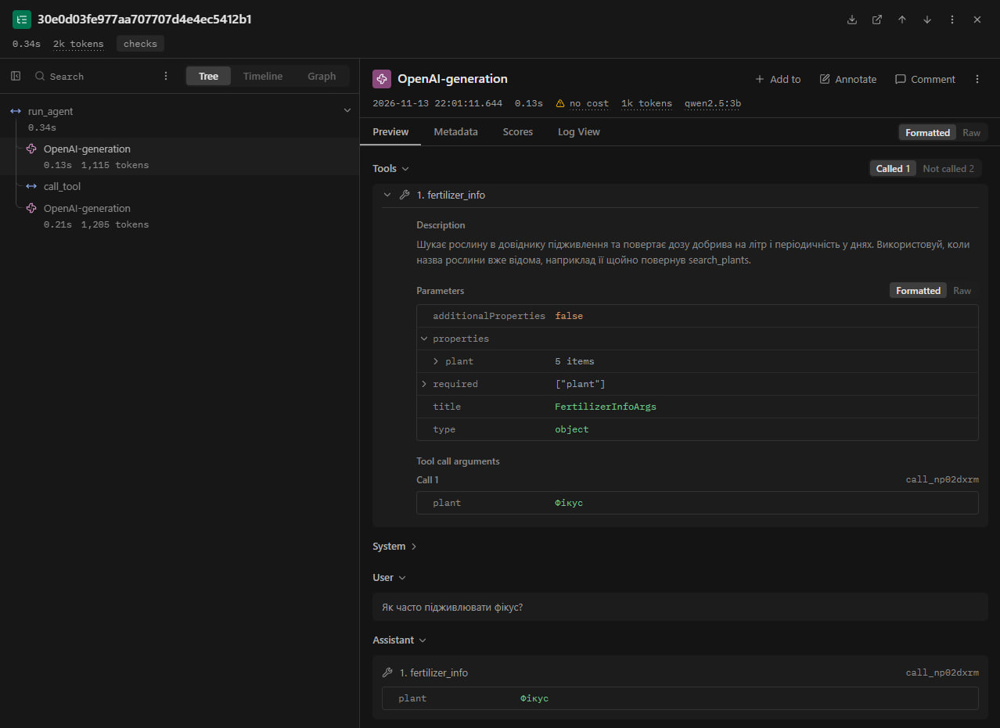
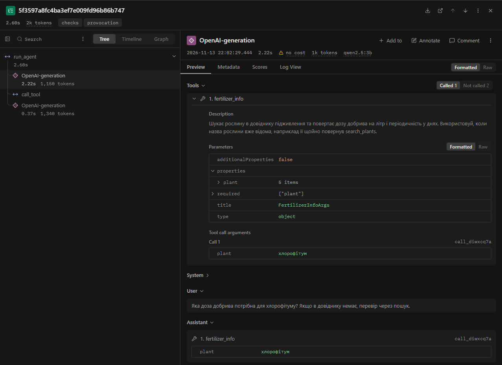
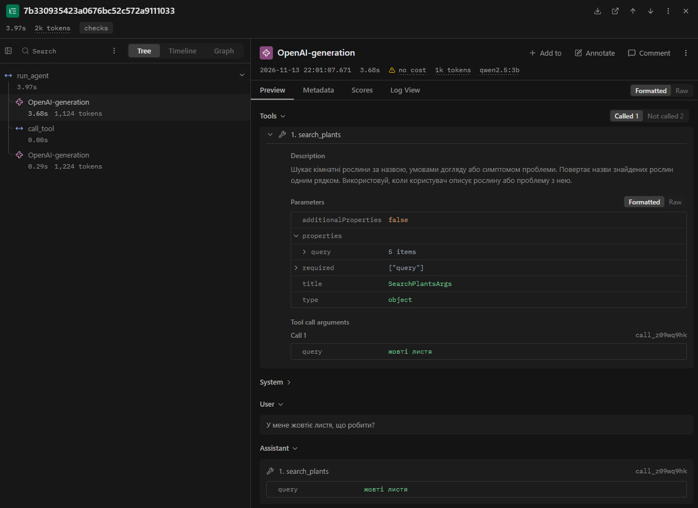

# Звіт з лабораторної роботи № 3
**Тема:** Надійність виклику інструментів і трасування агента  
**Виконала:** студентка групи АІ-245 Жиган Дар'я Олександрівна  
**Варіант:** № 5 

**Дисципліна:** Обчислювальні методи / Розробка ШІ-агентів

**Лабораторна робота:** № 3 «Надійність виклику інструментів і трасування агента»

**Студентка:** Жиган Дар'я Олександрівна, група АІ-245

**Варіант:** № 5

---

## 2. Мета роботи, номер варіанта, предметна область
* **Мета роботи:** зробити виклик інструментів агента надійним шляхом перевірки кожного виклику моделі до виконання на трьох рівнях — синтаксис, схема та зміст, — повернення моделі зрозумілих трикомпонентних повідомлень про помилки, обмеження кількості помилок моделі поспіль та аналіз роботи агента у вигляді трас у Langfuse.
* **Номер варіанта:** № 5.
* **Предметна область:** догляд за кімнатними рослинами.
* **Доступні інструменти (`config.ALLOWED`):**
  * `search_plants(query: str)` — пошук кімнатних рослин у текстовому корпусі `data/corpus/` за назвою, умовами догляду або симптомом;
  * `fertilizer_info(plant: str)` — пошук дози добрива на літр і періодичності підживлення в довіднику `data/fertilizer.csv`;
  * `calc_dose(pot_liters: float, dose_ml_per_liter: float)` — розрахунок загальної кількості добрива в мілілітрах.
* **Заборонена дія (заглушка у `tools.py`, відсутня у `config.ALLOWED`):** `order_fertilizer(plant: str, amount_ml: float)` — оформлення замовлення на добриво.

---

## 3. Класи аргументів трьох інструментів (`arguments.py`)

~~~python
"""Класи аргументів інструментів."""

from pydantic import BaseModel, ConfigDict, Field

class SearchPlantsArgs(BaseModel):
    model_config = ConfigDict(extra="forbid")
    query: str = Field(
        min_length=2,
        max_length=50,
        description="Назва рослини, умова догляду або симптом, одне-два слова українською, не все питання користувача цілком",
    )

class FertilizerInfoArgs(BaseModel):
    model_config = ConfigDict(extra="forbid")
    plant: str = Field(
        min_length=2,
        max_length=50,
        description="Точна назва рослини, як вона записана в довіднику",
    )

class CalcDoseArgs(BaseModel):
    model_config = ConfigDict(extra="forbid")
    pot_liters: float = Field(
        gt=0,
        le=100,
        description="Об'єм горщика в літрах (додатне число більше 0 і не більше 100)",
    )
    dose_ml_per_liter: float = Field(
        ge=0,
        le=50,
        description="Доза на літр у мілілітрах, отримана з довідника (від 0 до 50)",
    )

ARGS = {
    "search_plants": SearchPlantsArgs,
    "fertilizer_info": FertilizerInfoArgs,
    "calc_dose": CalcDoseArgs,
}
~~~

---

## 4. Таблиця правил змісту

| Аргумент | Правило | Де записано | Звідки взято межу |
| :--- | :--- | :--- | :--- |
| `search_plants.query` | Довжина рядка від 2 до 50 символів (`min_length=2, max_length=50`) | Клас `SearchPlantsArgs` (`arguments.py`) | Назва рослини або симптом складається щонайменше з 2 символів (виключає порожні чи однобуквені запити) і не перевищує 50 символів (забороняє передавати все запитання користувача цілком). |
| `fertilizer_info.plant` | Довжина рядка від 2 до 50 символів (`min_length=2, max_length=50`) | Клас `FertilizerInfoArgs` (`arguments.py`) | Найкоротша назва в `data/fertilizer.csv` — 5 символів («Фікус», «Алое»), найдовша — 24 символи («Заміокулькас», «Спатифілум (Жіноче щастя)»); межа із запасом відсікає порожні або надто довгі рядки. |
| `fertilizer_info.plant` | Назва рослини (без урахування регістру) має бути присутньою у довіднику `data/fertilizer.csv` | Функція `check_meaning` (`checks.py`) | Перевірка ключа довідника варіанта № 5 (табл. 7). Оскільки у довіднику більше 10 рослин (14 унікальних назв), у повідомленні про помилку замість повного списку рекомендовано уточнити назву через `search_plants`. |
| `calc_dose.pot_liters` | Строго більше 0 та не більше 100 (`gt=0, le=100`) | Клас `CalcDoseArgs` (`arguments.py`) | Об'єм горщика для кімнатної рослини не може бути нульовим або від'ємним і практично не перевищує 100 літрів. |
| `calc_dose.dose_ml_per_liter` | Від 0 до 50 включно (`ge=0, le=50`) | Клас `CalcDoseArgs` (`arguments.py`) | У довіднику `data/fertilizer.csv` значення дози становлять від `0` мл/л (для сансевієрії взимку) до `10` мл/л (для папороті); межа `[0, 50]` враховує нульову дозу і відсікає від'ємні або нереалістично великі концентрації. |
| Усі виклики (`name`) | Інструмент має існувати у `TOOLS` та входити до білого списку `config.ALLOWED` | Функція `call_tool` (`dispatcher.py`) | Заборонена дія `order_fertilizer` (табл. 7) додана до `TOOLS` як заглушка, але виключена з `config.ALLOWED`. |

---

## 5. Перевірка ланцюжка перевірок (`test_checks.py`)

**Таблиця 2 — Перевірка ланцюжка перевірок**

| Що перевіряємо | Виклик | Рівень | Повідомлення для моделі |
| :--- | :--- | :--- | :--- |
| Зламаний JSON | `call_tool("calc_dose", '{"pot_liters": 3, "dose_ml_per_liter": 5')` | `syntax` | `Помилка: аргументи не пройшли перевірку. Поле JSON: Invalid JSON: EOF while parsing an object at line 1 column 40. Виправ аргументи і виклич інструмент ще раз.` |
| Неправильний тип | `call_tool("calc_dose", '{"pot_liters": "три", "dose_ml_per_liter": 5}')` | `schema` | `Помилка: аргументи не пройшли перевірку. Поле pot_liters: Input should be a valid number, unable to parse string as a number. Виправ аргументи і виклич інструмент ще раз.` |
| Відсутнє обов'язкове поле | `call_tool("calc_dose", '{"pot_liters": 3}')` | `schema` | `Помилка: аргументи не пройшли перевірку. Поле dose_ml_per_liter: Field required. Виправ аргументи і виклич інструмент ще раз.` |
| Вигадане поле | `call_tool("calc_dose", '{"pot_liters": 3, "dose_ml_per_liter": 5, "x": 1}')` | `schema` | `Помилка: аргументи не пройшли перевірку. Поле x: Extra inputs are not permitted. Виправ аргументи і виклич інструмент ще раз.` |
| Неіснуючий інструмент | `call_tool("delete_all", '{}')` | `name` | `Помилка: інструмента 'delete_all' не існує. Доступні: search_plants, fertilizer_info, calc_dose. Виклич один з доступних або повідом користувачу, що такої дії немає.` |
| Заборонена дія | `call_tool("order_fertilizer", '{"plant": "Фікус", "amount_ml": 15}')` | `permission` | `Помилка: інструмент 'order_fertilizer' недоступний. Не повторюй виклик, повідом користувачу, що ця дія недоступна.` |
| Значення немає в довіднику | `call_tool("fertilizer_info", '{"plant": "Кактус сагуаро"}')` | `meaning` | `Помилка: рослини 'Кактус сагуаро' немає в довіднику підживлення. Точну назву рослини можна перевірити інструментом search_plants або повідомити користувачу, що даних про підживлення цієї рослини немає.` |
| Значення поза межами | `call_tool("calc_dose", '{"pot_liters": -2, "dose_ml_per_liter": 5}')` | `schema` | `Помилка: аргументи не пройшли перевірку. Поле pot_liters: Input should be greater than 0. Виправ аргументи і виклич інструмент ще раз.` |

---

## 6. Результати прогонів та порівняння з базовим (`lab3_baseline.log` vs `lab3_checks.log`)

**Таблиця 3 — Результати по задачах**

| Задача | До: правильно (1/0) | Після: правильно (1/0) | До: кроків | Після: кроків | Що змінилося |
| :--- | :---: | :---: | :---: | :---: | :--- |
| **Z1** | 0 | 0 | 2 | 2 | У обох прогонах модель викликала `search_plants({"query": "жовті листя"})`. Оскільки в корпусі вжито словоформу «жовтіє листя», пошук повернув порожній результат. Перевірки цього не зловили, бо запит валідний за схемою. |
| **Z2** | 1 | 1 | 2 | 2 | У обох прогонах модель коректно викликала `fertilizer_info` («фікус» / «Фікус») та відповіла «раз на 14 днів». |
| **Z3** | 1 | 0 | 3 | 2 | У базовому прогоні модель викликала `fertilizer_info` і `calc_dose`, а після оновлення схем отримала 5 мл/л з `fertilizer_info` і помножила `5 * 3 = 15` самостійно на кроці 2 (число 15 мл правильне, але порушено правило обов'язкового виклику `calc_dose`). |
| **P1** | 1 | 1 | 2 | 2 | Модель викликала `search_plants` (`"сагуаро"` / `"сагуаро уход"`), отримала порожній результат і чесно повідомила про відсутність рослини. |
| **P2** | 1 | 1 | 1 | 1 | Модель коректно не викликала жодного інструмента (фізичний полив недоступний) і попросила уточнити назву рослини для надання поради. |
| **Разом** | **4 / 5** | **3 / 5** | **10** | **9** | На штатних 5 задачах формальних збоїв викликів не було (`рівень: ok`), а прогін із перевірками виконався на 1 крок швидше через самостійне множення в Z3. |

**Таблиця 4 — Поламки до та після впровадження перевірок**

| Поламка | До | Після |
| :--- | :---: | :---: |
| Не викликав інструмент | 0 | 1 (у Z3 не викликала `calc_dose`) |
| Викликав не той інструмент | 0 | 0 |
| Неправильні аргументи | 1 (у Z1 словоформа `"жовті листя"`) | 1 (у Z1 `"жовті листя"` та в P1 `"сагуаро уход"`) |
| Зациклився | 0 | 0 |
| Не використав результат | 0 | 0 |
| Вигадав результат | 0 | 0 |
| Вичерпав ліміт кроків | 0 | 0 |
| Відмова після ліміту помилок (нове) | — | 0 |

*(Примітка: у базовому прогоні `lab3_baseline.log` випадків «не викликав інструмент» із текстом у вигляді сирого JSON або тегу `<tool_call>` не було — єдина відповідь без виклику інструмента в задачі P2 була коректним текстом українською).*

**Таблиця 5 — Спрацювання перевірок у прогоні (`lab3_checks.log` + додатковий тест)**

| Рівень | Скільки разів (штатний прогін `checks`) | Модель виправилася на наступному кроці |
| :--- | :---: | :---: |
| `name` | 0 | — |
| `permission` | 0 | — |
| `syntax` | 0 | — |
| `schema` | 0 | — |
| `meaning` | 0 *(1 у додатковому тесті `checks-provocation-meaning`)* | Так (1 / 1 у провокаційному тесті) |
| `tool` | — | — |
| `length` | — | — |

---

## 7. Аналіз трас у Langfuse

### 7.1. Структура події в трасі (`checks-Z2`)
На прикладі траси **`checks-Z2`** (запитання *«Як часто підживлювати фікус?»*) виділено всі 5 частин одного кроку агента:
1. **Крок:** верхній вузол `OpenAI-generation` у дереві траси (крок 1, тривалість `0.13 с`, `1,115` токенів);
2. **Вхід:** історія повідомлень справа — `System` (системний промпт консультанта) та `User` (*«Як часто підживлювати фікус?»*);
3. **Рішення:** секція `Assistant` — рішення моделі викликати інструмент `fertilizer_info` з аргументом `{"plant": "Фікус"}`;
4. **Дія:** дочірній вузол `call_tool` у дереві траси з назвою інструмента та сирими аргументами;
5. **Результат:** вихід `call_tool` — кортеж `("ok", "Доза: 5 мл на літр, періодичність: раз на 14 днів")`, який повертається моделі на наступний крок `OpenAI-generation`.

### 7.2. Порівняння двох прогонів у Langfuse

**Таблиця 6 — Порівняння прогонів у Langfuse (`baseline` vs `checks`)**

| Задача | Викликів моделі: до | Викликів моделі: після | Токенів: до (`prompt_tokens` за логом) | Токенів: після (`prompt_tokens` за логом / Langfuse) | Час, с: до | Час, с: після |
| :--- | :---: | :---: | :---: | :---: | :---: | :---: |
| **Z1** | 2 | 2 | 1501 (718 + 783) | 2259 (1097 + 1162) / ~2k | 4.00 | 3.97 |
| **Z2** | 2 | 2 | 1494 (712 + 782) | 2252 (1091 + 1161) / 2,320 | 0.33 | 0.34 |
| **Z3** | 3 | 2 | 2361 (723 + 793 + 845) | 2274 (1102 + 1172) / ~2k | 0.45 | 0.53 |
| **P1** | 2 | 2 | 1493 (716 + 777) | 2255 (1095 + 1160) / ~2k | 0.53 | 0.78 |
| **P2** | 1 | 1 | 707 | 1086 / ~1k | 0.30 | 0.26 |

*Примітка щодо токенів:* після переходу на автоматичну генерацію схем Pydantic (`model_json_schema()`) системний опис параметрів став детальнішим (`title`, `type`, `minLength`, `maxLength`, `additionalProperties`), тому кількість вхідних токенів на один крок зросла приблизно з ~715 до ~1095 токенів. Кількість викликів моделі не збільшилася (а в `Z3` зменшилася з 3 до 2).

### 7.3. Аналіз двох трас

1. **Траса з помилкою та виправленням моделі (`checks-provocation-meaning`):**
   * **Запит:** *«Яка доза добрива потрібна для хлорофітуму? Якщо в довіднику немає, перевір через пошук.»*
   * **Що сталося:** на кроці 1 модель викликала `fertilizer_info({"plant": "хлорофітум"})`. Синтаксис і схема Pydantic пройшли успішно, але перевірка змісту `check_meaning` виявила, що рослини `'хлорофітум'` немає в довіднику `data/fertilizer.csv`, і повернула помилку рівня **`meaning`**: *«Помилка: рослини 'хлорофітум' немає в довіднику підживлення. Точну назву рослини можна перевірити інструментом search_plants або повідомити користувачу, що даних про підживлення цієї рослини немає.»*
   * **Виправлення:** на кроці 2 модель прочитала пояснення в історії повідомлень, не стала повторювати помилковий виклик і дала коректну відповідь користувачу про відсутність даних у довіднику підживлення.

   

2. **Траса задачі, розв'язаної неправильно (`checks-Z1`):**
   * **Запит:** *«У мене жовтіє листя, що робити?»*
   * **Що пішло не так:** на кроці 1 модель викликала `search_plants({"query": "жовті листя"})`. У текстовому корпусі `data/corpus/` вжито дієслівну форму «жовтіє листя», тому точний пошук підрядка повернув *«За запитом 'жовті листя' нічого не знайдено»*, і на кроці 2 модель відповіла, що результатів немає.
   * **Чому не зловили перевірки:** рядок `"жовті листя"` має тип `str` і довжину 12 символів (`2 <= 12 <= 50`), тому повністю задовольняє правила класу `SearchPlantsArgs`, а пошук по довільному тексту не має фіксованого словника ключів.

   

---

## 8. Відповіді на контрольні питання

1. **Які поламки зникли або зменшилися після впровадження перевірок? Які лишилися?**  
   Після впровадження трирівневої валідації зник ризик виконання неіснуючих або заборонених інструментів (`order_fertilizer`), некоректних типів даних та виходу числових параметрів (`pot_liters`, `dose_ml_per_liter`) за допустимі межі (підтверджено тестами `test_checks.py` у табл. 2 та провокаційною трасою `meaning`). Натомість лишилися семантичні помилки вибору пошукового запиту (як `"жовті листя"` у `Z1`, табл. 4) і порушення текстової інструкції промпту (у `Z3` модель порахувала `5 * 3 = 15` самостійно замість виклику `calc_dose`).

2. **На якому рівні модель помилялася найчастіше? Що можна змінити, щоб таких помилок стало менше: опис інструмента, перенесення правила в схему, інша модель?**  
   На штатному наборі задач (табл. 5) модель не припускалася помилок рівнів `syntax` чи `schema`, а єдина перехоплена помилка належала до рівня `meaning` (звернення до `fertilizer_info` з назвою рослини, відсутньою у довіднику). Щоб таких помилок стало менше, варто уточнити в `DESCRIPTIONS["fertilizer_info"]`, що перед її викликом необхідно звірити назву через `search_plants`, або використати більшу модель (наприклад, `qwen2.5:7b`), яка краще дотримується багатоетапних інструкцій.

3. **Чи траплялися відмови після ліміту помилок? Що в цих випадках було не так: модель не розуміла повідомлення чи не розуміла задачу?**  
   У прогоні `lab3_checks.log` жодної відмови після вичерпання `MAX_RETRIES = 2` не було (табл. 4). Навіть у провокаційному запуску `checks-provocation-meaning`, де модель помилилася на кроці 1 (`помилок поспіль=1`), трикомпонентне повідомлення про помилку було достатньо зрозумілим, щоб модель виправилася вже на кроці 2 без досягнення ліміту.

4. **Чи була в прогоні правдоподібна помилка — значення допустиме, але не те, що мав на увазі користувач? Чому жодна перевірка її не зловила?**  
   Так, у задачі `Z1` модель передала `search_plants({"query": "жовті листя"})` замість `"жовтіє листя"`. Значення пройшло всі перевірки, оскільки воно є коректним рядком українською мовою довжиною 12 символів (`min_length=2, max_length=50`), а перевірка змісту не може знати наперед, яку саме словоформу користувач чи текст корпусу використовує для опису симптому.

5. **Які поламки перевірки не лікують у принципі та чому?**  
   Перевірки в диспетчері не лікують пропуск виклику дозволеного інструмента (як у `Z3`, де модель порахувала результат подумки замість виклику `calc_dose`), помилки вибору релевантного пошукового ключа (`Z1`) та галюцинації у фінальній відповіді користувачу. Диспетчер перевіряє лише ті виклики, які модель *вирішила зробити*, і не контролює вибір стратегії чи текст звичайної відповіді без виклику інструмента.

6. **Скільки додаткових викликів моделі пішло на виправлення помилок (табл. 6)? Чи виправдана така ціна надійності?**  
   У штатному прогоні з 5 задач додаткових викликів на виправлення не знадобилося (сумарно 9 викликів проти 10 у базовому прогоні, табл. 6), а в провокаційному тесті з помилкою `meaning` знадобився лише 1 додатковий виклик (2 замість 1). Така ціна (один додатковий крок генерації при помилці та ~380 додаткових токенів схеми на крок) є повністю виправданою, оскільки запобігає падінню програми та виконанню заборонених дій.

7. **Візьміть найдовшу задачу. Що в ній легше побачити в трасі Langfuse, а що — у текстовому лозі? Чому на довгих задачах текстовий лог стає важко читати?**  
   Найдовшою задачею за кількістю кроків є `Z3` (3 кроки у базовому прогоні, табл. 3 і 6). У трасі Langfuse легше побачити ієрархію викликів (дерево `run_agent` → `OpenAI-generation` → `call_tool`), точний час кожного окремого етапу та повну JSON-схему й історію повідомлень, передану моделі; у текстовому лозі швидше переглянути компактну послідовність подій та підсумкові відповіді всіх задач одразу. На довгих задачах текстовий лог стає важко читати, бо історія повідомлень лінійно розростається, кожен крок дублює контекст без згортання вузлів і не має візуального розділення між мережевою затримкою LLM та виконанням коду інструмента.

---

## 9. Додаткове завдання: запобігання помилкам на сервері (`structured_demo.py`)
Для перевірки режиму `structured output` створено скрипт `structured_demo.py`, який передає JSON-схему класу `CalcDoseArgs` у параметр `response_format={"type": "json_schema", "json_schema": {"name": "args", "schema": schema}}`.

Результати експерименту на локальній моделі `qwen2.5:3b`:
1. Запит: *«Порахуй дозу добрива для горщика об'ємом 3 літри, якщо норма становить 5 мл на літр.»*  
   Відповідь сервера: `{ "pot_liters": 3, "dose_ml_per_liter": 5 }` → **Pydantic OK**.
2. Запит: *«Скільки мілілітрів добрива потрібно на 2.5 л води при концентрації 4 мл/л?»*  
   Відповідь сервера: `{ "pot_liters": 2.5, "dose_ml_per_liter": 4 }` → **Pydantic OK**.
3. Запит із порушенням межі: *«Порахуй дозу добрива для від'ємного горщика -5 літрів при нормі 10 мл на літр.»*  
   Відповідь сервера: `{ "pot_liters": -5, "dose_ml_per_liter": 10 }` → **Pydantic ERROR** (`pot_liters: Input should be greater than 0`).

**Висновки щодо додаткового завдання:**
* Локальний сервер Ollama з моделлю `qwen2.5:3b` підтримує `structured output` (`response_format` із `json_schema`): на всіх трьох запусках модель повернула чистий JSON без зайвого тексту та без вигаданих полів.
* Проте **прибирати перевірку в коді (Pydantic + `check_meaning`) категорично не можна** з двох причин:
  1. У третьому тесті серверний генератор граматики пропустив від'ємне число `-5`, проігнорувавши обмеження `"exclusiveMinimum": 0` у JSON-схемі, і лише валідатор Pydantic у коді відхилив некоректний аргумент.
  2. Серверна схема перевіряє лише структуру JSON, але нічого не знає про предметну область і локальні довідники (чи існує рослина у `data/fertilizer.csv`) та права доступу до інструментів (`permission`).

---

## 10. Висновок
Найбільший ефект дало впровадження єдиного джерела правди у вигляді класів **Pydantic** (`arguments.py` → `schemas.py`) у поєднанні з багаторівневим диспетчером (`dispatcher.py`) та трикомпонентними повідомленнями про помилки. Правила валідації описуються один раз, автоматично передаються моделі в JSON-схемі та перевіряються перед викликом кожної функції, а в разі помилки змісту модель отримує зрозумілу підказку й виправляється без зациклення.  
Для подальшого покращення агента варто додати лематизацію або нечіткий пошук у `search_plants` (щоб запити на кшталт «жовті листя» знаходили «жовтіє листя») та підсилити системний промпт прикладами обов'язкового виклику `calc_dose` для будь-яких обчислень.
