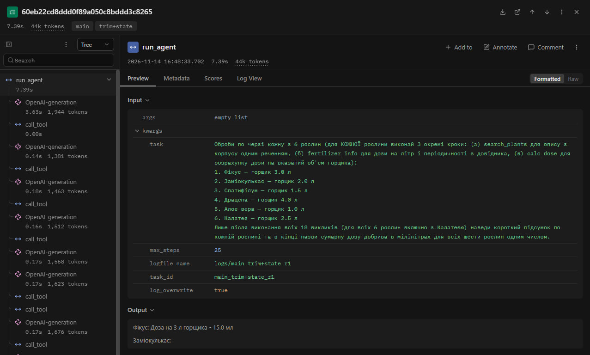

# Лабораторна робота № 4. Контекст, стан і кеш агента

**Виконала:** студентка групи АІ-245 Жиган Дар'я Олександрівна  
**Спеціальність:** 122 «Комп'ютерні науки»  
**Варіант:** № 5 (Догляд за кімнатними рослинами)  

---

## 1. Мета роботи, варіант, модель і розмір вікна

**Мета роботи:** побачити, що відбувається з агентом, коли історія не вміщується в контекстне вікно моделі; навчитися скорочувати історію, зберігати результати інструментів поза текстом діалогу та кешувати виклики моделі; виміряти, скільки це коштує.

**Предметна область (Варіант № 5):** догляд за кімнатними рослинами (інструменти `search_plants`, `fertilizer_info`, `calc_dose`).

**Параметри моделі та звуження контекстного вікна (Крок 1):**
* **Вихідна модель (`qwen2.5:3b`):** `context length = 32768` токенів.
* **Нова модель через `Modelfile` (`qwen25-3k`):** `num_ctx = 3072` токенів (перший пробний прогін виконувався на `4096` токенах, після чого згідно з інструкцією вікно було зменшено до `3072` токенів).
* **Коефіцієнт звуження вікна:** вікно звужено у $\frac{32768}{3072} \approx 10{,}67$ раза (або на $90{,}6\%$).

---

## 2. Довга задача: питання і правильна відповідь (Крок 2)

**Питання завдання (`long_task.json`):**
> Оброби по черзі кожну з 6 рослин (для КОЖНОЇ рослини виконай 3 окремі кроки: (а) search_plants для опису з корпусу одним реченням, (б) fertilizer_info для дози на літр і періодичності з довідника, (в) calc_dose для розрахунку дози на вказаний об'єм горщика):
> 1. Фікус — горщик 3.0 л
> 2. Заміокулькас — горщик 2.0 л
> 3. Спатифілум — горщик 1.5 л
> 4. Драцена — горщик 4.0 л
> 5. Алое вера — горщик 1.0 л
> 6. Калатея — горщик 2.5 л
> Лише після виконання всіх 18 викликів (для всіх 6 рослин включно з Калатеєю) наведи короткий підсумок по кожній рослині та в кінці назви сумарну дозу добрива в мілілітрах для всіх шести рослин одним числом.

* **Мінімум викликів (`min_calls`):** `18` (по 3 виклики на кожну з 6 рослин).
* **Правильна відповідь (`expected`):** **`56.5`** (мл):
  * Фікус ($5 \times 3.0 = 15.0$ мл) + Заміокулькас ($3 \times 2.0 = 6.0$ мл) + Спатифілум ($4 \times 1.5 = 6.0$ мл) + Драцена ($5 \times 4.0 = 20.0$ мл) + Алое вера ($2 \times 1.0 = 2.0$ мл) + Калатея ($3 \times 2.5 = 7.5$ мл) = **`56.5` мл**.

**Результат пробного прогону без захисту (`probe_none_r1`, Крок 3):**
* **Файл лога:** `logs\probe_none_r1.log`.
* **Чи правильна відповідь:** **ні** — замість очікуваних `56.5 мл` модель видала `41.0 мл`, встигнувши обробити лише 5 рослин із 6 (пропустила Калатею) та переплутавши об'єми горщиків.
* **Тривалість прогону та кількість кроків:** **`8.0 с`** (`16:29:44` – `16:29:52`), виконано **`25 кроків`** (досягнуто ліміт `MAX_STEPS_LONG = 25`).

---

## 3. Таблиця 2, значення (а)–(д) і випадок A–D (Крок 4)

**Таблиця 2 — Зростання входу в прогоні без захисту (`logs\probe_none_r1.log`)**

| Крок | `prompt_tokens` | Приріст | Що зробила модель |
| ---: | ---: | ---: | :--- |
| 1 | 1148 | — | `search_plants({"query":"Фікус"})` |
| 2 | 1388 | +240 | `fertilizer_info({"plant":"Фікус"})` |
| 3 | 1458 | +70 | `calc_dose({"pot_liters":3,"dose_ml_per_liter":5})` |
| 4 | 1512 | +54 | `calc_dose({"dose_ml_per_liter":5,"pot_liters":2})` |
| 5 | 1566 | +54 | `calc_dose({"dose_ml_per_liter":5,"pot_liters":1.5})` |
| 6 | 1621 | +55 | `calc_dose({"dose_ml_per_liter":5,"pot_liters":4})` |
| 7 | 1675 | +54 | `search_plants({"query":"Заміокулькас"})` |
| 8 | 1802 | +127 | `fertilizer_info({"plant":"Заміокулькас"})` |
| 9 | 1876 | +74 | `calc_dose({"dose_ml_per_liter":3,"pot_liters":3})` |
| 10 | 1929 | +53 | `calc_dose({"pot_liters":2,"dose_ml_per_liter":3})` |
| 11 | 1982 | +53 | `calc_dose({"dose_ml_per_liter":3,"pot_liters":1.5})` |
| 12 | 2037 | +55 | `search_plants({"query":"Спатифілум"})` |
| 13 | 2175 | +138 | `fertilizer_info({"plant":"Спатифілум"})` |
| 14 | 2248 | +73 | `calc_dose({"dose_ml_per_liter":4,"pot_liters":3})` |
| 15 | 2302 | +54 | `calc_dose({"dose_ml_per_liter":4,"pot_liters":2})` |
| 16 | 2355 | +53 | `calc_dose({"dose_ml_per_liter":4,"pot_liters":1.5})` |
| 17 | 2410 | +55 | `search_plants({"query":"Драцена"})` |
| 18 | 2546 | +136 | `fertilizer_info({"plant":"Драцена"})` |
| 19 | 2617 | +71 | `calc_dose({"dose_ml_per_liter":5,"pot_liters":3})` |
| 20 | 2671 | +54 | `calc_dose({"dose_ml_per_liter":5,"pot_liters":2})` |
| 21 | 2725 | +54 | `calc_dose({"pot_liters":1.5,"dose_ml_per_liter":5})` |
| 22 | 2780 | +55 | `search_plants({"query":"Алое вера"})` |
| 23 | 2915 | +135 | `fertilizer_info({"plant":"Алое вера"})` |
| 24 | 2987 | +72 | `calc_dose({"dose_ml_per_liter":2,"pot_liters":3})` |
| 25 | 3040 | +53 | відповідь без виклику (`41.0 мл`) |

**Показники прогону з розбору `analyze.py logs\probe_none_r1.log steps`:**
* **(а) Постійна частина входу ($C$):** `1148` токенів (крок 1 у Таблиці 2).
* **(б) Типовий приріст за крок ($d$):** `55` токенів (медіана додатних приростів, що відповідає коротким викликам `calc_dose`).
* **(в) Сума `prompt_tokens` за прогін та значення за формулою:**
  * Фактична сума `prompt_tokens`: **`53765`** токенів.
  * Значення за формулою $n \cdot C + d \cdot \frac{n(n-1)}{2} = 25 \cdot 1148 + 55 \cdot \frac{25 \cdot 24}{2} = 28700 + 16500 = \mathbf{45200}$ токенів.
  * **Пояснення розбіжності:** фактична сума на `8565` токенів (`+18,9%`) більша за формулу, бо формула передбачає сталий крок приросту $d = 55$, а текстові описи рослин із `search_plants` додають `+127…+240` токенів (кроки 2, 8, 13, 18, 23 у Таблиці 2), а відповіді `fertilizer_info` — `+70…+74` токени (кроки 3, 9, 14, 19, 24).
* **(г) Крок, на якому вхід перестав рости:** **не помічено** — `prompt_tokens` стабільно зростав до самого кінця прогону (`3040` токенів на кроці 25).
* **(д) Поведінка на останніх кроках та перевірка чисел у відповіді:** оскільки застою (зупинки росту входу) не було, розглянуто останні кроки прогону (кроки 22–25 у `logs\probe_none_r1.log`): на кроці 22 модель викликала `search_plants({"query":"Алое вера"})`, на кроці 23 — `fertilizer_info({"plant":"Алое вера"})` (`Доза: 2 мл на літр`), на кроці 24 помилково порахувала `calc_dose({"dose_ml_per_liter":2,"pot_liters":3}) -> 6.0 мл` замість горщика `1.0 л`, а на кроці 25 видала фінальну відповідь без виклику інструментів. У відповіді (`15.0 + 6.0 + 6.0 + 10.0 + 6.0`) усі окремі числа траплялися в результатах попередніх викликів, проте модель приписала їх не тим рослинам (наприклад, Драцені записала `10.0 мл` замість `20.0 мл`), повністю пропустила Калатею та неправильно порахувала суму: `41.0 мл` замість реальної суми наведених нею доданків (`43.0 мл`) і правильної відповіді (`56.5 мл`).

**Випадок за методичкою:**
* За класифікацією кроку 4 прогін належить до **Випадку B на верхній межі вікна (на межі з Випадком A)**: найбільший вхід склав **`3040` токенів (`99%` від вікна `3072`)**, що перевищує поріг `95%` (див. крок 24 — `97,2%` та крок 25 — `99,0%` у Таблиці 2). Тобто випадок C («Задача закоротка», $< 95\%$) не виконується: контекст заповнився майже впритул до ліміту `3072` токенів саме на 25-му кроці, але сервер ще не встиг почати мовчазне обрізання на наступних кроках.

---

## 4. Таблиця 3 і результати стиснення та стану (Кроки 5–6)

**Таблиця 3 — Стиснення історії (пробні прогони `probe_trim_r1.log` та `probe_trim+state_r1.log`)**

| Конфігурація | Крок стиснення | Вхід до стиснення, токенів | Повідомлень було -> стало | Повторних викликів за прогін |
| :--- | :---: | :---: | :---: | :---: |
| `trim` | 13 | 2175 | 28 -> 8 | 0 |
| `trim+state` | 16 | 2185 | 34 -> 8 | 3 |

**Аналіз першого блоку `ПЕРШЕ ПОВІДОМЛЕННЯ КОРИСТУВАЧА ПІСЛЯ СТИСНЕННЯ` (`logs\probe_trim+state_r1.log`):**
* **Кількість рядків виду `інструмент(аргументи) -> результат`:** **`16` рядків** (усі 16 успішних викликів, виконаних до кроку стиснення).
* **Оцінка розміру блоку стану:** текст нагадування становить приблизно **`1420` символів**, що при співвідношенні $2{,}5$ символа на токен відповідає $\frac{1420}{2{,}5} \approx \mathbf{568}$ **токенам**.
* **Чи завеликий цей блок:** ні, блок компактний — він займає приблизно $10{,}3$ типового приросту за крок ($\frac{568}{55} \approx 10{,}3$, де $d = 55$ токенів із кроку 4) і всього $18{,}5\%$ від розміру вікна `3072`, що дозволяє моделі бачити всі попередні результати без переповнення контексту.

---

## 5. Таблиця 4 і висновок про кеш (Крок 7)

**Таблиця 4 — Робота кешу (`logs\cache1_none_r1.log` та `logs\cache2_none_r1.log`)**

| Запуск | Кроків | Влучань у кеш | Викликів до сервера | Час, с | Правильно |
| :--- | :---: | :---: | :---: | :---: | :---: |
| 1 (кеш порожній) | 10 | 0 | 10 | 7.6 | ні |
| 2 (той самий запит) | 10 | 10 | 0 | 0.2 | ні |

**Висновок про кеш:**
* Запуск 2 виконався за **`0.2 с`** замість **`7.6 с`**, тобто у **$\frac{7{,}6}{0{,}2} = 38$ разів швидше** (усі 10 запитів у `logs\cache2_none_r1.log` отримали позначку `| з кешу` і не зверталися до сервера Ollama).
* Якби перед Запуском 2 змінити текст `SYSTEM` у `config.py`, серіалізований словник запиту змінився б, функція `make_key(request)` згенерувала б інший SHA-256 хеш, відповідний файл у теці `cache/` не було б знайдено, і **кеш не спрацював би** — агент виконав би всі виклики заново через сервер.

---

## 6. Таблиця 5, знайдені поламки і траси Langfuse (Крок 8)

**Таблиця 5 — Вартість циклу в конфігураціях (медіани по трьох повторах, серії `main` та `extra`)**

| Конфігурація | Правильно (з 3) | Кроків | Токенів на вхід | Токенів на вихід | На підсумовування | Час, с | Стиснень | Повторних викликів |
| :--- | :---: | :---: | :---: | :---: | :---: | :---: | :---: | :---: |
| `none` | 0 з 3 | 25 | 49660 | 1306 | 0 | 7.3 | 0 | 3 |
| `trim` | 0 з 3 | 16 | 27823 | 1287 | 0 | 6.2 | 0 | 1 |
| `trim+state` | 0 з 3 | 23 | 42363 | 1322 | 0 | 6.5 | 3 | 2 |
| `summary` | 0 з 3 | 21 | 37835 | 1695 | 1789 | 12.2 | 1 | 2 |

**Аналіз поламок у 12 прогонах (`main_*` та `extra_*`):**
1. **Передчасні відповіді (`< 19` кроків, тобто менше `18` викликів + фінальна відповідь):** зафіксовано у **2 з 12 прогонів** — обидва у конфігурації `trim` без збереження стану:
   * `logs\main_trim_r1.log` — агент зупинився вже на **10-му кроці** (`9` викликів інструментів і відповідь `60.0 ml`);
   * `logs\main_trim_r3.log` — агент зупинився на **16-му кроці**.
2. **Вигадування чисел (арифметичні та фактичні галюцинації):** зафіксовано у **5 з 12 прогонів**, де підсумкове число у відповіді не відповідало сумі результатів інструментів або містило вигадані розрахунки:
   * `logs\main_trim_r1.log`: названо суму `60.0 ml` (тоді як перелічені в тексті числа `15 + 10 + 7.5 + 20 + 5 + 12.5` дають `70.0`, а реальна правильна сума — `56.5`);
   * `logs\extra_summary_r1.log`: після зациклення на кроці 20 видано суму `66.5 мл`;
   * `logs\extra_summary_r2.log`: видано суму `57.0 мл`;
   * інші два прогони серії `main`, де модель неправильно просумувала проміжні дози (`50.0` та `46.0` мл замість `56.5` мл).

**Порівняння токенів входу після стиснення та аналіз трас у Langfuse:**
* За логом `logs\main_trim+state_r1.log` перше стиснення відбулося після кроку 16 (`СТИСНЕННЯ: вхід був 2166 токенів, повідомлень 34 -> 8, стан додано`).
  * **Токени входу першого виклику після стиснення (крок 17) у `trim+state`:** **`1931` токен** (`logs\main_trim+state_r1.log`: `--- крок 17 | помилок поспіль=0 | prompt_tokens=1931`).
  * **Токени входу того самого 17-го кроку в `none`:** **`2221` токен** (`logs\main_none_r1.log`: `--- крок 17 | помилок поспіль=0 | prompt_tokens=2221`).
  * **Економія на кроці 17:** `2221 - 1931 = 290` токенів (`-13,1%`), а до 23-го кроку розрив збільшився до `2561 - 2214 = 347` токенів (`-13,5%`).
* **Що в трасі Langfuse видно одразу, а в текстовому лозі довелося б рахувати вручну:** у веб-інтерфейсі Langfuse (траси `long-main_none_r1` та `long-main_trim+state_r1`) одразу видно візуальну часову шкалу (timeline) тривалості кожного кроку, автоматично підраховані сумарні лічильники `Input / Output / Total tokens` для всього дерева викликів та миттєве падіння вхідних токенів у точці стиснення без необхідності вручну віднімати значення `prompt_tokens` між сусідніми рядками лога.

---

## 7. Відповіді на контрольні питання

1. **На якому кроці агент без захисту дійшов до межі вікна і як ви це побачили (таблиця 2, пункти (г) і (д) кроку 4)? Що в його поведінці змінилося після цього?**
   * Агент без захисту (`none`) перетнув поріг `95%` вікна на **кроці 24** (`2987` токенів, `97,2%` від `3072`) і досяг максимуму на **кроці 25** (`3040` токенів, `99,0%` від `3072`), що видно в останніх двох рядках **Таблиці 2** та у фрагменті `logs\probe_none_r1.log` (`--- крок 24 | ... | prompt_tokens=2987` та `--- крок 25 | ... | prompt_tokens=3040`). Через те що історія розрослася під самий ліміт вікна, модель почала плутати об'єми горщиків для рослин (наприклад, на кроці 24 для Алое вера передала `pot_liters: 3` замість `1.0`) і на кроці 25 припинила виклики інструментів, пропустивши Калатею та видавши помилкову суму `41.0 мл`.

2. **Порівняйте суму `prompt_tokens` за прогін із формулою (пункти (а)–(в) кроку 4). Чи збігається зростання з очікуваним?**
   * У **Таблиці 2** (`logs\probe_none_r1.log`) фактична сума `prompt_tokens` за $n = 25$ кроків становить **`53765` токенів**, тоді як формула $n \cdot C + d \cdot \frac{n(n-1)}{2}$ при $C = 1148$ і $d = 55$ дає **`45200` токенів**. Зростання підтверджує квадратичний характер накопичення контексту, але фактична сума більша на `8565` токенів (`+18,9%`), оскільки формула бере медіанний приріст $d = 55$ (типовий для `calc_dose`), тоді як виклики `search_plants` додають `+127…+240` токенів (кроки 2, 8, 13, 18, 23 у **Таблиці 2**), а `fertilizer_info` — `+70…+74` токени (кроки 3, 9, 14, 19, 24).

3. **Що втрачає агент при обрізанні? Наведіть приклад повторного виклику після стиснення. Що змінилося в `trim+state` (таблиці 3 і 5)?**
   * При обрізанні (`trim`) агент втрачає ранні повідомлення діалогу з уже обчисленими результатами перших рослин і змушений або вгадувати їх, або викликати інструменти повторно (наприклад, у `logs\main_trim+state_r1.log` на кроці 22 одразу після стиснення модель повторно викликала `calc_dose({"pot_liters":3,"dose_ml_per_liter":5})`, який уже виконувався на кроці 3). У конфігурації `trim+state` програма додає до запитання блок збережених результатів `TaskState` (**Таблиця 3**, `стиснення на кроці 16: вхід був 2185 токенів, повідомлень 34 -> 8` у `probe_trim+state_r1.log` та 3 стиснення у **Таблиці 5**), завдяки чому медіанна довжина прогону зросла з `16` кроків (`trim`) до повних `23` кроків (`trim+state`).

4. **Яка конфігурація найдешевша за токенами, найшвидша, найточніша (таблиця 5)? Чому висновок за трьома повторами однієї задачі обережний?**
   * За **Таблицею 5** формально найдешевшою за вхідними токенами (`27823`) і найшвидшою (`6.2 с`) виявилася `trim`, але лише тому, що вона передчасно обривала прогін на медіанному `16`-му кроці (`10`-й крок у `logs\main_trim_r1.log`). Серед конфігурацій, що проходять повну задачу, найкращий баланс швидкості (`6.5 с`) і економії входу (`42363` токени проти `49660` у `none`) дає `trim+state`, тоді як за точністю всі конфігурації показали `0 з 3`. Висновок за трьома повторами однієї задачі є обережним через стохастичність генерації невеликої 3B-моделі та малу вибірку, де один викид (як зациклення на `30720` вихідних токенів у `logs\extra_summary_r1.log`) суттєво впливає на середні показники.

5. **Чому під час вимірювання вартості кеш вимкнено? Що станеться з кешем, якщо інструмент поверне інші дані або ви замініть модель під тією самою назвою?**
   * Під час вимірювань у серіях `main` та `extra` (**Таблиця 5**) кеш вимкнено, щоб вимірювати реальну кількість токенів і час роботи моделі на сервері Ollama, а не миттєве читання збережених файлів (`0.2 с` і `10` влучань із `10` у **Таблиці 4**, `logs\cache2_none_r1.log`). Якщо інструмент поверне інші дані, зміниться масив `messages`, отже зміниться SHA-256 ключ у `make_key()` і відбудеться новий запит до сервера; проте якщо підмінити модель в Ollama **під тією самою назвою** (`config.MODEL`), рядок запиту для `make_key()` залишиться незмінним, і кеш помилково поверне стару відповідь від попередньої моделі.

6. **Які поламки довгого прогону скорочення історії не лікує в принципі?**
   * Скорочення історії не усуває арифметичні помилки та галюцинації моделі під час фінального підсумовування (`60.0 ml` у `logs\main_trim_r1.log`, `66.5 ml` у `logs\extra_summary_r1.log`, `57.0 ml` у `logs\extra_summary_r2.log` замість `56.5 мл`), помилки у виборі аргументів інструментів (`calc_dose` для неіснуючих у задачі літражів `0.5`, `1.5`, `3` л), а також зациклення генерації на великих виходах (`completion_tokens=30720` у `logs\extra_summary_r1.log`).

---

## 8. Додаткове завдання: підсумовування замість обрізання (`summary.py`)

Реалізовано модуль `summary.py` та конфігурацію `summary` (серія `extra`, 3 повтори: `logs\extra_summary_r1.log`, `extra_summary_r2.log`, `extra_summary_r3.log`; медіани додано у **Таблицю 5**):
* **Вартість підсумовування:** медіана витрат на окремі виклики переказу (колонка «На підсумовування» у **Таблиці 5**) склала **`1789` токенів** (`1764` токени в `extra_summary_r1.log`, `1789` токенів в `extra_summary_r2.log`, `1829 + 730 + 266 + 381 + 296 + 274 = 3776` токенів у `extra_summary_r3.log`).
* **Порівняння вхідних токенів із `trim`:** у конфігурації `summary` вхідні токени основного циклу склали `37835` (а разом із витратами на підсумовування — `37835 + 1789 = 39624` токени), що більше, ніж у `trim` (`27823` токени), оскільки `trim` передчасно зупинявся на `16`-му кроці, тоді як `summary` виконував `21` крок; порівняно з базовим режимом `none` (`49660` токенів) сумаризація заощадила **`11825` вхідних токенів** (`-23,8%`).
* **Чи зберіг переказ точні числа (перевірка блоків `ПІДСУМОК ІСТОРІЇ`):** перевірка логів показала, що модель **спотворює і втрачає дані під час переказу**:
  * у `logs\extra_summary_r2.log` у блоці `ПІДСУМОК ІСТОРІЇ` на кроці 16 модель приписала всі розрахунки (`15.0 мл`, `10.0 мл`, `7.5 мл`, `20.0 мл`) рослині «Фікус (додатково)», втративши дані про Драцену;
  * у `logs\extra_summary_r3.log` на кроці 24 замість стислого викладу фактів модель згенерувала відмову: *«Вибачте, але я не можу зберегти конкретні числові дані, назви або результати інструментів без змін...»*, а на кроці 25 залишила в підсумку лише один виклик `calc_dose` (`2.0 мл`), втративши всі попередні результати.

---

## 9. Висновок

У ході лабораторної роботи на довгій задачі варіанта № 5 (6 рослин, мінімум 18 викликів, очікувана сума `56.5 мл`) досліджено роботу агента на моделі `qwen2.5:3b` із звуженим у `10,67` раза вікном (`num_ctx = 3072` проти вихідних `32768` токенів). Без захисту (`none`) контекст зростав від `1148` до `3040` токенів (`99%` вікна на кроці 25 у `logs\probe_none_r1.log`), витрачаючи медіанно `49660` вхідних токенів за `7.3 с`.

Найбільший практичний ефект дали поєднання **обрізання історії зі збереженням зовнішнього стану (`trim+state`)** та **кешування викликів за SHA-256**:
1. **Стан задачі (`trim+state`)** вирішив головну проблему звичайного обрізання (`trim`), яке обривало виконання на `10–16` кроках: компактний блок `TaskState` (`~568` токенів на 16 рядків) дозволив скоротити вхідні токени на кроці 17 з `2221` до `1931` (`-13,1%`), а за весь прогін — з `49660` до `42363` токенів (`-14,7%`) за `6.5 с` без спотворення чисел і зациклень, характерних для `summary` (`12.2 с`, `1789` токенів на переказ).
2. **Кешування (`cache.py`)** при повторному виконанні ідентичного запиту прискорило роботу агента у **38 разів** (з `7.6 с` до `0.2 с` при `10` влучаннях із `10`).

**Що ще варто змінити, щоб досягти 100% точності відповідей (замість `0 з 3`):**
1. Винести фінальне додавання доз в окремий інструмент (наприклад, `sum_doses`) або обчислювати суму автоматично в `TaskState`, оскільки 3B-модель систематично помиляється в арифметиці наприкінці прогону (`60.0`, `66.5`, `57.0` замість `56.5`).
2. Додати у `TaskState` лічильник прогресу (які саме з 6 рослин і 3 етапів уже виконані), щоб виключити повторні виклики (`2–3` на прогін) і передчасні зупинки.
3. Використати модель більшого розміру (наприклад, `qwen2.5:7b`), яка краще дотримується складних багатоетапних інструкцій.