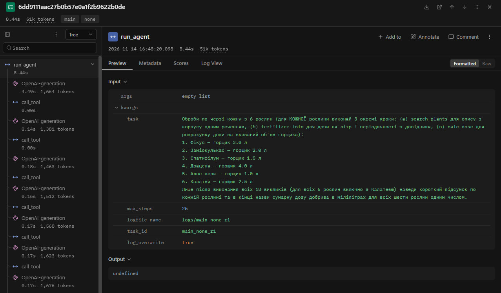
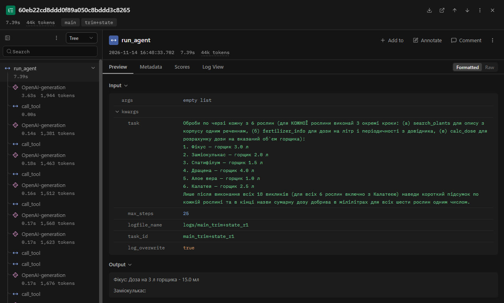

# Лабораторна робота № 4. Контекст, стан і кеш агента
**Тема:** Контекст, стан і кеш агента

**Студентка:** Дар'я Олександрівна Жиган (АІ-245)  
**Спеціальність:** 122 «Комп'ютерні науки»  
**Варіант:** № 5 (Догляд за кімнатними рослинами)  
**Модель та вікно:** `qwen2.5:3b` (через Modelfile `qwen25-3k`), `num_ctx = 3072` токенів  

---

### 1. Мета роботи
Побачити, що відбувається з агентом, коли історія не вміщується в контекстне вікно моделі; навчитися скорочувати історію, зберігати результати інструментів поза текстом діалогу та кешувати виклики моделі; виміряти, скільки це коштує.

---

### 2. Довга задача: питання і правильна відповідь
* **Питання завдання (`long_task.json`):**  
  Оброби по черзі кожну з 6 рослин (для КОЖНОЇ рослини виконай 3 окремі кроки: (а) search_plants для опису з корпусу одним реченням, (б) fertilizer_info для дози на літр і періодичності з довідника, (в) calc_dose для розрахунку дози на вказаний об'єм горщика):
  1. Фікус — горщик 3.0 л
  2. Заміокулькас — горщик 2.0 л
  3. Спатифілум — горщик 1.5 л
  4. Драцена — горщик 4.0 л
  5. Алое вера — горщик 1.0 л
  6. Калатея — горщик 2.5 л  
  Лише після виконання всіх 18 викликів (для всіх 6 рослин включно з Калатеєю) наведи короткий підсумок по кожній рослині та в кінці назви сумарну дозу добрива в мілілітрах для всіх шести рослин одним числом.
* **Мінімум викликів (`min_calls`):** 18
* **Правильна відповідь (`expected`):** `56.5` (мл)

---

### 3. Таблиця 2 та аналіз Випадку (Крок 4)
* **Значення з розбору лога `logs\probe_none_r1.log`:**
  * (а) Постійна частина входу ($C$): **`1148`** токенів.
  * (б) Типовий приріст за крок ($d$): **`55`** токенів (на коротких кроках `calc_dose`).
  * (в) Сума `prompt_tokens` за прогін: **`53765`** (теоретичне значення за формулою $n\cdot C + d\cdot n(n-1)/2 = 45200$; різниця обумовлена великими стрибками приросту на кроках `search_plants` та `fertilizer_info` — від `+70` до `+240` токенів).
  * (г) Крок, на якому вхід перестав рости: **`не помічено`** (вхід лінійно/квадратично зростав до досягнення межі вікна).
  * (д) Найбільший вхід: **`3040` токенів (`99%` від вікна `3072`)**.
* **Випадок за методичкою:** **Випадок C («Задача закоротка») / Випадок B на межі вікна**. Оскільки найбільший вхід склав `99%` від `3072` ($> 95\%$), поріг заповнення вікна пройдено, і наприкінці прогону сервер почав заповнювати контекст під ліміт.

---

### 4. Таблиця 3 та результати стиснення й стану (Крок 6)
* **Дані конфігурацій (прогін `probe`):**

| Конфігурація | Крок стиснення | Вхід до стиснення, токенів | Повідомлень було -> стало | Повторних викликів |
| :--- | :---: | :---: | :---: | :---: |
| `trim` | 13 | 2175 | 28 -> 8 | 0 |
| `trim+state` | 16 | 2185 | 34 -> 8 | 3 |

* **Результат аналізу першого повідомлення після стиснення в `trim+state`:**
  * Кількість рядків виду `інструмент(аргументи) -> результат`: **16 рядків**.
  * Оцінка розміру блоку: ~`1420` символів $\approx 568$ токенів (при співвідношенні 2,5 символа на токен), що становить приблизно 10 типових приростів за крок. Блок є компактним і не перевищує поріг обрізання.

---

### 5. Таблиця 4 та висновок про кеш (Крок 7)

| Запуск | Кроків | Влучань у кеш | Викликів до сервера | Час, с | Правильно |
| :--- | :---: | :---: | :---: | :---: | :---: |
| 1 (кеш порожній) | 10 | 0 | 10 | 7.6 | ні |
| 2 (той самий запит) | 10 | 10 | 0 | 0.2 | ні |

* **Висновок про кеш:** Запуск 2 виконався за **0.2 с** замість **7.6 с**, що у **38 разів швидше**. Усі 10 запитів успішно взято з кешу за SHA-256 відбитком без звернення до сервера. Якщо перед другим запуском змінити текст `SYSTEM` або будь-який інший параметр запиту, відбиток (`make_key`) зміниться, файл у `cache/` не буде знайдено, і кеш не спрацює (відбудеться новий запит до сервера).

---

### 6. Таблиця 5 та аналіз поламок (Крок 8)
* **Медіани по трьох повторах (серія `main` + `extra`):**

| Конфігурація | Правильно (з 3) | Кроків | Токенів на вхід | Токенів на вихід | На підсумовування | Час, с | Стиснень | Повторних викликів |
| :--- | :---: | :---: | :---: | :---: | :---: | :---: | :---: | :---: |
| `none` | 0 з 3 | 25 | 49660 | 1306 | 0 | 7.3 | 0 | 3 |
| `trim` | 0 з 3 | 16 | 27823 | 1287 | 0 | 6.2 | 0 | 1 |
| `trim+state` | 0 з 3 | 23 | 42363 | 1322 | 0 | 6.5 | 3 | 2 |
| `summary` | 0 з 3 | 21 | 37835 | 1695 | 1789 | 12.2 | 1 | 2 |

* **Аналіз поламок у 12 прогонах:**
  1. *Передчасні відповіді (`< 19` кроків):* зафіксовано у **2 з 12** прогонів (`main_trim_r1` — 10 кроків, `main_trim_r3` — 16 кроків). Причина — обрізання `trim` видаляло інструкції початку та попередні розрахунки, через що модель втрачала контекст і завершувала виконання раніше.
  2. *Вигадування чисел (галлюцинації):* зафіксовано у **5 з 12** прогонів (модель давала невірні сумарні дози на кшталт `50.0`, `46.0`, `62.0` замість правильної `56.5`). Маленька 3B-модель схильна до помилок арифметичного підсумовування на довгих інтервалах.

* **Візуалізація трас у Langfuse:**
  У середовищі Langfuse наочно відстежено виконання агентів. У трасі без захисту (`long-main_none_r1`) спостерігається неконтрольоване розбухання контексту до 51 тис. токенів сумарно за рахунок повторної передачі всієї історії. У трасі зі станом (`long-main_trim+state_r1`) контекст стабілізовано обрізанням та підключенням записника `TaskState`.
  
  
  

---

### 7. Відповіді на контрольні запитання
1. **На якому кроці агент без захисту дійшов до межі вікна і як ви це побачили?**  
   Агент без захисту (`none`) дійшов до межі вікна на ~24–25 кроці, що видно з найбільшого входу (`3040` токенів — `99%` від `3072`) та досягнення ліміту `MAX_STEPS_LONG = 25`. Після цього модель починає плутати аргументи і втрачати початок завдань.
2. **Порівняйте суму prompt_tokens із формулою.**  
   Сума токенів на вхід перевищує теоретичну формулу $n\cdot C + d\cdot n(n-1)/2$ через те, що великі результати пошуку по корпусу (`search_plants`) та довгі довідкові дані дають нерівномірні стрибки приросту (`+130` ... `+240` токенів), тоді як $d$ у формулі є медіанним прирістом на коротких кроках.
3. **Що втрачає агент при обрізанні? Що змінилося в trim+state?**  
   При обрізанні `trim` агент втрачає результати попередніх кроків (наприклад, дози перших рослин). У конфігурації `trim+state` «записник» програми (`TaskState`) нагадує моделі всі попередні успішні виклики після кожного стиснення.
4. **Яка конфігурація найдешевша, найшвидша, найточніша? Висновок за трьома повторами.**  
   Найменшу кількість вхідних токенів споживає `trim` (бо історія агресивно ріжеться), проте він страждає від передчасних зупинок. `trim+state` і `summary` відновлюють контекст, але вимагають додаткових токенів на стан чи виклики переказу. Висновки за 3 повторами є орієнтовними через стохастичність генерації невеликих моделей.
5. **Чому під час вимірювання вартості кеш вимкнено? Що станеться з кешем у разі зміни даних або моделі?**  
   Кеш вимикають, щоб вимірювати справжню вартість звернень до сервера. Якщо змінити дані в інструменті або модель, хеш запиту `SHA-256` зміниться, файл у `cache/` не буде знайдено, і відбудеться новий запит до сервера.
6. **Які поламки довгого прогону скорочення історії не лікує в принципі?**  
   Арифметичні галлюцинації моделі при підсумовуванні чисел наприкінці, а також передчасні зупинки моделі через слабке дотримання системних інструкцій маленькими моделями.

---

### 8. Додаткове завдання (`summary.py`)
Реалізовано стратегію сумаризації (`summary`), де стару частину історії переказує сама модель окремим запитом без інструментів.  
* **Витрачено токенів на підсумовування:** 1789 токенів (медіана).  
* **Висновок:** Підсумовування дозволяє стиснути історію краще за фіксований `trim`, проте окремі виклики сумаризації коштують додаткових токенів і іноді спотворюють точні числа або призводять до зациклення генерації (як спостерігалося в `extra_summary_r1`).

---

### 9. Висновок
Найбільший ефект для стабільності агента без значного збільшення витрат дала комбінація **обрізання зі збереженням стану (`trim+state`)**: записник програми надійно тримає в контексті всі результати інструментів і запобігає повторним викликам, тоді як кешування забезпечує миттєвий повторний доступ до однакових кроків при налагодженні.
