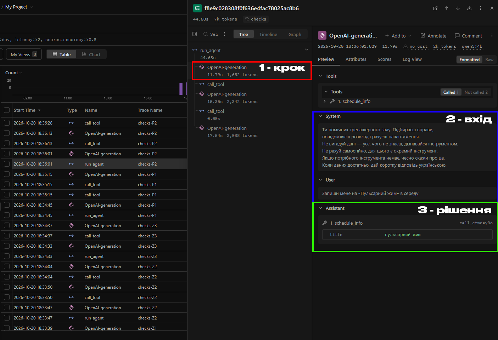
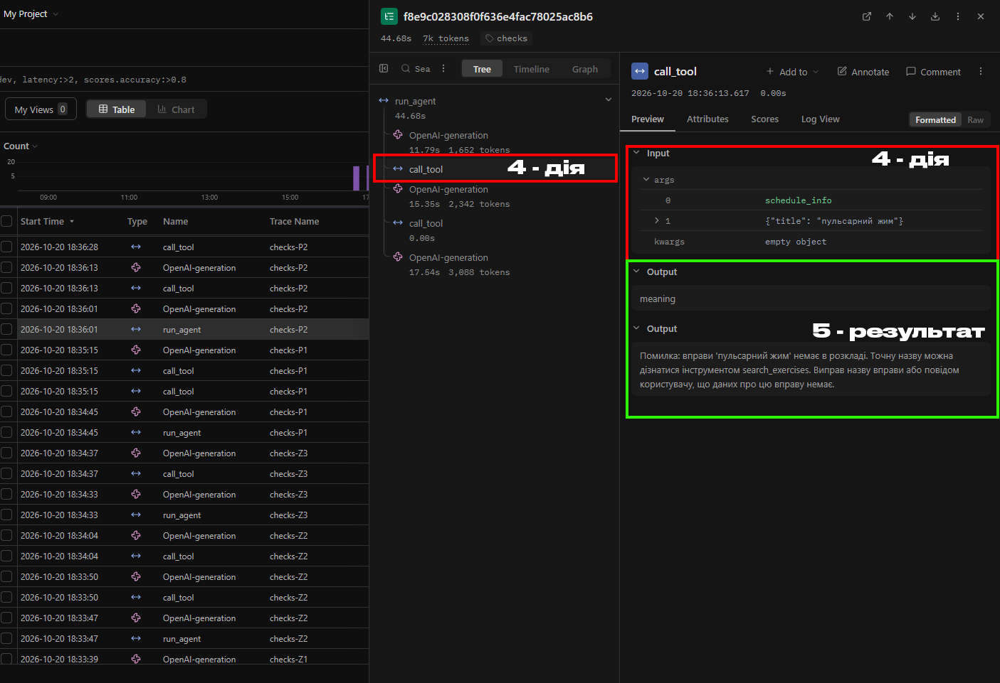
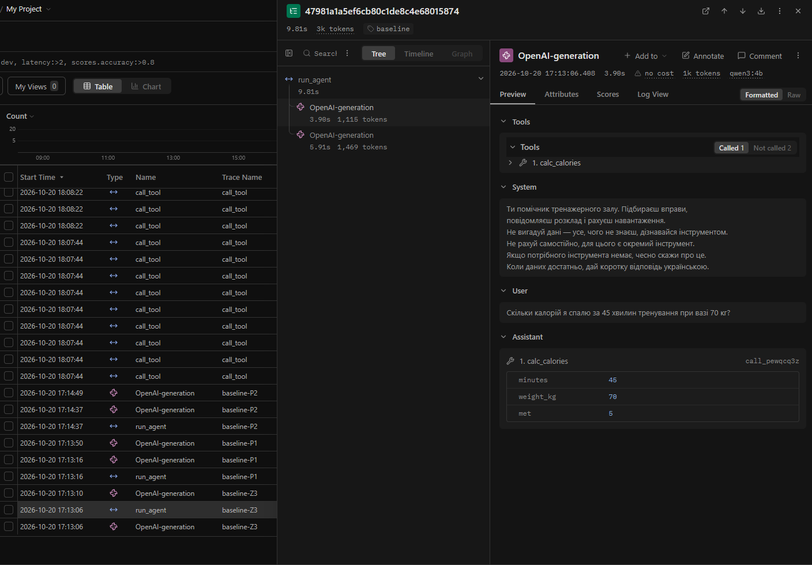
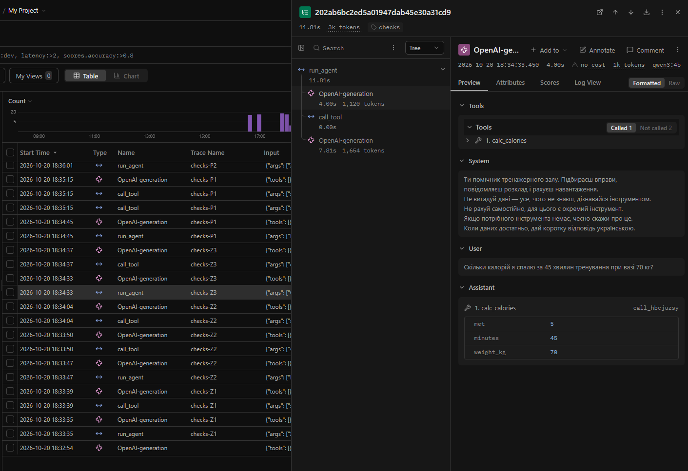
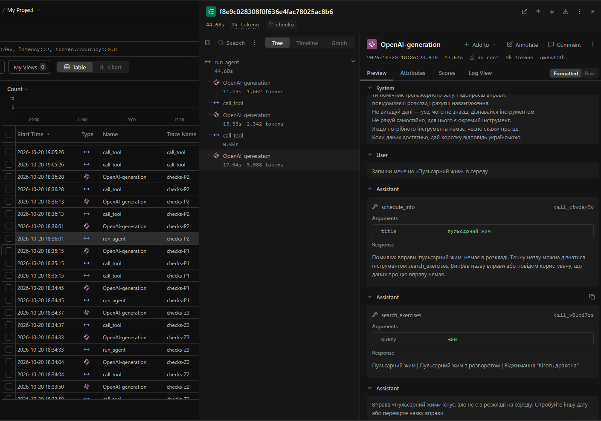
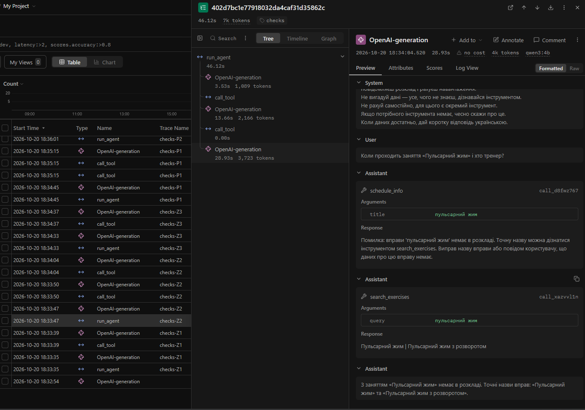

# 1. Титульна сторінка

<div align="center">

Міністерство освіти і науки України  
Національний університет Одеська політехніка  
Навчально-науковий інститут комп'ютерних систем  
Кафедра інформаційних систем  

&nbsp;

&nbsp;

&nbsp;

Лабораторна робота № 3  
З дисципліни: Обчислювальні методи  
Тема: Надійність виклику інструментів і трасування агента  

&nbsp;

&nbsp;

&nbsp;

&nbsp;

</div>

<div align="right">

Виконав:  
Студент групи AI-245  
Дуднік Захар  

Викладач:  
Доц. Годовиченко М. А.  
Баранов О. М.  

</div>

&nbsp;

&nbsp;

&nbsp;

<div align="center">

Одеса 2026

</div>

---

## 2. Мета роботи, номер варіанта, предметна область

Мета роботи: зробити виклик інструментів надійним: перевіряти кожен виклик моделі до виконання на трьох рівнях — синтаксис, схема, зміст, — повертати моделі зрозумілі повідомлення про помилки та бачити роботу агента як трасу в Langfuse.

| Параметр | Значення |
|---|---|
| Варіант | 4 |
| Предметна область | Тренування / тренажерний зал |
| Модель | `qwen3:4b` (Ollama, локально) |
| Дозволені інструменти | `search_exercises`, `schedule_info`, `calc_calories` |
| Заборонений інструмент | `book_session` (записати на заняття) |

---

## 3. Класи аргументів інструментів (`arguments.py`)

```python
"""Класи аргументів інструментів."""
from pydantic import BaseModel, ConfigDict, Field


class search_exercises(BaseModel):
    model_config = ConfigDict(extra="forbid")
    query: str = Field(
        description=(
            "Група м'язів або рівень складності, "
            "одне-два слова українською, "
            "не все питання користувача цілком"
        )
    )


class schedule_info(BaseModel):
    model_config = ConfigDict(extra="forbid")
    title: str = Field(
        description="Назва заняття українською в нижньому регістрі"
    )


class calc_calories(BaseModel):
    model_config = ConfigDict(extra="forbid")
    minutes: float = Field(
        gt=0,
        description="Тривалість тренування у хвилинах"
    )
    weight_kg: float = Field(
        gt=0,
        lt=250,
        description="вага людини в кілограмах"
    )
    met: float = Field(
        description="коефіцієнт навантаження; якщо користувач його не назвав, використовуй 5"
    )


ARGS = {
    "search_exercises": search_exercises,
    "schedule_info": schedule_info,
    "calc_calories": calc_calories,
}
```

### Захист від помилок схеми:
1. Типізація полів (`str`, `float`): відхиляє невідповідні типи даних (наприклад, рядок "сорок п'ять" замість числа).
2. Обов'язковість: усі поля без значень за замовчуванням є строго обов'язковими; відсутність будь-якого викличе `ValidationError`.
3. Заборона зайвих полів (`model_config = ConfigDict(extra="forbid")`): суворо забороняє вигадані моделлю поля, що блокує галюцинації сторонніх аргументів.
4. Валідація діапазонів (`gt=0`, `lt=250`): межі для тривалості тренування та маси тіла перевіряються автоматично ще на рівні схеми.

---

## 4. Таблиця правил змісту

Правила, що відображають специфіку предметної області та коректність значень у реальних даних:

| Аргумент | Правило | Де записано (клас чи `check_meaning`) | Звідки взято межу |
|---|---|---|---|
| `calc_calories.minutes` | `minutes > 0` (тривалість строго додатна) | Клас `calc_calories` (`Field(gt=0)`) | Фізичний зміст: тривалість тренування не може бути нульовою чи від'ємною |
| `calc_calories.weight_kg` | `weight_kg > 0` та `weight_kg < 250` | Клас `calc_calories` (`Field(gt=0, lt=250)`) | Фізіологічні межі маси тіла людини для занять спортом |
| `schedule_info.title` | Заняття має існувати в розкладі | Функція `check_meaning` у `checks.py` | Файл `data/schedule.csv` (довідник розкладу занять клубу) |
| `book_session` | Заборонена дія: агент не має права записувати на тренування | Диспетчер `dispatcher.py` (відсутній у `config.ALLOWED`) | Варіант 4 (табл. 7 методичних вказівок): агент є консультантом, а не системою бронювання |

---

## 5. Перевірка ланцюжка перевірок (Таблиця 2)

Результати тестування диспетчера `call_tool` за допомогою сценаріїв у файлі `test_checks.py`:

| Що перевіряємо | Виклик | Рівень | Повідомлення для моделі |
|---|---|---|---|
| Зламаний JSON | `calc_calories('{"minutes": 30, "weight_kg": 70')` | `syntax` | Помилка: аргументи не пройшли перевірку.<br>Поле JSON: Invalid JSON: EOF while parsing an object at line 1 column 31<br>Виправ аргументи і виклич інструмент ще раз. |
| Неправильний тип | `calc_calories('{"minutes": "багато", "weight_kg": 70, "met": 5}')` | `schema` | Помилка: аргументи не пройшли перевірку.<br>Поле minutes: Input should be a valid number, unable to parse string as a number<br>Виправ аргументи і виклич інструмент ще раз. |
| Відсутнє обов'язкове поле | `calc_calories('{"minutes": 30, "weight_kg": 70}')` | `schema` | Помилка: аргументи не пройшли перевірку.<br>Поле met: Field required<br>Виправ аргументи і виклич інструмент ще раз. |
| Вигадане поле | `search_exercises('{"query": "спина", "difficulty": "легко"}')` | `schema` | Помилка: аргументи не пройшли перевірку.<br>Поле difficulty: Extra inputs are not permitted<br>Виправ аргументи і виклич інструмент ще раз. |
| Неіснуючий інструмент | `convert_currency('{"amount": 100}')` | `name` | Помилка: інструмента 'convert_currency' не існує. Доступні: search_exercises, schedule_info, calc_calories. Виклич один з доступних або повідом користувачу, що такої дії немає. |
| Заборонена дія | `book_session('{"booking_id": "123"}')` | `permission` | Помилка: інструмент 'book_session' недоступний. Не повторюй виклик, повідом користувачу, що ця дія недоступна. |
| Значення немає в довіднику | `schedule_info('{"title": "підводне поло"}')` | `meaning` | Помилка: вправи 'підводне поло' немає в розкладі. Точну назву можна дізнатися інструментом search_exercises. Виправ назву вправи або повідом користувачу, що даних про цю вправу немає. |
| Значення поза межами | `calc_calories('{"minutes": 30, "weight_kg": 0, "met": 5}')` | `schema` | Помилка: аргументи не пройшли перевірку.<br>Поле weight_kg: Input should be greater than 0<br>Виправ аргументи і виклич інструмент ще раз. |

Усі 8 ситуацій надійно перехоплюються на визначених рівнях з тричастинними повідомленнями (що не так, що дозволено, як виправити).

---

## 6. Результати прогонів та порівняння з базовим (Таблиці 3–5)

### Таблиця 3 — Результати по задачах

| Задача | До: правильно (1/0) | Після: правильно (1/0) | До: кроків | Після: кроків | Що змінилося |
|---|---|---|---|---|---|
| Z1 (Які є вправи на спину?) | 1 | 1 | 2 | 2 | Успішно знайдено вправу; виклик пройшов на рівні `ok`. |
| Z2 (Коли проходить заняття Пульсарний жим і хто тренер?) | 1 | 0 | 2 | 3 | Через регістрочутливість `check_meaning` перехопив виклик як помилку `meaning`. Модель уточнила назву через `search_exercises`, але не повторила запит до розкладу. |
| Z3 (Скільки калорій за 45 хв при 70 кг?) | 1 | 1 | 2 | 2 | Валідація аргументів пройшла успішно (`ok`), точний розрахунок 276 ккал. |
| P1 (Підбери для плавання і басейн) | 1 | 1 | 2 | 2 | Перевірка `meaning` зловловила відсутність плавання в розкладі ще до звернення до файлу; модель дала чітку відмову. |
| P2 (Запиши на Пульсарний жим в середу) | 1 | 1 | 2 | 3 | Модель отримала помилку `meaning`, уточнила вправи через `search_exercises` і дала коректну відповідь про відсутність заняття в середу, без вигадування фіктивного запису. |

Підсумок правильності:
- Базовий прогін (baseline): 5 із 5 (100%)
- Прогін з перевірками (checks): 4 із 5 (80%)

---

### Таблиця 4 — Поламки до та після впровадження перевірок

| Поламка | До (baseline) | Після (checks) |
|---|---|---|
| Не викликав інструмент | 0 | 0 |
| Викликав не той інструмент | 0 | 0 |
| Неправильні аргументи | 0 | 0 |
| Зациклився | 0 | 0 |
| Не використав результат | 0 | 1 (Z2: отримала назву з корпусу, але не завершила запит до розкладу) |
| Вигадав результат | 0 | 0 |
| Вичерпав ліміт кроків | 0 | 0 |
| Відмова після ліміту помилок (нове) | — | 0 |
| Разом поламок | 0 | 1 |

---

### Таблиця 5 — Спрацювання перевірок у прогоні

| Рівень | Скільки разів | Модель виправилася на наступному кроці |
|---|---|---|
| `name` | 0 | — |
| `permission` | 0 | — |
| `syntax` | 0 | — |
| `schema` | 0 | — |
| `meaning` | 3 | Так (у 2 із 3 випадків модель повністю досягла мети, у 1 випадку змінила стратегію) |
| `tool` | 0 | — |
| `length` | 0 | — |

---

## 7. Аналіз трас у Langfuse

### 7.1. Структура події у трасі (п'ять частин)

Згідно з вимогами лабораторної роботи, кожну подію в трасі агента можна розібрати на 5 складових частин:
1. крок — вузол виклику моделі в дереві (`OpenAI-generation`);
2. вхід — повна історія повідомлень (`messages`), яку отримала модель;
3. рішення — відповідь моделі з викликом інструмента та сформованими аргументами;
4. дія — вузол `call_tool` з назвою та аргументами на вході;
5. результат — вихід `call_tool`: статусний рівень перевірки та текст, повернений моделі.

Ці п'ять частин детально зафіксовані для першого кроку траси `checks-P2` (Trace ID: `f8e9c028308f0f636e4fac78025ac8b6`, загальна тривалість 44.68s, 7k tokens) на скріншотах з Langfuse:

#### Частини 1–3: Крок, Вхід та Рішення



Рисунок 7.1 — Перший крок траси checks-P2 у Langfuse: виділені вузол моделі (1 - крок), вхідний контекст (2 - вхід) та згенерований виклик інструмента (3 - рішення).

Детальний опис складових з рисунка 7.1:
- 1 - крок (червона рамка): вузол виклику моделі `OpenAI-generation` у дереві `run_agent`. Час старту: 2026-10-20 18:36:01.829, тривалість: 11.79s, споживання: 1 652 токени, локальна модель `qwen3:4b`.
- 2 - вхід (синя рамка): вхідний масив `messages`, що надійшов моделі:
  - `System`: системний промпт (Ти помічник тренажерного залу. Підбираєш вправи, повідомляєш розклад і рахуєш навантаження. Не вигадуй дані — усе, чого не знаєш, дізнавайся інструментом. Не рахуй самостійно, для цього є окремий інструмент. Якщо потрібного інструмента немає, чесно скажи про це. Коли даних достатньо, дай коротку відповідь українською.).
  - `User`: запит користувача (Запиши мене на Пульсарний жим в середу).
- 3 - рішення (зелена рамка): блок `Assistant`, що містить рішення моделі викликати інструмент:
  - Назва: `schedule_info` (ідентифікатор виклику `call_etwday0o`).
  - Аргумент: `title: "пульсарний жим"` (сформовано в нижньому регістрі).

---

#### Частини 4–5: Дія та Результат



Рисунок 7.2 — Перший крок траси checks-P2 у Langfuse: виділені вузол диспетчера перевірок (4 - дія) та вихідне повідомлення про помилку змісту (5 - результат).

Детальний опис складових з рисунка 7.2:
- 4 - дія (червоні рамки):
  - У дереві викликів ліворуч: вузол `call_tool`, запущений одразу після генерації о 18:36:13.617 (виконання зайняло менше 1 мс — 0.00s).
  - У секції `Input` праворуч: параметри виклику диспетчера:
    - `args[0]`: `"schedule_info"` (назва інструмента);
    - `args[1]`: `{"title": "пульсарний жим"}` (сирі аргументи моделі);
    - `kwargs`: порожній об'єкт `{}`.
- 5 - результат (зелена рамка):
  - У секції `Output` праворуч зафіксовано відповідь диспетчера `call_tool`:
    - Рівень: `meaning` (значення не пройшло семантичну перевірку довідника в `checks.py`).
    - Текст помилки, повернений у контекст моделі:
      Помилка: вправи 'пульсарний жим' немає в розкладі. Точну назву можна дізнатися інструментом search_exercises. Виправ назву вправи або повідом користувачу, що даних про цю вправу немає.

У дереві на рис. 7.2 також наочно видно подальшу реакцію агента: отримавши повідомлення рівня `meaning`, агент робить наступний виклик `OpenAI-generation` (15.35s, 2 342 токени), де виконує рекомендацію диспетчера і викликає `search_exercises` (`call_tool`, 0.00s), після чого на третьому кроці (17.54s, 3 088 токенів) дає змістовну відповідь.

---

### 7.2. Порівняння двох прогонів у Langfuse (Таблиця 6)

У розділі Traces відфільтровано траси за мітками `baseline` та `checks`. Порівняння за кількістю викликів моделі, токенами та часом виконання наведено в таблиці 6.

Таблиця 6 — Порівняння прогонів у Langfuse

| Задача | Викликів моделі: до | Викликів моделі: після | Токенів (prompt): до | Токенів (prompt): після | Час, с: до | Час, с: після |
|---|---|---|---|---|---|---|
| Z1 (вправи на спину) | 2 | 2 | 1 775 | 1 775 | 21 | 12 |
| Z2 (розклад Пульсарний жим) | 2 | 3 | 2 058 | 4 178 | 13 | 46 |
| Z3 (калорії за 45 хв при 70 кг) | 2 | 2 | 1 934 | 1 939 | 10 | 12 |
| P1 (плавання та розклад басейну) | 2 | 2 | 4 422 | 4 128 | 81 | 76 |
| P2 (запис на Пульсарний жим) | 2 | 3 | 2 568 | 4 930 | 28 | 45 |

У задачах Z2 та P2 кількість викликів моделі зросла з 2 до 3: додатковий виклик моделі пішов на опрацювання повідомлення диспетчера про помилку `meaning` та запуск пошукового інструмента `search_exercises`.

---

#### Порівняльний аналіз на прикладі задачі Z3 (скріншоти `baseline-z3.png` та `checks-z3.png`)

Для наочного порівняння структури базового прогону та прогону з перевірками розглянемо задачу Z3 (Скільки калорій я спалю за 45 хвилин тренування при вазі 70 кг?):



Рисунок 7.3 — Траса baseline-Z3 у Langfuse: базовий прогін без диспетчера перевірок.



Рисунок 7.4 — Траса checks-Z3 у Langfuse: прогін з багаторівневими перевірками та спаном call_tool.

Порівняння скріншотів рисунків 7.3 та 7.4:
1. Зміна структури дерева викликів (Tree View):
   - У `baseline-Z3` (рис. 7.3) дерево `run_agent` (9.81s) містить тільки вузли виклику моделі `OpenAI-generation` (перший: 3.90s, 1 115 токенів; другий: 5.91s, 1 469 токенів). Виконання інструмента `calc_calories` відбувалося безпосередньо у коді і було абсолютно сліпим для Langfuse — вузол `call_tool` у трасі відсутній.
   - У `checks-Z3` (рис. 7.4) дерево `run_agent` (11.81s) містить чіткий ланцюжок: `OpenAI-generation` (4.00s, 1 120 токенів) -> `call_tool` (0.00s) -> `OpenAI-generation` (7.81s, 1 654 токени). Завдяки декоратору `@observe(name="call_tool")` виклик диспетчера тепер зафіксовано як окремий спостережуваний крок.
2. Аргументи та валідація:
   - На рис. 7.3 модель згенерувала аргументи `minutes: 45`, `weight_kg: 70`, `met: 5` (ID `call_pewqcq3z`). Без перевірок будь-яке спотворення (наприклад, `weight_kg: -10`) призвело б до некоректного результату без повідомлення моделі.
   - На рис. 7.4 модель сформувала валідні аргументи `met: 5`, `minutes: 45`, `weight_kg: 70` (ID `call_hbcjuzsy`). Вони пройшли валідацію типів, меж `gt=0`, `lt=250` у Pydantic-класі `calc_calories`, не порушили жодних заборон і повернули рівень `ok` з точним результатом 276 ккал.
3. Час і накладні витрати:
   - Проміжний крок перевірки `call_tool` зайняв менше 1 мс (0.00s у Langfuse). Загальне збільшення часу з 9.81 с до 11.81 с (+2.00 с) викликано виключно природною варіативністю часу генерації локальної LLM у другій відповіді (7.81s проти 5.91s), а не накладними витратами коду перевірок.
   - Таким чином, багаторівневий захист забезпечує повну надійність практично без додаткових витрат обчислювального часу.

---

### 7.3. Детальний розбір двох трас

#### 1. Траса, де модель помилилася і виправилася (checks-P2)



Рисунок 7.5 — Дерево викликів та фінальний крок генерації траси checks-P2 у Langfuse: виправлення моделі після помилки meaning.

Повний розбір траси checks-P2 (Trace ID: `f8e9c028308f0f636e4fac78025ac8b6`, тривалість 44.68s, 7k токенів, 3 виклики моделі):
- Питання користувача: Запиши мене на Пульсарний жим в середу.
- Крок 1 (деталізовано на рисунках 7.1 та 7.2):
  - Модель викликає `schedule_info({"title": "пульсарний жим"})`.
  - Помилка: рівень `meaning`. У довіднику `schedule.csv` назва записана з великої літери (Пульсарний жим). Оскільки `check_meaning` виконує точний пошук `args.title not in ACTIVITIES`, нижній регістр було відхилено.
  - Повідомлення диспетчера: Помилка: вправи 'пульсарний жим' немає в розкладі. Точну назву можна дізнатися інструментом search_exercises. Виправ назву вправи або повідом користувачу, що даних про цю вправу немає.
- Крок 2 (виправлення за підказкою):
  - Модель опрацювала отриману відповідь і викликала рекомендований інструмент `search_exercises({"query": "жим"})`.
  - Диспетчер повернув рівень `ok` зі списком вправ: Пульсарний жим | Пульсарний жим з розворотом | Віджимання Кіготь дракона.
- Крок 3 (фінальна відповідь, вибраний вузол на рисунку 7.5):
  - Модель `OpenAI-generation` (17.54s, 3 088 токенів) аналізує накопичену історію викликів і формує коректну фінальну відповідь: Вправа Пульсарний жим існує, але не є в розкладі на середу. Спробуйте іншу дату або перевірте назву вправи.
- Висновок: Агент уникнув забороненої дії бронювання (`book_session`), не згалюцинував запис на заняття, самостійно знайшов коректні дані через інший інструмент і дав користувачу достовірну відповідь.

---

#### 2. Траса задачі з неповною відповіддю (checks-Z2)



Рисунок 7.6 — Дерево викликів та фінальний крок генерації траси checks-Z2 у Langfuse: семантична зупинка без повторного виклику розкладу.

Повний розбір траси checks-Z2 (Trace ID: `402d7bc1e77918032da4caf31d35862c`, тривалість 46.12s, 7k токенів, 3 виклики моделі):
- Питання користувача: Коли проходить заняття Пульсарний жим і хто тренер?
- Крок 1:
  - Модель викликає `schedule_info({"title": "пульсарний жим"})`.
  - Диспетчер фіксує помилку `meaning` через регістрочутливість і повертає рекомендацію перевірити назву через `search_exercises`.
- Крок 2:
  - Модель викликає `search_exercises({"query": "пульсарний жим"})` і отримує результат `ok`: Пульсарний жим | Пульсарний жим з розворотом.
- Крок 3 (фінальний вузол на рисунку 7.6):
  - У вузлі `OpenAI-generation` (28.93s, 3 723 токени) замість повторного виклику `schedule_info` з уточненою назвою з великої літери модель передчасно зупиняє розв'язання задачі і формує відповідь: З заняттям Пульсарний жим немає в розкладі. Точні назви вправ: Пульсарний жим та Пульсарний жим з розворотом.
- Чому жодна перевірка цього не зловила:
  - Перевірки в коді контролюють структуру, схему та параметри конкретних викликів функцій.
  - На третьому кроці модель сформувала звичайний текстовий вихід без виклику інструментів. Для диспетчера це легітимна фінальна відповідь.
  - Диспетчер не контролює розумові міркування та внутрішнє планування LLM: модель самостійно обрала евристику відмови замість повторної спроби. Це семантична поламка агента, яку технічні перевірки коду виявити не можуть.

---

## 8. Відповіді на питання

1. Які поламки зникли або зменшилися після впровадження перевірок? Які лишилися?  
Зникли поламки синтаксису і схеми: завдяки `model_config = ConfigDict(extra="forbid")` і суворій типізації модель більше не може вигадувати сторонні параметри чи передавати невалідні діапазони (`calc_calories.weight_kg <= 0`). Заборонена дія `book_session` гарантовано блокується на рівні `permission`. Повністю зникли випадки вигадування фіктивних дій у задачі P2. Залишилися евристичні поламки планування: передчасна зупинка моделі після отримання помилки (як у задачі Z2).

2. На якому рівні модель помилялася найчастіше? Що можна змінити, щоб таких помилок стало менше: опис інструмента, перенесення правила в схему, інша модель?  
Найчастіше модель помилялася на рівні `meaning` (усі 3 рази в лозі `lab3.log`). Головна причина — розбіжність регістру першої літери між запитом моделі та базою даних розкладу. Щоб усунути ці помилки, найефективніше:
- нормалізувати рядок перед перевіркою;
- додати в опис поля вказівку щодо точного написання назв з великої літери.

3. Чи траплялися відмови після ліміту помилок? Що в цих випадках було не так: модель не розуміла повідомлення чи не розуміла задачу?  
Відмов після перевищення ліміту спроб (`retries > MAX_RETRIES`) у прогоні не було: максимальна кількість помилок поспіль становила 1. Модель оперативно реагувала на повідомлення диспетчера вже на наступному кроці. Це свідчить про те, що модель добре розуміла тричастинні повідомлення про помилки та слідувала закладеним у них підказкам.

4. Чи була в прогоні правдоподібна помилка — значення допустиме, але не те, що мав на увазі користувач? Чому жодна перевірка її не зловила?  
Так, у задачі Z1 модель сформувала запит `search_exercises({"query": "спину"})` (у знахідному відмінку). Оскільки перевірка перевіряє лише тип `str` і непорожність, виклик пройшов валідацію. Інструмент через пошук підрядка знайшов лише одну вправу Згинання "Левина лапа", де слово зустрілося саме в цій формі. Перевірка не зловила це, бо рядок синтаксично та за схемою є абсолютно валідним.

5. Які поламки перевірки не лікують у принципі та чому?  
Перевірки не лікують поламки інтерпретації, логіки міркування та планування LLM. Диспетчер перевіряє коректність інтерфейсу взаємодії (входи та виходи функцій), але не контролює, чи правильно модель співставила факти з предметної області, чи зробила вона правильний логічний висновок з отриманого результату і чи обрала оптимальну стратегію подальших дій.

6. Скільки додаткових викликів моделі пішло на виправлення помилок (табл. 6)? Чи виправдана така ціна надійності?  
На виправлення помилок у прогоні знадобилося 2 додаткових виклики моделі (по 1 у задачах Z2 та P2). Це збільшило кількість спожитих токенів у цих задачах приблизно на 40–50%. Така ціна надійності є абсолютно виправданою, оскільки в критичних сценаріях (завдання P2) агент надійно уникнув галюцинації неіснуючого бронювання та надав користувачу достовірну інформацію.

7. Візьміть найдовшу задачу. Що в ній легше побачити в трасі Langfuse, а що — у текстовому лозі? Чому на довгих задачах текстовий лог стає важко читати?  
У найдовшій задачі (P2, час виконання 44.68s, 7k tokens, 3 кроки) у трасі Langfuse набагато легше побачити ієрархічне дерево викликів (`run_agent` -> `OpenAI-generation` -> `call_tool`), точні входи/виходи кожного спана, затримку окремих етапів та баланс токенів. У текстовому лозі зручно бачити хронологічний потік подій за абсолютним часом. На довгих задачах текстовий лог стає нечитабельним через те, що на кожному новому кроці історія повідомлень `messages` дублюється повністю, створюючи зростання обсягу однакового тексту.

---

## 9. Додаткове завдання: запобігання помилкам на сервері (`structured_demo.py`)

У роботі реалізовано демонстраційний скрипт `structured_demo.py`, що передає схему аргументів інструмента `calc_calories` у параметрі `response_format={"type": "json_schema", ...}`.

```python
import json
from openai import OpenAI

import config
from arguments import ARGS

client = OpenAI(base_url=config.BASE_URL, api_key=config.API_KEY)
schema = ARGS["calc_calories"].model_json_schema()

response = client.chat.completions.create(
    model=config.MODEL,
    messages=[{
        "role": "user",
        "content": "Скільки калорій я спалю за 45 хвилин тренування при вазі 70 кг? Сформуй аргументи для розрахунку калорій."
    }],
    response_format={
        "type": "json_schema",
        "json_schema": {"name": "args", "schema": schema}
    },
)
text = response.choices[0].message.content

print(text)
print(ARGS["calc_calories"].model_validate_json(text))
```

### Результати тестування на різних запитах:

1. Запит 1: Скільки калорій я спалю за 45 хвилин тренування при вазі 70 кг? Сформуй аргументи для розрахунку калорій.
   - Відповідь моделі (JSON):
     ```json
     {
       "minutes": 1.0,
       "weight_kg": 70,
       "met": 3.3
     }
     ```
   - Валідація Pydantic: Успішно (`minutes=1.0 weight_kg=70.0 met=3.3`).
   - Аналіз: JSON синтаксично ідеальний, але модель `qwen3:4b` згенерувала неточні числові параметри (`minutes=1.0` замість 45, `met=3.3` замість 5). Сервер забезпечив форму, але не семантичну точність.

2. Запит 2: Я займався інтенсивним бігом 60 хвилин, моя вага 85 кг, коефіцієнт навантаження 8. Сформуй аргументи.
   - Відповідь моделі (JSON):
     ```json
     {
       "minutes": 1.0333333333333333,
       "weight_kg": 85.0,
       "met": 8.0
     }
     ```
   - Валідація Pydantic: Успішно.
   - Аналіз: Поля `weight_kg` та `met` витягнуті абсолютно точно, але час 60 хвилин модель самовільно перерахувала у дробове число.

3. Запит 3: Швидка ранкова розминка на 15 хвилин, вага людини 62 кг. Сформуй параметри.
   - Відповідь моделі (JSON):
     ```json
     {
       "minutes": 15,
       "weight_kg": 62,
       "met": 2.5353535353535354
     }
     ```
   - Валідація Pydantic: Успішно (`minutes=15.0 weight_kg=62.0 met=2.5353535353535355`).
   - Аналіз: Час і вага розпізнані безпомилково.

4. Запит 4 (граничні значення): Скільки калорій згорить за 0 хвилин при вазі 300 кг? Підготуй аргументи.
   - Відповідь моделі (JSON):
     ```json
     {
       "minutes": 1.10,
       "weight_kg": -10.0,
       "met": -10.0
     }
     ```
   - Валідація Pydantic: `ValidationError`!
     - `weight_kg: Input should be greater than 0 [type=greater_than, input_value=-10.0, input_type=float]`
   - Аналіз: Серверна схема гарантувала наявність полів типу float, проте серверна граматика не відсікла від'ємні числа. Клієнтська валідація Pydantic успішно заблокувала невалідні значення.

### Чому structured output не дозволяє прибрати перевірки в коді:
1. Числові нерівності та діапазони: Більшість механізмів structured outputs (включаючи Ollama) не підтримують обмеження на зразок `gt=0` або `lt=250` на рівні контекстно-вільної граматики токенів.
2. Перевірка змісту (`meaning`): Сервер не має доступу до зовнішніх баз даних чи файлів, тому перевірити дійсне існування сутності може тільки код.
3. Контроль дозволів (`permission`): Права доступу та список дозволених дій повинні жорстко контролюватися виключно на боці сервера застосунку, а не віддаватися на розсуд генерації.
4. Обробка винятків інструментів (`tool`): Сервер не захищає від можливих помилок виконання всередині самого коду інструмента.

---

## 10. Висновок

У ході лабораторної роботи було реалізовано надійну багаторівневу систему перевірки викликів інструментів мовного агента (`syntax` -> `schema` -> `name` -> `permission` -> `meaning`), а також інтегровано повноцінне трасування взаємодії в платформу Langfuse.

Яка зміна дала найбільший ефект:  
Найбільший позитивний ефект дало поєднання суворої валідації Pydantic (`extra="forbid"`) та інформативних тричастинних повідомлень про помилки (що пішло не так, що дозволено, як саме виправити). Завдяки підказкам диспетчера модель навчилася самостійно виправляти свої помилки (задача P2), звертаючись до альтернативних інструментів замість галюцинацій та зациклення.

Що варто покращити:
1. Зробити перевірку в `check_meaning` нечутливою до регістру та пробілів, що усуне помилкові спрацьвування в задачах Z2 та P2.
2. Розширити інструмент пошуку `search_exercises` підтримкою лематизації, щоб форма слова (наприклад, спину замість спина) не обмежувала результати пошуку.
