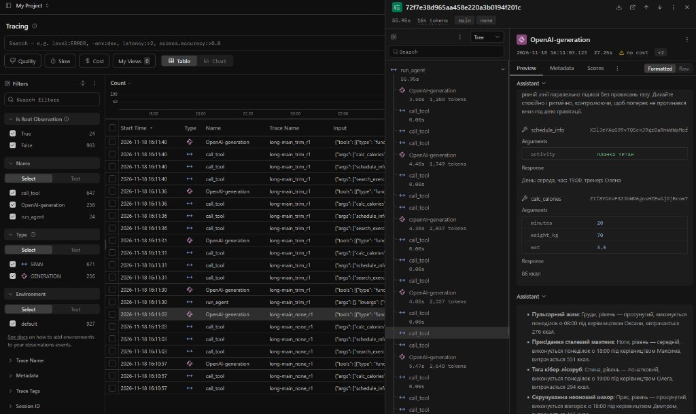
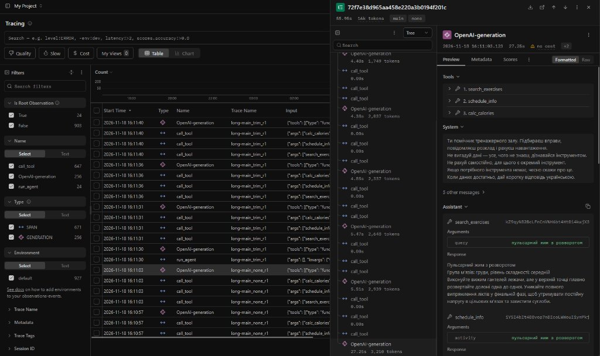
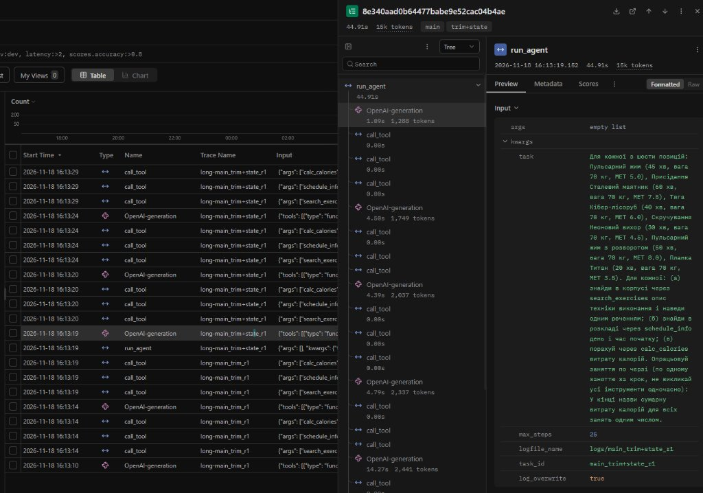
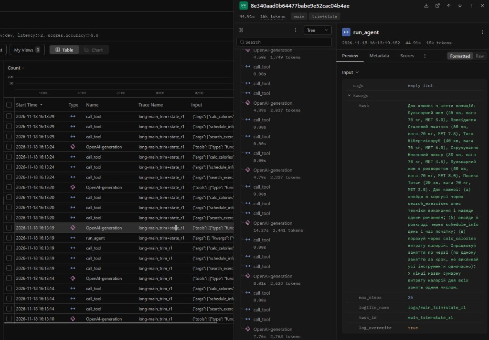

# 1. Титульна сторінка

Міністерство освіти і науки України  
Національний університет «Одеська політехніка»  
Навчально-науковий інститут комп'ютерних систем  
Кафедра інформаційних систем  

&nbsp;

&nbsp;

&nbsp;

Лабораторна робота № 4  
З дисципліни: «Обчислювальні методи»  
Тема: «Контекст, стан і кеш агента»  

&nbsp;

&nbsp;

&nbsp;

&nbsp;

Виконав:  
Студент групи АІ-245  
Дуднік Захар  

Перевірили:  
Доц. Годовиченко М. А.  
Баранов О. М.  

&nbsp;

&nbsp;

&nbsp;

Одеса — 2026

---

## 2. Мета роботи, номер варіанта, предметна область

**Мета роботи:** Дослідити поведінку агента, коли історія діалогу не вміщується в контекстне вікно моделі; реалізувати три способи захисту — обрізання історії (`trim`), збереження стану викликів інструментів (`state`) та кешування викликів моделі (`cache`); виміряти їхню вартість у токенах, часі та точності.

| Параметр | Значення |
|---|---|
| Варіант | 4 |
| Предметна область | Тренування та фітнес (підбір вправ, розклад занять, розрахунок калорій) |
| Базова модель | `qwen3:4b-instruct` (Ollama, локально) |
| Початкова модель з вузьким вікном | `qwen34-instruct-4k` (`num_ctx = 4096`) |
| Робоча модель після звуження (випадок C) | `qwen34-instruct-3k` (`num_ctx = 3072`) |
| Дозволені інструменти | `search_exercises`, `schedule_info`, `calc_calories` |
| Заборонений інструмент | `book_session` |

### Три числа з кроку 1 (налаштування вікна):
1. `context length` вихідної моделі `qwen3:4b-instruct`: `262144` токенів.
2. `num_ctx` нової моделі (`qwen34-instruct-4k` на кроці 1 -> `qwen34-instruct-3k` за випадком C у кроці 4): початково `4096`, робоче значення `3072` токенів.
3. У скільки разів вікно звузили: у `64` рази для `4096` ($262144 / 4096 = 64$) і у `85.33` раза для робочого вікна `3072` ($262144 / 3072 \approx 85.33$).

---

## 3. Довга задача: питання і правильна відповідь (крок 2)

Для тестування контекстного вікна сформовано довгу задачу із 6 позицій (`make_task.py` -> `long_task.json`), де кожна позиція потребує пошуку в корпусі (`search_exercises`), перевірки розкладу (`schedule_info`) та обчислення витрати калорій (`calc_calories`).

* Файл задачі: `long_task.json`
* Мінімум викликів інструментів (`min_calls`): `18` (6 позицій × 3 інструменти)
* Правильна відповідь (`expected`): `1862` (сума `276 + 551 + 294 + 165 + 490 + 86`, порахована напряму через `calc_calories` без моделі).

### Текст питання (`question`):
> Для кожної з шести позицій: Пульсарний жим (45 хв, вага 70 кг, MET 5.0), Присідання Сталевий маятник (60 хв, вага 70 кг, MET 7.5), Тяга Кібер-лісоруб (40 хв, вага 70 кг, MET 6.0), Скручування Неоновий вихор (30 хв, вага 70 кг, MET 4.5), Пульсарний жим з розворотом (50 хв, вага 70 кг, MET 8.0), Планка Титан (20 хв, вага 70 кг, MET 3.5). Для кожної: (а) знайди в корпусі через search_exercises опис техніки виконання і наведи одним реченням; (б) знайди в розкладі через schedule_info день і час початку; (в) порахуй через calc_calories витрату калорій. Опрацьовуй заняття по черзі (по одному заняттю за крок, не викликай усі інструменти одночасно): У кінці назви сумарну витрату калорій для всіх занять одним числом.

---

## 4. Зростання входу без захисту (Таблиця 2 і Крок 4)

На початковому прогоні з `qwen34-instruct-4k` (`NUM_CTX = 4096`) модель завершила задачу за `7` кроків (`32.1 с`, статус `final`) із найбільшим входом `3131` токен (`76%` вікна `4096`). Оскільки максимальний вхід був меншим за `95%` вікна (`Випадок C. Задача закоротка`), згідно з методичними вказівками `num_ctx` у `Modelfile` було зменшено до `3072`, створено `qwen34-instruct-3k` і задано `NUM_CTX = 3072`, `COMPRESS_AT = 2150` у `config.py`.

Нижче наведено результати повторного пробного прогону без захисту для вікна `3072` (`logs/probe_none_r1.log`, тривалість `65.7 с`, `правильно: ні`):

### Таблиця 2 — Зростання входу в прогоні без захисту (`NUM_CTX = 3072`)

| Крок | `prompt_tokens` | Приріст | Що зробила модель |
|-----:|----------------:|--------:|:----------------------------------------------------------|
| 1 | 1196 | — | `search_exercises({"query":"пульсарний жим"})` |
|   |      |   | `schedule_info({"activity":"пульсарний жим"})` |
|   |      |   | `calc_calories({"minutes":45,"weight_kg":70,"met":5})` |
| 2 | 1647 | +451 | `search_exercises({"query":"присідання сталевий маятник"})` |
|   |      |   | `schedule_info({"activity":"присідання сталевий маятник"})` |
|   |      |   | `calc_calories({"minutes":60,"weight_kg":70,"met":7.5})` |
| 3 | 1939 | +292 | `search_exercises({"query":"тяга кібер-лісоруб"})` |
|   |      |   | `schedule_info({"activity":"тяга кібер-лісоруб"})` |
|   |      |   | `calc_calories({"minutes":40,"weight_kg":70,"met":6})` |
| 4 | 2235 | +296 | `search_exercises({"query":"скручування неоновий вихор"})` |
|   |      |   | `schedule_info({"activity":"скручування неоновий вихор"})` |
|   |      |   | `calc_calories({"minutes":30,"weight_kg":70,"met":4.5})` |
| 5 | 2546 | +311 | `search_exercises({"query":"пульсарний жим з розворотом"})` |
|   |      |   | `schedule_info({"activity":"пульсарний жим з розворотом"})` |
|   |      |   | `calc_calories({"minutes":50,"weight_kg":70,"met":8})` |
| 6 | 2851 | +305 | `search_exercises({"query":"планка титан"})` |
|   |      |   | `schedule_info({"activity":"планка титан"})` |
|   |      |   | `calc_calories({"minutes":20,"weight_kg":70,"met":3.5})` |
| 7 | 2771 | -80 | відповідь без виклику |

### Показники прогону (пункти а–д):
* **(а) Постійна частина входу («вхід першого кроку»):** `1196` токенів (системний промпт, схеми трьох інструментів і текст питання).
* **(б) Типовий приріст за крок:** `305` токенів (медіана додатних приростів: `451, 292, 296, 311, 305`).
* **(в) Сума `prompt_tokens` за прогін і формула:**
  * Фактична сума: `15185` токенів (`1196 + 1647 + 1939 + 2235 + 2546 + 2851 + 2771`).
  * За формулою $n \cdot C + d \cdot \frac{n(n-1)}{2}$: $7 \cdot 1196 + 305 \cdot \frac{7 \cdot 6}{2} = 8372 + 6405 = 14777$ токенів.
  * *Пояснення:* На перших 6 кроках вхід зростав майже лінійно (~300 токенів за крок, крок 2 був трохи більшим через два описи в результаті першого пошуку), тому фактична сума дуже близька до формули, а незначне відхилення на кроці 7 (`2771` замість ~`3156`) спричинене обрізанням початку історії сервером при досягненні ліміту `3072`.
* **(г) Крок, на якому вхід перестав рости:** `7` (на кроці 6 вхід досяг `2851` токенів — `93%` вікна `3072`, а на кроці 7 зменшився на `80` токенів до `2771`).
* **(д) Поведінка моделі після кроку (г) і перевірка `logs/probe_none_r1.log`:** На кроці 7 модель дала фінальну відповідь без виклику інструментів, але через мовчазне обрізання початку контексту втратила п'яту вправу («Пульсарний жим з розворотом», `490 ккал`) і вимогу вказати сумарну витрату калорій одним числом (`1862`). Усі наведені у відповіді числа (`276`, `551`, `294`, `165`, `86`, час занять) є реальними значеннями з результатів інструментів — вигаданих чисел у відповіді немає, проте сама відповідь неповна.

### Класифікація результату:
**Випадок B — Сервер мовчки обрізає вхід.** Сервер Ollama не повернув помилку довжини, але при перевищенні `3072` токенів відкинув початок контексту (`вхід перестав рости на кроці 7`), внаслідок чого модель забула частину вхідної умови та одного з кроків.

---

## 5. Стиснення історії та збереження стану (Таблиця 3 і Крок 6)

### Таблиця 3 — Стиснення історії (`NUM_CTX = 3072`, `COMPRESS_AT = 2150`, `KEEP_LAST = 6`)

| Конфігурація | Крок стиснення | Вхід до стиснення, токенів | Повідомлень було -> стало | Повторних викликів за прогін |
|---|---:|---:|:---:|---:|
| `trim` | 4 | 2235 | 18 -> 6 | 60 |
| `trim` | 8 | 2400 | 22 -> 6 | 60 |
| `trim` | 11 | 2235 | 18 -> 6 | 60 |
| `trim` | 15 | 2400 | 22 -> 6 | 60 |
| `trim` | 18 | 2235 | 18 -> 6 | 60 |
| `trim` | 22 | 2400 | 22 -> 6 | 60 |
| `trim` | 25 | 2235 | 18 -> 6 | 60 |
| `trim+state` | 4 | 2235 | 18 -> 6 | 0 |
| `trim+state` | 5 | 2339 | 10 -> 6 | 0 |
| `trim+state` | 6 | 2535 | 10 -> 6 | 0 |

### Результати перевірки стану (пункт 7 кроку 6):
У лозі `logs/probe_trim+state_r1.log` після першого стиснення на кроці 4 (`2235` токенів, `18 -> 6` повідомлень, стан додано) у блоці `ПЕРШЕ ПОВІДОМЛЕННЯ КОРИСТУВАЧА ПІСЛЯ СТИСНЕННЯ`:
* **Кількість рядків результатів виду `- інструмент(аргументи) -> результат`:** `12` рядків (по 3 виклики для перших чотирьох занять).
* **Розмір блоку стану:** `1746` символів, що за оцінкою `2.5` символа/токен становить близько `698` токенів (усе перше повідомлення користувача разом із текстом задачі має `2521` символ ≈ `1008` токенів).
* **Оцінка достатності/компактності:** Блок стану з 12 фактів (`~698` токенів) приблизно дорівнює приросту за `2.3` звичайні кроки (`698 / 305`), що значно компактніше за повну історію 4 кроків з думками й повідомленнями `assistant`/`tool`. Завдяки цьому вхід на кроці 5 виріс лише до `2339` токенів, повторних викликів не було (`0`), і модель успішно завершила задачу на кроці 7 з точною відповіддю `1862 ккал`.

---

## 6. Кеш викликів моделі (Таблиця 4 і Крок 7)

Прогони виконано в конфігурації `none` із серіями `cache1` (після очищення `cache/`) та `cache2` (`logs/cache1_none_r1.log` і `logs/cache2_none_r1.log`).

### Таблиця 4 — Робота кешу

| Запуск | Кроків | Влучань у кеш | Викликів до сервера | Час, с | Правильно |
|---|---:|---:|---:|---:|:---:|
| 1 (кеш порожній) | 7 | 0 | 7 | 55.4 | ні |
| 2 (той самий запит) | 7 | 7 | 0 | 1.0 | ні |

### Висновок про кеш:
1. Запуск 2 виконався за `1.0 с` замість `55.4 с` — приблизно у **55.4 раза швидше**, оскільки всі 7 відповідей було прочитано з локального кешу без жодного звернення до Ollama.
2. **Якби перед запуском 2 змінити текст `SYSTEM` у `config.py`:** функція `make_key` обчислює SHA-256 від усього запиту (`model`, `messages`, `tools`, `temperature`), а `SYSTEM` входить до `messages[0]`. Будь-яка зміна в `SYSTEM` змінює хеш уже на першому кроці, тому кеш дав би `0` влучань і всі `7` кроків пішли б на сервер заново.

---

## 7. Підсумкова вартість циклу (Таблиця 5 і Крок 8)

Основна серія `main` (`python measure.py all 3 main`, кеш вимкнений) виконала по 3 повтори для всіх чотирьох конфігурацій у `measure.py` (12 прогонів).

### Таблиця 5 — Вартість циклу в різних конфігураціях (медіани по 3 повторах)

| Конфігурація | Правильно (з 3) | Кроків | Токенів на вхід | Токенів на вихід | На підсумовування | Час, с | Стиснень | Повторних викликів |
|---|---:|---:|---:|---:|---:|---:|---:|---:|
| `none` | 0 з 3 | 7 | 15185 | 1023 | 0 | 56.5 | 0 | 0 |
| `trim` | 0 з 3 | 25 | 47895 | 2476 | 0 | 108.8 | 7 | 60 |
| `trim+state` | 3 з 3 | 7 | 14596 | 642 | 0 | 45.0 | 3 | 0 |
| `summary` | 0 з 3 | 10 | 19830 | 807 | 4169 | 88.4 | 5 | 6 |

### Поламки в `logs/main_*.log`, яких не видно лише з точності в таблиці (пункт 5 кроку 8):
* **Кількість кроків менша за 19 (`steps < 19`):** Зафіксовано в усіх `9` прогонах, що дійшли до `final` (`main_none_r1..3` — 7 кроків; `main_trim+state_r1..3` — 7 кроків; `main_summary_r1..3` — 9–10 кроків), тому що модель об'єднувала по 3 виклики інструментів (`search_exercises`, `schedule_info`, `calc_calories`) в один крок на позицію замість 18 окремих послідовних кроків. Інші `3` прогони (`main_trim_r1..3`) взагалі не дали відповіді (`step_limit` на 25-му кроці через зациклення з `60` повторними викликами).
* **Числа у відповідях, яких не було в рядках `результат:`:**
  * У `main_summary_r2` модель назвала число `1132` (`Сумарна витрата калорій для всіх занять: 1132 ккал`), якого немає в результатах і яке не відповідає сумі шести позицій (`1862`).
  * У `main_summary_r3` модель вивела `276 + 551 + 294 + 165 + 165 + 86 = 1037 ккал` — пропустила `490`, двічі підставила `165` і ще й неправильно додала (числа `1037` не було в жодному результаті).
  * У `main_summary_r1` модель взагалі завершила діалог сторонньою відмовою `За запитом «груди середнього рівня» нічого не знайдено`.
  * У `main_trim+state_r1..3` число `1862` теж не зустрічається в окремому рядку `результат:`, але воно є точною арифметичною сумою шести реальних результатів інструментів (`276 + 551 + 294 + 165 + 490 + 86 = 1862`).

### Траси в Langfuse (пункт 6 кроку 8):
У Langfuse (мітка `main`) для повторно виконаних прогонів зафіксовано траси:
* `long-main_none_r1` (`trace_id = 72f7e38d965aa458e220a3b0194f201c`, загальна тривалість `55.95 s`, `16k tokens`)
* `long-main_trim+state_r1` (`trace_id = 8e340aad0b64477babe9e52cac04b4ae`, загальна тривалість `44.91 s`, `15k tokens`)

#### Дерево траси `long-main_none_r1` (без захисту)

#### Дерево траси `long-main_trim+state_r1` (з обрізанням та збереженням стану)

Порівняння першого виклику після стиснення (`analyze.py logs\main_trim+state_r1.log` — **крок 5**):
* У `main_trim+state_r1` на кроці 5 `prompt_tokens = 2339` токенів (`2,441 tokens` разом із виходом у Langfuse, після першого стиснення на кроці 4, де було `2235`).
* У `main_none_r1` на тому ж кроці 5 `prompt_tokens = 2546` токенів (`2,648 tokens` разом із виходом у Langfuse, на `207` вхідних токенів більше), а на кроці 6 досягає `2851` (`2,939 tokens` разом із виходом) і на кроці 7 обрізається сервером до `2771` (`3,210 tokens` разом із виходом).
* **Що в трасі Langfuse видно одразу, а в текстовому лозі довелося б рахувати вручну:**
  1. Ієрархічне дерево виконання (`run_agent` -> чергування `OpenAI-generation` і трьох вкладених `call_tool` на кожному кроці).
  2. Готова тривалість кожного спану в секундах (видно, що всі `call_tool` займають `0.00 s`, а в `main_none_r1` майже половину часу — `27.25 s` з `55.95 s` — зайняла остання генерація `OpenAI-generation` на кроці 7, тоді як у `main_trim+state_r1` кроки 5–7 зайняли `14.27 s`, `8.01 s`, `7.76 s`).

---

## 8. Відповіді на питання

1. **На якому кроці агент без захисту дійшов до межі вікна і як ви це побачили? Що в його поведінці змінилося після цього?**  
   На кроці 6 вхід досяг `2851` токенів (`93%` вікна `3072`), а разом із викликами кроку 6 вийшов за межу `3072`. У таблиці 2 ми побачили це на кроці 7 за від'ємним приростом `-80` токенів (`2851 -> 2771`, ознака «вхід перестав рости на кроці 7»). Після цього агент дав неповну відповідь, загубивши п'яту вправу (`Пульсарний жим з розворотом`) і вимогу порахувати сумарну калорійність `1862`.

2. **Порівняйте суму `prompt_tokens` за прогін із формулою. Чи збігається зростання з очікуваним?**  
   Фактична сума `15185` токенів дуже близька до значення за формулою `14777` ($n=7, C=1196, d=305$). На кроках 1–6 зростання збігається з очікуваним майже лінійним накопиченням історії (~300 токенів за крок), і лише на 7-му кроці формула дає вищий прогноз через мовчазне обрізання контексту сервером.

3. **Що втрачає агент при обрізанні? Наведіть приклад повторного виклику після стиснення. Що змінилося в `trim+state`?**  
   При звичайному обрізанні (`trim`) агент втрачає попередні результати інструментів, які випали з останніх `KEEP_LAST = 6` повідомлень. У `logs/probe_trim_r1.log` після стиснення на кроці 4 (вхід `2235`, повідомлень `18 -> 6`) модель на кроці 5 знову викликала `search_exercises({"query":"тяга кібер-лісоруб"})`, `schedule_info({"activity":"тяга кібер-лісоруб"})` і `calc_calories({"minutes":40,"weight_kg":70,"met":6})`, які вже виконувала на кроці 3, і зациклилася до ліміту 25 кроків (`60` повторних викликів). У `trim+state` результати всіх успішних викликів зберігаються в `TaskState` і додаються до питання користувача, тому повторних викликів стало `0`, а точність зросла з `0 з 3` до `3 з 3`.

4. **Яка конфігурація найдешевша за токенами, найшвидша, найточніша? Чому висновок за трьома повторами однієї задачі обережний?**  
   За таблицею 5 у всіх трьох категоріях перемогла `trim+state`: найдешевша (`14596` вхідних і `642` вихідних токенів), найшвидша (`45.0 с`) і єдина точна (`3 з 3`). Висновок за трьома повторами однієї задачі є обережним, бо вибірка мала і перевіряє лише один сценарій фіксованої довжини; на іншій задачі або за більшого числа позицій сам блок стану теж почне роздувати контекст.

5. **Чому під час вимірювання вартості кеш вимкнено? Що станеться з кешем, якщо інструмент поверне інші дані або ви заміните модель під тією самою назвою?**  
   Кеш вимикають у серії `main`, щоб виміряти реальний час і витрату серверних токенів на кожному повторі (інакше повторні запуски брали б готові відповіді з диска за ~1 с). Якщо інструмент поверне інші дані, зміниться повідомлення `tool` у `messages`, тому `make_key` згенерує новий SHA-256 хеш і зробить новий виклик моделі. Якщо ж під тією самою назвою моделі в Ollama замінити її ваги чи `Modelfile`, поля запиту (`model`, `messages`, `tools`, `temperature`) не зміняться, тож кеш поверне застарілу відповідь попередньої моделі.

6. **Які поламки довгого прогону скорочення історії не лікує в принципі?**  
   Скорочення історії не виправляє помилки в межах одного кроку або самої моделі: арифметичні промахи під час підсумовування чисел (як `1868` у `extra_summary_r2`), галюцинації неіснуючих значень, ігнорування інструкцій про послідовний виклик інструментів, а також неправильні аргументи чи формати JSON.

---

## 9. Додаткове завдання: підсумовування замість обрізання (`summary`)

Реалізовано модуль `summary.py` (інтеграція в `compress.py` і `measure.py`) та виконано серію з трьох повторів: `python measure.py summary 3 extra`.

### Медіанні результати серії `extra` (`summary`, 3 повтори):

| Конфігурація | Правильно | Кроків | Токенів на вхід | Токенів на вихід | На підсумовування | Час, с | Стиснень | Повторних викликів |
|---|---:|---:|---:|---:|---:|---:|---:|---:|
| `summary` (`extra`) | 1 з 3 | 7 | 14280 | 591 | 3607 | 67.5 | 3 | 0 |

* **Витрати на підсумовування:** медіана `3607` токенів за прогін (`extra_summary_r1`: `3607`, `r2`: `3616`, `r3`: `1972`).
* **Економія токенів на вході порівняно з `trim`:** у серії `main` конфігурація `trim` зациклилася на 25 кроків і витратила `47895` токенів на вхід, тоді як `summary` (`extra`) витратив `14280` вхідних токенів — заощаджено `33615` токенів на основному вході (але додано `3607` токенів на самі виклики сумаризатора). Навіть із цим `summary` поступається `trim+state` (`14596` вхідних токенів, `0` на підсумовування, `45.0 с`, `3 з 3`).
* **Перевірка збереження точних чисел (`ПІДСУМОК ІСТОРІЇ` vs `результат:`):**
  * У `logs/extra_summary_r3.log` на кроці 4 переказ `ПІДСУМОК ІСТОРІЇ` зберіг три калорійності (`276`, `551`, `294`) і розклад, але **повністю втратив** описи вправ «Присідання Сталевий маятник» і «Тяга Кібер-лісоруб» та подав «Пульсарний жим з розворотом» як підпункт першої вправи; у результаті агент пропустив 5-ту позицію (`490 ккал`) і відповів `1472 ккал`.
  * У `logs/extra_summary_r2.log` сумаризатор зберіг точні числа (`276`, `551`, `294`, `165`, `490`), але в основній серії `logs/main_summary_r1..3.log` (`0 з 3`) перекази призводили до повторних викликів (`6`), втрати даних і вигаданих підсумків (`1132` і `1037`).

---

## 10. Висновок

Порівняння трьох способів керування контекстом у вузькому вікні (`3072` токенів) на моделі `qwen34-instruct-3k` показало чітку ієрархію ефективності:
1. **Найбільший ефект дало поєднання обрізання зі збереженням стану (`trim+state`):** воно зменшило медіану вхідних токенів до `14596`, часу до `45.0 с`, прибрало повторні виклики (`0`) і забезпечило `100%` точність (`3 з 3`).
2. **Звичайне обрізання (`trim`)** без стану утримало вікно від переповнення, але призвело до втрати пам'яті про виконані кроки й зациклення на 25 кроків (`60` повторів, `47895` токенів, `0 з 3`).
3. **LLM-підсумовування (`summary`)** витрачало додатково `3607–4169` токенів на переказ і було нестабільним (`1 з 3` в `extra`, `0 з 3` у `main`), оскільки переказ може пропускати деталі або спотворювати структуру виконаних позицій.
4. **Кешування (`cache`)** прискорило повторний ідентичний прогін у `55.4` раза (`55.4 с -> 1.0 с`), що робить його незамінним для налагодження промптів, аналізу та повторних експериментів.
5. **Що ще варто змінити:** додати інструмент-підсумовувач або калькулятор суми для фінального додавання (щоб модель не помилялась в усній арифметиці, як `1868` у `extra_summary_r2`), а також обмежувати або структурувати довжину відповідей `search_exercises`, щоб результати не переповнювали контекст.
