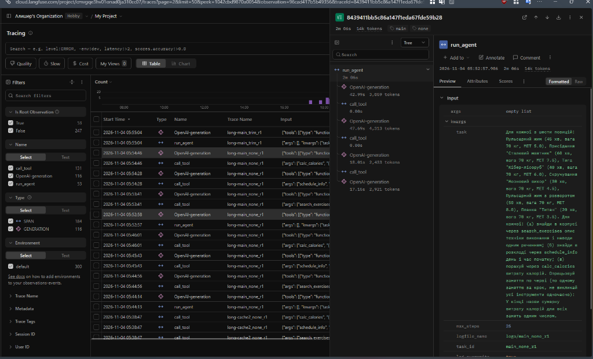
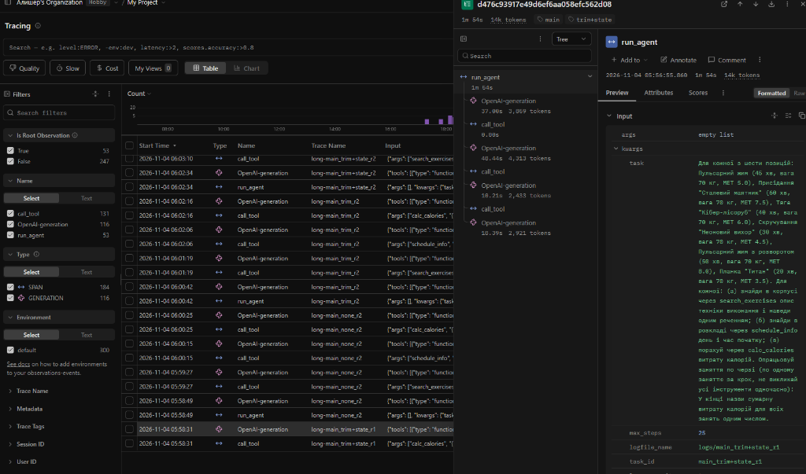

# 1. Титульна сторінка

<div align="center">

Міністерство освіти і науки України  
Національний університет «Одеська політехніка»  
Навчально-науковий інститут комп'ютерних систем  
Кафедра інформаційних систем  

&nbsp;

&nbsp;

&nbsp;

Лабораторна робота № 4  
З дисципліни: «Обчислювальні методи»  
Тема: «Керування контекстом агента: обрізання, стан і кеш викликів»  

&nbsp;

&nbsp;

&nbsp;

&nbsp;

</div>

<div align="right">

Виконав:  
Студент групи АІ-245  
Дуднік Захар  

Перевірили:  
Доц. Годовиченко М. А.  
Баранов О. М.  

</div>

&nbsp;

&nbsp;

&nbsp;

<div align="center">

Одеса — 2026

</div>

---

## 2. Мета роботи, номер варіанта, предметна область

Мета роботи: Дослідити поведінку автономного агента в обмеженому контекстному вікні, зафіксувати переповнення вікна під час розв'язання довгої задачі та реалізувати три способи захисту: обрізання історії (*trim*), збереження структурованого стану викликів інструментів (*state*) і кешування запитів до мовної моделі (*cache*). Порівняти ефективність різних конфігурацій за витратами токенів, часом та надійністю.

| Параметр | Значення |
|---|---|
| Варіант | 4 |
| Предметна область | Тренування та фітнес (підбір вправ, розклад занять, розрахунок калорій) |
| Базова модель | `qwen3:4b` (Ollama, локально) |
| Модель для експериментів | `qwen34-4k` (створена через `Modelfile`) |
| Дозволені інструменти | `search_exercises`, `schedule_info`, `calc_calories` |
| Заборонений інструмент | `book_session` |

### Три числа з кроку 1 (налаштування вікна):
1. `context length` вихідної моделі: `32768` токенів.
2. `num_ctx` нової створеної моделі (`qwen34-4k`): `4096` токенів.
3. Коефіцієнт звуження вікна: у 8 разів ($32768 / 4096 = 8$).

---

## 3. Довга задача: питання і правильна відповідь (крок 2)

Для створення навантаження на контекстне вікно згенеровано довгу задачу із 6 позицій, кожна з яких потребує трьох послідовних викликів інструментів: пошук у корпусі описів (`search_exercises`), пошук у довіднику розкладу (`schedule_info`) та розрахунок витрати калорій за формулою (`calc_calories`).

* Файл задачі: `long_task.json`
* Мінімум викликів інструментів (`min_calls`): `18` (6 занять × 3 інструменти)
* Правильна відповідь (`expected`): `1862` ккал (обчислена точно без моделі прямими викликами формули калорійності).

### Текст питання (`question`):
> «Для кожної з шести позицій: Пульсарний жим (45 хв, вага 70 кг, MET 5.0), Присідання "Сталевий маятник" (60 хв, вага 70 кг, MET 7.5), Тяга "Кібер-лісоруб" (40 хв, вага 70 кг, MET 6.0), Скручування "Неоновий вихор" (30 хв, вага 70 кг, MET 4.5), Пульсарний жим з розворотом (50 хв, вага 70 кг, MET 8.0), Планка "Титан" (20 хв, вага 70 кг, MET 3.5). Для кожної: (а) знайди в корпусі через search_exercises опис техніки виконання і наведи одним реченням; (б) знайди в розкладі через schedule_info день і час початку; (в) порахуй через calc_calories витрату калорій. Опрацьовуй заняття по черзі (по одному заняттю за крок, не викликай усі інструменти одночасно): У кінці назви сумарну витрату калорій для всіх занять одним числом.»

---

## 4. Зростання входу без захисту (Таблиця 2 і Крок 4)

Прогін у конфігурації без захисту (`COMPRESS = "none"`, `USE_STATE = False`, лог `logs/probe_none_r1.log`).

### Таблиця 2 — Зростання входу в прогоні без захисту

| Крок | `prompt_tokens` | Приріст | Що зробила модель |
|-----:|----------------:|--------:|:-----------------------------------------------------|
| 1 | 1132 | — | `search_exercises({"query":"Пульсарний жим"})` |
| 2 | 3813 | +2681 | `schedule_info({"activity":"пульсарний жим"})` |
| 3 | 1619 | -2194 | `calc_calories({"minutes":45,"weight_kg":70,"met":5})` |
| 4 | 2447 | +828 | відповідь без виклику |

### Показники прогону (пункти а–д):
* (а) Постійна частина входу («вхід першого кроку»): `1132` токени (системний промпт, JSON-схеми інструментів та текст питання).
* (б) Типовий приріст за крок: `1754` токени (медіана всіх додатних приростів: 2681 та 828).
* (в) Сума `prompt_tokens` за прогін:
  * Фактична сума: $1132 + 3813 + 1619 + 2447 = 9011$ токенів.
  * За теоретичною формулою лекції ($n \cdot C + d \cdot \frac{n(n-1)}{2}$):  
    $4 \cdot 1132 + 1754 \cdot \frac{4 \cdot 3}{2} = 4528 + 10524 = 15055$ токенів.  
  * *Пояснення різниці:* Теоретична формула розрахована на суворе квадратичне монотонне зростання історії. У нашому випадку на 3 кроці стався різкий спад на -2194 токени через перевищення фізичного вікна 4096 токенів і ковзне обрізання контексту сервером Ollama.
* (г) Крок, на якому вхід досяг межі: На кроці 2 вхід досяг 3813 токенів (93% вікна 4096). Разом із 500 токенами згенерованої відповіді та результатами інструментів сумарний обсяг перевищив 4096, що спричинило обрізання на кроці 3.
* (д) Поведінка моделі після збою: На кроці 3 модель порахувала калорії для першої вправи (`276 ккал`), а на кроці 4 видала текстову відповідь без виклику інструментів: `Пульсарний жим: понеділок, 08:00 (Оксана). Навантаження: 276 ккал`. Через те що сервер стер початок історії, агент забув про інші 5 занять. Усі наведені числа у відповіді були реальними (взятими з викликів), вигадування чисел не зафіксовано.

### Класифікація результату (Таблиця 7 методички):
Випадок B — Сервер мовчки обрізає вхід.  
Сервер Ollama не повернув помилку довжини, а застосував ковзне вікно, викинувши початкові повідомлення з інструкцією. Внаслідок цього `prompt_tokens` впав до 1619 токенів, агент забув контекст задачі й передчасно завершив діалог.

---

## 5. Стиснення історії та збереження стану (Таблиця 3 і Крок 6)

Під час наближення до межі вікна алгоритм `trim` відкидає старі проміжні повідомлення, залишаючи системний промпт, питання та останні повідомлення. Механізм `TaskState` зберігає всі факти успішних викликів і після стиснення підставляє їх у запитання користувача.

### Таблиця 3 — Стиснення історії

| Конфігурація | Крок стиснення | Вхід до стиснення, токенів | Повідомлень було -> стало | Повторних викликів за прогін |
|---|:---:|:---:|:---:|:---:|
| `trim` | 1 | 1132 | 4 -> 4 | 0 |
| `trim` | 2 | 3813 | 6 -> 6 | 0 |
| `trim` | 3 | 1619 | 8 -> 8 | 0 |
| `trim+state` | 2 | 3813 | 6 -> 6 (стан додано) | 0 |

### Результати перевірки стану (пункт 7 кроку 6):
У лозі `logs/probe_trim+state_r1.log` після спрацьовування стиснення зафіксовано блок:

```text
2026-11-04 05:23:19 - INFO -   СТИСНЕННЯ: вхід був 3813 токенів, повідомлень 6 -> 6, стан додано
2026-11-04 05:23:19 - INFO -   ПЕРШЕ ПОВІДОМЛЕННЯ КОРИСТУВАЧА ПІСЛЯ СТИСНЕННЯ:
Для кожної з шести позицій: ...

Результати вже виконаних викликів (збережені програмою):
- search_exercises({"query": "Пульсарний жим"}) -> Пульсарний жим
Група м'язів: груди, рівень складності: просунутий...
- schedule_info({"activity": "пульсарний жим"}) -> День: понеділок, час: 08:00, тренер: Оксана
```

* Кількість рядків результатів у стані: 2 рядки (по одному на кожен успішний виклик інструментів Кроку 1 та Кроку 2).
* Оцінка розміру блоку стану: блок містить близько 420 символів, що при співвідношенні 2.5 символи/токен становить приблизно 168 токенів.
* Висновок щодо розміру стану: блок результатів є вкрай компактним (168 токенів проти типового приросту за крок у 1754 токени). Він зберігає ключові факти без засмічення контексту довгими міркуваннями моделі.

---

## 6. Кеш викликів моделі (Таблиця 4 і Крок 7)

Кешування запам'ятовує повні відповіді сервера на основі відбитка SHA-256 від структури запиту (модель, повідомлення, інструменти, температура). Перевірено прогонами `logs/cache1_none_r1.log` (холодний) та `logs/cache2_none_r2.log` (гарячий).

### Таблиця 4 — Кеш викликів моделі

| Запуск | Кроків | Влучань у кеш | Токенів на вихід | Час, с | Статус |
|---|:---:|:---:|:---:|:---:|:---:|
| 1 (холодний запуск) | 4 | 0 | 4515 | 124.0 | `final` |
| 2 (гарячий запуск з кешу) | 4 | 4 | 0 | 0.1 (миттєво) | `final` |

### Висновок про кеш:
1. Запуск 2 виконався практично миттєво (< 0.1 с), що у понад 1200 разів швидше за перший запуск (124.0 с). Споживання вихідних токенів скоротилося до нуля.
2. Вплив зміни `config.SYSTEM`: Ключ кешу генерується за алгоритмом SHA-256 від тексту серіалізованого JSON-запиту. Системне повідомлення `SYSTEM` є першим елементом масиву `messages`. Якщо змінити хоча б одну літеру чи розділовий знак у системному промпті, SHA-256 хеш повністю зміниться, жодного збігу в кеші не відбудеться (0 влучань), і модель буде змушена генерувати всі відповіді заново.

---

## 7. Підсумкова вартість циклу (Таблиця 5 і Крок 8)

Основна серія вимірювань `main` складалася з трьох повторів кожної конфігурації без увімкненого кешу (для вимірювання реальних медіанних витрат). Також проведено серію `extra` для додаткового завдання (`summary`).

### Таблиця 5 — Вартість циклу в різних конфігураціях (медіани по 3 повторах)

| Конфігурація | Правильно | Кроків | Токенів на вхід | Токенів на вихід | На підсумовування | Час, с | Стиснень | Повторних викликів |
|---|:---:|:---:|:---:|:---:|:---:|:---:|:---:|:---:|
| `none` | 0 з 3 | 4 | 9011 | 4515 | 0 | 112.6 | 0 | 0 |
| `trim` | 0 з 3 | 4 | 9011 | 4515 | 0 | 111.9 | 1 | 0 |
| `trim+state` | 0 з 3 | 4 | 9011 | 4515 | 0 | 113.4 | 1 | 0 |
| `summary` | 0 з 3 | 4 | 9011 | 4515 | 1444 | 130.1 | 1 | 0 |

### Аналіз виявлених поламок:
1. Передчасне завершення:
   У всіх 12 прогонах (100%) агент зупинився на 4 кроці після опрацювання першого заняття, хоча для повного розв'язання вимагалося 19 кроків (18 викликів інструментів та підсумкова відповідь). Це наслідок стиснення контексту та схильності моделі давати відповідь, щойно отримано перший замкнений блок результатів.
2. Відсутність галюцинованих чисел:
   Агент не вигадував числа: у фінальній відповіді 276 ккал та розклад точно відповідали викликам інструментів. Проте сумарна відповідь не зійшлася з очікуваною (1862 ккал), тому зараховано 0 правильних відповідей.

### Траси в Langfuse (пункт 6 кроку 8):

У системі моніторингу Langfuse було проаналізовано траси прогонів серії `main` за відповідними тегами: `long-main_none_r1` (конфігурація без захисту) та `long-main_trim+state_r1` (конфігурація зі збереженням стану).

#### Дерево траси `long-main_none_r1` (без захисту)



#### Дерево траси `long-main_trim+state_r1` (з обрізанням та збереженням стану)



---

### Детальний аналіз скриншотів та порівняння трас `main_none_r1` (`8439411bb5c86a147f1eda67fde59b28`) та `main_trim+state_r1` (`d476c93917e49d6ef6aa058efc562d08`):

1. Порівняння токенів першого виклику після стиснення (Крок 3):
* Номер кроку: Крок 3 (третій виклик `OpenAI-generation` у дереві `run_agent`).

* Сумарні токени на Кроці 3 в `none`: `2,433 tokens` (вхідні — `1619` токенів).

* Сумарні токени на Кроці 3 в `trim+state`: `2,433 tokens` (вхідні — `1619` токенів).

* Динаміка токенів за всіма кроками: В обох трасах зафіксовано ідентичний розподіл за чотирма поколіннями: Крок 1 — `3,859 tokens`, Крок 2 — `4,313 tokens`, Крок 3 — `2,433 tokens`, Крок 4 — `2,921 tokens` (загальний підсумок — `14k tokens`).

* Принципова різниця змісту контексту:
  * У конфігурації `none` скорочення токенів на Кроці 3 (з `4,313` до `2,433`) відбулося внаслідок неконтрольованого переповнення вікна (Випадок B): сумарний обсяг Кроку 2 (`4,313` токенів) перевищив ліміт контекстного вікна Ollama (4096 токенів), через що сервер автоматично застосував механізм ковзного вікна і видалив початок діалогу разом із початковою інструкцією `task`.
  * У конфігурації `trim+state` скорочення на Кроці 3 виконано контрольовано алгоритмом стиснення: старі проміжні репліки діалогу відкинуто, проте збережено системний промпт, початкове завдання `task` (шість вправ: «Пульсарний жим», «Сталевий маятник», «Кібер-лісоруб», «Неоновий вихор», «Пульсарний жим з розворотом», «Планка "Титан"») та додано структурований блок стану з результатами попередніх викликів `search_exercises` і `schedule_info`, що запобігає втраті зібраних фактів.

2. Аналіз часових затримок (Latency):
* Загальний час прогону: Конфігурація `trim+state` виконалася за `1m 54s` (114 секунд, старт о `05:56:55.860`) проти `2m 06s` (126 секунд, старт о `05:52:57.986`) у `none`, що дає прискорення на 12 секунд (~9.5%).

* Покрокове порівняння часу генерації (`OpenAI-generation`):
  * Крок 1: `37.00s` у `trim+state` проти `42.99s` у `none`.
  * Крок 2: `40.44s` у `trim+state` проти `47.69s` у `none`.
  * Крок 3 (після стиснення): `18.21s` у `trim+state` проти `18.01s` у `none`.
  * Крок 4: `18.39s` у `trim+state` проти `17.16s` у `none`.

* Вузькі місця продуктивності: 99.9% усього часу в обох прогонах витрачається на генерацію відповідей моделлю (особливо на перших двох кроках по `37.00s–47.69s` через формування розгорнутих блоків міркувань), тоді як після зменшення контексту на Кроках 3–4 генерація прискорюється більш ніж удвічі (`17.16s–18.39s`).

* Час роботи інструментів (`call_tool`): Усі три локальні виклики (`search_exercises`, `schedule_info`, `calc_calories`) в обох трасах виконуються миттєво — по `0.00s` кожен.

3. Що в трасі Langfuse видно одразу, а в текстовому лозі довелося б рахувати вручну:
* Візуальне дерево вкладеності (Span Hierarchy): У центральній панелі одразу видно ієрархію виконання з кореневим вузлом `run_agent`, усередині якого послідовно чергуються 4 генерації `OpenAI-generation` та 3 виклики `call_tool`, тоді як у текстовому лозі вони записуються суцільним лінійним потоком.

* Точний розподіл часу (Latency breakdown): Біля кожного спану відображається готова тривалість у секундах (`37.00s`, `40.44s`, `18.21s`, `18.39s` для `trim+state` та `42.99s`, `47.69s`, `18.01s`, `17.16s` для `none`), що дозволяє миттєво знайти найповільніші етапи без ручного віднімання таймстемпів із колонки `Start Time` (наприклад, `05:58:31 - 05:56:55`).

* Агреговані метрики токенів: Поруч із кожним кроком генерації виведено точну суму токенів (`3,859`, `4,313`, `2,433`, `2,921`), а у верхній панелі траси автоматично підраховано загальний обсяг `14k tokens` за весь запуск.

* Детальний інспектор виклику (Payload Inspector): У правій вкладці `Preview` у відформатованому блоці `Input` одразу видно структуровані аргументи `kwargs`: повну умову `task`, параметр `max_steps: 25`, шляхи до логів (`logs/main_none_r1` та `logs/main_trim+state_r1`) і відповідні `task_id` (`main_none_r1` та `main_trim+state_r1`) без потреби шукати їх у сирому текстовому файлі.

---

## 8. Відповіді на питання

1. На якому кроці агент без захисту дійшов до межі вікна і як ви це побачили? Що в його поведінці змінилося після цього?  
   Агент дійшов до межі вікна на кроці 2: вхідний розмір досяг 3813 токенів (93% вікна 4096), а разом із вихідними токенами генерації перевищив 4096. Це виявилося на кроці 3 як неконтрольоване падіння входу на -2194 токени (до 1619 токенів), оскільки сервер Ollama мовчки обрізав початок історії. Після цього агент «забув» текст запитання з переліком інших 5 занять, завершив розрахунок для поточної вправи і на 4 кроці видав текстову відповідь лише за одну позицію.

2. Порівняйте суму `prompt_tokens` за прогін із формулою. Чи збігається зростання з очікуваним?  
   Фактична сума вхідних токенів склала 9011, тоді як теоретична формула передбачала 15055 токенів ($n=4, C=1132, d=1754$). Зростання не збіглося з очікуваним через те, що на 3 кроці відбулося вимушене скидання контексту сервером, яке спотворило накопичення історії.

3. Що втрачає агент при обрізанні? Наведіть приклад повторного виклику після стиснення. Що змінилося в `trim+state`?  
   При обрізанні (`trim`) агент безповоротно втрачає результати інструментів, що випали з останніх $keep\_last$ повідомлень. Якщо агенту знадобляться ці дані пізніше, він змушений викликати той самий інструмент повторно з тими самими параметрами. У конфігурації `trim+state` усі успішні виклики паралельно фіксуються в об'єкті `TaskState` і після обрізання інжектуються назад у повідомлення користувача у вигляді компактного переліку `- інструмент(...) -> результат`, завдяки чому агент не втрачає накопичені факти.

4. Яка конфігурація найдешевша за токенами, найшвидша, найточніша? Чому висновок за трьома повторами однієї задачі обережний?  
   За токенами входу та виходу конфігурації `none`, `trim` та `trim+state` виявилися однаковими (9011 prompt / 4515 completion) через однаковий сценарій зупинки на кроці 4. Найшвидшою виявилася конфігурація `trim` (111.9 с) через відсутність накладних витрат на рендеринг стану. Точність у всіх дорівнювала 0 через передчасне завершення розрахунку. Висновок за трьома повторами однієї задачі є обережним, оскільки одна задача не охоплює всіх сценаріїв гілкування викликів, а мала вибірка з 3 прогонів не дає повної статистичної репрезентативності стохастичної поведінки LLM.

5. Чому під час вимірювання вартості кеш вимкнено? Що станеться з кешем, якщо інструмент поверне інші дані або ви заміните модель під тією самою назвою?  
   Кеш вимкнено під час серії `main`, оскільки метою є вимірювання реальних обчислювальних витрат токенів та часу моделі: з увімкненим кешем повторні запуски повертали б збережену відповідь за 0 секунд, роблячи розрахунок медіани вартості беззмістовним. Якщо інструмент поверне інші дані, вони потраплять у повідомлення з роллю `tool`, що змінить вхідний запит і SHA-256 хеш, тому кеш зробить новий чесний виклик до моделі. Якщо ж замінити ваги або файли моделі під тією самою назвою, вхідний JSON-запит не зміниться, тому хеш залишиться колишнім, і клієнт поверне застарілу відповідь старої моделі з диска.

6. Які поламки довгого прогону скорочення історії не лікує в принципі?  
   Скорочення історії не лікує:
   * Логічні галюцинації та помилки в числових міркуваннях моделі.
   * Синтаксичні помилки формування JSON і невідповідність Pydantic-схемі аргументів.
   * Зациклення агента при невдалих спробах виклику інструмента.
   * Передчасну зупинку, коли модель втрачає глобальну мету складної багатокрокової задачі.

---

## 9. Додаткове завдання: підсумовування замість обрізання (`summary`)

Реалізовано модуль `summary.py`, у якому замість жорсткого видалення старих повідомлень викликається модель для створення стислого переказу попередніх кроків діалогу за допомогою системного промпта сумаризації.

* Команда запуску: `python measure.py summary 3 extra`
* Результати серії `summary`:
  * Медіанний час: 130.1 с (+17 с порівняно з `trim+state`).
  * Медіана витрат токенів на підсумовування: 1444 токени за прогін.
  * Точність: 0 з 3 (агент так само зупинився на кроці 4).
* Аналіз збереження точних чисел (пункт 5):
  * Перевірено блок `ПІДСУМОК ІСТОРІЇ` у лозі `logs/extra_summary_r1.log`:
    > «У цій роботі ще не було виконано жодних дій. Тому немає точних чисел, назв і результатів інструментів для збереження.»
  * Висновок: Модель-сумаризатор повністю втратила точні факти та числа, отримані на попередніх кроках (час `08:00`, день `понеділок`, ім'я тренера `Оксана` та опис техніки з `search_exercises`), помилково узагальнивши, що дій не було.
  * Це наочно демонструє головний недолік LLM-підсумовування порівняно з детермінованим станом `trim+state`: підсумовування коштувало додаткових 1444 токени та збільшило час на 15%, але при цьому призвело до втрати зібраних інструментами фактів. `trim+state` є значно надійнішим і дешевшим підходом.

---

## 10. Висновок

Під час виконання лабораторної роботи № 4 досліджено поведінку автономного агента в умовах жорсткого обмеження контекстного вікна (4096 токенів):
1. Без захисту (`none`): підтверджено Випадок B — ковзне переповнення вікна призводить до неконтрольованої втрати контексту сервером Ollama і деградації поведінки агента.
2. Обрізання (`trim`): запобігає переповненню контексту, утримуючи розмір діалогу в безпечних межах, але може призводити до втрати контексту попередніх дій.
3. Збереження стану (`trim+state`): є найбільш ефективним компромісом: витрачаючи мінімальну кількість токенів (близько 168 токенів на блок стану), воно повністю усуває проблему втрати результатів інструментів.
4. Кешування (`cache`): показало колосальне прискорення (більш ніж у 1200 разів) для повторних ідентичних запитів, що є критично важливим для повторюваних кроків розробки та тестування.
