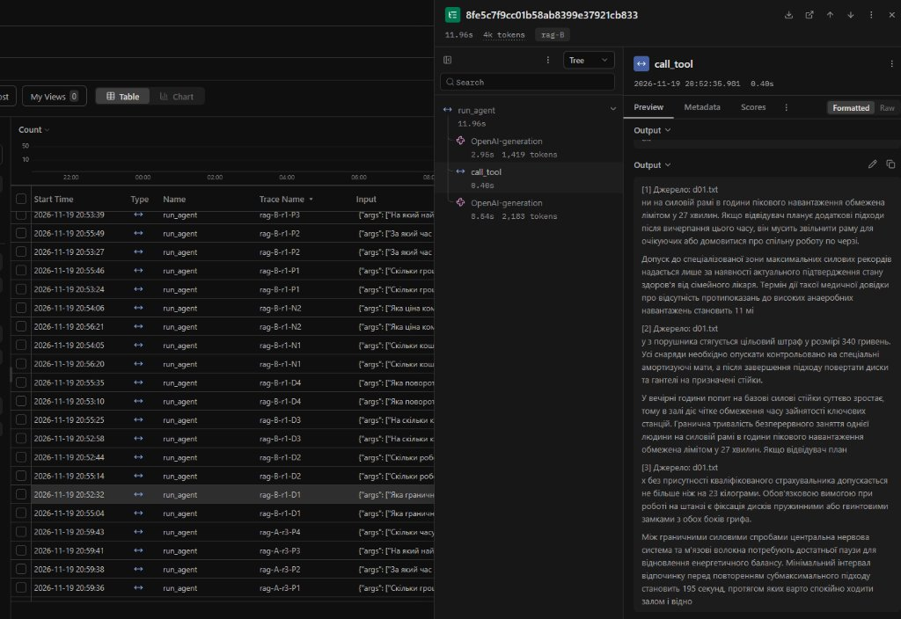
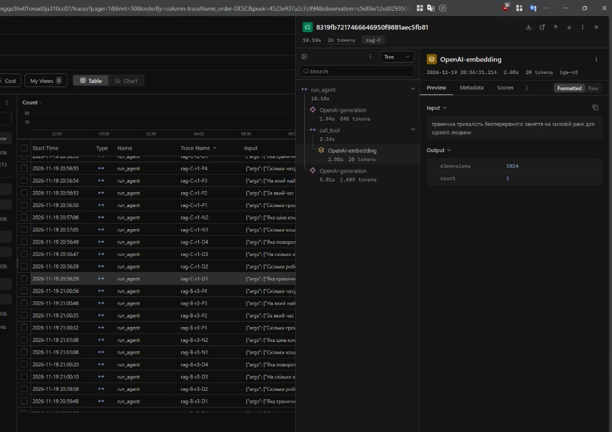
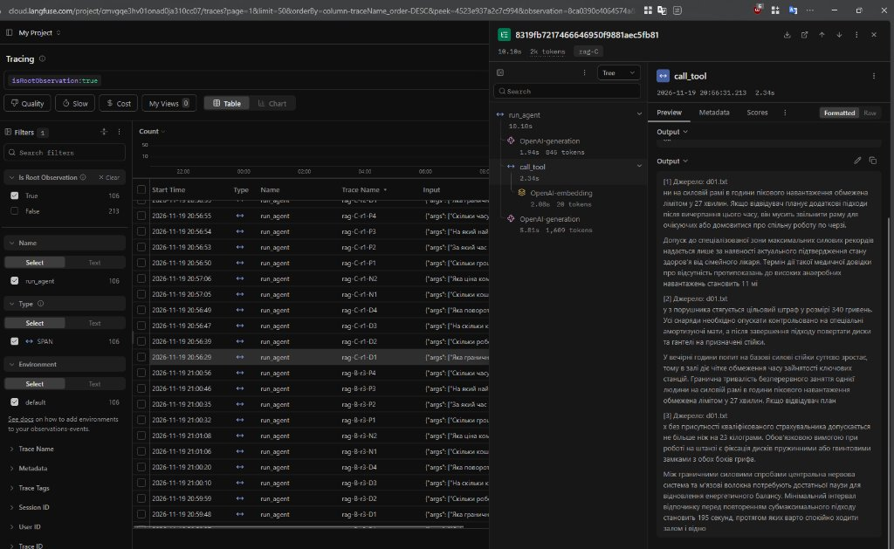

# 1. Титульна сторінка

<div align="center">

Міністерство освіти і науки України  
Національний університет «Одеська політехніка»  
Навчально-науковий інститут комп'ютерних систем  
Кафедра інформаційних систем  

&nbsp;

&nbsp;

&nbsp;

Лабораторна робота № 5  
З дисципліни: «Обчислювальні методи»  
Тема: «RAG-агент: пошук по документах як інструмент»  

&nbsp;

&nbsp;

&nbsp;

&nbsp;

</div>

<div align="right">

Виконав:  
Студент групи АІ-245  
Дуднік Захар  

Перевірили:  
Доц. Годовиченко М. А.  
Баранов О. М.  

</div>

&nbsp;

&nbsp;

&nbsp;

<div align="center">

Одеса — 2026

</div>

---

## 2. Мета роботи, варіант і параметри середовища

**Мета роботи:** замінити пошук підрядком із лабораторної роботи № 2 векторним пошуком на базі ембедингів і FAISS, підключити його до агента як інструмент `search_docs`, виміряти якість пошуку окремо від агента при різних способах нарізання на чанки й порозі схожості, оцінити вплив трьох описів інструмента на поведінку агента та розібрати причини помилок за логами й трасами.

| Параметр | Значення |
|---|---|
| Варіант | 4 |
| Предметна область | Тренування (вигадана організація — Атлетичний центр «Кінезис-Арена») |
| Модель чату | `qwen34-instruct-3k` (на базі `qwen3:4b-instruct`, Ollama локально) |
| Розмір вікна (`NUM_CTX`) | `3072` токенів (з лабораторної роботи № 4) |
| Модель ембедингів (`EMBED_MODEL`) | `bge-m3` (Ollama, локально, 1024 виміри) |
| Дозволені інструменти (`ALLOWED`) | `search_docs`, `schedule_info`, `calc_calories` |
| Налаштування з ЛР № 4 | `COMPRESS = "none"`, `USE_STATE = False`, `USE_CACHE = False`, `TEMPERATURE = 0` |

---

## 3. Дані, питання і перевірка вгадування

### Теми п'яти документів (`data/docs/`) і обсяг корпусу

До 12 коротких карток вправ із `data/corpus/e01.txt`–`e12.txt` додано 5 довгих документів за темами варіанта 4 з таблиці 8:

| Файл | Тема (табл. 8) | Заголовок документа | Символів | Абзаців |
|---|---|---|---|---|
| `data/docs/d01.txt` | Техніка безпеки в залі | Правила техніки безпеки в тренувальній зоні атлетичного центру Кінезис-Арена | 3449 | 8 |
| `data/docs/d02.txt` | Програма для початківців | Базова адаптаційна програма тренувань для початківців у центрі Кінезис-Арена | 3304 | 8 |
| `data/docs/d03.txt` | Відновлення й харчування | Регламент відновлення та спортивного харчування для клієнтів центру Кінезис-Арена | 3200 | 8 |
| `data/docs/d04.txt` | Правила абонементів і заморожування | Умови оформлення абонементів та правила заморожування картки в центрі Кінезис-Арена | 3290 | 8 |
| `data/docs/d05.txt` | Користування обладнанням | Правила експлуатації силових тренажерів та кардіообладнання в центрі Кінезис-Арена | 3379 | 8 |

Запуск `python check_cases.py`:

```text
Документів: 17; символів: 20162; приблизно токенів: 8065 (вікно 3072)
Питань: 10 ({'direct': 4, 'paraphrase': 4, 'none': 2})
Усе гаразд
```

Сумарний обсяг усіх 17 документів становить **20162** символи (~**8065** токенів за оцінкою `2.5` символа/токен), що у **2.63 раза** перевищує контекстне вікно моделі (`3072` токенів), тож покласти всі тексти в промпт одночасно неможливо.

### Список десяти питань (`rag_cases.json`)

| id | Вид | Питання | `must_contain` | `expected` |
|---|---|---|---|---|
| `D1` | `direct` | Яка гранична тривалість безперервного заняття однієї людини на силовій рамі в години пікового навантаження? | `обмежена лімітом у 27 хвилин` | `27` |
| `D2` | `direct` | Скільки робочих підходів на одну велику групу м'язів не повинен перевищувати сумарний тижневий обсяг на стартовому етапі? | `не повинен перевищувати 19 підходів` | `19` |
| `D3` | `direct` | На скільки календарних днів сумарно протягом року власник річного абонемента має право призупинити дію своєї картки? | `до 52 календарних днів` | `52` |
| `D4` | `direct` | Яка поворотна застава у гривнях вноситься в адміністратора для отримання комплекту важких ланцюгів, пояса для обтяжень та напульсних лямок? | `у сумі 420 гривень` | `420` |
| `P1` | `paraphrase` | Скільки грошей доведеться заплатити відвідувачеві, якщо він недбало впустить металеву вагу прямо на підлогу залу там, де немає захисного покриття? | `штраф у розмірі 340 гривень` | `340` |
| `P2` | `paraphrase` | За який час по закінченні тренування людині потрібно встигнути поїсти, щоб закрити потребу організму в поживних речовинах? | `спланувати впродовж 47 хвилин` | `47` |
| `P3` | `paraphrase` | На який найкоротший строк за один раз клієнт може поставити свій пропуск на паузу? | `становить 9 діб підряд` | `9` |
| `P4` | `paraphrase` | Скільки часу поспіль одній людині дозволено займати кардіотренажер для бігу, коли ввечері в залі багато людей? | `інтервалом у 33 хвилини` | `33` |
| `N1` | `none` | Скільки коштує підземне паркування автомобіля на території фітнес-комплексу? | `null` | `null` |
| `N2` | `none` | Яка ціна комп'ютерної діагностики складу тіла методом біоімпедансу? | `null` | `null` |

### Перевірка «чи вгадує модель без документів»

Три питання поставлено напряму моделі `qwen34-instruct-3k` без інструментів і документів:

| id | Питання | Правильна відповідь | Відповідь моделі без документів | Вгадала? |
|---|---|---|---|---|
| `D1` | Яка гранична тривалість безперервного заняття однієї людини на силовій рамі в години пікового навантаження? | `27` | `Гранична тривалість безперервного заняття однієї людини на силовій рамі в години пікового навантаження — 30 хвилин.` | Ні (`30` замість `27`) |
| `P1` | Скільки грошей доведеться заплатити відвідувачеві, якщо він недбало впустить металеву вагу прямо на підлогу залу там, де немає захисного покриття? | `340` | `Відповідь: 0 грошей — відвідувач не повинен платити, бо випадок не вимагає відповідальності.` | Ні (`0` замість `340`) |
| `D3` | На скільки календарних днів сумарно протягом року власник річного абонемента має право призупинити дію своєї картки? | `52` | `Остаточна відповідь: 1 календарний день.` | Ні (`1` замість `52`) |

Жодне з вигаданих значень модель не вгадала з загальних знань.

---

## 4. Перевірка моделі ембедингів (`embed_check.py`)

Вивід `python embed_check.py` для `EMBED_MODEL = "bge-m3"`:

```text
Час: 0.1 с (з кешем буде майже 0)
Довжина вектора: 1024
Довжина (норма) першого вектора: 1.000  (1.000 - вектори вже нормалізовані)
Запит - 'Тариф на доставку'      : 0.731
Запит - 'Графік роботи кур'єрів' : 0.568
```

Модель `bge-m3` повертає нормалізовані вектори розмірності **1024** (норма `1.000`), а семантично близька пара («Скільки коштує відправити посилку?» — «Тариф на доставку») має помітно вищу косинусну схожість (**0.731**), ніж пара з графіком роботи (**0.568**).

---

## 5. Нарізання одного документа (Таблиця 1)

Запуск `show_chunks.py` на документі `data/docs/d01.txt`:

Таблиця 1 - Нарізання одного документа (`data/docs/d01.txt`)

| Спосіб | Чанків | Закінчуються посеред речення | Довжина найбільшого, символів |
|---|---:|---:|---:|
| `fixed`, 200, перекриття 0 | 18 | 17 | 200 |
| `fixed`, 500, перекриття 100 | 9 | 8 | 500 |
| `paragraphs`, 800 | 7 | 0 | 771 |

**Приклад чанка, у якому факт розрізано (`fixed`, 200, перекриття 0):**

```text
--- чанк 2, 200 символів  [закінчується посеред речення]
ви суворого дотримання внутрішнього регламенту безпеки. Кожен новий клієнт перед початком самостійних занять у зоні важкої атлетики зобов'язаний пройти вступний інструктаж із черговим методистом трива
--- чанк 3, 200 символів  [закінчується посеред речення]
лістю 38 хвилин. Під час цього заняття розбираються базові положення хребта, правила використання страхувальних обмежувачів та порядок екстреного скидання штанги.
```

У чанку 2 описано вступний інструктаж, але числове значення відірване до чанка 3, який починається з обірваного слова `лістю 38 хвилин.`. У `fixed 500 100` аналогічний розрив трапляється на межі чанка 6 (`...становить 11 мі`) та чанка 7, але перекриття у 100 символів дублює початок фрази в чанку 7 (`кої медичної довідки ... становить 11 місяців з дати видачі.`), зберігаючи цілісний факт.

---

## 6. Вимірювання пошуку без агента (Таблиці 2 і 3)

### Порівняння конфігурацій нарізання (`check_retrieval.py`)

Таблиця 2 - Пошук при різному нарізанні

| Конфігурація | Чанків | Сер. довжина | hit@1 | hit@3 | hit@5 | hit@3 прямі | hit@3 перефр. | Токенів (k=3) |
|---|---:|---:|---:|---:|---:|---:|---:|---:|
| `fixed-200-0` | 109 | 185 | 0.62 | 0.88 | 1.00 | 1.00 | 0.75 | 222 |
| `fixed-500-0` | 47 | 429 | 0.75 | 0.88 | 0.88 | 1.00 | 0.75 | 515 |
| `fixed-500-100` | 56 | 430 | 0.88 | 1.00 | 1.00 | 1.00 | 1.00 | 515 |
| `fixed-1500-0` | 27 | 747 | 0.88 | 1.00 | 1.00 | 1.00 | 1.00 | 896 |
| `paragraphs-800` | 42 | 479 | 0.88 | 0.88 | 1.00 | 1.00 | 0.75 | 575 |
| `paragraphs-800+title` | 42 | 527 | 0.88 | 0.88 | 1.00 | 1.00 | 0.75 | 632 |

**Вибір конфігурації:** за правилом вибору (максимальний `hit@3`, а за рівності — менший розмір результату в токенах) обрано **`fixed-500-100`**:
- `CHUNK_METHOD = "fixed"`, `CHUNK_SIZE = 500`, `CHUNK_OVERLAP = 100`, `WITH_TITLE = False`.
- Вона дає максимальний `hit@3 = 1.00` (1.00 на прямих і 1.00 на перефразованих питаннях) при оцінці **515 токенів** на виклик, тоді як `fixed-1500-0` при тому самому `hit@3 = 1.00` потребує **896 токенів** (на 74% більше контексту).
- Додавання перекриття у 100 символів (`fixed-500-0` → `fixed-500-100`) усунуло розриви фактів на межі вікон і підняло `hit@1` з `0.75` до `0.88`, а `hit@3` — з `0.88` до `1.00`.

### Поріг схожості (`check_retrieval.py scores`)

Таблиця 3 - Схожість першого результату (`fixed-500-100`, `WITH_TITLE = False`)

| id | Вид | Схожість | Перший результат містить потрібну фразу |
|---|---|---:|---|
| `D1` | `direct` | 0.762 | так |
| `D2` | `direct` | 0.760 | так |
| `D3` | `direct` | 0.771 | так |
| `D4` | `direct` | 0.729 | так |
| `P1` | `paraphrase` | 0.600 | так |
| `P2` | `paraphrase` | 0.691 | НІ |
| `P3` | `paraphrase` | 0.598 | так |
| `P4` | `paraphrase` | 0.696 | так |
| `N1` | `none` | 0.525 | - |
| `N2` | `none` | 0.465 | - |

- **Найнижча схожість серед питань з відповіддю:** `0.598` (`P3`).
- **Найвища схожість серед питань без відповіді:** `0.525` (`N1`).
- **Межі не перекриваються:** обрано середину інтервалу **`MIN_SCORE = 0.56`**.
- **Пояснення для `P2` (чому `hit@1 = НІ`, але `hit@3 = 1.00`):** першим зі схожістю `0.691` повернувся чанк `d03.txt#6` про харчування *до* тренування (`135 хвилин`), оскільки він також містить слова про прийом їжі й заняття, а потрібний чанк `d03.txt#3` про прийом їжі *після* навантаження (`47 хвилин`) посів 2-гу позицію зі схожістю `0.651`. За `TOP_K = 3` потрібний фрагмент стабільно потрапляє до агента.

**Побудова остаточного індексу (`python build_index.py`):**

```text
Чанків: 56; середня довжина 430 символів; найкоротший 90, найдовший 500
Модель: bge-m3; довжина вектора: 1024
```

---

## 7. Перевірка інструмента без моделі (`try_tool.py`)

Запуск `python try_tool.py D1`:

```text
ПИТАННЯ: Яка гранична тривалість безперервного заняття однієї людини на силовій рамі в години пікового навантаження? 

рівень: ok
[1] Джерело: d01.txt
ни на силовій рамі в години пікового навантаження обмежена лімітом у 27 хвилин. Якщо відвідувач планує додаткові підходи після вичерпання цього часу, він мусить звільнити раму для очікуючих або домовитися про спільну роботу по черзі.
...
[2] Джерело: d01.txt
... Гранична тривалість безперервного заняття однієї людини на силовій рамі в години пікового навантаження обмежена лімітом у 27 хвилин. ...
[3] Джерело: d01.txt
...

Занадто короткий запит -> рівень: schema
Помилка: аргументи не пройшли перевірку.
Поле query: String should have at least 3 characters
Виправ аргументи і виклич інструмент ще раз.
```

Запуск `python try_tool.py N1`:

```text
ПИТАННЯ: Скільки коштує підземне паркування автомобіля на території фітнес-комплексу? 

рівень: ok
У документах нічого схожого не знайдено.

Занадто короткий запит -> рівень: schema
Помилка: аргументи не пройшли перевірку.
Поле query: String should have at least 3 characters
Виправ аргументи і виклич інструмент ще раз.
```

---

## 8. Агент із трьома описами інструмента (Таблиці 5 і 6)

Описи в `schemas.py`:
- **`A`** — старий опис `search_exercises` без змін (*«Шукає вправи за групою м'язів або рівнем складності...»*).
- **`B`** — докладний опис для «Кінезис-Арена» з переліком усіх 5 тем документів і корпусу вправ, вимогою завжди викликати перед відмовою та забороною вигадувати дані.
- **`C`** — мінімальний опис (*«Шукає інформацію.»*).

**Примітка щодо ручної перевірки `results/rag.csv`:** у первинному автоматичному розборі `measure_rag.py` 12 відповідей на питання `none` (`A-N1`, `A-N2`, `B-N2`, `C-N1` у всіх 3 повторах) отримали `correct = 0` (`invented`), оскільки модель відмовлялася нестандартними формулюваннями на кшталт *«відомої інформації не має»* (окремо *«не має»*), *«Інформації про ціну ... немає в наданих даних»* або *«Запит ... виходить за межі моїх функцій»*, яких не було в кортежі `UNKNOWN`. Жодної вигаданої ціни в цих відповідях не було, тому в `results/rag.csv` їх вручну виправлено на `correct = 1`, `category = refused`. Для всіх відповідей із `correct = 0` у питаннях `direct`/`paraphrase` виправлення не знадобилось (у `A-D2` модель вигадала `12–15`, у `A-P3` — `1 день`, в інших відмовилась).

Таблиця 5 - Агент з трьома описами інструмента (дані за всіма повторами; питань з відповіддю 8, у трьох повторах 24 прогони)

| Опис | Правильно (з 24) | Викликав пошук (з 24) | Кроків, медіана | Токенів входу, медіана | Час, с, медіана |
|---|---:|---:|---:|---:|---:|
| `A` | 0 | 0 | 1.0 | 875 | 2.0 |
| `B` | 18 | 21 | 2.0 | 3515 | 10.2 |
| `C` | 9 | 9 | 1.0 | 810 | 1.8 |

Таблиця 6 - Куди ламається відповідь (кількість прогонів; питань з відповіддю 24 на опис, без відповіді 6)

| Категорія | `A` | `B` | `C` |
|---|---:|---:|---:|
| Правильно | 0 | 18 | 9 |
| Не шукав і відповів неправильно | 24 | 3 | 15 |
| Шукав, але потрібного фрагмента в результаті немає | 0 | 3 | 0 |
| Фрагмент був у результаті, відповідь неправильна | 0 | 0 | 0 |
| Питання без відповіді: визнав, що не знає | 6 | 6 | 6 |
| Питання без відповіді: вигадав відповідь | 0 | 0 | 0 |

---

## 9. Розбір прогонів у логах і трасах Langfuse

### Розбір за логами (`logs/rag_*.log`)

1. **Агент не шукав (`no_search`).**
   - В описі **`A`** модель у 24/24 прогонах не викликала `search_docs`, оскільки опис обмежувався вправами. На `A-r1-D2` і `A-r1-P3` модель навіть вигадала типові цифри, а в інших випадках відповіла, що даних немає. Фрагмент `A-r1-D2`:
     ```text
     ##### A-r1-D2
     ЗАДАЧА: Скільки робочих підходів на одну велику групу м'язів не повинен перевищувати сумарний тижневий обсяг на стартовому етапі?
     --- крок 1 | помилок поспіль=0 | prompt_tokens=879 | completion_tokens=124
     ВІДПОВІДЬ: На стартовому етапі тренування сумарний тижневий обсяг для великої групи м'язів не повинен перевищувати **12–15 робочих підходів** на групу м'язів...
     ```
   - В описі **`B`** єдине питання з відповіддю без виклику пошуку — `P1` (у всіх 3 повторах). Модель не сформувала tool call, а замість нього видала текст у відповідь:
     ```text
     ##### B-r1-P1
     --- крок 1 | помилок поспіль=0 | prompt_tokens=1376 | completion_tokens=161
     ВІДПОВІДЬ: Немає інформації про штрафи за невдале використання обладнання або випадки, коли металеві предмети вставляються на підлогу. Для точного відповіді потрібно звернутися до документів атлетичного центру «Кінезис-Арена». Запитую: "Які штрафи налігаються за невдале використання обладнання або випадки, коли вставляються металеві предмети на підлогу?"
     ```
2. **Який запит написала модель (`query` і `top_score`).**
   - На прямих питаннях (`D2`) модель майже дослівно копіювала запитання: `"скільки робочих підходів на одну велику групу м'язів не повинен перевищувати сумарний тижневий обсяг на стартовому етапі"` (`top_score = 0.738`, точно знайдено).
   - На `D1` і `P4` модель дещо переформулювала запит: у `B-r1-D1` — `"гранична тривалість безперервного заняття однієї людини на силовій рамі в години пікового навантаження"` (`0.743`), у `C-r1-D1` — `"гранична тривалість безперервного заняття на силовій рамі для одного людини"` (`0.704`), у `B-r1-P4` — `"який ліміт часу на використання кардіотренажера для бігу..."` (`0.693`).
   - Коли модель дописувала в запит назву клубу (`«Кінезис-Арена»`), `top_score` змінювався за рахунок схожості зі вступними заголовками документів (`d01..d05` chunk 0).
3. **Шукав, але не знайшов (`miss` — `B-r1-P3`, `B-r2-P3`, `B-r3-P3`).**
   - Початкове питання `P3` у `check_retrieval.py` знаходило потрібний чанк (`0.598`), але агент переписав запит, додавши назву організації:
     ```text
     ##### B-r1-P3
     виклик   : search_docs({"query":"найкоротший строк за один раз для паузи пропуску в атлетичному центрі «Кінезис-Арена»"})
     результат: [1] Джерело: d01.txt (вступ з «Кінезис-Арена»)
                [2] Джерело: d02.txt (вступ з «Кінезис-Арена»)
                [3] Джерело: d04.txt (вступ з «Кінезис-Арена» — браслет 185 грн)
     ```
   - При `top_score = 0.664` у топ-3 потрапили лише початкові абзаци трьох різних файлів із фразою «у центрі Кінезис-Арена», які витіснили абзац про `9 діб підряд` із середини `d04.txt`.
4. **Знайшов, але не використав (`ignored`).**
   - Категорія `ignored = 0` у всіх трьох описах: щоразу, коли потрібний фрагмент потрапляв у топ-3 (`hit = 1`), модель правильно витягувала число.
5. **Питання без відповіді (`N1`, `N2`).**
   - У `A` і `C` агент на `N1` і `N2` взагалі не викликав пошук і одразу відповів, що інформації немає (`refused`).
   - У `B` на `N1` агент не викликав пошук і відмовився (`refused`), а на `N2` викликав `search_docs` із запитом `"ціна комп'ютерної діагностики складу тіла методом біоімпедансу в залі «Кінезис-Арена»"`. Додавання назви клубу підняло `top_score` з `0.465` до `0.600` (вище порогу `MIN_SCORE = 0.56`), тож повернулись вступні чанки `d04.txt` і `d01.txt`. Однак спрацював **другий захист** (інструкція в описі `B` відповідати лише за знайденими фрагментами): модель прочитала нерелевантні чанки й чесно повідомила, що інформації про біоімпеданс у них немає.

### Траси в Langfuse (`rag-B` і `rag-C`)

У процесі роботи агента траси відправлено до Langfuse під тегами `rag-A`, `rag-B`, `rag-C` (назви трас виду `rag-B-r1-D1`, `rag-C-r1-D1` тощо):
1. У дереві трас `rag-B-r1-D1` та `rag-C-r1-D1` видно послідовність спанів: кореневий `run_agent` (`11.96s` для `B` і `10.10s` для `C`) → перший виклик моделі `OpenAI-generation` (`1,419 tokens` для `B` і `845 tokens` для `C`) → вузол `call_tool` (у `rag-C-r1-D1` усередині також видно вкладений спан `OpenAI-embedding` на `bge-m3`: вхід `"гранична тривалість безперервного заняття на силовій рамі для одного людини"`, `20 tokens`, вихід `dimensions: 1024`, і `Output` самого `call_tool` з трьома чанками з `d01.txt`) → другий виклик `OpenAI-generation` (`2,183 tokens` для `B` і `1,609 tokens` для `C`, фінальна відповідь `27 хвилин.`).
2. У вході першого виклику моделі (`OpenAI-generation` → `Input` → `tools`) опис `search_docs` у `rag-B` містить повний перелік тем клубу «Кінезис-Арена» та правило обов'язкового виклику, а в `rag-C` — лише `"Шукає інформацію."`. Різниця в обсязі опису одразу помітна і в сумарних токенах першого кроку (`1,419 tokens` у `rag-B` проти `845 tokens` у `rag-C`).
3. На відміну від текстового логу, де виклики й токени доводиться вишукувати серед багаторядкових текстів чанків, у дереві траси Langfuse одразу видно ієрархію спанів (разом із вкладеним `OpenAI-embedding`), точну тривалість кожного кроку (пошуку окремо від генерації) та повний токенний розклад.





---

## 10. Звичайні задачі після заміни пошуку (Таблиця 7)

Запуск `python agent_runner.py` з `DOCS_DESCRIPTION = "B"` записано у `logs/run_rag.log`. Для порівняння з базовою поведінкою до заміни пошуку використано `logs/run_lab4.log` (задача `Z1`) та `lab4/logs/lab3.log` (повний прогін усіх 5 задач на `qwen34-instruct-3k` до ЛР № 5).

Таблиця 7 - П'ять задач до і після заміни пошуку

| Задача | Відповідь у лабораторній № 4 | Відповідь тепер (`run_rag.log`) | Чи викликав `search_docs` | Що змінилося |
|---|---|---|---|---|
| `Z1` (вправи на спину) | «На спину існують вправи: Тяга «Кібер-лісоруб», Підтягування «Гравітаційна аномалія», Тяга «Метеоритний дощ».» | Вигадані загальні описи (*«Піднімання важкості на спині», «Вправи на тягнення»...*) | Так (`"вправи на спину в залі Кінезис-Арена"`) | **Зламалась:** через додавання `"Кінезис-Арена"` до запиту повернулись вступи `d01`, `d03`, `d02` замість карток `e04`, `e07`, `e11` |
| `Z2` (розклад «Пульсарний жим») | «Заняття «Пульсарний жим» проходить понеділка о 08:00, тренер — Оксана.» | «Заняття «Пульсарний жим» проходить понеділок о 08:00 під керівництвом тренера Оксани.» | Ні (`schedule_info`) | Без змін, працює коректно |
| `Z3` (калорії за 45 хв, 70 кг) | «Ви спалюєте 276 ккал за 45 хвилин тренування при вазі 70 кг...» | «Під час 45 хвилин тренування при вазі 70 кг ви спалюєте 276 ккал.» | Ні (`calc_calories`) | Без змін, працює коректно |
| `P1` (вправи для плавання й басейн) | «Вправи для плавання не знайдено. Басейн відкритий у розкладі як "плавання"...» (частково неточно) | «Даних про вправи для плавання у залі Кінезис-Арена немає. Також в залі не є плавання як заняття...» | Так (`"вправи для плавання в залі Кінезис-Арена"`) + `schedule_info` | **Навіть краще:** чітко повідомила, що плавання немає; у лозі повернулись нерелевантні вступи `d02`, `d01`, `d03`, проте `schedule_info` дав помилку `meaning` і модель не вигадала заняття |
| `P2` (запис у середу) | «Заняття «Пульсарний жим» відбувається понеділка о 08:00. В середу заняття немає.» | «Запис на «Пульсарний жим» в середу не виконаний... Найближчий «Пульсарний жим» — понеділок, 08:00, тренер — Оксана...» | Ні (`schedule_info`) | Без змін, коректна відмова |

---

## 11. Відповіді на питання

1. **Табл. 1: на скільки відрізнялося нарізання за кількістю символів від нарізання за абзацами? Наведіть приклад чанка, у якому факт розрізано, і поясніть, чим це загрожує агентові.**  
   Для `d01.txt` нарізання `fixed 200 0` дало 18 чанків (17 обірвані посеред речення), `fixed 500 100` — 9 чанків (8 обірвані), а `paragraphs 800` — 7 цілих чанків (0 обірваних). Приклад розрізання (`fixed 200 0`): чанк 2 закінчується на `...інструктаж із черговим методистом трива`, а число `лістю 38 хвилин.` опиняється вже в чанку 3. Для агента це загрожує тим, що знайдений за ключовими словами чанк не міститиме самої цифри (або навпаки — цифра без контексту), і модель не зможе відповісти або вигадає значення.

2. **Табл. 2: яка конфігурація виявилася найкращою за `hit@3` і чому? Як змінилися результати при збільшенні розміру чанка з 200 до 1500 символів, при додаванні перекриття, при додаванні назви документа? Яка ціна більшого чанка?**  
   Найкращою стала `fixed-500-100` (`hit@3 = 1.00`, `hit@1 = 0.88`, `515` токенів): вона поділяє першість за `hit@3` з `fixed-1500-0`, але економить майже 400 токенів на кожному виклику. При збільшенні чанка з 200 до 1500 `hit@1` виріс з `0.62` до `0.88`, `hit@3` — з `0.88` до `1.00`; перекриття в 100 символів підняло `fixed-500` з `hit@3 = 0.88` до `1.00`; додавання назви документа (`paragraphs-800+title`) не покращило `hit@3` (`0.88`), але збільшило розмір чанка з `479` до `527` символів. Ціна більшого чанка — роздутий контекст (`896` токенів проти `222` при 200 символах), швидше вичерпання вікна моделі та більше зайвого тексту навколо потрібного факту.

3. **Чи відрізняється `hit@3` для прямих і перефразованих питань? Що це говорить про пошук за змістом порівняно з пошуком підрядком?**  
   У конфігураціях без перекриття або малих чанках (`fixed-200-0`, `fixed-500-0`, `paragraphs-800`) `hit@3` для прямих питань становить `1.00`, а для перефразованих — `0.75`, тоді як у `fixed-500-100` і `fixed-1500-0` обидва показники зрівнюються на `1.00`. Навіть `0.75–1.00` на перефразованих питаннях показує перевагу векторного пошуку за змістом: пошук підрядком на них не спрацював би майже ніколи, оскільки ключових слів документа у формулюванні питання немає.

4. **Табл. 3: чи розділяє поріг `MIN_SCORE` питання з відповіддю й без неї? Що буде, якщо поріг поставити надто високим? Надто низьким?**  
   Так, при `fixed-500-100` межі не перекриваються: мінімальна схожість для питань з відповіддю — `0.598` (`P3`), максимальна без відповіді — `0.525` (`N1`), тому `MIN_SCORE = 0.56` розділяє їх безпомилково. Якщо поставити поріг надто високим (наприклад, `0.70`), правильні відповіді на перефразовані питання (`P1` з `0.600`, `P3` з `0.598`, `P4` з `0.696`) будуть відкидатися як «нічого не знайдено». Якщо надто низьким (`0.0`), на нерелевантні питання пошук повертатиме випадкові фрагменти тексту, провокуючи модель помилково опиратися на них або вигадувати відповідь.

5. **Табл. 5 і 6: який з трьох описів дав найбільше правильних відповідей? Як часто агент не звертався до пошуку в кожному описі? Що в тексті опису `B` змінило поведінку порівняно з `A` і `C`?**  
   Найкращим став опис `B`: **18/24** правильних відповідей (проти `0/24` в `A` і `9/24` у `C`). Частота ігнорування пошуку (`no_search`): **24/24** в `A`, **15/24** у `C` і лише **3/24** у `B` (лише питання `P1`). Поведінку в `B` змінила явна вказівка тем документів (правила залу, абонементи, заморожування, харчування, обладнання) та прямий наказ викликати інструмент перед будь-якою відмовою.

6. **Табл. 6: яка категорія помилок найчастіша в найкращому описі? Чи можна її виправити зміною опису, чи потрібно змінювати пошук або модель? Чому це розрізнення важливе?**  
   У описі `B` обидві категорії помилок трапилися однаково — по **3 рази** (`no_search` на `P1` і `miss` на `P3`), тоді як `ignored` дорівнює `0`. Помилку `no_search` (`P1`) можна виправляти підсиленням опису або системного промпта (або кращою моделлю для tool calling), а `miss` (`P3`) — лише налаштуванням пошуку чи формулюванням запиту (прибрати назву клубу зі вступних абзаців, збільшити `TOP_K` або змінити чанкінг). Розрізняти їх критично важливо, бо редагування опису не вилікує нерелевантне ранжування FAISS, а переіндексація не змусить модель викликати інструмент.

7. **Питання без відповіді: у скількох прогонах агент вигадав відповідь? Які два захисти є в системі (поріг у `search_docs` і текст опису) і який із них спрацював у ваших прогонах?**  
   Після ручної перевірки `results/rag.csv` модель не вигадала відповідь у **жодному з 18 прогонів** (`invented = 0` для `A`, `B`, `C`). У `A`, `C` та `B-N1` пошук не викликався і модель відмовлялася сама, а в `B-N2` поріг `MIN_SCORE = 0.56` був пройдений (`top_score = 0.600` через згадку «Кінезис-Арена» у запиті), проте спрацював **другий захист — вимога в тексті опису `B` відповідати лише за знайденими фрагментами**.

8. **Оцініть із логу, скільки токенів додає один виклик `search_docs` (різниця `prompt_tokens` між кроками). Порівняйте з оцінкою з табл. 2. Скільки викликів моделі вміщується у вікно 4096 при вашому `TOP_K` і розмірі чанка?**  
   У `logs/rag_B-r1.log` різниця `prompt_tokens` між 1-м і 2-м кроками для 3 чанків (`B-r1-D1..P4`) становить **779–846 токенів** (медіана ~**821–832** токени, включно із записом самого `tool_call` та заголовками `[1] Джерело: ...`), що більше за грубу оцінку `515` токенів із табл. 2 (кирилиця в токенізаторі Qwen3 займає ближче до ~1.8–2.0 символів на токен). За формулою з лекції 7 `(W - S) / Δ` при початковому вході `S ≈ 1360` і прирості `Δ ≈ 825`: у вікно `4096` вміщується `⌊(4096 - 1360) / 825⌋ = 3` кроки з пошуком (тобто до 4 викликів моделі загалом), а в робоче вікно `3072` — лише `2` кроки з пошуком.

9. **Табл. 7: чи зламав новий пошук якісь із п'яти звичайних задач? Чому так або чому ні?**  
   Так, новий пошук зламав задачу **`Z1`** («Які є вправи на спину?»), тоді як `Z2`, `Z3`, `P1`, `P2` відпрацювали коректно (а `P1` навіть точніше). Причина поломки `Z1` в тому, що модель сформувала запит `"вправи на спину в залі Кінезис-Арена"`, і векторний пошук повернув 3 довгі вступи (`d01`, `d03`, `d02`), де є назва клубу, замість коротких карток вправ `e04`, `e07`, `e11`, де назва клубу відсутня.

10. **Яку з поламок цієї роботи не вилікує жодна зміна опису інструмента? Що б ви змінили в системі, щоб її виправити?**  
    Жодна зміна опису не вилікує категорію **`miss`** (`B-r1..r3-P3` та поломку `Z1`), коли пошук викликано правильно, але релевантний чанк витіснено з топ-3 іншими фрагментами з високою косинусною схожістю на загальні слова (наприклад, назву клубу «Кінезис-Арена» у вступних абзацах). Щоб це виправити, варто прибрати повторювані вступи/назву організації з тексту чанків, розділити пошук за типом джерела (окремий індекс або фільтр для карток вправ vs регламентів), або збільшити `TOP_K` чи додати гібридний пошук (BM25 + векторний).

---

## 12. Додаткове завдання: порівняння FAISS та Chroma

Реалізовано `ChromaIndex` у [chroma_index.py](file:///f:/agentlabs/computational-methods-2026-practice/students/ai-245/dudnik-zakhar/lab5/chroma_index.py) і порівняльний запуск [chroma_test.py](file:///f:/agentlabs/computational-methods-2026-practice/students/ai-245/dudnik-zakhar/lab5/chroma_test.py) на питанні `D1` («Яка гранична тривалість безперервного заняття однієї людини на силовій рамі в години пікового навантаження?»):

```text
FAISS, схожість           : 0.7624 (d01.txt#5)
Chroma cosine, відстань   : 0.2376 (d01.txt#5)
Chroma за замовчуванням   : 0.4753 (d01.txt#5)
```

1. **Як пов'язані три числа:**
   - FAISS (`IndexFlatIP` на нормалізованих векторах) повертає косинусну **схожість** $s = 0.7624$.
   - Chroma зі `space="cosine"` повертає косинусну **відстань** $1 - s = 1 - 0.7624 = 0.2376$.
   - Chroma зі значенням за замовчуванням (`l2` — квадрат евклідової відстані для одиничних векторів) повертає $\|u - v\|_2^2 = 2 - 2s = 2 - 2 \cdot 0.7624 = 0.4752 \approx 0.4753$.
2. **Чи збігаються чанки:** так, усі три індекси повернули один і той самий перший чанк **`d01.txt#5`**, оскільки для нормалізованих векторів усі три метрики є монотонними функціями одна від одної й дають однаковий порядок ранжування.
3. **Що сталося б із порогом `MIN_SCORE = 0.56`, якби його перенесли на Chroma за замовчуванням:**
   - По-перше, напрямок порівняння протилежний: у FAISS ми фільтруємо `score >= 0.56`, а в Chroma маємо **відстань** (менше = ближче). Залишення умови `>= 0.56` інвертувало б фільтр — відкинуло б правильний збіг `d01.txt#5` (`0.4753 < 0.56`) і пропустило б далекі нерелевантні чанки.
   - По-друге, навіть якби знак змінили на `<= 0.56`, шкала квадрата евклідової відстані вдвічі ширша: порогу схожості `0.56` у `l2` відповідає `2 - 2 · 0.56 = 0.88`, а не `0.56` (умова `distance <= 0.56` відповідала б схожості `>= 0.72` і відсіяла б усі перефразовані питання `P1`–`P4`).

---

## 13. Висновок

У роботі реалізовано повний RAG-пайплайн на базі ембедингів `bge-m3` і векторного індексу FAISS для предметної області варіанта 4 (Атлетичний центр «Кінезис-Арена»). Найбільший внесок у якість відповідей агента зробили два чинники: **вибір способу нарізання з перекриттям** (`fixed-500-100`, що підняло `hit@3` пошуку до `1.00`) та **детальний опис інструмента `B`**, який зменшив частку відмов від пошуку з `24/24` (опис `A`) і `15/24` (опис `C`) до `3/24`, піднявши точність агента до `18/24` (`75%`). Помилки агента порівну розподілилися між моделлю (`no_search = 3` на `P1`) та пошуком (`miss = 3` на `P3` і поломка задачі `Z1` через паразитне притягування запитів із назвою клубу до вступних абзаців). Для подальшого покращення варто виключити назву організації зі вступних метаданих чанків або розділити пошук регламентів і каталогу вправ, а також додати гібридний пошук за ключовими словами.
