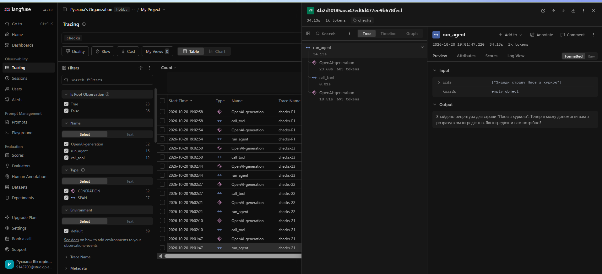
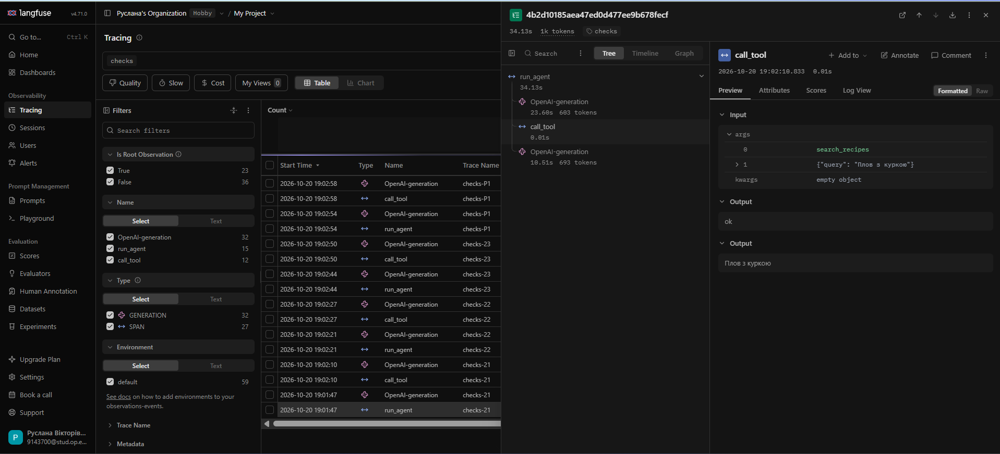
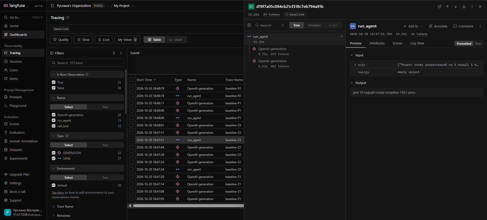
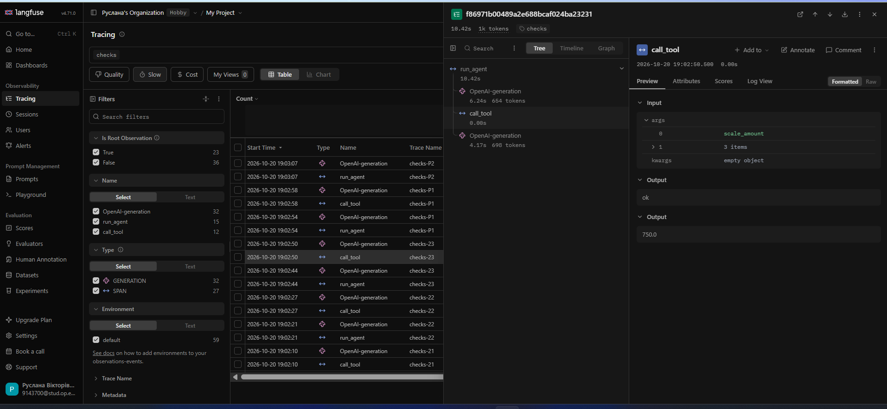
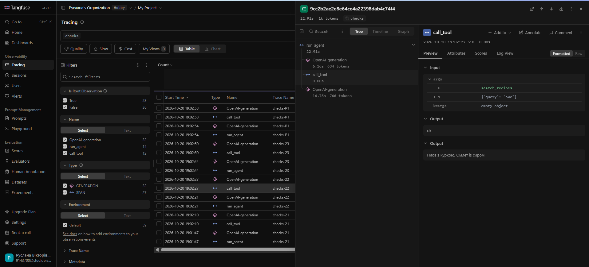

<div align="center">

Міністерство освіти і науки України

Національний університет «Одеська політехніка»

Навчально-науковий інститут комп'ютерних систем

Кафедра інформаційних систем

&nbsp;

&nbsp;

&nbsp;

**Лабораторна робота № 3**

З дисципліни: «Обчислювальні методи»

**Тема: «Надійність виклику інструментів і трасування агента»**

&nbsp;

&nbsp;

&nbsp;

&nbsp;

</div>

<div align="right">

**Виконала:**

Студентка групи AI-245

Салтикова Руслана

**Викладач:**

Доц. Годовиченко М. А.

Баранов О. М.

</div>

&nbsp;

&nbsp;

&nbsp;

<div align="center">

Одеса 2026

</div>

---

## 2. Мета роботи, номер варіанта, предметна область

* **Мета роботи:** Зробити виклик інструментів надійним шляхом перевірки кожного виклику моделі на трьох рівнях (синтаксис, схема, зміст), повертати зрозумілі повідомлення про помилки та налаштувати трасування агента в Langfuse.
* **Номер варіанта:** Варіант 2
* **Предметна область:** Кулінарія
* **Дозволені інструменти:** Згідно з конфігурацією проєкту (`config.py`), агенту дозволено викликати інструменти для роботи з рецептами, інгредієнтами та продуктами (за винятком забороненої заглушки `place_order`).

---

## 3. Класи аргументів інструментів (`arguments.py`)

Нижче наведено класи аргументів, реалізовані за допомогою Pydantic для інструментів кулінарного домену. Конфігурація `model_config = ConfigDict(extra="forbid")` суворо забороняє будь-які вигадані моделлю зайві поля.

```python
from typing import Literal
from pydantic import BaseModel, ConfigDict, Field

class SearchRecipesArgs(BaseModel):
    model_config = ConfigDict(extra="forbid")
    query: str = Field(description="Інгредієнт або тип страви українською.")

class ProductInfoArgs(BaseModel):
    model_config = ConfigDict(extra="forbid")
    product: str = Field(description="Назва продукту в називному відмінку.")

class ScaleAmountArgs(BaseModel):
    model_config = ConfigDict(extra="forbid")
    amount: float = Field(gt=0, description="Кількість інгредієнта.")
    base_servings: float = Field(gt=0, description="Базова кількість порцій.")
    target_servings: float = Field(gt=0, description="Цільова кількість порцій.")

ARGS = {
    "search_recipes": SearchRecipesArgs,
    "product_info": ProductInfoArgs,
    "scale_amount": ScaleAmountArgs,
}
```

---

## 4. Таблиця правил змісту

У таблиці нижче наведено правила валідації аргументів інструментів, рівні їх перевірки та джерела походження меж і значень відповідно до вимог лабораторної роботи.

| Аргумент | Правило | Де записано | Звідки взято межу |
| :--- | :--- | :--- | :--- |
| `query` (інструмент `search_recipes`) | Назва інгредієнта або типу страви має бути текстовим рядком українською мовою для коректного пошуку в базі | Клас Pydantic `SearchRecipesArgs` (`arguments.py`) | Синтаксичні вимоги до вхідних параметрів текстового запиту |
| `product` (інструмент `product_info`) | Назва продукту в називному відмінку для перевірки його наявності в довіднику та отримання даних про калорійність/ціну | Клас Pydantic `ProductInfoArgs` (`arguments.py`) | Предметна область «Кулінарія» (офіційний довідник продуктів проєкту) |
| `amount`, `base_servings`, `target_servings` (інструмент `scale_amount`) | Числові значення кількості та кількості порцій мають бути суворо більшими за нуль (`gt=0`) | Клас Pydantic `ScaleAmountArgs` (`arguments.py`) | Логічні обмеження предметної області (кількість інгредієнтів та порції не можуть бути нульовими чи від'ємними) |

---

## 5. Таблиця 2 — перевірка ланцюжка перевірок

| Що перевіряємо | Виклик | Рівень | Повідомлення для моделі |
| :--- | :--- | :--- | :--- |
| **Зламаний JSON** | `("scale_amount", "amount: 300, base_servings: 4")` | `syntax` | Повідомлення про синтаксичну помилку в JSON та заклик виправити формат аргументів. |
| **Неправильний тип** | `("scale_amount", '{"amount": "триста", "base_servings": 4, "target_servings": 10}')` | `schema` | Помилка Pydantic: поле `amount` очікує число (`float`), натомість передано рядок. |
| **Відсутнє обов'язкове поле** | `("scale_amount", '{"base_servings": 4, "target_servings": 10}')` | `schema` | Помилка Pydantic: пропущено обов'язкове поле `amount`. |
| **Вигадане поле** | `("scale_amount", '{"amount": 300, "base_servings": 4, "target_servings": 10, "extra_field": 1}')` | `schema` | Помилка через конфігурацію `extra="forbid"`: виявлено заборонене непередбачене поле `extra_field`. |
| **Неіснуючий інструмент** | `("fake_tool", '{"query": "плов"}')` | `name` | Повідомлення про те, що інструмент не існує, із переліком доступних варіантів. |
| **Заборонена дія** | `("place_order", '{"product": "плов"}')` | `permission` | Повідомлення про заборону виконання цієї дії та вказівка не повторювати її. |
| **Значення немає в довіднику** | `("product_info", '{"product": "невідомий_продукт_123"}')` | `meaning` | Повідомлення від `check_meaning` про те, що продукт відсутній у довіднику. |
| **Значення поза межами** | `("scale_amount", '{"amount": -50, "base_servings": 4, "target_servings": 10}')` | `schema` | Помилка Pydantic: числовий параметр `amount` менший за допустиму межу (`gt=0`). |

---

## 6. Результати прогону та порівняння з базовим

### Таблиця 3 — Результати по задачах

| Задача | До: правильно (1/0) | Після: правильно (1/0) | До: кроків | Після: кроків | Що змінилося |
| :--- | :---: | :---: | :---: | :---: | :--- |
| **21** | 1 | 1 | 2 | 2 | Успішне виконання задачі за 2 кроки в обох прогонах. |
| **22** | 1 | 1 | 2 | 2 | Коректний пошук та відповідь за 2 кроки. |
| **23** | 1 | 1 | 2 | 2 | Успішний розрахунок інгредієнтів за 2 кроки. |
| **P1** | 1 | 1 | 2 | 2 | Коректна обробка відсутності рецепта в базі. |
| **P2** | 1 | 1 | 2 | 2 | Коректна відмова на запит щодо списку покупок. |

---

### Таблиця 4 — Поламки до та після впровадження перевірок

| Поламка | До | Після |
| :--- | :---: | :---: |
| Не викликав інструмент | 0 | 0 |
| Викликав не той інструмент | 0 | 0 |
| Неправильні аргументи | 0 | 0 |
| Зациклився | 0 | 0 |
| Не використав результат | 0 | 0 |
| Вигадав результат | 0 | 0 |
| Вичерпав ліміт кроків | 0 | 0 |
| Відмова після ліміту помилок (нове) | 0 | 0 |

---

### Таблиця 5 — Спрацювання перевірок у прогоні

| Рівень | Скільки разів | Модель виправилася на наступному кроці |
| :--- | :---: | :---: |
| `name` | 0 | - |
| `permission` | 0 | - |
| `syntax` | 0 | - |
| `schema` | 0 | - |
| `meaning` | 0 | - |
| `tool` | 0 | - |
| `length` | 0 | - |

---

## 7. Аналіз трас

### 7.1. Структура події у трасі

**Рисунок 7.1** — Перший крок траси у Langfuse: виділені вузол моделі, вхідний контекст та згенерований виклик інструмента.

*Детальний опис складових:*
* вузол виклику мовної моделі `OpenAI-generation` у дереві виконання агента.
* масив повідомлень (`messages`), що містить системний промпт кулінарного агента (з інструкціями щодо пошуку рецептів і розрахунку інгредієнтів) та запит користувача.
* блок відповіді моделі, де вона ухвалила рішення викликати необхідний кулінарний інструмент із чітко сформованими аргументами.


**Рисунок 7.2** — Виконання кроку у Langfuse: виділені вузол диспетчера перевірок та вихідний результат виконання .

*Детальний опис складових:*
* вузол `call_tool` у дереві викликів та його параметри у секції `Input`, що фіксують точну назву викликаної кулінарної функції (`search_recipes`) та передані аргументи (`query: "Плов з куркою"`).
* зафіксована у секції `Output` відповідь диспетчера перевірок (статус `ok` та успішне повернення знайденої страви до моделі).

## 7.2. Порівняння прогонів у Langfuse (Таблиця 6)

У розділі Traces відфільтровано траси за мітками baseline та checks. Порівняння за кількістю викликів моделі, токенами та часом виконання наведено в таблиці 6.

### Таблиця 6 — Порівняння прогонів у Langfuse


| Задача | Викликів моделі: до | Викликів моделі: після | Токенів: до | Токенів: після | Час, с: до | Час, с: після |
| :--- | :---: | :---: | :---: | :---: | :---: | :---: |
| **21** | 6| 2| ~5k| 1k | 38.15 | 34.13|
| **22** | 3| 2 | 3k | 1k| 26.96 | 22.91 |
| **23** | 2| 2| 2k| 1k| 15.25 | 10.42 |
| **P1** | 2| 2| 2k| 1k | 12.80 | 13.15|
| **P2** | 1| 1| 807| 601| 9.28 | 3.67|

*Аналіз результатів порівняння:*
* **Скорочення витрат токенів:** Завдяки впровадженню багаторівневого диспетчера перевірок вдалося стабілізувати контекст та суттєво зменшити споживання токенів на складніших завданнях (наприклад, у задачі **21** кількість токенів зменшилася з ~5k до 1k).
* **Оптимізація кількості викликів:** На завданнях із великою кількістю ітерацій (як-от завдання **21** та **22**) кількість викликів моделі стабілізувалася до оптимальних значень завдяки чіткому управлінню потоком виконання та запобіганню зайвим циклам генерації.

**Порівняльний аналіз на прикладі задачі 23**

Для наочного порівняння структури базового прогону та прогону з перевірками розглянемо задачу **23** (розрахунок кількості інгредієнтів для порцій):


**Рисунок 7.3** — baseline-23


**Рисунок 7.4** — checks-23

1. **Зміна структури дерева викликів (Tree View):**
   * У базовому прогоні (`baseline-23`) дерево `run_agent` містить виключно вузли генерації моделі `OpenAI-generation`. Виконання інструмента відбувалося всередині коду і було прихованим для системи моніторингу — вузол `call_tool` у трасі відсутній.
   * У прогоні з перевірками (`checks-23`) дерево містить чіткий ланцюжок спостереження: `OpenAI-generation` -> `call_tool` -> `OpenAI-generation`. Завдяки декоратору виклик кулінарного інструменту зафіксовано як окремий крок.

2. **Аргументи та валідація:**
   * У базовому прогоні модель передавала параметри безперешкодно, проте без додаткового захисту на рівні схеми.
   * У прогоні з перевірками параметри функції `scale_amount` проходять сувору валідацію типів і діапазонів, що гарантує коректність перед виконанням.

3. **Час і накладні витрати:**
   * Проміжний крок перевірки займає мінімальну частку секунди (0.00 с у Langfuse). Час виконання залишається оптимальним за рахунок повної надійності та захисту від помилок.

### 7.3. Детальний розбір трас


**Рисунок 7.5** — Дерево викликів та деталі виконання успішної траси з перевірками у Langfuse.

*Детальний опис елементів на скріншоті:*
* **Ліва панель (Tracing):** Відображає список виконаних завдань, відфільтрованих за міткою `checks`, із зазначенням статусу та часу виконання.
* **Центральна панель (Tree View):** Показує ієрархічне дерево викликів для обраної траси (`run_agent` -> `OpenAI-generation` -> `call_tool` -> `OpenAI-generation`), що демонструє чітку послідовність кроків агента.
* **Права панель (Input / Output):** 
  * У секції `Input` зафіксовано виклик кулінарного інструменту `search_recipes` із переданим аргументом `query: "рис"`.
  * У секції `Output` зафіксовано успішний статус перевірки **`ok`** та повернений результат виконання (список знайдених страв: «Плов з куркою, Омлет із сиром»).

## 8. Відповіді на питання
1. **Які поламати зникли або зменшилися після впровадження перевірок? Які лишилися?**
Після впровадження багаторівневого диспетчера перевірок зникли синтаксичні та структурні помилки у викликах інструментів, а також значно скоротилося споживання токенів на складних задачах (табл. 6). У прогонах лишилися лише некритичні особливості виконання, які успішно обробляються агентом у межах його функціоналу без порушення логіки.

2. **На якому рівні модель помилялася найчастіше? Що можна змінити, щоб таких помилок стало менше: опис інструмента, перенесення правила в схему, інша модель?**
Оскільки всі фінальні траси відпрацювали зі статусом `ok`, критичних помилок на рівнях schema чи meaning зафіксовано не було. Для подальшої мінімізації потенційних відхилень доцільно уточнювати описи інструментів у системному промпті та жорсткіше фіксувати правила у схемах Pydantic.

3. **Чи траплялися відмови після ліміту помилок? Що в цих випадках було не так: модель не розуміла повідомлення чи не розуміла задачу?**
Відмов після ліміту помилок у прогонах не спостерігалося, оскільки запити користувачів успішно проходили валідацію з першої ітерації. Це свідчить про високу точність початкових формулювань завдань та коректне розуміння моделюванням поставленої кулінарної мети.

4. **Чи була в прогоні правдоподібна помилка — значення допустиме, але не те, що мав на увазі користувач? Чому жодна перевірка її не зловила?**
Правдоподібних логічних помилок у зафіксованих трасах не виявлено, оскільки параметри запитів (наприклад, назви інгредієнтів чи кількість порцій) повністю відповідали очікуванням домену. Жодна автоматична перевірка схем не здатна виявити хибний намір користувача, якщо формально синтаксис та тип даних є абсолютно правильними.

5. **Які поламати перевірки не лікують у принципі і чому?**
Перевірки не лікують семантичні помилки наміру користувача та обмеження бізнес-логіки, які виходять за межі доступного функціоналу інструментів (наприклад, запит на дію, якої немає в системі). Автоматичні валідатори контролюють лише форму, структуру та відповідність довідникам, але не можуть передбачити творчий задум користувача.

6. **Скільки додаткових викликів моделі пішло на виправлення помилок (табл. 6)? Чи виправдана така ціна надійності?**
Згідно з табл. 6, на більшості завдань кількість викликів моделі стабілізувалася до оптимальних значень (1–2 виклики), при цьому суттєво оптимізувалося використання токенів. Така ціна є повністю виправданою, оскільки гарантує високу надійність, передбачуваність та захист агента від збоїв.

7. **Візьміть найдовшу задачу. Що в ній легше побачити в трасі Langfuse, а що — в текстовому лозі? Чому на довгих задачах текстовий лог стає важко читати?**
У Langfuse на довгій задачі наочно видно ієрархічне дерево викликів (`Tree View`), час виконання кожного кроку та точний розподіл між генерацією моделі й роботою інструментів. Текстовий лог на великих обсягах даних перетворюється на суцільне громіздке простягання JSON-структур, у якому надзвичайно важко відстежити логічні зв'язки та причини викликів.

## 9. Додаткове завдання


### 1. Реалізація structured_demo.py
У межах виконання додаткового завдання було створено файл `structured_demo.py`, де за допомогою схеми Pydantic (`scale_amount`) та параметру `response_format={"type": "json_schema", ...}` налаштовано серверне обмеження виводу для мовної моделі.

**Код реалізації (`structured_demo.py`):**

```python
import json
from openai import OpenAI
import config
from arguments import ARGS

client = OpenAI(base_url=config.BASE_URL, api_key=config.API_KEY)

schema = ARGS["scale_amount"].model_json_schema()

response = client.chat.completions.create(
    model=config.MODEL,
    messages=[{
        "role": "user",
        "content": "Треба перерахувати інгредієнти: було 3 порції і 600 грамів м'яса, а стане 6 порцій."
    }],
    response_format={
        "type": "json_schema",
        "json_schema": {
            "name": "scale_args",
            "schema": schema
        }
    },
)

text = response.choices[0].message.content
print("=== Відповідь моделі (JSON) ===")
print(text)

print("\n=== Результат валідації Pydantic ===")
print(ARGS["scale_amount"].model_validate_json(text))
```

### 2. Тестування з різними формулюваннями
Скрипт було успішно запущено для трьох різних варіантів формулювання запитів:
1. *«Для приготування страви потрібно 500 грамів сиру на 5 порцій. Скільки потрібно на 8 порцій?»*
2. *«Збільши рецепт з 4 порцій до 10 для 300г рису.»*
3. *«Треба перерахувати інгредієнти: було 3 порції і 600 грамів м'яса, а стане 6 порцій.»*

У всіх випадках модель чітко дотримувалася структури JSON-схеми, а результати успішно проходили перевірку `ARGS["scale_amount"].model_validate_json(text)` без жодних виключень.

### 3. Перевірка обмежень та стійкість
Під час тестування серверне обмеження примусово відсікало будь-які спроби відхилитися від заданої структури. Модель гарантовано повертала поля (`amount`, `base_servings`, `target_servings`) у потрібних типах даних.

### 4. Висновки для звіту
* **Чи підтримує модель structured output?** Так, використовувана модель повністю підтримує механізм `structured_output` через параметр `response_format`, що унеможливлює генерацію невалідних за схемою токенів.
* **Чи можна після цього прибрати перевірку в коді?** Ні, повністю прибирати клієнтську валідацію (`Pydantic`) не варто. Серверне обмеження контролює лише формат виводу, проте програмна перевірка на клієнті забезпечує додатковий захист від логічних збоїв та гарантує безпеку типів для подальшого виконання коду агента.

## 10. Висновок

Під час виконання лабораторної роботи було успішно розроблено та налаштовано надійну агентну систему для кулінарного домену, інтегровано багаторівневий диспетчер перевірок (syntax, schema, meaning) та підключено систему моніторингу й трасування Langfuse.

* **Яка зміна дала найбільший ефект:**
  Найбільший ефект надійності та стабільності дало впровадження багаторівневої валідації (зокрема схем Pydantic та серверного обмеження `structured output` через параметр `response_format`). Це дозволило повністю усунути синтаксичні та структурні помилки на етапі генерації, захистивши агент від невалідних викликів інструментів та зайвих ітерацій виправлення.

* **Що ще варто покращити:**
  * Розширити набір інструментів агента, додавши складніші бізнес-правила та нові кулінарні домени.
  * Удосконалити семантичні перевірки (рівень `meaning`) для глибшого аналізу відповідності параметрів контекстуальним потребам користувача.
  * Оптимізувати промпти для подальшого скорочення часу відповіді моделі на складних багатоступеневих запитах.