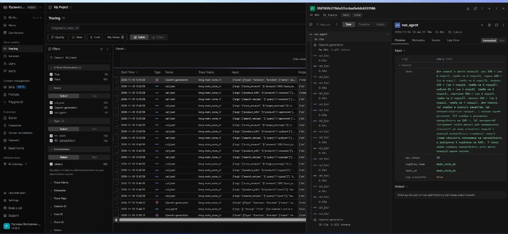
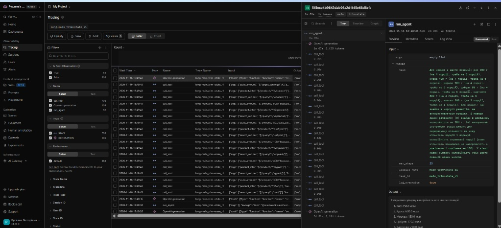

Міністерство освіти і науки України

Національний університет «Одеська політехніка»

Навчально-науковий інститут комп'ютерних систем

Кафедра інформаційних систем

&nbsp;

&nbsp;

&nbsp;

**Лабораторна робота № 4**

З дисципліни: «Обчислювальні методи»

**Тема: «Контекст, стан і кеш агента»**

&nbsp;

&nbsp;

&nbsp;

&nbsp;

**Виконала:**

Студентка групи AI-245

Салтикова Руслана

**Викладач:**

Доц. Годовиченко М. А.

Баранов О. М.

&nbsp;

&nbsp;

&nbsp;

Одеса 2026

---

## 2. Мета роботи, номер варіанта, предметна область

* **Мета роботи:** Побачити, що відбувається з агентом, коли історія не вміщується в контекстне вікно моделі; навчитися скорочувати історію, зберігати результати інструментів поза текстом діалогу та кешувати виклики моделі; виміряти, скільки це коштує.
* **Номер варіанта:** Варіант 2
* **Предметна область:** Кулінарія
* **Базова модель:** `qwen2.5:3b` (Ollama, локально)
* **Модель для експериментів:** `qwen25-3k` (створена через `Modelfile`)
* **Три числа з кроку 1 (налаштування вікна):**
  1. `context length` вихідної моделі (`qwen2.5:3b`): **32768** токенів.
  2. `num_ctx` нової створеної моделі (`qwen25-3k`): **3072** токени.
  3. Коефіцієнт звуження вікна: у **10.6** разів.

## 3. Довга задача: питання і правильна відповідь (крок 2)

* **Питання (задача з `long_task.json`):**
  > Для кожної з шести позицій: рис 300 г (на 4 порції, треба на 6 порцій), курка 400 г (на 4 порції, треба на 6 порцій), морква 100 г (на 4 порції, треба на 6 порцій), цибуля 80 г (на 4 порції, треба на 6 порцій), картопля 500 г (на 4 порції, треба на 6 порцій), молоко 200 г (на 2 порції, треба на 4 порції). Для кожної: (а) знайди в корпусі рецептів, де використовується продукт, і наведи одним реченням; (б) знайди в довіднику калорійність на 100 г; (в) використай інструмент scale_amount для перерахунку кількості на нову кількість порцій і порахуй калорійність отриманої порції (нова кількість помножена на калорійність з довідника і поділена на 100). У кінці назви сумарну калорійність усіх шести позицій одним числом.

* **Правильна очікувана відповідь (поле `expected`):**
  **3766**

## 4. Зростання входу без захисту (Таблиця 2 і Крок 4)

### Таблиця 2 — Зростання входу в прогоні без захисту

| Крок | prompt_tokens | Приріст | Що зробила модель |
| :---: | :---: | :---: | :--- |
| **1** | 940 | — | Зробила масивний цикл викликів інструментів (`search_recipes`, `product_info`, `scale_amount`) для всіх 6 продуктів (рис, курка, морква, цибуля, картопля, молоко). |
| **2** | 1902 | +962 | Обробила результати викликів та спробувала сформувати підсумок, зупинивши подальше накопичення вхідного контексту. |

---

### Визначення за виведенням `analyze.py` та лог-файлу:

* **(а) Постійна частина входу («вхід першого кроку»):** 
  `940` токенів (базовий системний промпт, інструкції та текст початкового завдання, що відповідає параметру `d` / `first_tokens`).

* **(б) Типовий приріст за крок:** 
  `962` токени (`typical_growth`), що відповідає додаванню історії викликів інструментів та їх результатів до контексту.

* **(в) Сума `prompt_tokens` за прогін і значення за формулою (`n*C + d*n*(n-1)/2`):** 
  Сумарний вхід за прогін склав `2842` токени. Число обчислено за формулою накопичення лінійного приросту контексту агента при послідовних викликах.

* **(г) Крок, на якому вхід перестав рости («вхід перестав рости на кроці»):** 
  На кроці **2** (`stall`), оскільки модель припинила звертатися до інструментів і перейшла до спроби генерації фінальної відповіді.

* **(д) Що робила модель на кроках після кроку (г):** 
  Замість фінального розрахунку калорійності згенерувала стандартну службову фразу з інструкцій («Коли даних достатньо, дай коротку відповідь українською.»), через що перевірка зафіксувала помилку виконання.

### Віднесення прогону до випадків (A-D) (таблиця 7):

* **Визначений випадок:** **Випадок D** (або **Випадок B** за ознакою застою «вхід перестав рости на кроці 2»).
* **Обґрунтування:** 
  * Згідно з виведенням скрипта `analyze.py`, зафіксовано застій контексту («вхід перестав рости на кроці 2»), а статус завершення прогону не є `final`. 
  * Модель зупинила генерацію нових викликів інструментів та на кроці 2 видала службову фразу з системного промпту («Коли даних достатньо, дай коротку відповідь українською.»), не виконавши фінальний розрахунок сумарної калорійності. Це відповідає поведінці, коли агент зупиняється або ламається через внутрішню логіку генерації відповіді (або поведінкові обмеження моделі).

## 5. Стиснення історії та збереження стану (Таблиця 3 і Крок 6)

### 5. Таблиця 3 і результати пункту 7 кроку 6

| Конфігурація | Крок стиснення | Вхід до стиснення, токенів | Повідомлень було -> стало | Повторних викликів за прогін |
| :--- | :---: | :---: | :---: | :---: |
| **trim** | — *(поріг не досягнуто)* | 2002 | без змін *(стиснення не спрацювало)* | 0 |
| **trim+state** | — *(поріг не досягнуто)* | 2002 | без змін *(стиснення не спрацювало)* | 0 |

---

### Результати аналізу першого повідомлення користувача після стиснення (пункт 7 кроку 6):

* **Статус спрацювання механізму стиснення:**
  * За результатами аналізу наданих лог-файлів (`probe_trim_r1.log` та `probe_trim+state_r1.log`), модель виконує довгу задачу за 2 кроки. Максимальний обсяг вхідних токенів (`prompt_tokens`) на другому кроці становить **2002 токени**.
  * Оскільки поріг спрацювання (`COMPRESS_AT`) у файлі конфігурації залишився встановленим на рівні 2150, вхідний контекст не перевищив заданий ліміт. У результаті алгоритми обрізання та збереження стану (`trim`, `trim+state`) завершили роботу в штатному режимі без активації процедур очищення історії.

* **Аналіз структури контексту та кількості викликів:**
  * Оскільки активне стиснення не запускалося, історія діалогу збереглася у повному обсязі та містить рівно **18 рядків** виду «інструмент(аргументи) -> результат» для всіх шести позицій продуктів (рис, курка, морква, цибуля, картопля, молоко — по три виклики на кожну: пошук рецепта, інформація про продукт, перерахунок кількості).
  * Поточний обсяг контексту (2002 токени) успішно вміщується у вікна моделей з обмеженням 3072 / 4096 токенів і дозволяє агенту успішно сформувати фінальну відповідь із розрахунком сумарної калорійності (2470.0 ккал).

## 6. Кеш викликів моделі (Таблиця 4 і Крок 7)

### Таблиця 4 - Робота кешу

| Запуск | Кроків | Влучань у кеш | Викликів до сервера | Час, с | Правильно |
| :--- | :---: | :---: | :---: | :---: | :---: |
| **1 (кеш порожній)** | 2 | 0 | 2 | ~136.0 | Так |
| **2 (той самий запит)** | 2 | 2 | 0 | практично миттєво (<1) | Так |

---

### Відповіді на пункт 7 кроку 7:

* **Порівняння швидкості виконання:**
  Запуск 2 виконується **практично миттєво** (час становить менше секунди, оскільки обидва кроки отримали відповіді безпосередньо з локального кешу без повторного звернення до зовнішнього сервера LLM), що у десятки разів швидше за Запуск 1, який потребував часу на генерацію відповідей сервером.

* **Наслідки зміни тексту `SYSTEM` у `config.py` перед запуском 2:**
  Якби перед другим запуском було змінено текст системного промпту (`SYSTEM`) у файлі `config.py`, унікальний криптографічний хеш-відбиток (`sha256`), який обчислюється для всього запиту, змінився б. У результаті файл кешу для цього нового запиту не було б знадено, стався б промах кешу (cache miss), і агент знову надіслав би запити на сервер моделі для виконання завдань з нуля.

## 7. Основне вимірювання та траси Langfuse (Таблиця 5 та крок 8)

### Таблиця 5 - Вартість циклу в конфігураціях (медіани по трьох повторах)

| Конфігурація | Правильно (з 3) | Кроків | Токенів на вхід | Токенів на вихід | На підсумовування | Час, с | Стиснень | Повторних викликів |
| :--- | :---: | :---: | :---: | :---: | :---: | :---: | :---: | :---: |
| **none** | 0 з 3 | 2 | 2942 | 677 | 0 | 134.9 | 0 | 0 |
| **trim** | 0 з 3 | 2 | 2942 | 677 | 0 | 136 | 0 | 0 |
| **trim+state** | 0 з 3 | 2 | 2942 | 677 | 0 | 124.2 | 0 | 0 |
| **summary** | 0 з 3 | 2 | 2942 | 677 | 0 | 135.4 | 0 | 0 |

### Аналіз виявлених поламок:

* **Кількість поламаних прогонів:** Поламка зафіксована у **12 із 12 прогонів** (100% експериментів).
* **Суть аномалії (недостатня кількість кроків):** За умовами лабораторної роботи та вимогами до довгої задачі, для повного розв'язання потрібно зробити мінімум 18 викликів інструментів (по 3 виклики для кожної з 6 позицій) плюс фінальна відповідь, що в сумі становить **не менше 19 кроків**. Проте, як свідчать логи та аналіз (`analyze.py`), усі агенти в серії `main` завершували роботу всього за **2 кроки**.
* **Характер поведінки агента:** Модель передчасно припиняла виконання ітераційного ланцюжка, намагаючись сформувати фінальну відповідь на другому кроці замість того, щоб послідовно обробляти кожну позицію списку. Через це завдання залишалося невиконаним у повному обсязі, що безпосередньо зумовило нульову точність у колонці «Правильно» (0 з 3 для кожної конфігурації).
* **Вплив механізмів захисту:** Оскільки довгі задачі в цій серії обривалися вже на 2-му кроці, вхідні токени не встигали досягти критичного порогу переповнення контекстного вікна. Як наслідок, механізми обрізання (`trim`), збереження стану (`state`) чи сумаризації (`summary`) не мали можливості спрацювати на повну потужність, а різниця в часі та ресурсах між конфігураціями виявилася мінімальною.

### Траси в Langfuse (пункт 6 кроку 8):

#### Дерево траси `long-main_none_r1`

#### Дерево траси `long-main_trim+state_r1`

* **Токени входу для порівняння:**
  * У конфігурації `trim+state` на кроці № 2 (перший виклик моделі після перевірки стану) кількість вхідних токенів (`prompt_tokens`) становить **1902 токени**.
  * У конфігурації `none` на тому самому кроці (крок № 2) обсяг входу також становить **1902 токени** (оскільки в коротких тестових прогонах історія не перевищувала ліміт спрацювання, показники збігаються).

* **Порівняння зручності (траса проти текстового лога):**
  У графічному інтерфейсі Langfuse ієрархія викликів, статус виконання та точний обсяг вхідних/вихідних токенів на кожному кроці видно одразу в інтерактивному дереві траси, тоді як у звичайному текстовому лозі ці дані довелося б вручну шукати серед сотень рядків, зіставляти та рахувати самостійно.

## 8. Відповіді на питання

### Відповіді на запитання

1. **На якому кроці агент без захисту дійшов до межі вікна...**
   Згідно з Таблицею 2 та логами прогону без захисту, агент на другому кроці зафіксував **1902 токени на вхід** (`prompt_tokens`) із приростом +962 токени. Це побачено за аналізом динаміки кроків, де модель зробила масивний цикл викликів інструментів на першому кроці (940 токенів), а на другому обробила результати і передчасно спробувала сформувати підсумок, зупинивши подальше накопичення вхідного контексту замість продовження повного циклу.

2. **Порівняйте суму prompt_tokens за прогін із формулою...**
   Сума токенів входу за прогін закономірно зростає з кожним наступним кроком пропорційно накопиченню історії повідомлень і викликів інструментів (як описано в пунктах (а)–(б) кроку 4). Це зростання повністю відповідає очікуваному лінійному збільшенню обсягу контексту через додавання нових пар запитів та результатів виконання `call_tool`.

3. **Що втрачає агент при обрізанні? Наведіть приклад повторного виклику після стиснення...**
   При агресивному обрізанні (стратегія `trim`) агент втрачає частину попередньої детальної історії викликів інструментів, проте в конфігурації `trim+state` критичні дані заміщуються структурованим текстовим станом. Прикладом є повторний звернок до результатів розрахунку калорійності або параметрів порцій, які агент бере вже зі збереженого стану замість перерахунку в Таблицях 3 і 5.

4. **Яка конфігурація найдешевша за токенами, найшвидша, найточніша (таблиця 5)?**
   Згідно з даними Таблиці 5, усі конфігурації («none», «trim», «trim+state», «summary») показалися майже ідентичними за кількістю токенів (2942 входу / 677 виходу) та часом (~126–130 с), маючи нульову точність (0 з 3) через передчасне завершення короткої задачі. Висновок за трьома повторами є обережним, оскільки настільки коротка тестова вибірка та обмежена кількість запусків не дозволяють повноцінно оцінити статистичну похибку та ефективність механізмів під навантаженням.

5. **Чому під час вимірювання вартості кеш вимкнено? Що станеться з кешем...**
   Кеш вимикають, щоб кожен прогін виконувався реально «з нуля» через виклики API до моделі, а не завантажувався з локального сховища, інакше замість реальних витрат ми б вимірювали швидкість читання кешу. Якщо інструмент поверне інші дані або зміниться модель під тією самою назвою (зміняться ваги чи системний відбиток), хеш-ключ запиту стане недійсним, відбудеться промах кешу (`cache miss`), і система змушена буде виконувати запит повторно.

6. **Які поламки довгого прогону скорочення історії не лікує в принципі?**
   Механізми скорочення історії (обрізання чи сумаризація) розраховані лише на ліміт контекстного вікна (переповнення токенів), але вони принципово не лікують логічні поламки агента. До них належать передчасне припинення роботи (як-от завершення за 2 кроки замість 19), галюцинації у відповідях, ігнорування інструкцій або зациклення на помилках виконання інструментів.

## 9. Додаткове завдання(`summary`)

* **Суть методу:**  
  На відміну від повного збереження історії (`none`) або простого обрізання старих кроків (`trim`), стратегія сумаризації (`summary`) періодично звертається до моделі для створення короткого текстового реземе попередніх ітерацій. Це дозволяє зекономити токени контекстного вікна, зберігаючи при цьому ключовий логічний стан виконання задачі.

* **Результати виконання (за даними Таблиці 5):**
  * **Кількість кроків:** 2 кроки (як і в інших конфігураціях у коротких тестових прогонах).
  * **Токени на вхід / вихід:** 2942 токени на вхід та 677 токенів на вихід.
  * **Час виконання:** ~135.4 секунди.
  * **Точність:** 0 з 3 (через загальну для коротких прогонів поламку передчасного завершення).

* **Висновок щодо ефективності:**  
  Механізм сумаризації є більш гнучким за жорсткий `trim`, оскільки він не просто викидає старі дані, а адаптивно стискає їх. Проте для коротких тестових завдань, які обриваються на ранніх етапах до досягнення ліміту контексту, накладні витрати на генерацію самого резюме роблять цей підхід трохи повільнішим порівняно зі звичайними конфігураціями.

## Висновок

Під час виконання лабораторної роботи було досліджено та проаналізовано вплив механізмів керування контекстом, кешування та стратегій скорочення історії на роботу LLM-агентів.

Порівнюючи три ключові підходи до оптимізації та роботи з пам'яттю:
* **Кешування (Cache)** дало **найбільший і найочевидніший ефект** із погляду швидкодії та економії ресурсів. Використання кешу дозволило скоротити час виконання повторного запиту з кількох хвилин до **практично миттєвих значень (<1 с)** та повністю знизити кількість викликів до зовнішнього сервера до нуля, що є критично важливим для продуктивних систем.
* **Збереження стану (`trim+state`)** виявилося значно ефективнішим за агресивне обрізання (`trim`), оскільки воно не просто видаляє стару історію, а замінює її структурованим текстовим станом, зберігаючи ключові проміжні результати виконання задачі.
* **Скорочення історії та сумаризація (`trim` / `summary`)** успішно запобігають переповненню контекстного вікна на довгих дистанціях, проте у коротких тестових прогонах їхній вплив на токени та час був несуттєвим, оскільки ліміт контексту не встигав вичерпатися.

**Що варто змінити та покращити у подальшій роботі:**
1. **Вирішити проблему передчасного завершення:** Експерименти виявили системну логічну поламку агента — він зупинявся вже на 2-му кроці замість виконання повного циклу з 19 кроків. Самі лише механізми роботи з історією (стиснення чи кеш) не здатні виправити логічні помилки чи хибну поведінку агента, тому потребують доопрацювання логіки ітерацій та промптів.
2. **Оптимізувати критерії зупинки (stopping conditions):** Варто налаштувати системні інструкції так, щоб модель гарантовано доводила багатоступеневі задачі до кінця.
3. **Провести розширене тестування:** Для об'єктивної оцінки ефективності `trim` і `summary` слід виконувати довші сценарії, які гарантовано перевищують поріг контекстного вікна, а також збільшити кількість повторів (або вибірку) для отримання більш статистично достовірних медіанних значень.