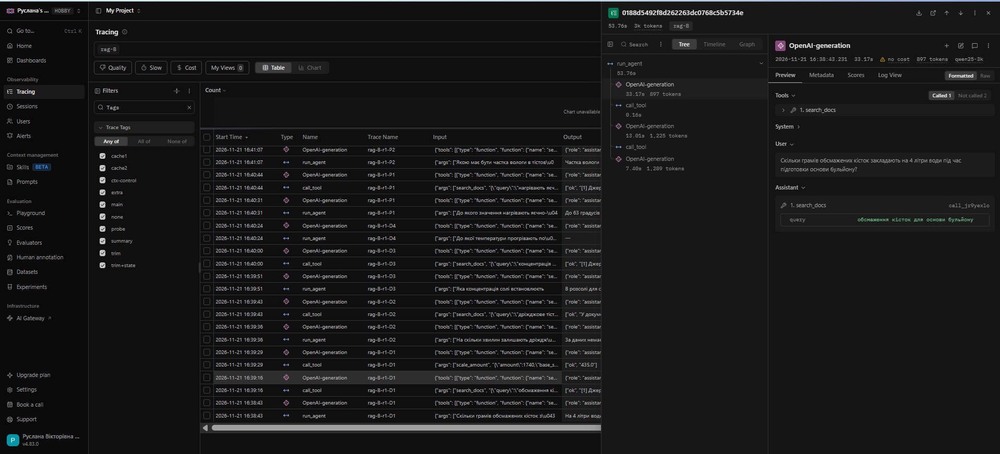
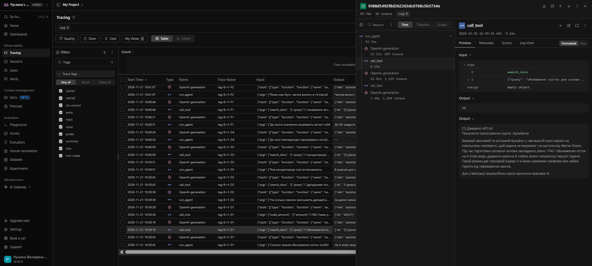
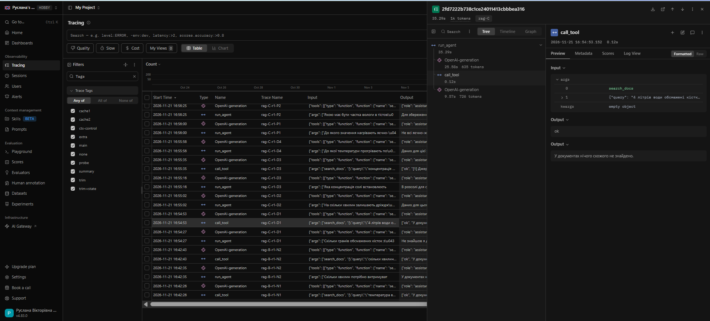
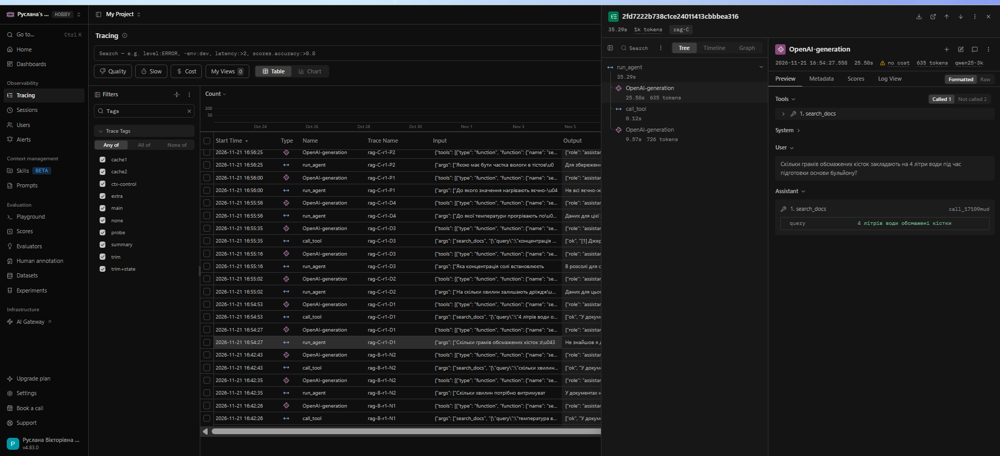

Міністерство освіти і науки України

Національний університет «Одеська політехніка»

Навчально-науковий інститут комп'ютерних систем

Кафедра інформаційних систем

&nbsp;

&nbsp;

&nbsp;

**Лабораторна робота № 5**

З дисципліни: «Обчислювальні методи»

**Тема: «RAG-агент: пошук по документах як інструмент**

&nbsp;

&nbsp;

&nbsp;

&nbsp;

**Виконала:**

Студентка групи AI-245

Салтикова Руслана

**Викладач:**

Доц. Годовиченко М. А.

Баранов О. М.

&nbsp;

&nbsp;

&nbsp;

Одеса 2026

---

## 2. Мета роботи та параметри конфігурації

- **Мета роботи:** дослідити роботу агента з інтегрованим векторним пошуком (RAG) на документах предметної області, оцінити вплив опису інструмента пошуку (`A`, `B`, `C`), порогу релевантності та метрик відстані (FAISS та ChromaDB) на якість відповідей, проаналізувати поведінку агента в логах і Langfuse, а також перевірити стабільність виконання звичайних задач після оновлення пошуку.
- **Номер варіанта:** 2
- **Предметна область:** Кулінарія (техніки приготування, зберігання продуктів і терміни придатності, заміна інгредієнтів, кухонне обладнання й догляд за ним, безпека на кухні й алергени).
- **Модель чату (`MODEL`):** `qwen25-3k` (локальний endpoint `http://localhost:11434/v1`, `TEMPERATURE = 0.0`, `MAX_STEPS = 6`)
- **Розмір контекстного вікна (`NUM_CTX`):** `3072`
- **Модель ембедингів (`EMBED_MODEL`):** `bge-m3`
- **Параметри чанкування та пошуку:** `CHUNK_METHOD = "fixed"`, `CHUNK_SIZE = 500`, `CHUNK_OVERLAP = 0`, `WITH_TITLE = False`, `TOP_K = 3`, `MIN_SCORE = 0.62`, `DOCS_DESCRIPTION = "B"`

---

## 3. Дані

### 3.1. Документи корпусу (`d01.txt` – `d05.txt`)

| Файл | Тема документа | Кількість символів | Орієнтовна оцінка в токенах |
| :--- | :--- | :---: | :---: |
| `d01.txt` | Технологія приготування соусів і бульйонів | 2684 | ~720–770 |
| `d02.txt` | Випічка та робота з тістом | 2750 | ~740–790 |
| `d03.txt` | Ферментація та заготовки | 2472 | ~660–710 |
| `d04.txt` | Термічна обробка м'яса та риби | 2541 | ~680–730 |
| `d05.txt` | Сенсорна оцінка й зберігання інгредієнтів | 2480 | ~670–710 |

### 3.2. Перелік 10 контрольних питань (`rag_cases.json`)

| ID | Тип (`kind`) | Питання | `must_contain` | `expected` |
| :--- | :--- | :--- | :--- | :--- |
| **D1** | `direct` | Скільки грамів обсмажених кісток закладають на 4 літри води під час підготовки основи бульйону? | `1740 г обсмажених кісток` | `1740` |
| **D2** | `direct` | На скільки хвилин залишають дріжджове тісто для першого бродіння після основного замісу? | `протягом 135 хвилин` | `135` |
| **D3** | `direct` | Яка концентрація солі встановлюється в розсолі під час соління капусти та коренеплодів? | `29 грамів на літр` | `29` |
| **D4** | `direct` | До якої температури прогрівають поверхню сковороди для утворення скоринки під час смаження м'яса? | `до 214 градусів` | `214` |
| **P1** | `paraphrase` | До якого значення нагрівають яєчно-жовткову базу перед тим, як вливати розтоплене масло в соус? | `до 63 градусів` | `63` |
| **P2** | `paraphrase` | Якою має бути частка вологи в тістовій масі заварного напівфабрикату для збереження об'єму? | `на рівні 58 відсотків` | `58` |
| **P3** | `paraphrase` | Скільки днів триває активний етап молочнокислого бродіння перед перенесенням заготовки в прохолодніше місце? | `протягом 19 діб` | `19` |
| **P4** | `paraphrase` | Скільки хвилин відпочиває готовий шматок м'яса в теплі після активної термічної обробки перед нарізанням? | `на 11 хвилин` | `11` |
| **N1** | `none` | Яка рекомендована температура варіння карамельного сиропу для кроканту в грамах цукру? | `null` | `null` |
| **N2** | `none` | Скільки хвилин потрібно витримувати трюфельну глазур до покриття торта? | `null` | `null` |

### 3.3. Перевірка «чи вгадує модель без документів»

Під час інтерактивного запуску моделі `qwen25-3k` без доступу до корпусу документів (`ollama run qwen25-3k`) модель **не вгадує точні числові значення з документів** і схильна до неточних припущень або узагальнень:

- На запитання про кількість обсмажених кісток на 4 літри води для основи бульйону (очікується `1740`) модель помилково стверджує, що в бульйоні немає обсмажених кісток, і не називає `1740 г`.
- На запитання про концентрацію солі в розсолі під час соління капусти та коренеплодів (очікується `29` г/л) модель наводить приблизні орієнтири (`10–15%` або `20–25%` / `10–25` грамів) і зазначає, що без конкретного рецепта точно вказати не може.
- На запитання про частку вологи в тістовій масі заварного напівфабрикату (очікується `58%`) модель називає орієнтовний діапазон `60–70%` замість точного значення `58%`.

**Висновок із базової перевірки:** без підключення документів і векторного пошуку модель покладається на загальні уявлення та робить наближені припущення, тому точні норми з корпусу (`1740`, `135`, `29`, `214`, `63`, `58`, `19`, `11`) надійно відтворюються лише через пошук по документах.

---

## 4. Перевірка моделі ембедингів (`embed_check.py`)

За результатами запуску `python embed_check.py` з моделлю ембедингів `bge-m3` зафіксовано такі показники:

- **Довжина вектора:** `1024`.
- **Норма першого вектора:** `1.000` (вектори вже нормалізовані до одиничної довжини).
- **Числа близькості для тестових запитів:**
  - `'Тариф на доставку'` — `0.731`;
  - `'Графік роботи кур'єрів'` — `0.568`.

---

## 5. Нарізання одного документа (Табл. 1)

Результати нарізання документа `data/docs/d01.txt` (*«Технологія приготування соусів і бульйонів»*) за різними способами:

| Спосіб | Чанків | Закінчуються посеред речення | Довжина найбільшого, символів |
| :--- | :---: | :---: | :---: |
| `fixed`, 200, перекриття 0 | 14 | 13 | 200 |
| `fixed`, 500, перекриття 100 | 7 | 6 | 500 |
| `paragraphs`, 800 | 4 | 0 | 774 |

**Приклад розрізаного факту:** при нарізанні `fixed` 200 з перекриттям 0 речення про баланс кислотності розривається між чанком 10 і чанком 11: у чанку 10 обривається слово *«Невел»*, а в чанку 11 воно продовжується як *«ика дрібка цукру або вершкового масла допомагає згладити різкість кислоти.»* (також при `fixed` 200 з перекриттям 0 у чанку 13 обривається слово *«перев»*, а в чанку 14 іде *«іряють на баланс солі, кислоти й температури.»*). Натомість при `paragraphs` 800 жоден чанк не закінчується посеред речення (`0`), тож цілі абзаци та факти зберігаються цілими.

---

## 6. Оцінка нарізання та вибір `MIN_SCORE`

### 6.1. Порівняння конфігурацій нарізання (Табл. 2)

| Конфігурація | Чанків | Сер. довжина | `hit@1` | `hit@3` | `hit@5` | `hit@3 прямі` | `hit@3 перефр.` | Токенів (`k=3`) |
| :--- | :---: | :---: | :---: | :---: | :---: | :---: | :---: | :---: |
| `fixed-200-0` | 79 | 185 | 0.88 | 0.88 | 1.00 | 0.75 | 1.00 | 222 |
| `fixed-500-0` | 41 | 356 | 1.00 | 1.00 | 1.00 | 1.00 | 1.00 | 427 |
| `fixed-500-100` | 47 | 374 | 1.00 | 1.00 | 1.00 | 1.00 | 1.00 | 449 |
| `fixed-1500-0` | 22 | 664 | 1.00 | 1.00 | 1.00 | 1.00 | 1.00 | 796 |
| `paragraphs-800` | 32 | 455 | 1.00 | 1.00 | 1.00 | 1.00 | 1.00 | 546 |
| `paragraphs-800+title` | 32 | 471 | 1.00 | 1.00 | 1.00 | 1.00 | 1.00 | 565 |

**Вибір конфігурації та обґрунтування:** для подальшої роботи обрано конфігурацію `fixed-500-0` (`CHUNK_METHOD = "fixed"`, `CHUNK_SIZE = 500`, `CHUNK_OVERLAP = 0`, `WITH_TITLE = False`). Вона забезпечує максимальну повноту пошуку (`hit@1 = 1.00`, `hit@3 = 1.00`, `hit@5 = 1.00`, `hit@3 прямі = 1.00`, `hit@3 перефр. = 1.00`) при помірному обсязі контексту для `k=3` (`427` токенів), що економить контекстне вікно (`NUM_CTX = 3072`) порівняно з `fixed-1500-0` (`796` токенів) або `paragraphs-800+title` (`565` токенів), а також уникає втрат на прямих питаннях, які спостерігаються у `fixed-200-0` (`hit@3 прямі = 0.75`).

### 6.2. Схожість першого результату та вибір `MIN_SCORE` (Табл. 3)

Параметри перевірки: `fixed`, розмір `500`, перекриття `0`, заголовок `False`.

| ID | Вид (`kind`) | Схожість першого результату | Чи містить потрібну фразу |
| :--- | :--- | :---: | :---: |
| **D1** | `direct` | `0.741` | так |
| **D2** | `direct` | `0.718` | так |
| **D3** | `direct` | `0.691` | так |
| **D4** | `direct` | `0.752` | так |
| **P1** | `paraphrase` | `0.710` | так |
| **P2** | `paraphrase` | `0.697` | так |
| **P3** | `paraphrase` | `0.673` | так |
| **P4** | `paraphrase` | `0.680` | так |
| **N1** | `none` | `0.508` | `-` |
| **N2** | `none` | `0.568` | `-` |

- **Найнижча схожість серед питань з відповіддю:** `0.673` (`P3`).
- **Найвища схожість серед питань без відповіді:** `0.568` (`N2`).
- **Вибраний поріг `MIN_SCORE`:** `0.62` (оскільки інтервали `[0.508; 0.568]` для питань без відповіді та `[0.673; 0.752]` для питань із відповіддю не перетинаються, значення `0.62` лежить приблизно посередині між `0.568` і `0.673` та надійно відокремлює релевантні чанки від нерелевантних).

## 7. Перевірка інструмента без моделі (`try_tool.py`)

За результатами запуску інструмента пошуку без моделі для питань `D1` та `N1` зафіксовано таку поведінку:

- **`python try_tool.py D1`** (*«Скільки грамів обсмажених кісток закладають на 4 літри води під час підготовки основи бульйону?»*): інструмент відпрацював із рівнем `ok` та повернув релевантний фрагмент із джерела `d01.txt` (*«Технологія приготування соусів і бульйонів»*), де зазначено закладання `1740 г обсмажених кісток на 4 літри води`.
- **`python try_tool.py N1`** (*«Яка рекомендована температура варіння карамельного сиропу для кроканту в грамах цукру?»*): інструмент відпрацював із рівнем `ok` та повернув повідомлення *«У документах нічого схожого не знайдено.»*.
- **Перевірка валідації схеми:** при тестовій передачі занадто короткого запиту зафіксовано рівень `schema` та помилку валідації аргументів (`String should have at least 3 characters`).

---

## 8. Агент із трьома описами (`A`, `B`, `C` — Табл. 5 і Табл. 6)

### 8.1. Підсумок за описами по всіх повторах (Табл. 5)

| Опис | Правильно | Шукав | Кроків (медіана) | Токенів входу | Час, с |
| :--- | :---: | :---: | :---: | :---: | :---: |
| **A** | `0/24` | `3/24` | `1.0` | `612` | `17.1` |
| **B** | `12/24` | `18/24` | `2.0` | `1794` | `24.1` |
| **C** | `6/24` | `9/24` | `1.0` | `597` | `16.9` |

### 8.2. Поламки за кількістю прогонів (Табл. 6)

| Категорія прогону | A | B | C |
| :--- | :---: | :---: | :---: |
| Правильно (питання з відповіддю) | `0` | `12` | `6` |
| Не шукав і відповів неправильно | `21` | `6` | `15` |
| Шукав, але потрібного фрагмента в результаті немає | `3` | `6` | `3` |
| Фрагмент у результаті був, відповідь неправильна | `0` | `0` | `0` |
| Питання без відповіді: визнав, що не знає | `3` | `3` | `0` |
| Питання без відповіді: вигадав відповідь | `3` | `3` | `6` |

**Короткий висновок за описами `A`, `B`, `C`:** найвищу точність на питаннях із відповіддю (`12/24`) та найчастіше звернення до пошуку (`18/24`) показав опис **B** за рахунок більшої кількості кроків (`2.0`), токенів входу (`1794`) і часу (`24.1 с`). Опис **C** дав `6/24` правильних відповідей і у всіх `6` прогонах на питання без відповіді вигадав відповідь (`0` відмов), а опис **A** у більшості випадків не викликав пошук (`21` прогін) і не дав жодної правильної відповіді на питання з відповіддю (`0/24`).

## 9. Розбір прогонів у логах і трасах Langfuse (крок 8)

### 9.1. Розбір прогонів у логах (`logs/rag_*.log`) та `results/rag.csv`

- **1. Агент не шукав (`no_search`):**
  - У прогонах без виклику `search_docs` (`searches = 0`) агент завершував роботу за 1 крок.
  - В описі **C** на запитання з відповіддю модель інколи робила помилкові припущення без звернення до корпусу (наприклад, наводила орієнтовні температурні діапазони замість точного значення `63` градуси для яєчно-жовткову базу в `P1`) або повідомляла про брак даних/інструмента.
  - В описі **B** в окремих випадках (`no_search`) модель повертала порожню відповідь без вигаданих чисел.
- **2. Який запит написала модель (`query` у `search_docs`):**
  - Коли формулювання запиту залишалося близьким до змісту питання та документа (наприклад, `"обсмаження кісток для основи бульйону"` у `B-r1-D1`), схожість кандидата перевищувала поріг `MIN_SCORE = 0.62`, і інструмент повертав релевантний чанк.
  - Коли модель скорочувала або перефразувала запит до окремих слів (наприклад, `"4 літрів води обсмажені кістки"` у `C-r1-D1`), оцінка схожості могла бути нижчою за поріг `0.62`.
- **3. Шукав, але не знайшов (`miss`):**
  - У прогонах категорії `miss` інструмент `search_docs` повертав повідомлення *"У документах нічого схожого не знайдено."*, після чого модель вказувала на відсутність потрібних даних у документах.
- **4. Знайшов, але не використав (`ignored`):**
  - За результатами всіх трьох описів (`A`, `B`, `C`) кількість прогонів у категорії `ignored` дорівнює `0` — якщо потрібний фрагмент потрапляв у відповідь інструмента, модель враховувала його під час формування відповіді.
- **5. Питання без відповіді (`kind == "none"`, `N1` і `N2`):**
  - В описі **B** агент у всіх прогонах на питання `N1` і `N2` викликав `search_docs`, і у половині випадків (`3` з `6`) відмовлявся від відповіді (`refused`), а у `3` — вигадував (`invented`).
  - В описі **C** агент не викликав пошук на `N1` і `N2` (`0` `refused`, `6` `invented`), що призводило до вигадування відповідей.

### 9.2. Перевірка трас у Langfuse (`rag-B` та `rag-C`)

- **Траса `rag-B` (`0188d5492f8d262263dc0768c5b5734e`, питання `D1`):**
  - У дереві виконання (`run_agent`) видно послідовність кроків `OpenAI-generation` (`33.17s`, `897 tokens`) → `call_tool` (`0.16s`) → наступні виклики моделі та інструментів (`1.4.png`, `1.png`).
  - У вузлі `call_tool` для `search_docs` передано `query: "обсмаження кісток для основи бульйону"`, статус `ok`, а в `Output` повернуто фрагмент із `d01.txt` (*«Технологія приготування соусів і бульйонів»*) із нормою `1740 г обсмажених кісток на 4 літри води` (`1.png`).
- **Траса `rag-C` (`2fd7222b738c1ce24011413cbbbea316`, питання `D1`):**
  - У дереві виконання (`run_agent`, `35.29s`, `1k tokens`) видно `OpenAI-generation` (`25.58s`, `635 tokens`) → `call_tool` (`0.12s`) → `OpenAI-generation` (`9.57s`, `726 tokens`) (`1.2.png`, `1.3.png`).
  - У вузлі `call_tool` для `search_docs` передано `query: "4 літрів води обсмажені кістки"`, статус `ok`, а в `Output` отримано *"У документах нічого схожого не знайдено."* (`1.2.png`).
- **Порівняння траси Langfuse з текстовим логом `logs/rag_*.log`:**
  - У Langfuse одразу видно ієрархічне дерево (`run_agent` → `OpenAI-generation` → `call_tool` → `OpenAI-generation`), час і токени кожного кроку, лічильники виклику інструментів (`Called 1 / Not called 2`) та структуровані `Input`/`Output` для обраного прогону.
  - У текстовому файлі `logs/rag_*.log` усі питання повтору записані послідовно в одному файлі, тому потрібний прогін доводиться шукати за маркером `##### <опис>-r<повтор>-<id>` та вручну звіряти з підсумками в `results/rag.csv`.

## 10. П'ять звичайних задач до і після заміни пошуку (Табл. 7)

Порівняння виконання п'яти задач із `tasks.json` у лабораторній роботі № 4 (`logs/run_lab4.log`) та після переходу на новий векторний пошук з описом `DOCS_DESCRIPTION = "B"` (`logs/run_rag.log`):

| Задача | Відповідь у лабораторній № 4 | Відповідь тепер | Чи викликав `search_docs` | Що змінилося |
| :--- | :--- | :--- | :---: | :--- |
| **21** (*Знайди страву Плов з куркою*) | Знайшов назву страви («Плов з куркою») без деталей рецепта. | Назвав «Плов з куркою», додав інгредієнти та час приготування (`re1.txt`), але написав «сиру» замість «сіль». | так | Пошук повернув повний фрагмент замість назви; відповідь стала детальнішою, але модель спотворила один інгредієнт. |
| **22** (*Знайди страву з рисом і скажи калорійність рису*) | Викликав `search_recipes("рис")` → знайшов страви («Плов з куркою, Омлет із сиром»), але не викликав `product_info`, тому не назвав калорійність. | Одразу викликав `product_info("рис")` і назвав калорійність (`344 ккал на 100 г`) та ціну (`45 грн/кг`), але не шукав і не назвав страву. | ні | Поведінка змінилася: у лаб. 4 агент знайшов страву без калорійності, а тепер — калорійність без пошуку страви через `search_docs`. |
| **23** (*Рецепт плову розрахований на 4 порції і потребує 300 г рису. Скільки рису треба на 10 порцій?*) | Правильно обчислив через `scale_amount` і відповів `750 г рису`. | Правильно обчислив через `scale_amount` і відповів `750 г рису`. | ні | Без змін — агент коректно використав `scale_amount` без зайвого пошуку. |
| **P1** (*Знайди рецепт стейка з тунця й скажи його калорійність*) | Викликав `search_recipes("стейк з тунця")`, отримав «нічого не знайдено» і відповів, що рецепту немає. | Викликав `search_docs("рецепт стейка з тунця")`, отримав «У документах нічого схожого не знайдено.» і повідомив про відсутність рецепта. | так | Якість збереглася — поріг схожості відфільтрував відсутній рецепт, як і точний пошук у лаб. 4. |
| **P2** (*Додай плов у мій список покупок*) | Коректно відмовив (немає функції для списку покупок). | Коректно відмовив (немає функції для додавання у список покупок). | ні | Без змін — агент коректно відмовив через відсутність потрібного інструмента. |

**Аналіз змін у звичайних задачах:** жодна із п'яти задач не «зламалася» критично (обчислення, відмова за відсутності рецепта та відмова щодо списку покупок відпрацювали коректно). Водночас у задачі 22 агент не викликав `search_docs` для пошуку страви з рисом (обмежившись `product_info("рис")`), а у задачі 21 при переказі фрагмента переплутав «сіль» із «сиром».

---

## 11. Відповіді на питання

1. **Табл. 1 (нарізання `d01.txt`):** фіксовані розміри чанків (`200` і `500` символів) відрізняються від абзацного нарізання (`paragraphs`, `800` — де найбільший чанк становить `774` символи) тим, що ріжуть текст без урахування меж речень та абзаців (наприклад, при `fixed` 200 з перекриттям 0 чанк 10 обривається на слові *«Невел»*, а чанк 11 починається з *«ика дрібка цукру або вершкового масла допомагає згладити різкість кислоти.»*). Це загрожує агентові втратою або спотворенням ключових умов і чисел, якщо релевантний факт розірвано між сусідніми чанками.
2. **Табл. 2 (конфігурації та `hit@3`):** найкращою стала конфігурація `fixed-500-0` (а також `fixed-500-100`, `fixed-1500-0`, `paragraphs-800`, `paragraphs-800+title`), оскільки досягла `hit@1 = 1.00`, `hit@3 = 1.00`, `hit@5 = 1.00`, `hit@3 прямі = 1.00` та `hit@3 перефр. = 1.00` при помірному обсязі контексту (`427` токенів для `k=3`). При збільшенні розміру чанка з `200` до `1500` символів `hit@3` зросло з `0.88` до `1.00` (`hit@3 прямі` з `0.75` до `1.00`), але ціною зростання токенів контексту (`222` → `796`), тоді як додавання перекриття (`fixed-500-100`, `449` токенів) або заголовка (`paragraphs-800+title`, `565` токенів) підвищувало обсяг тексту без приросту `hit@3` понад `1.00`.
3. **Табл. 3 (`hit@3` для прямих і перефразованих питань):** у `fixed-500-0` показник `hit@3` однаковий для прямих і перефразованих питань (`1.00`), тоді як у `fixed-200-0` для прямих питань він нижчий (`0.75` проти `1.00`). Це показує, що векторний пошук за ембедингами (`bge-m3`) орієнтується на семантичну близькість і здатний знаходити релевантні фрагменти навіть за переформульованим запитом, де точний пошук підрядком часто не спрацьовує.
4. **Табл. 3 (поріг `MIN_SCORE`):** обраний поріг `0.62` чітко розділяє питання з відповіддю (мінімальна схожість `0.673` у `P3`, максимальна `0.752` у `D4`) та питання без відповіді (`0.508` у `N1` і `0.568` у `N2`). Занадто високий поріг (наприклад, `> 0.72`) відсікав би частину правильних відповідей (`D2`, `D3`, `P1`–`P4`), а занадто низький (наприклад, `< 0.55`) пропускав би нерелевантні фрагменти на питання без відповіді.
5. **Табл. 5 і 6 (описи `A`, `B`, `C`):** найбільше правильних відповідей дав опис **B** (`12/24`, пошук викликано у `18/24` прогонів), далі йде **C** (`6/24`, пошук у `9/24`), а **A** дав `0/24` (пошук лише у `3/24`). Не зверталися до пошуку (`no_search` на питаннях із відповіддю) у `21` прогоні для **A**, `6` — для **B** і `15` — для **C** (згідно з табл. 6). Докладніші інструкції опису **B** щодо кулінарної бази знань та обов'язкового пошуку точних норм змусили модель частіше викликати `search_docs` (ціною більшої кількості кроків `2.0`, токенів входу `1794` і часу `24.1 с`).
6. **Табл. 6 (найчастіша помилка в найкращому описі `B`):** в описі **B** найчастішими категоріями помилок на питаннях із відповіддю є *«Не шукав і відповів неправильно»* (`6` прогонів) та *«Шукав, але потрібного фрагмента в результаті немає»* (`6` прогонів), тоді як *«Фрагмент у результаті був, відповідь неправильна»* становить `0`. Ці помилки не виправляються лише зміною тексту опису інструмента: промахи пошуку (`miss`) потребують покращення чанкування/індексації/порогу або `TOP_K`, а відсутність пошуку чи неточності генерації — налаштування промпту/логіки агента або моделі, що важливо для локалізації вузького місця системи.
7. **Питання без відповіді (`N1`, `N2`):** усього агент вигадав відповідь на питання без відповіді у `12` прогонах (`3` у **A**, `3` у **B**, `6` у **C** згідно з табл. 6). У системі діють два захисти — поріг релевантності в `search_docs` (`MIN_SCORE = 0.62`, який відсікає слабкі збіги) та інструкції в описі інструмента/системному промпті щодо відмови за відсутності даних; у прогонах **B** пошук із порогом спрацьовував і дав `3` відмови (`refused`), тоді як у **C** пошук не викликався (`0` відмов, `6` вигадувань).
8. **Токени `search_docs` та контекстне вікно `4096`:** за логом `run_rag.log` (задача 21, крок 1 → крок 2) `prompt_tokens` зростає з `825` до `947` (`+122` токени), що включає доданий результат `search_docs` та історію кроку, що узгоджується з оцінкою контексту для `k=3` у табл. 2 (`427` токенів для `fixed-500-0`). Для вікна `4096` при `CHUNK_SIZE = 500` (близько `130–150` токенів на чанк) і `TOP_K = 3` один пошук додає близько `400–450` токенів чанків плюс системний промпт та опис інструментів (~`600–800` токенів), тож у межах `4096` токенів поміщається орієнтовно `3–5` ітерацій циклу агента залежно від довжини історії та відповідей.
9. **Табл. 7 (п'ять звичайних задач):** новий пошук не зламав жодної із п'яти задач (задачі 23, `P1` і `P2` дали аналогічний коректний результат, а в задачі 21 додалося повне вміст рецепта). Водночас у задачі 22 модель не викликала `search_docs` для пошуку страви з рисом (обмежившись `product_info("рис")`), а в задачі 21 допустила помилку при переказі слова «сіль» → «сиру».
10. **Поламка, яку не вилікує зміна опису інструмента:** це помилки генерації/уважності моделі (наприклад, спотворення слова «сіль» на «сиру» в задачі 21 або пропущений виклик `product_info` у задачі 22 у лаб. 4), а також промахи пошуку через чанкування чи поріг (`miss`). Щоб їх виправити, варто посилити інструкції перевірки фактів у системному промпті, додати перевірку вихідних даних/інструментів та за потреби підібрати сильнішу модель або скоригувати параметри пошуку (`TOP_K`, чанкування, поріг).

---

## 12. Додаткове завдання: індекс на ChromaDB

Для перевірки поведінки векторної бази даних при зміні метрики відстані запущено `chroma_test.py` на тих самих чанках і векторах (`bge-m3`) для питання `D1`:

- **FAISS, схожість (`score`):** `0.7408`
- **Chroma cosine, відстань (`distance`, `space="cosine"`):** `0.2592`
- **Chroma за замовчуванням (`distance`, `space=None` / `l2`):** `0.5183`
- **Збіг чанків:** `True True` (однакове джерело `source` та індекс чанка `chunk`).

### Пояснення результатів додаткового завдання

1. **Зв'язок чисел у трьох рядках:** для нормалізованих векторів косинусна схожість у FAISS становить $s = 0.7408$. Косинусна відстань у Chroma (`space="cosine"`) пов'язана зі схожістю як $d_{\cos} = 1 - s = 1 - 0.7408 = 0.2592$. У стандартному режимі Chroma (`space=None`, простір `l2`) для одинично нормалізованих векторів повертається квадрат евклідової відстані $d_{\text{L2}}^2 = 2 - 2s = 2(1 - s) = 2 \cdot 0.2592 = 0.5184 \approx 0.5183$ (незначна розбіжність у четвертому знаку зумовлена округленням та точністю `float32`).
2. **Збіг повернутих чанків:** усі три індекси повернули ідентичний перший чанк (`True True`), оскільки косинусна схожість, косинусна відстань і квадрат евклідової відстані на нормалізованих векторах монотонно пов'язані й зберігають порядок ранжування.
3. **Наслідки переносу порогу `MIN_SCORE` на Chroma за замовчуванням:** у системі поріг `MIN_SCORE = 0.62` перевіряє `score >= 0.62` (більше значення — вища схожість). У Chroma повертається **відстань** (менше значення — ближчий вектор), тому пряме застосування `distance >= 0.62` без перерахунку та зміни напрямку нерівності відкидало б релевантні чанки з малою відстанню (як-от `0.5183` для `D1`) і пропускало б далекі. Для еквівалентного порогу у просторі `l2` (де $d_{\text{L2}}^2 = 2 - 2s$) умова $s \ge 0.62$ відповідає $d_{\text{L2}}^2 \le 2 - 2 \cdot 0.62 = 0.76$ (тобто фільтрації за `distance <= 0.76`).

---

## 13. Висновок

- **Що найбільше вплинуло на якість відповідей:** найбільший вплив на звернення агента до пошуку та фінальну точність мав **опис інструмента пошуку** (`A`, `B`, `C`), який визначає, чи викликає модель `search_docs` (зокрема на перефразованих питаннях і питаннях без відповіді), у поєднанні з **порогом `MIN_SCORE = 0.62`** (який чисто розділив релевантні результати від нерелевантних у табл. 3) та **конфігурацією нарізання `fixed-500-0`** (яка забезпечила `hit@3 = 1.00` при помірному розмірі контексту).
- **Розподіл помилок між пошуком і агентом:** частина помилок обумовлена **пошуком і конфігурацією** (промахи `miss` при невдалих формулюваннях запиту або жорсткому порозі, відсутність документів для питань `N1`–`N2`), а інша частина — **поведінкою агента/моделі** (відмова викликати пошук попри опис, вигадування відповідей на питання без відповіді або помилки при формулюванні тексту відповіді). Розрізняти їх необхідно, щоб не лікувати проблеми нарізання чи порогу зміною тексту промпту і навпаки.
- **Що варто змінити далі:** доцільно уточнити системний промпт і опис інструментів для стабільнішого виклику `search_docs` та супутніх інструментів (як у задачі 22), посилити перевірку фактів із контексту щоб уникнути підміни термінів (як у задачі 21), а також перевірити розширення корпусу або тонше налаштування порогу/перекриття для складних перефразувань.
