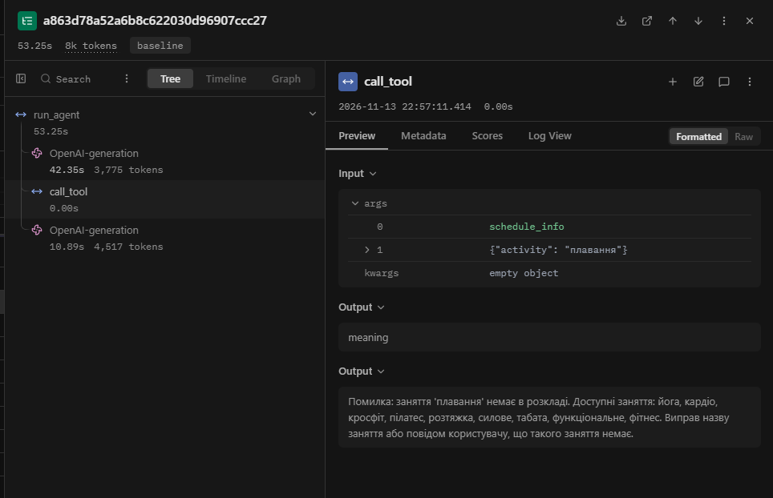
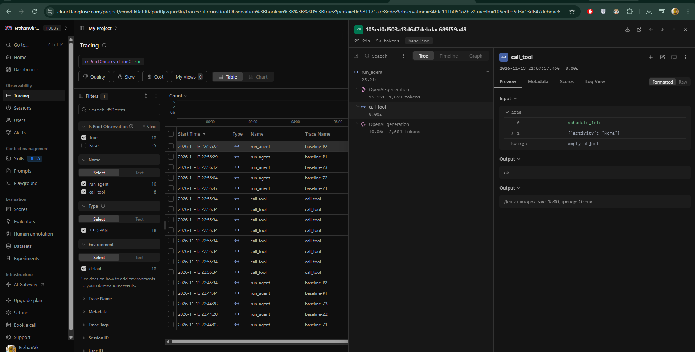

# Звіт до лабораторної роботи № 3
**Надійність виклику інструментів і трасування агента**

- **Студент:** Слюсаренко Данило Романович
- **Група:** АІ-245
- **Варіант:** 4
- **Предметна область:** Тренування

---

## 1. Мета роботи

Зробити виклик інструментів агента надійним шляхом перевірки кожного виклику моделі до виконання на трьох рівнях — синтаксис, схема та зміст, — формувати для моделі зрозумілі повідомлення про помилки з трьох частин, обмежити кількість помилок поспіль та проаналізувати виконання задач у вигляді трас на платформі Langfuse.

---

## 2. Класи аргументів інструментів (`arguments.py`)

Для опису та валідації вхідних аргументів трьох дозволених інструментів створено Pydantic-моделі із забороною зайвих полів (`extra="forbid"`) та числовими й рядковими обмеженнями:

```python
"""Класи аргументів інструментів."""
from pydantic import BaseModel, ConfigDict, Field


class SearchExercisesArgs(BaseModel):
    model_config = ConfigDict(extra="forbid")
    query: str = Field(
        min_length=2,
        max_length=50,
        description="Група м'язів або рівень складності, одне-два слова українською (наприклад: 'спина', 'ноги', 'початковий'), не все питання цілком.",
    )


class ScheduleInfoArgs(BaseModel):
    model_config = ConfigDict(extra="forbid")
    activity: str = Field(
        min_length=2,
        max_length=40,
        description="Назва заняття українською в нижньому регістрі (наприклад: 'йога', 'кардіо').",
    )


class CalcCaloriesArgs(BaseModel):
    model_config = ConfigDict(extra="forbid")
    minutes: float = Field(gt=0, le=600, description="Тривалість тренування у хвилинах.")
    weight_kg: float = Field(gt=20, le=300, description="Вага людини в кілограмах.")
    met: float = Field(
        gt=0,
        le=25,
        description="Коефіцієнт навантаження; якщо користувач його не назвав, обов'язково використовуй 5.",
    )


ARGS = {
    "search_exercises": SearchExercisesArgs,
    "schedule_info": ScheduleInfoArgs,
    "calc_calories": CalcCaloriesArgs,
}
```

---

## 3. Правила змісту

Усі обмеження предметної області «Тренування» зведено в таблицю 1.

Таблиця 1 — Правила перевірки аргументів і змісту

| Аргумент / виклик | Правило | Де записано | Звідки взято межу / значення |
|---|---|---|---|
| `query` (`search_exercises`) | Довжина рядка `2..50` символів | Клас `SearchExercisesArgs` | Пошуковий запит — 1–2 слова (від `йога` до назви групи м'язів), без цілих речень |
| `activity` (`schedule_info`) | Довжина рядка `2..40` символів | Клас `ScheduleInfoArgs` | Назви групових занять у розкладі мають довжину 4–14 символів |
| `activity` (`schedule_info`) | Назва заняття має бути в довіднику `data/schedule.csv` | Функція `check_meaning` (`checks.py`) | Перелік 9 занять з `data/schedule.csv`: `йога`, `кардіо`, `кросфіт`, `пілатес`, `розтяжка`, `силове`, `табата`, `функціональне`, `фітнес` |
| `minutes` (`calc_calories`) | `0 < minutes <= 600` | Клас `CalcCaloriesArgs` | Тривалість тренування не може бути нульовою/від'ємною і не перевищує 10 годин |
| `weight_kg` (`calc_calories`) | `20 < weight_kg <= 300` | Клас `CalcCaloriesArgs` | Реалістична маса тіла людини у кілограмах |
| `met` (`calc_calories`) | `0 < met <= 25` | Клас `CalcCaloriesArgs` | Метаболічний еквівалент фізичної активності (від спокою > 0 до максимального спринту ~23–25) |
| Усі інструменти | Заборона невідомих полів (`extra="forbid"`) | Усі класи в `arguments.py` | Захист від вигаданих моделлю параметрів |
| `book_session` | Виклик функції запису на заняття заборонений (`not in config.ALLOWED`) | Диспетчер `call_tool` (`dispatcher.py`) | Таблиця 7 методичних вказівок (варіант 4) |

---

## 4. Перевірка ланцюжка перевірок диспетчера

Перевірку всіх рівнів відсіювання виконано автономно через скрипт `test_checks.py` без участі мовної моделі (табл. 2).

Таблиця 2 — Перевірка ланцюжка перевірок

| Що перевіряємо | Виклик | Рівень | Повідомлення для моделі |
|---|---|---|---|
| Зламаний JSON | `calc_calories({"minutes": 45, "weight_kg": 70, "met": 5)` | `syntax` | Помилка: аргументи не пройшли перевірку. Поле JSON: Invalid JSON: EOF while parsing an object at line 1 column 41. Виправ аргументи і виклич інструмент ще раз. |
| Неправильний тип | `calc_calories({"minutes": "сорок", "weight_kg": 70, "met": 5})` | `schema` | Помилка: аргументи не пройшли перевірку. Поле minutes: Input should be a valid number, unable to parse string as a number. Виправ аргументи і виклич інструмент ще раз. |
| Відсутнє обов'язкове поле | `calc_calories({"minutes": 45, "weight_kg": 70})` | `schema` | Помилка: аргументи не пройшли перевірку. Поле met: Field required. Виправ аргументи і виклич інструмент ще раз. |
| Вигадане поле | `calc_calories({"minutes": 45, "weight_kg": 70, "met": 5, "extra": 1})` | `schema` | Помилка: аргументи не пройшли перевірку. Поле extra: Extra inputs are not permitted. Виправ аргументи і виклич інструмент ще раз. |
| Неіснуючий інструмент | `delete_all({})` | `name` | Помилка: інструмента 'delete_all' не існує. Доступні: search_exercises, schedule_info, calc_calories. Виклич один з доступних або повідом користувачу, що такої дії немає. |
| Заборонена дія | `book_session({"activity": "йога", "weekday": "середа"})` | `permission` | Помилка: інструмент 'book_session' недоступний. Не повторюй виклик, повідом користувачу, що ця дія недоступна. |
| Значення немає в довіднику | `schedule_info({"activity": "плавання"})` | `meaning` | Помилка: заняття 'плавання' немає в розкладі. Доступні заняття: йога, кардіо, кросфіт, пілатес, розтяжка, силове, табата, функціональне, фітнес. Виправ назву заняття або повідом користувачу, що такого заняття немає. |
| Значення поза межами | `calc_calories({"minutes": -10, "weight_kg": 70, "met": 5})` | `schema` | Помилка: аргументи не пройшли перевірку. Поле minutes: Input should be greater than 0. Виправ аргументи і виклич інструмент ще раз. |

---

## 5. Результати прогону та порівняння з базовим

Порівняння результатів виконання п'яти контрольних задач за логами `lab3_baseline.log` та `lab3_checks.log` наведено в табл. 3–5.

Таблиця 3 — Результати по задачах

| Задача | До: правильно (1/0) | Після: правильно (1/0) | До: кроків | Після: кроків | Що змінилося |
|---|---|---|---|---|---|
| Z1 | 1 | 1 | 2 | 2 | Стабільне виконання без помилок (`рівень: ok`) |
| Z2 | 1 | 1 | 2 | 2 | Стабільне виконання без помилок (`рівень: ok`) |
| Z3 | 1 | 1 | 2 | 2 | Стабільне виконання без помилок (`рівень: ok`) |
| P1 | 0 | 1 | 2 | 2 | Спрацювала перевірка `meaning` на `schedule_info("плавання")`; модель отримала повний перелік доступних занять із довідника і коректно повідомила користувача, але так само не викликала `search_exercises` для пошуку вправ |
| P2 | 0 | 0 | 2 | 2 | Змін немає: модель не намагалася викликати `book_session`, а перевірила розклад через `schedule_info("йога")` і відповіла, що заняття в середу відсутнє, замість відмови через відсутність функції запису |

Таблиця 4 — Поламки до та після впровадження перевірок

| Поламка | До | Після |
|---|---|---|
| Не викликав інструмент | 1 (у P1 не викликано `search_exercises`) | 1 (у P1 не викликано `search_exercises`) |
| Викликав не той інструмент | 1 (у P2 викликано `schedule_info` замість відмови) | 1 (у P2 викликано `schedule_info` замість відмови) |
| Неправильні аргументи | 0 | 0 |
| Зациклився | 0 | 0 |
| Не використав результат | 0 | 0 |
| Вигадав результат | 1 (у P1 вигадано відсутність вправ без пошуку в корпусі) | 0 (список доступних занять модель отримала офіційно з повідомлення перевірки `meaning`) |
| Вичерпав ліміт кроків | 0 | 0 |
| Відмова після ліміту помилок (нове) | - | 0 |

Таблиця 5 — Спрацювання перевірок у прогоні (`lab3_checks.log`)

| Рівень | Скільки разів | Модель виправилася на наступному кроці |
|---|---|---|
| `name` | 0 | - |
| `permission` | 0 | - |
| `syntax` | 0 | - |
| `schema` | 0 | - |
| `meaning` | 1 (задача P1: `schedule_info({"activity":"плавання"})`) | Так (на кроці 2 модель прийняла повідомлення про відсутність заняття та передала користувачу коректний список доступних занять) |
| `tool` | 0 | - |
| `length` | 0 | - |

У базовому прогоні (`lab3_baseline.log`) випадки зламаного текстового виклику інструмента (`<tool_call>` або сирий JSON у `content`) не траплялися — модель на кожному першому кроці формувала структурований `tool_calls`.

---

## 6. Аналіз трас у Langfuse

### Структура події у трасі

На скріншоті траси задачі P1 (`images/trace_p1_meaning.png`) виділено п'ять складових кроку агента:
1. **Крок** — вузол `OpenAI-generation` у дереві виконання ліворуч (виклик моделі на 1-му кроці циклу, 3 775 токенів, 42.35 с).
2. **Вхід** — масив `messages` (системний промпт, питання користувача та масив `SCHEMAS`), переданий у перший `OpenAI-generation`.
3. **Рішення** — відповідь моделі `tool_calls` із викликом `schedule_info({"activity": "плавання"})`.
4. **Дія** — дочірній вузол `call_tool` (0.00 с) із вхідними параметрами `args: ["schedule_info", "{\"activity\": \"плавання\"}"]`.
5. **Результат** — вихід вузла `call_tool`: рівень `meaning` і повідомлення з трьох частин про відсутність заняття та список доступних варіантів.



### Порівняння двох прогонів у Langfuse

Таблиця 6 — Порівняння прогонів у Langfuse

| Задача | Викликів моделі: до | Викликів моделі: після | Токенів: до | Токенів: після | Час, с: до | Час, с: після |
|---|---|---|---|---|---|---|
| Z1 | 2 | 2 | ~2 100 | ~2 100 | 17.70 | 17.39 |
| Z2 | 2 | 2 | ~2 020 | ~2 020 | 7.76 | 7.77 |
| Z3 | 2 | 2 | ~2 300 | ~2 300 | 16.42 | 16.40 |
| P1 | 2 | 2 | ~4 800 | 8 292 | 49.46 | 53.25 |
| P2 | 2 | 2 | ~2 950 | 4 503 | 25.19 | 25.21 |

Кількість викликів моделі в усіх задачах залишилася незмінною (по 2 виклики на задачу), проте в задачі P1 зросла кількість токенів (до 8 292 токенів на трасу) через розгорнуте повідомлення перевірки `meaning` зі списком усіх 9 занять довідника, яке потрапило в історію діалогу на другому кроці.

### Розбір двох трас

1. **Траса з помилкою та виправленням (`P1`, `images/trace_p1_meaning.png`):**
   - **Що сталося:** Модель викликала `schedule_info({"activity": "плавання"})`.
   - **На якому рівні зловлено:** На рівні `meaning` у функції `check_meaning` (`checks.py`), оскільки значення `"плавання"` відсутнє у довіднику `data/schedule.csv`.
   - **Яке повідомлення отримала модель:** `"Помилка: заняття 'плавання' немає в розкладі. Доступні заняття: йога, кардіо, кросфіт, пілатес, розтяжка, силове, табата, функціональне, фітнес. Виправ назву заняття або повідом користувачу, що такого заняття немає."`
   - **Що змінила модель:** Модель не стала повторювати хибний виклик, використала отриманий зі зворотної відповіді перелік реальних занять і сформувала коректну відповідь для користувача.

2. **Траса неправильно розв'язаної задачі (`P2`, `images/trace_p2_fail.png`):**
   - **Що сталося:** На запит *«Запиши мене на йогу в середу»* модель викликала `schedule_info({"activity": "йога"})`, отримала розклад на вівторок і відповіла, що заняття в середу немає, замість відмови через відсутність функції запису.
   - **Чому перевірки не зловили помилку:** Виклик `schedule_info({"activity": "йога"})` є повністю валідним за синтаксисом JSON, за схемою Pydantic (`ScheduleInfoArgs`) і за довідником `data/schedule.csv` (`"йога"` існує в розкладі). Перевірки контролюють коректність виклику обраного інструмента, але не можуть визначити, що намір користувача вимагав відмови, а не довідкового пошуку.



---

## 7. Відповіді на питання

1. **Які поламки зникли або зменшилися після впровадження перевірок? Які лишилися?**
   Зникло вигадування відсутності занять без перевірки довідника (у P1 перевірка `meaning` повернула реальний перелік доступних занять із `schedule.csv`, табл. 4). Натомість лишилися поламки вибору стратегії: пропуск другого інструмента в складеному запиті (P1) та виклик довідкового інструмента замість відмови (P2).
2. **На якому рівні модель помилялася найчастіше? Що можна змінити, щоб таких помилок стало менше?**
   У прогоні єдина помилка виникла на рівні `meaning` (табл. 5), оскільки модель підставила значення користувача (`"плавання"`), якого немає в довіднику. Щоб зменшити кількість таких помилок, перелік допустимих занять (оскільки їх менше 10 — усього 9) можна перенести зі звичайного `str` у `Literal[...]` в класі `ScheduleInfoArgs`, тоді модель одразу бачитиме допустимі значення у JSON-схемі.
3. **Чи траплялися відмови після ліміту помилок? Що в цих випадках було не так?**
   Відмов після перевищення `MAX_RETRIES = 2` не було (`retries` не перевищував 1, табл. 4). Після отримання структурованого повідомлення про помилку на рівні `meaning` модель з першої спроби коректно скоригувала свою поведінку.
4. **Чи була в прогоні правдоподібна помилка — значення допустиме, але не те, що мав на увазі користувач? Чому жодна перевірка її не зловила?**
   Так, у задачі P2 виклик `schedule_info({"activity": "йога"})` містив цілком допустиме значення з довідника, хоча користувач просив виконати запис на заняття (`book_session`), а не перевірити розклад. Жодна перевірка диспетчера її не зловила, оскільки диспетчер валідує аргументи відносно схеми та даних викликаного інструмента, але не перевіряє семантичну відповідність обраного інструмента наміру користувача.
5. **Які поламки перевірки не лікують у принципі та чому?**
   Перевірки в диспетчері не лікують ситуації, коли модель взагалі не викликає потрібний інструмент («не викликав інструмент») або викликає дозволений інструмент замість відмови («викликав не той інструмент»). Диспетчер спрацьовує лише в момент, коли модель уже ініціювала виклик інструмента.
6. **Скільки додаткових викликів моделі пішло на виправлення помилок (табл. 6)? Чи виправдана така ціна надійності?**
   Жодного додаткового виклику моделі не знадобилося (по 2 виклики в обох прогонах, табл. 6), зросла лише кількість токенів контексту в задачі P1 (до 8 292 токенів) через текст підказки від перевірки. Така ціна повністю виправдана, оскільки дозволяє гарантовано запобігти некоректним операціям і надати моделі точні дані довідника без циклу зайвих запитів.
7. **Візьміть найдовшу задачу. Що в ній легше побачити в трасі Langfuse, а що — у текстовому лозі? Чому на довгих задачах текстовий лог стає важко читати?**
   У найдовшій задачі P1 (53.25 с, 8 292 токени) у Langfuse легше побачити точний час кожного кроку, витрату токенів на кожну генерацію та вкладеність подій `OpenAI-generation` → `call_tool` → `OpenAI-generation`. У текстовому лозі легше швидко переглянути лінійний хід кроків, лічильник `помилок поспіль` та очікуваний результат `expected`, але на довгих задачах суцільний текст без згортання великих JSON-схем та історії повідомлень стає громіздким для візуального пошуку причини збою.

---

## 8. Висновок

Найбільший практичний ефект дало поєднання декларативних схем Pydantic (`arguments.py`) із трирівневим ланцюжком перевірок у диспетчері та інформативними повідомленнями про помилки з трьох частин: замість сирих винятків Python або порожніх відповідей модель отримує чіткий зворотний зв'язок і здатна виправитися на наступному кроці. Підключення трасування Langfuse дозволило візуально відстежити кожен виклик моделі, витрати токенів і час виконання окремих кроків. Для подальшого покращення агента варто перенести невеликі довідники (до 10 значень, як-от список занять у `schedule_info`) у тип `Literal[...]` безпосередньо в Pydantic-схемі та уточнити системний промпт щодо обов'язкової відмови при запитах на запис.