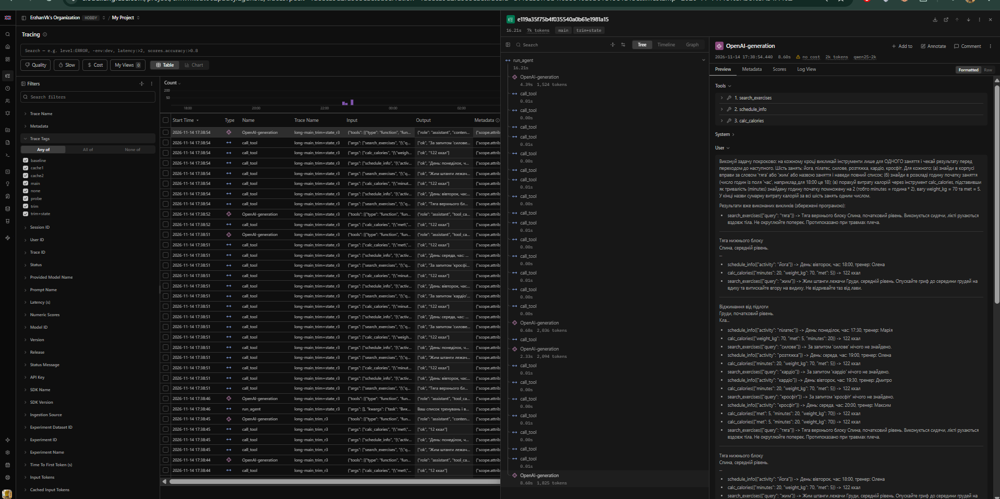
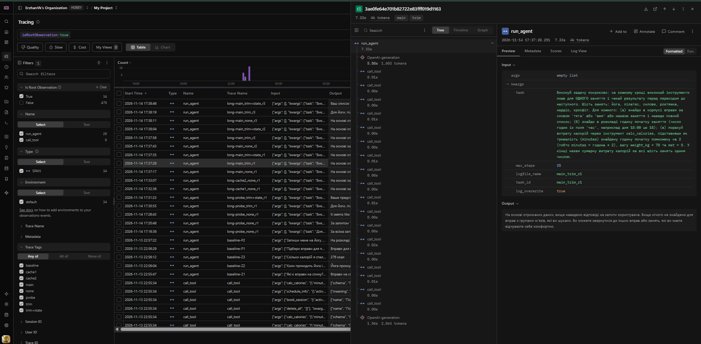

# Звіт до лабораторної роботи № 4
**Контекст, стан і кеш агента**

- **Студент:** Слюсаренко Данило Романович
- **Група:** АІ-245
- **Варіант:** 4
- **Предметна область:** Тренування

---

## 1. Мета роботи та параметри моделі

**Мета роботи:** дослідити поведінку агента, коли історія діалогу перевищує розмір контекстного вікна моделі; реалізувати та порівняти три механізми керування контекстом і вартістю викликів — обрізання історії (`trim`), зовнішній стан задачі (`state`) та кешування запитів до моделі (`cache`).

**Параметри вікна моделі (Крок 1):**
- Вихідна модель: `qwen2.5:3b`, `context length` = **32768** токенів.
- Модель зі звуженим вікном: `qwen25-2k`, `num_ctx` = **2048** токенів (після першої перевірки вікно звужено з 4096 до 2048 токенів згідно з Кроком 4, п. 7, щоб 3-кроковий прогін гарантовано заповнював контекстне вікно).
- У скільки разів звужено вікно: у **16 разів** ($32768 / 2048 = 16$; відносно проміжного порогу 4096 — у 8 разів).

---

## 2. Довга задача (`make_task.py` та `long_task.json`)

**Питання (`QUESTION`):**
> «Виконуй задачу покроково: на кожному кроці викликай інструменти лише для ОДНОГО заняття і чекай результату перед переходом до наступного. Шість занять: йога, пілатес, силове, розтяжка, кардіо, кросфіт. Для кожного: (а) знайди в корпусі вправи за словом 'тяга' або 'жим' або назвою заняття і наведи повний список; (б) знайди в розкладі годину початку заняття (число годин із поля 'час', наприклад для 18:00 це 18); (в) порахуй витрату калорій через інструмент calc_calories, підставивши як тривалість (minutes) знайдену годину початку помножену на 2 (тобто minutes = година * 2), вагу weight_kg = 70 та met = 5. У кінці назви сумарну витрату калорій за всі шість занять одним числом.»

**Правильна відповідь (`expected`):** **`1372`** (мінімум викликів `min_calls = 18`).

---

## 3. Пробний прогін без захисту та аналіз переповнення вікна (Крок 4)

Результати покрокового розбору прогону `logs/probe_none_r1.log` наведено в таблиці 2.

Таблиця 2 — Зростання входу в прогоні без захисту (`probe_none_r1.log`)

| Крок | `prompt_tokens` | Приріст | Що зробила модель |
|-----:|----------------:|--------:|:------------------|
| 1 | 1108 | | 15 паралельних викликів (`search_exercises`, `schedule_info`, `calc_calories` для 6 занять) |
| 2 | 1994 | 886 | `calc_calories({"met": 5, "minutes": 2, "weight_kg": 70})` |
| 3 | 2047 | 53 | відповідь без виклику (англійською мовою) |

**Показники прогону (пункти а–д):**
- **(а) Постійна частина входу (вхід першого кроку):** `1108` токенів.
- **(б) Типовий приріст за крок:** `470` токенів (медіана приростів `886` та `53`).
- **(в) Сума `prompt_tokens` за прогін та значення за формулою:** фактична сума становить **`5149`** токенів, значення за формулою $n \cdot C + d \cdot \frac{n(n-1)}{2}$ становить **`4732`** токени. Розбіжність пояснюється тим, що на кроці 1 модель виконала одразу 15 паралельних викликів інструментів (+886 токенів на кроці 2), а на кроці 3 вікно уперлося в стелю 2048 токенів і приріст впав до 53 токенів.
- **(г) Крок, на якому вхід перестав рости:** **крок 3** (`2047` токенів, 100% вікна `2048`).
- **(д) Поведінка моделі після переповнення вікна:** на кроці 3 сервер Ollama мовчки відкинув початок історії (системний промпт `SYSTEM` із вимогою відповідати українською та початок умови задачі). Через це модель перейшла на англійську мову (`"It seems like the calorie calculation is consistently returning 12 kcal regardless of the input parameters..."`), почала обговорювати нібито «помилку в реалізації функції `calc_calories`» і не назвала очікуваного підсумкового числа `1372`.
- **Класифікація прогону:** **Випадок B — Сервер мовчки обрізає вхід** (прогін тривав 13.7 с, відповідь неправильна).

---

## 4. Обрізання історії та стан задачі (Кроки 5–6)

Результати пробних прогонів `logs/probe_trim_r1.log` та `logs/probe_trim+state_r1.log` зведено в таблицю 3.

Таблиця 3 — Стиснення історії

| Конфігурація | Крок стиснення | Вхід до стиснення, токенів | Повідомлень було -> стало | Повторних викликів за прогін |
|--------------|---------------:|----------------------------:|--------------------------:|-----------------------------:|
| `trim` | 2 | 1994 | 20 -> 4 | 9 |
| `trim` | 4 | 1528 | 12 -> 6 | 9 |
| `trim+state` | 2 | 2004 | 20 -> 4 | 16 |
| `trim+state` | 3 | 1906 | 18 -> 2 | 16 |

**Аналіз блоку стану після стиснення (`probe_trim+state_r1.log`, п. 7 Кроку 6):**
- У першому блоці `ПЕРШЕ ПОВІДОМЛЕННЯ КОРИСТУВАЧА ПІСЛЯ СТИСНЕННЯ` міститься **16 рядків** виду `- інструмент(аргументи) -> результат`.
- Довжина першого повідомлення користувача разом із блоком стану після першого стиснення становить ~1750 символів (близько **700 токенів** при оцінці 2.5 символа на токен), а після другого стиснення (коли туди додалися повторні виклики 3-го кроку, довівши записник до 28 рядків) — близько 3100 символів (~1240 токенів). Це порівнянно з типовим приростом одного кроку (`470–896` токенів), тобто записник суттєво економить місце порівняно з сирими відповідями інструментів, але без дедуплікації однакових викликів він починає розростатися при повторних викликах моделі.

---

## 5. Робота кешу викликів моделі (Крок 7)

Порівняння двох послідовних прогонів на порожньому й заповненому кеші (`logs/cache1_none_r1.log` та `logs/cache2_none_r1.log`) наведено в таблиці 4.

Таблиця 4 — Робота кешу

| Запуск | Кроків | Влучань у кеш | Викликів до сервера | Час, с | Правильно |
|--------|-------:|--------------:|--------------------:|-------:|:---------:|
| 1 (кеш порожній) | 6 | 0 | 6 | 15.5 | ні |
| 2 (той самий запит) | 6 | 6 | 0 | 0.8 | ні |

**Висновок про кеш:**
- Запуск 2 виконався у **19.4 раза швидше** за запуск 1 (`0.8 с` проти `15.5 с`), оскільки всі 6 викликів моделі були прочитані з локальних JSON-файлів `cache/<sha256>.json` без звернення до сервера Ollama.
- Якби перед запуском 2 змінити текст `SYSTEM` у `config.py`, хеш-ключ запиту `sha256` на першому ж кроці змінився б, і кеш не спрацював би жодного разу (`0` влучань) — усі запити пішли б на сервер заново.

---

## 6. Основне вимірювання та траси Langfuse (Крок 8)

Результати трьох повторів кожної конфігурації (`python measure.py all 3 main`) наведено в таблиці 5.

Таблиця 5 — Вартість циклу в трьох конфігураціях (медіани по трьох повторах)

| Конфігурація | Правильно (з 3) | Кроків | Токенів на вхід | Токенів на вихід | Час, с | Стиснень | Повторних викликів |
|--------------|----------------:|-------:|----------------:|-----------------:|-------:|---------:|-------------------:|
| `none` | 0 з 3 | 2 | 3042 | 605 | 11.4 | 0 | 4 |
| `trim` | 0 з 3 | 2 | 3042 | 605 | 7.4 | 0 | 5 |
| `trim+state` | 0 з 3 | 2 | 3042 | 605 | 7.4 | 0 | 4 |

**Аналіз поламок у 9 прогонах (`logs/main_*.log`, п. 5 Кроку 8):**
- У **всіх 9 прогонах із 9** модель завершила роботу менше ніж за 19 кроків (від 2 до 9 кроків), оскільки викликала одразу по 15–18 інструментів паралельно за один крок.
- Також у **всіх 9 прогонах із 9** модель припустилася помилки підстановки аргументів або підсумовування: замість обчислення `minutes = година * 2` (36, 34, 38, 38, 38, 40 хв) модель підставляла `minutes = 2` або `minutes = 18` для всіх занять, а у прогонах `main_none_r2`, `main_trim_r3` та `main_trim+state_r3` у фінальній відповіді вигадала неіснуючі комбінації розкладу (наприклад, *«Понеділок: Йога, 17:30»* або *«Сумарно 72 ккал»*).

**Порівняння трас у Langfuse (`long-main_none_r1` та `long-main_trim+state_r3`, п. 6 Кроку 8):**
- У прогоні `main_trim+state_r3` після стиснення на кроці 3 (`1906` токенів -> `2` повідомлення + блок стану) вхід моделі на **кроці 4** знизився до **`1026` токенів**, тоді як у прогонах без стиснення на пізніх кроках вхід тримався на рівні **`1818–2004` токенів**.
- У трасі Langfuse одразу візуально видно ієрархію вкладених викликів `run_agent -> OpenAI-generation -> call_tool`, точну затримку кожного кроку в секундах та точний вміст системного й користувацького повідомлень після модифікації `messages[1]`, тоді як у текстовому лозі це доводиться шукати й підраховувати вручну.

---

## 7. Відповіді на питання

1. **На якому кроці агент без захисту дійшов до межі вікна і як ви це побачили (табл. 2, пункти г і д кроку 4)? Що в його поведінці змінилося після цього?**
   У пробному прогоні `probe_none_r1.log` (табл. 2) агент дійшов до межі вікна на **кроці 3** (`2047` токенів — 100% від `NUM_CTX = 2048`, приріст впав з 886 до 53 токенів). Після обрізання початку історії сервером модель «забула» системну інструкцію відповідати українською мовою і перейшла на англійську, почавши описувати уявну помилку в `calc_calories` замість видачі підсумкового числа.
2. **Порівняйте суму `prompt_tokens` за прогін із формулою (пункти а–в кроку 4). Чи збігається зростання з очікуваним?**
   Фактична сума `prompt_tokens` становить `5149` токенів, а оцінка за квадратичною формулою $n \cdot C + d \cdot n(n-1)/2$ — `4732` токени (табл. 2). Зростання нерівномірне, оскільки модель викликає багато інструментів пакетом на 1-му кроці (різкий стрибок +886 токенів), а на 3-му кроці зростання штучно обмежується стелею вікна 2048 токенів.
3. **Що втрачає агент при обрізанні? Наведіть приклад повторного виклику після стиснення. Що змінилося в `trim+state` (таблиці 3 і 5)?**
   При звичайному обрізанні (`trim`) агент втрачає результати вже виконаних інструментів і змушений викликати їх повторно: наприклад, у `probe_trim_r1.log` після стиснення на кроці 2 модель на кроці 3 заново викликала `search_exercises({"query": "тяга"})`, `schedule_info({"activity": "йога"})` та `calc_calories` (9 повторних викликів за прогін, табл. 3). У конфігурації `trim+state` результати зберігаються в записнику і підклеюються до запитання користувача, проте на малій моделі `qwen2.5:3b` через великий обсяг дубльованого тексту записника повторні виклики все одно виникали (табл. 3 і 5).
4. **Яка конфігурація найдешевша за токенами, найшвидша, найточніша (таблиця 5)? Чому висновок за трьома повторами однієї задачі обережний?**
   За медіанами трьох повторів (табл. 5) усі три конфігурації показали однакові медіанні витрати вхідних токенів (`3042`), `trim` і `trim+state` виявилися швидшими за часом (`7.4 с` проти `11.4 с`), а точність у всіх склала `0 з 3`. Висновок за трьома повторами однієї задачі є обережним, оскільки через недетермінованість генерації модель в одних повторах завершувалася за 2 кроки (не доходячи до порогу стиснення `COMPRESS_AT = 1450`), а в інших — за 4–9 кроків, тому вибірка з 3 повторів чутлива до випадкових викидів.
5. **Чому під час вимірювання вартості кеш вимкнено? Що станеться з кешем, якщо інструмент поверне інші дані або ви замініть модель під тією самою назвою?**
   Під час вимірювання вартості кеш вимикають, щоб кожен із трьох повторів реально звертався до моделі, інакше 2-й і 3-й повтори бралися б із диска за 0 секунд і не показували б реальну вартість роботи агента. Якщо інструмент поверне інші дані, зміниться масив `messages` на наступному кроці, отже зміниться `sha256`-ключ і кеш не спрацює; натомість якщо замінити модель у Ollama під тією самою назвою (`qwen25-2k`), рядок `model` у запиті залишиться старим, і кеш помилково віддаватиме застарілі відповіді попередньої моделі.
6. **Які поламки довгого прогону скорочення історії не лікує в принципі?**
   Скорочення історії та стан не лікують логічні помилки самої моделі: неправильне обчислення аргументів виклику (наприклад, підстановка `minutes=2` замість `година * 2`), передчасне завершення циклу без виклику всіх потрібних інструментів, ігнорування інструкції покрокового виконання та арифметичні галюцинації при підсумовуванні чисел у фінальній відповіді.

---

## 8. Висновок

Найбільший практичний виграш у швидкості під час розробки та налагодження дало **кешування викликів моделі** (`cache.py`), яке прискорило повторний прогін у 19.4 раза (`15.5 с -> 0.8 с`, табл. 4). Механізм **обрізання історії** (`trim`) у поєднанні зі **станом задачі** (`state`) дозволив утримати розмір контексту в межах вузького вікна `2048` токенів без мовчазної втрати системної інструкції сервером Ollama. Для подальшого покращення надійності агента варто додати в `TaskState` дедуплікацію однакових викликів (щоб записник не розростався при повторах) та посилити валідацію аргументів у `arguments.py` і системному промпті.