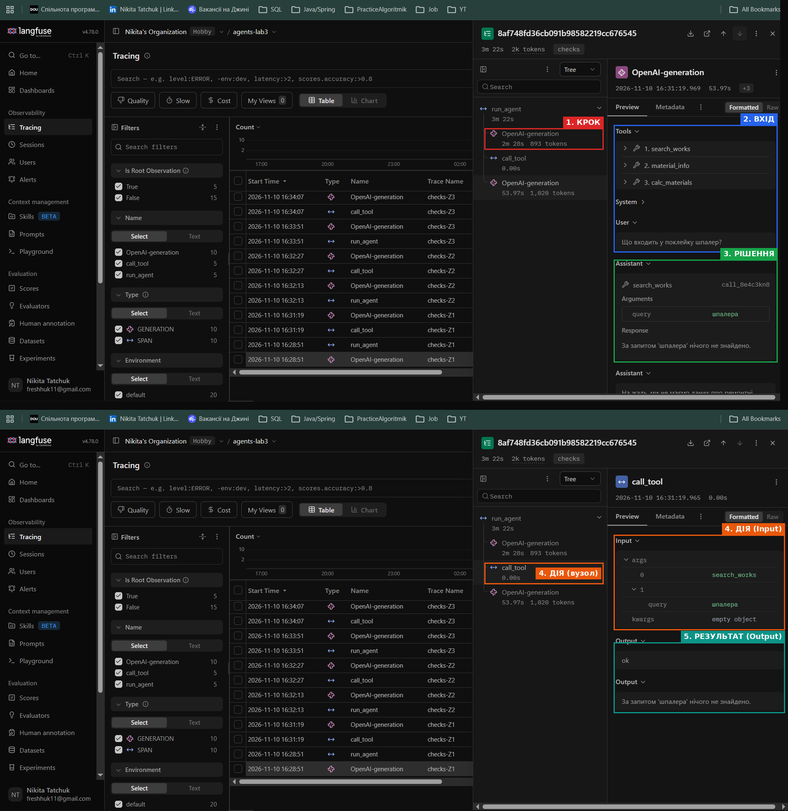
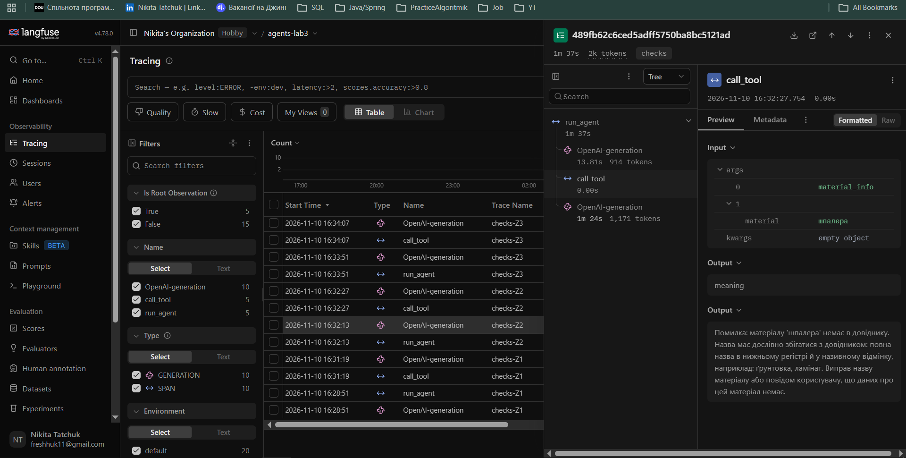
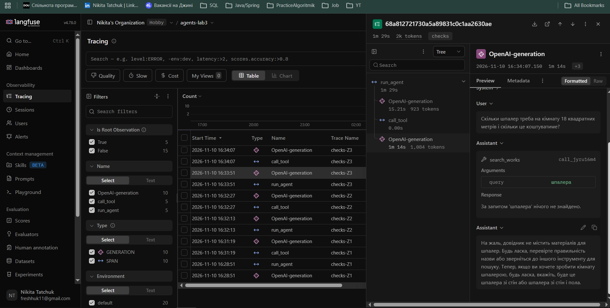

<div align="center">

МІНІСТЕРСТВО ОСВІТИ І НАУКИ УКРАЇНИ

НАЦІОНАЛЬНИЙ УНІВЕРСИТЕТ «ОДЕСЬКА ПОЛІТЕХНІКА»

ІНСТИТУТ КОМП'ЮТЕРНИХ СИСТЕМ

КАФЕДРА ІНФОРМАЦІЙНИХ СИСТЕМ

&nbsp;

&nbsp;

**Протокол лабораторної роботи № 3**

**«Надійність виклику інструментів і трасування агента»**

з дисципліни: «Обчислювальні методи»

&nbsp;

&nbsp;

</div>

<div align="right">

**Виконав:**

студент групи АІ-245

Татчук Нікіта Максимович

&nbsp;

**Перевірив:**

ас. Баранов О. М.

</div>

&nbsp;

<div align="center">

Одеса – 2026

</div>

---

## 1. Мета роботи, варіант, предметна область

**Мета:** зробити виклик інструментів надійним: перевіряти кожен виклик моделі до виконання на трьох рівнях — синтаксис, схема, зміст, — повертати моделі зрозумілі повідомлення про помилки та бачити роботу агента як трасу в Langfuse.

| | |
|---|---|
| **Варіант** | 6 |
| **Предметна область** | Ремонт квартири |
| **Модель** | qwen2.5:3b (Ollama, локально, на CPU) |
| **MAX_STEPS / TEMPERATURE** | 8 / 0 |
| **MAX_RETRIES** | 2 |
| **Дозволені інструменти (`ALLOWED`)** | `search_works`, `material_info`, `calc_materials` |
| **Що звіряти з довідником** | Назва матеріалу (`data/materials.csv`) |
| **Заборонена дія** | `place_order` — замовити матеріали |

Дані, набір задач і параметри виклику моделі залишено такими самими, як у лабораторній роботі № 2.

---

## 2. Класи аргументів інструментів (`arguments.py`)

```python
"""Класи аргументів інструментів."""
from pydantic import BaseModel, ConfigDict, Field


class SearchWorksArgs(BaseModel):
    model_config = ConfigDict(extra="forbid")
    query: str = Field(description="Тип роботи або категорія, одне-два слова українською "
                                   "у називному відмінку, наприклад: стеля, ламінат, "
                                   "сантехніка. Не передавай усе питання користувача цілком.")


class MaterialInfoArgs(BaseModel):
    model_config = ConfigDict(extra="forbid")
    material: str = Field(description="Назва матеріалу в нижньому регістрі, як вона записана "
                                      "в довіднику, наприклад: ґрунтовка, ламінат.")


class CalcMaterialsArgs(BaseModel):
    model_config = ConfigDict(extra="forbid")
    area: float = Field(gt=0, le=500, description="Площа в квадратних метрах")
    coverage_m2: float = Field(gt=0, description="Покриття однієї одиниці в м², отримане з довідника")
    price: float = Field(gt=0, description="Ціна за одиницю в гривнях, отримана з довідника")


ARGS = {
    "search_works": SearchWorksArgs,
    "material_info": MaterialInfoArgs,
    "calc_materials": CalcMaterialsArgs,
}
```

Назви полів збігаються з параметрами функцій у `tools.py`. Описи полів перенесено з `schemas.py` лабораторної роботи № 2.

Розділ `parameters` у `schemas.py` тепер генерується методом `model_json_schema()`. Перевірка `print(json.dumps(SCHEMAS[0], ensure_ascii=False, indent=2))` показала `"additionalProperties": false` і `"required": ["query"]`. Для `calc_materials` у схемі з'явилися `"exclusiveMinimum": 0` для `area`, `coverage_m2` і `price`, а також `"maximum": 500` для `area`.

---

## 3. Правила змісту

| Аргумент | Правило | Де записано | Звідки взято межу |
|---|---|---|---|
| `material_info.material` | Назва (без урахування регістру) є в довіднику | `check_meaning` | Ключ довідника за табл. 7 (варіант 6 — назва матеріалу), `data/materials.csv`. Значень 19 (> 10), тому в повідомленні їх не перелічено, а описано, як записати правильну назву |
| `calc_materials.area` | `area > 0` | клас, `Field(gt=0)` | Площа не буває нульовою чи від'ємною |
| `calc_materials.area` | `area ≤ 500` | клас, `Field(le=500)` | Оцінка з запасом: у задачах і корпусі площі 4–18 м², площа поверхонь однієї квартири не перевищує кількох сотень м² |
| `calc_materials.coverage_m2` | `coverage_m2 > 0` | клас, `Field(gt=0)` | `calc_materials` ділить площу на покриття, а при `coverage_m2 ≤ 0` сам повертає помилку |
| `calc_materials.price` | `price > 0` | клас, `Field(gt=0)` | Ціна не буває нульовою; мінімальна ціна в довіднику — 110 грн |
| `calc_materials.coverage_m2` + `price` | Пара (покриття, ціна) збігається з одним рядком довідника | `check_meaning` | Опис `calc_materials`: «Покриття й ціну спочатку отримай через `material_info`»; значення з `data/materials.csv` |

Для `search_works.query` правила змісту немає. Відсутність роботи в корпусі — допустимий результат (саме його очікує задача P1).

Для кабелю розрахунок неможливий: у довіднику в нього `coverage_m2 = 0`, тож виклик `calc_materials` з таким значенням зупиниться на рівні `schema`.

`check_meaning` (`checks.py`):

```python
"""Перевірки змісту аргументів."""
import csv

with open("data/materials.csv", encoding="utf-8") as f:
    MATERIALS = list(csv.DictReader(f))

MATERIAL_NAMES = [row["material"] for row in MATERIALS]

# пари (покриття, ціна), які реально є в довіднику
PAIRS = [(float(row["coverage_m2"]), float(row["price"])) for row in MATERIALS]


def check_meaning(name, args):
    if name == "material_info":
        # ключ довідника: назва матеріалу має бути в materials.csv
        if args.material.lower() not in MATERIAL_NAMES:
            return (f"Помилка: матеріалу '{args.material}' немає в довіднику. "
                    "Назва має дослівно збігатися з довідником: повна назва в нижньому регістрі "
                    "й у називному відмінку, наприклад: ґрунтовка, ламінат. "
                    "Виправ назву матеріалу або повідом користувачу, що даних про цей матеріал немає.")

    if name == "calc_materials":
        # правило для двох аргументів: покриття й ціна мають належати одному рядку довідника
        if (args.coverage_m2, args.price) not in PAIRS:
            return (f"Помилка: у довіднику немає матеріалу з покриттям {args.coverage_m2} м² "
                    f"і ціною {args.price} грн. "
                    "Покриття й ціна мають бути взяті з результату material_info для одного матеріалу. "
                    "Спочатку виклич material_info, потім передай отримані значення в calc_materials.")
    return None
```

Заборонену дію `place_order(material, quantity)` додано в `tools.py` як заглушку і внесено в реєстр `TOOLS`, але не в `config.ALLOWED`.

---

## 4. Перевірка ланцюжка перевірок

Таблиця 2 — Перевірка ланцюжка перевірок (вивід `test_checks.py`)

| Що перевіряємо | Виклик | Рівень | Повідомлення для моделі |
|---|---|---|---|
| Зламаний JSON | `calc_materials`, `'{"area": 18, "coverage_m2": 5, "price": 450'` | `syntax` | Помилка: аргументи не пройшли перевірку.<br>Поле JSON: Invalid JSON: EOF while parsing an object at line 1 column 43<br>Виправ аргументи і виклич інструмент ще раз. |
| Неправильний тип | `calc_materials`, `'{"area": "вісімнадцять", "coverage_m2": 5, "price": 450}'` | `schema` | Помилка: аргументи не пройшли перевірку.<br>Поле area: Input should be a valid number, unable to parse string as a number<br>Виправ аргументи і виклич інструмент ще раз. |
| Відсутнє обов'язкове поле | `calc_materials`, `'{"area": 18, "coverage_m2": 5}'` | `schema` | Помилка: аргументи не пройшли перевірку.<br>Поле price: Field required<br>Виправ аргументи і виклич інструмент ще раз. |
| Вигадане поле | `material_info`, `'{"material": "шпалери", "unit": "рулон"}'` | `schema` | Помилка: аргументи не пройшли перевірку.<br>Поле unit: Extra inputs are not permitted<br>Виправ аргументи і виклич інструмент ще раз. |
| Неіснуючий інструмент | `delete_all`, `'{}'` | `name` | Помилка: інструмента 'delete_all' не існує. Доступні: search_works, material_info, calc_materials. Виклич один з доступних або повідом користувачу, що такої дії немає. |
| Заборонена дія | `place_order`, `'{"material": "шпалери", "quantity": 4}'` | `permission` | Помилка: інструмент 'place_order' недоступний. Не повторюй виклик, повідом користувачу, що ця дія недоступна. |
| Значення немає в довіднику | `material_info`, `'{"material": "демпферна стрічка"}'` | `meaning` | Помилка: матеріалу 'демпферна стрічка' немає в довіднику. Назва має дослівно збігатися з довідником: повна назва в нижньому регістрі й у називному відмінку, наприклад: ґрунтовка, ламінат. Виправ назву матеріалу або повідом користувачу, що даних про цей матеріал немає. |
| Значення поза межами | `calc_materials`, `'{"area": 18, "coverage_m2": 0, "price": 0}'` | `schema` | Помилка: аргументи не пройшли перевірку.<br>Поле coverage_m2: Input should be greater than 0<br>Поле price: Input should be greater than 0<br>Виправ аргументи і виклич інструмент ще раз. |

Усі вісім перевірок спрацювали на очікуваному рівні з першого запуску.

Останній рядок — це виклик, який модель зробила в задачі Z3 лабораторної роботи № 2. Межу `gt=0` задано в класі, тому рівень `schema`, а не `meaning`.

Окремо в `test_checks.py` перевірено правило для двох аргументів: виклик `calc_materials` з `{"area": 18, "coverage_m2": 20, "price": 450}` (покриття ґрунтовки, ціна шпалер) зупиняється на рівні `meaning` з повідомленням «у довіднику немає матеріалу з покриттям 20.0 м² і ціною 450.0 грн…».

---

## 5. Результати прогону та порівняння з базовим

Колонки «До» взято з `lab3_baseline.log` (мітка `baseline`), колонки «Після» — з `lab3_checks.log` (мітка `checks`). Правильність оцінено за тими самими критеріями, що й у лабораторній роботі № 2.

Таблиця 3 — Результати по задачах

| Задача | До: правильно (1/0) | Після: правильно (1/0) | До: кроків | Після: кроків | Що змінилося |
|---|---|---|---|---|---|
| Z1 | 1 | 0 | 2 | 2 | Модель шукала `search_works({"query":"шпалера"})` замість «поклейка шпалер». Такої форми слова в корпусі немає (там «шпалер», «шпалери»), тому пошук нічого не знайшов, і модель відповіла, що даних немає |
| Z2 | 1 | 0 | 2 | 2 | Виклик `material_info({"material":"шпалера"})` зупинено на рівні `meaning`. Модель не виправила назву на «шпалери», а попросила користувача перевірити назву |
| Z3 | 1 | 0 | 3 | 2 | Модель викликала `search_works("шпалера")` замість `material_info` і до `calc_materials` не дійшла. У відповіді — твердження, що «довідник не містить матеріалів для шпалер», хоча довідник вона не відкривала |
| P1 | 0 | 1 | 3 | 2 | Один пошук «встановлення теплої підлоги» і чесна відповідь, що такої роботи немає, без вигаданої ціни |
| P2 | 1 | 0 | 1 | 2 | Замість відмови модель шукала роботу «мастер» і попросила уточнити запит |

**Правильних відповідей: до — 4 із 5, після — 1 із 5.**

Таблиця 4 — Поламки до та після впровадження перевірок

| Поламка | До | Після |
|---|---|---|
| Не викликав інструмент | 0 | 0 |
| Викликав не той інструмент | 0 | 1 (Z3) |
| Неправильні аргументи | 1 (Z3) | 1 (Z2) |
| Зациклився | 0 | 0 |
| Не використав результат | 0 | 0 |
| Вигадав результат | 1 (P1) | 2 (Z1, Z3) |
| Вичерпав ліміт кроків | 0 | 0 |
| Відмова після ліміту помилок (нове) | - | 0 |

Пояснення до колонки «Після»:

- **Вигадав результат.** У Z1 у відповіді з'явилася назва «ламінат», якої немає в жодному результаті. У Z3 модель заявила про вміст довідника, не викликавши `material_info`.
- **P2.** Відповідь неправильна, але жодна ознака з лабораторної роботи № 2 до неї не підходить. Пошук `search_works("мастер")` нічого не зламав, проблема в тому, що агент не відмовив.

Таблиця 5 — Спрацювання перевірок у прогоні

| Рівень | Скільки разів | Модель виправилася на наступному кроці |
|---|---|---|
| `name` | 0 | — |
| `permission` | 0 | — |
| `syntax` | 0 | — |
| `schema` | 0 | — |
| `meaning` | 1 (Z2, крок 1) | Ні: на кроці 2 модель не викликала інструмент повторно, а попросила користувача перевірити назву |
| `tool` | 0 | - |
| `length` | 0 | - |

Решта 4 виклики в `lab3_checks.log` мають рівень `ok`.

У базовому прогоні випадків «не викликав інструмент» не було. У P2 на першому кроці немає виклику, але відповідь — звичайна відмова українською. Вона не містить `<tool_call>` і не починається з `{`, тобто це не зламаний виклик.

---

## 6. Аналіз трас у Langfuse

### Структура події



Рисунок 1 — Структура події: перший крок агента в трасі `checks-Z1`

- **Крок** — перший вузол `OpenAI-generation` у дереві траси `checks-Z1`.
- **Вхід** — історія з двох повідомлень (system з `config.SYSTEM` і user «Що входить у поклейку шпалер?») разом з описами трьох інструментів.
- **Рішення** — відповідь моделі: виклик `search_works` з аргументами `{"query":"шпалера"}`.
- **Дія** — вузол `call_tool`, на вході `search_works` і `'{"query":"шпалера"}'`.
- **Результат** — вихід `call_tool`: `["ok", "За запитом 'шпалера' нічого не знайдено."]`.

### Порівняння двох прогонів

Таблиця 6 — Порівняння прогонів у Langfuse

| Задача | Викликів моделі: до | Викликів моделі: після | Токенів: до | Токенів: після | Час, с: до | Час, с: після |
|---|---|---|---|---|---|---|
| Z1 | 2 | 2 | 1466 | 1913 | 195 | 202 |
| Z2 | 2 | 2 | 1479 | 2085 | 45 | 97 |
| Z3 | 3 | 2 | 2393 | 2007 | 75 | 89 |
| P1 | 3 | 2 | 2292 | 1904 | 91 | 68 |
| P2 | 1 | 2 | 743 | 1881 | 47 | 71 |
| **Разом** | **11** | **10** | **8373** | **9790** | **453** | **527** |

Викликів моделі стало більше лише в P2: 1 → 2. Додатковий виклик пішов на пошук `search_works({"query":"мастер"})`, після якого модель так і не відмовила.

У Z3 і P1 викликів, навпаки, поменшало. Модель зупинилася після першого порожнього пошуку і не дійшла до розрахунку чи другого пошуку.

Токенів більше в усіх задачах, крім Z3 і P1. Причина — довший опис інструментів: `prompt_tokens` на першому кроці зросли з 691–707 до 869–900. Схеми, згенеровані Pydantic, містять `title`, `additionalProperties`, `exclusiveMinimum` і `maximum`, яких не було в ручних схемах.

Найбільше токенів у Z2 (2085): історія на кроці 2 зросла на 172 токени (892 → 1064), здебільшого через повідомлення про помилку `meaning`.

Час у Z1 в обох прогонах найбільший через завантаження моделі на першому виклику.

### Траса з помилкою моделі



Рисунок 2 — Дерево траси `checks-Z2`

```
--- крок 1 | помилок поспіль=0 | prompt_tokens=892
  виклик   : material_info({"material":"шпалера"})
  рівень   : meaning
  результат: Помилка: матеріалу 'шпалера' немає в довіднику. Назва має дослівно збігатися з довідником: повна назва в нижньому регістрі й у називному відмінку, наприклад: ґрунтовка, ламінат. Виправ назву матеріалу або повідом користувачу, що даних про цей матеріал немає.

--- крок 2 | помилок поспіль=1 | prompt_tokens=1064
ВІДПОВІДЬ: Поважаю, матеріал "шпалера" не був знайдений у нашому довіднику. Будь ласка, перевірте назву матеріалу і повторіть запит. Я можу допомогти, коли ви дадите повну назву матеріалу в нижньому регістрі, наприклад: ґрунтовка, ламінат.
```

У прогоні немає траси, де модель помилилася б і виправилася: єдину помилку моделі (Z2) зловлено, але виправлення не було. Тому розібрано саме її.

- **Яка була помилка.** Модель передала в `material_info` назву «шпалера». У довіднику матеріал записано як «шпалери».
- **На якому рівні зловлено.** На рівні `meaning`, перевіркою ключа довідника в `check_meaning`. У трасі це вузол `call_tool` кроку 1, його вихід — `["meaning", ...]`. Функцію `material_info` не викликано.
- **Яке повідомлення отримала модель.** Що назви немає в довіднику, що назва має бути повною, в нижньому регістрі й у називному відмінку, і що робити: виправити назву або повідомити користувача.
- **Що вона змінила.** Виклик модель не виправила. На кроці 2 вона обрала другий варіант із повідомлення і переадресувала уточнення користувачу. Повідомлення не дало їй потрібної інформації: «шпалера» вже стоїть у називному відмінку, а правильної назви «шпалери» в повідомленні немає, бо 19 назв довідника не перелічено.

### Траса неправильно розв'язаної задачі



Рисунок 3 — Дерево траси `checks-Z3`

```
--- крок 1 | помилок поспіль=0 | prompt_tokens=900
  виклик   : search_works({"query":"шпалера"})
  рівень   : ok
  результат: За запитом 'шпалера' нічого не знайдено.

--- крок 2 | помилок поспіль=0 | prompt_tokens=957
ВІДПОВІДЬ: На жаль, довідник не містить матеріалів для шпалер. Будь ласка, перевірте правильність назви або зверніться до іншого інструменту для пошуку. Тепер, якщо ви хочете зробити кімнату шпалерою, будь ласка, вкажіть, буде це шпалера зі стін або шпалера зі стін і пола.
```

**Що пішло не так:** для розрахунку потрібні `material_info` і `calc_materials`, а модель викликала `search_works` з формою «шпалера», якої немає в корпусі. Після порожнього результату вона не спробувала інший інструмент, а у відповіді заявила, що довідник не містить матеріалів для шпалер, хоча довідника не відкривала.

**Чому жодна перевірка цього не зловила:**

- Інструмент `search_works` існує і дозволений.
- Аргумент `query` — рядок без вигаданих полів.
- Для `query` правила змісту немає, бо порожній результат пошуку допустимий.
- Чи відповідає обраний інструмент задачі, диспетчер не перевіряє.
- Хибне твердження з'явилося у фінальній відповіді, яку не перевіряє ні `call_tool`, ні `check_response`.

---

## 7. Відповіді на питання

**1. Які поламки зникли або зменшилися після впровадження перевірок? Які лишилися?**
За табл. 4 зникла вигадана ціна в P1: тепер модель чесно відповідає, що роботи немає. Помилка з нулями в Z3 не повторилася, бо модель до `calc_materials` не дійшла. Натомість з'явилися «Викликав не той інструмент» (Z3) і два випадки «Вигадав результат» (Z1, Z3), а «Неправильні аргументи» перейшли із Z3 у Z2. Правильних відповідей стало менше: 4 → 1 (табл. 3). Більшість нових поламок перевірки не ловлять у принципі: форма слова «шпалера» і вибір інструмента проходять усі рівні як `ok`.

**2. На якому рівні модель помилялася найчастіше? Що можна змінити, щоб таких помилок стало менше?**
Єдина помилка прогону — на рівні `meaning` (табл. 5, Z2). Найкорисніше змінити повідомлення: додати в нього схожі назви з довідника (для «шпалера» — «шпалери», «клей для шпалер»), щоб модель мала з чого виправитися. Друге — опис `query` і `material`: схоже, вимога «у називному відмінку» підштовхнула модель до форми «шпалера», якої немає в корпусі, хоча пошук іде за підрядком і «шпалер» знайшов би роботу. Третій варіант — більша модель.

**3. Чи траплялися відмови після ліміту помилок? Що в цих випадках було не так?**
Ні: у `lab3_checks.log` немає рядка «СТОП: модель не змогла сформувати правильний виклик», найбільше значення «помилок поспіль» — 1 (Z2, крок 2). Після помилки модель не робила повторних викликів, а відповіла користувачу. Повідомлення вона зрозуміла (повторила його вимоги у відповіді), але виправити назву не мала з чого.

**4. Чи була в прогоні правдоподібна помилка — значення допустиме, але не те, що мав на увазі користувач?**
Так, `search_works({"query":"шпалера"})` у Z1 і Z3 та `search_works({"query":"мастер"})` у P2. Значення — коректні рядки, інструмент їх прийняв і чесно повернув порожній результат, але користувач питав про поклейку шпалер і про виклик майстра. Перевірки контролюють форму аргументів і наявність ключа в довіднику, а для пошукового запиту правила змісту немає, бо порожній результат — допустимий.

**5. Які поламки перевірки не лікують у принципі та чому?**
Вибір не того інструмента (Z3), правдоподібні значення (Z1, P2), вигадані твердження у фінальній відповіді (Z1, Z3) і відсутність відмови (P2). Перевірки працюють лише на межі «модель → інструмент». Вони бачать, чи існує інструмент, чи дозволений він і чи коректні аргументи, але не бачать, чи це той інструмент і те значення, що потрібні для задачі. Фінальний текст відповіді не перевіряє жоден рівень.

**6. Скільки додаткових викликів моделі пішло на виправлення помилок? Чи виправдана така ціна надійності?**
На виправлення не пішло жодного виклику, бо модель не виправлялася. Загалом викликів 10 проти 11 (табл. 6), а єдиний додатковий (P2) пішов на зайвий пошук. Токенів більше на 17 % (8373 → 9790), переважно через довші схеми (+178–193 токени на першому кроці), час — 453 → 527 с. У такому вигляді ціна себе не виправдовує: перевірки зловили одну помилку, але повідомлення не допомогло її виправити. Виправданою вона стане з інформативнішими повідомленнями (відповідь 2).

**7. Візьміть найдовшу задачу. Що в ній легше побачити в трасі Langfuse, а що — у текстовому лозі?**
Найдовша задача — Z1 (202 с).

- **Траса Langfuse.** Одразу видно, що з 202 с майже 150 с займає перший вузол `OpenAI-generation`, тобто завантаження моделі. Там же видно повну історію повідомлень і схеми інструментів на вході кожного виклику.
- **Текстовий лог.** Легше швидко переглянути послідовність викликів, рівні й лічильник «помилок поспіль» і порахувати рівні пошуком рядків (так заповнено табл. 5).
- **Чому лог важко читати на довгих задачах.** Час кожного вузла доводиться обчислювати з різниці позначок часу. Довгі повідомлення про помилки займають кілька екранних рядків. Історію, яку отримала модель на кроці, з логу доводиться відновлювати вручну.

---

## 8. Висновок

Найбільший ефект дала заміна диспетчера ланцюжком перевірок разом із класами Pydantic. Незалежно від моделі вісім випадків табл. 2 зупиняються на очікуваних рівнях до виконання функції. У прогоні перевірка ключа довідника не дала `material_info` виконатися з неіснуючою назвою (Z2). Але на п'яти задачах правильних відповідей стало менше (4 → 1). Зниження пов'язане з тим, як модель обирала значення («шпалера») та інструменти, і більшість цих помилок проходить усі рівні як `ok`. Чи вплинули на поведінку моделі довші схеми, за п'ятьма задачами визначити не можна.

Варто покращити такі речі:

- **Повідомлення `meaning`.** Додати схожі назви з довідника, щоб модель могла виправитися сама.
- **Опис аргументу `query`.** Не вимагати називного відмінка, який для пошуку за підрядком шкодить.
- **Фінальна відповідь.** Окремо перевіряти твердження, яких немає в жодному результаті інструментів (Z1, Z3).
