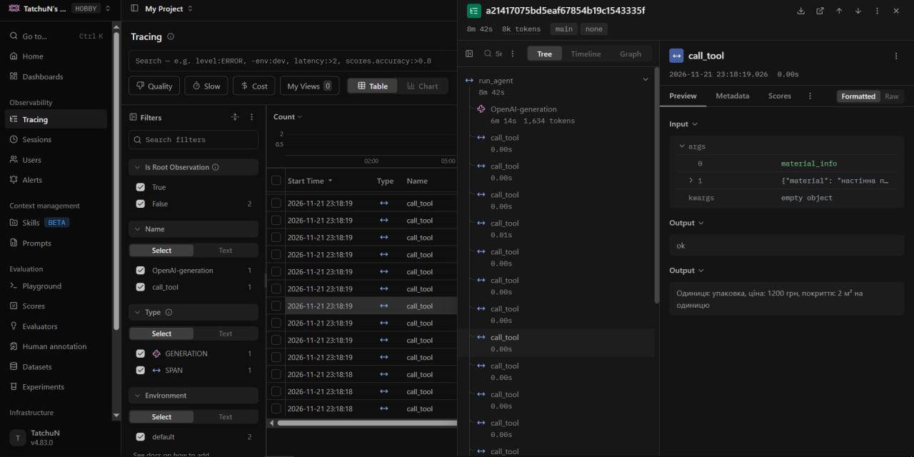
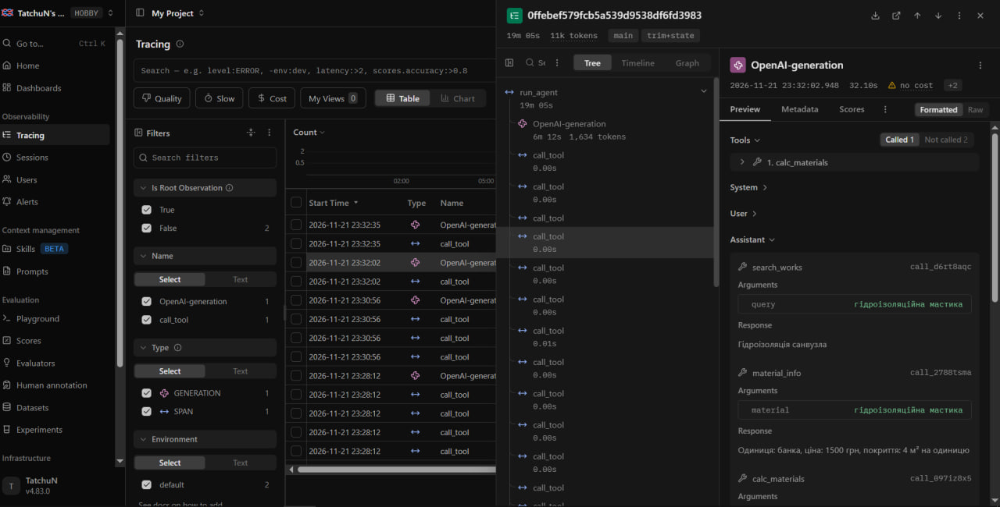

<div align="center">

МІНІСТЕРСТВО ОСВІТИ І НАУКИ УКРАЇНИ

НАЦІОНАЛЬНИЙ УНІВЕРСИТЕТ «ОДЕСЬКА ПОЛІТЕХНІКА»

ІНСТИТУТ КОМП'ЮТЕРНИХ СИСТЕМ

КАФЕДРА ІНФОРМАЦІЙНИХ СИСТЕМ

&nbsp;

&nbsp;

**Протокол лабораторної роботи № 4**

**«Контекст, стан і кеш агента»**

з дисципліни: «Обчислювальні методи»

&nbsp;

&nbsp;

</div>

<div align="right">

**Виконав:**

студент групи АІ-245

Татчук Нікіта Максимович

&nbsp;

**Перевірив:**

ас. Баранов О. М.

</div>

&nbsp;

<div align="center">

Одеса – 2026

</div>

---

## 1. Мета роботи, варіант, предметна область, модель і вікно

**Мета:** побачити, що відбувається з агентом, коли історія не вміщується в контекстне вікно моделі; навчитися скорочувати історію, зберігати результати інструментів поза текстом діалогу та кешувати виклики моделі; виміряти, скільки це коштує.

| | |
|---|---|
| **Варіант** | 6 |
| **Предметна область** | Ремонт квартири |
| **Вихідна модель** | qwen2.5:3b (Ollama, локально, на CPU) |
| **Модель з вузьким вікном** | `llama32-3k` (спочатку `llama32-4k`, див. розділ 3) |
| **Інструменти (`ALLOWED`)** | `search_works`, `material_info`, `calc_materials` |
| **MAX_STEPS / MAX_STEPS_LONG** | 8 / 25 |
| **COMPRESS_AT / KEEP_LAST / STATE_RESULT_CHARS** | 2150 / 6 / 200 |

Модель з вузьким вікном створено з `Modelfile`:

```
FROM qwen2.5:3b
PARAMETER num_ctx 3072
```

Фрагменти виведення `ollama show`:

```
> ollama show qwen2.5:3b
  Model
    architecture        qwen2
    parameters          3.1B
    context length      32768
    embedding length    2048
    quantization        Q4_K_M

> ollama show llama32-3k
  Model
    architecture        qwen2
    parameters          3.1B
    context length      32768
    embedding length    2048
    quantization        Q4_K_M

  Parameters
    num_ctx    3072
```

Розмір вікна:

| Показник | Значення |
|---|---|
| `context length` вихідної моделі | 32768 |
| `num_ctx` нової моделі | 3072 (перша спроба — 4096) |
| У скільки разів вікно звузили | 32768 / 3072 ≈ 10,7 (для 4096 — у 8 разів) |

---

## 2. Довга задача

Шість позицій — матеріали з довідника `data/materials.csv`, площі взято з описів робіт у корпусі (кімната 18 м², кухонний фартух 5 м², санвузол 4 м²). Для кожної позиції потрібні всі три інструменти: `search_works` (у якій роботі використовується матеріал), `material_info` (ціна за одиницю і покриття), `calc_materials` (кількість одиниць і вартість).

**Питання (`long_task.json`, `question`):**

> Для кожного з шести матеріалів: шпалери 18 м², водоемульсійна фарба 18 м², настінна плитка 5 м², ламінат 18 м², лінолеум 18 м², гідроізоляційна мастика 4 м². Для кожного: (а) знайди в корпусі робіт, у якій роботі використовується матеріал, і наведи одним реченням; (б) знайди в довіднику ціну за одиницю; (в) порахуй кількість одиниць на задану площу і вартість. У кінці назви загальну вартість усіх шести матеріалів одним числом.

**Правильна відповідь (`expected`): 20600 грн**, `min_calls` = 18. Її пораховано в `make_task.py` прямими викликами `material_info` і `calc_materials`, без моделі.

| Матеріал | Площа, м² | Ціна, грн | Покриття, м² | Одиниць | Вартість, грн |
|---|---:|---:|---:|---:|---:|
| шпалери | 18 | 450 | 5 | 4 | 1800 |
| водоемульсійна фарба | 18 | 950 | 15 | 2 | 1900 |
| настінна плитка | 5 | 1200 | 2 | 3 | 3600 |
| ламінат | 18 | 1100 | 2 | 9 | 9900 |
| лінолеум | 18 | 1900 | 18 | 1 | 1900 |
| гідроізоляційна мастика | 4 | 1500 | 4 | 1 | 1500 |
| **Разом** | | | | | **20600** |

---

## 3. Прогін без захисту і межа вікна

Перевірка `python agent.py` пройшла без помилок: за два кроки агент викликав `search_works({"query":"шпалера"})`, нічого не знайшов і відповів, попросивши уточнити запит.

**Перший пробний прогін (вікно 4096).** `python measure.py none 1 probe`: відповідь правильна (20600), час 638,2 с. `analyze.py` показав:

| Показник | Значення |
|---|---|
| Статус | `final` |
| Кроків | 20 (повторних викликів: 0) |
| Вхід першого кроку | 1040 токенів |
| Типовий приріст за крок | 69 токенів |
| Найбільший вхід | 2471 токен (60 % вікна 4096) |
| Сума `prompt_tokens` / за формулою | 34499 / 33910 |
| Вхід перестав рости на кроці | не помічено |

Найбільший вхід менший за 95 % вікна, статус `final` — **випадок C** (задача закоротка). Тому `num_ctx` змінено на 3072, створено модель `llama32-3k` (`ollama create llama32-3k -f Modelfile`), у `config.py` задано `MODEL = "llama32-3k"` і `NUM_CTX = 3072`. Пункт 5 кроку 3 і пункти 4–6 кроку 4 повторено.

**Повторний пробний прогін (вікно 3072).** `python measure.py none 1 probe`: відповідь правильна (20600), **час 678,0 с**.

Таблиця 2 — Зростання входу в прогоні без захисту (`logs\probe_none_r1.log`, вікно 3072)

| Крок | `prompt_tokens` | Приріст | Що зробила модель |
|-----:|----------------:|--------:|:------------------|
| 1 | 1040 | | `search_works({"query":"шпалери"})` |
| | | | `material_info({"material":"шпалери"})` |
| 2 | 1146 | 106 | `calc_materials({"area":18,"coverage_m2":5,"price":450})` |
| 3 | 1215 | 69 | `search_works({"query":"водоемульсійна фарба"})` |
| | | | `material_info({"material":"водоемульсійна фарба"})` |
| 4 | 1337 | 122 | `calc_materials({"area":18,"coverage_m2":15,"price":950})` |
| 5 | 1407 | 70 | `search_works({"query":"настінна плитка"})` |
| 6 | 1460 | 53 | `material_info({"material":"настінна плитка"})` |
| 7 | 1531 | 71 | `calc_materials({"area":5,"coverage_m2":2,"price":1200})` |
| 8 | 1600 | 69 | `search_works({"query":"ламінат"})` |
| | | | `material_info({"material":"ламінат"})` |
| 9 | 1710 | 110 | `calc_materials({"area":18,"coverage_m2":2,"price":1100})` |
| 10 | 1780 | 70 | `search_works({"query":"лінолеуму"})` |
| 11 | 1828 | 48 | `material_info({"material":"лінолеум"})` |
| 12 | 1895 | 67 | `calc_materials({"area":18,"coverage_m2":18,"price":1900})` |
| 13 | 1966 | 71 | `search_works({"query":"гідроізоляційна мастика"})` |
| 14 | 2020 | 54 | `material_info({"material":"гідроізоляційна мастика"})` |
| 15 | 2092 | 72 | `calc_materials({"area":4,"coverage_m2":4,"price":1500})` |
| 16 | 2161 | 69 | відповідь без виклику |

Значення з виведення `analyze.py`:

- **(а)** Постійна частина входу (вхід першого кроку): $C = 1040$ токенів.
- **(б)** Типовий приріст за крок: $d = 70$ токенів.
- **(в)** Сума `prompt_tokens` за прогін — **26188**, за формулою — **25040**:

$$S \approx n \cdot C + d \cdot \frac{n(n-1)}{2} = 16 \cdot 1040 + 70 \cdot \frac{16 \cdot 15}{2} = 16640 + 8400 = 25040.$$

  Розбіжність 1148 токенів (4,4 %). Формула вважає приріст сталим, а на кроках 2, 4 і 9 він становив 106–122 токени: на попередньому кроці модель зробила два виклики одразу, і в історію потрапили два результати. Медіана (70) ці кроки не враховує.
- **(г)** Вхід перестав рости: **не помічено**. Найбільший вхід — 2161 токен (70 % вікна 3072).
- **(д)** Не виконується: застою немає (пункт (д) потрібен лише для випадку B).

**Випадок: C** і на вікні 3072. Найбільший вхід менший за 95 % вікна (2161 < 2918), статус `final`. Причина — короткі результати інструментів у варіанті 6: `search_works` повертає лише назви робіт, тому історія росте приблизно на 70 токенів за крок, і 18 викликів не заповнюють навіть 3072 токени. За методичкою далі робота виконується з вікном 3072 і `COMPRESS_AT = 2150`.

---

## 4. Обрізання історії і стан задачі

Таблиця 3 — Стиснення історії (`logs\probe_trim_r1.log`, `logs\probe_trim+state_r1.log`)

| Конфігурація | Крок стиснення | Вхід до стиснення, токенів | Повідомлень було -> стало | Повторних викликів за прогін |
|--------------|---------------:|---------------------------:|--------------------------:|-----------------------------:|
| `trim`       | 18 | 2181 | 38 -> 8 | 0 |
| `trim+state` | 17 | 2177 | 37 -> 8 | 0 |

В обох прогонах стиснення відбулося один раз, на передостанньому кроці: поріг 2150 вхід перевищив лише після п'ятої-шостої позиції.

- **`trim`.** Після стиснення на кроці 19 вхід упав з 2181 до 1237 токенів. Модель виконала останній `calc_materials` для мастики, а на кроці 20 відповіла без повторних викликів. Але результатів для позицій 1–5 вона вже не бачила й підставила ціни, кількості та вартості, яких немає в жодному рядку `результат:` (збіглася лише вартість лінолеуму, яка лишилася в «хвості» історії). Наприклад, шпалери — «680 грн за рулон, 2 рулони, 1360 грн» замість 450 грн, 4 рулонів і 1800 грн. Загальна вартість у відповіді — 9980 грн замість 20600, відповідь неправильна (час 603,9 с).
- **`trim+state`.** Після стиснення вхід упав з 2177 до 1838 токенів. Відповідь правильна (20600), час 630,5 с.

**Блок `ПЕРШЕ ПОВІДОМЛЕННЯ КОРИСТУВАЧА ПІСЛЯ СТИСНЕННЯ`** у `logs\probe_trim+state_r1.log` містить **17 рядків** виду `- інструмент(аргументи) -> результат` — усі успішні виклики до кроку 17. Помилковий виклик `material_info({"material":"лінолеуму"})` рівня `meaning` у стан не потрапив. Розмір блоку:

| Частина | Символів | Токенів (2,5 символа на токен) |
|---|---:|---:|
| Список збережених результатів (із заголовком) | 1674 | ≈ 670 |
| Увесь блок (запитання + список) | 2104 | ≈ 842 |

Список займає близько 670 токенів — приблизно 10 типових приростів за крок (69 токенів, розділ 3). Для цієї задачі блок завеликий: стиснення 37 → 8 повідомлень зменшило вхід лише на 339 токенів (2177 → 1838), бо більшість відкинутого повернулася у вигляді записника. Кожен успішний виклик додає до нього рядок, тож на довшій задачі записник сам займав би більшу частину вікна. Скорочення до `STATE_RESULT_CHARS = 200` не спрацювало жодного разу: усі результати коротші за 200 символів.

---

## 5. Кеш викликів моделі

Таблиця 4 — Робота кешу

| Запуск | Кроків | Влучань у кеш | Викликів до сервера | Час, с | Правильно |
|---------------------|-------:|--------------:|--------------------:|-------:|-----------|
| 1 (кеш порожній)    | 15 | 0  | 15 | 565,0 | так |
| 2 (той самий запит) | 15 | 15 | 0  | 0,5   | так |

Запуск 2 швидший за запуск 1 приблизно у **1130 разів** (565,0 / 0,5) — практично миттєво. Усі 15 відповідей узято з файлів каталогу `cache`, сервер не викликався жодного разу. Логи `cache1_none_r1.log` і `cache2_none_r1.log` збігаються за всіма числами, у другому кожен крок позначено «з кешу».

**Якби перед запуском 2 змінити текст `SYSTEM` у `config.py`**, змінилося б перше повідомлення кожного запиту, а отже й відбиток `sha256` кожного запиту. Жодного влучання не було б: усі 15 (або більше) викликів пішли б на сервер, запуск 2 тривав би стільки ж, скільки запуск 1, а в `cache` з'явилися б нові файли поруч зі старими.

---

## 6. Вимірювання і траси

`python measure.py all 3 main` (кеш вимкнений).

Таблиця 5 — Вартість циклу в трьох конфігураціях (медіани по трьох повторах)

| Конфігурація | Правильно (з 3) | Кроків | Токенів на вхід | Токенів на вихід | Час, с | Стиснень | Повторних викликів |
|--------------|----------------:|-------:|----------------:|-----------------:|-------:|---------:|-------------------:|
| `none`       | 2 | 17 | 27104 | 927 | 568,2 | 0 | 0 |
| `trim`       | 3 | 18 | 28862 | 928 | 595,6 | 0 | 0 |
| `trim+state` | 2 | 17 | 27196 | 958 | 654,5 | 1 | 0 |
| `summary`    | 3 | 19 | 30387 | 937 | 585,4 | 0 | 0 |

Колонку «Правильно» перевірено вручну за рядками `відповідь:`. Рядок `summary` — з додаткового завдання (розділ 8).

Повтори однієї конфігурації поводилися дуже по-різному. У прогонах r2 і r3 модель проходила позиції по черзі, по 1–2 виклики за крок, і за 17–19 кроків отримувала 20600. У двох прогонах першого повтору модель уже на кроці 1 зробила **всі 18 викликів одразу**:
- шість `search_works`;
- шість `material_info`, з них два з назвами, яких немає в довіднику («шпалера», «фарба»);
- шість `calc_materials` з вигаданими покриттям і ціною (наприклад, `{"coverage_m2":0.25,"price":150,"area":18}`), бо результатів `material_info` вона ще не бачила.

Вісім із 18 викликів зупинено перевіркою `meaning`. Вхід кроку 2 одразу зріс з 1082 до 2880 токенів (94 % вікна).

- **`main_none_r1`.** На кроках 2 і 3 модель знову викликала `calc_materials` з вигаданими значеннями. Вхід дійшов до 3036 токенів (99 % вікна), після третьої помилки поспіль прогін зупинено: `СТОП: модель не змогла сформувати правильний виклик` (статус `retry_limit`, відповіді немає). `analyze.py` показав «вхід перестав рости на кроці 3», але це не обрізання сервером: приріст 156 токенів відповідає одному виклику з повідомленням про помилку. Його «малість» — наслідок того, що типовий приріст (977) роздутий кроком із 18 викликами.
- **`main_trim+state_r1`.** Після кроку 2 (вхід 2880) історію стиснуто, повідомлень 25 -> 6, стан додано. Записник містив 12 рядків, але лише результати рівня `ok`: для шпалер і фарби не було ні ціни, ні покриття, а жодного `calc_materials` не вдалося. На кроці 3 модель повторно викликала `material_info({"material":"гідроізоляційна мастика"})` — утретє за прогін. На кроці 4 правильно порахувала мастику (1500 грн). На кроці 5 відповіла: ціни шпалер і фарби підставила від плитки (1200 грн), для ламінату назвала 9 упаковок і 9900 грн без жодного успішного `calc_materials`. Загальна вартість — 15000 грн замість 20600.

У серії `main` стиснення відбулося у двох прогонах `trim+state`: r1 (крок 2) і r2 (крок 16). У прогонах `trim` вхід перевищив 2150 токенів лише на останньому кроці, коли модель уже відповідала, тому історію не скорочено жодного разу.

**Поламки, яких таблиця не показує.** Серія `main` складається з 3 × 3 = 9 прогонів (конфігурацій три, а не чотири), тому підрахунок — з дев'яти:

- **Відповів, зробивши менше 19 кроків:** 7 з 9 прогонів. Ще у `main_none_r1` відповіді немає взагалі (`retry_limit`), а 19 кроків було лише в `main_trim+state_r3`. У всіх семи прогонах інструменти викликано не менше 18 разів, бо модель робила по кілька викликів за крок. Але в `main_trim+state_r1` 9 із 23 викликів відхилено перевіркою, і `calc_materials` вдався лише для мастики, тож справді «з пам'яті» відповів саме цей прогін (5 кроків).
- **Назвав число, якого немає в жодному рядку `результат:`:** 1 з 9 — `main_trim+state_r1`. Ламінат «9 упаковок, 9900 грн» без успішного `calc_materials`; загальна вартість 15000 грн.

**Траси в Langfuse.** Траси відфільтровано за міткою `main`.



Рисунок 1 — Дерево траси `long-main_none_r1`



Рисунок 2 — Дерево траси `long-main_trim+state_r1`

За `python analyze.py logs\main_trim+state_r1.log` стиснення відбулося на кроці 2 (вхід 2880, повідомлень 25 -> 6). Перший виклик після стиснення — крок 3:

| Траса | Вхід кроку 3, токенів |
|---|---:|
| `long-main_trim+state_r1` | 1888 |
| `long-main_none_r1` | 3036 |

До стиснення обидва прогони йшли однаково (1082 → 2880). На кроці 3 вхід у `trim+state` на 1148 токенів менший, ніж у `none`, хоча записник додав до запитання 12 рядків.

У трасі одразу видно, що на першому кроці один вузол `OpenAI-generation` породив 18 вузлів `call_tool`, видно вхід і вихід кожного виклику та падіння входу після стиснення (2880 → 1888). У текстовому лозі це довелося б рахувати вручну: 18 рядків `виклик` під одним заголовком кроку, а тривалість кроку — з різниці позначок часу (крок 1 — понад 6 хв, відповідь у `trim+state` — 8,5 хв).

---

## 7. Відповіді на питання

**1. На якому кроці агент без захисту дійшов до межі вікна і як ви це побачили? Що в його поведінці змінилося після цього?**
У пробному прогоні не дійшов: максимум 2161 токен (70 % вікна) на останньому, 16-му кроці (табл. 2), «вхід перестав рости» — «не помічено». Близько до межі агент без захисту підійшов у `main_none_r1`: після кроку з 18 викликами вхід став 2880 (94 %), на кроці 3 — 3036 (99 % вікна 3072). Після цього модель лише повторювала той самий `calc_materials` з вигаданими значеннями, і прогін зупинився на ліміті помилок без відповіді.

**2. Порівняйте суму `prompt_tokens` за прогін із формулою. Чи збігається зростання з очікуваним?**
У пробному прогоні збігається з точністю 4,4 %: 26188 фактично проти 25040 за формулою при $C = 1040$, $d = 70$, $n = 16$. Вхід кожного кроку росте лінійно, а сума — квадратично: вона в 25 разів більша за вхід першого кроку, хоча кроків 16. Перевищення дають кроки 2, 4 і 9 з приростом 106–122 токени після подвійних викликів. У `main_none_r1` формула помиляється сильніше (6177 проти 6998), бо приріст там зовсім не сталий: 1798, потім 156 токенів.

**3. Що втрачає агент при обрізанні? Наведіть приклад повторного виклику після стиснення. Що змінилося в `trim+state`?**
Агент втрачає результати відкинутих повідомлень. Без стану (`probe_trim_r1`) модель після стиснення не повторювала виклики, а вигадала ціни для позицій 1–5 і назвала 9980 грн замість 20600. Приклад повторного виклику після стиснення — `main_trim+state_r1`, крок 3: `material_info({"material":"гідроізоляційна мастика"})` утретє за прогін (`analyze.py`: 4 повторні виклики в цьому прогоні). Стан повертає моделі успішні результати, і в `probe_trim+state_r1` та `main_trim+state_r2` відповідь правильна. Але помилкових викликів записник не зберігає, тому в `main_trim+state_r1` для шпалер і фарби даних не було, і модель їх вигадала.

**4. Яка конфігурація найдешевша за токенами, найшвидша, найточніша? Чому висновок за трьома повторами однієї задачі обережний?**
За медіанами табл. 5 найдешевша за вхідними токенами — `none` (27104), найшвидша — теж `none` (568,2 с), найточніша — `trim` (3 з 3). Висновок обережний: повтори однієї конфігурації відрізняються в рази (`none`: 6998 і 28862 токени; `trim+state`: 575,7 і 1146 с), а одна невдала поведінка моделі в першому кроці змінює все. Стиснення спрацювало лише у 2 з 6 прогонів зі скороченням. Задача одна.

**5. Чому під час вимірювання вартості кеш вимкнено? Що станеться з кешем, якщо інструмент поверне інші дані або ви замініть модель під тією самою назвою?**
З увімкненим кешем повтори брали б відповіді з файлів: час падає до 0,5 с, а викликів сервера стає 0 (табл. 4), тож вартість конфігурацій виміряти не можна. Якщо інструмент поверне інші дані, перші кроки до цього результату ще влучать у кеш, а починаючи з запиту, що містить новий результат, ключ зміниться і кеш не спрацює. Якщо замінити модель під тією самою назвою, ключ не зміниться, бо в ньому лише назва моделі. Кеш віддаватиме відповіді старої моделі, тому каталог `cache` треба очищувати вручну.

**6. Які поламки довгого прогону скорочення історії не лікує в принципі?**
Помилки, що виникають не через довжину історії:
- вигадані аргументи (`calc_materials` з покриттям 0.25 м² і ціною 150 грн до виклику `material_info` у `main_*_r1`);
- неправильні форми назв (`material_info({"material":"шпалера"})`, `"фарба"`, `"лінолеуму"`, рівень `meaning`);
- невдалі пошукові запити (`search_works({"query":"плитка настінна"})` у `main_none_r3`, `main_trim_r1`, `main_trim_r3` нічого не знайшов, і в пункті (а) модель написала, що згадки в корпусі немає);
- зупинку на ліміті помилок (`main_none_r1`);
- вигадані числа у фінальній відповіді.

Скорочення лише прибирає частину історії й саме може спричинити нову поламку — втрату результатів (`probe_trim_r1`).

---

## 8. Додаткове завдання: підсумовування замість обрізання

Створено `summary.py`, у `compress.py` додано гілку `COMPRESS = "summary"`, у `measure.py` — конфігурацію `summary`. Виконано `python measure.py summary 3 extra`. Рядок `summary` додано в табл. 5.

- **Скільки коштувало підсумовування:** 0 токенів (колонка «На підсумовування» — 0). У жодному з трьох прогонів вхід не перевищив `COMPRESS_AT = 2150` до останнього кроку (найбільший вхід 2176–2180 токенів, саме на кроці з відповіддю), тому окремий виклик моделі для переказу не відбувся.
- **Заощаджено порівняно з `trim`:** нічого. Медіана входу в `summary` — 30387 токенів проти 28862 у `trim`, тобто на 1525 більше. Різниця через кількість кроків (19 проти 18), а не через спосіб скорочення: у прогонах обох конфігурацій історію не скорочено жодного разу.
- **Чи зберіг переказ точні числа:** перевірено логи `extra_summary_r1–r3.log` — блоків `ПІДСУМОК ІСТОРІЇ` у них немає, тож порівнювати немає з чим. Усі три відповіді правильні (20600).

---

## 9. Висновок

Найбільший вимірний ефект дав **кеш**: повторний запуск тієї самої задачі став у 1130 разів швидшим (565,0 → 0,5 с) без жодного виклику сервера. Але кеш корисний лише для налагодження, не для вимірювань і не для роботи з новими даними.

**Обрізання й стан** дали неоднозначний результат. Коли модель проходила позиції по черзі, історія росла приблизно на 70 токенів за крок і до межі вікна 3072 не доходила: обрізання майже не спрацьовувало. Коли модель робила всі 18 викликів одразу (`main_*_r1`), вхід після першого кроку займав 94 % вікна. Тоді:
- без захисту агент дійшов до 99 % вікна й зупинився на ліміті помилок;
- з обрізанням і станом вхід упав з 2880 до 1888 токенів, і агент дав відповідь, але неправильну.

Стан компенсує втрату успішних результатів (`probe_trim+state_r1`, `main_trim+state_r2`), але не помилкових і не пропущених викликів.

Що варто змінити:

- **Стан задачі.** Записувати в стан і невдалі виклики з причиною помилки, щоб модель після стиснення знала, яких даних їй бракує.
- **Паралельні виклики.** Обмежити кількість викликів за крок або заборонити `calc_materials` до отримання результату `material_info`: вигадані аргументи на першому кроці зламали обидва прогони r1.
- **Перевірка відповіді.** Звіряти числа у фінальній відповіді з рядками `результат:`.
