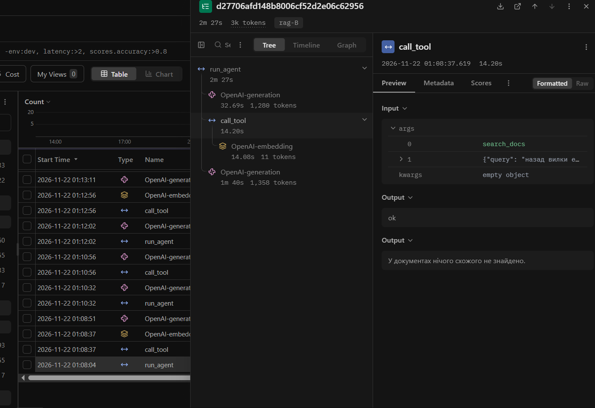
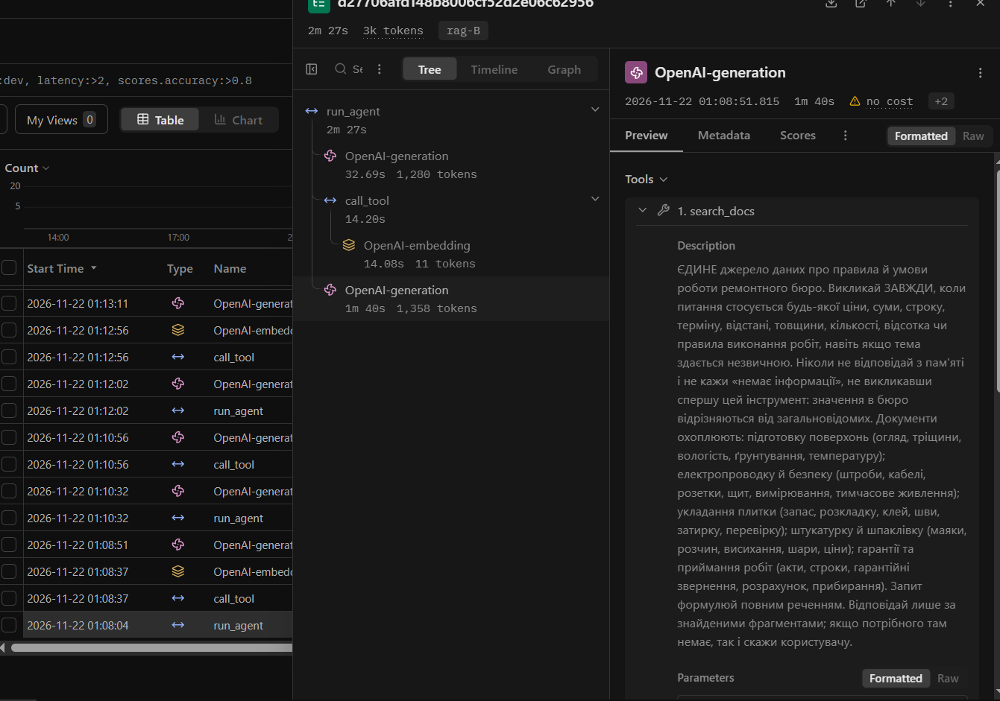
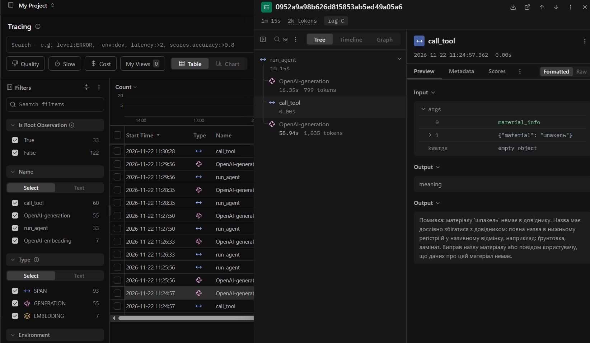
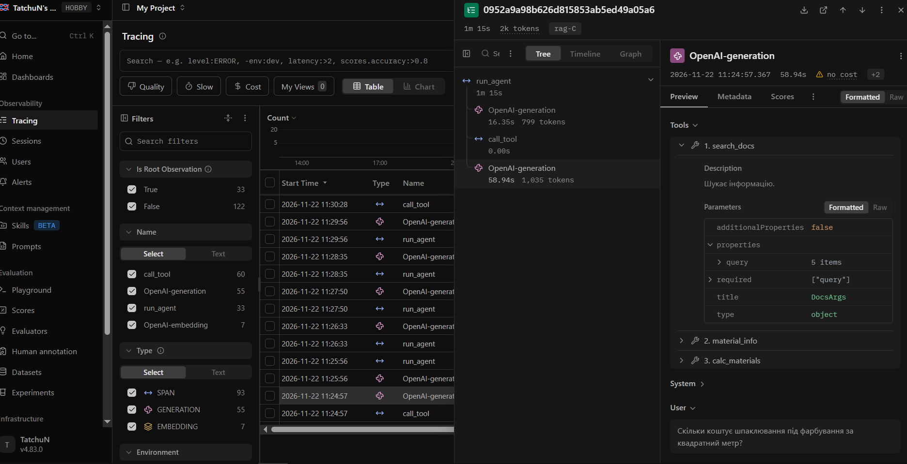

<div align="center">

МІНІСТЕРСТВО ОСВІТИ І НАУКИ УКРАЇНИ

НАЦІОНАЛЬНИЙ УНІВЕРСИТЕТ «ОДЕСЬКА ПОЛІТЕХНІКА»

ІНСТИТУТ КОМП'ЮТЕРНИХ СИСТЕМ

КАФЕДРА ІНФОРМАЦІЙНИХ СИСТЕМ

&nbsp;

&nbsp;

**Протокол лабораторної роботи № 5**

**«RAG-агент: пошук по документах як інструмент»**

з дисципліни: «Обчислювальні методи»

&nbsp;

&nbsp;

</div>

<div align="right">

**Виконав:**

студент групи АІ-245

Татчук Нікіта Максимович

&nbsp;

**Перевірив:**

ас. Баранов О. М.

</div>

&nbsp;

<div align="center">

Одеса – 2026

</div>

---

## 1. Мета роботи, варіант, модель і вікно

**Мета:** замінити пошук підрядком з лабораторної роботи № 2 векторним, під'єднати його до агента як інструмент, перевірити якість пошуку окремо від агента і виміряти, як розмір чанка та опис інструмента впливають на поведінку агента.

| | |
|---|---|
| **Варіант** | 6 |
| **Предметна область** | Ремонт квартири |
| **Модель чату** | `llama32-4k` (qwen2.5:3b, Ollama, локально) |
| **Розмір вікна** | 4096 токенів |
| **Модель ембедингів** | `bge-m3` (Ollama), довжина вектора 1024 |
| **Інструменти агента (`ALLOWED`)** | `search_docs`, `material_info`, `calc_materials` |
| **Скорочення, стан, кеш** | вимкнено (`COMPRESS = "none"`, `USE_STATE = False`, `USE_CACHE = False`) |

Каталог `lab5` створено копією `lab4` без `venv/`, `cache/`, `state/`, `results/`, `logs/`; лог `lab4/logs/lab4.log` скопійовано як `logs/run_lab4.log`. Установлено `numpy` і `faiss-cpu`, у `.gitignore` додано `index/embeddings_cache.json` і `chroma_db/`.

---

## 2. Дані

### Документи

Вигадана організація — ремонтне бюро «Квадрат і Кельма». П'ять документів у `data/docs/`:

| Файл | Назва | Символів |
|---|---|---:|
| `d01.txt` | Підготовка поверхонь | 3021 |
| `d02.txt` | Електропроводка й безпека | 3050 |
| `d03.txt` | Укладання плитки | 3006 |
| `d04.txt` | Штукатурка й шпаклівка | 3183 |
| `d05.txt` | Гарантії та приймання робіт | 3031 |

Кожен документ має 8–9 абзаців по 4 речення і не менше 6 вигаданих числових значень, записаних цифрами. Разом зі старим корпусом (`data/corpus/`, 12 анотацій) індексується 17 документів.

Вивід `python check_cases.py`:

```
Документів: 17; символів: 17805; приблизно токенів: 7122 (вікно 4096)
Питань: 10 ({'direct': 4, 'paraphrase': 4, 'none': 2})
Усе гаразд
```

Документи разом займають приблизно 7122 токени — більше за вікно 4096, тому без пошуку їх не передати моделі.

### Питання (`rag_cases.json`)

| id | Вид | Питання | `must_contain` | `expected` |
|---|---|---|---|---|
| D1 | direct | Скільки хвилин витримують між шарами ґрунтовки? | між шарами витримують 140 хвилин | 140 |
| D2 | direct | На якій висоті підвішують кабелі тимчасового живлення? | на висоті не менше 190 см | 190 |
| D3 | direct | Скільки коштує шпаклювання під фарбування за квадратний метр? | становить 236 грн за квадратний метр | 236 |
| D4 | direct | Який гарантійний строк на оздоблювальні роботи в бюро? | становить 27 місяців | 27 |
| P1 | paraphrase | Скільки годин треба почекати, перш ніж ступати на свіже кахляне покриття? | через 31 годину після укладання | 31 |
| P2 | paraphrase | Наскільки далеко від купелі дозволено ставити гніздо для вилки електроприладів у санвузлі? | щонайменше 64 см | 64 |
| P3 | paraphrase | Скільки часу майстер має, щоб витратити замішану масу для вирівнювання стін, поки вона не зіпсувалася? | використовують протягом 35 хвилин | 35 |
| P4 | paraphrase | Яку долю від загальної суми договору клієнт може притримати, доки не мине певний час після завершення ремонту? | в розмірі 9 відсотків | 9 |
| N1 | none | Скільки коштує демонтаж старої плитки за квадратний метр? | `null` | `null` |
| N2 | none | Скільки коштує оренда риштувань на тиждень? | `null` | `null` |

Для питань без відповіді перевірено, що їх ключових слів («демонтаж», «оренда», «риштування», «тиждень») у текстах немає. Ключових слів перефразованих питань («купелі», «гніздо», «долю», «притримати», «кахляне») у текстах теж немає.

### Чи вгадує модель без документів

Питання поставлено моделі напряму (`ollama run llama32-4k`):

| Питання | Відповідь моделі | Правильно |
|---|---|---|
| D2. На якій висоті підвішують кабелі тимчасового живлення? | «…зазвичай підвішують на висоті не менше 2,5 метра.» | ні (190 см) |
| D4. Який гарантійний строк на оздоблювальні роботи в бюро? | «…зазвичай становить 12 місяців.» | ні (27) |
| P2. Наскільки далеко від купелі дозволено ставити гніздо для вилки…? | «…не ближче 60 см від ванни чи душу.» | ні (64) |

Модель відповідає загальновідомими значеннями, і жодне не збіглося з документами, тож вгадати відповіді не можна.

---

## 3. Модель ембедингів

Вивід `python embed_check.py`:

```
Час: 28.0 с (з кешем буде майже 0)
Довжина вектора: 1024
Довжина (норма) першого вектора: 1.000  (1.000 - вектори вже нормалізовані)
Запит - 'Тариф на доставку'      : 0.732
Запит - 'Графік роботи кур'єрів' : 0.568
```

Довжина вектора 1024, норма 1.000. Запит про вартість відправлення ближчий до фрази про тариф (0,732), ніж до фрази про графік кур'єрів (0,568), як і має бути. Навіть зовсім не пов'язана фраза має схожість 0,568, тому поріг схожості не можна брати «на око» — його треба підбирати на власних питаннях (розділ 5). Перший запуск тривав 28 с, бо Ollama завантажувала модель ембедингів.

Перший індекс (`paragraphs`, 800) — вивід `python build_index.py`:

```
Чанків: 34; середня довжина 523 символів; найкоротший 173, найдовший 791
Модель: bge-m3; довжина вектора: 1024
```

---

## 4. Нарізання одного документа

`show_chunks.py` на `data/docs/d01.txt`:

Таблиця 1 — Нарізання одного документа

| Спосіб | Чанків | Закінчуються посеред речення | Довжина найбільшого, символів |
|---|---:|---:|---:|
| `fixed`, 200, перекриття 0 | 16 | 15 | 200 |
| `fixed`, 500, перекриття 100 | 8 | 7 | 500 |
| `paragraphs`, 800 | 4 | 0 | 762 |

**Розрізаний факт** (`fixed`, 200, чанки 5 і 6):

```
--- чанк 5, 200 символів  [закінчується посеред речення]
ним швом на глибину 6 мм, знепилюють і заповнюють ремонтною сумішшю. Волосяні тріщини лише проклеюють серпянкою. Місця, де штукатурка звучить глухо під киянкою, обрізають до міцного шару із запасом 9 
--- чанк 6, 200 символів  [закінчується посеред речення]
см від краю відшарування. Іржаві плями від арматури спершу обробляють перетворювачем іржі, а вже потім закладають сумішшю.
```

Число 9 опинилося в чанку 5, а одиниця «см» і те, до чого воно належить («від краю відшарування»), — у чанку 6.

---

## 5. Пошук без агента

### Нарізання і hit rate

Вивід `python check_retrieval.py`:

Таблиця 2 — Пошук при різному нарізанні

| Конфігурація | Чанків | Сер. довжина | hit@1 | hit@3 | hit@5 | hit@3 прямі | hit@3 перефр. | Токенів (k=3) |
|---|---:|---:|---:|---:|---:|---:|---:|---:|
| `fixed-200-0` | 100 | 178 | 0.75 | 0.75 | 0.88 | 1.00 | 0.50 | 214 |
| `fixed-500-0` | 47 | 379 | 0.50 | 0.62 | 0.75 | 1.00 | 0.25 | 455 |
| `fixed-500-100` | 52 | 410 | 0.75 | 1.00 | 1.00 | 1.00 | 1.00 | 492 |
| `fixed-1500-0` | 27 | 659 | 0.75 | 0.75 | 0.88 | 0.75 | 0.75 | 791 |
| `paragraphs-800` | 34 | 523 | 0.88 | 1.00 | 1.00 | 1.00 | 1.00 | 627 |
| `paragraphs-800+title` | 34 | 534 | 1.00 | 1.00 | 1.00 | 1.00 | 1.00 | 641 |

**Вибір:** найвищий `hit@3` (1.00) мають три конфігурації: `fixed-500-100`, `paragraphs-800` і `paragraphs-800+title`. За правилом методички за рівності вибрано ту, що має менший розмір результату, — **`fixed-500-100`** (492 токени проти 627 і 641). У `config.py`: `CHUNK_METHOD = "fixed"`, `CHUNK_SIZE = 500`, `CHUNK_OVERLAP = 100`, `WITH_TITLE = False`.

У вибраній конфігурації `hit@3` повний, тож пропущених питань немає. Неповний лише `hit@1` (0.75): для P2 і P4 потрібний чанк стоїть не першим (табл. 3). На P2 першою повернулася анотація `w11.txt` «Встановлення ванни» (0.582), а чанк d02 із фразою «щонайменше 64 см» — другим (0.579): питання перефразоване, і зі словом «купель» модель зближує все, що стосується ванни. На P4 першим (0.591) повернувся чанк d05, який починається з «…ро дозволяє утримати до закінчення 60 днів»: межа `fixed`-нарізання пройшла посеред речення, і саме значення «в розмірі 9 відсотків» лишилося в попередньому чанку, що став лише третім (0.569).

### Поріг схожості

Вивід `python check_retrieval.py scores` (параметри `fixed`, 500, 100, без заголовка):

Таблиця 3 — Схожість першого результату

| id | Вид | Схожість | Перший результат містить потрібну фразу |
|---|---|---:|---|
| D1 | direct | 0.649 | так |
| D2 | direct | 0.713 | так |
| D3 | direct | 0.701 | так |
| D4 | direct | 0.697 | так |
| P1 | paraphrase | 0.566 | так |
| P2 | paraphrase | 0.582 | ні |
| P3 | paraphrase | 0.615 | так |
| P4 | paraphrase | 0.591 | ні |
| N1 | none | 0.561 | - |
| N2 | none | 0.493 | - |

Найнижча схожість серед питань з відповіддю — 0.566 (P1), найвища серед питань без відповіді — 0.561 (N1). Межі не перекриваються, тому вибрано **`MIN_SCORE = 0.563`** — посередині. Запас з обох боків лише 0,003: питання N1 про ціну демонтажу плитки семантично дуже близьке до документів з цінами за квадратний метр. Остаточний індекс (`python build_index.py`): 52 чанки, середня довжина 410 символів, найкоротший 173, найдовший 500.

---

## 6. Інструмент без моделі

`python try_tool.py D1`:

```
ПИТАННЯ: Скільки хвилин витримують між шарами ґрунтовки? 

рівень: ok
[1] Джерело: d01.txt
ожна лише тоді, коли жодна точка не показує більше 7 відсотків вологості. Монолітні бетонні стіни новобудов зазвичай досягають цього рівня через 26 діб після зняття опалубки, тому поспішати з оздобленням не варто. Результати вимірювання записують у той самий листок огляду.

Ґрунтовку обирають за типом основи: глибокого проникнення для пухкої штукатурки, адгезійну з кварцовим піском для гладкого бетону. Її наносять валиком у два шари, а між шарами витримують 140 хвилин. Витрату ґрунтовки глибоког

[2] Джерело: d01.txt
тону. Її наносять валиком у два шари, а між шарами витримують 140 хвилин. Витрату ґрунтовки глибокого проникнення бюро нормує як 115 мілілітрів на квадратний метр за один шар. Ґрунтовку не розбавляють водою, якщо цього прямо не вимагає інструкція виробника.

Перед нанесенням будь-якої суміші температура повітря в приміщенні має бути не нижчою за 11 градусів. Температура самої стіни не повинна відрізнятися від температури повітря більше ніж на 3 градуси. Протяги під час підготовки заборонено, а п

[3] Джерело: w10.txt
Гідроізоляція санвузла
Сантехніка.
Основу ґрунтують і покривають гідроізоляційною мастикою у два шари з заведенням на стіни.
Санвузол 4 м² займає два дні з урахуванням висихання.
Матеріали: гідроізоляційна мастика, ґрунтовка.

Занадто короткий запит -> рівень: schema
Помилка: аргументи не пройшли перевірку.
Поле query: String should have at least 3 characters
Виправ аргументи і виклич інструмент ще раз.
```

`python try_tool.py N1`:

```
ПИТАННЯ: Скільки коштує демонтаж старої плитки за квадратний метр? 

рівень: ok
У документах нічого схожого не знайдено.

Занадто короткий запит -> рівень: schema
Помилка: аргументи не пройшли перевірку.
Поле query: String should have at least 3 characters
Виправ аргументи і виклич інструмент ще раз.
```

Для D1 повернулися фрагменти з іменами файлів; через перекриття 100 символів фраза «між шарами витримують 140 хвилин» є в двох сусідніх чанках. Для N1 поріг відкинув усі результати. Запит «а» зупинено на рівні `schema`. `check_meaning` для `search_docs` повертає `None`, тому `checks.py` не змінювався.

Перевірка всього ланцюжка (`python ask.py D1`): агент викликав `search_docs({"query":"хвилин витримують між шарами ґрунтовки"})` і відповів «Її наносять валиком у два шари, а між шарами витримують 140 хвилин».

---

## 7. Агент із трьома описами інструмента

Опис **A** — дослівно старий опис `search_works`; **C** — «Шукає інформацію.». Опис **B** (варіант 6):

> ЄДИНЕ джерело даних про правила й умови роботи ремонтного бюро. Викликай ЗАВЖДИ, коли питання стосується будь-якої ціни, суми, строку, терміну, відстані, товщини, кількості, відсотка чи правила виконання робіт, навіть якщо тема здається незвичною. Ніколи не відповідай з пам'яті і не кажи «немає інформації», не викликавши спершу цей інструмент: значення в бюро відрізняються від загальновідомих. Документи охоплюють: підготовку поверхонь (огляд, тріщини, вологість, ґрунтування, температуру); електропроводку й безпеку (штроби, кабелі, розетки, щит, вимірювання, тимчасове живлення); укладання плитки (запас, розкладку, клей, шви, затирку, перевірку); штукатурку й шпаклівку (маяки, розчин, висихання, шари, ціни); гарантії та приймання робіт (акти, строки, гарантійні звернення, розрахунок, прибирання). Запит формулюй повним реченням. Відповідай лише за знайденими фрагментами; якщо потрібного там немає, так і скажи користувачу.

Пробний прогін `python measure_rag.py B 1` пройшов без помилок, після нього виконано повне вимірювання `python measure_rag.py` (90 запусків). Пізніше серії `B-r1` і `C-r1` повторено (`python measure_rag.py B 1`, `python measure_rag.py C 1`) для трас у Langfuse. Вони замінили відповідні рядки `results/rag.csv` і логи `rag_B-r1.log`, `rag_C-r1.log`, тож таблиці нижче побудовано за підсумковим файлом (`python rag_report.py`):

```
Підсумок за описами (по всіх повторах)
опис   правильно    шукав  кроків  токенів входу  час, с
A        8/24     14/24       2.0           1793    40.8
B       11/24     21/24       2.0           2680    79.7
C        4/24      4/24       1.0            807    37.2
```

**Ручна перевірка.** Переглянуто всі відповіді з `correct = 0` і всі відповіді на питання `none`. Помилково оцінено 4 рядки — B-r1-N1, B-r1-N2, C-r1-N1, C-r1-N2: автоматично вони отримали `invented`, бо не містять жодного слова-маркера зі списку `UNKNOWN`. Але жодного значення модель не вигадала:
- у N2 вона прямо написала, що даних немає: «даних про ціну оренди риштувань на тиждень немає в нашому довіднику», «в документах не було знайдено ціни»;
- у N1 попросила уточнити назву або відповіла, що порахувати це інструментами не можна.

Цим рядкам виставлено `correct = 1`, `category = refused`. Решта автоматичних оцінок збіглася з ручною: кожна відповідь з `correct = 1` на питання з відповіддю містить фразу `must_contain`.

Таблиця 5 — Агент з трьома описами інструмента (дані за всіма повторами; питань з відповіддю 8, у трьох повторах 24 прогони)

| Опис | Правильно (з 24) | Викликав пошук (з 24) | Кроків, медіана | Токенів входу, медіана | Час, с, медіана |
|---|---:|---:|---:|---:|---:|
| `A` | 8 | 14 | 2 | 1793 | 40,8 |
| `B` | 11 | 21 | 2 | 2680 | 79,7 |
| `C` | 4 | 4 | 1 | 807 | 37,2 |

Таблиця 6 — Куди ламається відповідь (кількість прогонів; питань з відповіддю 24 на опис, без відповіді 6)

| Категорія | `A` | `B` | `C` |
|---|---:|---:|---:|
| Правильно | 8 | 11 | 4 |
| Не шукав і відповів неправильно | 10 | 3 | 20 |
| Шукав, але потрібного фрагмента в результаті немає | 3 | 4 | 0 |
| Фрагмент був у результаті, відповідь неправильна | 3 | 6 | 0 |
| Питання без відповіді: визнав, що не знає | 5 | 6 | 5 |
| Питання без відповіді: вигадав відповідь | 1 | 0 | 1 |

---

## 8. Розбір у логах і трасах

**1. Агент не шукав** (`no_search`). Найчастіше модель хапалася не за той інструмент. У `logs/rag_B-r1.log` на питання про ціну шпаклювання вона двічі викликала калькулятор з вигаданими значеннями і зупинилася на ліміті помилок:

```
##### B-r1-D3
ЗАДАЧА: Скільки коштує шпаклювання під фарбування за квадратний метр?
--- крок 1 | помилок поспіль=0 | prompt_tokens=1229 | completion_tokens=41
  виклик   : calc_materials({"area":1,"coverage_m2":1.2,"price":150})
  рівень   : meaning
--- крок 2 | помилок поспіль=1 | prompt_tokens=1382 | completion_tokens=30
  виклик   : material_info({"material":"шпаклювальний матеріал"})
  рівень   : meaning
--- крок 3 | помилок поспіль=2 | prompt_tokens=1570 | completion_tokens=34
  виклик   : calc_materials({"area":1,"coverage_m2":1.2,"price":150})
  рівень   : meaning
СТОП: модель не змогла сформувати правильний виклик
```

З описом C модель узагалі не пов'язувала `search_docs` з питаннями (`logs/rag_C-r1.log`):

```
##### C-r1-D2
ЗАДАЧА: На якій висоті підвішують кабелі тимчасового живлення?
--- крок 1 | помилок поспіль=0 | prompt_tokens=771 | completion_tokens=72
ВІДПОВІДЬ: Дано питання не відповідає ни одному з доступних мені інструментів. Мені не потрібно використовувати ці інструменти для отримання відповіді на ваше питання.
```

У серії C-r1 пошук викликано лише раз із десяти (N2). В інших прогонах без пошуку модель відповідала «загальновідомим» значенням: у C-r3-D4 — «зазвичай становить 12 місяців» замість 27.

**2. Який запит написала модель.** Модель рідко копіювала питання повністю: здебільшого вона скорочувала його або переписувала своїми словами, іноді втрачаючи зміст (`logs/rag_B-r1.log`):

| Прогін | Питання | Запит у `search_docs` | `top_score` | Результат |
|---|---|---|---:|---|
| B-r1-D1 | Скільки хвилин витримують між шарами ґрунтовки? | «шар грунтовки» | 0.479 | нічого не знайдено |
| B-r1-D2 | На якій висоті підвішують кабелі тимчасового живлення? | «висота підвішання кабелів тимчасового живлення» | 0.673 | знайдено (190 см) |
| B-r1-D4 | Який гарантійний строк на оздоблювальні роботи в бюро? | «гарантійні звернення оздоблювальні роботи» | 0.597 | знайдено (27 місяців) |
| B-r1-P1 | Скільки годин треба почекати, перш ніж ступати на свіже кахляне покриття? | «температура» | 0.511 | нічого не знайдено |
| B-r1-P2 | Наскільки далеко від купелі дозволено ставити гніздо…? | «назад вилки електропроводки санвузел» | 0.515 | нічого не знайдено |
| B-r1-P4 | Яку долю від загальної суми договору клієнт може притримати…? | майже повна копія питання | 0.614 | знайдено |

Запити, що зберегли зміст питання, знаходили потрібний фрагмент. Надто короткий («шар грунтовки», 0.479) або спотворений запит («температура», 0.511; «назад вилки…», 0.515) отримував схожість нижче порогу 0.563, і інструмент повертав «нічого схожого не знайдено». Запити, що знайшли потрібне, мали 0.597–0.673. Те саме видно на P4 у серіях A: скорочений запит «яку долю загальної суми договору клієнт» мав схожість 0.560 проти 0.591 у повного питання (табл. 3).

**3. Шукав, але не знайшов** (`miss`, `logs/rag_B-r1.log`):

```
##### B-r1-P1
--- крок 1 | prompt_tokens=1231 | completion_tokens=23
  виклик   : search_docs({"query":"температура"})
  результат: У документах нічого схожого не знайдено.
--- крок 2 | prompt_tokens=1285 | completion_tokens=49
ВІДПОВІДЬ: Не можу знайти даних про цю ситуацію у нашій базі даних. Спробуйте ввести інші ключові слова або питання.
```

Усі 7 прогонів `miss` у табл. 6 — це випадки, коли поріг відкинув усі результати, бо запит моделі вийшов коротким або не про те. Для повних питань потрібний чанк є серед трьох найближчих (табл. 2, `hit@3` = 1.00). Тобто причина не в нарізанні, а у вигляді запиту разом із порогом.

**4. Знайшов, але не використав** (`ignored`, `logs/rag_B-r1.log`):

```
##### B-r1-P4
  виклик   : search_docs({"query":"доля від загальної суми договору клієнт може притримати, доки не мине певний час після завершення ремонту"})
  результат: [1] Джерело: d05.txt …
[2] Джерело: d05.txt
… Остаточний розрахунок замовник здійснює після підписання фінального акта. Частину вартості в розмірі 9 відсотків бюро дозволяє утримати до закінчення 60 днів після здачі об'єкта як забезпечення гарантійних зобов'яза
ВІДПОВІДЬ: Доля від загальної суми договору, яку клієнт може притримати, доки не мине певний час після завершення ремонту, становить 60 днів. Це забезпечення гарантійних зобов'язань.
```

Фраза «в розмірі 9 відсотків» є у фрагменті [2], але модель узяла інше число з того самого речення — «60 днів», яке відповідає на «певний час», а не на «яку долю». В інших прогонах `ignored` модель брала сусіднє речення того самого чанка. У B-r2-P3 замість «використовують протягом 35 хвилин» вона назвала «38 квадратних метрів стін», у B-r2-D3 — строк висихання цементної штукатурки замість ціни шпаклювання, у B-r3-D4 — «9 відсотків» замість гарантійного строку.

**5. Питання без відповіді.** З 18 прогонів на N1 і N2 агент 16 разів не вигадав значення і 2 рази вигадав (A-r1-N2: «близько 1000 грн на тиждень»; C-r3-N1: «близько 120 грн за квадратний метр»). Обидва вигадування — у прогонах **без пошуку**. Коли агент шукав (12 прогонів), поріг 11 разів повернув «нічого схожого не знайдено», і модель відповіла, що даних немає. Один раз (B-r2-N1) запит «коштує демонтаж старої плитки квадратний метр» отримав схожість 0.566 ≥ 0.563 і повернув фрагменти про плитку та ціни шпаклювання. Модель усе одно не взяла з них число, а відповіла, що даних немає, — як вимагає опис B. У B-r1-N1 модель замість пошуку викликала `material_info({"material":"демонтаж плитки"})` і попросила уточнити назву.

### Траси



Рисунок 1 — Траса `rag-B-r1-P2` (мітка `rag-B`): вхід і вихід вузла `call_tool` для `search_docs`



Рисунок 2 — Траса `rag-B-r1-P2`: опис `search_docs` (B) у вході виклику моделі



Рисунок 3 — Траса `rag-C-r1-D3` (мітка `rag-C`): вузол `call_tool`



Рисунок 4 — Траса `rag-C-r1-D3`: опис `search_docs` (C) у вході виклику моделі

- **Вузол `call_tool` для `search_docs`.** У трасі `rag-B-r1-P2` (рис. 1) вхід — `search_docs` з запитом «назад вилки е…», вихід — рівень `ok` і «У документах нічого схожого не знайдено.». Усередині `call_tool` видно вкладений вузол `OpenAI-embedding` (14,08 с, 11 токенів): це ембединг запиту моделлю `bge-m3`. Він зайняв майже весь час виклику інструмента, бо Ollama перемикалася між моделлю чату й моделлю ембедингів.
- **Опис C.** У серії C-r1 модель викликала `search_docs` лише в N2, тому для D3 (рис. 3) у вузлі `call_tool` видно інший виклик: `material_info({"material": "шпакель"})` з виходом `meaning` і текстом помилки. Модель прочитала питання про ціну як питання про матеріал.
- **Опис `search_docs` у вході першого виклику.** У B (рис. 2) — повний текст з темами документів і вимогою «Викликай ЗАВЖДИ…». У C (рис. 4) — лише «Шукає інформацію.», а поруч — схема аргументів `DocsArgs` і питання користувача. Через довгий опис вхід першого кроку в B приблизно на 450 токенів більший (1220–1250 проти 766–797 у C).
- **Що в трасі видно одразу, а в лозі довелося б шукати.** Опис інструмента, який фактично бачила модель, — у лозі його немає взагалі. Окремий вузол ембедингу з його часом. Тривалість кожного кроку: у лозі її доводиться рахувати з різниці позначок часу. І вкладеність викликів: який виклик інструмента належить до якого кроку моделі.

---

## 9. Звичайні задачі після зміни пошуку

`DOCS_DESCRIPTION = "B"`, `python agent_runner.py`, лог перейменовано на `logs/run_rag.log`. Порівняння з `logs/run_lab4.log` (прогін `agent_runner.py` лабораторної № 4):

Таблиця 7 — П'ять задач до і після заміни пошуку

| Задача | Відповідь у лабораторній № 4 | Відповідь тепер | Чи викликав `search_docs` | Що змінилося |
|---|---|---|---|---|
| Z1 | `search_works("шпалера")` нічого не знайшов; «не маємо даних про ремонтну роботу з поклейки шпалери» | Склад робіт і матеріали з w01: «Матеріали: шпалери, клей для шпалер, ґрунтовка» | так | Краще: векторний пошук знайшов роботу за повним питанням, хоча форма «шпалер» не збігається з «шпалера» |
| Z2 | `material_info("шпалера")` → `meaning`; прохання перевірити назву | Те саме, плюс зайвий виклик `search_docs` (нічого не знайдено) | так | Без змін за результатом, на 1 крок більше |
| Z3 | `search_works("шпалера")` нічого не знайшов; «довідник не містить матеріалів для шпалер» | «потрібно 4 рулони шпалер, вартість 1800 грн» | так | Краще: після пошуку модель викликала `material_info("шпалери")` і `calc_materials` |
| P1 | «не знайшли роботи про встановлення теплої підлоги» | «у документах бюро немає інформації про встановлення теплої підлоги» | так | Без змін: поріг відкинув результати, відповідь чесна |
| P2 | `search_works("мастер")`; прохання уточнити запит | «викликати майстра я не можу: такої дії немає серед доступних інструментів» | так | Краще: агент відмовив, як очікується |

Жодна задача не стала гіршою. Z2 лишилася неправильною з тієї ж причини, що й у лабораторній № 4 (форма «шпалера» в `material_info`), а виклик `search_docs` додав крок і близько 65 токенів входу.

---

## 10. Відповіді на питання

**1. Табл. 1: на скільки відрізнялося нарізання за кількістю символів від нарізання за абзацами? Наведіть приклад чанка, у якому факт розрізано.**
На d01 `fixed` дав 16 і 8 чанків, з яких посеред речення закінчуються 15 і 7; `paragraphs-800` — 4 чанки, жоден не обриває речення. У `fixed-200` число «9» залишилося в чанку 5, а «см від краю відшарування» — у чанку 6 (розділ 4). Агент, отримавши лише один із цих чанків, бачить або число без змісту, або зміст без числа і може відповісти неправильним значенням чи вирішити, що даних немає.

**2. Табл. 2: яка конфігурація найкраща за `hit@3` і чому? Як змінилися результати при збільшенні чанка, перекритті, назві документа? Яка ціна більшого чанка?**
`hit@3` = 1.00 мають `fixed-500-100`, `paragraphs-800` і `paragraphs-800+title`; вибрано `fixed-500-100` як найкоротшу за результатом (492 токени). Від 200 до 1500 символів `hit@3` не росте монотонно (0.75 → 0.62 → 0.75): малі чанки розрізають факти, великі розмивають ембединг і знижують схожість. Перекриття 100 символів підняло `fixed-500` з 0.62 до 1.00, бо факти на межі чанків опинилися цілими хоча б в одному з них. Назва документа підняла `hit@1` з 0.88 до 1.00 при тому самому `hit@3`. Ціна більшого чанка — розмір результату: від 214 до 791 токена на один виклик пошуку.

**3. Чи відрізняється `hit@3` для прямих і перефразованих питань? Що це говорить про пошук за змістом?**
Для прямих `hit@3` = 1.00 у 5 конфігураціях з 6, для перефразованих — від 0.25 до 1.00 залежно від нарізання (табл. 2). Перефразовані питання мають нижчу схожість (0.566–0.615 проти 0.649–0.713, табл. 3), але у вибраній конфігурації знаходяться всі. Пошук підрядком на них нічого б не дав: ключових слів «купелі», «гніздо», «долю», «притримати» в текстах немає (перевірено в розділі 2).

**4. Табл. 3: чи розділяє поріг питання з відповіддю й без? Що буде, якщо поріг надто високий? Надто низький?**
На повних питаннях розділяє, але із запасом лише 0,005 (0.561 у N1 проти 0.566 у P1); вибрано 0.563. Агент передає в пошук не питання, а свій запит, і короткі чи спотворені запити («шар грунтовки» — 0.479, «температура» — 0.511, скорочений P4 — 0.560) опинялися нижче порогу. Це всі 7 прогонів `miss` у табл. 6. Ще вищий поріг (наприклад, 0.6) відкинув би навіть повні P1, P2 і P4, і агент казав би «нічого не знайдено» на питання з відповіддю. Надто низький (0.0) повертав би на N1 і N2 фрагменти з іншими цінами, і модель могла б узяти з них число.

**5. Табл. 5 і 6: який опис дав найбільше правильних? Як часто агент не звертався до пошуку? Що в тексті B змінило поведінку?**
Найбільше правильних — B (11 з 24) проти 8 в A і 4 у C. Без пошуку агент відповідав у 3 з 24 прогонів з B, 10 з 24 з A і 20 з 24 з C. З C модель прямо писала, що питання «не відповідає жодному з доступних інструментів», або намагалася рахувати через `material_info` і `calc_materials`. Поведінку змінили пряма вимога «Викликай ЗАВЖДИ… Ніколи не відповідай з пам'яті», перелік тем документів і пояснення, що значення в бюро відрізняються від загальновідомих.

**6. Табл. 6: яка категорія помилок найчастіша в найкращому описі? Чи можна її виправити зміною опису?**
У B найчастіша — «фрагмент був, відповідь неправильна» (6 з 13 помилок), далі `miss` (4). Опис першу не виправить: модель уже отримала потрібний текст, але взяла інше число з того самого речення чи чанка (розділ 8, п. 4). Тут потрібні коротший і точніший результат, підказка відповідати саме на поставлене питання або сильніша модель. `miss` опис теж лікує погано: вимогу «Запит формулюй повним реченням» модель порушувала (розділ 8, п. 2). Тож краще допомогти кодом — наприклад, повторити пошук повним питанням користувача. Розрізняти причини важливо, бо кожна лікується в іншому місці системи.

**7. Питання без відповіді: у скількох прогонах агент вигадав відповідь? Які два захисти є і який спрацював?**
Агент вигадав відповідь у 2 з 18 прогонів (по одному в A і C), обидва рази без звернення до пошуку. Захисти — поріг `MIN_SCORE` у `search_docs` і текст опису B («якщо потрібного там немає, так і скажи»). Поріг спрацював в 11 з 12 пошуків на N1/N2 (наприклад, «оренда риштувань на тиждень» — 0.462). У B-r2-N1 він пропустив фрагменти (0.566), і тоді спрацював опис: агент відповів, що даних немає. Ще 4 відповіді на N1/N2 автоматично визнано вигаданими помилково: модель не назвала жодного значення, і це виправлено вручну (розділ 7).

**8. Скільки токенів додає один виклик `search_docs`? Скільки викликів вміщується у вікно 4096?**
За різницею `prompt_tokens` між кроками 1 і 2 у логах `rag_*.log` виклик з трьома чанками додає в медіані 688 токенів (582–884). З одним чанком — 275, «нічого не знайдено» — 69. Оцінка з табл. 2 для `fixed-500-100` — 492 токени: реальний результат більший на рядки «[n] Джерело: …», службові токени шаблону і довгий запит моделі, який теж потрапляє в історію. За формулою $n = (W - C) / d$ з вікном $W = 4096$, входом першого кроку $C \approx 1169$ (опис B, медіана) і $d = 688$:

$$n = \frac{4096 - 1169}{688} \approx 4{,}3,$$

тобто 4 повні виклики пошуку. З описом A або C ($C \approx 800$–$860$) — теж 4 ($\approx 4{,}7$).

**9. Табл. 7: чи зламав новий пошук якісь із п'яти звичайних задач?**
Ні: три задачі покращилися (Z1, Z3, P2), дві лишилися без змін (Z2, P1). Векторний пошук знаходить роботи за змістом, а не за точним збігом форми слова «шпалера», а для неіснуючих робіт (тепла підлога) поріг дає «нічого не знайдено». Ціна заміни — додатковий виклик пошуку в Z2 і довший опис інструмента (вхід першого кроку зріс приблизно з 880 до 1150 токенів).

**10. Яку поламку не вилікує жодна зміна опису? Що б ви змінили?**
«Фрагмент був, відповідь неправильна»: модель отримує правильний текст, але бере з нього не те число. Також опис не виправить `miss` через поріг і скорочений запит. Я б зменшив результат (чанки за реченнями або абзацами з назвою документа, `TOP_K = 2`), підібрав поріг із більшим запасом або перевіряв не лише перший результат, а для `miss` — повторював пошук повним питанням користувача, якщо скорочений запит нічого не дав.

---

## 11. Додаткове завдання: той самий індекс на Chroma

Створено `chroma_index.py`; у `chroma_test.py` на тих самих чанках і векторах побудовано три індекси і порівняно перший результат для D1:

```
FAISS, схожість           : 0.6489
Chroma cosine, відстань   : 0.3511
Chroma за замовчуванням   : 0.7022
Чанки: ('d01.txt', 4) ('d01.txt', 4) ('d01.txt', 4)
```

1. **Як пов'язані числа.** Косинусна відстань Chroma дорівнює $1 - s$: $1 - 0{,}6489 = 0{,}3511$. За замовчуванням Chroma використовує квадрат евклідової відстані, який для нормалізованих векторів дорівнює $2 - 2s$: $2 - 2 \cdot 0{,}6489 = 0{,}7022$.
2. **Чанки збігаються:** усі три індекси повернули чанк 4 з `d01.txt`. Обидві відстані монотонно спадають зі зростанням схожості, тому порядок результатів однаковий.
3. **Перенесений поріг.** Якби `MIN_SCORE = 0.563` застосувати до відстані зі стандартними налаштуваннями як «результат ≥ 0.563», логіка перевернулася б. Відстань 0.7022 для правильного D1 пройшла б, а найближчі результати з відстанню менше 0.563 (схожість понад 0.72) відкидалися б. Пошук відсіював би саме найкращі збіги, і жодної помилки при цьому не було б.

---

## 12. Висновок

Найбільше на якість відповідей вплинув **опис інструмента**: з описом B агент шукав у 21 з 24 прогонів і відповів правильно 11 разів, з A — 14 і 8, з C — 4 і 4 (табл. 5). З описом C модель не пов'язувала інструмент «Шукає інформацію.» з питаннями і намагалася відповідати через `material_info` та `calc_materials`. **Нарізання** визначило, чи потрапляє факт у результат: перекриття 100 символів підняло `hit@3` для `fixed-500` з 0.62 до 1.00. **Поріг** відфільтрував питання без відповіді, але із запасом лише 0,005. Через це він відкидав і короткі чи спотворені запити моделі — усі 7 `miss`.

**Пошук і агент.** На пошук (`miss`) припадає 7 з 49 помилок на питаннях з відповіддю, решта — на агента: 33 рази він не шукав і 9 разів не використав знайдене (табл. 6). Вигадані відповіді на питання без відповіді з'являлися лише тоді, коли агент не звертався до пошуку.

Що ще варто змінити:
- шукати повним питанням користувача або повторювати пошук ним, якщо запит моделі нічого не знайшов;
- коротший і точніший результат пошуку, щоб модель не брала інше число з того самого речення;
- поріг із більшим запасом, наприклад з назвами документів у чанках (`paragraphs-800+title` дав `hit@1` = 1.00).
