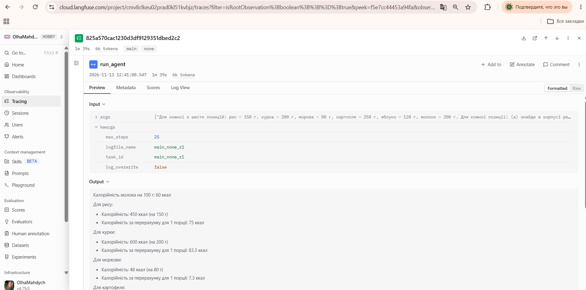
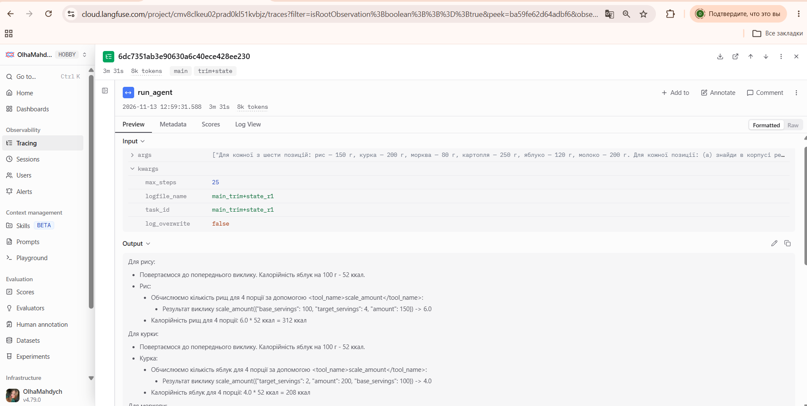
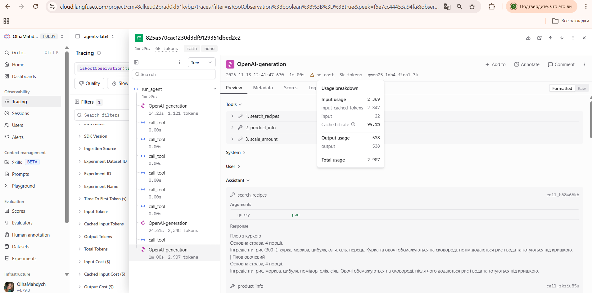
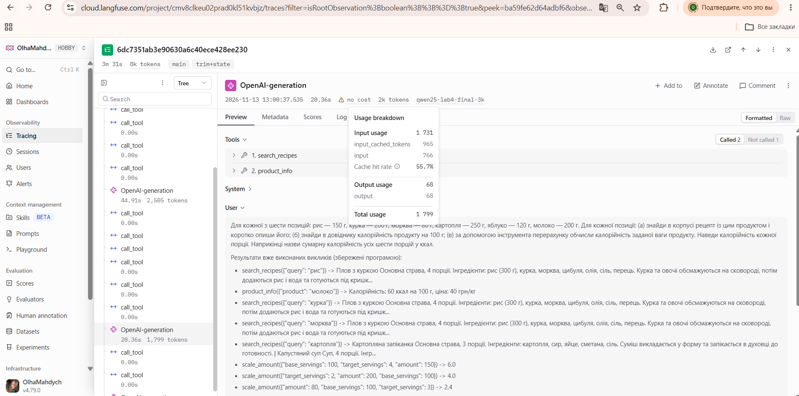

# Національний університет «Одеська політехніка»
## Інститут комп’ютерних систем
## Лабораторна робота № 4
### з дисципліни «Обчислювальні методи»
### «Контекст, стан і кеш агента»

Виконала: Магдич Ольга Валентинівна, група ЕАІ-244.  
Перевірив: ас. Баранов О. М.  
Одеса — 2026.

## 1. Мета роботи

Побачити, що відбувається з агентом, коли історія не вміщується в контекстне вікно моделі; навчитися скорочувати історію, зберігати результати інструментів поза текстом діалогу та кешувати виклики моделі; виміряти, скільки це коштує.

## 2. Варіант і умови експерименту

Варіант № 2 — «Кулінарія». Використано інструменти `search_recipes`, `product_info`, `scale_amount`. Основна серія `main` виконана 13.11.2026. Усі дев’ять спроб мають однакові контрольні суми вихідного коду і задачі, однакові налаштування та вимкнений файловий кеш відповідей.

| Параметр | Значення |
|---|---|
| Базова модель | qwen2.5:3b |
| Модель експерименту | qwen25-lab4-final-3k |
| Вікно базової моделі | 32768 токенів |
| Вікно експерименту | 3072 токени |
| Зменшення | 32768 / 3072 ≈ 10,67 раза |
| Температура; repeat_penalty | 0; 1,1 |
| COMPRESS_AT; KEEP_LAST | 2150; 6 |
| STATE_RESULT_CHARS | 200 символів результату (+ «...» при обрізанні) |
| Ліміти | 25 кроків; HTTP 240 с; прогін 900 с |
| Середовище | Windows, Python 3.12.2, Ollama 0.40.15, CPU |
| Кеш | lab4-final-qwen25-3k-v1 |

Зменшення до 3072 відповідає вказівці методички для випадку C після попередньої перевірки з більшим вікном. `repeat_penalty=1.1` — додатковий параметр стабілізації генерації, зафіксований однаково в усіх порівнюваних спробах. Експерименти з Qwen3 та уточненим послідовним запитом не включено до основної таблиці.

## 3. Довга задача та контрольна відповідь

Для кожної з шести позицій: рис — 150 г, курка — 200 г, морква — 80 г, картопля — 250 г, яблуко — 120 г, молоко — 200 г. Для кожної позиції: (а) знайди в корпусі рецепт із цим продуктом і коротко опиши його; (б) знайди в довіднику калорійність продукту на 100 г; (в) за допомогою інструмента перерахунку обчисли калорійність заданої ваги продукту. Наведи калорійність кожної порції. Наприкінці назви сумарну калорійність усіх шести порцій у ккал.

Мінімальна кількість викликів інструментів: 6 × 3 = 18. Кількість кроків моделі може бути іншою, якщо один крок містить кілька викликів інструментів.

| Продукт | Вага, г | Ккал на 100 г із довідника | Ккал у порції |
|---|---:|---:|---:|
| Рис | 150 | 344 | 516 |
| Курка | 200 | 190 | 380 |
| Морква | 80 | 35 | 28 |
| Картопля | 250 | 77 | 192,5 |
| Яблуко | 120 | 52 | 62,4 |
| Молоко | 200 | 60 | 120 |
| **Разом** | — | — | **1298,9** |

Розрахунок: калорійність на 100 г × вага / 100. Контрольну відповідь обчислює `make_task.py` через інструменти, без мовної моделі. Це дані навчального довідника. Результат **1298,9 ккал** підтверджений запуском користувачки та повторною перевіркою коду. Після першого прогону `expected` не змінюється.

## 4. Прогін без захисту

Джерело: [original_probe_none_r1.log](logs/original_probe_none_r1.log). Це пробний прогін з початковим запитом; він відокремлений від трьох повторів `main`.

Таблиця 2 — Зростання входу.

| Крок | prompt_tokens | Приріст | Виклики / дія |
|---|---|---|---|
| 1 | 971 |  | search_recipes({"query":"рис"}); product_info({"product":"молоко"}); search_recipes({"query":"курка"}); search_recipes({"query":"морква"}); search_recipes({"query":"картопля"}) |
| 2 | 2266 | 1295 | scale_amount({"target_servings":4,"amount":150,"base_servings":100}); scale_amount({"amount":200,"base_servings":100,"target_servings":2}); scale_amount({"base_servings":100,"target_servings":3,"amount":80}); scale_amount({"amount":250,"base_servings":100,"target_servings":4}); scale_amount({"amount":120,"base_servings":100,"target_servings":3}); scale_amount({"amount":200,"base_servings":100,"target_servings":4}) |
| 3 | 2562 | 296 | Фінальна відповідь |

(а) Початковий вхід C = **971** токен. (б) Типовий приріст d = **795,5** токена — медіана двох приростів 1295 і 296. (в) Фактична сума — **5799**; оцінка `n*C + d*n*(n-1)/2` при n=3 становить **5299,5**. Різниця 499,5 токена (9,43% від оцінки) пояснюється нерівномірними розмірами результатів і пакетами викликів.

(г) Зупинки зростання не виявлено: максимум **2562 / 3072 = 83,4%**. (д) Трьох наступних кроків після досягнення межі немає: агент завершився на кроці 3 з відповіддю 250,4 ккал і лише 11 викликами замість мінімальних 18. Це **випадок C за таблицею методички**, а не доказ мовчазного обрізання контексту; при вже зменшеному вікні передчасне завершення залишилося.

## 5. Обрізання історії та збереження стану

Обрізання зберігає системне повідомлення й завдання, залишає останні повідомлення та прибирає результати інструментів без відповідного виклику. Тому фактична довжина після обрізання може бути меншою за 2 + 6. Стан записує результати рівня `ok`, але такий рівень засвідчує виконання функції, а не правильний зміст її аргументів.

Таблиця 3 — Усі події стиснення основної серії. Повтори — загалом за прогін, а не кількість повторів у момент стиснення.

| Прогін | Після кроку | Вхід | Повідомлень | Повтори за прогін |
|---|---|---|---|---|
| main_trim_r1 | 2 | 2313 | 11 → 4 | 5 |
| main_trim_r2 | 2 | 2278 | 12 → 4 | 2 |
| main_trim+state_r1 | 2 | 2266 | 15 → 2 | 0 |
| main_trim+state_r2 | 2 | 2195 | 15 → 2 | 8 |
| main_trim+state_r2 | 6 | 2571 | 14 → 8 | 8 |
| main_trim+state_r2 | 7 | 3050 | 11 → 8 | 8 |
| main_trim+state_r2 | 8 | 2890 | 11 → 8 | 8 |

У `main_trim+state_r1` перший блок містить **11 записів**, **1621 символів**, тобто приблизно **648.4 токенів** за евристикою «символи / 2,5». Це не фактичний tokenizer usage; оцінка порівнюється з типовим приростом пробного прогону 795,5. Повний відтворений блок: [first_state_block.txt](evidence/first_state_block.txt).

У `main_trim_r1` після обрізання на кроці 2 знову виконано `search_recipes({"query":"рис"})` на кроці 3, а `search_recipes({"query":"курка"})` — на кроці 4; загалом повторів 5. У `trim+state_r1` повторів немає, проте в `trim+state_r2` їх 8: стан не гарантує ні відсутності повторів, ні правильної відповіді. Помилкові результати на зразок `scale_amount(amount=150, base_servings=100, target_servings=4) → 6` зберігаються і нагадуються так само, як правильні.

## 6. Кеш відповідей

Таблиця 4 — Окремий експеримент з файловим кешем.

| Прогін | Кроків | Влучань | Успішних запитів моделі | Час, с | Правильно |
|---|---|---|---|---|---|
| cache1_none_r1 | 3 | 0 | 3 | 43.573 | Ні |
| cache2_none_r1 | 3 | 3 | 0 | 2.626 | Ні |

Прискорення: **43.573 / 2.626 ≈ 16.59 раза**. У теплому прогоні повторно використано всі три відповіді моделі, включно з неправильною фінальною відповіддю 1569 ккал. Інструменти при цьому виконуються; показники usage у кешованих відповідях скопійовані з початкової генерації і не є новими витратами моделі.

Порожній файловий кеш не означає холодний кеш префікса в Ollama. `input_cached_tokens` у Langfuse описує повторне використання вхідних токенів сервером — це інший механізм, ніж позначка «з кешу» у нашому журналі.

## 7. Три повтори кожної конфігурації

Таблиця 5 — Медіани основної серії без файлового кешу. Правильність перевірена за виконанням усього завдання, не лише за статусом `final`.

| Режим | Правильно | Відповідей / 3 | Кроків з usage | Вхід | Вихід | Час, с | Стиснень | Повторів |
|---|---|---|---|---|---|---|---|---|
| none | 0/3 | 3 | 3 | 5653 | 603 | 93.953 | 0 | 0 |
| trim | 0/3 | 1 | 3 | н/д* | н/д* | 294.143 | 1 | 2 |
| trim+state | 0/3 | 3 | 4 | 6936 | 1426 | 213.543 | 1 | 0 |

\* У `trim_r1` і `trim_r2` стався `Request timed out` на спробах кроків 6 і 4 відповідно. Usage цих незавершених запитів невідомий, тому повна медіана токенів за три прогони не визначена; медіана часу включає всі спроби. Медіана кроків означає лише кроки з отриманим usage; медіана кількості спроб звернення для `trim` — 4.

Таблиця 5а — Усі дев’ять спроб, без вилучення невдалих.

| Прогін | Статус | Кроків з usage | Інструментів | Відомий вхід | Відомий вихід | Час, с |
|---|---|---|---|---|---|---|
| main_none_r1 | final | 3 | 7 | 5653 | 723 | 102.169 |
| main_none_r2 | final | 3 | 8 | 5582 | 603 | 93.953 |
| main_none_r3 | final | 3 | 11 | 5798 | 514 | 80.605 |
| main_trim_r1 | server_error | 5 | 15 | 7301 | 348 | 308.648 |
| main_trim_r2 | server_error | 3 | 11 | 4275 | 275 | 294.143 |
| main_trim_r3 | final | 2 | 3 | 2303 | 369 | 39.432 |
| main_trim+state_r1 | final | 4 | 13 | 6936 | 1548 | 213.543 |
| main_trim+state_r2 | final | 9 | 23 | 18579 | 1426 | 269.839 |
| main_trim+state_r3 | final | 2 | 3 | 2303 | 369 | 42.005 |

Для єдиного завершеного `trim_r3` отримано 2303 вхідних токени і 39,432 с; це один результат, а не медіана трьох завершених прогонів. Стандартний `collect_results.py` відбирає завершені прогони, тому його експорт не використано як повну таблицю основної серії. Доданий `export_review.py` перевіряє вихідні хеші, журнали й формує таблицю всіх дев’яти спроб; початковий вимірювальний код збережений без змін.

Усі 9 спроб мають менше 19 отриманих відповідей моделі. Саме по собі це не означає пропуск інструментів: модель може викликати декілька за один крок. У `none` виконано 7, 8 і 11 викликів — менше мінімальних 18; у `trim+state_r2` є 23 виклики, але повтори і фінальна відповідь без розрахунків також не дають зарахувати виконання.

Виявлені поламки: вигадані калорійності та порції (`none_r1`), помилкова сума 524,4 (`none_r2`), 1086 (`none_r3`), застосування калорійності яблука до інших продуктів (`trim+state_r1`), відсутність порцій і підсумку (`trim+state_r2`), рання відповідь 318,3 (`trim_r3`, `trim+state_r3`). Стиснення не є перевіркою арифметики.

П’ять коротких перевірок ЛР3 збережено в [run_lab3.log](logs/run_lab3.log). Ручна оцінка: 3/5 — пошук рецепта курки, масштабування 300 г з 4 до 10 порцій (750 г), повідомлення про відсутній тунець; помилки — вигадана калорійність рису та відсутність чіткого повідомлення, що інструмента додавання рецепта немає.

### Докази Langfuse

Рисунок 1 — `main_none_r1`: коренева подія, початок відповіді з помилковими числами; дерево на цьому кадрі згорнуте. ID траси: `825a570cac1230d3df9129351dbed2c2`.

Рисунок 2 — `main_trim+state_r1`: коренева подія та помилкове використання даних яблука. ID траси: `6dc7351ab3e90630a6c40ece428ee230`.

Рисунок 3 — Дерево `none_r1`, крок 3: вхід 2369, вихід 538, разом 2907; кешованих сервером вхідних токенів 2347.

Рисунок 4 — Частина дерева `trim+state_r1` і крок 3 після стиснення: вхід 1731, вихід 68, разом 1799; кешованих сервером вхідних токенів 965. У User видно нагадування збережених результатів.

На однаковому номері кроку різниця входу становить 638 токенів, або 26,9% від 2369. Проте попередні виклики у двох прогонах відрізняються, тому це спостереження, а не чиста оцінка причинного ефекту обрізання. Langfuse зручний для дерева та перегляду аргументів, текстовий лог — для точного місця стиснення і підрахунків; час кореневої траси може відрізнятися від часу запуску процесу в JSON.

## 8. Відповіді на питання

1. **Коли досягнуто межі вікна?** У пробному `none` межі не досягнуто: максимум 2562 токени (таблиця 2), а зростання не зупинилося. Агент завершив відповідь раніше, тому зміни поведінки після переповнення за цим прогоном встановити не можна.
2. **Чи збігається сума з формулою?** Отримано 5799 проти оцінки 5299,5 токена (розділ 4). Формула припускає сталий приріст, тоді як довжини рецептів і кількість викликів різні.
3. **Що втрачається і що дає стан?** Обрізання прибирає попередні результати й може провокувати повторні звернення: у `trim_r1` їх 5 (таблиця 3). Стан повертає ці результати в запит, але також повертає змістовно неправильні обчислення; у `trim+state_r2` залишилися 8 повторів.
4. **Який режим кращий?** Серед режимів із трьома завершеними відповідями `none` має менші медіани входу і часу, ніж `trim+state`: 5653 проти 6936 токенів та 93,953 проти 213,543 с (таблиця 5). Усі режими мають 0/3 правильних виконань; неповні токени `trim` та лише одна задача не дозволяють узагальнювати рейтинг.
5. **Навіщо вимикати кеш?** Інакше вимірювався б час читання з файлу, а не нова генерація. Змінений результат інструмента змінює наступну історію й ключ; після заміни моделі під тим самим ім’ям потрібно змінити `CACHE_NAMESPACE` або очистити файловий кеш.
6. **Що не лікує стиснення?** Воно не усуває неправильного вибору аргументів, вигаданих чисел, передчасного завершення й арифметичних помилок (розділ 7). Воно також не гарантує відповіді сервера за HTTP-ліміт, як показали два тайм-аути `trim`.

## 9. Додаткове завдання

Режим `summary` не виконувався. Обов’язкова серія містить три режими по три спроби, тобто дев’ять спроб; невдалі спроби не підмінено успішними.

## 10. Висновок

Найбільший підтверджений ефект для швидкості дав файловий кеш: близько 16,59 раза в окремій парі запусків, але він відтворив і неправильну відповідь. Обрізання зменшувало історію, а стан дозволяв повернути результати, проте жодний режим не забезпечив повного правильного виконання цієї задачі.

Для подальшої роботи доцільно додати перевірку охоплення всіх шести продуктів, звірку аргументів із довідником і програмне підсумовування порцій. Це пропозиції, а не зміни в коді виміряної серії. Обмеження роботи: не спостережено достовірного переповнення в `none`; два тайм-аути не дають повної медіани токенів `trim` за три завершені прогони.

## Джерела й відтворюваність

Методичка: [SOURCE_METHOD.md](SOURCE_METHOD.md); власні журнали, JSON-результати, дані та знімки Langfuse в цьому комплекті. Контрольна сума джерел записана в кожному JSON; `manual_review.json` відокремлює ручну оцінку від незмінних первинних результатів. Допомогу ChatGPT використано для підготовки коду, перевірки журналів та оформлення звіту; виміряні результати й невдалі спроби не замінювалися згенерованими даними.
